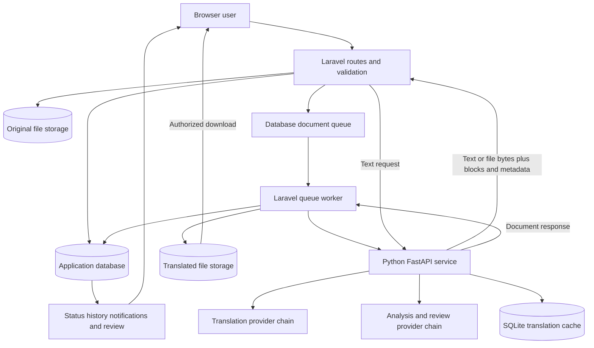
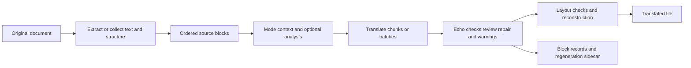
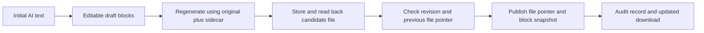
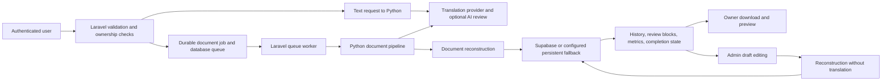

# Current state

Status as of 2026-10-27: implementation and historical engineering evidence exist; production readiness is not established by this cleanup. Live environments, databases, external providers and deployed application behavior were not exercised.

## Implemented and evidenced in the records

- Text/document translation, provider selection/fallback, translation history, admin review, quotas, cleanup outbox and authenticated engine requests are represented in the source and implementation records.
- Native PDF reconstruction preserves placement and handles fonts, links, fitting and output-validation holds. Hybrid image-text reconstruction has bounded-resource and signed-plan safeguards.
- OCR preview is opt-in, visibly unverified and separate from strict acceptance. Old serialized queued jobs default to strict; preview and strict requests have distinct deduplication identities. Preview cannot be marked production-verified.
- OCR review preparation, resume/advance and a connected advisory coordinator are implemented. The coordinator can organize separate draft proposals; it cannot grant human approval, sign acceptance, invent acquisition rights or establish independent OCR accuracy.

The 2026-10-27 preview record reports a two-page Lion/Mouse run with 7 translated regions, 2 held illustration placements and 1 passthrough. Both image-dialogue panels were reconstructed; glyph erasure, searchable output and unchanged pixels outside masks were checked in that historical run. Its semantic quality still needs review. Renderer algorithm version 3 requires retranslation of older algorithm 1/2 signed plans; existing downloaded PDFs remain readable.

## Partial, held and open work

Strict OCR acceptance remains on hold pending genuine acquisition/rights metadata, complete independent references and representative unseen held-out material. The tuned Lion/Mouse sample is calibration material and cannot become held-out evidence. The 95% word-accuracy gate remains unchanged; OCR confidence alone is not measured word accuracy.

Translation meaning remains a separate blocker. The 2026-10-26 report recorded wording that appeared to reverse the meaning of “A kindness is never wasted.” Experimental prompt changes were reverted. HTTP success, cache hits and layout preservation do not establish semantic correctness.

Approximate font matching, textured backgrounds, curved/outlined text, shared images, mobile/accessibility coverage, full format/direction acceptance and Linux visual/licensing review remain bounded or unverified in the records. Historical PostgreSQL concurrency, storage, migration and release holds must be resolved against the actual deployment before claiming readiness.

## Environment and deployment status

No real environment file or secret/cache contents were opened for this cleanup. Actual provider/model settings, database contents, queue state and production release status remain unknown here. Historical Laravel/Python cloud reports are retained with their dates; they are not current deployment checks.

Cleanup snapshot: `pre-cleanup-2026-10-27`. The local backup branch and tag refer to that snapshot. Remote publication was withheld because there is no matching origin branch reference establishing publication of the tracked environment blob. A verified local bundle and full local-directory backup exist; both must remain private. The full backup excludes only the named regenerable directories and is verified by file count and logical size.

The pre-existing oversized tracked `trilingua-code/translated_input.pdf` remains tracked and locally modified, intentionally excluded from the snapshot. A clean working tree cannot truthfully be reported while preserving that amended exclusion. The tracked `.env.testing` also remains tracked without content inspection; remote exposure is unverified. Rotate any keys that may have been exposed, after identifying affected services privately.

## Recommended but not applied

- Review tracked real environment files and historical credential exposure; do not assume ignore rules remove tracked secrets or history.
- Decide how to handle the oversized tracked generated PDF after reviewing the private full backup. No untracking or deletion was performed.
- Reorganize executable code or remove duplicate implementations only in a separately approved behavior-tested change. Framework paths, autoload roots, queue launchers and dependency versions remain untouched.
- Keep source/config-referenced documentation, test fixtures, operational review packets and licenses in their required locations. Avoid breaking generators merely to reduce the count of Markdown files.
- Review historical appendices before compressing them further. Their full text is retained deliberately to avoid dropping decisions, findings or rejected approaches.

## Iteration History

The chronology below preserves dated commit subjects and bodies from the snapshot branch. Commit messages describe the recorded change and rationale; they are not independently verified deployment facts. Document-specific versions and decisions remain in the full source passages.

````text
2026-05-04 | 63d297be | Initial commit

2026-05-07 | 124a2452 | 1st iteration
Sign up, Login, and general settings added

2026-05-10 | d8931c66 | Translation, History

2026-05-12 | ebf86694 | semi-Finished
Have a dire problem in Model translation

2026-05-14 | 92823484 | Improve UI: responsive layout, redesigned auth pages, translation page, dashboard, user feedback toasts, password strength, error pages, sticky header with user dropdown

2026-05-29 | 63230830 | docs: Add comprehensive README and capstone project documentation
This commit updates the project documentation to clearly identify TriLingua
as a capstone project and provides complete setup instructions.

Major Changes:
- Enhanced README.md with capstone project badge and description
- Added comprehensive installation and usage instructions
- Included technology stack details and project structure
- Added badges for Laravel, Python, and license

New Features Added:
- Password reset functionality (forgot password flow)
- Local database fallback for translation history
- Python model download script
- Dashboard error handling improvements

New Documentation:
- GITHUB_DESCRIPTION.md - Repository setup guide
- PASSWORD_RESET_GUIDE.md - Password reset documentation
- DASHBOARD_FIX.md - Dashboard troubleshooting guide

Technical Improvements:
- Added ForgotPasswordController and ResetPasswordController
- Created ResetPasswordNotification for email templates
- Added TranslationHistory model for local database
- Updated HistoryService with local DB fallback
- Enhanced .gitignore for Python files
- Updated login CSS with alert styles

Files Modified:
- README.md - Complete rewrite with capstone focus
- routes/web.php - Added password reset routes
- app/Models/User.php - Added password reset notification
- app/Services/HistoryService.php - Added local DB fallback
- Model/server.py - Removed offline mode enforcement
- resources/views/auth/login.blade.php - Updated forgot password link
- resources/css/views/auth/login.css - Added alert styles

New Files:
- GITHUB_DESCRIPTION.md
- PASSWORD_RESET_GUIDE.md
- DASHBOARD_FIX.md
- app/Http/Controllers/Auth/ForgotPasswordController.php
- app/Http/Controllers/Auth/ResetPasswordController.php
- app/Notifications/ResetPasswordNotification.php
- app/Models/TranslationHistory.php
- resources/views/auth/forgot-password.blade.php
- resources/views/auth/reset-password.blade.php
- Model/download_model.py

This update makes the repository more professional and clearly identifies
it as a capstone project for academic purposes.

2026-05-29 | de6291a1 | docs: Add GitHub setup completion guide and checklist

2026-05-29 | c54d7793 | Update README.md

2026-06-07 | fdd67d4c | feat: animated auth UI, real-time dashboard, fix registration, Supabase table setup

2026-06-07 | 3cda107b | merge: resolve conflicts, keep local changes

2026-06-07 | 63e9f8f9 | fix: compact mobile brand strip, form fills screen naturally

2026-06-13 | 6ba4b307 | Fully Working system
Can look back on the document level translation improvements if just basic level document translation it does perfectly but when images and layout are involved it struggles drastically

2026-07-09 | 7399f385 | Work

2026-07-14 | 5172f9fa | With ollama And Requirments

2026-07-14 | d1490c59 | Safest choice right now

2026-07-15 | 65db8645 | 07/15/26

2026-07-26 | 8de98fd1 | Kinda good

2026-07-28 | 6b8b185c | 07/28/26

2026-07-29 | 0daa0a86 | 07/29/26

2026-08-02 | c52074df | Stage 2/3 WIP baseline: PDF per-line extract, per-line redact-reinsert reconstructor, font-cache fix, continuation rescue, 2-char relaxation, overflow tests
- extractor: per-line records (bbox/baseline/font/size/color/bold/italic/links), font-name normalization, link collection, block-mode dedupe via intersection
- reconstructor: per-line redact+reinsert with font cache keyed (parent id, xref), span-collision check, free-row continuation, link re-creation/reconciliation, I1-I4 invariants
- pipeline: pass layout plan, preserve alignment key
- translation_pipeline: 2-char letter relaxation (Oh/Hi/No)
- tests: overflow continuation rescue/occupied tests, regression suite 213 passed/2 skipped
- fixtures: 4 test PDFs

2026-08-02 | 31803b37 | Stage 4: run-level formatting Bug 5 fix (word-boundary-respecting), Bug 3 Mistral context_hint, run-aware fit, mid-word regression test

2026-08-03 | bc45244c | new

2026-08-04 | 8c0e5ea6 | addition of admin

2026-08-06 | 17e4cda8 | Show review status on non-admin side (history cards, detail modal, dashboard)

2026-08-06 | 8e9e0864 | Admin two-pane document review: translated file preview (Final) + live editable draft (Draft)

2026-08-08 | b4d36a2f | Improve translation UI, add language exclusivity, transparent logo

2026-08-08 | f15156d3 | Dark-theme-aware login/register pages with input and button focus polish

2026-08-10 | 18f59107 | For testing and additional feature to add

2026-08-10 | f9d6fa3c | Merge branch 'walben' of https://github.com/walbengwapo-png/Trilingua into walben

2026-08-26 | 9362a8d3 | fix: download button not appearing after translation completes
- TranslationController::status(): when history row exists but cache is
  expired/missing/stale, recover from the DB row and generate a fresh
  signed URL instead of returning {status:'processing'} forever
- translation.blade.php: stop polling on non-OK HTTP responses instead
  of silently swallowing 4xx/5xx errors
- HistoryService::insertRecord(): add missing 'review_status' to the
  create array so the column is persisted on insert

2026-08-26 | 9f1225ab | feat: remove Shared and Archived tabs from My Documents
These tabs were non-functional (both hardcoded to 0 with no backend
support) and only confused users. Remove them to keep the toolbar clean.

2026-08-26 | 566bc250 | feat: add Date and File Type filters to My Documents
- Date filter: All Time, Today, This Week, This Month, This Year
- File Type filter: PDF, Word, Text, Markdown, Rich Text, OpenDoc,
  CSV, PowerPoint, Excel
- Both filters work client-side alongside the existing Language and
  Search filters
- Each card now carries data-date and data-file-type attributes for
  client-side filtering

2026-08-26 | 32c4ed0e | refactor: clean up Saved Translations page
- Remove dead detail modal HTML (~90 lines) and its JS functions
  (loadDetail, renderDetail, openDetailModal, closeDetailModal,
  formatFileSize, formatDate) — the View Details button navigates to
  the dedicated /history/{id}/view page instead of opening a modal
- Add quality score badge to history cards (was only on bookmarks page)
- Load admin.css via Vite for quality score dot styles

2026-08-26 | a70d3f5d | feat: enhance user dashboard with richer stats and Bookmarks link
- TranslationStatsService now returns totalTexts, topLangPair alongside
  existing totals
- Dashboard shows 4 stat cards: Documents (with text count subtitle),
  This Month, Words Translated, Top Language Pair
- Quick actions grid now includes Bookmarks alongside New Translation,
  Upload Document, and View History
- Added amber icon variant and responsive grid for 4-column layout

2026-08-26 | c179dbca | feat: restructure admin dashboard with system health and user activity
- Added systemHealth() method: checks DB connectivity, storage availability,
  queue pending count, and failed job count with fallback on error
- Added userActivity() method: top 10 active users in last 30 days with
  translation/doc/text counts and last active timestamp
- System health section with 4 indicator cards (Database, Storage,
  Queue Pending, Queue Failed) using green/red status dots
- User activity table with User, Email, Translations, Documents, Text,
  Last Active, and View link columns
- New CSS for health grid, status dots, compact cards, error value

2026-09-07 | 9fc0f0ec | feat(py): resilient providers, coherence polish, env config, cache namespace, benchmarks
- Add fallback analysis provider with cooldown + atomic primary/fallback swap
- Add opt-in coherence polish phase for Cebuano/Filipino
- Introduce Model/config/environment.py and cache namespace isolation
- Refresh cached golden fixtures and add translation quality benchmarks
- Extend regression/unit coverage incl. analysis resilience and cache namespace

2026-09-07 | b3873b07 | feat(auth/admin): Google OAuth, profile, users directory, metrics + audit UI
- Google OAuth login/linking with session fingerprint capture
- Public profile page and user settings (account/password/theme)
- Admin users directory with per-user activity and translation history
- Translation metrics model/service and CSV export support
- Session fingerprint middleware hardening and associated tests

2026-09-07 | 89c8502d | refactor(jobs): document job uuid + in-flight dedup groundwork
- Job exposes stable uuid() shared with the controller cache key
- Controller records the job id (not a boolean) in the in-flight marker
- Dedup hit returns the canonical in-flight job id to the poller
- Ownership-scoped status endpoint tests and dedup determinism tests

2026-09-07 | ea9ff09a | chore(config): supabase config, queue/db tuning, admin seed, demo tooling
- Add config/supabase.php and register service keys
- Adjust queue retry_after and database PgBouncer-safe settings
- Add sessions/Google/metrics/document_word_count migrations
- Seed admin user migration and DatabaseSeeder updates
- Demo launcher + named-tunnel deploy/undeploy scripts and DEMO guide

2026-09-07 | 2fc03774 | chore(security): test-env guard, evidence/containment/rotation runbooks, hygiene ignores
- Standalone pre-boot test guard (assert-safe-test-env.php) wired into composer test
- Post-boot isolation assertion in tests/TestCase.php
- Evidence, containment, and rotation runbooks + secrets inventory under security/
- Commit the remediation plan doc (chatgpt/) as working context
- Ignore generated caches, review render dumps, SQLite caches, demo runtime state

2026-09-07 | de733e15 | feat(jobs): durable translation_jobs state machine + backend-aware storage
- translation_jobs table with active-job-only partial unique index on
  (user_id, payload_hash); controller dispatches durable rows and the
  job performs a DB-backed status state machine instead of cache-only
- payload-hash dedup (byte-identical content) reuses completed results
  and dedups in-flight jobs; content sniffing rejects spoofed extensions
- StorageService::uploadWithFallback with retries; local durable fallback
  backend; backend-propagating original/output paths through history,
  controllers, and the retranslate/review flows
- TranslateDocumentJob rewrite: tries/backoff/timeout, backfillOriginal
  storage, terminal fail() -> failed_jobs + release() for retryable
  errors; notifications preserved
- translations:reconcile command + admin jobs panel + scheduler entries
- python service forwarded via X-Service-Token; daily upload quota
- repaired job-flow tests for the new architecture (255 passing, no regressions)

2026-09-07 | 12da7733 | fix(jobs): harden python/http service, purge CVEs, add CI, repair stale tests
- Repaired 4 stale render/UI tests + ValidateSession (11/11 green) and left the
  remaining 3 job-flow tests passing; full suite now 280 passed / 1 skipped.
- bootstrap/app.php: trustProxies '*' -> specific Cloudflare prefix list.
- config/session.php: SESSION_SECURE_COOKIE defaults true in production.
- Model/server.py: X-Service-Token enforced (constant-time) on all mutation
  endpoints; file-watch reload auto-disabled outside local/dev/test.
- composer: guzzlehttp pinned 7.8.2 -> ^7.9 (audit now clean).
- npm: auto-fix + swap xlsx to maintained SheetJS build (audit clean, 0 vulns).
- Added Model/requirements.txt and .github/workflows/ci.yml (Laravel+front+py).

2026-09-07 | aab29117 | feat(translation): unify client capability contract

2026-09-07 | 4162dc59 | fix(storage): preserve queued job source files

2026-09-07 | d19854b0 | fix(queue): schedule stale translation reconciliation

2026-09-07 | cbbfc901 | fix(auth): restrict auth routes and reconcile stale jobs

2026-10-19 | 2ce3638a | Harden document and application HTML insertion boundaries

2026-10-19 | 55bf3e4e | Observe strict same-origin script policy without enforcing it

2026-10-19 | 8ed64a53 | Preserve workbook formulas, request recalculation and warn about unsupported content

2026-10-19 | a0b836fb | Exclude raw document evidence and OCR samples from source paths

2026-10-20 | 590a1f0a | Inherited baseline snapshot (unreviewed; no correctness claim)

2026-10-22 | ed50c6b1 | Inherited baseline extension (unreviewed; no correctness claim)

2026-10-25 | 4599e6fd | test: record isolated hybrid PDF baseline (P0)

2026-10-25 | ac364620 | feat: inventory PDF regions and preserve explicit held output (P1)

2026-10-25 | 3c2ce0bd | feat: validate heldout OCR corpus contracts and separate metrics (P2)

2026-10-25 | ef4479a4 | feat: clean flat image glyphs and draw searchable fitted targets (P3)

2026-10-26 | 7e953bff | feat: persist strict hybrid render plans and bound PDF regeneration (P4)

2026-10-26 | 1fc3bf63 | fix: keep held PDF regions and native placement identities consistent

2026-10-26 | d8a135d0 | fix: guard incomplete documents through every verification action

2026-10-26 | 3205baa8 | fix: enforce actual PDF limits and release timed-out worker resources

2026-10-26 | ec06a41d | fix: publish rebuilt PDFs only after saved-output validation

2026-10-26 | fb4dd61c | fix: retain incomplete content labels across history and download states

2026-10-26 | c7efbbae | test: cover renderer hold safeguards and mutation-sensitive invariants

2026-10-26 | c52d0178 | perf: reuse font-estimation image statistics and remove dead imports

2026-10-26 | eb8dff74 | docs: finish hybrid PDF review verdicts and preservation evidence

2026-10-26 | a5dbc752 | feat: authenticate evaluator reports and recompute held-out acceptance

2026-10-26 | d0ce01be | feat: sign frozen render plans and bind reconstruction metadata

2026-10-26 | 72e99537 | feat: bound decoded pixels and own worker scratch through hard timeouts

2026-10-26 | 36cc8372 | feat: add offline diagnostic OCR intake and independent-reference tooling

2026-10-26 | 14e228f6 | test: exercise held service output and isolated signed synthetic replacement

2026-10-26 | a410a7a5 | fix: preserve signed plans through PHP JSON and finish hybrid OCR tooling

2026-10-26 | 6e1f131b | docs: record final hybrid OCR engineering verification and owner handoff

2026-10-26 | 9d8d3af2 | Fix OCR baseline geometry and bounded region retries

2026-10-26 | 6af226dd | Document OCR correction evidence and release holds

2026-10-26 | 5ae47dfd | Add resumable OCR acceptance review workflow

2026-10-26 | 5deec829 | Add connected advisory AI for OCR acceptance preparation

2026-10-27 | cc05d7fa | Enable unverified hybrid OCR preview in document uploads

2026-10-27 | 6cfcd1eb | chore: pre-cleanup snapshot (gitignore hardening + WIP)


````

### Document iterations and dated reports

| Date reported in source/path | Version or report | Preserved record |
|---|---|---|
| 2026-09-06 | Mistral analysis failure investigation | [output/reviews/hybrid-pdf-implementation/baseline/source/trilingua-code/docs/mistral-analysis-investigation.md](CURRENT_STATE.md#source-48216e12284a0a7a) |
| 2026-09-06 | Mistral analysis failure investigation | [trilingua-code/docs/mistral-analysis-investigation.md](CURRENT_STATE.md#source-3ce389b32ab3ab69) |
| 2026-09-07 | Trilingua Investigation and Remediation Plan | [chatgpt/trilingua-investigation-and-remediation-plan.md](CURRENT_STATE.md#source-8dee3855947c1eed) |
| 2026-09-07 | Trilingua — Secret Inventory (raw findings, 2026-09-07) | [output/reviews/hybrid-pdf-implementation/baseline/source/trilingua-code/security/SECRETS_INVENTORY.md](SYSTEM_WALKTHROUGH.md#source-286a556ffa6bb147) |
| 2026-09-07 | 0A — Evidence Preservation Runbook | [output/reviews/hybrid-pdf-implementation/baseline/source/trilingua-code/security/evidence-runbook.md](TESTING_FINDINGS.md#source-1279e4574ff04f70) |
| 2026-09-07 | Trilingua — Secret Inventory (raw findings, 2026-09-07) | [trilingua-code/security/SECRETS_INVENTORY.md](SYSTEM_WALKTHROUGH.md#source-645889f43436f469) |
| 2026-09-07 | 0A — Evidence Preservation Runbook | [trilingua-code/security/evidence-runbook.md](TESTING_FINDINGS.md#source-c127f38407def380) |
| 2026-09-13 | TriLingua deployment strategy report | [docs/DEPLOYMENT_STRATEGY_REPORT_2026-09-13.md](README.md#source-c9b53d34acd7cb74) |
| 2026-09-19 | TriLingua feature-evidence audit | [docs/FEATURE_EVIDENCE_AUDIT.md](TESTING_FINDINGS.md#source-af743f96d35befa1) |
| 2026-09-21 | TriLingua Iteration 1 and 2 Findings | [chatgpt/test/comparison/Trilingua-Iteration-1-and-2-Findings.md](TESTING_FINDINGS.md#source-4d233d1c4c6c2ecd) |
| 2026-09-21 | Iteration 1 — Local NLLB-200 600M Findings | [chatgpt/test/iteration-1-nllb-200-600m/findings.md](TESTING_FINDINGS.md#source-e667a439b98ccad7) |
| 2026-09-21 | Iteration 2 — Current GPT-OSS Findings | [chatgpt/test/iteration-2-gptoss/findings.md](TESTING_FINDINGS.md#source-b35d984a3d39490e) |
| 2026-09-22 | Phase 6 — GPT-OSS-Only DTO Unit Pipeline Acceptance Report | [chatgpt/Part2 test/phase-6-unit-pipeline-gptoss/ACCEPTANCE.md](TESTING_FINDINGS.md#source-62135e407041f315) |
| 2026-09-28 | TriLingua post-audit: remaining work handoff | [codex/HANDOFF_REMAINING_POST_AUDIT_2026-09-28.md](TESTING_FINDINGS.md#source-c7efcd70636bcf2f) |
| 2026-09-28 | TriLingua existing-system correction plan | [codex/IMPLEMENTATION_PLAN_EXISTING_SYSTEM_2026-09-28.md](CURRENT_STATE.md#source-d27b42a211bd3ee2) |
| 2026-09-28 | TriLingua post-implementation integrity plan | [codex/IMPLEMENTATION_PLAN_POST_AUDIT_2026-09-28.md](TESTING_FINDINGS.md#source-e9e10657099b7a3a) |
| 2026-09-28 | TriLingua current-system audit and implementation plan | [docs/CURRENT_SYSTEM_AUDIT_2026-09-28.md](TESTING_FINDINGS.md#source-e2486f28e6f89d8f) |
| 2026-09-28 | Phase 0 — Baseline & failure reproductions | [trilingua-code/docs/implementation-records/phase-00-baseline.md](CURRENT_STATE.md#source-7255187ef916cf94) |
| 2026-09-28 | Phase 1 — Admin provisioning (R1) | [trilingua-code/docs/implementation-records/phase-01-admin-provisioning.md](CURRENT_STATE.md#source-88071093a45e8cd2) |
| 2026-09-28 | Phase 2 — Timeout ladder & recoverable admin retry (R2 + R3) | [trilingua-code/docs/implementation-records/phase-02-timeouts-retry.md](CURRENT_STATE.md#source-fbb6dacd79702ec4) |
| 2026-09-28 | Phase 3 — Completion integrity (R4) | [trilingua-code/docs/implementation-records/phase-03-completion-integrity.md](CURRENT_STATE.md#source-8747c154d6a56220) |
| 2026-09-28 | Phase 4 — Review edit/publish integrity (R5) | [trilingua-code/docs/implementation-records/phase-04-review-publish-integrity.md](CURRENT_STATE.md#source-4e9b159fe7cd342e) |
| 2026-09-28 | Phase 6 — UI/UX corrections (U1–U4) | [trilingua-code/docs/implementation-records/phase-06-ui-ux-corrections.md](CURRENT_STATE.md#source-ddef0bd7704c17fd) |
| 2026-09-28 | Phase 7 — Release evidence (R8) | [trilingua-code/docs/implementation-records/phase-07-release-evidence.md](TESTING_FINDINGS.md#source-2d21328bc7e21e4c) |
| 2026-09-28 | TriLingua post-audit release report — 2026-09-28 | [trilingua-code/docs/implementation-records/post-audit-release-report.md](TESTING_FINDINGS.md#source-3b60bc8fa960137d) |
| 2026-09-29 | TriLingua production-readiness implementation plan | [codex/PRODUCTION_READINESS_IMPLEMENTATION_PLAN_2026-09-29.md](CURRENT_STATE.md#source-fd02bd1f9b635044) |
| 2026-09-29 | TriLingua web system: current evaluation and implementation plan | [docs/CURRENT_SYSTEM_REEVALUATION_2026-09-29.md](TESTING_FINDINGS.md#source-bde972ced33a44dd) |
| 2026-09-29 | Phase 08 — Gate 0: Baseline and safe staging | [trilingua-code/docs/implementation-records/phase-08-baseline-staging.md](CURRENT_STATE.md#source-9171a3d56b997877) |
| 2026-09-29 | Phase 09 — Local continuation without a new Supabase project | [trilingua-code/docs/implementation-records/phase-09-local-continuation.md](CURRENT_STATE.md#source-b2a6c2ca0a5d0821) |
| 2026-10-01 | TriLingua Current Standing and Translation Evaluation | [docs/TRILINGUA_CURRENT_STANDING_2026-10-01.md](CURRENT_STATE.md#source-80bb8beb157a569a) |
| 2026-10-05 | Cebuano downloadable translation-test sources | [output/research/cebuano-source-notes.md](CURRENT_STATE.md#source-e0d78c957345b7e1) |
| 2026-10-09 | What this repo does: TriLingua translates text and documents between English, Cebuano, and Filipino. Laravel handles accounts, upl | [TRILINGUA_PRODUCTION_STATE_REPORT_2026-10-09.md](CURRENT_STATE.md#source-dd33efddc2ccc7cc) |
| 2026-10-12 | TriLingua Test Cases Template | [output/test-cases-2026-10-12/TriLingua_Test_Cases_Template.docx](TESTING_FINDINGS.md#source-50801e43277e7b80) |
| 2026-10-12 | Template contract | [output/test-cases-2026-10-12/qa/artifact.md](TESTING_FINDINGS.md#source-8bd65230739cdf8a) |
| 2026-10-12 | Identified Concerns | [output/test-cases-2026-10-12/qa/reference.docx](TESTING_FINDINGS.md#source-16999b0547b52c68) |
| 2026-10-15 | TriLingua codebase walkthrough | [docs/CODEBASE_WALKTHROUGH_2026-10-15.md](SYSTEM_WALKTHROUGH.md#source-0352c442c49370be) |
| 2026-10-19 | TriLingua hosting options for adviser testing | [docs/hosting-options-2026-10-19.md](README.md#source-b85783c08fc9f145) |
| 2026-10-19 | TriLingua document handling implementation report | [output/reviews/TriLingua_Document_Handling_Implementation_Report_2026-10-19.md](CURRENT_STATE.md#source-320868c8a2d7a7de) |
| 2026-10-19 | TriLingua document handling findings and implementation plan | [output/reviews/TriLingua_Fix_First_Detailed_Plan_2026-10-19.md](CURRENT_STATE.md#source-d4fc2bf8d1ad6337) |
| 2026-10-19 | TriLingua system and manuscript gap review | [output/reviews/TriLingua_System_and_Manuscript_Gaps_2026-10-19.md](CURRENT_STATE.md#source-f210d2d81b6bd257) |
| 2026-10-25 | Layout-preserving image-text translation: investigation and proposed design | [output/reviews/layout-preserving-ocr-investigation-2026-10-25/FINDINGS_AND_DESIGN.md](TESTING_FINDINGS.md#source-b5151f0cbcf93934) |
| 2026-10-25 | Hybrid PDF translation — implementation plan only | [output/reviews/layout-preserving-ocr-investigation-2026-10-25/IMPLEMENTATION_PLAN.md](CURRENT_STATE.md#source-07c992ab4083b7da) |
| 2026-10-25 | OCR and PDF-rendering options — primary-source investigation | [output/reviews/layout-preserving-ocr-investigation-2026-10-25/ocr-options-primary-sources.md](CURRENT_STATE.md#source-1fae0bf8676c761b) |
| 2026-10-25 | Existing poster: live translation and reconstruction test | [output/reviews/ocr-2026-10-25/local-image-test/live-cebuano/REVIEW.md](TESTING_FINDINGS.md#source-dddc4ddf3c57976a) |
| 2026-10-25 | Local OCR implementation — 25 October 2026 | [trilingua-code/docs/OCR_IMPLEMENTATION_2026-10-25.md](CURRENT_STATE.md#source-13ab5b9c574a6685) |
| 2026-10-26 | Connected AI preparation | [output/ocr-acceptance/lion-mouse-review-2026-10-26/AI_COORDINATOR.md](CURRENT_STATE.md#source-8a8e7ad1283de0c0) |
| 2026-10-26 | Review observations - not approval | [output/ocr-acceptance/lion-mouse-review-2026-10-26/REVIEW_NOTES.md](CURRENT_STATE.md#source-a3923c8b2d03df70) |
| 2026-10-26 | OCR review packet | [output/ocr-acceptance/lion-mouse-review-2026-10-26/START_HERE.md](README.md#source-4ecee5209bbf70c4) |
| 2026-10-26 | Lion and Mouse: actual pipeline test | [output/pdf/lion-mouse-pipeline-test-2026-10-26/RUN_REPORT.md](TESTING_FINDINGS.md#source-0178fe843ff3d73b) |
| 2026-10-26 | Same-file Cebuano pipeline retest | [output/pdf/lion-mouse-retest-2026-10-26-222800/RUN_REPORT.md](TESTING_FINDINGS.md#source-fe0dd5ae2620c4e8) |
| 2026-10-26 | Technical workflow COMPLETE. Real acceptance evidence PENDING. | [output/reviews/ocr-acceptance-workflow-2026-10-26/PROGRESS.md](CURRENT_STATE.md#source-3a847362d82d0cd5) |
| 2026-10-26 | Advisory coordinator IMPLEMENTED; live connection checked. Acceptance/release NOT granted. | [output/reviews/ocr-ai-coordinator-2026-10-26/PROGRESS.md](CURRENT_STATE.md#source-9717116b0387b529) |
| 2026-10-26 | Make hybrid OCR operational: evidence and implementation order | [output/reviews/ocr-functional-diagnostic-2026-10-26/FUNCTIONAL_PLAN.md](CURRENT_STATE.md#source-78379c9eeda1bc69) |
| 2026-10-26 | OCR acceptance workflow handoff - 26 October 2026 | [trilingua-code/docs/OCR_ACCEPTANCE_WORKFLOW_2026-10-26.md](CURRENT_STATE.md#source-3fa25517291c3ab8) |
| 2026-10-26 | Connected OCR advisory coordinator - 26 October 2026 | [trilingua-code/docs/OCR_AI_COORDINATOR_2026-10-26.md](CURRENT_STATE.md#source-d86638d668b930bf) |
| 2026-10-26 | Hybrid OCR functional corrections - 26 October 2026 | [trilingua-code/docs/OCR_FUNCTIONAL_CORRECTIONS_2026-10-26.md](CURRENT_STATE.md#source-de1bdf0e7d98f2c7) |
| 2026-10-27 | Hybrid OCR preview — 2026-10-27 | [output/pdf/lion-mouse-ocr-preview-final-2026-10-27/RUN_REPORT.md](CURRENT_STATE.md#source-1903120a5655b125) |
| 2026-10-27 | OCR poster test pack | [output/pdf/ocr-poster-pack-2026-10-27/README.md](README.md#source-aee6882f3d45d1c6) |
| 2026-10-27 | Complete Cebuano reference PDFs | [output/pdf/ocr-poster-pack-2026-10-27/cebuano-reference/README.md](README.md#source-f9e454af889cb044) |
| 2026-10-27 | Persistent local OCR keys - 27 October 2026 | [output/reviews/ocr-key-setup-2026-10-27/SETUP_REPORT.md](README.md#source-07f427e35a5ece9b) |
| 2026-10-27 | Hybrid OCR preview — 2026-10-27 | [output/reviews/ocr-preview-implementation-2026-10-27/PROGRESS.md](CURRENT_STATE.md#source-801c1d6ace4ec358) |
| 2026-10-27 | TriLingua Python Engine — Setup Guide | [output/reviews/ocr-preview-implementation-2026-10-27/baseline/dirty/SETUP.md](README.md#source-20e313c9001b1cce) |
| 2026-10-27 | Trilingua — Complete Guide | [output/reviews/ocr-preview-implementation-2026-10-27/baseline/dirty/TRILINGUA_COMPLETE_GUIDE.md](SYSTEM_WALKTHROUGH.md#source-42ee674a0c0909f6) |
| 2026-10-27 | TriLingua Demo Runbook | [output/reviews/ocr-preview-implementation-2026-10-27/baseline/dirty/trilingua-code/DEMO.md](README.md#source-5f28ab73e0fe4414) |
| 2026-10-27 | Trilingua — Enterprise Document Localization Platform | [output/reviews/ocr-preview-implementation-2026-10-27/baseline/dirty/trilingua-code/docs/ARCHITECTURAL_DESIGN.md](SYSTEM_WALKTHROUGH.md#source-00df69ba9d80a974) |
| 2026-10-27 | Hybrid OCR preview — 2026-10-27 | [trilingua-code/docs/HYBRID_OCR_PREVIEW_2026-10-27.md](CURRENT_STATE.md#source-28be56b1c6c92bd1) |
| Undated | docs: Add comprehensive README and capstone project documentation | [COMMIT_MESSAGE.txt](CURRENT_STATE.md#source-43923fb73d86c0a7) |
| Undated | GitHub Repository Settings | [GITHUB_DESCRIPTION.md](README.md#source-968241be041cd655) |
| Undated | ✅ GitHub Repository Setup Complete! | [GITHUB_SETUP_COMPLETE.md](README.md#source-220dcaf449450a37) |
| Undated | PROJECT NAME: | [Google Classroom Student Test Cases.docx](TESTING_FINDINGS.md#source-d9c460bf87b098fa) |
| Undated | TriLingua - 3-Way Translation System | [README.md](README.md#source-b335630551682c19) |
| Undated | 📋 GitHub Repository Setup Checklist | [REPOSITORY_CHECKLIST.md](CURRENT_STATE.md#source-ed866e602843454a) |
| Undated | TriLingua Python Engine — Setup Guide | [SETUP.md](README.md#source-0040e607148899ae) |
| Undated | TriLingua Translation System — Fixes Implemented | [TRANSLATION_FIXES_IMPLEMENTED.md](CURRENT_STATE.md#source-7297e3b989cbb932) |
| Undated | Trilingua Translation System - Issues Fixed | [TRANSLATION_FIXES_SUMMARY.md](CURRENT_STATE.md#source-58129ed59283a247) |
| Undated | TriLingua Translation System — Comprehensive Fix Plan | [TRANSLATION_FIX_PLAN.md](CURRENT_STATE.md#source-6fe5cd727b452902) |
| Undated | Trilingua — Complete Guide | [TRILINGUA_COMPLETE_GUIDE.md](SYSTEM_WALKTHROUGH.md#source-73004bf051cfcd3c) |
| Undated | TriLingua Provider Neutral Pipeline Improvement Report | [TriLingua Provider Neutral Pipeline Improvement Report.docx](SYSTEM_WALKTHROUGH.md#source-7facedd941adcf3c) |
| Undated | Part2 Iteration 1 NLLB Evaluation | [chatgpt/Part2 test/Part2 Iteration 1 NLLB Evaluation.md](TESTING_FINDINGS.md#source-e28caa3f92bde09d) |
| Undated | Part2 Iteration Comparison and Current State Logging Audit | [chatgpt/Part2 test/Part2 Iteration Comparison and Current State Logging Audit.md](TESTING_FINDINGS.md#source-419935bec5371902) |
| Undated | Part2 Translation Quality Layout and Speed Improvement Report | [chatgpt/Part2 test/Part2 Translation Quality Layout and Speed Improvement Report.docx](TESTING_FINDINGS.md#source-357ef3ba0710f3e0) |
| Undated | Part2 Translation Quality Layout and Speed Improvement Report | [chatgpt/Part2 test/Part2 Translation Quality Layout and Speed Improvement Report.md](TESTING_FINDINGS.md#source-72a5b5f15d9fa3f4) |
| Undated | TriLingua Provider Neutral Pipeline Improvement Report | [chatgpt/Part2 test/TriLingua Provider Neutral Pipeline Improvement Report.docx](TESTING_FINDINGS.md#source-eff5b5f357f6ed3f) |
| Undated | TriLingua Provider Neutral Pipeline Improvement Report | [chatgpt/Part2 test/TriLingua Provider Neutral Pipeline Improvement Report.md](TESTING_FINDINGS.md#source-f028764e10052022) |
| Undated | TriLingua Third IterationProvider Neutral Unit Pipeline Report | [chatgpt/Part2 test/TriLingua Third Iteration Provider Neutral Unit Pipeline Report.docx](TESTING_FINDINGS.md#source-c73e5e3c341416f2) |
| Undated | DFS Website Foundation Agreement Cebuano Translation Report | [chatgpt/test/DFS Website Foundation Agreement Cebuano Translation Report.docx](TESTING_FINDINGS.md#source-2e63cb77d4341681) |
| Undated | TriLingua Current Translation Evaluation Report | [chatgpt/test/Trilingua Current Evaluation Report.docx](TESTING_FINDINGS.md#source-e0315c61acc71980) |
| Undated | TriLingua Current Translation Evaluation Report | [chatgpt/test/comparison/Trilingua-Current-Evaluation-Report.md](TESTING_FINDINGS.md#source-201fb117be318e1e) |
| Undated | Test3 Current Pipeline Evaluation | [chatgpt/test3/Test3 Current Pipeline Evaluation Report.docx](TESTING_FINDINGS.md#source-602d90852e32873f) |
| Undated | Test3 Current Pipeline Evaluation | [chatgpt/test3/Test3 Current Pipeline Evaluation Report.md](TESTING_FINDINGS.md#source-b97bafe82fd30abd) |
| Undated | Content and Layout Improvements | [chatgpt/test3/improvements/Test3 Content and Layout Implementation Report.docx](TESTING_FINDINGS.md#source-ad373fa33c9d150f) |
| Undated | TriLingua Content and Layout Implementation Report | [chatgpt/test3/improvements/Test3 Content and Layout Implementation Report.md](TESTING_FINDINGS.md#source-a383e3c1f95390fc) |
| Undated | TriLingua  /  Content and layout implementation  /  Test3 | [chatgpt/test3/improvements/report-preview/Test3 Content and Layout Implementation Report.pdf](TESTING_FINDINGS.md#source-5cfe0ce5c3f3a296) |
| Undated | Local clip studio: feasibility and implementation plan | [clip-studio-feasibility/IMPLEMENTATION-PLAN.md](CURRENT_STATE.md#source-24bf3730f8bee25d) |
| Undated | Clip studio: technical fact check | [clip-studio-feasibility/technical-fact-check.md](CURRENT_STATE.md#source-93c5037889591ea9) |
| Undated | TriLingua walkthrough  /  1 | [output/codebase-walkthrough-docx/TriLingua_Codebase_Walkthrough.pdf](SYSTEM_WALKTHROUGH.md#source-91e4ecea131dd560) |
| Undated | The Lion and the Mouse: mixed-text OCR fixture | [output/pdf/ocr-translation-test/Lion_and_Mouse_README.md](TESTING_FINDINGS.md#source-147932aade6e2c5f) |
| Undated | OCR and translation test material | [output/pdf/ocr-translation-test/README.md](TESTING_FINDINGS.md#source-37b15f0065a2a5ad) |
| Undated | University of the Immaculate Conception155731-3664834906775-657857 | [output/progress-reports/Benogsudan_CCS-FO-002_Individual_Progress_Report_Prelim_to_Midterm.docx](CURRENT_STATE.md#source-c085d3621156eae2) |
| Undated | Eight short documents for translation testing | [output/research/translation-test-resources.md](TESTING_FINDINGS.md#source-2b4616fee0213c11) |
| Undated | Hybrid PDF engineering finish | [output/reviews/hybrid-pdf-implementation/FINISH.md](CURRENT_STATE.md#source-ea4c767ac45d0128) |
| Undated | Hybrid PDF implementation handoff | [output/reviews/hybrid-pdf-implementation/HANDOFF.md](CURRENT_STATE.md#source-b340fea2702a4047) |
| Undated | Hybrid PDF implementation progress | [output/reviews/hybrid-pdf-implementation/PROGRESS.md](CURRENT_STATE.md#source-eab15ffc677d34a0) |
| Undated | Hybrid PDF review and cleanup | [output/reviews/hybrid-pdf-implementation/REVIEW.md](CURRENT_STATE.md#source-321d5fd35a87af65) |
| Undated | Hybrid PDF implementation tasks | [output/reviews/hybrid-pdf-implementation/TASKS.md](CURRENT_STATE.md#source-7ff9fdd005a841ab) |
| Undated | Translation quality benchmark v1 | [output/reviews/hybrid-pdf-implementation/baseline/finish-mutations/Model/benchmarks/README.md](TESTING_FINDINGS.md#source-6864aaa1c9b0787f) |
| Undated | One-page capture and reference guide | [output/reviews/hybrid-pdf-implementation/baseline/finish-mutations/Model/tools/ocr_kit/CAPTURE_GUIDE.md](SYSTEM_WALKTHROUGH.md#source-81f31b7d782e19bb) |
| Undated | Local OCR feasibility and collection kit | [output/reviews/hybrid-pdf-implementation/baseline/finish-mutations/Model/tools/ocr_kit/README.md](SYSTEM_WALKTHROUGH.md#source-435554ac5d9a7831) |
| Undated | TriLingua Python Engine — Setup Guide | [output/reviews/hybrid-pdf-implementation/baseline/finish-start/dirty/SETUP.md](README.md#source-565020023ad17cb0) |
| Undated | Trilingua — Complete Guide | [output/reviews/hybrid-pdf-implementation/baseline/finish-start/dirty/TRILINGUA_COMPLETE_GUIDE.md](SYSTEM_WALKTHROUGH.md#source-9b46a5a23ef3a8a0) |
| Undated | TriLingua Demo Runbook | [output/reviews/hybrid-pdf-implementation/baseline/finish-start/dirty/trilingua-code/DEMO.md](README.md#source-71cb7332a7bfd6ce) |
| Undated | Trilingua — Enterprise Document Localization Platform | [output/reviews/hybrid-pdf-implementation/baseline/finish-start/dirty/trilingua-code/docs/ARCHITECTURAL_DESIGN.md](SYSTEM_WALKTHROUGH.md#source-017aa0f6ef2c4efd) |
| Undated | Translation quality benchmark v1 | [output/reviews/hybrid-pdf-implementation/baseline/index-snapshot/trilingua-code/Model/benchmarks/README.md](TESTING_FINDINGS.md#source-f99bef5f6fdc5347) |
| Undated | Translation quality benchmark v1 | [output/reviews/hybrid-pdf-implementation/baseline/review-mutations-final/trilingua-code/Model/benchmarks/README.md](TESTING_FINDINGS.md#source-36b1dfee3d969ffe) |
| Undated | Translation quality benchmark v1 | [output/reviews/hybrid-pdf-implementation/baseline/review-mutations/trilingua-code/Model/benchmarks/README.md](TESTING_FINDINGS.md#source-209712cbcd0bdb14) |
| Undated | TriLingua Python Engine — Setup Guide | [output/reviews/hybrid-pdf-implementation/baseline/review-start/dirty/SETUP.md](README.md#source-351c96d2a7a320bf) |
| Undated | Trilingua — Complete Guide | [output/reviews/hybrid-pdf-implementation/baseline/review-start/dirty/TRILINGUA_COMPLETE_GUIDE.md](SYSTEM_WALKTHROUGH.md#source-86d72714f41b596f) |
| Undated | TriLingua Demo Runbook | [output/reviews/hybrid-pdf-implementation/baseline/review-start/dirty/trilingua-code/DEMO.md](README.md#source-119aae08d5dfd44d) |
| Undated | Trilingua — Enterprise Document Localization Platform | [output/reviews/hybrid-pdf-implementation/baseline/review-start/dirty/trilingua-code/docs/ARCHITECTURAL_DESIGN.md](SYSTEM_WALKTHROUGH.md#source-c866c00fa5a601cf) |
| Undated | Bugfix Requirements Document | [output/reviews/hybrid-pdf-implementation/baseline/source/trilingua-code/.kiro/specs/auth-css-rendering-fix/bugfix.md](TESTING_FINDINGS.md#source-3575e6c7045c7d45) |
| Undated | Auth CSS Rendering Fix - Bugfix Design | [output/reviews/hybrid-pdf-implementation/baseline/source/trilingua-code/.kiro/specs/auth-css-rendering-fix/design.md](SYSTEM_WALKTHROUGH.md#source-9af131179e3e2464) |
| Undated | Implementation Plan | [output/reviews/hybrid-pdf-implementation/baseline/source/trilingua-code/.kiro/specs/auth-css-rendering-fix/tasks.md](CURRENT_STATE.md#source-5bf595bc7f3b7ee7) |
| Undated | Bugfix Requirements Document | [output/reviews/hybrid-pdf-implementation/baseline/source/trilingua-code/.kiro/specs/dashboard-ui-fix/bugfix.md](TESTING_FINDINGS.md#source-9c422e8021a9ab89) |
| Undated | Dashboard UI Fix — Bugfix Design | [output/reviews/hybrid-pdf-implementation/baseline/source/trilingua-code/.kiro/specs/dashboard-ui-fix/design.md](SYSTEM_WALKTHROUGH.md#source-5bab4d4e89f9ff63) |
| Undated | Implementation Plan | [output/reviews/hybrid-pdf-implementation/baseline/source/trilingua-code/.kiro/specs/dashboard-ui-fix/tasks.md](CURRENT_STATE.md#source-7fd1646bf93347dc) |
| Undated | Design Document — New Translation Page | [output/reviews/hybrid-pdf-implementation/baseline/source/trilingua-code/.kiro/specs/new-translation-page/design.md](SYSTEM_WALKTHROUGH.md#source-c11bbf4c5dc25710) |
| Undated | Implementation Plan: New Translation Page | [output/reviews/hybrid-pdf-implementation/baseline/source/trilingua-code/.kiro/specs/new-translation-page/tasks.md](CURRENT_STATE.md#source-eb6f0ab9fe26195d) |
| Undated | Design Document: Per-View CSS Architecture | [output/reviews/hybrid-pdf-implementation/baseline/source/trilingua-code/.kiro/specs/per-view-css-architecture/design.md](SYSTEM_WALKTHROUGH.md#source-54acbf2d32ade8bf) |
| Undated | Implementation Plan: Per-View CSS Architecture | [output/reviews/hybrid-pdf-implementation/baseline/source/trilingua-code/.kiro/specs/per-view-css-architecture/tasks.md](SYSTEM_WALKTHROUGH.md#source-3cf67aa6671e1461) |
| Undated | Design Document — Supabase Cloud Storage | [output/reviews/hybrid-pdf-implementation/baseline/source/trilingua-code/.kiro/specs/supabase-cloud-storage/design.md](SYSTEM_WALKTHROUGH.md#source-95ef7c7a409da25d) |
| Undated | Implementation Plan: Supabase Cloud Storage | [output/reviews/hybrid-pdf-implementation/baseline/source/trilingua-code/.kiro/specs/supabase-cloud-storage/tasks.md](CURRENT_STATE.md#source-b90677a6cd68e5c3) |
| Undated | Design Document — translation-fixes | [output/reviews/hybrid-pdf-implementation/baseline/source/trilingua-code/.kiro/specs/translation-fixes/design.md](SYSTEM_WALKTHROUGH.md#source-7032a97108044e52) |
| Undated | Implementation Plan: translation-fixes | [output/reviews/hybrid-pdf-implementation/baseline/source/trilingua-code/.kiro/specs/translation-fixes/tasks.md](CURRENT_STATE.md#source-99ac44b2ed2378f6) |
| Undated | Design Document: Translation Layout Quality | [output/reviews/hybrid-pdf-implementation/baseline/source/trilingua-code/.kiro/specs/translation-layout-quality/design.md](TESTING_FINDINGS.md#source-3b8b3e91d0842b34) |
| Undated | Implementation Plan: Translation Layout Quality | [output/reviews/hybrid-pdf-implementation/baseline/source/trilingua-code/.kiro/specs/translation-layout-quality/tasks.md](TESTING_FINDINGS.md#source-cc50bcbb8d9b9525) |
| Undated | Design Document: Translation Pipeline Optimization | [output/reviews/hybrid-pdf-implementation/baseline/source/trilingua-code/.kiro/specs/translation-pipeline-optimization/design.md](SYSTEM_WALKTHROUGH.md#source-d689137ac35ed4f6) |
| Undated | Implementation Plan: Translation Pipeline Optimization | [output/reviews/hybrid-pdf-implementation/baseline/source/trilingua-code/.kiro/specs/translation-pipeline-optimization/tasks.md](SYSTEM_WALKTHROUGH.md#source-b5bb9ef791ec86d6) |
| Undated | Bugfix Requirements Document | [output/reviews/hybrid-pdf-implementation/baseline/source/trilingua-code/.kiro/specs/user-id-history-fix/bugfix.md](TESTING_FINDINGS.md#source-cda4a90ebc7a4c28) |
| Undated | User ID History Fix — Bugfix Design | [output/reviews/hybrid-pdf-implementation/baseline/source/trilingua-code/.kiro/specs/user-id-history-fix/design.md](SYSTEM_WALKTHROUGH.md#source-d24d4d0013fdc821) |
| Undated | Implementation Plan | [output/reviews/hybrid-pdf-implementation/baseline/source/trilingua-code/.kiro/specs/user-id-history-fix/tasks.md](CURRENT_STATE.md#source-3e5747a91a2821e3) |
| Undated | Design Document: User Settings Feature | [output/reviews/hybrid-pdf-implementation/baseline/source/trilingua-code/.kiro/specs/user-settings/design.md](SYSTEM_WALKTHROUGH.md#source-8ae3335805fd5508) |
| Undated | Implementation Plan: User Settings Feature | [output/reviews/hybrid-pdf-implementation/baseline/source/trilingua-code/.kiro/specs/user-settings/tasks.md](CURRENT_STATE.md#source-8ca5dbacd531bbe2) |
| Undated | Authentication Testing Guide | [output/reviews/hybrid-pdf-implementation/baseline/source/trilingua-code/AUTHENTICATION_TESTING.md](TESTING_FINDINGS.md#source-d0e39953fb8c3b39) |
| Undated | CSS Not Loading - Troubleshooting Guide | [output/reviews/hybrid-pdf-implementation/baseline/source/trilingua-code/CSS_NOT_LOADING_TROUBLESHOOTING.md](CURRENT_STATE.md#source-2a0e7eae97ce2102) |
| Undated | Dashboard Error Fix | [output/reviews/hybrid-pdf-implementation/baseline/source/trilingua-code/DASHBOARD_FIX.md](CURRENT_STATE.md#source-8e3aca3db64a8bcb) |
| Undated | TriLingua Demo Runbook | [output/reviews/hybrid-pdf-implementation/baseline/source/trilingua-code/DEMO.md](README.md#source-38cb1f47b18c6de5) |
| Undated | Translation quality benchmark v1 | [output/reviews/hybrid-pdf-implementation/baseline/source/trilingua-code/Model/benchmarks/README.md](TESTING_FINDINGS.md#source-075e2a87c1808bca) |
| Undated | <p align="center"><a href="https://laravel.com" target="_blank"><img src="https://raw.githubusercontent.com/laravel/art/master/log | [output/reviews/hybrid-pdf-implementation/baseline/source/trilingua-code/README.md](README.md#source-6fe1a0b75f976b81) |
| Undated | Authentication Security Features | [output/reviews/hybrid-pdf-implementation/baseline/source/trilingua-code/SECURITY_FEATURES.md](SYSTEM_WALKTHROUGH.md#source-88375f1b414f775b) |
| Undated | Trilingua — Enterprise Document Localization Platform | [output/reviews/hybrid-pdf-implementation/baseline/source/trilingua-code/docs/ARCHITECTURAL_DESIGN.md](SYSTEM_WALKTHROUGH.md#source-97b5712d25f4f442) |
| Undated | 0B — Containment Runbook | [output/reviews/hybrid-pdf-implementation/baseline/source/trilingua-code/security/containment-runbook.md](SYSTEM_WALKTHROUGH.md#source-a6c4ec90342e3167) |
| Undated | 0C — Secret Rotation Runbook | [output/reviews/hybrid-pdf-implementation/baseline/source/trilingua-code/security/rotation-runbook.md](SYSTEM_WALKTHROUGH.md#source-201ad5b974c7b338) |
| Undated | Functional OCR corrections | [output/reviews/ocr-functional-implementation/PROGRESS.md](CURRENT_STATE.md#source-dd3739f87f8d4b90) |
| Undated | TriLingua Python Engine — Setup Guide | [output/reviews/ocr-functional-implementation/baseline/dirty/SETUP.md](README.md#source-920f67c1dbd48aed) |
| Undated | Trilingua — Complete Guide | [output/reviews/ocr-functional-implementation/baseline/dirty/TRILINGUA_COMPLETE_GUIDE.md](SYSTEM_WALKTHROUGH.md#source-1802cd9187536bc0) |
| Undated | TriLingua Demo Runbook | [output/reviews/ocr-functional-implementation/baseline/dirty/trilingua-code/DEMO.md](README.md#source-5ff359c37bc411dc) |
| Undated | Trilingua — Enterprise Document Localization Platform | [output/reviews/ocr-functional-implementation/baseline/dirty/trilingua-code/docs/ARCHITECTURAL_DESIGN.md](SYSTEM_WALKTHROUGH.md#source-59ec50433312ab49) |
| Undated | Bugfix Requirements Document | [trilingua-code/.kiro/specs/auth-css-rendering-fix/bugfix.md](TESTING_FINDINGS.md#source-4f96b0777024fa23) |
| Undated | Auth CSS Rendering Fix - Bugfix Design | [trilingua-code/.kiro/specs/auth-css-rendering-fix/design.md](SYSTEM_WALKTHROUGH.md#source-a1e11a015a5f055b) |
| Undated | Implementation Plan | [trilingua-code/.kiro/specs/auth-css-rendering-fix/tasks.md](CURRENT_STATE.md#source-da57462ba9a19582) |
| Undated | Bugfix Requirements Document | [trilingua-code/.kiro/specs/dashboard-ui-fix/bugfix.md](TESTING_FINDINGS.md#source-5f52441ea653460d) |
| Undated | Dashboard UI Fix — Bugfix Design | [trilingua-code/.kiro/specs/dashboard-ui-fix/design.md](SYSTEM_WALKTHROUGH.md#source-7370164fb0d387b1) |
| Undated | Implementation Plan | [trilingua-code/.kiro/specs/dashboard-ui-fix/tasks.md](CURRENT_STATE.md#source-87594546c439d65a) |
| Undated | Design Document — New Translation Page | [trilingua-code/.kiro/specs/new-translation-page/design.md](SYSTEM_WALKTHROUGH.md#source-552a1c99b85c3f1c) |
| Undated | Implementation Plan: New Translation Page | [trilingua-code/.kiro/specs/new-translation-page/tasks.md](CURRENT_STATE.md#source-9a79a5f1d2142cec) |
| Undated | Design Document: Per-View CSS Architecture | [trilingua-code/.kiro/specs/per-view-css-architecture/design.md](SYSTEM_WALKTHROUGH.md#source-84f33651f50bcfbe) |
| Undated | Implementation Plan: Per-View CSS Architecture | [trilingua-code/.kiro/specs/per-view-css-architecture/tasks.md](SYSTEM_WALKTHROUGH.md#source-267b84795c5d3a75) |
| Undated | Design Document — Supabase Cloud Storage | [trilingua-code/.kiro/specs/supabase-cloud-storage/design.md](SYSTEM_WALKTHROUGH.md#source-8f99815eb3634327) |
| Undated | Implementation Plan: Supabase Cloud Storage | [trilingua-code/.kiro/specs/supabase-cloud-storage/tasks.md](CURRENT_STATE.md#source-49a81cec44f061c8) |
| Undated | Design Document — translation-fixes | [trilingua-code/.kiro/specs/translation-fixes/design.md](SYSTEM_WALKTHROUGH.md#source-4226899e6601d957) |
| Undated | Implementation Plan: translation-fixes | [trilingua-code/.kiro/specs/translation-fixes/tasks.md](CURRENT_STATE.md#source-cf855a854d2e1349) |
| Undated | Design Document: Translation Layout Quality | [trilingua-code/.kiro/specs/translation-layout-quality/design.md](TESTING_FINDINGS.md#source-80d125a64f0b69c5) |
| Undated | Implementation Plan: Translation Layout Quality | [trilingua-code/.kiro/specs/translation-layout-quality/tasks.md](TESTING_FINDINGS.md#source-8b3bc6bd6fe265ce) |
| Undated | Design Document: Translation Pipeline Optimization | [trilingua-code/.kiro/specs/translation-pipeline-optimization/design.md](SYSTEM_WALKTHROUGH.md#source-69b9789c7ce1386b) |
| Undated | Implementation Plan: Translation Pipeline Optimization | [trilingua-code/.kiro/specs/translation-pipeline-optimization/tasks.md](SYSTEM_WALKTHROUGH.md#source-d15bd221a65673ef) |
| Undated | Bugfix Requirements Document | [trilingua-code/.kiro/specs/user-id-history-fix/bugfix.md](TESTING_FINDINGS.md#source-b9661a0e05d92aae) |
| Undated | User ID History Fix — Bugfix Design | [trilingua-code/.kiro/specs/user-id-history-fix/design.md](SYSTEM_WALKTHROUGH.md#source-68036160e64a2d71) |
| Undated | Implementation Plan | [trilingua-code/.kiro/specs/user-id-history-fix/tasks.md](CURRENT_STATE.md#source-c64afe822afc2c52) |
| Undated | Design Document: User Settings Feature | [trilingua-code/.kiro/specs/user-settings/design.md](SYSTEM_WALKTHROUGH.md#source-6fe525a2f1ef5f27) |
| Undated | Implementation Plan: User Settings Feature | [trilingua-code/.kiro/specs/user-settings/tasks.md](CURRENT_STATE.md#source-9359bdf95170601e) |
| Undated | Authentication Testing Guide | [trilingua-code/AUTHENTICATION_TESTING.md](TESTING_FINDINGS.md#source-52c768bb89c4e2fa) |
| Undated | CSS Not Loading - Troubleshooting Guide | [trilingua-code/CSS_NOT_LOADING_TROUBLESHOOTING.md](CURRENT_STATE.md#source-061f3f5631620509) |
| Undated | Dashboard Error Fix | [trilingua-code/DASHBOARD_FIX.md](CURRENT_STATE.md#source-85e634126379c260) |
| Undated | TriLingua Demo Runbook | [trilingua-code/DEMO.md](README.md#source-fd2f0c52d5026c88) |
| Undated | Translation quality benchmark v1 | [trilingua-code/Model/benchmarks/README.md](TESTING_FINDINGS.md#source-c71fa52ed4df9b36) |
| Undated | One-page capture and reference guide | [trilingua-code/Model/tools/ocr_kit/CAPTURE_GUIDE.md](SYSTEM_WALKTHROUGH.md#source-fd1f7bf96e117fdf) |
| Undated | Local OCR feasibility and collection kit | [trilingua-code/Model/tools/ocr_kit/README.md](SYSTEM_WALKTHROUGH.md#source-3781340dbeaa67ff) |
| Undated | <p align="center"><a href="https://laravel.com" target="_blank"><img src="https://raw.githubusercontent.com/laravel/art/master/log | [trilingua-code/README.md](README.md#source-20ba7d0f4971ba56) |
| Undated | Authentication Security Features | [trilingua-code/SECURITY_FEATURES.md](SYSTEM_WALKTHROUGH.md#source-8b0b65087bd7bb06) |
| Undated | Trilingua — Enterprise Document Localization Platform | [trilingua-code/docs/ARCHITECTURAL_DESIGN.md](SYSTEM_WALKTHROUGH.md#source-a1f61c4c356bdc1e) |
| Undated | Phase 05 — Quota atomicity (R6) + deletion integrity/outbox (R7) | [trilingua-code/docs/implementation-records/phase-05-quota-outbox.md](CURRENT_STATE.md#source-6ccb29a4a642edfd) |
| Undated | Post-audit Package A — authoritative job acceptance | [trilingua-code/docs/implementation-records/post-audit-package-A.md](TESTING_FINDINGS.md#source-d062648fd8195b27) |
| Undated | Post-audit Package B - Publication and audit integrity | [trilingua-code/docs/implementation-records/post-audit-package-B.md](TESTING_FINDINGS.md#source-e2bf2e4eb67297a9) |
| Undated | Post-audit Package C - Downloads and cleanup | [trilingua-code/docs/implementation-records/post-audit-package-C.md](TESTING_FINDINGS.md#source-106ffa9793a709a4) |
| Undated | Post-audit Package D — client and text-state truthfulness | [trilingua-code/docs/implementation-records/post-audit-package-D.md](TESTING_FINDINGS.md#source-37eb3b411a878d28) |
| Undated | Post-audit Package E — quality availability and spacing evidence | [trilingua-code/docs/implementation-records/post-audit-package-E.md](TESTING_FINDINGS.md#source-721d147429d62e22) |
| Undated | Post-audit Package F — targeted performance and UI inspection | [trilingua-code/docs/implementation-records/post-audit-package-F.md](TESTING_FINDINGS.md#source-ae7632eac6ecc81f) |
| Undated | Post-audit Package G — integrated acceptance record | [trilingua-code/docs/implementation-records/post-audit-package-G.md](TESTING_FINDINGS.md#source-4c14bdf95b591651) |
| Undated | 0B — Containment Runbook | [trilingua-code/security/containment-runbook.md](SYSTEM_WALKTHROUGH.md#source-b5d386b2388c781f) |
| Undated | 0C — Secret Rotation Runbook | [trilingua-code/security/rotation-runbook.md](SYSTEM_WALKTHROUGH.md#source-93839900d82bfd59) |

## Other preserved material

Full extracted historical text follows. Original binary documents preserve images, tables and formatting beyond this text representation. Older commands/settings and contradicted claims are historical evidence. Sensitive-looking values are redacted only in the canonical copy; original files remain unchanged and private backup precautions still apply.

- [chatgpt/trilingua-investigation-and-remediation-plan.md](#source-8dee3855947c1eed) — [chatgpt/trilingua-investigation-and-remediation-plan.md](chatgpt/trilingua-investigation-and-remediation-plan.md)
- [clip-studio-feasibility/IMPLEMENTATION-PLAN.md](#source-24bf3730f8bee25d) — [clip-studio-feasibility/IMPLEMENTATION-PLAN.md](archive_candidates/clip-studio-feasibility/IMPLEMENTATION-PLAN.md)
- [clip-studio-feasibility/technical-fact-check.md](#source-93c5037889591ea9) — [clip-studio-feasibility/technical-fact-check.md](archive_candidates/clip-studio-feasibility/technical-fact-check.md)
- [codex/IMPLEMENTATION_PLAN_EXISTING_SYSTEM_2026-09-28.md](#source-d27b42a211bd3ee2) — [codex/IMPLEMENTATION_PLAN_EXISTING_SYSTEM_2026-09-28.md](archive_candidates/codex/IMPLEMENTATION_PLAN_EXISTING_SYSTEM_2026-09-28.md)
- [codex/PRODUCTION_READINESS_IMPLEMENTATION_PLAN_2026-09-29.md](#source-fd02bd1f9b635044) — [codex/PRODUCTION_READINESS_IMPLEMENTATION_PLAN_2026-09-29.md](archive_candidates/codex/PRODUCTION_READINESS_IMPLEMENTATION_PLAN_2026-09-29.md)
- [COMMIT_MESSAGE.txt](#source-43923fb73d86c0a7) — [COMMIT_MESSAGE.txt](COMMIT_MESSAGE.txt)
- [docs/TRILINGUA_CURRENT_STANDING_2026-10-01.md](#source-80bb8beb157a569a) — [docs/TRILINGUA_CURRENT_STANDING_2026-10-01.md](docs/TRILINGUA_CURRENT_STANDING_2026-10-01.md)
- [output/ocr-acceptance/lion-mouse-review-2026-10-26/AI_COORDINATOR.md](#source-8a8e7ad1283de0c0) — [output/ocr-acceptance/lion-mouse-review-2026-10-26/AI_COORDINATOR.md](archive_candidates/output/ocr-acceptance/lion-mouse-review-2026-10-26/AI_COORDINATOR.md)
- [output/ocr-acceptance/lion-mouse-review-2026-10-26/REVIEW_NOTES.md](#source-a3923c8b2d03df70) — [output/ocr-acceptance/lion-mouse-review-2026-10-26/REVIEW_NOTES.md](archive_candidates/output/ocr-acceptance/lion-mouse-review-2026-10-26/REVIEW_NOTES.md)
- [output/pdf/lion-mouse-ocr-preview-final-2026-10-27/RUN_REPORT.md](#source-1903120a5655b125) — [output/pdf/lion-mouse-ocr-preview-final-2026-10-27/RUN_REPORT.md](archive_candidates/output/pdf/lion-mouse-ocr-preview-final-2026-10-27/RUN_REPORT.md)
- [output/progress-reports/Benogsudan_CCS-FO-002_Individual_Progress_Report_Prelim_to_Midterm.docx](#source-c085d3621156eae2) — [output/progress-reports/Benogsudan_CCS-FO-002_Individual_Progress_Report_Prelim_to_Midterm.docx](archive_candidates/output/progress-reports/Benogsudan_CCS-FO-002_Individual_Progress_Report_Prelim_to_Midterm.docx)
- [output/research/cebuano-source-notes.md](#source-e0d78c957345b7e1) — [output/research/cebuano-source-notes.md](archive_candidates/output/research/cebuano-source-notes.md)
- [output/reviews/hybrid-pdf-implementation/baseline/source/trilingua-code/.kiro/specs/auth-css-rendering-fix/tasks.md](#source-5bf595bc7f3b7ee7) — [output/reviews/hybrid-pdf-implementation/baseline/source/trilingua-code/.kiro/specs/auth-css-rendering-fix/tasks.md](archive_candidates/output/reviews/hybrid-pdf-implementation/baseline/source/trilingua-code/.kiro/specs/auth-css-rendering-fix/tasks.md)
- [output/reviews/hybrid-pdf-implementation/baseline/source/trilingua-code/.kiro/specs/dashboard-ui-fix/tasks.md](#source-7fd1646bf93347dc) — [output/reviews/hybrid-pdf-implementation/baseline/source/trilingua-code/.kiro/specs/dashboard-ui-fix/tasks.md](archive_candidates/output/reviews/hybrid-pdf-implementation/baseline/source/trilingua-code/.kiro/specs/dashboard-ui-fix/tasks.md)
- [output/reviews/hybrid-pdf-implementation/baseline/source/trilingua-code/.kiro/specs/new-translation-page/tasks.md](#source-eb6f0ab9fe26195d) — [output/reviews/hybrid-pdf-implementation/baseline/source/trilingua-code/.kiro/specs/new-translation-page/tasks.md](archive_candidates/output/reviews/hybrid-pdf-implementation/baseline/source/trilingua-code/.kiro/specs/new-translation-page/tasks.md)
- [output/reviews/hybrid-pdf-implementation/baseline/source/trilingua-code/.kiro/specs/supabase-cloud-storage/tasks.md](#source-b90677a6cd68e5c3) — [output/reviews/hybrid-pdf-implementation/baseline/source/trilingua-code/.kiro/specs/supabase-cloud-storage/tasks.md](archive_candidates/output/reviews/hybrid-pdf-implementation/baseline/source/trilingua-code/.kiro/specs/supabase-cloud-storage/tasks.md)
- [output/reviews/hybrid-pdf-implementation/baseline/source/trilingua-code/.kiro/specs/translation-fixes/tasks.md](#source-99ac44b2ed2378f6) — [output/reviews/hybrid-pdf-implementation/baseline/source/trilingua-code/.kiro/specs/translation-fixes/tasks.md](archive_candidates/output/reviews/hybrid-pdf-implementation/baseline/source/trilingua-code/.kiro/specs/translation-fixes/tasks.md)
- [output/reviews/hybrid-pdf-implementation/baseline/source/trilingua-code/.kiro/specs/user-id-history-fix/tasks.md](#source-3e5747a91a2821e3) — [output/reviews/hybrid-pdf-implementation/baseline/source/trilingua-code/.kiro/specs/user-id-history-fix/tasks.md](archive_candidates/output/reviews/hybrid-pdf-implementation/baseline/source/trilingua-code/.kiro/specs/user-id-history-fix/tasks.md)
- [output/reviews/hybrid-pdf-implementation/baseline/source/trilingua-code/.kiro/specs/user-settings/tasks.md](#source-8ca5dbacd531bbe2) — [output/reviews/hybrid-pdf-implementation/baseline/source/trilingua-code/.kiro/specs/user-settings/tasks.md](archive_candidates/output/reviews/hybrid-pdf-implementation/baseline/source/trilingua-code/.kiro/specs/user-settings/tasks.md)
- [output/reviews/hybrid-pdf-implementation/baseline/source/trilingua-code/CSS_NOT_LOADING_TROUBLESHOOTING.md](#source-2a0e7eae97ce2102) — [output/reviews/hybrid-pdf-implementation/baseline/source/trilingua-code/CSS_NOT_LOADING_TROUBLESHOOTING.md](output/reviews/hybrid-pdf-implementation/baseline/source/trilingua-code/CSS_NOT_LOADING_TROUBLESHOOTING.md)
- [output/reviews/hybrid-pdf-implementation/baseline/source/trilingua-code/DASHBOARD_FIX.md](#source-8e3aca3db64a8bcb) — [output/reviews/hybrid-pdf-implementation/baseline/source/trilingua-code/DASHBOARD_FIX.md](output/reviews/hybrid-pdf-implementation/baseline/source/trilingua-code/DASHBOARD_FIX.md)
- [output/reviews/hybrid-pdf-implementation/baseline/source/trilingua-code/docs/mistral-analysis-investigation.md](#source-48216e12284a0a7a) — [output/reviews/hybrid-pdf-implementation/baseline/source/trilingua-code/docs/mistral-analysis-investigation.md](output/reviews/hybrid-pdf-implementation/baseline/source/trilingua-code/docs/mistral-analysis-investigation.md)
- [output/reviews/hybrid-pdf-implementation/FINISH.md](#source-ea4c767ac45d0128) — [output/reviews/hybrid-pdf-implementation/FINISH.md](output/reviews/hybrid-pdf-implementation/FINISH.md)
- [output/reviews/hybrid-pdf-implementation/HANDOFF.md](#source-b340fea2702a4047) — [output/reviews/hybrid-pdf-implementation/HANDOFF.md](output/reviews/hybrid-pdf-implementation/HANDOFF.md)
- [output/reviews/hybrid-pdf-implementation/PROGRESS.md](#source-eab15ffc677d34a0) — [output/reviews/hybrid-pdf-implementation/PROGRESS.md](output/reviews/hybrid-pdf-implementation/PROGRESS.md)
- [output/reviews/hybrid-pdf-implementation/REVIEW.md](#source-321d5fd35a87af65) — [output/reviews/hybrid-pdf-implementation/REVIEW.md](output/reviews/hybrid-pdf-implementation/REVIEW.md)
- [output/reviews/hybrid-pdf-implementation/TASKS.md](#source-7ff9fdd005a841ab) — [output/reviews/hybrid-pdf-implementation/TASKS.md](output/reviews/hybrid-pdf-implementation/TASKS.md)
- [output/reviews/layout-preserving-ocr-investigation-2026-10-25/IMPLEMENTATION_PLAN.md](#source-07c992ab4083b7da) — [output/reviews/layout-preserving-ocr-investigation-2026-10-25/IMPLEMENTATION_PLAN.md](archive_candidates/output/reviews/layout-preserving-ocr-investigation-2026-10-25/IMPLEMENTATION_PLAN.md)
- [output/reviews/layout-preserving-ocr-investigation-2026-10-25/ocr-options-primary-sources.md](#source-1fae0bf8676c761b) — [output/reviews/layout-preserving-ocr-investigation-2026-10-25/ocr-options-primary-sources.md](archive_candidates/output/reviews/layout-preserving-ocr-investigation-2026-10-25/ocr-options-primary-sources.md)
- [output/reviews/ocr-acceptance-workflow-2026-10-26/PROGRESS.md](#source-3a847362d82d0cd5) — [output/reviews/ocr-acceptance-workflow-2026-10-26/PROGRESS.md](output/reviews/ocr-acceptance-workflow-2026-10-26/PROGRESS.md)
- [output/reviews/ocr-ai-coordinator-2026-10-26/PROGRESS.md](#source-9717116b0387b529) — [output/reviews/ocr-ai-coordinator-2026-10-26/PROGRESS.md](output/reviews/ocr-ai-coordinator-2026-10-26/PROGRESS.md)
- [output/reviews/ocr-functional-diagnostic-2026-10-26/FUNCTIONAL_PLAN.md](#source-78379c9eeda1bc69) — [output/reviews/ocr-functional-diagnostic-2026-10-26/FUNCTIONAL_PLAN.md](archive_candidates/output/reviews/ocr-functional-diagnostic-2026-10-26/FUNCTIONAL_PLAN.md)
- [output/reviews/ocr-functional-implementation/PROGRESS.md](#source-dd3739f87f8d4b90) — [output/reviews/ocr-functional-implementation/PROGRESS.md](output/reviews/ocr-functional-implementation/PROGRESS.md)
- [output/reviews/ocr-preview-implementation-2026-10-27/PROGRESS.md](#source-801c1d6ace4ec358) — [output/reviews/ocr-preview-implementation-2026-10-27/PROGRESS.md](output/reviews/ocr-preview-implementation-2026-10-27/PROGRESS.md)
- [output/reviews/TriLingua_Document_Handling_Implementation_Report_2026-10-19.md](#source-320868c8a2d7a7de) — [output/reviews/TriLingua_Document_Handling_Implementation_Report_2026-10-19.md](archive_candidates/output/reviews/TriLingua_Document_Handling_Implementation_Report_2026-10-19.md)
- [output/reviews/TriLingua_Fix_First_Detailed_Plan_2026-10-19.md](#source-d4fc2bf8d1ad6337) — [output/reviews/TriLingua_Fix_First_Detailed_Plan_2026-10-19.md](archive_candidates/output/reviews/TriLingua_Fix_First_Detailed_Plan_2026-10-19.md)
- [output/reviews/TriLingua_System_and_Manuscript_Gaps_2026-10-19.md](#source-f210d2d81b6bd257) — [output/reviews/TriLingua_System_and_Manuscript_Gaps_2026-10-19.md](archive_candidates/output/reviews/TriLingua_System_and_Manuscript_Gaps_2026-10-19.md)
- [REPOSITORY_CHECKLIST.md](#source-ed866e602843454a) — [REPOSITORY_CHECKLIST.md](REPOSITORY_CHECKLIST.md)
- [TRANSLATION_FIX_PLAN.md](#source-6fe5cd727b452902) — [TRANSLATION_FIX_PLAN.md](TRANSLATION_FIX_PLAN.md)
- [TRANSLATION_FIXES_IMPLEMENTED.md](#source-7297e3b989cbb932) — [TRANSLATION_FIXES_IMPLEMENTED.md](TRANSLATION_FIXES_IMPLEMENTED.md)
- [TRANSLATION_FIXES_SUMMARY.md](#source-58129ed59283a247) — [TRANSLATION_FIXES_SUMMARY.md](TRANSLATION_FIXES_SUMMARY.md)
- [trilingua-code/.kiro/specs/auth-css-rendering-fix/tasks.md](#source-da57462ba9a19582) — [trilingua-code/.kiro/specs/auth-css-rendering-fix/tasks.md](trilingua-code/.kiro/specs/auth-css-rendering-fix/tasks.md)
- [trilingua-code/.kiro/specs/dashboard-ui-fix/tasks.md](#source-87594546c439d65a) — [trilingua-code/.kiro/specs/dashboard-ui-fix/tasks.md](trilingua-code/.kiro/specs/dashboard-ui-fix/tasks.md)
- [trilingua-code/.kiro/specs/new-translation-page/tasks.md](#source-9a79a5f1d2142cec) — [trilingua-code/.kiro/specs/new-translation-page/tasks.md](trilingua-code/.kiro/specs/new-translation-page/tasks.md)
- [trilingua-code/.kiro/specs/supabase-cloud-storage/tasks.md](#source-49a81cec44f061c8) — [trilingua-code/.kiro/specs/supabase-cloud-storage/tasks.md](trilingua-code/.kiro/specs/supabase-cloud-storage/tasks.md)
- [trilingua-code/.kiro/specs/translation-fixes/tasks.md](#source-cf855a854d2e1349) — [trilingua-code/.kiro/specs/translation-fixes/tasks.md](trilingua-code/.kiro/specs/translation-fixes/tasks.md)
- [trilingua-code/.kiro/specs/user-id-history-fix/tasks.md](#source-c64afe822afc2c52) — [trilingua-code/.kiro/specs/user-id-history-fix/tasks.md](trilingua-code/.kiro/specs/user-id-history-fix/tasks.md)
- [trilingua-code/.kiro/specs/user-settings/tasks.md](#source-9359bdf95170601e) — [trilingua-code/.kiro/specs/user-settings/tasks.md](trilingua-code/.kiro/specs/user-settings/tasks.md)
- [trilingua-code/CSS_NOT_LOADING_TROUBLESHOOTING.md](#source-061f3f5631620509) — [trilingua-code/CSS_NOT_LOADING_TROUBLESHOOTING.md](trilingua-code/CSS_NOT_LOADING_TROUBLESHOOTING.md)
- [trilingua-code/DASHBOARD_FIX.md](#source-85e634126379c260) — [trilingua-code/DASHBOARD_FIX.md](trilingua-code/DASHBOARD_FIX.md)
- [trilingua-code/docs/HYBRID_OCR_PREVIEW_2026-10-27.md](#source-28be56b1c6c92bd1) — [trilingua-code/docs/HYBRID_OCR_PREVIEW_2026-10-27.md](trilingua-code/docs/HYBRID_OCR_PREVIEW_2026-10-27.md)
- [trilingua-code/docs/implementation-records/phase-00-baseline.md](#source-7255187ef916cf94) — [trilingua-code/docs/implementation-records/phase-00-baseline.md](trilingua-code/docs/implementation-records/phase-00-baseline.md)
- [trilingua-code/docs/implementation-records/phase-01-admin-provisioning.md](#source-88071093a45e8cd2) — [trilingua-code/docs/implementation-records/phase-01-admin-provisioning.md](trilingua-code/docs/implementation-records/phase-01-admin-provisioning.md)
- [trilingua-code/docs/implementation-records/phase-02-timeouts-retry.md](#source-fbb6dacd79702ec4) — [trilingua-code/docs/implementation-records/phase-02-timeouts-retry.md](trilingua-code/docs/implementation-records/phase-02-timeouts-retry.md)
- [trilingua-code/docs/implementation-records/phase-03-completion-integrity.md](#source-8747c154d6a56220) — [trilingua-code/docs/implementation-records/phase-03-completion-integrity.md](trilingua-code/docs/implementation-records/phase-03-completion-integrity.md)
- [trilingua-code/docs/implementation-records/phase-04-review-publish-integrity.md](#source-4e9b159fe7cd342e) — [trilingua-code/docs/implementation-records/phase-04-review-publish-integrity.md](trilingua-code/docs/implementation-records/phase-04-review-publish-integrity.md)
- [trilingua-code/docs/implementation-records/phase-05-quota-outbox.md](#source-6ccb29a4a642edfd) — [trilingua-code/docs/implementation-records/phase-05-quota-outbox.md](trilingua-code/docs/implementation-records/phase-05-quota-outbox.md)
- [trilingua-code/docs/implementation-records/phase-06-ui-ux-corrections.md](#source-ddef0bd7704c17fd) — [trilingua-code/docs/implementation-records/phase-06-ui-ux-corrections.md](trilingua-code/docs/implementation-records/phase-06-ui-ux-corrections.md)
- [trilingua-code/docs/implementation-records/phase-08-baseline-staging.md](#source-9171a3d56b997877) — [trilingua-code/docs/implementation-records/phase-08-baseline-staging.md](trilingua-code/docs/implementation-records/phase-08-baseline-staging.md)
- [trilingua-code/docs/implementation-records/phase-09-local-continuation.md](#source-b2a6c2ca0a5d0821) — [trilingua-code/docs/implementation-records/phase-09-local-continuation.md](trilingua-code/docs/implementation-records/phase-09-local-continuation.md)
- [trilingua-code/docs/mistral-analysis-investigation.md](#source-3ce389b32ab3ab69) — [trilingua-code/docs/mistral-analysis-investigation.md](trilingua-code/docs/mistral-analysis-investigation.md)
- [trilingua-code/docs/OCR_ACCEPTANCE_WORKFLOW_2026-10-26.md](#source-3fa25517291c3ab8) — [trilingua-code/docs/OCR_ACCEPTANCE_WORKFLOW_2026-10-26.md](trilingua-code/docs/OCR_ACCEPTANCE_WORKFLOW_2026-10-26.md)
- [trilingua-code/docs/OCR_AI_COORDINATOR_2026-10-26.md](#source-d86638d668b930bf) — [trilingua-code/docs/OCR_AI_COORDINATOR_2026-10-26.md](trilingua-code/docs/OCR_AI_COORDINATOR_2026-10-26.md)
- [trilingua-code/docs/OCR_FUNCTIONAL_CORRECTIONS_2026-10-26.md](#source-de1bdf0e7d98f2c7) — [trilingua-code/docs/OCR_FUNCTIONAL_CORRECTIONS_2026-10-26.md](trilingua-code/docs/OCR_FUNCTIONAL_CORRECTIONS_2026-10-26.md)
- [trilingua-code/docs/OCR_IMPLEMENTATION_2026-10-25.md](#source-13ab5b9c574a6685) — [trilingua-code/docs/OCR_IMPLEMENTATION_2026-10-25.md](archive_candidates/trilingua-code/docs/OCR_IMPLEMENTATION_2026-10-25.md)
- [TRILINGUA_PRODUCTION_STATE_REPORT_2026-10-09.md](#source-dd33efddc2ccc7cc) — [TRILINGUA_PRODUCTION_STATE_REPORT_2026-10-09.md](archive_candidates/TRILINGUA_PRODUCTION_STATE_REPORT_2026-10-09.md)

<a id="source-8dee3855947c1eed"></a>

### Preserved source: chatgpt/trilingua-investigation-and-remediation-plan.md

Original: [chatgpt/trilingua-investigation-and-remediation-plan.md](chatgpt/trilingua-investigation-and-remediation-plan.md). SHA-256: `62667c66804b5f0072d33144c20bb0982e97c62b136ccb976f1852f6fa88ad1f`.

````text
# Trilingua Investigation and Remediation Plan

**Date:** 2026-09-07  
**Scope:** Investigation and planning only. No application source or configuration changes were made as part of this audit.

## Executive conclusion

Trilingua has a strong prototype-level feature set: multilingual text and document translation, asynchronous processing, history, notifications, user settings, and an administrator review workflow with block-level editing and metrics. The Python translation pipeline and its test coverage are particularly promising.

It is **not safe to deploy to production yet**. The highest-risk blockers are exposed Supabase access, committed credentials, a predictable default administrator account, unsafe test-environment isolation, and document-job durability defects.

## Immediate incident: possible production database reset

During the audit, the repository's documented PHP test command was run. Although `.env.testing` and `phpunit.xml` specify an in-memory SQLite database, Laravel's cached configuration caused the test process to connect to the real Supabase PostgreSQL database.

Laravel feature tests use `RefreshDatabase`, which may execute destructive migration-reset operations. A read-only inspection immediately afterward showed one user and zero records in translation history, blocks, edit logs, metrics, notifications, activity logs, queued jobs, and failed jobs.

This does **not** prove data loss because no baseline count was available. Treat it as a production incident until Supabase Point-in-Time Recovery (PITR), backups, and API/database logs establish otherwise.

### Immediate containment

1. Pause public access and avoid further database writes until the incident is assessed.
2. Check Supabase backups/PITR for 2026-09-07 and compare restored data to the current database.
3. Review database/API logs for migrations, destructive SQL, and suspicious access.
4. Add a test bootstrap guard that aborts unless `APP_ENV=testing`, SQLite, and `:memory:` are all active.
5. Explicitly reject the known production database host during tests.

## Current functional flow

```text
Guest
  -> login / registration / Google OAuth / password reset
  -> dashboard
  -> text translation (synchronous result)
     OR document translation (queued job)
  -> history / notifications / file download
  -> bookmark, prioritize, rename, retranslate, delete

Administrator
  -> dashboard and queue
  -> text/document review
  -> block-level edit or regeneration
  -> users, audit log, metrics, CSV exports
```

This overall flow is sensible. The main user-flow issues are unreliable long-running job status, inconsistent upload capabilities between UI and server, weak recovery when storage fails, and insufficient privacy communication/controls.

## Critical security findings

| Priority | Finding | Risk | Required remediation |
|---|---|---|---|
| P0 | Supabase public tables have RLS disabled and permissive `anon`/`authenticated` grants. | Anyone with the anon key can potentially bypass Laravel authorization and read, modify, or delete application data. | Disable the Data API if it is not needed. Otherwise revoke broad grants, enable RLS, and create narrow ownership policies. |
| P0 | The `trailingua` object-storage bucket is public with no size or MIME restrictions. | Sensitive document retrieval can bypass Laravel ownership checks. | Make the bucket private, use short-lived signed URLs, set allowed MIME types and limits, and enforce storage policies. |
| P0 | Active-looking Supabase, Mistral, and other credentials are tracked in Git history. | Database/API/provider compromise; past commits remain accessible after ordinary deletion. | Rotate all credentials, invalidate sessions, scrub history with `git filter-repo`, force-push in coordination with collaborators, and add secret scanning. |
| P0 | A migration creates `admin@example.com` with password `password`. | Immediate administrative-account takeover if deployed. | Disable/delete the account now; remove seeded production credentials; bootstrap first admin through a one-time secret/CLI flow; require MFA. |
| P0 | PHP tests can use production configuration. | Tests can mutate or reset live data. | Add hard environment assertions, clear config cache before tests, and use disposable CI databases only. |
| P1 | CSP permits `unsafe-inline` and `unsafe-eval`. | Weakens XSS protection. | Bundle scripts, use nonces where needed, remove unsafe directives after report-only rollout. |
| P1 | All proxies are trusted. | Spoofed forwarded IP/protocol headers can compromise rate limits and audit accuracy if the origin is reachable. | Trust only known proxy ranges and firewall the origin. |
| P1 | Python translation service endpoints lack service authentication. | Cache control, provider discovery, or translation endpoints may be exposed if network boundaries change. | Require an internal service credential/private network, add rate limits, and disable development reload in production. |
| P1 | Upload checks rely mainly on extension/MIME metadata. | Malware, archive bombs, memory exhaustion, and cost abuse. | Add content sniffing, malware quarantine/scanning, archive/page/cell limits, and per-user quotas. |
| P1 | Source/translation content may be logged or retained in plaintext cache files. | Privacy exposure for sensitive documents. | Minimize logs, cache hashes rather than raw text when possible, encrypt/expire sensitive caches, and stop tracking runtime artifacts. |

## Functional correctness findings

| Priority | Finding | User impact | Required remediation |
|---|---|---|---|
| P0 | Document job deduplication cache key is overwritten with boolean `true`, although the controller expects a job ID. | A duplicate submission can receive `job_id: true` and poll an invalid job. | Persist a canonical job record before dispatch; never change the cache value type; return the canonical existing job ID. |
| P0 | Deduplication excludes document hash and output-affecting options. | Different documents/options can incorrectly share a job. | Use SHA-256 of file content plus language pair, mode, and document options under a unique database constraint. |
| P0 | Storage failure fallback keeps completed output only in one-hour cache, then removes the temporary file. | A completed translation can become permanently unavailable after cache expiry. | Persist a durable private fallback, retry remote storage, and mark jobs complete only once output is durable. |
| P1 | UI limits conflict with backend capabilities: 5,000 vs 8,000 text chars; 10 MB vs 50 MB; UI excludes supported PPTX/XLSX. | Users are blocked from supported capabilities and receive contradictory behavior. | Define one server-owned capability contract serialized to the frontend; add contract tests. |
| P1 | Browser polling ends around six minutes while translation may take ten minutes. | User sees timeout while a job may later finish. | Build durable server-side job state and a persistent job center with backoff, reconnect, resume, and status history. |
| P1 | Translate control is re-enabled immediately after enqueue; multiple jobs overwrite shared UI state. | Confusing concurrent-job behavior and lost status context. | Keep an active job lock or provide a proper multi-job queue with individual cards/status. |
| P1 | Retranslation file-size fallback is defeated by type-cast precedence. | Old records without size can behave as zero-byte uploads. | Cast after applying fallback and add regression coverage. |
| P1 | User filenames reach paths, storage keys, headers, and `innerHTML`. | Potential DOM/header/path handling vulnerabilities. | Use generated opaque object keys, sanitize display names, use DOM `textContent`, and generate safe download headers. |
| P1 | History record deletion occurs before remote object cleanup. | Storage failures orphan sensitive files. | Use tombstone/outbox deletion, retry workers, and periodic orphan reconciliation. |
| P2 | Toggle/notification routes return success for error paths. | API clients cannot reliably distinguish forbidden/missing/invalid actions. | Return correct 403/404/422 status codes and define idempotent behavior. |
| P2 | Authenticated users can revisit auth pages; name/password validation is inconsistent and overly restrictive. | Confusing navigation and exclusion of legitimate names. | Apply guest middleware, redirect signed-in users, use Unicode-friendly names, and centralize password policy. |

## Performance and operational reliability

### Document processing

Large documents are repeatedly read into memory and returned as base64 JSON. A 50 MB file is read by Laravel and Python, expanded by base64, decoded again by PHP, then read again for storage. At concurrent load this can exhaust worker memory.

Plan:

1. Stream original and translated artifacts through private object storage.
2. Pass object references to workers instead of document bytes in JSON.
3. Return job metadata rather than base64 output payloads.
4. Set format-specific size/complexity limits.
5. Measure memory/latency and configure queue concurrency accordingly.

### Database and query efficiency

History and dashboard views load broad datasets and perform some filtering/aggregation in PHP. Translation counts are queried in a loop, creating N+1 behavior. Admin filter fields need targeted indexes.

Plan:

1. Paginate and aggregate in SQL.
2. Use `withCount`, selected columns, and indexed database aggregates.
3. Add composite indexes only after validating real query plans with `EXPLAIN ANALYZE`.
4. Cache only non-sensitive aggregate dashboard data.

### Queue reliability

The document job lacks a clear retry, timeout, backoff, heartbeat, and dead-letter policy. Some exceptions are transformed into status results, which can bypass Laravel failed-job visibility.

Plan:

1. Set explicit attempts, timeout, backoff, and retry classification.
2. Record job heartbeats and progress.
3. Maintain failed-job/dead-letter visibility and administrator retry controls.
4. Add stale-job reconciliation on a schedule.
5. Alert on queue age, provider errors, storage failures, and translation latency.

## Accessibility and ease of use

The application has a reasonable responsive layout and some ARIA/live-region support. It still needs a formal accessibility pass.

Red flags:

- No skip-to-content link.
- Some simulated buttons use `div role="button"` instead of native controls.
- Dropdown/modal focus management is incomplete.
- Some administrative inputs rely on placeholders rather than permanent labels.
- Reduced-motion support is inconsistent.
- Long-running job status is fragile and errors during polling are not actionable.
- There is no public landing/privacy page that explains data handling or provider use.

Plan:

1. Use native controls and semantic labels.
2. Add skip navigation, visible focus, focus trap/return, and reduced-motion support.
3. Test against WCAG 2.2 AA with axe, keyboard-only flows, contrast checks, and screen-reader smoke tests.
4. Add a public landing page describing supported formats/languages, privacy, retention, and third-party translation processing.
5. Build a durable job center with cancel/retry/resume actions.

## Missing features and why they matter

| Feature | Justification |
|---|---|
| Privacy center | Users need retention details, third-party AI disclosure, data export, account deletion, and explicit document deletion for potentially sensitive files. |
| Persistent job center | Document translation is long-running and cannot depend on one browser polling session. |
| Cancel/retry/resume | Provider, network, and storage failures are normal for asynchronous document processing. |
| Email verification, admin MFA, session/device management | Administrators can access all user translations; password-only access is insufficient. |
| Role-based administration | A single boolean admin role combines reviewer, support, and operational authority. |
| User glossary/terminology | Backend terminology capability exists, but users cannot ensure consistent domain-specific translations. |
| Translation feedback/correction | User quality reports should feed the existing review and metrics workflows. |
| Source-language detection | Confidence-based detection with manual override reduces wrong-direction translations. |
| Backup/PITR and restore drills | The discovered test-isolation incident demonstrates the need for proven recovery procedures. |
| CI/CD release gates | Tests, dependency audits, secret scanning, migrations, E2E flows, accessibility, and performance checks should block unsafe releases. |

## Dependency and test health

- Composer audit: 37 advisories across 11 packages, including 12 high-severity findings.
- Production npm audit: high-severity SheetJS `xlsx` issues and a moderate `@xmldom/xmldom` issue.
- Full npm tree: 11 issues, including 2 critical and 7 high.
- Python tests: 277 passed, 2 skipped.
- PHP tests: 147 passed, 129 failed, 1 skipped.

The PHP failures are not all confirmed product defects. Many are caused by the production-configuration leak, database type differences, and stale tests. Confirmed test drift includes tests using an outdated job `handle()` signature, expecting a removed session method, and mocking an obsolete translation service abstraction.

## Delivery roadmap

### Phase 0 — containment (today)

1. Investigate and, if needed, restore Supabase data.
2. Pause public exposure.
3. Rotate exposed credentials and invalidate sessions.
4. Remove default-admin access.
5. Disable/restrict Supabase API access and make storage private.
6. Preserve logs and inventory leaked secrets.
7. Add hard database test guards.

### Phase 1 — production blockers (next 1–3 days)

1. Scrub credentials and generated data from Git history.
2. Repair job identity, deduplication, durable output storage, and recovery.
3. Harden filenames, downloads, uploads, proxy trust, CSP, cookies, and Python service access.
4. Establish retries, failure visibility, and stale-job recovery.
5. Upgrade vulnerable dependencies.
6. Create isolated CI/test infrastructure and repair stale PHP tests.

### Phase 2 — reliability and user workflow (one sprint)

1. Deliver persistent job center, progress, retry, cancellation, and resume.
2. Unify frontend/backend capabilities.
3. Implement privacy controls, retention, export, and deletion.
4. Optimize database queries and indexing.
5. Complete WCAG remediation and browser end-to-end coverage.

### Phase 3 — product maturity

1. Add glossary, feedback/correction, and language detection.
2. Add MFA and role-based administrative permissions.
3. Add operational dashboards, SLOs, load tests, failure injection, and restore drills.
4. Remove obsolete services and split oversized pipeline modules.

## Final readiness assessment

| Area | Assessment |
|---|---|
| Functional breadth | Strong prototype |
| Translation pipeline | Promising |
| Security | Critical deployment blocker |
| Data durability | High risk |
| Performance | Acceptable for light text use; unsafe for concurrent large documents |
| Usability | Good foundation; unreliable long-job experience |
| Accessibility | Partial foundation; formal compliance work required |
| Maintainability | Mixed; strong Python tests but weak PHP test trust and repository hygiene |
| Production readiness | Not ready until Phase 0 and Phase 1 are complete |

## Reference points in the repository

- `trilingua-code/app/Http/Controllers/TranslationController.php`
- `trilingua-code/app/Jobs/TranslateDocumentJob.php`
- `trilingua-code/app/Http/Controllers/HistoryController.php`
- `trilingua-code/app/Http/Controllers/DocumentsController.php`
- `trilingua-code/app/Http/Middleware/SecurityHeaders.php`
- `trilingua-code/bootstrap/app.php`
- `trilingua-code/database/migrations/2026_09_06_000003_seed_default_admin_user.php`
- `trilingua-code/phpunit.xml`
- `trilingua-code/Model/server.py`

````

<a id="source-24bf3730f8bee25d"></a>

### Preserved source: clip-studio-feasibility/IMPLEMENTATION-PLAN.md

Original: [clip-studio-feasibility/IMPLEMENTATION-PLAN.md](archive_candidates/clip-studio-feasibility/IMPLEMENTATION-PLAN.md). SHA-256: `0f62731d944fb9eac2e1c7fdaec6b658035887a037d9b14833d35ecdbc9b75d0`.

````text
# Local clip studio: feasibility and implementation plan

Prepared: 5 October 2026, Asia/Manila.

## 1. Decision

**Proceed with a small, local, single-user clipper pilot. Do not treat the full original feature list or its income potential as validated.**

- **Hardware:** your i5-14400 PC can perform captioned 1080 × 1920 exports; this was tested successfully. CPU transcription and a quantized small language model are technically supported, but their speed and quality on your content remain unmeasured.
- **Workflow:** feasible for permitted speech-led videos with human selection, editable captions and manual crop. Automatic highlight ranking and speaker tracking need separate validation.
- **Business:** potentially useful as your own production tool or for an authorized editing service. There is no evidence yet of customer demand, profitable campaign access or dependable platform income.
- **Generation:** retain it as a later module. Script + TTS + existing stock footage is plausible; locally generating new high-quality video with a diffusion model is a substantially different workload and is outside this plan.

**Confirmed direction:** use your own/client videos, spend **₱0 on software subscriptions, cloud AI or hardware**, and use this PC with free tools. The main viability test is usable editing output and time saved; campaign payouts and channel advertising are not the basis of the build.

**Planning assumptions:** one user, one heavy processing stage at a time, local video imports, manual posting, initial speech-led 1080p sources. Usual source language, duration and target output volume have not been supplied. Existing electricity, internet and storage use are real operating costs, even when there is no new purchase.

Keep this project separate from the existing TriLingua application. These planning and benchmark files are stored beside it for convenience; implementing the clipper should use its own project directory and environment.

## 2. Your PC: confirmed findings

| Item | Inspected configuration | Practical implication |
|---|---|---|
| CPU | Intel Core i5-14400, 10 cores / 16 threads | Suitable candidate for CPU ASR and a small quantized LLM; does not establish measured inference speed. |
| Graphics | Intel UHD Graphics 730; no NVIDIA adapter reported | Quick Sync rendering works. The normal faster-whisper CUDA backend cannot use this GPU. |
| RAM | 16 GB installed, 15.79 GiB visible, 2 × 8 GB DDR4-3200 | Use sequential model stages; do not keep ASR and a 4B LLM resident together initially. |
| Current memory headroom | Initially 1.02 GiB free; 2.11 GiB at the later snapshot | Insufficient comfortable headroom for a useful 4B scoring benchmark while the current workload remains active. |
| Background workload | Game/client, browser and other apps; about 30% CPU use at one sample | Results depend on what else is running. Do not plan reliable heavy processing while gaming. |
| Storage | Approximately 476 GiB SATA SSD, initially 213 GiB free | Enough for a pilot; source footage and proxies need an explicit retention policy. |
| OS | Windows 11 Pro, 64-bit | Native Windows implementation is suitable; Docker and WSL are not requirements. |
| Existing tools | Python 3.11, Node, Ollama 0.35.1 | Useful starting point; pin and test the clipper's own environment. |
| Local models | llama3.2:1b Q8_0; remaining listed models were cloud aliases | A cloud model name in Ollama does not mean that model runs on this PC. The 1B model is not a demonstrated substitute for the proposed scorer. |
| Initially missing | FFmpeg on PATH and faster-whisper/CTranslate2 in the inspected global Python environment | Installed a portable benchmark copy of FFmpeg only; no PATH changes, ASR installation or model downloads were performed. Other uninspected environments may differ. |

Intel's specification independently confirms the i5-14400's UHD 730, AVX2 and Quick Sync support. The integrated graphics shares system memory; the Windows adapter-memory field is not dedicated NVIDIA VRAM. [Intel CPU specification](https://www.intel.com/content/www/us/en/products/sku/236788/intel-core-i5-processor-14400-20m-cache-up-to-4-70-ghz/specifications.html)

### Actual export benchmark

A checksum-verified FFmpeg 9.0.2 Windows build was obtained from Gyan, a provider linked by FFmpeg's official download page. The test used a **15-second synthetic 1920 × 1080 / 30 fps input**, cropped and scaled to **1080 × 1920**, with ASS captions and AAC audio. Existing background applications remained running. [FFmpeg download providers](https://ffmpeg.org/download.html), [Gyan builds](https://www.gyan.dev/ffmpeg/builds/)

| Encoder | Measured wall time | Clip duration / wall time | Sampled peak FFmpeg working set |
|---|---:|---:|---:|
| libx264, veryfast, CRF 23 | 5.457 seconds | 2.75× | 309.0 MiB |
| h264_qsv, medium, global quality 23 | 4.444 seconds | 3.38× | 215.1 MiB |

Both outputs passed codec, dimensions, frame-rate inspection and 15-second duration checks. A decoded QSV frame was visually inspected: the burned-in caption was present and readable.

**What this proves:** the current Intel driver and portable FFmpeg can complete the intended basic crop → captions → H.264 export chain. A working software fallback also exists.

**What it does not prove:** equal visual quality between encoder settings, an optimal preset, a sustained speed under heat/load, accurate audio synchronization on real speech, variable-frame-rate handling, dynamic tracking, transcription speed or complete source-to-clips throughput. CRF and QSV quality values are different scales. These are single short runs, not a controlled encoder-quality comparison; do not extrapolate them into a promised daily clip capacity.

**Hardware recommendation within your ₱0 budget:** close unnecessary applications before measuring inference; do not terminate them automatically. As a conservative initial operating target, make at least 6 GiB available before loading the 4B scorer, then measure its actual peak. This is a safety margin, not a documented minimum. Run ASR and scoring separately, process smaller windows and use manual ranking if the scorer is not worth its memory/time. A hardware purchase is outside the approved plan. If these limits cannot meet your actual volume or quality, report that limitation before changing the budget or scope.

## 3. Fact check of the supplied plan

| Claim or design | Assessment | Required correction |
|---|---|---|
| Local Python / FastAPI / React / SQLite application | Feasible architecture | Keep it single-user and local. A usable pipeline must precede the full UI. |
| faster-whisper small, int8, VAD and word times | Supported | Use CPU int8 on this PC; explicitly enable word timestamps and VAD. Verify actual target-language captions. |
| Quick Sync is the fastest rendering on the CPU | Overstated | QSV is the Intel media engine. Crop/caption filters still use CPU work. The completed export, not an encoder list, establishes support; ours passed. |
| Small LLM proposes the best moments | Unvalidated quality claim | Treat suggestions as editorial assistance. Scores are heuristic ratings, not probabilities of virality. Human review stays mandatory. |
| Sentence IDs instead of invented timestamps | Sound design | Validate existing IDs, ordering, media bounds and duration independently of the model's JSON schema. |
| Four-minute windows | Reasonable starting idea, incomplete | Cap by tokens as well as duration. Preserve transcript offsets and allow overlapping boundary proposals. |
| Always generate 5–10 candidates | Unnecessary constraint | Return up to a configurable limit, including zero if no suitable moments exist. |
| Audio energy improves ranking | Plausible but unsupported | Loudness can reward noise or shouting. Add only after an ablation shows improved usable selections or less review time. |
| MediaPipe keeps the speaker centered | Incomplete | It detects faces, not the active speaker. Start with manual crop/fit; add tracking with scene resets and manual override later. |
| WAL + jobs table means resumable processing | Incorrect by itself | Durable checkpoints, atomic claims, recovery and verified outputs implement recovery. Restart interrupted stages; do not promise partial-render resume. |
| Permission and compliance in v1 | Too late | Record rights during the first import. A checklist records human review; it cannot certify copyright legality or platform monetization. |
| Captions/crops/template variation solve reused-content risks | Unsupported | Cosmetic changes alone can still be unoriginal or ineligible. Review the ownership and actual creative contribution. |
| All clips constrained to 20–60 seconds | Useful default, not universal | Keep duration configurable. Shorts can reach 3 minutes; TikTok Creator Rewards targets original videos over a minute. |
| TTS + stock generation later | Plausible conditional extension | Audit engine/voice licenses, language support, factual script quality and stock terms separately. |
| 13 tables, embeddings, waveform library and scene/audio tools up front | Excessive for a first version | Add only to solve observed review, search or bookkeeping problems. |

The technical evidence, including engine and model links, is in [technical-fact-check.md](technical-fact-check.md). Primary references: [faster-whisper](https://github.com/SYSTRAN/faster-whisper), [FFmpeg QSV](https://ffmpeg.org/ffmpeg-codecs.html#QSV-Encoders), [MediaPipe face detector](https://developers.google.com/edge/mediapipe/solutions/vision/face_detector/python), [Ollama schema output](https://docs.ollama.com/capabilities/structured-outputs), [YouTube Shorts duration](https://support.google.com/youtube/answer/15424877?hl=en).

### SQLite dependency issue found locally

The inspected Python reports **SQLite 3.42.0**. SQLite's official documentation identifies a rare WAL-reset corruption race affecting likely versions 3.7.0 through 3.51.2, fixed in 3.51.3+ and backports 3.44.6 / 3.50.7. Before using concurrent API/worker WAL connections, verify a patched SQLite library in the clipper's isolated runtime. Python version alone does not establish this. This does not mean the current machine's databases are corrupt, and this review did not modify or audit TriLingua's database. [SQLite WAL documentation, section 11](https://sqlite.org/wal.html)

## 4. Viability for your own/client work

The selected use is a production tool, not a business built on reused-video platform payouts. **The practical case is conditional but reasonable:** the tool must deliver acceptable clips with less total hands-on time than your current editor. AI inference time can run unattended, but correction, failed suggestions and extra maintenance count against the savings. Local processing also avoids uploading client media to a third-party AI service; keep project access and backup handling appropriate for the client's agreement.

Start with existing work rather than building speculative campaign or subscription features. If you charge for editing, validate what a client will actually accept and pay; the ability to render clips does not establish demand. The other routes in the original plan are listed for context and are outside the selected pilot.

| Intended use | Verdict | Evidence needed before expansion |
|---|---|---|
| Your own/client-owned video repurposing | Reasonable pilot | Measure editorial time saved and client/owner acceptance of final clips. |
| Authorized paid clipping campaigns | Conditional | A real campaign with accepted Philippines participation/payout, clear permission, active budget, valid-view rules and approval criteria. |
| Monetized channel reposting others' videos | Weak premise if relying on cosmetic edits | Demonstrate a permissible, substantively original format and actual account/program eligibility. Do not forecast revenue from views alone. |
| Selling the software | Technically possible, commercially unproven | Identify users needing local privacy/offline control or language quality that existing products fail to provide; obtain evidence they will pay. Packaging, licensing and support become additional scope. |

YouTube distinguishes reused-content monetization from copyright permission; even authorized material can be ineligible when contribution is insufficient. Meta's current guidance explicitly identifies minor changes such as inserted captions or borders as insufficient originality for third-party posts. Neither a rights record nor a transformation checkbox guarantees acceptance. [YouTube monetization policy](https://support.google.com/youtube/answer/1311392?hl=en), [Meta original-content guidance](https://about.fb.com/news/2026/03/rewarding-original-creators-on-facebook/)

TikTok's official Creator Rewards announcement specifies original content over one minute and eligibility in an available region. Its current help pages were blocked/inaccessible during this review; **Philippines eligibility and your account's access were not confirmed**. Treat TikTok platform payouts as zero in planning until eligibility is verified directly. Campaign payments are a different arrangement and also require their own payout checks. [TikTok program announcement](https://newsroom.tiktok.com/introducing-the-new-creator-rewards-program)

Caption generation or ordinary AI assistance does not automatically require a YouTube synthetic-content disclosure. Apply current platform rules to the actual media alteration; realistic synthetic scenes or impersonation need a different review. [YouTube disclosure guidance](https://support.google.com/youtube/answer/14328491?hl=en)

There is an existing alternative: OpusClip lists a free tier with 60 monthly credits, watermark, no editing and limited export availability, plus paid plans. This establishes competition, not that its results fit your language/privacy/workload. If a permitted sample and the free tier answer the immediate need, a full custom build may waste time. Compare quality and editing effort on the same source before expanding. [Official OpusClip pricing](https://www.opus.pro/pricing)

### A small validation experiment

Before committing to the UI, use three representative owned/client-authorized sources to produce ten publishable clips in total if the sources contain enough good moments. Record manual baseline time, assisted review/correction time, accepted suggestions and final quality. Obtain your own editorial approval or a client's acceptance of the batch. Do not require a paid campaign to validate the selected use.

Track effective hourly return using **cash actually received minus fees, direct costs and attributable hardware cost**, divided by **all time spent obtaining sources, reviewing, editing, posting, administration, failed submissions and allocated development/maintenance time**. Do not count pending views as paid views or an advertised rate as guaranteed income.

Useful break-even calculation for an internal tool:

`break-even clips = build hours × value per hour / (minutes saved per clip / 60 × value per hour − added cost per clip)`

Only use it when the denominator is positive and inputs are measured. Illustrative assumption: 60 build hours and 10 minutes saved per clip, with no added running cost and the same hourly value, means about 360 clips to recover build time. This is arithmetic, not a timeline or income prediction.

## 5. Recommended first version

Keep the proposed Python / FastAPI / React / SQLite direction. The staged pilot reduces what is implemented first without changing the eventual product concept.

**First usable release:** import a permitted local video → transcribe once → correct captions → select/trim → choose fixed crop or fit/pad → export a captioned vertical MP4 → reopen the saved project. Add optional AI suggestions only after they pass the editorial gate.

| Component | Initial choice | Additions deferred until needed |
|---|---|---|
| Python environment | Isolated, pinned environment; compatible maintained Python/runtime with verified SQLite | No change to existing TriLingua Python packages. `uv` is optional tooling, not a runtime dependency. |
| Media | Working FFmpeg/ffprobe build; software filters + QSV, libx264 fallback | Hardware decoding and tracking only after profiling real sources. |
| ASR | faster-whisper multilingual small, CPU int8, VAD, word timestamps, one request | Start with 4–6 CPU threads and measure; this is a tuning baseline. Do not assume faster or larger is better. |
| Scoring | Ollama already installed; benchmark one provenance-checked Q4 4B instruct model | No second LLM server, provider router or speculative prompt framework. |
| Storage | JSON artifacts during CLI pilot, SQLite once projects need persistence | Retain planned SQLModel/Alembic if adopted; they are implementation aids, not feasibility requirements. |
| Jobs | One worker, one heavy job at a time | No Redis, Celery, parallel inference or distributed services. |
| Progress | Simple status polling initially | SSE if polling produces a real usability issue. |
| Review UI | React/Vite/TypeScript, native video controls, start/end fields and caption editor | Waveforms, frame-by-frame tools and effects timeline after demonstrated need. |
| Captions/crop | One readable ASS style; editable text/timing; manual crop and fit/pad | Automatic face tracking and extra styles later. |
| Search | Filename/title/transcript text search | FTS5 when ordinary search is inadequate; semantic embeddings after that. |
| Testing | Small relevant pytest cases and a permitted tiny video fixture | No large synthetic test framework or tests that merely repeat implementation. |

Model suggestion: Qwen3-4B-Instruct-2507 is a documented non-thinking candidate, not a claim that it is the best current model. The official base Qwen3-4B Q4_K_M file is about 2.5 GB; that is a weight-download reference for a different variant, not measured RAM or a guaranteed size for the chosen Instruct quantization. Pin exact model/quantization, provenance and runtime. Benchmark with a bounded 2K–4K context and short output. Release the ASR process before loading the scorer, and explicitly unload the scorer after use. [Qwen Instruct card](https://huggingface.co/Qwen/Qwen3-4B-Instruct-2507), [official base GGUF files](https://huggingface.co/Qwen/Qwen3-4B-GGUF/tree/main)

## 6. Phased execution and acceptance gates

Do one phase at a time. Preserve benchmark evidence, runnable checks and failures. A coding agent should report each gate's results; installing packages or receiving HTTP 200 is not completion evidence.

### Phase 0 — confirm the use case and operating limits

1. Use the confirmed own/client-video route and ₱0 software/cloud/hardware budget; state the usual languages, video lengths and weekly volume.
2. Select three permitted sources representative of the actual work: clean speech, the hardest expected language/noise case, and multi-person or screen-share content if relevant.
3. Time manual selection and editing with an existing editor on one source. Record the caption and framing problems.
4. Set desired processing wait time, minimum editorial quality and cash budget before choosing heavier models or hardware.

**Gate:** one written pilot brief, three owned/client-authorized source files and a manual time baseline. Skip campaign tracking in this pilot; do not fabricate a language-quality promise without samples.

### Phase 1 — benchmark the AI workload in isolation

1. Create a separate project environment. Verify FFmpeg, Python packages, model license/provenance and SQLite library version.
2. Benchmark a ten-minute sample with multilingual small / CPU int8 / word timestamps / VAD; fully consume the transcription iterator. Record cold load, transcription time, peak process/system memory and caption correction time.
3. Unload ASR. Run bounded structured scoring over several token-capped transcript windows with stable sentence IDs. Measure input/output tokens, wall time, memory and validity; do not benchmark only one trivial prompt.
4. Unload the scorer. Export at 720 × 1280 and 1080 × 1920 on the actual source, with corrected captions. Compare QSV and software fallback, including visible quality and synchronization.
5. Repeat on representative languages/content. Observe responsiveness with the ordinary non-game working set and after sustained processing.

**Suggested pilot gates, to adjust to your actual volume:** a ten-minute clean sample transcribed in no more than ten minutes; a bounded scoring window in no more than two minutes; a 60-second captioned 1080p vertical export in no more than 60 seconds. These are acceptance targets, not measured predictions. Keep at least 2 GiB system memory available at peak and avoid sustained paging/freezes. Manually transcribe a reference excerpt, record errors and correction time, and reject unacceptable names/numbers/meaning errors.

**If the gate fails:** try smaller context/shorter output, fewer concurrent resident models and a smaller ASR model only if its correction burden is acceptable. Retain manual ranking if the scorer is slow or weak. If those compromises conflict with the desired quality or volume, report the unmet requirement; paid cloud or hardware is outside your approved ₱0 direction.

### Phase 2 — deliver the working CLI workflow

1. Input validation with ffprobe: readable path, media streams, codec/duration/rotation and reasonable bounds. Handle unsupported or corrupt files clearly.
2. Record source permission and a fingerprint; cache the transcript with model/settings identity.
3. Accept manual start/end times, corrected caption text/timing, crop position or fit/pad and one export preset.
4. Generate ASS with clip-relative timestamps; invoke FFmpeg using argument arrays. Verify the temporary output before making it the final export.
5. Preserve source files and reuse the transcript when trimming or changing caption style.

**Gate:** the three source types produce usable clips. Check real speech sync, caption alignment, missing/corrupt media, invalid timing, rotation, variable-frame-rate source if expected, Unicode/spaces in paths and failure cleanup. Reject invalid inputs without producing a misleading completed file. Save one repeatable export smoke check and focused checks for nontrivial timestamp conversion.

### Phase 3 — add assisted selection only when it saves time

1. Split transcript into stable sentence IDs retaining original word times. Build overlapping windows within the model's actual token budget.
2. Return sentence boundaries, editorial ratings and a short grounded reason. Treat transcript text as input content, not instructions to the scorer.
3. Validate JSON, ID existence, chronological order, candidate bounds and configured duration. Deduplicate overlaps deterministically. Bounded retry once; then leave manual selection available.
4. Show up to ten suggestions, allowing fewer/zero. Provide context before/after so the reviewer can detect misleading cuts.
5. Evaluate across the pilot sources and compare to manual review.

**Gate:** for suitable sources, at least three of the top five proposed moments are worth retaining with minor boundary edits, and total selection/correction time improves meaningfully. A suggested decision threshold is at least 25% less hands-on time across the pilot; this is a chosen product gate, not a scientific validation. Reject an LLM ranking module that fails the gate even when its JSON is valid. Do not add arbitrary weighted audio scores to hide poor results.

### Phase 4 — persistence, API and recoverable worker

1. Start with `sources`, `jobs`, `candidates` and `clips`. Store versioned transcripts/words in artifacts; keep their paths and settings in source records. Add tables only when their workflow exists.
2. Use a patched SQLite runtime before concurrent WAL. Short transactions, foreign keys, busy timeout and atomic job claim; one worker is enough.
3. Job states: queued → running → succeeded / failed / cancelled. Persist stage, attempts, heartbeat/lease, worker token, output references and error summary.
4. Cache completed stage artifacts. On interruption, recover expired claims and retry only the interrupted stage. Write temporary media, verify, rename on the same filesystem, then reconcile completion after a crash. Make duplicate stage execution harmless.
5. Add cancellation between stages and explicit FFmpeg termination; poll durable status for the UI. Confirm backup creation and restoration before schema changes.

**Gate:** deliberately interrupt transcription, scoring and export; restart without duplicate final clips or losing completed work. Check duplicate enqueue, corrupt artifact, deleted source, cancellation, low disk and database restore. Back up using SQLite's backup API or a stopped/checkpointed database; copying only a live WAL database file is inadequate. [SQLite backup guidance](https://sqlite.org/backup.html)

### Phase 5 — browser review and project library

1. Show imported sources, jobs, transcript and optional suggestions.
2. Support seek/play, editable start/end, crop/fit, caption text/timing corrections, approve/reject and render.
3. Offer a browser-compatible preview/proxy when the original codec/container cannot be played. Keep the original timebase and export from the original source.
4. Save projects, list finished clips, search ordinary transcript text, and allow re-render without ASR.
5. Add a Windows launcher that starts exactly one API/worker pair and detects duplicate startup. Keep heavy work off request handlers; do not rely on the web server's reload process as a worker.

**Gate:** import → review → correction → export → close/reopen works on all pilot sources. Refresh/disconnection does not lose a running job. Progress, failure and cancellation are clear; keyboard operation and caption contrast are usable. PC sleep/shutdown pauses local processing; recover on restart. Overnight runs require the PC awake and adequate storage.

### Phase 6 — real-use validation and optional v1 features

1. Produce the ten-clip pilot batch; log editorial time, caption corrections, rejected suggestions and delivery acceptance.
2. Validate your own editorial approval or client acceptance. Views alone do not establish editing quality, profit or scorer correctness.
3. Add tags/FTS search, platform presets or extra captions only when pilot use demonstrates need. Keep one generic export preset until actual destination requirements are checked. Campaign records remain deferred unless you later choose that workflow.
4. Add automatic reframing only after manual crop is an observed bottleneck. Analyze a low-resolution proxy; track a selected face, smooth within shots, reset at cuts, and provide no-face/multi-face fallbacks.
5. Add a simple launcher/settings/export backup workflow before considering distribution to other users.

**Gate:** useful clips, measurable time savings, stable processing and a confirmed reason to continue. If client income is an objective, require acceptable effective hourly return from actual agreed work, rather than a theoretical high view count.

### Phase 7 — generation module, conditional

Reuse the existing caption/editor/render/library flow: approved script → licensed supported-language TTS → licensed stock/local footage → timed sequence → human review → export. Store script provenance, asset URLs/creator/license and voice/model version. Review factual statements and final visual relevance; stock selection cannot be inferred from keywords alone.

Kokoro is a candidate for its documented languages, not a verified Tagalog/Cebuano narrator. Current maintained Piper licensing differs from older MIT assumptions; both engine and each voice require review. Pexels API attribution obligations differ from its general stock license. Redistribution of the app creates additional dependency/FFmpeg licensing work. [Kokoro model](https://huggingface.co/hexgrad/Kokoro-82M), [current Piper](https://github.com/OHF-Voice/piper1-gpl), [Pexels license](https://www.pexels.com/license/), [Pexels API](https://www.pexels.com/api/documentation/)

**Gate:** approved narration quality/language, documented rights, acceptable CPU time and genuinely useful original content. Caption/crop variation is not a substitute for varied substance. Compare analytics descriptively before attempting a learning model: views are confounded by topic, account, distribution and posting conditions.

## 7. Operational limits that must be implemented

- Bind API/model services to loopback; do not expose a private file editor to the network. Narrow allowed browser origins and reject unexpected origins for mutation routes. Validate selected media/project paths and avoid unrestricted filesystem-reading endpoints or shell-built commands.
- Keep heavy stages sequential. Cache transcripts and candidates by source fingerprint and relevant settings; changing captions should rerender, not retranscribe. Keep the app responsive while a worker runs.
- Reserve disk space before rendering; stop clearly on insufficient space. Delete only app-owned temporary outputs; never delete an imported original as automatic cleanup.
- Use an explicit source ownership/permission record, rights evidence reference, allowed destination/use and restrictions. Store unknown permissions as unknown; do not infer them from a public URL.
- Treat caption correction, fixed crop/fit fallback and human approval as core requirements. An automatic path must not remove the manual path.

Storage planning example, not measured source bitrate: one hour at 10 Mb/s is about 4.5 GB in decimal units before audio/proxies/backups. At 20 Mb/s it is about 9 GB. Start with an explicit 30–50 GB pilot working budget and preserve roughly 50 GB system-disk reserve; adjust from real source sizes. Do not promise an unlimited library on this SSD.

## 8. Effort and cost boundaries

**Rough planning estimate only:** isolated benchmarks and pilot workflow, 12–30 engineering hours; recoverable API, review UI and saved library, another 40–90 hours; stabilization against representative failures, another 12–30 hours. These are broad implementation estimates for an experienced developer using coding assistance, not commitments. They exclude obtaining permissions, sourcing clients, advanced tracking, campaigns, distribution and generation. Do not turn them into a deadline until phases 0–1 expose the actual quality and environment problems.

No paid API, subscription or hardware purchase is permitted by the selected plan. All required processing must run locally with free tools and appropriately licensed assets. Free software still costs development time, electricity, internet/model downloads, storage and maintenance. Keep generation effort uncommitted until the clipping tool earns its place. Avoid a hosted SaaS build, user accounts, billing, embeddings, waveform timeline and automatic posting during the local pilot.

## 9. Next execution brief for a coding agent

Implement **phases 0–1 only** first in a separate project for own/client videos and a strict ₱0 software/cloud/hardware budget, after representative sources and operating targets are provided. Use the existing portable FFmpeg as a known working reference. Do not change TriLingua, silently close user applications, download large models without checking free memory/disk, or enable cloud inference. Produce a benchmark sheet with configuration, source properties, timings, memory, caption correction burden and bounded scoring validity. Report whether the phase gate passed; expose an unmet requirement before moving to the next phase.

## 10. Evidence and remaining decisions

- [Technical primary-source audit](technical-fact-check.md).
- [Hardware snapshots](hardware-check.json).
- [Measured render results](benchmark-results.json).
- [Decoded caption proof](caption-check.png).
- [Runnable render check](benchmark_render.py); uses the included portable FFmpeg.
- Original plan: `C:\Users\walbe\.codex\attachments\d12da77d-49f7-4326-8154-2e7b6adda025\Pasted text.txt`.

**Remaining for the selected pilot:** usual languages, representative sources, desired volume and real AI throughput/quality. Own/client use and ₱0 software/cloud/hardware budget are confirmed. Platform payout eligibility is outside this pilot and has not been established. The remaining items are gates before committing to a full product, not reasons to discard the local clipper pilot.

````

<a id="source-93c5037889591ea9"></a>

### Preserved source: clip-studio-feasibility/technical-fact-check.md

Original: [clip-studio-feasibility/technical-fact-check.md](archive_candidates/clip-studio-feasibility/technical-fact-check.md). SHA-256: `e560ec5e84336994b37ba876f6e9b176b7adabb19d927297eb141961d39225cf`.

````text
# Clip studio: technical fact check

Checked against current primary documentation on 5 October 2026. This checks the supplied plan, not an implemented application. No models were installed or benchmarked for this research. Local hardware and render measurements are reported separately.

## Conclusion

The architecture is feasible for a single-user local editor, subject to measured throughput and quality. The plan overstates automatic highlight judgment, face-based reframing, and guaranteed Quick Sync speed. Start with manual trimming, editable captions, one render preset, one worker, and cached transcripts. Add ranking only if it saves review time on actual content. This is an engineering recommendation, not a measured product result.

## Verified claims and necessary corrections

| Original proposal | Finding | Correction |
|---|---|---|
| faster-whisper small, CPU int8, VAD, word times | Supported. GPU implementation requires NVIDIA CUDA/cuDNN, not Intel Quick Sync. | Use CPU int8 without a supported NVIDIA GPU; explicitly enable word timestamps and VAD; review caption text/times. |
| Quick Sync is the fastest rendering on your CPU | Unsupported comparative claim. QSV is an Intel hardware video encoder; the full crop/caption pipeline may be CPU-bound. | Probe installed build, run actual captioned render, compare with libx264. Keep software fallback. |
| 3–4B Qwen and JSON schema | Supported in local runtimes; structure does not prove good judgment or valid sentence references. | Pin one model and runtime; validate IDs, ordering, bounds, duration and truncated responses in application code. |
| MediaPipe keeps the speaker centered | Detection supplies face boxes; it does not determine the person speaking or edit the crop. | Manual crop first; later add confidence threshold, smoothing, shot reset and manual override. |
| SQLite WAL and jobs make stages resumable | WAL supports database concurrency, not job semantics. | Add transactional claim, heartbeat/lease, retry policy, durable checkpoints and idempotent stage outputs. |
| SSE gives job progress | Suitable for notifications, but disconnects do not stop or recover a job. | Database is the source of truth; reconnect fetches current state. Polling is adequate initially. |
| Piper or Kokoro, check each voice license | Correct but incomplete: current Piper engine licensing also matters. | Audit engine, weights, selected voice and phonemizer before redistribution. |
| Pexels is free stock | Generally correct with restrictions; API has attribution and rate limits. | Preserve asset ID, URL, creator, retrieval date and license; show required API attribution. |

### Transcription and caption timing

The faster-whisper project documents CPU `int8`, `word_timestamps=True`, Silero VAD, Python 3.9+, and NVIDIA CUDA 12/cuDNN 9 for its current GPU dependencies. Its published small-model CPU reference uses an **i7-12700K with eight threads**, taking **1 minute 42 seconds / 1,477 MB** for the reference 13-minute recording; batching improves speed while raising RAM. Those figures are not a prediction for another CPU, another language, or the planned word-timing pipeline. Consume the returned segment generator when timing a benchmark; creating it alone does not execute transcription. System FFmpeg is still needed for the application's export, even though the transcription library uses bundled PyAV decoding. [Project documentation](https://github.com/SYSTRAN/faster-whisper)

Word boundaries are model estimates, not verified alignments. Recommendation: allow transcript corrections, caption timing changes, and re-render without re-transcribing; manually check representative speech, noise, overlap and silence. Use multilingual `small`, not `small.en`, for mixed-language material. Whisper's official language list includes Tagalog but does not list Cebuano; do not promise Bisaya/Cebuano accuracy without samples. [Official Whisper tokenizer](https://github.com/openai/whisper/blob/main/whisper/tokenizer.py)

### FFmpeg and Intel Quick Sync

FFmpeg exposes `h264_qsv`, but encoder presence only shows build capability. Hardware, driver and requested options must work at runtime. `ffmpeg -encoders`, `-filters`, and `-h encoder=h264_qsv` are inventory checks; a completed output is the acceptance test. FFmpeg notes QSV settings can change according to the system; verbose logs reveal actual settings. [FFmpeg CLI documentation](https://www.ffmpeg.org/ffmpeg.html), [QSV encoder documentation](https://ffmpeg.org/ffmpeg-codecs.html#QSV-Encoders)

ASS/subtitles use libass and require the relevant FFmpeg build support. The ordinary crop/subtitles chain operates in system memory. Hardware-frame pipelines may require `hwdownload`, compatible pixel format conversion and upload; adding QSV encoding does not automatically accelerate those filters. An initial software decode/crop/subtitles followed by QSV encode is simpler than forcing every stage onto hardware. Benchmark this complete chain at 720×1280 and 1080×1920; compare speed, CPU load, file size and visible quality. FFmpeg's special QSV accelerated transcoding mode is documented separately from general filtering. [FFmpeg filter documentation](https://www.ffmpeg.org/ffmpeg-filters.html#subtitles), [hardware-frame transfers](https://www.ffmpeg.org/ffmpeg-filters.html#hwdownload), [QSV CLI behavior](https://www.ffmpeg.org/ffmpeg.html)

### Model choice and moment ranking

Qwen provides an official Qwen3-4B GGUF with a Q4_K_M file of about **2.5 GB**, Apache-2.0 licensing, multilingual support and switchable thinking. Disk size is not peak RAM; context/KV cache, runtime buffers and other processes add memory. Keep context near 4K initially, one scoring request at a time, and bounded output. [Official model card](https://huggingface.co/Qwen/Qwen3-4B-GGUF), [official files](https://huggingface.co/Qwen/Qwen3-4B-GGUF/tree/main)

For short ranking outputs, **Qwen3-4B-Instruct-2507** is a reasonable candidate because its official card explicitly describes a non-thinking-only model. It is a candidate to benchmark, not a claim that it is the newest or best small model. Obtain a compatible quantization with clear provenance; do not confuse it with the base Qwen3-4B or Thinking-2507 variant. [Official Instruct model card](https://huggingface.co/Qwen/Qwen3-4B-Instruct-2507)

Local Ollama accepts JSON schema in `format`; llama.cpp converts a supported subset of JSON Schema into grammar constraints. The schema still needs to be described in the prompt. Independently validate every response, including available sentence IDs, `start <= end`, media bounds and configured duration. Clamp or reject invalid scores; one bounded retry, then manual review. A schema-shaped result can still be factually wrong or select an incoherent clip. [Ollama structured outputs](https://docs.ollama.com/capabilities/structured-outputs), [llama.cpp grammars](https://github.com/ggml-org/llama.cpp/blob/master/grammars/README.md)

Engineering recommendations: use sentence IDs mapped to original timestamps; preserve offsets through VAD and clip-relative captions. Budget transcript windows by tokens as well as duration. Do not force 5–10 candidates when fewer valid moments exist. Treat ranking as a heuristic rather than a probability of going viral. Compare suggested selections with a human-selected baseline and record minutes of review saved. Audio energy does not prove importance; add it only if it improves measured selection quality.

### Face detection and reframing

MediaPipe returns face boxes, confidence and keypoints; video mode can use tracking to reduce repeated detection. Nothing in this interface identifies the active speaker or guarantees a good composition. Multi-person panels, screen shares, occlusion, profile shots, graphics and no-face scenes require fallback handling. Manual fixed crop or fit/pad should remain available. If automation is later added, analyze a small proxy, reset tracking at cuts, and smooth only within a shot. [Google's Face Detector Python guide](https://developers.google.com/edge/mediapipe/solutions/vision/face_detector/python)

### SQLite, worker recovery, and progress

SQLite WAL lets readers and a writer run concurrently, but only one writer at a time; WAL is intended for connections on the same host. **Current safety correction:** the official docs disclose a rare WAL-reset corruption race fixed in **3.51.3+**, with backports **3.44.6** and **3.50.7**. Verify the SQLite library actually used by Python, not just Python's version. For the proposed API+worker WAL setup, use a patched version. This is a dependency verification item, not grounds for replacing SQLite. [Official WAL documentation](https://sqlite.org/wal.html)

Claim a job in one short transaction (`BEGIN IMMEDIATE`, select/update, commit, or equivalent atomic conditional update); do not hold the database write transaction during inference/rendering. Suggested application fields: status, stage, attempts, worker token, lease expiry, heartbeat and last error. On restart recover expired claims; save each successful stage; write to temporary output, verify media, then rename. Retry an interrupted stage rather than claiming byte-level render resume. These are application design requirements inferred from transaction semantics. [SQLite transactions](https://sqlite.org/lang_transaction.html)

Use SQLite's online backup API or a fully stopped/checkpointed database for backup; copying just the main database while live in WAL mode can omit committed data. Restore-test a backup before trusting the migration workflow. [SQLite backup API](https://sqlite.org/backup.html), [WAL file lifetime](https://sqlite.org/wal.html)

SSE supports one-way server notifications and reconnects; under HTTP/1 browsers commonly limit a domain to six connections. Use one stream per app rather than one per job; reload state from the database after reconnect. Polling every couple of seconds is simpler for the first local version. [MDN SSE guide](https://developer.mozilla.org/en-US/docs/Web/API/Server-sent_events/Using_server-sent_events)

### Later generation: TTS and stock footage

The old rhasspy Piper repo is archived and directs development to OHF-Voice. The current maintained engine is **GPL-3.0**; old MIT-engine assumptions do not apply automatically to current packages. Individual voice models need separate review. Local personal use and redistribution are different licensing situations. [Archived Piper repository](https://github.com/rhasspy/piper), [maintained Piper repository](https://github.com/OHF-Voice/piper1-gpl)

Kokoro-82M publishes Apache-2.0 weights and a small architecture, supporting its use as a local TTS candidate. CPU speed and Windows phonemizer installation still need measurement. Its documented voices cover English, Japanese, Mandarin, Spanish, French, Hindi, Italian and Brazilian Portuguese; Tagalog/Cebuano are not listed. Some voice entries include dataset attribution references, so inspect the chosen voice rather than assuming a blanket engine license settles everything. [Official Kokoro model card](https://huggingface.co/hexgrad/Kokoro-82M), [voice list](https://huggingface.co/hexgrad/Kokoro-82M/blob/main/VOICES.md)

Pexels permits personal/commercial use and modification, but prohibits unaltered resale, misleading endorsement, certain offensive depictions and stock-library redistribution. Content-license attribution is generally optional; **API use separately requires a prominent Pexels link and creator credit when possible**. Default API limits are **200 requests/hour and 20,000/month**. Current video endpoints use `/v1/videos/`; retain metadata and cache responsibly. [Pexels license](https://www.pexels.com/license/), [API documentation](https://www.pexels.com/api/documentation/)

## Minimal phase gates to carry into the main plan

1. Establish throughput: representative 10-minute transcript with actual word times and VAD; one constrained scoring request; one captioned vertical export. Record wall time, peak memory, working responsiveness and quality. Installed packages or model loading alone do not satisfy this gate.
2. Deliver a manual workflow: import with permission record, transcript edit, select/trim, fixed crop/fit, readable captions, valid MP4. Keep one caption style and no semantic search.
3. Evaluate ranking on at least three different permitted sources and real intended languages. Require valid ranges plus human-accepted suggestions and less review time than manual selection.
4. Add database/one worker only after the pipeline works; test kill/restart, missing source, bad media, full disk, duplicate enqueue, cancellation and backup restore. Completed stages are reused; interrupted stages are retried safely.
5. Add UI/library, then campaign bookkeeping and optional face tracking. TTS/stock generation follows only after clip workflow produces useful work reliably.

Performance figures for this PC remain unverified until model and end-to-end pipeline benchmarks run. Technical feasibility does not establish demand, campaign eligibility, copyright permission or monetization.

````

<a id="source-d27b42a211bd3ee2"></a>

### Preserved source: codex/IMPLEMENTATION_PLAN_EXISTING_SYSTEM_2026-09-28.md

Original: [codex/IMPLEMENTATION_PLAN_EXISTING_SYSTEM_2026-09-28.md](archive_candidates/codex/IMPLEMENTATION_PLAN_EXISTING_SYSTEM_2026-09-28.md). SHA-256: `6f5f562c126e839a524e5b2afb72b85466d89ed764327afa846ee3f06b7c1d9b`.

````text
# TriLingua existing-system correction plan

**Status:** Implementation proposal for review by the implementing agent and product owner.  
**Baseline:** Current working tree in `C:\dev\Trilingua` on 2026-09-28. It contains substantial pre-existing uncommitted changes; inspect the current diff before editing, preserve unrelated work, and treat this plan as a map rather than a substitute for tracing callers.  
**Objective:** Make the existing two-role web system (regular user and admin) logically consistent, recoverable, secure, and demonstrably ready for deployment. Improve only UI/UX that affects comprehension, accessibility, or correct completion of existing flows.  
**Out of scope:** New roles, new translation providers, new document formats, a visual redesign, speculative abstractions, quality/accuracy claims based only on automated scores, deployment or data migration without a separate deployment review.

## 1. Operating contract for the implementing agent

1. Reproduce each failure with a focused test or controlled scenario before changing code. Trace every caller of a shared method and apply a root-cause fix at the common layer where appropriate.
2. Implement in the order below. One phase must have passing acceptance checks before the next phase alters its assumptions. A code change passing unit tests is not equivalent to a real provider, storage, browser, or deployment check.
3. Keep the current Laravel/Python boundary: Laravel owns users, authorization, queue state, review, history, and storage; Python owns translation, analysis, and reconstruction. Reuse `StorageService`, `TranslationJob`, and existing routes before introducing new classes or dependencies.
4. Preserve document bytes, original source, existing translations, review audit history, and ownership rules during fixes. Avoid rewriting unrelated pages or translation logic.
5. Capture a short implementation record per phase: files changed, behavior before/after, commands run, failures observed, remaining limitations. Do not report a feature as working solely because a mocked test passed.
6. Before any migration or repair against an existing database, inventory affected rows and provide a reversible runbook. Never print credentials, tokens, uploaded content, or user documents in the report.

## 2. Confirmed architecture and baseline evidence

- `routes/web.php` has authenticated regular-user routes and a nested `admin` middleware group. `users.is_admin` is the only application role flag; there is no separate translator or reviewer account type.
- `TranslationController` accepts text synchronously and documents through `TranslateDocumentJob`. `DocumentsController::retranslate` dispatches the same job type. `TranslationJob` is the durable status row, with cache used as a secondary polling path.
- `StorageService` supports Supabase and a configured durable local fallback. `HistoryController` handles owner-only file streaming; admin review has separate preview and regeneration paths.
- `ReviewService` owns status changes, block edits, and audit rows. `DocumentReviewController` also persists on-screen edits before calling regeneration.
- Prior read-only checks: `php tests/assert-safe-test-env.php` passed; `php artisan test` reported **294 passed, 1 skipped**; selected deterministic Python pipeline/review/regeneration tests reported **123 passed**. Broader Python test discovery stopped on `tests/test_properties.py::test_chunk_content_round_trip` with input `0  0`. These results describe the checked working tree, not production behavior. Re-run after implementation.
- No live provider, storage, browser, multi-worker, deployment, human translation-quality, or full format/language-pair verification has been completed for this assessment.

## 3. Release-risk findings: problem, consequence, correction

### R1 — Critical: automatic administrator with a known password

**Evidence:** `trilingua-code/database/migrations/2026_09_06_000003_seed_default_admin_user.php` inserts `admin@example.com` with password `password` on fresh migration. `database/seeders/DatabaseSeeder.php` also creates or updates that address with the same password and `is_admin=true` when seeding runs.

**Problem and justification:** A known credential grants access to every admin review, user, job, and audit route. Removing only the migration leaves the seeder able to reset an account to the known password. Existing deployed databases will not be repaired by changing old migration source alone.

**Implementation:**

1. Remove known-credential provisioning from both production migration behavior and general seeding. Keep explicit test-only fixtures in tests/factories. For already-applied migrations, add a safe forward remediation path; do not assume edits to an old migration rerun in deployed databases.
2. Specify a controlled first-admin procedure using a one-time operator action or environment-provided secret that is not committed. Do not create a permanent default credential or rely on a hidden UI route.
3. Inventory existing environments for the address without logging password hashes. Rotate or disable accounts whose provenance is uncertain, and document operator action for an existing real admin using that address. This step needs an environment-specific deployment decision; do not silently delete a live account.
4. Add a fresh-install check that no known admin password works and a seed check that seeding cannot turn an existing account into a known-password admin.

**Gate:** Fresh migration and ordinary seeding expose no fixed admin login; existing-environment remediation is documented and verified by an authorized operator before public exposure.

### R2 — High: queue lease, worker timeout, and reconciliation disagree

**Evidence:** `config/queue.php` defaults `DB_QUEUE_RETRY_AFTER=900`; `.env.example` repeats 900. `TranslateDocumentJob::$timeout=1300`, Python HTTP timeout defaults to 1200, and `start-all.bat`/`start-demo.ps1` launch `queue:listen` with `--timeout=1500`. `bootstrap/app.php` schedules `translations:reconcile --fail` every five minutes; `ReconcileTranslations` defaults `--processing-timeout=900` and only updates the heartbeat at milestone writes. A single Python translation call can occupy most of the service timeout with no new heartbeat.

**Problem and justification:** After 900 seconds, the database queue may make an active job available to another worker. The scheduled reconciler may also mark its durable row failed while the original worker is still running. This can cause duplicate provider work, competing uploads/history rows, false failure in polling, and conflicting notifications. Changing only `retry_after` leaves the scheduled false-failure path.

**Implementation:**

1. Define one documented timeout ordering across Laravel HTTP, job `$timeout`, worker `--timeout`, database `retry_after`, and reconciliation thresholds. The queue lease must exceed the effective worker timeout with margin. The reconcile threshold must not classify an expected long provider call as a dead worker.
2. Prefer an actual lease/heartbeat-safe mechanism. If no mid-call heartbeat can be emitted safely during blocking Python HTTP, use a conservative processing timeout greater than the maximum expected job execution plus margin; the scheduler must check worker/queue evidence before transitioning to failed. Keep manual report-only inspection available.
3. Apply the same values to both launch scripts, `.env.example`, config defaults, and deployment instructions. Validate real production values at startup or with a diagnostic command so an override cannot silently restore the unsafe ordering.
4. Ensure terminal state transitions are monotonic: an old worker or reconciler cannot overwrite an already completed or failed row without explicit recovery. Review `markProcessing`, `noteError`, `markQueued`, `markCompleted`, and reconciliation writes for conditional updates or locks.
5. Exercise two workers with a controlled slow Python response crossing the old 900-second boundary. Confirm one execution, one history row, one stored output, and accurate status throughout. Use a shortened test clock/config where possible for automated coverage; keep a real-duration staging check for release.

**Gate:** No active job becomes visible to a second worker or gets reconciled as failed during legitimate processing; dead workers eventually become observable and recoverable.

### R3 — High: admin Retry uses a deleted upload

**Evidence:** `TranslateDocumentJob` deletes `$tempPath` on terminal failure, then records the failed queue job. `Admin/JobController::retry` invokes `queue:retry` on the serialized payload. `handle()` first checks `file_exists($this->tempPath)`.

**Problem and justification:** An admin can click Retry, receive a success flash, and run the same failure again. This is both an operational dead end and misleading UI. Original bytes may exist in `original_storage_path`, but the job does not restore them before checking the temp path.

**Implementation:**

1. At job start, if the temp file is absent, use `original_storage_backend` and `original_storage_path` with `StorageService::read` to reconstruct a fresh opaque worker-local input. Reject recovery when no durable original exists; never silently continue with an empty file.
2. Make the retry action check recoverability and the `queue:retry` outcome. Show a precise success or failure message. Do not display an actionable Retry control for a job that cannot be reconstructed, unless the action is explicitly a re-upload flow (which is out of scope here).
3. Keep recovered temp-file cleanup tied to a confirmed terminal outcome; consider what another retry will read after cleanup. Ensure replays are idempotent against any already-created output/history.
4. Cover missing-temp/durable-original, missing-both, Supabase-original, local-original, repeated retry, and owner/admin authorization. Verify failed-job and `translation_jobs` statuses do not disagree after replay.

**Gate:** A recoverable failed job replays to one usable result; an unrecoverable job is clearly identified and does not claim it was retried.

### R4 — High: completed document without persisted history or valid link

**Evidence:** `TranslateDocumentJob` catches failure from history/block persistence as non-fatal, then calls `markCompleted(..., $history?->id)`. `TranslationController::status` returns `processing` when a completed job lacks a usable history payload. Local-fallback links require a history ID.

**Problem and justification:** A completed state can be unresolvable to the user, remain apparently processing, or point to no authenticated file route. The uploaded output may be stranded in storage. This breaks the central submit → finish → download → review sequence.

**Implementation:**

1. Define completion invariant: translated object is durably stored, a history row links the owner/job/file, required review blocks and sidecar are persisted or explicitly marked unavailable, and the download route can resolve the object.
2. Wrap database history/block/metric writes in an appropriate transaction, while recognizing object storage cannot join the DB transaction. On DB failure, do not mark completed. Retain enough durable paths in `translation_jobs` to reconcile or clean up the uploaded object; record a recoverable failure and expose accurate polling status.
3. Make retry of a partially persisted attempt idempotent: use job UUID and existing history association to resume rather than creating a second row/object. Validate uniqueness where necessary at the database layer.
4. Have `status` distinguish a terminal completion-integrity error from genuinely in-progress work. Never return `completed` without an owner-authorized download path that works.
5. Verify with injected history insert, block insert, storage upload, signed-URL generation, and notification failures. Notification or metrics failure may remain non-fatal if the user can still retrieve the file; document that boundary explicitly.

**Gate:** Every completed document has exactly one owner-visible history record and a working download path; all other terminal outcomes are accurately marked failed/recoverable.

### R5 — High: review edits, audit, status, and published document can diverge

**Evidence:** `DocumentReviewController::saveAndRegenerate` calls `applyBlockEdits` before `ReviewService::saveAndRegenerate`; the latter writes blocks/status before downloading, reconstructing, and uploading. Individual `Save Edit` also changes `current_text` and document status without regenerating the file. `verifyDocument` and `flagDocument` cascade status across blocks independently of file regeneration.

**Problem and justification:** A user can download an older file while admin text, audit entries, and status say `edited` or `verified`. Failure during regeneration makes that divergence permanent until manually retried. There is no atomic transaction across a database and object storage, so wrapping everything in one DB transaction alone is insufficient.

**Recommended existing-feature contract (product vision checkpoint):** `Save Edit` persists a **review draft**; `Save & Regenerate` publishes a new downloadable file; only a successfully published version may be represented as containing the edits. Verification should identify what version was reviewed. This contract should be approved or corrected by the product owner before implementation because it changes the meaning of the current review badge.

**Implementation after contract approval:**

1. Separate draft block state from the published file state using the smallest durable marker/version needed. Preserve immutable AI text and append-only edit logs. Avoid adding a general versioning framework unless the accepted contract requires it.
2. On regeneration, validate block IDs and collect a consistent snapshot of current text. Reconstruct from the original through Python, upload to a new unique storage key with `uploadWithFallback`, and verify the new object is readable before switching the history file pointer. Commit pointer and published review state together in DB. If commit fails, retain or schedule cleanup of the new object; the old published file remains authoritative.
3. Use `StorageService::read($history->original_storage_backend, ...)` for the original and backend-aware reads for admin preview. Persist `storage_backend` when a regenerated output lands on local fallback. Return the authenticated history route for local files and a valid signed URL for Supabase files.
4. Update `Save Edit`, `Verify`, `Flag`, and `Save & Regenerate` responses and visible labels to distinguish draft content, published content, and review disposition without inventing an extra role. When regeneration fails, show that edits remain saved as draft and the previous file remains downloadable; do not show a success message for publication.
5. Cover missing original, Python error, upload error, DB commit error, concurrent admin edits, repeat submission, local fallback, owner download, admin preview, and audit trail order. Verify the user sees the correct file and status after each outcome.

**Gate:** Admin draft, audit, review state, and actual downloaded file are never represented as the same version when they differ; failed regeneration cannot replace or lose the last usable file.

### R6 — Medium: upload quota can be bypassed by concurrent accepted work

**Evidence:** `TranslationController::exceedsUploadQuota` counts completed document history rows for the current day; `DocumentsController::retranslate` has a separate intake path.

**Problem and justification:** Concurrent uploads see the same completed count and can all be accepted. The cap limits completed results rather than work sent to the engine, so it does not bound resource consumption.

**Implementation:**

1. Confirm the intended policy with the product owner: whether re-translation consumes the same daily file/byte quota, and whether failed accepted submissions consume it. The recommendation is to count accepted work because that is what consumes provider and queue capacity.
2. Enforce a single intake calculation for uploads and, if policy includes them, re-translations. Count accepted `translation_jobs` plus applicable legacy completed history without double counting jobs that already have history.
3. Serialize per-user acceptance with a short DB row lock or equivalent atomic reservation. Keep file hashing/storage work outside the lock where safe; create the accepted job/reservation within the protected section. A rejected request must clean its temporary file and must not dispatch a job.
4. Test simultaneous requests at both count and byte limits, duplicate submissions, midnight/timezone boundary, and a failed or cancelled job according to the approved policy.

**Gate:** Concurrent acceptance cannot exceed the defined quota; deduped work is not charged twice.

### R7 — Medium: deleting history can strand storage objects

**Evidence:** `HistoryService::deleteRecord` deletes parent and child DB rows, then `HistoryController::destroy` best-effort deletes storage entries. A storage error is only logged. Local deletion currently suppresses an `unlink` failure.

**Problem and justification:** After the row is gone, cleanup loses its durable object list; user data may remain stored without a visible owner record. Retrying a delete request cannot find the removed row.

**Implementation:**

1. Record deletion intent and the unique backend/path pairs durably in the same DB transaction that removes or marks the history. Use a minimal outbox/cleanup table or a durable queued job with equivalent crash-safe persistence; do not rely on post-response memory or logs.
2. Perform idempotent deletes asynchronously or immediately with retry. Treat already-missing objects as success. Make local `unlink` failures observable rather than silently successful.
3. Preserve ownership and cascade scope for child translations. Avoid deleting a shared original object while another surviving child still references it; verify actual reference relationships before deleting each unique path.
4. Test remote and local failure, process crash between DB commit and object deletion, repeated cleanup, child deletion, and owner visibility after deletion.

**Gate:** Every removed record's storage paths remain discoverable until deletion is confirmed; cleanup can be retried safely.

### R8 — Medium: red Python property test and unverified quality claims

**Evidence:** `Model/tests/test_properties.py::test_chunk_content_round_trip` expects `'0  0'` to normalize to `'0 0'`, while `Chunk_Splitter` returns the original short string. `quality_score` and issues are surfaced in admin/user views, but no human calibration establishes that score as translation accuracy.

**Problem and justification:** A red test weakens release confidence, but changing a layout-sensitive chunker to satisfy a possibly incorrect test may damage document fidelity. Numeric scores can imply a validated precision they do not have.

**Implementation:**

1. State the text contract for the chunker: exact spacing preservation or normalized semantic text. Examine callers and format expectations; fix the test or implementation to match, with a focused regression for repeated spaces and a real document case.
2. Run the deterministic Python suite separately from live-provider/benchmark tests. Do not let benchmark tests rewrite user artifacts during normal CI. Record any intentionally skipped live dependencies.
3. Audit where quality scores are displayed. Until calibrated, label them as automated review signals rather than verified accuracy; avoid threshold colors that imply pass/fail unless backed by human evaluation.
4. Conduct a controlled acceptance matrix: supported format × source/target language pairs, a small representative sample of short/long, structured, scanned, and layout-sensitive documents, human judgments for meaning and layout, and actual download/open checks. Define pass thresholds from the results before claiming production quality.

**Gate:** Deterministic tests pass with a documented spacing contract; product copy does not overclaim; human-evaluated samples meet accepted quality/layout criteria.

## 4. UI/UX corrections tied to existing workflows

These observations come from source code. The implementing agent must inspect rendered desktop/mobile pages and keyboard behavior before changing styling.

### U1 — Translation page reports a false timeout

**Evidence:** `resources/views/translation.blade.php::pollJobStatus` stops after 300 polls at two-second intervals and displays “Translation timed out.” Python HTTP can run for 1200 seconds; queue waiting and file work add time. `TranslationController::status` already has durable job state.

**Solution:** The browser must not infer job failure from elapsed polling time. Use durable `failed`/`completed` status for terminal claims. On long waits or intermittent network loss, show “still processing/status unavailable” and a route to the existing Saved Translations or status view; persist the job ID in the current page/session if needed so refresh does not discard the user's ability to check. Avoid a new tracking feature if a small existing-route link suffices.

**Acceptance:** Simulated 11–25 minute job never displays a false failure; real failure displays the server error; refresh/navigation preserves a way to locate the result; polling does not issue overlapping requests or run without bound after navigation.

### U2 — Admin Draft preview implies a whole document but renders one page

**Evidence:** `Admin/ReviewController::show` paginates editor blocks at 25; `resources/js/review-document.js::renderDraft` reads only DOM `.doc-block` elements. The page labels the pane “Draft” under “Translated Document” without explaining its scope.

**Recommended minimal correction:** Label it “Current page draft preview” and show the current block/page range. Preserve the existing full saved-file preview. A full-document draft preview is a separate product decision because it requires merging all persisted blocks with unsaved edits from the current page and may be expensive for large documents.

**Acceptance:** A reviewer with >25 blocks can tell which subset is previewed; switching pages does not silently imply unsaved edits were carried forward; beforeunload warning and unsaved count work for navigation and form submits.

### U3 — Review controls and output state need accessible, precise feedback

**Evidence:** The block editor textarea has no associated `<label>`; review tabs switch `is-active` and panel display but do not expose a selected state or panel relationship. `Save Edit` marks block state as edited while the saved file can remain old. The Jobs page advertises Retry even when input is unavailable.

**Solution:** Give every block textarea a unique programmatic label (e.g. block index/type), expose tab selection and controlled panel IDs using an appropriate button/tab pattern, retain visible focus, and give Save/Regenerate/Retry distinct accurate success/failure messages. Do this alongside R3/R5 so UI wording reflects real server state. Avoid a new component library or global redesign.

**Acceptance:** Keyboard-only reviewer can reach and identify every action; screen reader can identify the current preview and block editor; failed regeneration/retry cannot show success; statuses describe whether edits are draft or included in the downloadable file.

### U4 — Verify rendered layout and preview behavior before cosmetic changes

**Evidence:** `document-preview.js` lazy-loads DOCX/XLSX/PPTX conversion and falls back to DB blocks; that fallback is content-only and should not be mistaken for a faithful file rendering. The admin review page additionally loads a full block list for the document view despite paginating the editor.

**Solution:** On desktop and narrow mobile widths, inspect translation, history detail, admin queue/jobs, review document, and error states. Test PDF, DOCX, XLSX, PPTX, plain text, and fallback previews with actual files. Label a block fallback as a text preview with possible layout differences. Measure large-document load time and memory before changing the query or adding virtualized UI.

**Acceptance:** No clipped primary actions, hidden focus, misleading preview fidelity claim, unusable long-document review, or broken download link. Any visual refinement must serve a demonstrated issue and retain the existing visual language.

## 5. Work packages and dependency order

| Order | Package | Depends on | Deliverable | Acceptance evidence |
| --- | --- | --- | --- | --- |
| 0 | Baseline and safeguards | None | Current diff inventory, isolated test environment, failure reproductions, deployment values | No unrelated files overwritten; failing cases reproduced |
| 1 | Admin provisioning (R1) | 0 | Safe migration/seed behavior and existing-environment runbook | Fresh install/seed tests and operator audit |
| 2 | Job timing and retry (R2–R3) | 0 | Consistent timeout configuration, safe reconciliation, recoverable replay | Two-worker slow-job and retry tests |
| 3 | Completion integrity (R4) | 2 | Idempotent history/storage completion and honest polling | Failure-injection matrix; one usable result |
| 4 | Review publication (R5) | 3 and product review-state decision | Backend-aware, failure-safe regeneration and accurate statuses | Admin/user downloads and failure cases |
| 5 | Quota and deletion (R6–R7) | 3 | Atomic intake and durable cleanup | Concurrent quota and object-delete recovery tests |
| 6 | UI/UX corrections (U1–U4) | 2–5 for truthful state | Existing screens communicate actual job, file, and review state | Browser, mobile, keyboard, format previews |
| 7 | Release evidence (R8) | All | Green deterministic suites and real-service/human validation report | Defined acceptance thresholds met |

## 6. Detailed verification matrix

**Role and authorization:** Guest cannot use protected routes; regular user cannot access admin actions or another user's job/history/file; admin can review and retry only through admin routes; changing sessions does not bypass ownership; notification links resolve only to accessible records.

**Text:** Each language pair rejects same-source/target, handles empty/oversized input, returns a translation or honest provider failure, and has an explicit policy for history failure. Admin text verify/edit/flag preserves prior text in the audit trail. Copy/download reflects current persisted text.

**Documents:** For each supported format (`docx`, `pdf`, `txt`, `md`, `rtf`, `odt`, `csv`, `pptx`, `xlsx`) test validation, queue acceptance, dedup, completion, history visibility, original/translated download, and openability. Test local and Supabase backends, malformed extension/content, maximum size, concurrent duplicate submissions, and re-translation. Do not assert language quality solely from API success.

**Queue/state:** Test queued wait, long translation, worker crash, lease expiry, reconciliation, transient provider failure, terminal failure, retry with and without durable original, output-storage failure, history/block failure, repeated retry, completed-result reuse, and deleted history. At every state, compare queue job, `translation_jobs`, history, cache, polling payload, admin jobs page, and user notification.

**Review:** Test block edit vs file version, multiple blocks, pagination, flag/verify, original missing, Python reconstruction failure, Supabase/local read and write, failed upload, DB failure after upload, concurrent admins, and repeat save. Verify audit rows are append-only and immutable AI text remains unchanged.

**UI/accessibility:** Test desktop and mobile viewport widths; keyboard-only translation and review; text field labels, tabs, errors, progress, and focus; reload/navigation with unsaved changes; delayed jobs and network interruptions; PDF/Office/text/fallback previews. Compare displayed status with actual downloaded bytes.

**Operations:** Validate `.env`/launch-time timeout ordering without exposing secrets, run migrations against a fresh DB and a copy of the current schema, check failed-job recovery procedure, and confirm cleanup/reconciliation are observable. Staging must use the same queue/storage configuration class as deployment.

## 7. Product-owner vision checkpoints for plan review

The implementing agent should bring these decisions back before coding the dependent package; the rest of the plan can proceed independently.

1. **Review meaning:** Does `Save Edit` mean a saved draft, or must every edit immediately update the downloadable document? Recommended: saved draft, then explicit `Save & Regenerate` publishes it. This is the least disruptive interpretation of the existing two buttons.
2. **Text history failure:** Must a successful text translation always be saved for later and appear in admin review, or may the user receive an explicitly unsaved result? Recommended: if history is a promised core feature, surface an honest partial-success state and provide a retry path; do not silently claim it was saved.
3. **Quota policy:** Do re-translations and failed accepted jobs consume daily count/bytes? Recommended: accepted engine work counts; identical deduped requests do not count again.
4. **Quality presentation:** Is the automatic score intended only for admin triage, or user-facing quality indication? Recommended: admin triage until human calibration supports user-facing interpretation.
5. **Preview scope:** Is current-page draft preview sufficient? Recommended: label it precisely now; commission a full-document draft preview only if reviewer testing shows it is needed.

These are product semantics, not routine implementation choices. The agent can implement R1–R4 and collect evidence while these are reviewed.

## 8. Release definition of done

- R1–R5 have passing failure-injection tests and staging verification; no fixed admin credential remains in any supported setup path.
- Queue lease, worker timeout, Python timeout, and reconciliation are ordered and documented. One long job produces one usable result.
- No `completed` response lacks a working owner-authorized download. Retry and deletion failures are visible and recoverable.
- Review page, history page, status badges, and downloaded bytes agree on what is draft, published, verified, or failed.
- Quota is enforced under concurrency; object cleanup survives storage failures.
- Laravel and deterministic Python suites pass; any skips are listed. Real service/format/language-pair tests and representative human meaning/layout review meet accepted criteria.
- Desktop/mobile and keyboard verification covers the named screens; the admin draft preview and long-running translation state make no false claims.
- A deployment runbook covers migrations, admin credential remediation, queue/storage settings, worker restart, rollback, and monitoring. The product owner reviews the vision checkpoints and accepts the remaining quality/risk limits before calling the system production-ready.

````

<a id="source-fd02bd1f9b635044"></a>

### Preserved source: codex/PRODUCTION_READINESS_IMPLEMENTATION_PLAN_2026-09-29.md

Original: [codex/PRODUCTION_READINESS_IMPLEMENTATION_PLAN_2026-09-29.md](archive_candidates/codex/PRODUCTION_READINESS_IMPLEMENTATION_PLAN_2026-09-29.md). SHA-256: `8fbbe1fc5c8977555d6aa3952a824b07add1dc878b19266768ecff266e4cc313`.

````text
# TriLingua production-readiness implementation plan

**Baseline:** Current working tree on 29 September 2026; retain all existing uncommitted work. [Current evaluation](../docs/CURRENT_SYSTEM_REEVALUATION_2026-09-29.md) is the evidence base. This plan strengthens existing guest, user, and admin workflows. It does not add roles, formats, providers, or a redesign. The application is **not production-ready** until every required gate below is evidenced in an isolated deployment-shaped environment.

## Execution order

| Gate | Required work | Proof to record |
| --- | --- | --- |
| **0. Baseline and safe staging** | Inventory current branch/diff, migrations, runtime config, storage backends, queue driver, and active provider without exposing secrets. Prepare an isolated PostgreSQL database and test bucket/objects. Preserve a rollback point and confirm no test command points at existing user data. | Environment inventory; backup/restore procedure; `tests/assert-safe-test-env.php`; current test results. No production migration or data repair yet. |
| **1. Storage lifecycle correctness** | Reproduce deletion of a source history while its original is referenced by a queued, processing, or failed-recoverable `TranslationJob`. Change the existing `StorageCleanupService::hasLiveReference()` check so both history and relevant job references protect the path at intent creation **and** deletion time. Keep genuine orphan cleanup retryable. Audit every caller of that check before editing. | Focused test proves active/recoverable input survives immediate and scheduled cleanup, while an unreferenced object is eventually deleted. Test a job retry after the parent history is removed. |
| **2. Python service authentication** | Align Laravel's `PYTHON_SERVICE_TOKEN` and Python's `MODEL_SERVICE_TOKEN` on one documented key. Update the shared `.env` loader and launch/deployment configuration as needed; do not introduce a second secret. Keep Python private. | With the documented config: Laravel request succeeds; direct request without/wrong token returns 401; health behavior is explicit. Verify effective process environment without printing the secret. |
| **3. Honest user data and downloads** | Replace dashboard all-time counts derived from the latest 200 histories with scoped database aggregates. Paginate the Documents list/groups so older items remain reachable. Make completed re-translation reuse call the same storage-availability rule as `/translate/status/{jobId}`; distinguish signer failure, confirmed missing object, and temporary storage uncertainty. | Seed more than 200 mixed text/document records and verify totals, filters, pages, and ownership. Exercise each storage outcome; no completed response promises a URL known to fail. |
| **4. Integrated job and review flow** | On PostgreSQL and the real database queue, exercise fresh upload, duplicate upload, re-translation, quota collision, two workers, timeout, crash, admin retry, reconciliation, and cleanup. Verify admin draft edit, conflict, publish, audit, download, and owner preview from the same stored file. Repair only reproduced inconsistencies. | For each scenario, compare queue row, `translation_jobs`, history, blocks, audit, quota, notification, status payload, and actual file bytes. No contradictory completed/failed states, lost audit, or draft shown as published. |
| **5. Deployment runtime and security** | Select a hosting topology, then configure production web, worker, Python service, scheduler, PostgreSQL, and durable private storage. Do not use `start-all.bat`, `start-demo.ps1`, the PHP development server, SQLite, or worker-local files as the production runtime. Use `APP_ENV=production`, `APP_DEBUG=false`, HTTPS/secure cookies, unique secrets, private Python network access, controlled admin provisioning, and a real backup/restore runbook. Ensure the scheduled reconcile, cleanup, and stale-job checks actually run. Validate the effective timeout ladder and queue transaction assumptions. | Startup/health checks for every process; `php artisan deployment:validate-timeouts`; migration dry run on a restored copy; backup **and restore** test; scheduler execution evidence; no known default admin login; owner/admin isolation against another user's IDs. |
| **6. Capacity, usability, and translation acceptance** | Measure web/Python/worker peak memory, response size, queue wait, and end-to-end time at representative concurrency and the 50 MB upload boundary. Change whole-file/base64 transport only if it breaches the chosen runtime limit. In a served browser, walk guest/user/admin flows on desktop/mobile and keyboard, including network loss and expired links. Run a small openable fixture through all **9 advertised document formats × 6 directed language pairs**; inspect representative output in target applications. Have bilingual reviewers assess meaning and layout using agreed criteria. Keep the experimental unit pipeline off unless a matched benchmark and its known numeral/passthrough issues are resolved. | Measurements with environment, file size and concurrency recorded; no OOM or stranded job at supported limits; all advertised format/pair cells pass the agreed gate. If a cell fails, fix it or ask the owner to choose whether to narrow the advertised contract before release. Human review results and defects are logged; automated scores alone do not constitute accuracy evidence. |
| **7. Release decision and rollout** | Re-run all required checks on the release candidate, inspect the final diff, and create a short deployment/rollback record. Release only if all high-risk defects and acceptance gates pass. After deployment, verify login, one text and one document translation, admin review, download, scheduler, queue, storage, backups, and error visibility with non-sensitive test data. | A signed-off go/no-go sheet separating local automated, staging/live, human-reviewed, and unverified evidence. Any failed or unrun required gate means **no production-ready claim**. |

## Required checks and limits

- **Local regression gate:** `php tests/assert-safe-test-env.php`; `php artisan test --compact`; from `trilingua-code/Model`, `python -m pytest tests -q --ignore=tests/test_concurrency_benchmark.py --ignore=tests/test_reference_gemini_workflow.py -m "not slow and not golden and not font_regression" -p no:cacheprovider`; `npm run build`; `php artisan deployment:validate-timeouts`. Keep the import-time benchmark excluded from routine CI because collecting it writes a report. Record pass/fail/skip/deselection counts separately.
- **Storage/queue gate:** Use isolated records and objects. Mocked SQLite tests do not prove PostgreSQL locking, real queue leases, Supabase signing/read/delete, or worker crash recovery. Run those scenarios against staging services before release.
- **Role gate:** Guest cannot reach protected routes; regular users can act only on their own jobs, files, history, notifications, and review requests; admins can review and operate jobs but cannot silently publish stale drafts. Test direct URLs, not only visible navigation.
- **Scope and optimization:** Fix demonstrated correctness defects first. Profile before replacing the existing file transport or adding caching/streaming infrastructure. Remove legacy stubs only if they obstruct maintenance; they are not release blockers.

## Decisions needed before Gate 5 or Gate 6 sign-off

1. **Hosting and operating budget:** choose the deployment target and who operates its web, worker, Python, scheduler, database, storage, backups, and provider credentials. The 13 September deployment report contains a historical recommendation and cost assumptions; refresh those before committing money or changing provider access.
2. **Acceptance policy:** agree what human reviewers consider acceptable meaning/layout for each language pair and document class, plus the maximum supported concurrency/latency. The plan deliberately does not invent quality scores or an uptime promise.
3. **Release exposure:** define whether this is an invited pilot or open public service; that determines how much load and abuse testing must pass before launch. The code corrections in Gates 1–4 are required either way.

**Handoff rule:** Complete Gates 1–4 in order with focused failure tests, then validate the chosen runtime through Gates 5–7. Keep brief evidence for each gate: reproduced problem, files changed, exact checks/results, migration or rollback implications, and remaining limits. Do not change production data until inventory, backup, and reversible procedure exist.

````

<a id="source-43923fb73d86c0a7"></a>

### Preserved source: COMMIT_MESSAGE.txt

Original: [COMMIT_MESSAGE.txt](COMMIT_MESSAGE.txt). SHA-256: `6a4c5bc8f8d41475fc2d2dee6a87aefed8f682899326e54a9d589f051999d27f`.

````text
docs: Add comprehensive README and capstone project documentation

This commit updates the project documentation to clearly identify TriLingua
as a capstone project and provides complete setup instructions.

Major Changes:
- Enhanced README.md with capstone project badge and description
- Added comprehensive installation and usage instructions
- Included technology stack details and project structure
- Added badges for Laravel, Python, and license

New Features Added:
- Password reset functionality (forgot password flow)
- Local database fallback for translation history
- Python model download script
- Dashboard error handling improvements

New Documentation:
- GITHUB_DESCRIPTION.md - Repository setup guide
- PASSWORD_RESET_GUIDE.md - Password reset documentation
- DASHBOARD_FIX.md - Dashboard troubleshooting guide

Technical Improvements:
- Added ForgotPasswordController and ResetPasswordController
- Created ResetPasswordNotification for email templates
- Added TranslationHistory model for local database
- Updated HistoryService with local DB fallback
- Enhanced .gitignore for Python files
- Updated login CSS with alert styles

Files Modified:
- README.md - Complete rewrite with capstone focus
- routes/web.php - Added password reset routes
- app/Models/User.php - Added password reset notification
- app/Services/HistoryService.php - Added local DB fallback
- Model/server.py - Removed offline mode enforcement
- resources/views/auth/login.blade.php - Updated forgot password link
- resources/css/views/auth/login.css - Added alert styles

New Files:
- GITHUB_DESCRIPTION.md
- PASSWORD_RESET_GUIDE.md
- DASHBOARD_FIX.md
- app/Http/Controllers/Auth/ForgotPasswordController.php
- app/Http/Controllers/Auth/ResetPasswordController.php
- app/Notifications/ResetPasswordNotification.php
- app/Models/TranslationHistory.php
- resources/views/auth/forgot-password.blade.php
- resources/views/auth/reset-password.blade.php
- Model/download_model.py

This update makes the repository more professional and clearly identifies
it as a capstone project for academic purposes.

````

<a id="source-80bb8beb157a569a"></a>

### Preserved source: docs/TRILINGUA_CURRENT_STANDING_2026-10-01.md

Original: [docs/TRILINGUA_CURRENT_STANDING_2026-10-01.md](docs/TRILINGUA_CURRENT_STANDING_2026-10-01.md). SHA-256: `23176971ff84f0b4e37e92bfff8e8250e0a69627ab71cd00b49c27fd6d6be19b`.

````text
# TriLingua Current Standing and Translation Evaluation

**Assessment date:** 1 October 2026, Asia/Manila.  
**Scope:** Current local working tree, local Python health response, fresh isolated automated checks, and saved iteration 1–3 evaluation artifacts.  
**Conclusion:** TriLingua is an implemented translation and review system with substantial local test coverage. Its current evidence supports a working development system, but does not establish production readiness, human translation accuracy, or complete formatting preservation across every supported file type.

This report explains what the system currently does, how text and document translations are produced, how data moves through the application, and what the evaluations demonstrate. “Implemented” means the route or code path exists; “tested” states the particular evidence available. Historical results are not presented as measurements of today's running service.

## 1. Current system identity

TriLingua translates between English, Filipino, and Cebuano. The application contract permits six directions: English ↔ Filipino, English ↔ Cebuano, and Filipino ↔ Cebuano. This is the supported interface, not proof that all six directions have equivalent quality.

The web application uses Laravel, Blade templates, JavaScript, and Vite-built styling/assets. Laravel handles accounts, access control, input validation, document jobs, storage, history, notifications, and admin review. A separate Python FastAPI service handles extraction, translation, analysis, validation, and document reconstruction. Translation providers supply the language output; the surrounding pipeline handles document engineering.

The checked local `.env` selects PostgreSQL and a database queue. These settings establish configured intent, not that the database, worker, migrations, and queue have all been accepted in a live integration test. SQLite is used by the isolated Laravel tests in this assessment.

The root README still describes an NLLB-powered system and lists fewer formats than the current contract. It is historical documentation and should not govern current capability or provider claims. [S1, S2, S3]

## 2. Provider configuration observed now

The local Python `/health` endpoint responded successfully during this assessment and reported:

| Responsibility | Current reported route |
| --- | --- |
| Primary translation | GPT-OSS, `gpt-oss:20b-cloud` |
| Translation fallback | Gemini, `gemini-3.5-flash-lite` |
| Primary analysis and quality review | Gemini analysis, `gemini-3.5-flash-lite` |
| Analysis fallback | Ollama analysis using `gpt-oss:20b-cloud` |
| Implemented translation adapters | GPT-OSS, Gemini, NLLB |

GPT-OSS communicates through an Ollama-compatible chat endpoint. An Ollama endpoint on the PC does not by itself mean model inference happens on that PC; the reported model is a cloud model. NLLB is an available local-model adapter used in the historical evaluations, not today's reported primary translator.

Translation and analysis are separate provider chains. A GPT-OSS primary translation can therefore involve Gemini for analysis/review, and Gemini can also supply translated output if translation fallback is invoked. Describe a run using its actual provider evidence, not only the selected primary provider.

The local file sets `TRANSLATION_MAX_CONCURRENT=1` and `GPTOSS_TRANSLATION_SLOTS=1`. The experimental unit-pipeline flag is absent from the checked file and defaults to false in code. This establishes the file/default configuration; `/health` does not expose that flag, and startup environment overrides could differ. The health response verifies service responsiveness and its reported provider state; no new translation request was submitted. [S2, S4]

## 3. Current user and administrator capabilities

The system has two roles: regular user and admin. Document/text review is an admin responsibility; no separate reviewer role is established by the current route structure.

| Area | Implemented capabilities | Verification boundary |
| --- | --- | --- |
| Accounts | Registration, password login, Google sign-in routes, logout, password reset, profile and settings | Local automated coverage; actual OAuth and reset delivery not checked here |
| Text translation | Language selection, mode selection, returned translation, quality review when enabled, saved history | Code and local tests; no new live provider translation |
| Document translation | Upload validation, asynchronous jobs, status polling, translated file download, stored originals | Code and local tests; real queue/storage/provider combination not exercised here |
| Document management | Paginated document listing, preview/file routes, original downloads, rename, bookmark, deletion, re-translation | Implemented owner-scoped paths; complete served-browser walkthrough not repeated |
| History and dashboard | Translation history/details, database aggregate totals, recent activity | Fresh Laravel tests support local behavior |
| Notifications and priority | Completion/failure/review notifications, read state, priority request flag | Implemented; priority does not by itself establish faster model execution |
| Admin operations | Dashboard, review queue, text editing/verification/flagging, block editing, document regeneration, failed-job retry, user records, audit and CSV exports | Local tests; live multi-admin publication and real file fidelity remain acceptance work |

### Supported document inputs and outputs

| Input | Output | Processing behavior |
| --- | --- | --- |
| DOCX | DOCX | Collect text, translate, replay into the original document structure |
| PDF | PDF | Extract text/geometry, translate blocks, reconstruct against original pages |
| TXT | TXT | Extract and reconstruct text blocks |
| MD | MD | Extract typed text blocks and reconstruct text output; complete Markdown syntax fidelity is not established |
| CSV | CSV | Translate cells and rebuild rows through a separate cell path |
| RTF | DOCX | Extract text and convert output to DOCX |
| ODT | DOCX | Extract text and convert output to DOCX |
| PPTX | PPTX | Translate text paragraphs/table cells in the existing presentation structure |
| XLSX | XLSX | Translate string cells in the workbook; formula preservation currently fails |

These are accepted formats, not a claim of lossless conversion. RTF and ODT deliberately change output format. Images retained within documents are not generally translated as image content. The formats × six language directions × processing modes matrix has not been fully validated.

The application defaults are 8,000 text characters per request, 51,200 KB per uploaded file (50 MiB), and document intake limits of 25 files and 262,144,000 bytes (250 MiB) per user per day. Environment overrides can change these limits; the checked file does not supply overrides for these values. Limits do not establish measured performance at their maximum. [S1, S3, S5]

## 4. What block translation means

A **block** is a piece of document text attached to its original structural identity. Depending on format, it can represent a paragraph, heading, footer, text-box paragraph, PDF text region, presentation table-cell paragraph, or spreadsheet cell. A block is not necessarily a sentence or a page. A PDF extractor may split what looks like one paragraph into several regions, or group multiple lines into one region.

For example, a document containing a heading, two paragraphs, and three table cells could produce six translation blocks. TriLingua translates their text and maps each result back to its originating position. Actual extraction counts depend on the document and format reader.

Block metadata can include type, index/order, source text, font/style information, page number, and bounding box. The metadata available differs by format. Keeping it alongside the text lets reconstruction place translations into the appropriate source structure, and lets an admin edit one identified block later.

Three terms must be distinguished:

- **Block:** the source/output structural item that should retain its identity.
- **Chunk:** a subdivision or semantic grouping used to manage context and provider request size.
- **Batch:** multiple translation items packaged into one provider request or scheduling task.

A long block can require multiple chunks; multiple blocks can share a batch. In the experimental unit pipeline, semantic grouping supplies context and batch boundaries without merging separate output blocks. One output block per source block is an engineering invariant, not proof that every word or meaning survived. [S5, S6, S7]

### The experimental translation unit

`TranslationUnit` adds a typed internal record containing unit ID, source block ID, reading order, page/geometry, structural role, section, nearby source context, table headers, protected spans, and a reference to source style. Providers return results indexed by unit ID, allowing completion order to differ from document order while reconstruction still follows the original order.

This path is implemented behind `TRANSLATION_UNIT_PIPELINE`. It is currently default-off. It applies to the extract → translate → reconstruct branch; DOCX/PPTX/XLSX in-place processing and CSV retain their separate legacy paths even when the flag is enabled. Iteration 3 therefore does not validate a universal replacement pipeline for every format. [S6, S7]

## 5. How text translation happens

1. The authenticated browser submits text, source/target language, and mode to Laravel.
2. Laravel validates the request and calls Python through `TranslationManager`, presenting the configured service token.
3. Python validates the language pair and mode, obtains bounded execution capacity, and invokes `TranslationPipeline`.
4. The pipeline translates through its configured provider chain. Cache and echo checks may affect the path. An echo check tries to distinguish untranslated body text from values or names that legitimately remain unchanged.
5. Balanced/thorough processing enables AI review. If issues require repair, Python can request another translation and review it. Review failure can return valid translated text with an unavailable review and no score.
6. Python returns translated text and available provider/model, timing, token, warning, and review information.
7. Laravel attempts to persist history and supporting records, then returns the result to the browser. A history-write failure is explicitly represented as `saved:false`; receiving translated text is not proof it was saved.

Text `auto` resolves to balanced. Text mode does not run the entire document extraction/layout workflow. [S2, S8]

## 6. How document translation happens

### Intake and background execution

Laravel validates extension/content, language pair, mode, file size, and intake quota. It maintains durable original-file references and identifies matching work to reuse or avoid duplicate active jobs. A durable job record carries identifiers, source/target settings, storage pointers, progress, attempts, and recovery information.

The browser receives a job identifier and polls for state. A Laravel queue worker invokes Python using the uploaded original. A worker restart/retry can recover input from durable original storage instead of relying entirely on a temporary local file.

### Extraction and context

For PDF and other reconstructed formats, Python reads text blocks and available structure. PDF extraction supports `auto`, `single`, `left`, and `right` column modes. If an entire PDF produces no text blocks, an OCR fallback is attempted. This is a dependency-dependent fallback, not guaranteed scanned-document support.

Balanced/thorough modes can analyze document type, style/context, and terminology. A prepass uses a limited source sample to supply a summary/domain/terms; it is not a full-document comprehension guarantee. The current analyzer setting is merged, combining analyzer/prepass work where applicable. Document memory and semantic groups provide context and terminology hints.

### Translation and checking

The active legacy path performs block/chunk translation, batching where supported, context injection, optional review/repair, glossary processing, and cache use. The experimental unit path additionally maps structured units, enriches per-unit context, schedules GPT-OSS batches fairly, restores recognizable protected spans, predicts layout stress, and reassembles results by source identity.

Cache defaults enable an in-memory document layer and persistent SQLite translation cache with a 30-day TTL. Namespace/source/provider information helps separate incompatible entries. Cache contents and access/retention must be considered separately from ordinary application history. Effective cache use is configuration/path dependent; the benchmark deliberately disabled it.

Echo checks, retries, and failure handling reduce false successes, but are heuristic. Systemic provider outages are intended to abort experimental batches. Isolated failures in that path can retain source text with warnings. Therefore, a completed output can still need review for untranslated passages.

### Reconstruction and return

PDF output replaces/reinserts translated text against original page geometry, with font/fit handling. Longer target text can stress its original box. Layout preflight is advisory; it is not a rendered-image inspection.

DOCX/PPTX/XLSX use collection followed by translation and replay through the same format walker. DOCX/PPTX preserve run formatting using proportional character distribution. That preserves formatting containers but does not prove that the same semantic word remains bold or colored after word order changes.

Python returns a JSON envelope containing base64 output bytes, per-block review data, a regeneration sidecar, filename/MIME information, and metrics. Laravel decodes the file, stores the translated object, persists history and required block data, then marks the durable job completed. Metrics failure is non-fatal; required history/block failure prevents an honest completion claim. Downloads use storage availability checks. [S2, S5–S9]

## 7. System data flow



The database stores application state and audit evidence; object storage holds files. Python temporary directories hold transient working copies. Supabase is the primary file storage backend. Optional local fallback storage exists but is disabled by default; the code does not establish infrastructure encryption, shared availability, backups, or durability merely by calling a disk “persistent.” Those are deployment requirements.

Document upload/output and downloads currently read whole file contents. Python-to-Laravel base64 expands raw bytes by roughly one-third before JSON and other copies are considered. This creates a plausible memory/concurrency ceiling, but this assessment did not measure peak memory under concurrent maximum-size uploads. [S8, S9, S10]

## 8. Translation data flow



For the experimental branch, source blocks become typed units before translation and return to block-shaped data before reconstruction. Protected spans include URLs, emails, numbers, placeholders, and inline code. Restoration is conservative: it repairs tokens whose recognizable identity survives, and does not reliably restore a token that disappears entirely. This explains why protected-span support must not be described as guaranteed numeric fidelity.

## 9. Admin review and publication data flow

Each persisted document block keeps source text, immutable initial AI text, editable current draft text, published text, review status, and available quality information. Draft editing and file publication are separate operations.



Regeneration uses reconstruction rather than another AI translation. Revision/pointer checks prevent publishing a stale draft over a newer one. The prior file remains published if candidate storage/read-back fails. Verification refuses documents with unpublished edits. These controls make review state meaningful; they do not establish the reviewer’s linguistic expertise or calibrate AI scores. [S11]

## 10. Processing modes

| Mode | Intended enabled behavior | Practical qualification |
| --- | --- | --- |
| Fast | Minimal additional AI analysis/review | Still translates and reconstructs; not inherently accurate or lossless |
| Balanced | Document analysis/memory, semantic context, specialized prompts, review, cache/prepass features | Additional calls can substantially increase runtime |
| Thorough | Balanced features plus AI layout planning for PDFs | More processing is not proof of better meaning or appearance |
| Auto | File/size/structure heuristics choose a document mode | Small text can use fast; PDFs and complex documents can use thorough; text endpoint uses balanced |

Flags, configured providers, and format-specific branches affect actual execution. For example, CSV follows a separate cell implementation, and in-place Office formats do not enter the experimental unit route. The preset table is therefore a configuration description, not proof that every feature executes for every format. [S5, S12]

## 11. Iteration 1–3 story-book summary

The later **Part2 story-book evaluation** is the main three-iteration comparison. It uses two supplied 25-page parallel editions, English and Cebuano, translating in both directions. Metrics use all extracted PDF pages with whitespace normalization. Scores compare output with those specific reference editions.

| Iteration | Direction | BLEU | chrF | Elapsed | Evidence type |
| --- | --- | ---: | ---: | --- | --- |
| 1 NLLB | English → Cebuano | 26.67 | 58.44 | 3.27 min | Measured full-document run, fast mode |
| 1 NLLB | Cebuano → English | 31.03 | 57.00 | 2.45 min | Measured full-document run, fast mode |
| 2 supplied GPT-OSS output | English → Cebuano | 29.68 | 61.86 | Not supplied | Scored existing PDF |
| 2 supplied GPT-OSS output | Cebuano → English | 52.52 | 74.33 | Not supplied | Scored existing PDF |
| 3 GPT-OSS unit pipeline | English → Cebuano | 28.27 | 60.77 | 13.86 min | Median of three live runs, balanced mode |
| 3 GPT-OSS unit pipeline | Cebuano → English | 44.55 | 70.71 | 13.98 min | Median of three live runs, balanced mode |

### Iteration 1

The local CPU model was `facebook/nllb-200-distilled-600M` at the recorded revision. Fast mode, fallback disabled, and translation cache disabled were used. Both full-document directions completed with passing page-count/non-empty-text structural checks. Separate excerpt repetitions succeeded three times per direction with one distinct output hash; median excerpt times were 0.25 min English → Cebuano and 0.17 min Cebuano → English. Excerpt stability does not establish full-document stability under every input. [S13]

### Iteration 2

Two supplied GPT-OSS PDFs were evaluated. Each had 25 pages and non-empty extracted text. Their reference-overlap scores exceeded the corresponding NLLB story-book results, particularly Cebuano → English. However, translation runtime, precise model/configuration, cache/fallback settings, and production lineage were not supplied. They are useful output-quality comparison artifacts, but not a controlled runtime benchmark. [S14]

### Iteration 3

The provider-neutral unit pipeline was tested through six live GPT-OSS translation runs: three in each direction, balanced mode, translation fallback disabled, translation cache disabled, and unit pipeline enabled by the harness. “GPT-OSS only” describes the translation route: saved health metadata still reports Gemini analysis with Ollama analysis fallback. It must not be interpreted as proof that every AI call used GPT-OSS. [S15, S16]

| Direction/run | Time seconds | BLEU | chrF | Blocks translated | Echo retries | Recorded LLM calls |
| --- | ---: | ---: | ---: | ---: | ---: | ---: |
| English → Cebuano 1 | 772.8 | 29.38 | 60.77 | 49 | 1 | 57 |
| English → Cebuano 2 | 831.8 | 27.84 | 60.91 | 49 | 0 | 59 |
| English → Cebuano 3 | 990.4 | 28.27 | 60.02 | 49 | 1 | 59 |
| Cebuano → English 1 | 620.5 | 44.76 | 70.80 | 48 | 6 | 71 |
| Cebuano → English 2 | 838.7 | 44.55 | 70.71 | 48 | 6 | 69 |
| Cebuano → English 3 | 870.3 | 43.83 | 70.19 | 48 | 6 | 70 |

All six outputs retained 25 pages, extractable text, and 49 block records. English → Cebuano translated all 49 blocks; Cebuano → English translated 48 with one short block preserved by the passthrough filter. Recorded provider retries/failures were zero, but echo retries and quality retranslations occurred. These are different categories and should not be collapsed into “no retries.”

The recorded result is **conditional pass**. A citation numeral `22` disappeared on all three Cebuano → English outputs. One short source block was intentionally passed through. Output hashes differed between repeats, so structure was stable while exact output was not.

Iteration 3 median overlap scores were below the supplied iteration 2 artifacts: English → Cebuano by 1.41 BLEU/1.09 chrF points, and Cebuano → English by 7.97 BLEU/3.62 chrF points. Missing matched iteration 2 runtime/configuration means these differences cannot isolate the pipeline as the cause. Iteration 1 fast-mode runtimes also cannot isolate provider speed from iteration 3 balanced-mode overhead.

The run metrics show three scheduler batches with one slot. They also record 57–71 LLM calls per document, including review/repair activity. Scheduler waiting and remote generation contribute to latency. Provider time, LLM totals, and scheduler waits can overlap or aggregate different work; do not add them as mutually exclusive wall-clock phases.

**Evidence corrections:** the acceptance report's `layout_validation=pass` is based on matching page count and non-empty text in the benchmark function, not a complete rendered-layout measurement. Page samples exist, but this assessment did not perform an all-page visual review. The top-level metadata records `<unset>` flags and a default slot value of 8 because the harness reads its parent environment, while child-process settings/per-run metrics show enabled unit processing and one actual slot. Future benchmarks should capture effective child configuration directly. Numeric checking searches multi-digit tokens, and zero missing placeholders with zero placeholders present is not placeholder coverage. [S15, S16]

## 12. Earlier SONA and brochure evaluation

This is a separate cohort and must not be merged into the story-book table. It evaluated English → Filipino and English → Cebuano with fast mode, disabled fallback/cache, the SONA 2019 English PDF and reference editions, plus a PSF brochure without a verified reference translation.

| Provider/input/direction | Result | BLEU | chrF | Time |
| --- | --- | ---: | ---: | ---: |
| NLLB SONA → Filipino | Completed, structural pass | 29.42 | 69.47 | 25.49 min |
| NLLB SONA → Cebuano | Completed, structural pass | 19.08 | 65.06 | 29.39 min |
| GPT-OSS SONA → Filipino | Failed after two unchanged blocks | — | — | 89.84 min |
| GPT-OSS SONA → Cebuano | Not run after user stop | — | — | — |
| NLLB brochure → Filipino | Completed, structural pass | — | — | 4.69 min |
| NLLB brochure → Cebuano | Failed after three unchanged blocks | — | — | 4.92 min |
| GPT-OSS brochure → Filipino | Failed after one unchanged block | — | — | 11.47 min |
| GPT-OSS brochure → Cebuano | Completed, structural pass | — | — | 21.76 min |

NLLB's two-page SONA excerpt completed three repetitions per target with one distinct output hash. Median times were 1.61 min for Filipino and 1.52 min for Cebuano. GPT-OSS stability runs were not performed after the user stopped the evaluation. The failed translations were rejected instead of returning the source PDF as a false success.

The original SONA-based provider-promotion gate was not met. Later story-book results provide different evidence; they do not retroactively complete missing SONA runs or prove Filipino/Cebuano production parity. [S17]

## 13. What quality scores mean

BLEU and chrF are reference-overlap metrics. They help compare outputs using the same reference, normalization, and evaluation scope. They are not percentages of sentences translated correctly. A valid alternate translation can score lower; an output with a harmful omission can still obtain a substantial score.

AI review scores are model-generated assessments, not calibrated confidence probabilities or bilingual human judgments. An unavailable review should remain unscored. Block/page survival and file openability address engineering properties; they do not demonstrate semantic completeness. None of the saved iteration reports establishes human-validated accuracy across all languages, domains, or formats. [S13–S17]

## 14. Current limitations and their consequences

| Limitation | Evidence and consequence | Needed correction or validation |
| --- | --- | --- |
| XLSX formulas are lost | Fresh temporary-workbook check through the actual reconstruction walker changed `=SUM(1,2)` to an empty cell; the writer loads with `data_only=True` | Preserve formulas in the shared writer and verify formula/text/style round-trip before claiming spreadsheet fidelity |
| Numeric preservation is incomplete | Iteration 3 lost citation numeral `22` in every Cebuano → English run; restoration cannot reliably recover absent tokens | Validate exact numeric inventories and repair or reject omissions |
| Partial untranslated output can survive | Passthrough heuristics and isolated unit failure retention exist | Surface warnings and distinguish legitimate unchanged identifiers from untranslated content |
| Formatting is approximate | PDF fit predictions are advisory; DOCX/PPTX run text is redistributed proportionally | Inspect rendered pages/slides for clipping, spacing, and semantic emphasis |
| OCR coverage is narrow | Fallback triggers when no PDF text blocks exist, requires Tesseract/dependencies, defaults to English OCR | Validate language settings and mixed scanned/text pages; image text in normal Office files is not general OCR coverage |
| Context is limited | Prepass samples source; batching/chunking limits context | Human review of cross-block meaning, pronouns, terminology, and long-document continuity |
| Throughput is unproven | Current file configuration serializes requests/slots; six historical story-book runs took roughly 10–16.5 min | Measure representative workloads, queue wait, actual provider limits, and memory before changing concurrency |
| Storage/deployment assurance remains open | Code has retries/fallback/recovery, but infrastructure durability and real backend behavior were not tested here | Real storage outage/retry/read-back/cleanup tests and backup/restore evidence |
| Logging/privacy needs verification | Python code prints source excerpts/context; default Laravel stack uses an unrotated single log unless overridden | Audit content exposure and configure access/retention for logs, cache, database, sidecars, and files |
| Full capability matrix is untested | Saved trials emphasize PDFs and selected directions | Real format × direction cases and bilingual meaning/layout assessment |

Document preview, pagination, and downloads do not establish full-browser usability/accessibility. The Documents list is now paginated, but page-local filtering should not be represented as a global search unless server-side filter behavior is verified.

No code fix was made as part of this report. The XLSX reproduction used disposable files and a deterministic translation callback, with no provider call or original-file modification. [S5–S7, S10, S18]

## 15. Current verification and release standing

### Fresh checks on 1 October 2026

| Check | Result |
| --- | --- |
| Pre-boot Laravel test-environment guard | Passed; SQLite `:memory:`, testing environment, no cached config |
| `php artisan test --compact` | 474 passed, 1,800 assertions, 24.39 seconds |
| Deterministic Python suite | 372 passed, 35 deselected, 51.63 seconds |
| Local Python `/health` | Successful response reporting GPT-OSS/Gemini translation and Gemini/Ollama analysis chains |
| Disposable XLSX formula round-trip | Formula-loss defect reproduced |

Python command: `python -m pytest Model/tests -m "not slow and not golden and not font_regression" --ignore=Model/tests/test_concurrency_benchmark.py --ignore=Model/tests/test_reference_gemini_workflow.py -q`.

Excluded tests and mocked/provider-independent checks do not establish live model quality. Laravel emitted doc-comment metadata deprecation warnings; these did not fail its suite. The new counts supersede older local counts of 407 Laravel/352 Python tests for this snapshot. Historical asset-build/browser checks remain historical; they were not rerun here.

The September 29 audit's cleanup-reference, service-token mismatch, capped dashboard totals/document list, and inconsistent completed-download findings are addressed in current source: cleanup includes live/recoverable jobs, Python uses the canonical Laravel token and refuses tokenless production startup, totals use database aggregates, Documents uses pagination, and completed reuse uses a shared download resolver. Do not list those earlier defects as still open without a fresh reproduction. [S18, S19]

**Release standing:** local engineering checks are strong, but production acceptance remains incomplete. Outstanding evidence includes real PostgreSQL with multiple queue workers, worker crash/retry/reconciliation, real storage operations, representative live translations through Laravel, document openability/rendered fidelity, complete user/admin/mobile/keyboard workflows, and human translation judgments against agreed criteria. The newly reproduced XLSX data-loss defect is also a concrete unresolved issue.

## 16. Recommended next work

1. Fix and verify the shared XLSX formula-preservation defect before using formula-bearing workbooks.
2. Reproduce the citation-number omission with current code, then require protected-token completeness or an explicit failed/warning outcome.
3. Run a matched legacy-versus-unit comparison using identical inputs, provider/model routes, mode, cache/fallback settings, and effective child-process configuration. Keep the experimental flag default-off until the promotion decision is evidence-backed.
4. Obtain bilingual human meaning review and inspect complete rendered outputs. Include Filipino and both Filipino/Cebuano directions, not only English/Cebuano story-book PDFs.
5. Complete real queue/database/storage acceptance and measure large-document memory/latency. Then issue a release verdict for that deployed configuration.

These are recommendations, not changes implemented by this assessment.

## Evidence index

Paths below are relative to `C:\dev\Trilingua` and identify the inspected sources.

- **S1:** `trilingua-code/config/translation.php` — languages, limits, modes, formats, output mappings.
- **S2:** `trilingua-code/Model/server.py` and local `GET http://127.0.0.1:5000/health` — provider chains, service token, text/document endpoints and response contract.
- **S3:** `trilingua-code/routes/web.php`; `README.md` — role/user/admin routes and stale README claims.
- **S4:** Allowlisted non-secret values from `trilingua-code/.env`; `Model/providers/gptoss.py`; `Model/config/environment.py` — configuration and provider loading. Secrets were not included in this report.
- **S5:** `trilingua-code/Model/pipeline/document_pipeline.py`; `Model/document/extractor.py`; `Model/document/reconstructor.py`; `Model/document/ocr_extractor.py` — format paths, context, reconstruction and OCR.
- **S6:** `trilingua-code/Model/pipeline/translation_pipeline.py` — legacy/unit processing, caching, echo/failure behavior and experimental flag.
- **S7:** `trilingua-code/Model/dto/pipeline.py`; `Model/document/protected_spans.py`; `Model/document/layout_preflight.py` — unit structure and preservation limits.
- **S8:** `trilingua-code/app/Http/Controllers/TranslationController.php`; `app/Services/Translation/TranslationManager.php` — application requests, persistence outcomes and Python transport.
- **S9:** `trilingua-code/app/Jobs/TranslateDocumentJob.php`; `app/Models/TranslationJob.php`; `app/Services/BlockService.php` — durable state, completion requirements and block persistence.
- **S10:** `trilingua-code/app/Services/StorageService.php`; `config/storage.php`; `Model/cache/sqlite_cache.py`; `config/logging.php` — storage, cache and log defaults.
- **S11:** `trilingua-code/app/Services/Admin/ReviewService.php` — drafts, regeneration, revision/pointer checks and publication.
- **S12:** `trilingua-code/Model/config/processing_modes.py` — processing presets.
- **S13:** `chatgpt/Part2 test/Part2 Iteration 1 NLLB Evaluation.md`; `iteration-1-nllb-200-600m/run-metadata.json` — story-book iteration 1.
- **S14:** `chatgpt/Part2 test/iteration-2-gptoss-artifacts.json`; `Part2 Iteration Comparison and Current State Logging Audit.md` — scored supplied iteration 2 PDFs.
- **S15:** `chatgpt/Part2 test/phase-6-unit-pipeline-gptoss/ACCEPTANCE.md`; `findings.json`; `run-metadata.json` — six-run iteration 3 results.
- **S16:** `trilingua-code/Model/benchmarks/phase6_unit_pipeline_gptoss.py` — benchmark configuration, scoring, structural test and metadata capture.
- **S17:** `chatgpt/test/comparison/Trilingua-Iteration-1-and-2-Findings.md` — distinct SONA/brochure cohort and stop condition.
- **S18:** Current `app/Services/StorageCleanupService.php`, `app/Http/Controllers/DashboardController.php`, `DocumentsController.php`, `app/Services/HistoryService.php`, `app/Services/Translation/CompletedDownloadResolver.php`; fresh Laravel/Python outputs and XLSX reproduction — current corrections and checks.
- **S19:** `docs/CURRENT_SYSTEM_REEVALUATION_2026-09-29.md`; `trilingua-code/docs/implementation-records/post-audit-release-report.md` — historical standing, used with current-source verification.

**Result:** Current capabilities, both data flows, block/unit mechanics, limitations, and separate iteration cohorts documented.  
**Checked:** Current source/configuration, local health, 474 Laravel tests, 372 deterministic Python tests, saved benchmark records, and XLSX formula behavior.  
**Remaining:** Formula loss, protected-number fidelity, matched unit-pipeline comparison, live integration/format coverage, and human translation/layout acceptance.

````

<a id="source-8a8e7ad1283de0c0"></a>

### Preserved source: output/ocr-acceptance/lion-mouse-review-2026-10-26/AI_COORDINATOR.md

Original: [output/ocr-acceptance/lion-mouse-review-2026-10-26/AI_COORDINATOR.md](archive_candidates/output/ocr-acceptance/lion-mouse-review-2026-10-26/AI_COORDINATOR.md). SHA-256: `087aa4f745183b746ef09d32fe3e106dc1ac9224e4402bfc09e6e90384445b49`.

````text
# Connected AI preparation

The configured Gemini model chose to prepare corrections for the missing page numbers1 and2. Separate proposed references now contain10 regions, while the original eight-region draft is unchanged.

[Open the AI advice and proposals](C:/dev/Trilingua/output/ocr-acceptance/lion-mouse-review-2026-10-26/coordinator-runs/ca39fba9d61e4a83973dbe3f703b4701/review.html)

This was a live connected-model request, not a mocked demonstration. It used workflow facts and program-detected native-text observations; no page images or held-out text were sent. This text/geometry coordinator is not a vision reviewer.

No acceptance approval, independent review or accuracy score was granted. The translation gate remains unchanged.

````

<a id="source-a3923c8b2d03df70"></a>

### Preserved source: output/ocr-acceptance/lion-mouse-review-2026-10-26/REVIEW_NOTES.md

Original: [output/ocr-acceptance/lion-mouse-review-2026-10-26/REVIEW_NOTES.md](archive_candidates/output/ocr-acceptance/lion-mouse-review-2026-10-26/REVIEW_NOTES.md). SHA-256: `1bcf6d4e1670ed999ddbb06a810de5810df3b81538535f9a3f65e35eee31de26`.

````text
# Review observations - not approval

The draft contains eight OCR text regions. The source also has visible page-number text at the bottom of each page (1 and2), absent from that OCR draft. The reference is therefore incomplete until those are added and all other text/boxes/order are checked. No accuracy percentage was calculated from this generated reference.

These are preparation observations, not an independent human sign-off.

````

<a id="source-1903120a5655b125"></a>

### Preserved source: output/pdf/lion-mouse-ocr-preview-final-2026-10-27/RUN_REPORT.md

Original: [output/pdf/lion-mouse-ocr-preview-final-2026-10-27/RUN_REPORT.md](archive_candidates/output/pdf/lion-mouse-ocr-preview-final-2026-10-27/RUN_REPORT.md). SHA-256: `12a162d75477ddac3936ee6519dc1f12695a6df103321b5a36e518dde7114b60`.

````text
# Hybrid OCR preview — 2026-10-27

## Try it locally

1. Start `trilingua-code/start-all.bat`. Existing services must finish and stop before restarting. The launcher now prefers the installed `.venv-ocr-layout` Python environment, including OpenCV.
2. Upload a PDF or PNG/JPEG on the normal translation page.
3. Select English → Cebuano and enable **Try OCR preview (unverified)**.
4. Translate and review the downloaded PDF. Preview warnings also appear in history, documents and admin review.

Preview is opt-in for each upload. Default strict mode still requires the qualifying OCR acceptance report. Preview skips only that report check: runtime/language packs, confidence, fit, geometry, pixel budgets and signed render plans still apply. Preview results cannot be marked production-verified. Preview and strict uploads have different deduplication identities. No `.env` changes or new packages were needed for this task.

## Actual supplied PDF test

Input: `C:\Users\walbe\Downloads\Lion_and_Mouse_2_pages_10_blocks_2_image_text.pdf`.

Output: `output/pdf/lion-mouse-ocr-preview-final-2026-10-27/Lion_and_Mouse_Cebuano_OCR_preview.pdf`.

The real `/translate/document` endpoint ran through an in-process ASGI client, real Tesseract and configured GPTOSS `gpt-oss:20b-cloud`. Translation caching was disabled only in the test process. One observed provider request succeeded; total elapsed time was 38.156 seconds. No external web/API service was started.

Both image-text panels were translated and reconstructed. Summary: 7 translated regions, 2 held illustration placements, 1 passthrough. Status remains partial/unverified because the shared illustration placements are conservatively held. Neither held placement is one of the dialogue panels.

Pixel verification confirmed 31,428 original glyph pixels erased on page 1 and 37,072 on page 2. Pixels outside the masks and both illustration images remained unchanged. Old text-panel image objects are absent from the saved PDF; translated dialogue is searchable PDF text. Page count, page dimensions and rotation are unchanged. Text fits at approximately 15 and 12.8 pt, above the unchanged 10 pt minimum. Both rendered pages were inspected visually. Input bytes remained unchanged.

Evidence is saved beside the output: `run-result.json`, `observed-provider-requests.json`, `verification.json`, `pipeline-response.json`, `page-1.png` and `page-2.png`.

## Root fix and compatibility

The original image replacement safety check rejected the sample's flat page-background drawing, although that drawing was painted before the opaque image. It now checks paint order: earlier drawings covered by the image are allowed, while later or ambiguous overlapping drawings remain held. Image reconstruction algorithm version is now 3; older saved version 1/2 render plans require retranslation. Previously downloaded PDFs remain readable.

OCR mode propagates through upload validation, queued jobs, engine requests, signed plans, regeneration and download labels. Old serialized queued jobs default to strict. Regeneration retains the preview marker without repeating OCR or translation. The regeneration handler now catches structured PDF validation errors before their general ValueError superclass.

## Verification and limits

- 360 Python tests passed, including strict/preview separation, replacement and regeneration, and drawing paint order.
- 80 PHP tests passed (370 assertions), including upload forwarding, deduplication and review restrictions.
- 6 browser tests passed, including checkbox opt-in/reset and preview completion warnings.
- Deployment timeout/migration preflight passed. Queue inspection found no queued work; historical failed jobs were left untouched.

Translation meaning still needs review: some provider wording is poor. Font matching is approximate. Conservative flat-background replacement does not promise support for every scan, shared image, textured background, curved text or outlined vector text. Preview provides behavior testing, not OCR accuracy certification or publication readiness.

Automatic approval review rejected starting local web/API/queue services with only “blocked by policy.” The user must start the updated launcher to exercise the upload UI. Separate controller, queue forwarding, browser and real in-process endpoint checks passed; a running full-stack browser upload was not performed.

````

<a id="source-c085d3621156eae2"></a>

### Preserved source: output/progress-reports/Benogsudan_CCS-FO-002_Individual_Progress_Report_Prelim_to_Midterm.docx

Original: [output/progress-reports/Benogsudan_CCS-FO-002_Individual_Progress_Report_Prelim_to_Midterm.docx](archive_candidates/output/progress-reports/Benogsudan_CCS-FO-002_Individual_Progress_Report_Prelim_to_Midterm.docx). SHA-256: `7c16a875ac1170ae511c87dbe48ff32037a29c7f8243523651c02db166d848fe`.

````text
University of the Immaculate Conception155731-3664834906775-657857
College of Computer Studies (CCS)


Individual Progress Report
Prelim to Midterm

Title:  TriLingua: A Three-Way Document-Level Translation System for Educational Materials for Teachers and Students

Reporting period: August 21 to October 8, 2026
Date
Milestone
Accomplishment
Remarks/ Proof
08/26/26
Refining document management and navigation
Added date and file-type filters, removed unused sharing and archive controls, and corrected document navigation and download behavior.
August 26 commits; updated document, history and dashboard views.
09/07/26
Strengthening authentication and document jobs
Improved document-job recovery, duplicate-request handling, storage and cache isolation. Scheduled stale-job checks and restricted authentication routes.
September 7 commits; job, storage, authentication and provider tests.
09/19/26
Checking feature claims against evidence
Audited implemented features against research and code evidence. Documented accuracy, processing-mode and formatting claims that still require validation.
Feature Evidence Audit dated September 19; code and benchmark records.
09/20/26 to 09/22/26
Comparing translation models and documenting results
Compared NLLB and GPT-OSS outputs using BLEU, chrF, timing and structural checks. Recorded failed runs and missing GPT-OSS runtime evidence.
Iteration 1 and 2 findings; Part2 comparison reports; saved outputs and logs.
09/22/26
Adding a provider-independent document pipeline
Added document mapping, protected spans, semantic units, bounded scheduling and layout preflight. Repeated GPT-OSS tests documented structural results and content defects.
Third Iteration Report; phase-6 acceptance; new pipeline code and tests. Experimental; human review pending.
09/28/26 to 09/29/26
Improving job recovery and storage integrity
Aligned timeouts, made retries reuse stored outputs, and required saved history before completion. Added download-availability checks, upload quotas and retryable cleanup.
September 28–29 implementation records; job, quota, storage and download tests. Live deployment unverified.
09/28/26 to 09/29/26
Protecting admin review and publication
Separated review drafts from published output, prevented conflicting edits, required regeneration before verification, improved previews and errors, and clarified AI-review labels.
Review and publication records; admin review tests; updated review pages and labels.
09/29/26
Preparing formal testing documents
Created the AT2 test plan, test cases and traceability matrix, linking 22 planned cases to requirements for accounts, translation, review and usability.
AT2 workbook, Test Case document and Traceability Matrix. Planned coverage; execution results pending.
10/01/26
Documenting system status and tracing queued requests
Documented current system status, updated startup and migration checks, corrected cancellation polling, and added Python request-arrival logging.
October 1 Current Standing report; startup launcher; cancellation and request-logging tests.
10/05/26
Testing content and layout on varied PDFs
Tested eight PDFs across five language directions. Documented content loss, rotation, clipping, overlap and invalid conversational replies in saved outputs.
Test3 Current Pipeline Evaluation Report; eight outputs, response records and visual comparisons.
10/05/26
Correcting PDF content loss and reconstruction
Added invalid-content and literal-preservation checks, corrected rotation and overflow handling, preserved mixed text styles, and validated saved PDFs for text loss and geometry.
Implementation report: 176 focused tests and eight offline PDF replays passed. Live and bilingual checks pending.
Date to confirm
Completing REC prerequisites and requesting documents
Personally completed the REC lesson and quiz, obtained and submitted my certificate, and requested the documents needed for REC submission.
Certificate dated 07/30/26, an earlier prerequisite; REC forms. Request date to confirm; not REC approval.

Prepared by: 

Benogsudan, Walben P.
Student
````

<a id="source-e0d78c957345b7e1"></a>

### Preserved source: output/research/cebuano-source-notes.md

Original: [output/research/cebuano-source-notes.md](archive_candidates/output/research/cebuano-source-notes.md). SHA-256: `4a456506f3f57ed0b20a12c9e5b44a1b48c586f96014ee7a27bfb998fcdaa3e2`.

````text
# Cebuano downloadable translation-test sources

Verified 2026-10-05 via publisher pages and web PDF reading. No source PDFs downloaded or saved locally.

## 1. Ang Wikipedya

- Author: Gio Abastillas; hosted on Wikimedia Commons, transferred from Cebuano Wikipedia.
- Format and length: PDF, 2 pages; publisher reports 867,410 bytes / 847 KB. PDF reader independently confirms 2 pages.
- Language: Cebuano prose throughout, with English technical/product terms, URLs, and names of other languages. The isolated German language name Deutsch occurs parenthetically; there are no German body passages.
- [Verified publisher/license page](https://commons.wikimedia.org/wiki/File:Ang_Wikipedya.pdf).
- [Verified publisher-linked original PDF](https://upload.wikimedia.org/wikipedia/commons/6/6e/Ang_Wikipedya.pdf?utm_campaign=index&utm_content=original&utm_source=commons.wikimedia.org).
- Permission: explicit CC BY-SA 3.0 and GFDL 1.2-or-later licensing. Download and adaptation allowed under license conditions. Preserve author credit and license information; distributed translations require compatible share-alike licensing. Do not call the file public domain.
- Test value: Cebuano-to-English/Filipino explanatory prose, multiple headings, varied sentence lengths, quotes, URLs, proper nouns, and brochure reading order.
- Limitations: 2008 content and original typos; text extraction has broken hyphen/control-character artifacts. These make it a useful extraction stress test but a poor pristine linguistic reference. Comparing translated output requires distinguishing source defects from translation defects.
- Verification path: web direct open of clean URL intermittently failed; clicking Original file from publisher page succeeded repeatedly and returned all 55 text lines. Screenshot calls eventually returned a screenshot result but image content was not exposed in functions output, so visual appearance has not been independently inspected.

## 2. Pagmabination, Ipakita ang Aloha — bullying prevention brochure for families

- Publisher: Hawaiʻi State Department of Education.
- Format and length: PDF, 4 pages; page count verified by web PDF reader. File size unverified.
- Language: substantive Cebuano throughout, English terms such as bullying, cyberbullying, social media, and app/resource names. Aloha appears in the title and Hawaii as a place name. No substantive Hawaiian paragraphs or Hawaiian agency motto found in the full 255-line PDF text layer. The separate parent letter has a Hawaiian agency name and is 1 page, so it is excluded.
- [Publisher page offering downloads](https://hawaiipublicschools.org/tl/student-programs/anti-bullying/?highlight=bullying).
- [PDF](https://hawaiipublicschools.org/wp-content/uploads/OSSS-Be-Kinda-Show-Aloha-Cebuano.pdf).
- [Terms](https://hawaiipublicschools.org/tl/useful-links/terms-of-use/).
- Permission basis: official publisher explicitly offers this PDF for download. Terms prohibit commercial duplication/use and use implying state approval; no explicit open license found. Suitable for the requested private noncommercial capability testing, not a recommendation for commercial reuse or publishing an endorsed translation.
- Test value: Cebuano-to-English/Filipino definitions, warning signs, practical instructions, bullets, multi-column/tabular content, grade bands (PreK–5, 6–8, 9–12), URLs, phone numbers 988/911, and legal references. Check negation, instruction order, preservation of numbers and URLs, and table/column reading order.
- Limitations: source includes awkward parenthetical wording and text-layer hyphen artifacts. Content belongs to Hawaii schools; translating it is a test, not adaptation of advice for Philippine deployment. Visual appearance has not been independently inspected because screenshot image content was not exposed in functions output.
- Verification path: direct PDF opens intermittently failed; clicking Cebuano (PDF) under Bullying Prevention Brochure for Families on the publisher page succeeded twice and returned all four pages. Do not click the separate one-page parent letter.

## Rejected or unverified candidates

- Malaya Ako TeenHealthBooklet_Bisaya.pdf: PDF reader confirms 40 pages; exceeds 10-page limit.
- DSWD Field Office 7 Cebuano 4Ps law brochure: publisher page offers an albumizr embed rather than an accessible PDF link; downloadable file/page count not verified.
- Climate Change Commission Cebuano PSF Brochure: officially linked Drive file, with public-domain footer on source site, but web reader could not access PDF contents/page count. Do not include as verified.
- DEPDev Region 7 Ambisyon Natin Bisaya PDF: 403 from web reader; page count unverified.
- NMMC Newborn-Screening.pdf: publicly indexed English/Cebuano content, but web PDF access failed; page count unverified.
- UNDRR Awareness raising brochure (Cebuano): download wrapper cycles to the same page, no accessible underlying PDF obtained; page count unverified.
- Ateneo COVID-19 Bisaya brochures: publisher explicitly permits free downloading and printing, but linked Drive folder could not be enumerated; file/page count unverified.
- Scribd, PDFCoffee, and similar third-party uploads: excluded because copyright/download provenance is insufficient for the user's legality requirement.

````

<a id="source-5bf595bc7f3b7ee7"></a>

### Preserved source: output/reviews/hybrid-pdf-implementation/baseline/source/trilingua-code/.kiro/specs/auth-css-rendering-fix/tasks.md

Original: [output/reviews/hybrid-pdf-implementation/baseline/source/trilingua-code/.kiro/specs/auth-css-rendering-fix/tasks.md](archive_candidates/output/reviews/hybrid-pdf-implementation/baseline/source/trilingua-code/.kiro/specs/auth-css-rendering-fix/tasks.md). SHA-256: `02249fd8089246faae2dcab9d8df0cde0c1aa45d54f78ab5b461a6ec6c62270a`.

````text
# Implementation Plan

- [x] 1. Write bug condition exploration test
  - **Property 1: Bug Condition** - Authentication Pages CSS Not Rendering
  - **CRITICAL**: This test MUST FAIL on unfixed code - failure confirms the bug exists
  - **DO NOT attempt to fix the test or the code when it fails**
  - **NOTE**: This test encodes the expected behavior - it will validate the fix when it passes after implementation
  - **GOAL**: Surface counterexamples that demonstrate the bug exists
  - **Scoped PBT Approach**: Scope the property to concrete failing cases: login and register pages accessed via guest layout
  - Test that accessing /login and /register routes results in CSS styles being rendered (from Bug Condition in design)
  - The test assertions should match the Expected Behavior Properties from design: CSS files load successfully, visual elements are styled correctly
  - Run test on UNFIXED code
  - **EXPECTED OUTCOME**: Test FAILS (this is correct - it proves the bug exists)
  - Document counterexamples found: CSS not loading, 404 errors, missing Vite manifest entries, unstyled HTML
  - Mark task complete when test is written, run, and failure is documented
  - _Requirements: 1.1, 1.2, 1.4_

- [x] 2. Write preservation property tests (BEFORE implementing fix)
  - **Property 2: Preservation** - Authenticated Pages Continue Working
  - **IMPORTANT**: Follow observation-first methodology
  - Observe behavior on UNFIXED code for authenticated pages (dashboard, app layout)
  - Write property-based tests capturing observed behavior patterns from Preservation Requirements
  - Test that dashboard page renders with proper styling (sidebar, header, navigation)
  - Test that app.css continues to load correctly for authenticated pages
  - Test that JavaScript functionality continues to work (logout button, etc.)
  - Property-based testing generates many test cases for stronger guarantees
  - Run tests on UNFIXED code
  - **EXPECTED OUTCOME**: Tests PASS (this confirms baseline behavior to preserve)
  - Mark task complete when tests are written, run, and passing on unfixed code
  - _Requirements: 3.1, 3.2, 3.3, 3.4, 3.5_

- [x] 3. Fix for authentication pages CSS rendering

  - [x] 3.1 Create guest.css with guest-specific styles
    - Create new file: resources/css/guest.css
    - Extract guest-specific styles from app.css: .guest-center, .hero, .left-hero, .form-card, .metrics, .metric, .metric-title, .metric-value
    - Include base styles: CSS variables (:root), reset styles, body/html base styles
    - Include shared utilities: .btn, .form-field, .form-area, .actions-grid, .divider, .link, .error-message, .subtitle, .muted, .center
    - Do NOT include app-specific styles: .app-container, .sidebar, .main, .header, .nav
    - _Bug_Condition: isBugCondition(input) where input.route IN ['login', 'register'] AND input.layout == 'guest.blade.php'_
    - _Expected_Behavior: cssStylesRendered(response) AND visualElementsDisplayCorrectly(response)_
    - _Preservation: Dashboard and authenticated pages must continue to render with proper styling_
    - _Requirements: 2.1, 2.2, 2.3, 2.5_

  - [x] 3.2 Modify app.css to remove guest-specific styles
    - Remove guest-specific styles: .guest-center, .hero, .left-hero, .form-card, .metrics, .metric, .metric-title, .metric-value
    - Keep app-specific styles: .app-container, .sidebar, .main, .header, .nav, .storage, .progress
    - Keep shared styles: CSS variables, base styles, form helpers, button styles
    - Ensure no duplicate styles between app.css and guest.css (except shared utilities)
    - _Bug_Condition: isBugCondition(input) where input.route IN ['login', 'register']_
    - _Expected_Behavior: Authentication pages load guest.css, authenticated pages load app.css_
    - _Preservation: Authenticated pages must continue to use app.css without regression_
    - _Requirements: 2.3, 2.5, 3.1_

  - [x] 3.3 Update Vite configuration to include guest.css
    - Modify vite.config.js
    - Update input array from ['resources/css/app.css', 'resources/js/app.js'] to ['resources/css/app.css', 'resources/css/guest.css', 'resources/js/app.js']
    - Verify laravel and tailwindcss plugins are correctly configured
    - Maintain refresh: true setting for HMR
    - _Bug_Condition: Vite must compile both CSS files for proper asset loading_
    - _Expected_Behavior: Vite compiles guest.css and includes it in manifest.json_
    - _Preservation: Existing Vite build process for app.css and JavaScript must continue working_
    - _Requirements: 2.4, 3.4_

  - [x] 3.4 Update guest.blade.php to load guest.css
    - Modify resources/views/layouts/guest.blade.php
    - Change @vite directive from @vite(['resources/css/app.css', 'resources/js/app.js']) to @vite(['resources/css/guest.css', 'resources/js/app.js'])
    - _Bug_Condition: Guest layout must load guest.css instead of app.css_
    - _Expected_Behavior: Authentication pages load and apply guest.css styles_
    - _Preservation: App layout continues to load app.css unchanged_
    - _Requirements: 2.1, 2.2, 2.4_

  - [x] 3.5 Verify app.blade.php continues to load app.css
    - Inspect resources/views/layouts/app.blade.php
    - Confirm @vite directive remains @vite(['resources/css/app.css', 'resources/js/app.js'])
    - No changes should be needed to this file
    - _Preservation: Authenticated pages must continue loading app.css_
    - _Requirements: 3.1, 3.3_

  - [x] 3.6 Verify bug condition exploration test now passes
    - **Property 1: Expected Behavior** - Authentication Pages CSS Rendering
    - **IMPORTANT**: Re-run the SAME test from task 1 - do NOT write a new test
    - The test from task 1 encodes the expected behavior
    - When this test passes, it confirms the expected behavior is satisfied
    - Run bug condition exploration test from step 1
    - Access /login and /register routes
    - Verify CSS files load successfully (200 status in network tab)
    - Verify visual elements are styled correctly (colors, layout, buttons, forms)
    - Verify Vite manifest includes guest.css
    - **EXPECTED OUTCOME**: Test PASSES (confirms bug is fixed)
    - _Requirements: 2.1, 2.2, 2.3, 2.4, 2.5_

  - [x] 3.7 Verify preservation tests still pass
    - **Property 2: Preservation** - Authenticated Pages Continue Working
    - **IMPORTANT**: Re-run the SAME tests from task 2 - do NOT write new tests
    - Run preservation property tests from step 2
    - Access /dashboard and verify styling is identical to before fix
    - Verify sidebar, header, navigation render correctly
    - Verify JavaScript functionality works (logout button, etc.)
    - Verify app.css loads successfully for authenticated pages
    - **EXPECTED OUTCOME**: Tests PASS (confirms no regressions)
    - Confirm all tests still pass after fix (no regressions)
    - _Requirements: 3.1, 3.2, 3.3, 3.4, 3.5_

- [x] 4. Checkpoint - Ensure all tests pass
  - Run all exploration and preservation tests
  - Verify login page renders with proper CSS styling
  - Verify register page renders with proper CSS styling
  - Verify dashboard page continues to render with proper CSS styling
  - Verify no visual regressions on any page
  - Verify Vite build process works correctly (npm run build)
  - Ensure all tests pass, ask the user if questions arise

````

<a id="source-7fd1646bf93347dc"></a>

### Preserved source: output/reviews/hybrid-pdf-implementation/baseline/source/trilingua-code/.kiro/specs/dashboard-ui-fix/tasks.md

Original: [output/reviews/hybrid-pdf-implementation/baseline/source/trilingua-code/.kiro/specs/dashboard-ui-fix/tasks.md](archive_candidates/output/reviews/hybrid-pdf-implementation/baseline/source/trilingua-code/.kiro/specs/dashboard-ui-fix/tasks.md). SHA-256: `85b46af12407fa03d1803293748c885053f9ba9b9069c80e3fcfb5e2f26de890`.

````text
# Implementation Plan

- [x] 1. Write bug condition exploration test
  - **Property 1: Bug Condition** - Hardcoded Data and Missing UI Elements on All Four Pages
  - **CRITICAL**: This test MUST FAIL on unfixed code — failure confirms the bug exists
  - **DO NOT attempt to fix the test or the code when it fails**
  - **NOTE**: This test encodes the expected behavior — it will validate the fix when it passes after implementation
  - **GOAL**: Surface counterexamples that demonstrate the bug exists across all four affected pages
  - **Scoped PBT Approach**: Scope the property to the concrete failing cases below for reproducibility
  - Write a Laravel feature test (PHPUnit) that authenticates a session and seeds known `translation_history` rows via `HistoryService` (or Supabase test fixtures), then asserts on the rendered HTML
  - **Test case 1 — Dashboard stat cards**: Seed 3 document records for the session, GET `/dashboard`, assert response contains "3" (not "24") for Total Documents
  - **Test case 2 — Dashboard greeting**: Authenticate as a user named "Maria Santos", GET `/dashboard`, assert response contains "Maria Santos"
  - **Test case 3 — New Translation counter**: GET `/translate`, assert response contains "0/5000" (not "0/8000")
  - **Test case 4 — Speaker icons**: GET `/translate`, assert response contains element with id `speak-source-btn`
  - **Test case 5 — My Documents tab filters**: GET `/documents`, assert response contains element with class `tab-btn`
  - **Test case 6 — History grouping**: GET `/history`, assert response contains element with class `history-group`
  - Run all test cases on UNFIXED code
  - **EXPECTED OUTCOME**: Tests FAIL (this is correct — it proves the bug exists)
  - Document counterexamples found, e.g.:
    - Dashboard renders "24" regardless of seeded record count
    - `/translate` response contains "8000" not "5000"
    - No elements with class `speak-source-btn`, `tab-btn`, `history-group`, or `match-badge` exist in the respective page responses
  - Mark task complete when tests are written, run, and failures are documented
  - _Requirements: 1.1, 1.2, 1.3, 1.4, 1.6, 1.7, 1.8, 1.9, 1.10, 1.11, 1.12, 1.13, 1.14_

- [x] 2. Write preservation property tests (BEFORE implementing fix)
  - **Property 2: Preservation** - All Existing Functional Flows Unchanged
  - **IMPORTANT**: Follow observation-first methodology — observe behavior on UNFIXED code first, then write tests capturing that behavior
  - **Observe on UNFIXED code (non-buggy inputs — all POST endpoints and auth flows):**
    - Observe: POST `/translate` with valid text returns JSON `{ "translated": "..." }`
    - Observe: POST `/translate` with a valid file returns JSON `{ "download_url": "..." }`
    - Observe: POST `/history/redownload/{id}` returns JSON `{ "download_url": "..." }`
    - Observe: GET `/translate` response contains the swap button markup and its JS handler
    - Observe: Unauthenticated GET `/dashboard` returns a redirect (HTTP 302) to the login page
    - Observe: Session with zero document records, GET `/documents`, response contains the empty-state message
  - **Write property-based tests capturing observed behavior patterns:**
    - For any valid text translation request, POST `/translate` returns HTTP 200 with `translated` key in JSON
    - For any valid document upload request, POST `/translate` returns HTTP 200 with `download_url` key in JSON
    - For any valid history record id, POST `/history/redownload/{id}` returns HTTP 200 with `download_url` key in JSON
    - For any unauthenticated request to a protected route, the response is a redirect to login
    - For any authenticated session with zero documents, GET `/documents` renders the empty-state element
  - Run all preservation tests on UNFIXED code
  - **EXPECTED OUTCOME**: Tests PASS (this confirms baseline behavior to preserve)
  - Mark task complete when tests are written, run, and passing on unfixed code
  - _Requirements: 3.1, 3.2, 3.3, 3.4, 3.5, 3.6, 3.7, 3.8, 3.9, 3.10_

- [x] 3. Fix for hardcoded data and missing UI elements on Dashboard, New Translation, My Documents, and Saved Translations pages

  - [x] 3.1 Create DashboardController
    - Create `app/Http/Controllers/DashboardController.php` (new file)
    - Inject `HistoryService` via constructor
    - In `index()`: call `$this->history->getHistory(session()->getId())` to fetch all records for the current session
    - Implement `computeStats(array $records)`: count records where `translation_type = 'document'` for `totalDocs`; count records where `created_at` starts with `date('Y-m')` for `translationsThisMonth`; sum `str_word_count($r['source_text'])` for text records plus 250 per document record for `wordsTranslated`
    - Slice the first 5 elements of the descending `$records` array as `$recentRecords`
    - On `HistoryService` exception: pass `$stats = ['totalDocs'=>0, 'translationsThisMonth'=>0, 'wordsTranslated'=>0]`, `$recentRecords = []`, `$error = true`
    - Return `view('dashboard', compact('stats', 'recentRecords', 'error'))`
    - Register `DashboardController@index` for `GET /dashboard` in `routes/web.php`, replacing any existing closure
    - _Bug_Condition: `isBugCondition(pageResponse)` where `pageContainsHardcodedStats(pageResponse)` OR `pageGreetingLacksRealName(pageResponse)` OR `recentTranslationsAreHardcoded(pageResponse)` OR `quickActionsPanelMissing(pageResponse)`_
    - _Expected_Behavior: Dashboard renders real user name, real stat counts, real recent records (up to 5), and a Quick Actions panel_
    - _Preservation: `TranslationController`, `DocumentsController`, `HistoryController`, and all POST endpoints are untouched_
    - _Requirements: 2.1, 2.2, 2.3, 2.4, 2.5_

  - [x] 3.2 Update Dashboard blade template
    - In `resources/views/dashboard.blade.php`: replace hardcoded greeting with `Welcome back, {{ auth()->user()->name ?? 'User' }}`
    - Replace hardcoded stat values with `{{ $stats['totalDocs'] }}`, `{{ $stats['translationsThisMonth'] }}`, `{{ number_format($stats['wordsTranslated']) }}`
    - Replace hardcoded table rows with a `@forelse ($recentRecords as $record)` loop (up to 5 rows) showing: document name or truncated source text, source → target language, formatted date, status pill ("Completed" for documents, "Text" for text records), and a confidence column (fixed "—")
    - Add `@empty` branch with a "No recent translations" message
    - Add a Quick Actions panel below the stat cards with three `<a>` links: "New Translation" → `route('translate')`, "Upload Document" → `route('translate')`, "Browse Corpus" → `#`
    - Add `@if ($error ?? false)` error banner above the stat cards
    - _Bug_Condition: `pageContainsHardcodedStats`, `pageGreetingLacksRealName`, `recentTranslationsAreHardcoded`, `quickActionsPanelMissing`_
    - _Expected_Behavior: All four dashboard defects resolved — real name, real stats, real recent records, Quick Actions panel present_
    - _Preservation: App layout (sidebar, header, logout) markup is unchanged; no changes to any POST route or controller_
    - _Requirements: 2.1, 2.2, 2.3, 2.4_

  - [x] 3.3 Update New Translation blade and JS
    - In `resources/views/translation.blade.php`: change `maxlength="8000"` on `<textarea id="source-text">` to `maxlength="5000"`
    - Change `MAX_CHARS = 8000` in the inline JS to `MAX_CHARS = 5000`
    - Change `WARN_THRESHOLD = 7500` to `WARN_THRESHOLD = 4500`
    - Update the initial counter `<span>` text from `0/8000` to `0/5000`
    - Add speaker `<button id="speak-source-btn" type="button" aria-label="Read source text aloud">` with a speaker SVG icon in the source panel footer (before `#attach-btn`)
    - Add speaker `<button id="speak-output-btn" type="button" aria-label="Read translation aloud">` with a speaker SVG icon in the output panel footer (before `#copy-btn`)
    - Add minimal JS for speaker buttons using `window.speechSynthesis`; hide buttons if the API is unavailable
    - Do NOT modify the existing translate/copy/save/swap JS handlers
    - _Bug_Condition: `charCounterShowsWrongLimit(pageResponse)` OR `speakerIconsMissing(pageResponse)`_
    - _Expected_Behavior: Counter shows "0/5000"; speaker buttons present on both panels; existing translate/copy/save/swap flows unchanged_
    - _Preservation: All existing `TranslationController` POST handling, file validation, swap button, copy button, and save button behavior is unchanged_
    - _Requirements: 2.6, 2.7, 3.1, 3.2, 3.3_

  - [x] 3.4 Update My Documents blade
    - In `resources/views/my-documents.blade.php`: add a `.docs-toolbar` row above the grid containing: `<input type="search" id="docs-search" placeholder="Search documents…">`, `<select id="docs-lang-filter">` (All Languages / English / Cebuano / Filipino), `<select id="docs-status-filter">` (All Status / Translated / Original), and two icon buttons for grid/list toggle
    - Add a `@php` block to compute tab counts from `$documents`: `$allCount`, `$recentCount` (current month), `$sharedCount = 0`, `$archivedCount = 0`
    - Add a `.docs-tabs` row with four `<button class="tab-btn">` elements showing All, Recent, Shared, Archived with their counts
    - Inside each `.doc-card__body`, add a progress bar: `<div class="doc-card__progress"><div class="doc-card__progress-bar" style="width: {{ $isTranslated ? 100 : 0 }}%"></div></div>` and `<span class="doc-card__progress-label">{{ $isTranslated ? '100%' : '0%' }} Complete</span>`
    - Add client-side JS for search filtering, dropdown filtering, tab switching, and grid/list toggle (all client-side only — no new AJAX calls)
    - Preserve the existing "Open" button and its download URL logic; preserve the empty-state markup
    - _Bug_Condition: `searchAndFilterBarMissing(pageResponse)` OR `tabFiltersWithCountsMissing(pageResponse)` OR `progressBarMissingOnCards(pageResponse)`_
    - _Expected_Behavior: Search bar, Language/Status filters, grid/list toggle, tab filters with real counts, and progress bar on each card are all present_
    - _Preservation: `DocumentsController` is unchanged; "Open" download flow and empty-state message are preserved_
    - _Requirements: 2.8, 2.9, 2.10, 3.4, 3.10_

  - [x] 3.5 Update Saved Translations (History) blade
    - In `resources/views/history.blade.php`: replace the plain `<h2>` with a `.history-page-header` row containing: title + `<span class="count-badge">{{ count($records) }}</span>`, `<input type="search" id="history-search">`, `<select id="history-group">` (Group by Language Pair / No Grouping), `<select id="history-sort">` (Newest First / Oldest First / Language A–Z)
    - Add a `@php` block to group records: `$grouped = []; foreach ($records as $r) { $key = ($r['source_language'] ?? '?') . ' → ' . ($r['target_language'] ?? '?'); $grouped[$key][] = $r; }`
    - Replace the flat `<table>` with a `@foreach ($grouped as $langPair => $groupRecords)` loop rendering each group as `<section class="history-group">` with a `<h3 class="history-group__title">` heading and a card grid
    - For each record, render a `<div class="history-card">` containing: match badge `<span class="match-badge">{{ $matchPct }}%</span>` (computed as `$isDoc ? 100 : min(100, (int)(mb_strlen($r['translated_text'] ?? '') / max(1, mb_strlen($r['source_text'] ?? '')) * 100))`), content preview, date, and action icon row with copy, download, share, and bookmark buttons
    - Reuse existing `data-id`, `data-source`, `data-translated` attributes on action buttons so the existing re-download JS and view-text-modal JS continue to work
    - Add client-side JS for search filtering, group-by toggle, and sort (all client-side only)
    - _Bug_Condition: `historyNotGroupedByLanguagePair(pageResponse)` OR `matchBadgeMissing(pageResponse)` OR `perCardActionIconsMissing(pageResponse)` OR `historyPageHeaderMissing(pageResponse)`_
    - _Expected_Behavior: Page header with count badge, search, group-by, and sort controls; cards grouped by language pair; match percentage badge; copy/download/share/bookmark action icons on each card_
    - _Preservation: `HistoryController` is unchanged; re-download POST flow and view-text-modal JS are preserved via same `data-*` attributes_
    - _Requirements: 2.11, 2.12, 2.13, 2.14, 3.5, 3.6_

  - [x] 3.6 Add CSS for all new UI components
    - In `resources/css/views/dashboard.css`: add `.welcome-greeting`, `.stat-card__icon`, `.quick-actions`, `.quick-action-card` (with hover state), `.recent-table__status--completed`, `.recent-table__status--text`
    - In `resources/css/views/translation.css`: add `.speak-btn` (matching existing `.translation-swap` pattern) and `.speak-btn svg` (icon sizing)
    - In `resources/css/views/my-documents.css`: add `.docs-toolbar`, `.docs-search`, `.docs-filter-select`, `.docs-view-toggle`, `.docs-tabs`, `.tab-btn`, `.tab-btn.active`, `.doc-card__progress`, `.doc-card__progress-bar`, `.doc-card__progress-label`, `.docs-list-view .doc-card`
    - In `resources/css/views/history.css`: add `.history-page-header`, `.count-badge`, `.history-search`, `.history-select`, `.history-group`, `.history-group__title`, `.history-cards`, `.history-card`, `.match-badge`, `.history-card__actions`, `.history-card__action-btn`
    - Use existing CSS custom properties (`--card-bg`, `--primary`, `--border`, `--muted`, `--text`, `--bg`, `--radius`) throughout for automatic dark-mode support
    - Do NOT modify any existing CSS rules — only add new rules
    - _Bug_Condition: Any required UI element is absent because its CSS class has no definition_
    - _Expected_Behavior: All new UI elements render correctly with the clean white/light-gray design and blue sidebar matching the mockups_
    - _Preservation: No existing CSS rules are modified; all existing component styles remain unchanged_
    - _Requirements: 2.1, 2.2, 2.3, 2.4, 2.6, 2.7, 2.8, 2.9, 2.10, 2.11, 2.12, 2.13, 2.14_

  - [x] 3.7 Write unit tests for DashboardController::computeStats()
    - `computeStats([])` returns `['totalDocs'=>0, 'translationsThisMonth'=>0, 'wordsTranslated'=>0]`
    - `computeStats()` with mixed document/text records returns correct `totalDocs` (document records only), correct `translationsThisMonth` (current month only), and correct `wordsTranslated` (sum of `str_word_count` for text records + 250 per document record)
    - `computeStats()` with records from a previous month returns `translationsThisMonth = 0`
    - Match percentage calculation: `mb_strlen($translated) / max(1, mb_strlen($source)) * 100`, capped at 100
    - _Requirements: 2.2_

  - [x] 3.8 Verify bug condition exploration test now passes
    - **Property 1: Expected Behavior** - Real Data Rendered on All Four Pages
    - **IMPORTANT**: Re-run the SAME test from task 1 — do NOT write a new test
    - The test from task 1 encodes the expected behavior; when it passes, it confirms the fix is correct
    - Run all six test cases from task 1 against the FIXED code
    - **EXPECTED OUTCOME**: All six test cases PASS (confirms bug is fixed)
    - _Requirements: 2.1, 2.2, 2.3, 2.4, 2.6, 2.7, 2.8, 2.9, 2.10, 2.11, 2.12, 2.13, 2.14_

  - [x] 3.9 Verify preservation tests still pass
    - **Property 2: Preservation** - All Existing Functional Flows Unchanged
    - **IMPORTANT**: Re-run the SAME tests from task 2 — do NOT write new tests
    - Run all preservation property tests from task 2 against the FIXED code
    - **EXPECTED OUTCOME**: All preservation tests PASS (confirms no regressions)
    - Confirm: POST `/translate` (text and document), POST `/history/redownload/{id}`, unauthenticated redirect, and empty-state all behave identically to the unfixed baseline
    - _Requirements: 3.1, 3.2, 3.3, 3.4, 3.5, 3.6, 3.7, 3.8, 3.9, 3.10_

- [x] 4. Checkpoint — Ensure all tests pass
  - Run the full PHPUnit test suite: `php artisan test`
  - Confirm all bug condition exploration tests (task 1 / 3.8) pass
  - Confirm all preservation property tests (task 2 / 3.9) pass
  - Confirm all unit tests for `DashboardController::computeStats()` (task 3.7) pass
  - Manually verify each of the four pages in a browser with a seeded session to confirm the UI matches the design mockups
  - If any test fails, investigate before proceeding — do not mark this task complete until the full suite is green
  - Ask the user if any questions arise

````

<a id="source-eb6f0ab9fe26195d"></a>

### Preserved source: output/reviews/hybrid-pdf-implementation/baseline/source/trilingua-code/.kiro/specs/new-translation-page/tasks.md

Original: [output/reviews/hybrid-pdf-implementation/baseline/source/trilingua-code/.kiro/specs/new-translation-page/tasks.md](archive_candidates/output/reviews/hybrid-pdf-implementation/baseline/source/trilingua-code/.kiro/specs/new-translation-page/tasks.md). SHA-256: `daf1bad02d992c1d2a01cdd83fbaa7d4fa4477d031558107ba77e6687e162d6b`.

````text
# Implementation Plan: New Translation Page

## Overview

Implement the `/translate` route end-to-end: a `TranslationException` class, a `TranslationService` that shells out to the Python NLLB-200 backend via `proc_open`, a `TranslationController` that validates requests and returns JSON or streamed downloads, a two-panel Blade view with inline vanilla JS, per-view CSS, Vite config update, sidebar nav link, PHPUnit unit + feature tests, eris property-based tests, and Playwright frontend tests.

---

## Tasks

- [x] 1. Install eris and set up the `storage/app/temp` directory
  - Run `composer require --dev giorgiosironi/eris:^0.12` to add the eris property-based testing library
  - Create `storage/app/temp/.gitkeep` so the temp directory is tracked by git but its contents are ignored
  - Add `storage/app/temp/*` (excluding `.gitkeep`) to `.gitignore`
  - _Requirements: 7.9_

- [x] 2. Create `TranslationException` and `TranslationService` skeleton
  - [x] 2.1 Create `app/Exceptions/TranslationException.php`
    - Thin subclass of `RuntimeException` with no additional methods
    - _Requirements: 7.5_

  - [x] 2.2 Create `app/Services/TranslationService.php` with `LANGUAGE_MAP`, `EXTENSION_MAP`, `TIMEOUT_SECONDS` constants and method stubs for `translateText()` and `translateDocument()`
    - Define `LANGUAGE_MAP`: `['English' => 'eng_Latn', 'Cebuano' => 'ceb_Latn', 'Filipino' => 'tgl_Latn']`
    - Define `EXTENSION_MAP`: `['.docx'=>'.docx', '.pdf'=>'.pdf', '.txt'=>'.txt', '.md'=>'.md', '.csv'=>'.csv', '.rtf'=>'.docx', '.odt'=>'.docx']`
    - Define `TIMEOUT_SECONDS = 60`
    - Stubs throw `\LogicException('not implemented')` so the class is autoloadable
    - _Requirements: 7.1, 7.2, 7.4_

- [x] 3. Implement `TranslationService::translateText()`
  - [x] 3.1 Implement the full `translateText(string $text, string $sourceLang, string $targetLang): string` method
    - Write `$text` to `storage/app/temp/{uuid}.txt` using `Storage::disk('local')`
    - Determine output path `storage/app/temp/{uuid}_out.txt`
    - Build the Python one-liner command using `LANGUAGE_MAP` codes (pass human-readable names to the script, which maps them internally)
    - Open the process with `proc_open`, set `stream_set_timeout` to `TIMEOUT_SECONDS` on all pipes
    - Read stdout/stderr; if `proc_get_status()['exitcode'] !== 0` throw `TranslationException($stderr)`
    - If stream timed out, kill the process and throw `TranslationException('Translation timed out after 60 seconds.')`
    - Read output file content and return as string
    - Register both temp file paths with `register_shutdown_function` for deletion
    - _Requirements: 7.3, 7.5, 5.9_

  - [ ]* 3.2 Write PHPUnit unit tests for `translateText` in `tests/Unit/TranslationServiceTest.php`
    - `test_translate_text_returns_translated_string` — mock subprocess (override command), verify return value
    - `test_translate_text_throws_on_nonzero_exit` — mock subprocess with exit code 1, verify `TranslationException` thrown
    - `test_language_map_returns_correct_nllb_codes` — verify all three `LANGUAGE_MAP` entries via reflection or a public accessor
    - _Requirements: 7.2, 7.3, 7.5_

- [x] 4. Implement `TranslationService::translateDocument()`
  - [x] 4.1 Implement the full `translateDocument(UploadedFile $file, string $sourceLang, string $targetLang): string` method
    - Store uploaded file to `storage/app/temp/{uuid}{ext}` using `$file->storeAs('temp', ...)`
    - Determine output extension via `EXTENSION_MAP` (`.rtf` → `.docx`, `.odt` → `.docx`, others unchanged)
    - Determine output path `storage/app/temp/{uuid}_translated{out_ext}`
    - Build and run the same Python one-liner command as `translateText`
    - Apply the same timeout and exit-code error handling
    - Register both temp file paths with `register_shutdown_function`
    - Return the absolute output file path
    - _Requirements: 7.4, 7.5, 7.9_

  - [ ]* 4.2 Write PHPUnit unit tests for `translateDocument` in `tests/Unit/TranslationServiceTest.php`
    - `test_translate_document_returns_output_path` — mock subprocess, verify returned path exists
    - `test_translate_document_maps_rtf_to_docx` — verify `.rtf` input produces `.docx` output path
    - `test_translate_document_maps_odt_to_docx` — verify `.odt` input produces `.docx` output path
    - _Requirements: 7.4_

- [x] 5. Checkpoint — Ensure all tests pass
  - Run `php artisan test --filter TranslationServiceTest` and confirm all unit tests pass. Ask the user if any questions arise.

- [x] 6. Create `TranslationController` and register routes
  - [x] 6.1 Add routes to `routes/web.php` inside the existing `auth` + `throttle:60,1` middleware group
    - `Route::get('/translate', [TranslationController::class, 'show'])->name('translate');`
    - `Route::post('/translate', [TranslationController::class, 'translate'])->name('translate.submit');`
    - Add `use App\Http\Controllers\TranslationController;` import
    - _Requirements: 8.1_

  - [x] 6.2 Create `app/Http/Controllers/TranslationController.php`
    - Constructor injects `TranslationService $service`
    - `show(): View` — returns `view('translation')`
    - `translate(Request $request): JsonResponse|StreamedResponse` — full implementation:
      - Validate `source_lang` and `target_lang` (required, in:English,Cebuano,Filipino, different from each other using a custom `Rule::notIn` or `after` validation)
      - Validate `text` (required_without:document, string, max:8000) OR `document` (required_without:text, file, mimes:docx,pdf,txt,md,rtf,odt,csv, max:10240)
      - For text mode: call `$this->service->translateText(...)`, return `response()->json(['translated' => $result])`
      - For document mode: call `$this->service->translateDocument(...)`, return `response()->streamDownload(...)` with `register_shutdown_function` to delete the output file
      - Catch `TranslationException`: return `response()->json(['error' => $e->getMessage()], 500)` or 504 for timeout
    - _Requirements: 1.1, 1.2, 5.1–5.9, 7.6, 7.7, 7.8, 7.9_

  - [ ]* 6.3 Write PHPUnit feature tests in `tests/Feature/TranslationControllerTest.php`
    - `test_show_requires_authentication` — GET /translate without auth → 302 to /login
    - `test_show_returns_translation_view` — GET /translate as auth user → 200, view is `translation`
    - `test_translate_rejects_same_language` — POST source_lang == target_lang → 422
    - `test_translate_rejects_empty_text` — POST with empty text → 422
    - `test_translate_rejects_text_over_8000_chars` — POST with 8001-char text → 422
    - `test_translate_rejects_unsupported_file_extension` — POST with `.xyz` file → 422
    - `test_translate_rejects_file_over_10mb` — POST with oversized file → 422
    - `test_translate_text_returns_json` — mock `TranslationService`, POST valid text → 200 JSON with `translated` key
    - `test_translate_document_returns_download` — mock `TranslationService`, POST valid file → streamed response
    - `test_translate_returns_error_on_translation_exception` — mock service throws `TranslationException` → 500 JSON with `error` key
    - _Requirements: 1.1, 1.2, 5.5, 7.6, 7.7, 7.8_

- [ ] 7. Write eris property-based tests
  - [ ]* 7.1 Create `tests/Feature/TranslationControllerPropertyTest.php` — Property 3: same-language POST always rejected
    - Tag: `// Feature: new-translation-page, Property 3: Same-language POST is rejected by the controller`
    - Use `$this->forAll(Generator\elements('English', 'Cebuano', 'Filipino'))` to generate a random language L
    - POST `/translate` with `source_lang == target_lang == L` as an authenticated user
    - Assert 422 response every time (minimum 100 iterations)
    - _Requirements: 2.7, 7.6_

  - [ ]* 7.2 Create `tests/Unit/TranslationServicePropertyTest.php` — Property 9: language name maps to NLLB code
    - Tag: `// Feature: new-translation-page, Property 9: Language name maps to correct NLLB code`
    - Use `$this->forAll(Generator\elements('English', 'Cebuano', 'Filipino'))` to generate a language name
    - Assert the `LANGUAGE_MAP` constant returns `eng_Latn`, `ceb_Latn`, or `tgl_Latn` respectively
    - _Requirements: 7.2_

  - [ ]* 7.3 Add to `TranslationServicePropertyTest` — Property 10: non-zero exit throws `TranslationException` with stderr
    - Tag: `// Feature: new-translation-page, Property 10: Non-zero exit code throws TranslationException with stderr`
    - Use `$this->forAll(Generator\string(), Generator\choose(1, 255))` to generate random stderr and exit code
    - Mock the subprocess to return that exit code and stderr
    - Assert `TranslationException` is thrown and `$e->getMessage() === $stderr`
    - _Requirements: 7.5_

  - [ ]* 7.4 Add to `TranslationServicePropertyTest` — Property 11: output extension follows mapping
    - Tag: `// Feature: new-translation-page, Property 11: Output file extension follows the defined mapping`
    - Use `$this->forAll(Generator\elements('.docx','.pdf','.txt','.md','.csv','.rtf','.odt'))` to generate an input extension
    - Assert the output extension matches `EXTENSION_MAP` (`.rtf`→`.docx`, `.odt`→`.docx`, others unchanged)
    - _Requirements: 7.4_

  - [ ]* 7.5 Add to `TranslationControllerPropertyTest` — Property 12: text length validation
    - Tag: `// Feature: new-translation-page, Property 12: Controller rejects text outside valid length range`
    - Generate text of length 0 OR length > 8000 (use `Generator\bind` or two separate `forAll` calls)
    - POST to `/translate` as authenticated user; assert 422 every time
    - _Requirements: 7.7_

  - [ ]* 7.6 Add to `TranslationControllerPropertyTest` — Property 13: invalid file rejected
    - Tag: `// Feature: new-translation-page, Property 13: Controller rejects invalid file uploads`
    - Generate a random unsupported extension (e.g. `.xyz`, `.exe`, `.png`) using `Generator\elements`
    - Create a fake `UploadedFile` with that extension; POST to `/translate`; assert 422 every time
    - _Requirements: 7.8_

  - [ ]* 7.7 Add to `TranslationServicePropertyTest` — Property 14: temp files deleted after translation
    - Tag: `// Feature: new-translation-page, Property 14: Temp files are deleted after response`
    - Generate random text and a random valid language pair
    - Run `translateText` with a mocked subprocess that writes a dummy output file
    - Trigger the registered shutdown functions manually
    - Assert neither the input nor the output temp file exists in `storage/app/temp`
    - _Requirements: 7.9_

- [x] 8. Checkpoint — Ensure all tests pass
  - Run `php artisan test --filter "TranslationController|TranslationService"` and confirm all unit, feature, and property tests pass. Ask the user if any questions arise.

- [x] 9. Create the Blade view `resources/views/translation.blade.php`
  - [x] 9.1 Create the Blade view skeleton extending `layouts/app.blade.php`
    - `@section('title', 'New Translation')`
    - `@section('styles')` — `@vite('resources/css/views/translation.css')`
    - `@section('content')` — outer `.translation-layout` wrapper div
    - Add `<meta name="csrf-token">` is already in the layout; confirm it is accessible via `document.querySelector('meta[name="csrf-token"]').content`
    - _Requirements: 1.3, 1.5, 1.8_

  - [x] 9.2 Build the Source Panel HTML inside `.translation-layout`
    - `.translation-panel.translation-panel--source` containing:
      - `.translation-panel__header` with `<select id="source-lang">` (options: English, Cebuano, Filipino; default English), `.translation-swap` button with swap icon and `aria-label="Swap languages"`, `<select id="target-lang">` (default Cebuano)
      - `.translation-panel__body` with `<textarea id="source-text" maxlength="8000">`, `.translation-panel__file-info` (hidden) containing `<span id="file-name">` and `<button id="remove-file">`, `.translation-panel__footer` with `<button id="attach-btn">`, `<input id="file-input" type="file" hidden accept=".docx,.pdf,.txt,.md,.rtf,.odt,.csv">`, `<span id="char-counter">0/8000</span>`
      - `.translation-panel__error` (empty, hidden by default)
    - _Requirements: 2.1, 2.2, 2.3, 3.1, 3.2, 4.1, 4.2_

  - [x] 9.3 Build the Output Panel HTML and Translate button
    - `.translation-panel.translation-panel--output` containing:
      - `.translation-panel__header` with static label "Translation"
      - `.translation-panel__body` with `<div id="output-text">` and `<div id="output-download" hidden>` containing `<a id="download-link">`
      - `.translation-panel__footer` with `<button id="copy-btn" aria-disabled="true">Copy</button>` and `<button id="save-btn" aria-disabled="true">Save</button>`
      - `.translation-panel__error` (empty, hidden by default)
    - `.translation-actions` div with `<button id="translate-btn" class="btn primary">Translate</button>`
    - _Requirements: 5.1, 5.6, 5.7, 6.1, 6.4, 6.5_

- [x] 10. Create `resources/css/views/translation.css`
  - Write all styles using only CSS custom properties from `base.css` (`--bg`, `--card-bg`, `--text`, `--muted`, `--primary`, `--accent`, `--border`, `--radius`)
  - `.translation-layout`: `display: flex; gap: 24px; align-items: flex-start`
  - `.translation-panel`: `flex: 1; min-width: 280px; background: var(--card-bg); border-radius: var(--radius); padding: 0`
  - `.translation-panel__header`: flex row, gap, padding, border-bottom
  - `.translation-panel__body textarea`: `width: 100%; resize: none; min-height: 240px; border: none; background: transparent; color: var(--text); padding: 16px; box-sizing: border-box`
  - `.translation-panel__footer`: flex row, padding, border-top, align-items center
  - `#char-counter`: `font-size: 0.8rem; color: var(--muted); margin-left: auto`
  - `.counter-warning`: `color: var(--accent)`
  - `select` inside `.translation-panel__header`: styled to match existing form inputs
  - `.translation-swap`: icon button, no background, cursor pointer
  - `.translation-actions`: `display: flex; justify-content: center; margin-top: 16px`
  - `button[aria-disabled="true"]`: `opacity: 0.5; pointer-events: none`
  - `@media (max-width: 768px)`: `.translation-layout { flex-direction: column }`
  - _Requirements: 1.4, 1.5, 1.6, 1.7, 6.5_

- [x] 11. Update Vite config and sidebar nav link
  - [x] 11.1 Add `'resources/css/views/translation.css'` to the `input` array in `vite.config.js`
    - Insert after `'resources/css/views/settings.css'`
    - _Requirements: 1.5_

  - [x] 11.2 Update the "New Translation" `<a>` in `resources/views/layouts/app.blade.php`
    - Change `href="#"` to `href="{{ route('translate') }}"`
    - Add `{{ request()->routeIs('translate') ? 'active' : '' }}` to the class attribute, consistent with the dashboard and settings links
    - _Requirements: 8.2, 8.3_

- [x] 12. Implement inline JavaScript in `translation.blade.php`
  - [x] 12.1 Implement the character counter and paste-truncation logic
    - On `input` event of `#source-text`: update `#char-counter` text to `${len}/8000`; toggle `.counter-warning` class when `len > 7500`
    - On `paste` event: truncate pasted content so total length ≤ 8000 using `e.preventDefault()` + manual insertion
    - _Requirements: 3.2, 3.3, 3.4, 3.5, 3.6, 3.7_

  - [x] 12.2 Implement the swap button logic
    - On click of `.translation-swap`: read both select values; if equal, show inline error in `.translation-panel__error` and return; otherwise swap values, clear `#output-text`, clear output error
    - In text mode: keep textarea content as-is (language swapped, text stays)
    - In file mode: swap only the selectors, do not remove the attached file
    - _Requirements: 2.3, 2.4, 2.5, 2.6_

  - [x] 12.3 Implement file attachment, validation, and removal
    - `#attach-btn` click → trigger `#file-input` click
    - `#file-input` change: validate extension against `['.docx','.pdf','.txt','.md','.rtf','.odt','.csv']` and size ≤ 10485760; on failure show inline error and reset input; on success show `#file-name`, hide `#source-text` and `#char-counter`, show `.translation-panel__file-info`
    - `#remove-file` click: clear `#file-input`, hide `.translation-panel__file-info`, show `#source-text` and `#char-counter`
    - _Requirements: 4.1, 4.2, 4.3, 4.4, 4.5, 4.6, 4.7, 4.8_

  - [x] 12.4 Implement the AJAX text translation submit flow
    - `#translate-btn` click (text mode): disable button, show loading indicator
    - Build `FormData` with `source_lang`, `target_lang`, `text`, and CSRF token
    - `fetch('/translate', { method: 'POST', headers: { 'X-CSRF-TOKEN': ..., 'Accept': 'application/json' }, body: formData })`
    - On 200: populate `#output-text`, enable `#copy-btn` and `#save-btn` (remove `aria-disabled`)
    - On 422: read `response.errors`, display first error message in source panel's `.translation-panel__error`
    - On 500/504: display `response.error` in output panel's `.translation-panel__error`
    - Always: re-enable `#translate-btn`, remove loading indicator
    - _Requirements: 5.2, 5.4, 5.6, 5.8, 5.9_

  - [x] 12.5 Implement the document translation submit flow
    - When a file is attached, `#translate-btn` click: disable button, show loading indicator
    - Submit a standard `<form>` POST (not AJAX) with `multipart/form-data` containing `source_lang`, `target_lang`, `document`, and `_token`
    - On success the browser receives a streamed download; show `#output-download` with `#download-link` pointing to the response
    - On error (422/500): display error in the appropriate panel's `.translation-panel__error`
    - _Requirements: 5.3, 5.4, 5.7, 5.8_

  - [x] 12.6 Implement copy and save button actions
    - `#copy-btn` click: call `navigator.clipboard.writeText(outputText)`; on success change label to "Copied!" and revert after 2000 ms; on failure show inline error in output panel's `.translation-panel__error`
    - `#save-btn` click: build UTC timestamp string `YYYYMMDD_HHMMSS`; create a `Blob` from `#output-text` content; trigger download as `translation_{timestamp}.txt` via a temporary `<a>` element
    - Both buttons must have `aria-disabled="true"` and `pointer-events: none` when `#output-text` is empty
    - _Requirements: 6.1, 6.2, 6.3, 6.4, 6.5_

- [x] 13. Checkpoint — Ensure all tests pass
  - Run `php artisan test` and confirm the full test suite passes. Ask the user if any questions arise.

- [ ] 14. Write Playwright frontend tests
  - [ ]* 14.1 Create `tests/e2e/translation.spec.js` (or `.ts`) with Playwright tests
    - Install Playwright if not present: `npm install --save-dev @playwright/test` and `npx playwright install`
    - Test: swap button exchanges select values and clears output
    - Test: character counter updates on input and shows `counter-warning` class above 7500 chars
    - Test: paste truncation caps textarea at 8000 characters
    - Test: unsupported file extension shows inline error without submitting
    - Test: oversized file shows inline error without submitting
    - Test: copy button label changes to "Copied!" then reverts
    - Test: save button downloads a file matching `translation_YYYYMMDD_HHMMSS.txt`
    - _Requirements: 2.3, 2.4, 3.2, 3.4, 3.6, 4.5, 4.6, 6.2, 6.4_

- [x] 15. Final checkpoint — Ensure all tests pass
  - Run `php artisan test` (PHPUnit + eris) and `npx playwright test` (Playwright). Confirm all suites pass. Ask the user if any questions arise.

---

## Notes

- Tasks marked with `*` are optional and can be skipped for a faster MVP
- Each task references specific requirements for traceability
- Checkpoints ensure incremental validation at logical boundaries
- Property tests (eris) validate universal correctness properties across random inputs (minimum 100 iterations each)
- Unit tests validate specific examples and edge cases
- The Python backend is invoked via a one-liner `python -c "..."` wrapper because `document_translator_v3.py` is a Colab notebook without a CLI entry point
- Temp files in `storage/app/temp` are cleaned up via `register_shutdown_function` — this runs even on fatal PHP errors
- Document translation uses a full-page form POST (not AJAX) because browsers cannot trigger a file download from a `fetch` response without extra complexity
- eris requires PHP 8.x and PHPUnit 10+; confirm compatibility with `phpunit/phpunit ^11.5` already in `composer.json`

---

## Task Dependency Graph

```json
{
  "waves": [
    { "id": 0, "tasks": ["2.1", "2.2"] },
    { "id": 1, "tasks": ["3.1", "4.1"] },
    { "id": 2, "tasks": ["3.2", "4.2", "6.1", "6.2"] },
    { "id": 3, "tasks": ["6.3", "7.1", "7.2", "7.3", "7.4", "7.5", "7.6", "7.7"] },
    { "id": 4, "tasks": ["9.1", "11.1", "11.2"] },
    { "id": 5, "tasks": ["9.2", "9.3", "10"] },
    { "id": 6, "tasks": ["12.1", "12.2", "12.3"] },
    { "id": 7, "tasks": ["12.4", "12.5"] },
    { "id": 8, "tasks": ["12.6"] },
    { "id": 9, "tasks": ["14.1"] }
  ]
}
```

````

<a id="source-b90677a6cd68e5c3"></a>

### Preserved source: output/reviews/hybrid-pdf-implementation/baseline/source/trilingua-code/.kiro/specs/supabase-cloud-storage/tasks.md

Original: [output/reviews/hybrid-pdf-implementation/baseline/source/trilingua-code/.kiro/specs/supabase-cloud-storage/tasks.md](archive_candidates/output/reviews/hybrid-pdf-implementation/baseline/source/trilingua-code/.kiro/specs/supabase-cloud-storage/tasks.md). SHA-256: `ece2f4e014a8d3cd437793f11de9f8a008a42540125bed459527caab4c27470a`.

````text
# Implementation Plan: Supabase Cloud Storage

## Overview

Integrate Supabase Storage and Supabase Database (PostgREST) into the Trilingua Laravel 12 application. The implementation proceeds in layers: configuration and service provider first, then the two new service classes, then the modified controller, then the new History controller and view, and finally wiring and frontend changes.

## Tasks

- [x] 1. Add Supabase configuration and boot-time validation
  - [x] 1.1 Add `supabase` key to `config/services.php` reading from `SUPABASE_URL`, `SUPABASE_ANON_KEY`, `SUPABASE_SERVICE_ROLE_KEY`, and `SUPABASE_BUCKET`
    - Add the four env-backed keys under `'supabase'` in `config/services.php`
    - _Requirements: 6.1_
  - [x] 1.2 Create `app/Providers/SupabaseServiceProvider.php` with boot-time validation
    - Iterate over the four required env vars; throw `RuntimeException` naming any missing variable
    - Register the provider in `app/Providers/AppServiceProvider.php` (or `bootstrap/providers.php` for Laravel 12)
    - _Requirements: 6.2_
  - [x] 1.3 Add placeholder values for all four Supabase variables to `.env.example`
    - _Requirements: 6.3_
  - [ ]* 1.4 Write property test for missing env var throws RuntimeException
    - **Property 9: Missing Env Var Throws RuntimeException**
    - **Validates: Requirements 6.2**
    - Use `eris` `subset` generator over the four variable names; assert `RuntimeException` is thrown and message names the missing variable
    - Tag: `Feature: supabase-cloud-storage, Property 9: Missing env var throws RuntimeException`

- [x] 2. Implement `StorageService`
  - [x] 2.1 Create `app/Services/StorageService.php` with `uploadFile()` method
    - Inject `GuzzleHttp\Client`; define `SIGNED_URL_EXPIRY_SECONDS = 604800`
    - POST raw file bytes to `/storage/v1/object/{bucket}/{storagePath}` with `Authorization: Bearer {service_role_key}`
    - On non-2xx response throw `RuntimeException("Supabase Storage upload failed: {body}")`
    - After successful upload call the sign endpoint (see 2.2) and return `{ storage_path, signed_url, signed_url_expires_at }`
    - _Requirements: 1.1, 1.2, 1.3, 1.4_
  - [x] 2.2 Add `generateSignedUrl()` method to `StorageService`
    - POST `{ "expiresIn": 604800 }` to `/storage/v1/object/sign/{bucket}/{storagePath}`
    - Construct full URL as `{SUPABASE_URL}/storage/v1{signedURL}`
    - Set `signed_url_expires_at` to `now() + 604800` seconds (ISO 8601 UTC)
    - On non-2xx throw `RuntimeException("Supabase signed URL generation failed: {body}")`; distinguish file-not-found (400/404) with a "not found" marker in the message
    - _Requirements: 1.2, 1.3, 1.5, 5.1_
  - [ ]* 2.3 Write property test for storage path format
    - **Property 1: Storage Path Format**
    - **Validates: Requirements 1.1**
    - Use `eris` `string()` generators for session_id, uuid, and `elements(['.docx','.pdf','.txt','.md'])` for ext; assert path matches `{session_id}/{uuid}_translated.{ext}`
    - Tag: `Feature: supabase-cloud-storage, Property 1: Storage path format`
  - [ ]* 2.4 Write property test for signed URL expiry invariant
    - **Property 2: Signed URL Expiry Invariant**
    - **Validates: Requirements 1.2, 5.1**
    - Use `eris` `date()` / `integer()` generators for base timestamp; assert `signed_url_expires_at` equals base timestamp + 604800 seconds
    - Tag: `Feature: supabase-cloud-storage, Property 2: Signed URL expiry invariant`
  - [ ]* 2.5 Write property test for upload failure propagates as exception
    - **Property 3: Upload Failure Propagates as Exception**
    - **Validates: Requirements 1.4**
    - Use `eris` `elements([400,401,403,404,500,502,503])` generator for HTTP status; mock Guzzle to return that status; assert `RuntimeException` is thrown containing the response body
    - Tag: `Feature: supabase-cloud-storage, Property 3: Upload failure propagates as exception`
  - [ ]* 2.6 Write unit tests for `StorageService`
    - Test successful `uploadFile()` returns correct array shape (`storage_path`, `signed_url`, `signed_url_expires_at`)
    - Test `generateSignedUrl()` success path
    - Test Guzzle `ConnectException` is caught and re-thrown as `RuntimeException`
    - _Requirements: 1.3, 1.4, 1.5_

- [x] 3. Implement `HistoryService`
  - [x] 3.1 Create `app/Services/HistoryService.php` with `insertRecord()` method
    - Inject `GuzzleHttp\Client`
    - POST to `/rest/v1/translation_history` with anon key headers and `Prefer: return=minimal`
    - Payload must include all eight columns: `session_id`, `original_filename`, `translated_filename`, `source_language`, `target_language`, `created_at`, `storage_path`, `signed_url_expires_at`
    - On non-2xx throw `RuntimeException("Supabase DB insert failed: {body}")`
    - _Requirements: 2.1, 2.2_
  - [x] 3.2 Add `getHistory()` method to `HistoryService`
    - GET `/rest/v1/translation_history?session_id=eq.{sessionId}&order=created_at.desc&limit=200&select=...`
    - Return decoded JSON array; on non-2xx throw `RuntimeException`
    - _Requirements: 4.1_
  - [x] 3.3 Add `getRecord()` and `updateExpiry()` methods to `HistoryService`
    - `getRecord(int $id)`: GET with `?id=eq.{id}&limit=1`; return first element or null
    - `updateExpiry(int $id, string $newExpiry)`: PATCH `?id=eq.{id}` with `{ "signed_url_expires_at": newExpiry }`; on non-2xx throw `RuntimeException`
    - _Requirements: 5.1, 5.6_
  - [ ]* 3.4 Write property test for history insert payload completeness
    - **Property 6: History Insert Payload Completeness**
    - **Validates: Requirements 2.1**
    - Use `eris` `string()` generators for session_id/filenames and `elements([...])` for languages; assert all eight columns are present and non-null in the payload sent to PostgREST
    - Tag: `Feature: supabase-cloud-storage, Property 6: History insert payload completeness`
  - [ ]* 3.5 Write property test for history ordering and cap
    - **Property 7: History Ordering and Cap**
    - **Validates: Requirements 4.1**
    - Use `eris` `vector(integer(0, 300), historyRecordGen())` generator; mock PostgREST to return the generated set; assert result is ordered by `created_at` descending and contains at most 200 records
    - Tag: `Feature: supabase-cloud-storage, Property 7: History ordering and cap`
  - [ ]* 3.6 Write unit tests for `HistoryService`
    - Test `getRecord()` returns null for a missing ID (empty array response)
    - Test `updateExpiry()` sends the correct PATCH payload and URL
    - _Requirements: 5.4, 5.6_

- [x] 4. Checkpoint — Ensure all service-layer tests pass
  - Ensure all tests pass, ask the user if questions arise.

- [x] 5. Modify `TranslationController` for document branch
  - [x] 5.1 Inject `StorageService` and `HistoryService` into `TranslationController`
    - Add constructor parameters; update service container bindings if needed
    - _Requirements: 1.1, 2.1_
  - [x] 5.2 Replace local-file download logic with Supabase upload in the document branch
    - After `TranslationService::translateDocument()` returns `$localPath`, build `$storagePath = session()->getId() . '/' . basename($localPath)`
    - Call `StorageService::uploadFile($localPath, $storagePath)` → `$storageResult`
    - Delete `$localPath` with `@unlink($localPath)` (remove `register_shutdown_function` cleanup)
    - Wrap `HistoryService::insertRecord(...)` in try/catch; log failure via `Log::error()` but do not re-throw
    - Return JSON `{ download_url, download_filename, signed_url_expires_at }` on success
    - Return HTTP 500 `{ "error": "..." }` if `StorageService` throws
    - _Requirements: 1.1, 1.3, 1.4, 1.5, 1.6, 2.1, 2.3, 3.1, 3.3_
  - [ ]* 5.3 Write property test for translation response shape
    - **Property 4: Translation Response Shape**
    - **Validates: Requirements 3.1**
    - Use `eris` `string()` generators for filenames and `elements(['English','Cebuano','Filipino'])` for languages; mock `StorageService` to return valid data; assert response contains `download_url`, `download_filename`, and `signed_url_expires_at` with non-empty string values
    - Tag: `Feature: supabase-cloud-storage, Property 4: Translation response shape`
  - [ ]* 5.4 Write property test for storage failure returns HTTP 500
    - **Property 5: Storage Failure Returns HTTP 500**
    - **Validates: Requirements 3.3**
    - Use `eris` `string()` generator for exception messages; mock `StorageService::uploadFile()` to throw `RuntimeException`; assert controller returns HTTP 500 with JSON body containing `error` key
    - Tag: `Feature: supabase-cloud-storage, Property 5: Storage failure returns HTTP 500`
  - [ ]* 5.5 Write unit tests for `TranslationController` document branch
    - Test DB insert failure is logged but HTTP 200 with `download_url` is still returned
    - Test that `download_token` route returns 404 for tokens no longer populated by new translations
    - _Requirements: 2.3, 3.1_

- [x] 6. Create `HistoryController` and history routes
  - [x] 6.1 Create `app/Http/Controllers/HistoryController.php` with `index()` method
    - Inject `HistoryService` and `StorageService`
    - `index()`: call `HistoryService::getHistory(session()->getId())`; on exception log and render error view; otherwise render `history.blade.php` with `$records`
    - _Requirements: 4.1, 4.2, 4.3, 4.4_
  - [x] 6.2 Add `redownload()` method to `HistoryController`
    - Fetch record via `HistoryService::getRecord($id)`; return 404 if null
    - Return 403 if `$record['session_id'] !== session()->getId()`
    - Call `StorageService::generateSignedUrl($record['storage_path'])`; map "not found" exception to 404, other exceptions to 500
    - Call `HistoryService::updateExpiry($id, $newExpiry)` on success
    - Return JSON `{ download_url }` on success
    - _Requirements: 5.1, 5.2, 5.3, 5.4, 5.5, 5.6, 5.7_
  - [x] 6.3 Register history routes in `routes/web.php`
    - Add `GET /history` → `HistoryController@index` named `history`
    - Add `POST /history/redownload/{id}` → `HistoryController@redownload` named `history.redownload`
    - Place inside the existing middleware group
    - _Requirements: 4.1, 5.1_
  - [ ]* 6.4 Write property test for session ownership enforcement
    - **Property 8: Session Ownership Enforcement**
    - **Validates: Requirements 5.7**
    - Use `eris` `string()` generators for two distinct session IDs; mock `HistoryService::getRecord()` to return a record with one session ID while the request carries the other; assert HTTP 403 is returned without revealing record or file existence
    - Tag: `Feature: supabase-cloud-storage, Property 8: Session ownership enforcement`
  - [ ]* 6.5 Write unit tests for `HistoryController`
    - Test empty history renders empty-state message "You have no translation history yet."
    - Test DB error renders error view with "Unable to load history. Please try again later."
    - Test re-download returns 404 when file not found in storage
    - Test re-download returns 500 on generic storage error
    - _Requirements: 4.3, 4.4, 5.4, 5.5_

- [x] 7. Create `history.blade.php` view
  - [x] 7.1 Create `resources/views/history.blade.php`
    - Extend `layouts.app`; set title to "Translation History"
    - Render error paragraph when `$error` is set
    - Render empty-state paragraph "You have no translation history yet." when `$records` is empty
    - Render table with columns: Original File, Translated File, From, To, Date (UTC), Action
    - Format `created_at` as `YYYY-MM-DD HH:MM UTC` using `Carbon::parse()->utc()->format('Y-m-d H:i')`
    - Render Re-download button with `data-id` and `data-filename` attributes
    - _Requirements: 4.2, 4.3, 4.4_
  - [x] 7.2 Add Re-download JavaScript to `history.blade.php`
    - On button click, POST to `/history/redownload/{id}` via `fetch` with CSRF token
    - On success set `window.location.href = data.download_url`
    - On error display an inline error message
    - _Requirements: 5.2, 5.3_

- [x] 8. Update frontend and navigation
  - [x] 8.1 Update document translation success branch in `resources/views/translation.blade.php`
    - Change condition from `data.download_token` to `data.download_url`
    - Set `downloadLink.href = data.download_url` and `downloadLink.download = data.download_filename`
    - Optionally display `data.signed_url_expires_at` in the UI
    - _Requirements: 3.2, 3.3_
  - [x] 8.2 Update navigation link in `resources/views/layouts/app.blade.php`
    - Replace `<a href="#" class="nav-link">My Documents</a>` with `<a href="{{ route('history') }}" class="nav-link {{ request()->routeIs('history') ? 'active' : '' }}">History</a>`
    - _Requirements: 4.1_

- [x] 9. Final checkpoint — Ensure all tests pass
  - Ensure all tests pass, ask the user if questions arise.

## Notes

- Tasks marked with `*` are optional and can be skipped for faster MVP
- Each task references specific requirements for traceability
- Checkpoints ensure incremental validation
- Property tests use the `eris` library (`giorgiosironi/eris: 0.12`) already in `require-dev`; each must run a minimum of 100 iterations
- Unit tests focus on specific examples, edge cases, and controller ↔ service wiring
- Internal error details (stack traces, Supabase error bodies) must never be exposed to the browser — log only
- The `download()` method and `GET /translate/download/{token}` route are kept for backward compatibility but will no longer be populated by new translations

## Task Dependency Graph

```json
{
  "waves": [
    { "id": 0, "tasks": ["1.1", "1.2", "1.3"] },
    { "id": 1, "tasks": ["1.4", "2.1", "3.1"] },
    { "id": 2, "tasks": ["2.2", "2.3", "2.4", "2.5", "2.6", "3.2"] },
    { "id": 3, "tasks": ["3.3", "3.4", "3.5", "3.6"] },
    { "id": 4, "tasks": ["5.1"] },
    { "id": 5, "tasks": ["5.2", "6.1", "6.3"] },
    { "id": 6, "tasks": ["5.3", "5.4", "5.5", "6.2", "7.1"] },
    { "id": 7, "tasks": ["6.4", "6.5", "7.2"] },
    { "id": 8, "tasks": ["8.1", "8.2"] }
  ]
}
```

````

<a id="source-99ac44b2ed2378f6"></a>

### Preserved source: output/reviews/hybrid-pdf-implementation/baseline/source/trilingua-code/.kiro/specs/translation-fixes/tasks.md

Original: [output/reviews/hybrid-pdf-implementation/baseline/source/trilingua-code/.kiro/specs/translation-fixes/tasks.md](archive_candidates/output/reviews/hybrid-pdf-implementation/baseline/source/trilingua-code/.kiro/specs/translation-fixes/tasks.md). SHA-256: `49fa938e7a8ab1f0fe6524ff778d95f8faf15d5e19c6eaf3376a13411f24c184`.

````text
# Implementation Plan: translation-fixes

## Overview

Three surgical bug fixes across the FastAPI microservice, Laravel controller/service, and Blade frontend. No architectural changes, no new dependencies. Each fix is isolated to its layer and builds on the previous to ensure the full request path works end-to-end.

## Tasks

- [x] 1. Fix Bug 1 — Route `/translate/text` directly through `_translate_single()`
  - [x] 1.1 Update `Model/server.py` `/translate/text` endpoint
    - Import `_translate_single` from `document_translator_v3` alongside the existing `run_pipeline` import
    - Replace the temp-file creation, `run_pipeline()` call, and `shutil.rmtree` with a direct call to `_translate_single(req.text.strip(), src_code, tgt_code)`
    - Add empty/whitespace guard: return HTTP 400 `{"detail": "Text must not be empty."}` when `not req.text or not req.text.strip()`
    - Wrap the `_translate_single` call in try/except and re-raise as `HTTPException(500, str(e))`
    - _Requirements: 1.1, 1.2, 1.3, 1.4, 1.5, 1.6_

  - [ ]* 1.2 Write property test for short text inputs always translate successfully
    - **Property 1: Short text inputs always translate successfully**
    - **Validates: Requirements 1.2, 1.3**
    - Add to `Model/tests/test_translation_fixes_properties.py`
    - Use `@given` with `st.lists` of 1–2 word strings joined by space; assert result is a non-empty string

  - [ ]* 1.3 Write property test for whitespace-only inputs are always rejected
    - **Property 2: Whitespace-only inputs are always rejected**
    - **Validates: Requirements 1.4**
    - Add to `Model/tests/test_translation_fixes_properties.py`
    - Use `@given(st.text(alphabet=" \t\n\r", min_size=1))`; assert `not text.strip()` (validates the guard condition)

  - [ ]* 1.4 Write property test for normal text inputs always translate successfully
    - **Property 3: Normal text inputs always translate successfully**
    - **Validates: Requirements 1.5**
    - Add to `Model/tests/test_translation_fixes_properties.py`
    - Use `@given` with `st.lists` of 3–20 word strings; assert result is a non-empty string

  - [ ]* 1.5 Write unit tests for `/translate/text` endpoint
    - Mock `_translate_single` to return a fixed string; verify HTTP 200 + `{"translated": ...}` for 1-word and 2-word inputs
    - Verify HTTP 400 for empty string and whitespace-only strings
    - Mock `_translate_single` to raise `RuntimeError`; verify HTTP 500 with exception message in `detail`
    - _Requirements: 1.1, 1.2, 1.3, 1.4, 1.6_

- [x] 2. Checkpoint — Ensure all Bug 1 tests pass
  - Ensure all tests pass, ask the user if questions arise.

- [x] 3. Fix Bug 2 — Add `pdf_column_mode` parameter to document translation
  - [x] 3.1 Update `Model/server.py` `/translate/document` endpoint
    - Add `VALID_PDF_COLUMN_MODES = {"auto", "single", "left", "right"}` constant
    - Add `pdf_column_mode: str = Form("auto")` parameter to the endpoint signature
    - Add validation: return HTTP 400 with descriptive message if `pdf_column_mode not in VALID_PDF_COLUMN_MODES`
    - Forward `pdf_column_mode=pdf_column_mode` to the `run_pipeline()` call
    - Wrap the entire handler body in try/except: re-raise `HTTPException` as-is, catch all other exceptions as `HTTPException(500, str(e))` with `shutil.rmtree` cleanup
    - _Requirements: 2.1, 2.2, 2.3_

  - [ ]* 3.2 Write property test for invalid `pdf_column_mode` values are always rejected
    - **Property 4: Invalid `pdf_column_mode` values are always rejected**
    - **Validates: Requirements 2.3**
    - Add to `Model/tests/test_translation_fixes_properties.py`
    - Use `@given(st.text(min_size=1).filter(lambda s: s not in VALID_MODES))`; assert value is not in the valid set

  - [ ]* 3.3 Write unit tests for `/translate/document` `pdf_column_mode` handling
    - Verify HTTP 400 for each invalid `pdf_column_mode` value
    - Mock `run_pipeline`; verify it is called with the correct `pdf_column_mode` for each valid value
    - Verify default `pdf_column_mode="auto"` is used when the field is omitted
    - _Requirements: 2.1, 2.2, 2.3_

  - [x] 3.4 Update `app/Services/TranslationService.php` `translateDocument()`
    - Add `string $pdfColumnMode = 'auto'` parameter to the method signature
    - Include `'pdf_column_mode' => $pdfColumnMode` in the `CURLOPT_POSTFIELDS` array passed to cURL
    - _Requirements: 2.8_

  - [x] 3.5 Update `app/Http/Controllers/TranslationController.php` `translate()`
    - Add `'pdf_column_mode' => ['nullable', Rule::in(['auto', 'single', 'left', 'right'])]` to the validation rules
    - Extract `$pdfColumnMode = $request->input('pdf_column_mode', 'auto')`
    - Pass `$pdfColumnMode` as the fourth argument to `$this->service->translateDocument()`
    - _Requirements: 2.2, 2.3, 2.8_

  - [ ]* 3.6 Write PHPUnit tests for `TranslationService` and `TranslationController`
    - Test `translateDocument()` with a mock cURL; verify `pdf_column_mode` appears in `CURLOPT_POSTFIELDS`
    - Test `translate()` with a mock service; verify `pdf_column_mode` is extracted from the request and forwarded
    - Test Laravel validation rejects invalid `pdf_column_mode` values with HTTP 422
    - _Requirements: 2.2, 2.3, 2.8_

- [x] 4. Checkpoint — Ensure all Bug 2 backend tests pass
  - Ensure all tests pass, ask the user if questions arise.

- [x] 5. Fix Bug 2 (frontend) — Add PDF column mode selector to Blade view
  - [x] 5.1 Add `<select id="pdf-column-mode">` element to `resources/views/translation.blade.php`
    - Insert the select element with options: Auto (value `"auto"`, default), Single column (`"single"`), Left column only (`"left"`), Right column only (`"right"`)
    - Set `style="display:none"` as the initial state
    - _Requirements: 2.4, 2.5_

  - [x] 5.2 Wire file input change and remove events to show/hide the selector
    - In the `fileInput` `change` event handler, detect if the selected file has a `.pdf` extension; show the selector if true, hide and reset to `"auto"` if false
    - In the `removeFile` click handler, hide the selector and reset its value to `"auto"`
    - _Requirements: 2.4_

  - [x] 5.3 Include `pdf_column_mode` in `FormData` for document translation fetch
    - When building `FormData` for the document translation request, check if the file extension is `.pdf`; if so, append `formData.append('pdf_column_mode', pdfColumnMode.value)`
    - Do not append the field for non-PDF files
    - _Requirements: 2.6, 2.7_

- [x] 6. Fix Bug 3 — Robust frontend error handling for non-JSON responses
  - [x] 6.1 Refactor document translation fetch chain in `resources/views/translation.blade.php`
    - Replace `response.json()` with `response.text()` in the first `.then()`
    - In the chained `.then(rawText => ...)`, attempt `JSON.parse(rawText)` inside a try/catch; set `data = null` on parse failure
    - Handle non-2xx: if `data && (data.error || data.detail)` → show that message; else show `'Error (' + response.status + '). Please try again.'`
    - Keep the `.catch()` handler showing `'Network error. Please try again.'`
    - _Requirements: 3.1, 3.2, 3.4_

  - [x] 6.2 Refactor text translation fetch chain in `resources/views/translation.blade.php`
    - Apply the same `response.text()` → `JSON.parse` → fallback pattern to the text translation fetch
    - Ensure non-2xx + non-JSON responses show `'Error (' + response.status + '). Please try again.'`
    - _Requirements: 3.3, 3.4_

  - [ ]* 6.3 Write property test for non-JSON error bodies produce status-code-bearing fallback
    - **Property 6: Non-JSON error bodies always produce a status-code-bearing fallback message**
    - **Validates: Requirements 3.2, 3.3**
    - Add to `Model/tests/test_translation_fixes_properties.py`
    - Extract the fallback-message-building logic into a pure helper function `build_fallback_error_message(status_code, raw_text)`
    - Use `@given(st.integers(min_value=400, max_value=599), st.text().filter(lambda s: _is_not_json(s)))`; assert `str(status_code) in message`

  - [ ]* 6.4 Write property test for all error responses from Translation_Service are valid JSON
    - **Property 5: All error responses from the Translation_Service are valid JSON**
    - **Validates: Requirements 3.5, 3.6**
    - Add to `Model/tests/test_translation_fixes_properties.py`
    - Use `TestClient`; generate bad inputs (empty text, unknown language names) via `@given`; assert response body is valid JSON with `detail` or `error` field

  - [ ]* 6.5 Write unit tests for error response JSON consistency
    - Verify all error paths in `/translate/text` and `/translate/document` return JSON bodies with a `detail` field
    - _Requirements: 3.5, 3.6_

- [x] 7. Final checkpoint — Ensure all tests pass
  - Ensure all tests pass, ask the user if questions arise.

## Notes

- Tasks marked with `*` are optional and can be skipped for faster MVP
- Properties 1 and 3 involve actual NLLB model inference and are slow; run with `@settings(max_examples=10)` in CI and full 100 iterations locally
- Properties 2, 4, 5, and 6 are fast (no model calls) and can run at full 100 iterations in CI
- All property tests go in `Model/tests/test_translation_fixes_properties.py`
- PHP unit tests go in the existing Laravel test suite under `tests/Unit/`
- Each task references specific requirements for traceability
- Checkpoints ensure incremental validation between the three bug fixes

## Task Dependency Graph

```json
{
  "waves": [
    { "id": 0, "tasks": ["1.1"] },
    { "id": 1, "tasks": ["1.2", "1.3", "1.4", "1.5", "3.1"] },
    { "id": 2, "tasks": ["3.2", "3.3", "3.4"] },
    { "id": 3, "tasks": ["3.5", "5.1"] },
    { "id": 4, "tasks": ["3.6", "5.2"] },
    { "id": 5, "tasks": ["5.3", "6.1"] },
    { "id": 6, "tasks": ["6.2"] },
    { "id": 7, "tasks": ["6.3", "6.4", "6.5"] }
  ]
}
```

````

<a id="source-3e5747a91a2821e3"></a>

### Preserved source: output/reviews/hybrid-pdf-implementation/baseline/source/trilingua-code/.kiro/specs/user-id-history-fix/tasks.md

Original: [output/reviews/hybrid-pdf-implementation/baseline/source/trilingua-code/.kiro/specs/user-id-history-fix/tasks.md](archive_candidates/output/reviews/hybrid-pdf-implementation/baseline/source/trilingua-code/.kiro/specs/user-id-history-fix/tasks.md). SHA-256: `0108901b67c07e906c31e73855b8ef76243078fc4e49bdaff666fd609fe93499`.

````text
# Implementation Plan

- [x] 1. Write bug condition exploration test
  - **Property 1: Bug Condition** - History Invisible After Re-Login
  - **CRITICAL**: This test MUST FAIL on unfixed code — failure confirms the bug exists
  - **DO NOT attempt to fix the test or the code when it fails**
  - **NOTE**: This test encodes the expected behavior — it will validate the fix when it passes after implementation
  - **GOAL**: Surface counterexamples that demonstrate that records stored under one session ID are invisible when queried with a different session ID (simulating re-login)
  - **Scoped PBT Approach**: For deterministic bugs, scope the property to the concrete failing cases to ensure reproducibility
  - Test cases to cover (from Bug Condition in design):
    - Insert a record with `session_id = 'session-A'` via a mocked Supabase call, then call `getHistory('session-B')` — assert the result is empty (confirms `isBugCondition` holds: `currentSessionId != storedSessionId`)
    - Simulate `HistoryController::redownload` with a record whose `session_id = 'session-A'` and current session `'session-B'` — assert 403 is returned
    - Verify `DocumentsController::index` returns an empty documents array when called with a new session ID while records exist under the old one
  - The test assertions should match the Expected Behavior Properties from design (records returned by `user_id`, ownership check passes for same user)
  - Run test on UNFIXED code
  - **EXPECTED OUTCOME**: Tests FAIL (this is correct — it proves the bug exists)
  - Document counterexamples found (e.g., "`getHistory('session-B')` returns `[]` even though 5 records exist under `'session-A'` for the same user")
  - Mark task complete when tests are written, run, and failures are documented
  - _Requirements: 1.1, 1.2, 1.3, 1.4, 1.5_

- [x] 2. Write preservation property tests (BEFORE implementing fix)
  - **Property 2: Preservation** - Cross-User Ownership and Error Behavior
  - **IMPORTANT**: Follow observation-first methodology
  - Observe behavior on UNFIXED code for non-buggy inputs (cases where `isBugCondition` returns false — i.e., the requesting user is NOT the legitimate owner, or the record does not exist)
  - Observations to record on unfixed code:
    - `redownload(recordId, differentSessionId)` → 403 Forbidden
    - `redownload(nonExistentId, anySessionId)` → 404 Not Found
    - `getHistory(sessionId)` with 200+ records → returns exactly 200, ordered by `created_at` descending
    - Failed `insertRecord` during translation → error is logged, translation response is still returned
  - Write property-based tests (using Hypothesis or equivalent) capturing these observed behaviors:
    - For all pairs `(ownerUserId, requestUserId)` where they differ → `redownload` returns 403
    - For all non-existent record IDs → `redownload` returns 404
    - For any valid user with records → `getHistory` result is ordered descending and capped at 200
  - Verify all tests PASS on UNFIXED code (confirms baseline behavior to preserve)
  - Mark task complete when tests are written, run, and passing on unfixed code
  - _Requirements: 3.1, 3.2, 3.3, 3.4, 3.5_

- [x] 3. Fix: Replace session_id with user_id across all layers

  - [x] 3.1 Create migration to add `user_id` and drop `session_id` in `translation_history`
    - Create file `database/migrations/2026_05_09_000001_replace_session_id_with_user_id_in_translation_history.php`
    - Add `user_id` column (`bigint unsigned`, not null, foreign key → `users.id`)
    - Drop the `session_id` column
    - Drop the old `(session_id, created_at)` index
    - Add new `(user_id, created_at)` index
    - Run the equivalent SQL against the Supabase PostgreSQL instance:
      ```sql
      ALTER TABLE translation_history
        ADD COLUMN user_id bigint NOT NULL REFERENCES users(id);
      DROP INDEX IF EXISTS translation_history_session_id_created_at_index;
      CREATE INDEX translation_history_user_id_created_at_index
        ON translation_history (user_id, created_at);
      ALTER TABLE translation_history DROP COLUMN session_id;
      ```
    - _Bug_Condition: isBugCondition(context) where context.currentSessionId != context.storedSessionId AND context.userId IS NOT NULL_
    - _Expected_Behavior: Records are keyed by user_id (stable across sessions) instead of session_id (changes on every login)_
    - _Preservation: Schema change only affects the ownership column; all other columns and indexes are unchanged_
    - _Requirements: 2.3, 2.5_

  - [x] 3.2 Update `HistoryService::insertRecord` to use `user_id`
    - In `app/Services/HistoryService.php`, replace `'session_id' => $data['session_id'] ?? null` with `'user_id' => $data['user_id'] ?? null` in the payload builder
    - Update the docblock to document `user_id` instead of `session_id`
    - _Bug_Condition: isBugCondition — payload was storing session_id, causing records to be invisible after re-login_
    - _Expected_Behavior: Payload now stores user_id so records persist across sessions_
    - _Preservation: All other payload fields (translation_type, filenames, languages, timestamps, etc.) are unchanged_
    - _Requirements: 2.3_

  - [x] 3.3 Update `HistoryService::getHistory` to filter by `user_id`
    - In `app/Services/HistoryService.php`, rename parameter from `string $sessionId` to `int $userId`
    - Change query parameter from `'session_id' => "eq.{$sessionId}"` to `'user_id' => "eq.{$userId}"`
    - Update the docblock accordingly
    - _Bug_Condition: isBugCondition — query was filtering by session_id, returning empty results after re-login_
    - _Expected_Behavior: Query filters by user_id, returning all records for the user across all sessions_
    - _Preservation: Ordering (created_at desc), limit (200), and selected columns are unchanged_
    - _Requirements: 2.5, 3.4_

  - [x] 3.4 Update `TranslationController::translate` to pass `Auth::id()` as `user_id`
    - In `app/Http/Controllers/TranslationController.php`, add `use Illuminate\Support\Facades\Auth;` import
    - Document translation branch:
      - Change `$storagePath = session()->getId() . '/' . basename($outputPath)` to `$storagePath = Auth::id() . '/' . basename($outputPath)`
      - Change `'session_id' => session()->getId()` to `'user_id' => Auth::id()` in the `insertRecord` call
      - Update error log context key from `'session_id'` to `'user_id'`
    - Text translation branch:
      - Change `'session_id' => session()->getId()` to `'user_id' => Auth::id()` in the `insertRecord` call
      - Update error log context key from `'session_id'` to `'user_id'`
    - _Bug_Condition: isBugCondition — storage path and history record were keyed by session_id, becoming stale after re-login_
    - _Expected_Behavior: Storage path is `{userId}/{filename}` (stable); history record stores user_id_
    - _Preservation: Translation logic, file upload, signed URL generation, and error handling are unchanged (Requirements 3.3, 3.6, 3.7)_
    - _Requirements: 2.3, 3.3, 3.6, 3.7_

  - [x] 3.5 Update `HistoryController` to use `Auth::id()`
    - In `app/Http/Controllers/HistoryController.php`, add `use Illuminate\Support\Facades\Auth;` import
    - In `index`: change `$this->history->getHistory(session()->getId())` to `$this->history->getHistory(Auth::id())`
    - In `index` error log: change `'session_id' => session()->getId()` to `'user_id' => Auth::id()`
    - In `redownload`: change `$record['session_id'] !== session()->getId()` to `$record['user_id'] !== Auth::id()`
    - _Bug_Condition: isBugCondition — ownership check compared session_id, always failing for re-logged-in users_
    - _Expected_Behavior: Ownership check compares user_id; history fetch returns all records for the user_
    - _Preservation: 403 for different user, 404 for missing record, 500 error handling — all unchanged (Requirements 3.1, 3.2)_
    - _Requirements: 2.1, 2.4, 3.1, 3.2_

  - [x] 3.6 Update `DocumentsController` to use `Auth::id()`
    - In `app/Http/Controllers/DocumentsController.php`, add `use Illuminate\Support\Facades\Auth;` import
    - Change `$this->history->getHistory(session()->getId())` to `$this->history->getHistory(Auth::id())`
    - Update error log context key from `'session_id'` to `'user_id'`
    - _Bug_Condition: isBugCondition — documents page queried by session_id, returning empty after re-login_
    - _Expected_Behavior: Documents page queries by user_id, showing all documents across sessions_
    - _Preservation: Document-type filtering logic and error handling are unchanged_
    - _Requirements: 2.2_

  - [x] 3.7 Verify bug condition exploration test now passes
    - **Property 1: Expected Behavior** - History Persists Across Sessions
    - **IMPORTANT**: Re-run the SAME tests from task 1 — do NOT write new tests
    - The tests from task 1 encode the expected behavior (records returned by `user_id`, ownership check passes for same user)
    - When these tests pass, it confirms the expected behavior is satisfied
    - Run bug condition exploration tests from step 1
    - **EXPECTED OUTCOME**: Tests PASS (confirms bug is fixed — history is visible after re-login, redownload returns 200 for legitimate owner)
    - _Requirements: 2.1, 2.2, 2.3, 2.4, 2.5_

  - [x] 3.8 Verify preservation tests still pass
    - **Property 2: Preservation** - Cross-User Ownership and Error Behavior
    - **IMPORTANT**: Re-run the SAME tests from task 2 — do NOT write new tests
    - Run preservation property tests from step 2
    - **EXPECTED OUTCOME**: Tests PASS (confirms no regressions — 403/404 behavior, ordering, error handling all unchanged)
    - Confirm all tests still pass after fix (no regressions)

- [x] 4. Checkpoint — Ensure all tests pass
  - Run the full test suite and confirm all tests pass
  - Verify the bug condition exploration tests (task 1 / task 3.7) pass on fixed code
  - Verify the preservation property tests (task 2 / task 3.8) pass on fixed code
  - Ask the user if any questions arise

````

<a id="source-8ca5dbacd531bbe2"></a>

### Preserved source: output/reviews/hybrid-pdf-implementation/baseline/source/trilingua-code/.kiro/specs/user-settings/tasks.md

Original: [output/reviews/hybrid-pdf-implementation/baseline/source/trilingua-code/.kiro/specs/user-settings/tasks.md](archive_candidates/output/reviews/hybrid-pdf-implementation/baseline/source/trilingua-code/.kiro/specs/user-settings/tasks.md). SHA-256: `717d00e3d6b50d564b02321219900e50858a73afa4c2ace56025d8f0da353415`.

````text
# Implementation Plan: User Settings Feature

## Overview

This plan implements a comprehensive user settings feature for the TriLingua Laravel application. The implementation follows Laravel's MVC pattern and integrates with the existing authentication system. The feature includes account management (name, email, password) and general preferences (theme, language) with immediate theme application and persistent storage.

## Tasks

- [x] 1. Create database migration for settings columns
  - Create migration file to add `theme` and `language` columns to users table
  - Set default values: theme='light', language='en'
  - Run migration to update database schema
  - _Requirements: 5.4, 4.7, 8.4_

- [x] 2. Update User model with new fillable attributes
  - Add `theme` and `language` to fillable array
  - Ensure proper attribute casting if needed
  - _Requirements: 5.1, 5.4_

- [x] 3. Create SettingsController with show method
  - [x] 3.1 Create SettingsController in app/Http/Controllers
    - Generate controller file
    - Implement show() method to display settings page
    - Load authenticated user data
    - _Requirements: 1.2, 1.3, 5.2_
  
  - [x] 3.2 Write unit tests for show method
    - Test authenticated user can access settings page
    - Test unauthenticated user is redirected
    - _Requirements: 1.3_

- [x] 4. Implement account settings update functionality
  - [x] 4.1 Create updateAccount method in SettingsController
    - Validate name and email fields
    - Check email uniqueness (excluding current user)
    - Update user record in database
    - Return with success message
    - _Requirements: 2.3, 2.4, 2.5, 7.1, 7.2_
  
  - [x] 4.2 Write unit tests for account updates
    - Test valid account update succeeds
    - Test email uniqueness validation
    - Test validation error messages
    - _Requirements: 2.6, 7.3_

- [x] 5. Implement password change functionality
  - [x] 5.1 Create updatePassword method in SettingsController
    - Validate current password matches
    - Validate new password meets requirements (min 8 chars)
    - Validate password confirmation matches
    - Hash and save new password
    - Return with success or error messages
    - _Requirements: 3.4, 3.5, 3.6, 3.7, 3.8_
  
  - [x] 5.2 Write unit tests for password changes
    - Test successful password change
    - Test incorrect current password rejection
    - Test password confirmation mismatch
    - Test minimum length validation
    - _Requirements: 3.7, 3.8_

- [x] 6. Implement general settings update functionality
  - [x] 6.1 Create updateGeneral method in SettingsController
    - Validate theme value (light/dark)
    - Validate language value (en/tl/ceb)
    - Update user preferences in database
    - Return with success message
    - _Requirements: 4.4, 4.6, 8.4_
  
  - [x] 6.2 Write unit tests for general settings
    - Test theme update saves correctly
    - Test language update saves correctly
    - Test invalid theme/language values rejected
    - _Requirements: 4.6, 8.5_

- [x] 7. Create settings routes
  - Add GET /settings route for displaying settings page
  - Add POST /settings/account route for account updates
  - Add POST /settings/password route for password changes
  - Add POST /settings/general route for general settings
  - Apply auth middleware to all routes
  - _Requirements: 1.3_

- [x] 8. Create settings view with sidebar layout
  - [x] 8.1 Create settings.blade.php in resources/views
    - Extend main layout
    - Create two-column layout (sidebar + content)
    - Add sidebar navigation with Account and General categories
    - Implement category switching functionality
    - _Requirements: 1.4, 6.1, 6.2, 6.3, 6.4_
  
  - [x] 8.2 Create account settings form section
    - Add name input field with current value
    - Add email input field with current value
    - Add submit button
    - Display success/error messages
    - _Requirements: 2.1, 2.2, 7.4, 7.5_
  
  - [x] 8.3 Create password change form section
    - Add current password input field
    - Add new password input field
    - Add password confirmation input field
    - Add submit button
    - Display success/error messages
    - _Requirements: 3.1, 3.2, 3.3_
  
  - [x] 8.4 Create general settings form section
    - Add theme toggle control (light/dark)
    - Add language dropdown (English, Tagalog, Cebuano)
    - Display current preferences
    - Add submit button
    - _Requirements: 4.1, 4.2, 8.1, 8.2, 8.5_

- [x] 9. Create CSS for settings page
  - [x] 9.1 Create settings.css in resources/css/views
    - Style sidebar navigation
    - Style form layouts and inputs
    - Style success/error messages
    - Ensure responsive design
    - Match existing application styling
    - _Requirements: 6.5, 6.6, 7.5_
  
  - [x] 9.2 Implement theme switching CSS
    - Define CSS custom properties for light theme
    - Define CSS custom properties for dark theme
    - Use data-theme attribute on html element
    - Apply theme variables to all UI elements
    - _Requirements: 4.3, 4.5_

- [x] 10. Update main layout to apply user theme
  - Modify layout blade template to set data-theme attribute
  - Load user's theme preference from database
  - Default to 'light' if no preference set
  - _Requirements: 4.5, 4.7, 5.3_

- [x] 11. Add settings navigation link to sidebar
  - Add settings link to main navigation sidebar
  - Use appropriate icon
  - Highlight active state when on settings page
  - _Requirements: 1.1_

- [x] 12. Checkpoint - Ensure all tests pass
  - Ensure all tests pass, ask the user if questions arise.

## Notes

- Tasks marked with `*` are optional and can be skipped for faster MVP
- Each task references specific requirements for traceability
- The implementation uses Laravel's built-in validation and authentication
- Theme switching uses CSS custom properties for immediate visual feedback
- All forms follow existing application patterns for consistency

````

<a id="source-2a0e7eae97ce2102"></a>

### Preserved source: output/reviews/hybrid-pdf-implementation/baseline/source/trilingua-code/CSS_NOT_LOADING_TROUBLESHOOTING.md

Original: [output/reviews/hybrid-pdf-implementation/baseline/source/trilingua-code/CSS_NOT_LOADING_TROUBLESHOOTING.md](output/reviews/hybrid-pdf-implementation/baseline/source/trilingua-code/CSS_NOT_LOADING_TROUBLESHOOTING.md). SHA-256: `60ba87d4917be0ad7b09c707eed0fcb190308a2da7a19936e1da303a2a1a97ce`.

````text
# CSS Not Loading - Troubleshooting Guide

## The Problem

**Symptom**: Your Laravel app shows unstyled HTML (browser default styles) even though you've built the CSS files.

**What You'll See**:
- Dark background (browser default)
- Unstyled form inputs
- No custom colors or layout
- Basic HTML elements only

## Root Cause

Laravel's Vite integration has **two modes**:

1. **Development Mode** (`npm run dev`)
   - Vite dev server runs (usually on port 5173 or 5174)
   - Laravel detects the dev server and tries to load CSS from it
   - Hot reload enabled (changes reflect immediately)

2. **Production Mode** (`npm run build`)
   - CSS compiled to static files in `public/build/`
   - Laravel loads CSS from these static files
   - No hot reload

**The Issue**: When `npm run dev` is running but **not accessible** (wrong port, IPv6 issue, firewall, etc.), Laravel tries to load from the dev server but fails, resulting in no CSS.

## How to Diagnose

### Step 1: Check Browser Console (F12)
Open Developer Tools → Console tab

**Look for**:
- `Failed to load resource: net::ERR_CONNECTION_REFUSED`
- URLs like `http://[::1]:5174/resources/css/guest.css`
- 404 errors for CSS files

### Step 2: Check Network Tab
Developer Tools → Network tab → Refresh page

**Look for**:
- CSS files showing as "failed" or "pending"
- Requests to `localhost:5173` or `localhost:5174`
- Red status codes (404, 500, etc.)

### Step 3: Check What's Running
```bash
# Windows PowerShell
Get-Process | Where-Object {$_.ProcessName -like "*node*"}

# Or check if ports are in use
netstat -ano | findstr "5173"
netstat -ano | findstr "5174"
```

## The Fix (3 Options)

### Option 1: Use Production Build (Simplest)

**When to use**: You don't need hot reload, just want it to work

```bash
# Stop Vite dev server if running (Ctrl+C)

# Build production assets
npm run build

# Refresh browser
# CSS will now load from public/build/
```

**Pros**: Always works, no server needed
**Cons**: Must rebuild after CSS changes

---

### Option 2: Fix Dev Server Connection

**When to use**: You want hot reload during development

```bash
# Stop current dev server (Ctrl+C)

# Start dev server with explicit host
npm run dev -- --host 127.0.0.1

# In another terminal, start Laravel
php artisan serve

# Refresh browser
```

**Pros**: Hot reload works
**Cons**: Need two terminals running

---

### Option 3: Use Production Build During Development

**When to use**: Dev server keeps having issues

**Update `vite.config.js`**:
```javascript
export default defineConfig({
    plugins: [
        laravel({
            input: ['resources/css/app.css', 'resources/css/guest.css', 'resources/js/app.js'],
            refresh: true,
        }),
        tailwindcss(),
    ],
    server: {
        host: '127.0.0.1', // Force IPv4
        port: 5173,
        strictPort: true,
        watch: {
            ignored: ['**/storage/framework/views/**'],
        },
    },
});
```

Then:
```bash
npm run build
php artisan serve
```

---

## Quick Fix Checklist

When CSS stops loading, do this in order:

1. **Stop Vite dev server** (Ctrl+C in terminal running `npm run dev`)
2. **Build production assets**: `npm run build`
3. **Clear Laravel cache**: `php artisan config:clear && php artisan cache:clear`
4. **Hard refresh browser**: Ctrl+Shift+R (Windows) or Cmd+Shift+R (Mac)

## Prevention

### For Development:
```bash
# Terminal 1: Build once and forget
npm run build

# Terminal 2: Run Laravel
php artisan serve

# Rebuild only when you change CSS
npm run build
```

### For Production:
```bash
# Always build before deploying
npm run build

# Commit the public/build/ folder or build during deployment
```

## Common Mistakes

❌ **Running `npm run dev` and forgetting about it**
- Dev server runs in background
- Laravel tries to use it but can't connect
- CSS fails to load

✅ **Solution**: Either use dev server properly OR stop it and use production build

---

❌ **Not rebuilding after CSS changes**
- You edit `resources/css/guest.css`
- Changes don't appear
- Forgot to run `npm run build`

✅ **Solution**: Run `npm run build` after every CSS change (or use `npm run dev` with hot reload)

---

❌ **Browser cache showing old CSS**
- You rebuilt CSS
- Still seeing old styles
- Browser cached the old file

✅ **Solution**: Hard refresh (Ctrl+Shift+R) or clear browser cache

---

## Understanding Vite Modes

### Development Mode (`npm run dev`)
```
Browser → Laravel → Vite Dev Server (localhost:5173) → CSS
                     ↑
                     Must be running and accessible
```

### Production Mode (`npm run build`)
```
Browser → Laravel → public/build/assets/guest-xxx.css
                     ↑
                     Static file, always works
```

## My Recommended Workflow

**For Active CSS Development**:
```bash
# Terminal 1
npm run dev -- --host 127.0.0.1

# Terminal 2
php artisan serve

# Edit CSS, see changes instantly
```

**For Backend Development** (not changing CSS):
```bash
# Build once
npm run build

# Run Laravel
php artisan serve

# Rebuild only when CSS changes
```

**For Production**:
```bash
# Build optimized assets
npm run build

# Deploy (include public/build/ folder)
```

## Debugging Commands

```bash
# Check if CSS file exists
Test-Path public/build/assets/guest-*.css

# Check CSS file size (should be > 0)
(Get-Item public/build/assets/guest-*.css).Length

# Check manifest
Get-Content public/build/manifest.json | ConvertFrom-Json

# Clear all caches
php artisan config:clear
php artisan cache:clear
php artisan view:clear
php artisan route:clear

# Rebuild assets
npm run build
```

## The Fix I Applied

1. **Identified the issue**: Vite dev server was running but Laravel couldn't connect to it (IPv6 issue)
2. **Stopped the dev server**: Killed the `npm run dev` process
3. **Used production build**: The `npm run build` files were already there
4. **Result**: Laravel now loads CSS from `public/build/` instead of trying to connect to dev server

## Summary

**Problem**: Vite dev server running but not accessible → CSS fails to load

**Solution**: Stop dev server, use production build (`npm run build`)

**Prevention**: Choose one mode and stick with it:
- Development: `npm run dev` (both terminals running)
- Production: `npm run build` (static files)

---

**Remember**: When in doubt, just run `npm run build` and refresh your browser! 🎨

````

<a id="source-8e3aca3db64a8bcb"></a>

### Preserved source: output/reviews/hybrid-pdf-implementation/baseline/source/trilingua-code/DASHBOARD_FIX.md

Original: [output/reviews/hybrid-pdf-implementation/baseline/source/trilingua-code/DASHBOARD_FIX.md](output/reviews/hybrid-pdf-implementation/baseline/source/trilingua-code/DASHBOARD_FIX.md). SHA-256: `53b3d1c4582429fa983843a7312c6fec34ff25aae07a1b631810c15344086057`.

````text
# Dashboard Error Fix

## Problem
The dashboard was showing: "Unable to load your translation data. Please try refreshing the page."

## Root Cause
The application was trying to connect to Supabase to fetch translation history, but Supabase was not configured yet (still had placeholder values in `.env`).

## Solution
Updated the `HistoryService` to use the local SQLite database as a fallback when Supabase is not configured or unavailable.

### Changes Made:

1. **Created `TranslationHistory` Model**
   - `app/Models/TranslationHistory.php`
   - Allows reading/writing translation history to local database

2. **Updated `HistoryService`**
   - `app/Services/HistoryService.php`
   - Added `getHistoryFromLocalDb()` method
   - Added `insertRecordToLocalDb()` method
   - Modified `getHistory()` to fallback to local DB
   - Modified `insertRecord()` to fallback to local DB

### How It Works Now:

- **Without Supabase**: Uses local SQLite database for translation history
- **With Supabase**: Uses Supabase for translation history and file storage

### Benefits:

✅ Dashboard works immediately without Supabase setup  
✅ Can test translation features locally  
✅ Seamless migration to Supabase when ready  
✅ Automatic fallback if Supabase is unavailable  

## Testing

1. Refresh the dashboard: http://localhost:8000/dashboard
2. You should now see:
   - Total Documents: 0
   - Translations This Month: 0
   - Words Translated: 0
   - No error message

## Next Steps

When you're ready to use Supabase for production:

1. Create a Supabase account
2. Create a project
3. Create a `translation_history` table with the same schema
4. Update `.env` with your Supabase credentials
5. The app will automatically start using Supabase

## Note

Document uploads still require Supabase for file storage. Text translations work completely offline with the local database.

````

<a id="source-48216e12284a0a7a"></a>

### Preserved source: output/reviews/hybrid-pdf-implementation/baseline/source/trilingua-code/docs/mistral-analysis-investigation.md

Original: [output/reviews/hybrid-pdf-implementation/baseline/source/trilingua-code/docs/mistral-analysis-investigation.md](output/reviews/hybrid-pdf-implementation/baseline/source/trilingua-code/docs/mistral-analysis-investigation.md). SHA-256: `e983e1fe3415664a586635746250c6f41f485dd44d43a0abdc8f13da60ba676c`.

````text
# Mistral analysis failure investigation

Investigated on 2026-09-06 against the configured local application and Mistral API.

## Findings

- `GET https://api.mistral.ai/v1/models` returned **200** with the configured key and listed `mistral-small-latest`. Authentication and model discovery worked.
- A synthetic merged document-analysis request returned **429**, with `message: Rate limit exceeded`, `type: rate_limited`, and `code: 1300`. A separate minimal request with just 16 output tokens returned the same error. Neither response supplied `Retry-After`.
- The response does not identify which workspace rate/quota limit was exceeded. It does not establish whether the restriction is requests, tokens, or another account limit. Mistral workspace usage/limits must be checked to determine that. Historical console output from the original three attempts was not persisted; the current failure was reproduced directly.
- The old analysis provider retried after one and two seconds, slept another four seconds after the last failed request, and never saved the 429 error in `last_error`. It ultimately reported `Mistral analysis failed after 3 attempts:` without the cause.
- The server selected Ollama only if the Mistral key was missing. An authenticated but rate-limited Mistral account therefore never triggered runtime fallback; the document analyzer returned a default zero-confidence profile and empty prepass context.
- The environment loader ignored `OLLAMA_ANALYSIS_MODEL` and `MISTRAL_ANALYSIS_MODEL`. The legacy Ollama default, `llama3.1:8b`, was not among the installed models.
- Once the configured `llama3.2:1b` was actually loaded, a live merged-analysis test copied schema placeholders such as `str` and returned zero confidence. The already available `gpt-oss:20b-cloud` produced a document-specific summary, medical domain, sections, and eight translated terms in about 14 seconds on the same sample. The local analysis configuration now selects that model.

## Changes

- Mistral remains the preferred analyzer. The running server makes one primary attempt, then uses Ollama on failure. A shared cooldown prevents subsequent analysis phases/documents from repeatedly hitting Mistral during its retry window; Mistral is tried again when the window expires.
- Standalone Mistral analysis calls retain bounded retries for transient errors, use longer rate-limit backoff, and honor `Retry-After`. Permanent client errors fail immediately. Long retry windows are propagated without blocking a worker for the entire interval.
- Error reports retain the HTTP status, provider message, and code. Missing keys fail before a network request. Invalid/non-object/truncated JSON is reported as an analysis error.
- Both analysis backends request JSON output. The environment loader now reads engine settings, strips quoted values/comments, and preserves process-level overrides.
- `/health` exposes analysis configuration, the last primary error, and cooldown state. A configured provider is not presented as proof that a paid chat request will succeed. Document profiles record the model that actually performed analysis, including fallback results.

## Verification

- Focused failure/recovery tests: **18 passed**. Coverage includes repeated 429s, retry headers, permanent errors, timeouts, missing keys, invalid JSON, fallback, cooldown expiry, recovery to Mistral, both providers failing, environment loading, and merged prepass context.
- Relevant unit, document reconstruction, parallel DOCX, and instrumentation tests: **176 passed, 2 skipped**.
- Live merged analysis with the replacement fallback returned a populated document profile and prepass context. The Python service was restarted with the corrected configuration and UTF-8 log output.
- A live `POST /translate/document` in balanced mode, using a synthetic English community-health document and Cebuano target, returned **HTTP 200 in 25.19 seconds** with translated file contents while Mistral was still returning 429. The analysis health state retained the rate-limit cause and showed the remaining fallback cooldown.

The application can recover from Mistral rejection; these changes cannot increase the Mistral account's quota. Automatic fallback uses the existing Ollama service and requires its configured model to remain available.

## Provider documentation

- [Mistral error glossary](https://docs.mistral.ai/resources/error-glossary)
- [Mistral JSON mode](https://docs.mistral.ai/studio/conversations/structured-output/json_mode)

````

<a id="source-ea4c767ac45d0128"></a>

### Preserved source: output/reviews/hybrid-pdf-implementation/FINISH.md

Original: [output/reviews/hybrid-pdf-implementation/FINISH.md](output/reviews/hybrid-pdf-implementation/FINISH.md). SHA-256: `d1bc71b59a9337021e5bb3820b466a953040e2bc9b7b90ad542b970601363696`.

````text
# Hybrid PDF engineering finish

**Real-document image replacement remains HOLD.** Engineering packages are implemented on `codex/hybrid-pdf-finish`, based on `eb8dff7`. No genuine corpus, reference sign-off, production acceptance report, deployed key or live setting was created.

## Package results

| Package | Result | Commit | Before -> after Python / PHP tests(assertions) / browser |
|---|---|---|---|
| Baseline | Same offline handoff suites | eb8dff7 |217 / 52(254) /4|
| 1 Report trust | Evaluator-only issuance, HMAC-SHA256, corpus/reviewer/manifest verification, recomputed held-out scores and engine/pack/settings fingerprints. Calibration/legacy/fixture material fails closed. Keygen and verification CLI. |a5dbc75|217 ->229 /52(254) /4|
| 2 Plan trust | Signed plan v3 binds original hash and immutable block metadata. Regeneration verifies before reconstruction, re-signs fitted edits before publication, recomputes content status, and never calls OCR/providers. PHP passes opaque signatures unchanged. Historical v1/v2 sidecars retained; unsigned hybrid plans rejected. |d0ce01b|229 ->234 /52(255) /4|
| 3 Memory/scratch/timeouts |120 MP configurable default aggregate admission before hash-based decode; over-budget images held. Cleaned arrays stage to disk and are released per image. Parent-owned scratch leases/finally cleanup and startup stale sweep. Request-local remaining-budget transport/retry caps across translation/analysis providers. |72e9953|234 ->242 /52(255) /4|
| 4 Feasibility kit | Hashed intake/metadata, split checks, 300/400 DPI/deskew/binarize diagnostics, blank independent-review sheets, reference import and evaluator v2 manifest preparation. Missing geometry yields no invented layout scores. Capture guide and exact commands below. |36cc837|242 ->246 /52(255) /4|
| 5 Service smoke | Synthetic upload-equivalent image-only output is untranslated; mixed output is partial with zero translated raster regions (user-confirmed interpretation). Original pixels intact. Signed fixture replacement is demonstrated only under test-owned injection; every report body leaf is tamper-tested. |14e228f|246 ->250 /52(255) /4|
| 6 Cleanup/integration | Real PHP JSON round-trip regression, canonical HMAC representation, stricter reference/geometry checks, image-conversion admission and failed-lease cleanup; docs/inventory/preservation. |a410a7a|250 ->254 /52(255) /4|

Every package's after-suites also form the next package's before-suites; no intervening code change was omitted. All suites use the preserved local working tree, not a clean deployment. Expanded Python handoff command adds `test_ocr_trust.py`, `test_pdf_finish_resources.py`, `test_provider_job_budget.py`, `test_ocr_kit.py`, `test_hybrid_finish_smoke.py`. Raw `finish-<package>-{python,php,browser}.log` files stay local/uncommitted.

## Safety verification and limits

- All 4 isolated mutations were killed: report signature, plan signature, aggregate pixel budget, parent scratch cleanup. Every source was restored byte-for-byte after each probe; no application/live file was mutated. See `finish-mutations.json`.
- Synthetic memory probe: 16 distinct 240,000-pixel images with a 720,000-pixel test budget admitted 3 and held 13 before hash lookup. Peak was about 19.5 MB (19,523,120-19,523,851 bytes across focused runs), measured with tracemalloc; **MuPDF native heap is excluded**. This is a bounded small-fixture check, not a production 120 MP stress result.
- Real Windows worker timeout/hard-kill cleanup passes, including an owned child-process test inherited from review. Stale sweep skips live leases/unowned paths. Actual Linux execution remains unverified.
- HMAC canonicalization sorts keys and normalizes integral floats and empty JSON containers across Laravel/PHP associative serialization. The real PHP encode/decode + reconstruction regression failed before this correction and passes afterward. Changed numeric values, source hash, status, geometry and immutable block metadata are still authenticated.
- Fixture keys/material are rejected by production loaders; no environment test-mode switch exists. Fixture demonstrations patch dependencies inside tests only, use randomly generated temporary keys, and carry synthetic/non-human-review labels. The signed replacement smoke uses an in-process test worker to keep these patches out of real spawned workers; ordinary held smoke uses the real isolated worker. This proves plumbing, not real OCR accuracy.
- HMAC prevents accidental/casual enablement, **not a malicious administrator holding the key**. No key contents are stored in this report or Git.
- Provider transport connect/read/total settings and retry waits are capped to remaining job time. No forced thread/network cancellation was added. DNS, slow streaming and OS scheduling can exceed a hard wall-clock deadline despite transport settings; late publication is refused. Do not claim an absolute cancellation guarantee.
- The default aggregate budget is 120,000,000 pixels (`OCR_JOB_PIXEL_BUDGET`); 40 MP/image, 50 pages, 60 s OCR, 8 MB masks, 16 MB plans, 24 MB sidecar/result and 10 pt/95% limits remain unchanged. Pages whose xref hash lookup cannot be safely admitted have all images held. A standalone image above a deliberately smaller job budget is rejected before conversion, because producing its PDF template requires decode.

## Commands and owner checklist

Use `trilingua-code/Model/tools/ocr_kit/README.md` and `CAPTURE_GUIDE.md` for formats, sheet fields, coordinate basis, diagnostic bands and constraints. No extra dependency was added. From repository root (replace folders with actual local collection locations):

```powershell
$py = (Resolve-Path .\trilingua-code\.venv-ocr-layout\Scripts\python.exe).Path
Set-Location .\trilingua-code\Model
$source = 'C:\OCR-work\incoming'
$work = 'C:\OCR-work\review'
$keys = 'C:\OCR-private-keys'
New-Item -ItemType Directory -Force $work, $keys | Out-Null
& $py -m tools.ocr_kit intake $source --output "$work\intake.json"
& $py -m tools.ocr_kit feasibility --intake "$work\intake.json" --dpi 300 400 --output "$work\raw-diagnostic.json"
& $py -m tools.ocr_kit feasibility --intake "$work\intake.json" --dpi 300 400 --deskew --binarize --output "$work\preprocessed-diagnostic.json"
& $py -m tools.ocr_kit reference-check --intake "$work\intake.json" --sheet "$work\second-review.csv"
# An independent human checks originals and completes the sheet; owner supplies corpus-review.json.
& $py -m tools.ocr_kit reference-check --intake "$work\intake.json" --sheet "$work\second-review.csv" --ingest --output "$work\checks.json"
& $py -m tools.ocr_kit build-manifest --intake "$work\intake.json" --checks "$work\checks.json" --approval "$work\corpus-review.json" --output "$work\frozen-corpus"
& $py -m tools.ocr_trust keygen --purpose acceptance --output "$keys\acceptance.json"
& $py -m tools.ocr_trust keygen --purpose render-plan --output "$keys\render-plan.json"
& $py -m benchmarks.ocr_feasibility --manifest "$work\frozen-corpus\calibration.json" --minimum-accuracy 95 --output "$work\calibration-diagnostic.json"
& $py -m benchmarks.ocr_feasibility --manifest "$work\frozen-corpus\held_out.json" --minimum-accuracy 95 --output "$work\held-out-diagnostic.json"
# Final issuance remeasures the frozen combined catalog; only held-out case scores count toward acceptance.
& $py -m benchmarks.ocr_feasibility --manifest "$work\frozen-corpus\manifest.json" --minimum-accuracy 95 --sign-key-file "$keys\acceptance.json" --output "$work\signed-evaluator-report.json"
& $py -m tools.ocr_trust verify --report "$work\signed-evaluator-report.json" --key-file "$keys\acceptance.json" --manifest "$work\frozen-corpus\manifest.json"
```

1. Collect 3 languages x 3 real capture classes x 4 distinct documents: 36 documents, separate content groups across calibration/held-out. Supply actual originals, matching UTF-8 transcripts, complete region boxes/text/order and info.csv metadata. Do not relabel generated renderings as scans/photos.
2. A second person, independent of acquisition/transcription, checks text and geometry against originals and supplies their actual name/date/decision/attestation. Owner confirms rights, representativeness and split isolation; no tool field substitutes for those acts.
3. Freeze/tune calibration separately. Feasibility variants and split-only evaluator reports are diagnostic; they cannot enable the application. Final signed issuance requires the complete frozen manifest and genuine checked material. Production preprocessing remains unchanged.
4. Protect the acceptance key for the evaluator owner and a separate plan key for the service, outside Git. Restrict Windows folder ACLs; POSIX creation uses 0600. Do not overwrite/reuse keys casually: rotation invalidates prior signatures. No automatic signing/migration of old unsigned hybrid plans.
5. After genuine evidence passes and owner approval, configure durable `OCR_ACCEPTANCE_REPORT`, `OCR_ACCEPTANCE_KEY_FILE`, `OCR_CORPUS_MANIFEST`, `OCR_PLAN_KEY_FILE` paths in the deployment. This task did not set them. Missing keys fail closed. Finish actual Linux/font parity, visual sign-off and PyMuPDF/font-rights review before release.

## Preservation and failure notes

`finish-verification.json`: 561 starting hash entries, zero unrelated hash mismatches; 35 initially dirty tracked files: 32 byte-identical and 3 mixed files contain only the exact approved task replacements over original dirty contents. The live .env, acceptance configuration and unrelated hunks remain unchanged. No service start/restart, real provider/network connection or real-document OCR run occurred. Private snapshots and raw logs remain uncommitted. `CHANGED_FILES.txt` now lists 91 cumulative phase/review/finish paths.

Recorded transient checks: one floating-point comparison tolerance in a new test; two new Gemini mocks initially used the wrong response format for the imported configuration; initial smoke assertions used the wrong warning-envelope path and overly broad test key policy. These were corrected without production configuration changes. The PHP round-trip check exposed and fixed a real canonicalization bug. Git's existing stale-worktree cleanup permission warning remains; commits succeed and no checkout was removed.

Result: all six engineering packages completed and committed; real-document replacement remains HOLD.
Checked: final 254 Python tests, 52 PHP tests/255 assertions, 4 browser tests passed; per-package suites, four mutations, synthetic memory/scratch/service smoke and preservation.
Remaining: genuine signed held-out evidence and deployment configuration; Linux, visual and licensing owner approval.

Final cleanup verification: 254 Python passed (81.94 s), 52 PHP/255 assertions passed, 4 browser passed. No skipped tests in these final suites. Cleanup source commit: a410a7a; this final report update changes documentation/evidence only. A transient index lock was removed only after confirming no Git process was running; no source reset/stash operation was used.

````

<a id="source-b340fea2702a4047"></a>

### Preserved source: output/reviews/hybrid-pdf-implementation/HANDOFF.md

Original: [output/reviews/hybrid-pdf-implementation/HANDOFF.md](output/reviews/hybrid-pdf-implementation/HANDOFF.md). SHA-256: `1ca3bce86bc5585047c0015a7d18a89de4ff87609fa802a5325bd48f257928cc`.

````text
# Hybrid PDF implementation handoff

Branch: `codex/hybrid-pdf-p0-p4`. Implementation started 25 October 2026; handoff 26 October 2026 (Asia/Manila).

## Delivered and held

| Phase | Implemented | Verification / limit |
|---|---|---|
| P0 | Isolated `.venv-ocr-layout`, baseline versions/hashes and offline test runner | Baseline: 113 Python tests; 24 PHP tests / 97 assertions |
| P1 | Region inventory on mixed pages; visible/hidden native checks; local many-to-many ownership; acceptance before recognition; strict native preflight; explicit complete/partial/untranslated status; empty-block sidecar persistence | All-held output retains original content; no dummy translated blocks; no new PDF job reflows; historical sidecars regenerate through their legacy path |
| P2 | Corpus schema/evaluator v2; screenshots; split/content isolation; independent references/provenance/hashes; word accuracy, region recall and reading order | No corpus was created. Legacy/calibration material cannot enable a category; 95% minimum retained |
| P3 | Flat-background glyph masks, rules/neighbors protected, spatial background checks, fill/residual checks, licensed-source packaged font assets, bounded fit, unique-image pixel updates and searchable target text in one assembly | Fixed geometry and fixed translations tested. Real scanned/mixed OCR acceptance and owner visual review remain blocked |
| P4 | Sidecar v3/render plan v2; hash/version/font rejection; saved masks; reconstruction-only regeneration; atomic file and updated-plan publication; review/history/download labels; one isolated PDF worker and resource limits | Windows tests pass. Actual Linux execution and release sign-off remain outstanding |

An index-only Python source export, excluding unrelated dirty hunks, also passed 178 tests with 1 skip (the export contains Model files, not every external fixture).

Final working-tree checks: **179 Python tests passed**, followed by **48 affected renderer/service tests passed** after the final mask-boundary checks; **49 PHP tests / 239 assertions passed**; **2 browser tests passed**; `pip check` passed. Browser routes were intercepted; no application server was started. Translation tests used mocks and the Python runner denied actual outbound socket connections before server imports. Readiness checks made no translation requests.

**Real-document image replacement remains HOLD for English, Cebuano and Filipino across scan, photo and screenshot categories.** The live `.env`, OCR acceptance settings and unrelated tracked source hashes match their starting snapshots. No real acceptance report was created or installed. Unit contract fixtures are diagnostic tests, not acceptance evidence.

## Behavior and boundaries

- Held image pixels remain original. Held native text remains original. Provider attempts/cache work are separate from translated/held/passthrough content counts.
- Source text is removed from the edited unique image stream, not hidden by a PDF patch. Only approved glyph-mask pixels change; saved decoded pixels and searchable target text are checked. Unmodified assets retain their byte invariant.
- Shared resources, optional layers, embedded backups, forms, clipping, alpha/transparency, overlaps, nonuniform stretch, rotations, outlined text, uncertain typography, non-flat backgrounds, low word confidence or unfittable target text are held.
- Image body text wraps and may shrink only within its bounded range, never below 10 pt. Native strict fitting retains its existing size policy. Family/weight selection is a shape estimate against packaged Noto Sans/Serif assets, not a promise of exact brand-font recovery.
- New image uploads use the same source-preserving PDF route. v1/v2 reflow sidecars keep their historical regeneration behavior.
- Regeneration verifies the durable original, runtime/algorithm/font hashes and bounded masks, uses no recognition or translation, then publishes the PDF and updated fit plan together. Failed edits retain the last published file.
- Limits: 50 pages, 40 MP, 60 s per Tesseract call, 8 MB accumulated encoded masks, 16 MB render plan, 24 MB sidecar/result. PDF work is serialized across threads/processes; its isolated process and OCR descendants are contained on expiry.
- Default job deadline is 900 s and is reduced against effective service/job/worker budgets. Expiry prevents further PDF work and publication. An already in-flight provider request still uses its existing transport timeout; hard cancellation of provider networking was not added.

## Exact isolated setup and checks (PowerShell)

Run from `C:\dev\Trilingua`. The environment already exists; creation/install commands below are for reproduction and do not update the live application environment.

```powershell
Set-Location C:\dev\Trilingua
py -3.11 -m venv trilingua-code\.venv-ocr-layout
& .\trilingua-code\.venv-ocr-layout\Scripts\python.exe -m pip install -r output/reviews/hybrid-pdf-implementation/requirements-isolated.lock.txt
& .\trilingua-code\.venv-ocr-layout\Scripts\python.exe -m pip check
& 'C:\Program Files\Tesseract-OCR\tesseract.exe' --version
```

No runtime font download is needed: eight font files, license text, pinned upstream revision and hashes are in `trilingua-code/Model/assets/fonts/manifest.json`. The source license was retrieved from the [Noto repository](https://github.com/notofonts/noto-fonts/blob/ffebf8c1ee449e544955a7e813c54f9b73848eac/LICENSE); embedding/redistribution and PyMuPDF AGPL obligations still require owner review. This report is not a legal determination.

```powershell
& .\trilingua-code\.venv-ocr-layout\Scripts\python.exe output/reviews/hybrid-pdf-implementation/offline_tests.py trilingua-code/Model/tests/test_pdf_region_classification.py trilingua-code/Model/tests/test_pdf_image_layout.py trilingua-code/Model/tests/test_pdf_hybrid_regeneration.py trilingua-code/Model/tests/test_hybrid_fonts.py trilingua-code/Model/tests/test_ocr_corpus_contract.py trilingua-code/Model/tests/test_ocr_feasibility.py trilingua-code/Model/tests/test_ocr_documents.py trilingua-code/Model/tests/test_regeneration.py trilingua-code/Model/tests/test_regression.py trilingua-code/Model/tests/test_service_token_policy.py -q --tb=short

Push-Location trilingua-code
php vendor/phpunit/phpunit/phpunit tests/Feature/HybridPdfPartialOutputTest.php tests/Feature/TranslationControllerTest.php tests/Feature/TranslationStatusDownloadIntegrityTest.php tests/Feature/DocumentPreviewTest.php tests/Feature/Admin/TranslationManagerRegenerateTest.php tests/Feature/Admin/ReviewDraftPublishIntegrityTest.php tests/Feature/Admin/DocumentReviewWriteActionsTest.php --no-progress
$env:TRILINGUA_PLAYWRIGHT_MODULE='C:\Users\walbe\.cache\codex-runtimes\codex-primary-runtime\dependencies\node\node_modules\playwright'
node --test tests/browser/hybrid-pdf-partial.test.mjs
Pop-Location
```

## Linux font check (provided, NOT executed here)

On an existing Linux checkout with Python 3.11, from repository root:

```sh
python3.11 -m venv trilingua-code/.venv-ocr-layout
trilingua-code/.venv-ocr-layout/bin/python -m pip install -r output/reviews/hybrid-pdf-implementation/requirements-isolated.lock.txt
trilingua-code/.venv-ocr-layout/bin/python output/reviews/hybrid-pdf-implementation/offline_tests.py trilingua-code/Model/tests/test_hybrid_fonts.py trilingua-code/Model/tests/test_pdf_image_layout.py trilingua-code/Model/tests/test_pdf_hybrid_regeneration.py -q --tb=short
```

## Remaining release work

1. Owner supplies rights-cleared, representative real scans/photos/screenshots and independent checked region references, split by document/content. No material was fabricated for this implementation.
2. Run evaluator schema v2 against that corpus with the actual engine/packs/settings. Every enabled language/capture scope needs genuine matching heldout evidence at or above 95%; calibration stays diagnostic. Unknown capture origin requires all plausible supported scopes, not the easiest passing one.
3. Calibrate region/visibility/font/background thresholds and perform visual review on real documents, including missed-region/order evidence, tables and columns. Conservative holds can over-report artwork as potential text.
4. Run the provided tests on actual Linux and approve visual/font parity. Review font embedding rights and PyMuPDF licensing before release.
5. P5 expansion, outlined replacement, textured/photographic backgrounds, new OCR engines and cloud editing are excluded.

## Change inventory and preservation

See `CHANGED_FILES.txt` for the exact task paths; `PROGRESS.md` and `TASKS.md` retain phase detail. P0-P3 commits: `4599e6f`, `ac36462`, `3c2ce0b`, `ef4479a`; P4 is the final hardening commit.

Unrelated initial Phase A/provider/admin changes remain uncommitted. Mixed files were staged with task-specific contents so those pre-existing hunks were not swept into the phase commits. Private baseline byte snapshots, exports and raw test logs are not committed. `PRESERVATION.json` records the unchanged live environment and unrelated source-hash check. Git reported a pre-existing stale-worktree metadata cleanup permission warning; phase commits succeeded and no checkout was removed.

## Engineering finish (26 October 2026)
The follow-up branch is `codex/hybrid-pdf-finish`, based on reviewed `eb8dff7`. Signed evaluator reports and signed plan v3 replace the previous self-asserted trust boundary. Aggregate pixel admission, per-image disk staging, parent scratch leases/sweep and request-local transport caps are implemented. The diagnostic collection/reference kit and exact owner commands are in `trilingua-code/Model/tools/ocr_kit/README.md`. See `FINISH.md` for package commits, current tests and limitations. Earlier counts/version descriptions above describe the original P0-P4 handoff, not the final protocol. Real replacement remains HOLD; no genuine corpus/report, live setting, key deployment or service start was performed.

Final engineering-finish source commit `a410a7a`: **254 Python tests passed;52 PHP tests/255 assertions passed;4 browser tests passed**. All4 requested final mutations were killed/restored. See `FINISH.md` for the exact collection/key/evaluator commands and remaining genuine-evidence/Linux/visual/licensing holds.

````

<a id="source-eab15ffc677d34a0"></a>

### Preserved source: output/reviews/hybrid-pdf-implementation/PROGRESS.md

Original: [output/reviews/hybrid-pdf-implementation/PROGRESS.md](output/reviews/hybrid-pdf-implementation/PROGRESS.md). SHA-256: `b45d02e3e243541d1cfc617e5b1f5383effa9a65387458a3c4254f74b7458d2e`.

````text
# Hybrid PDF implementation progress

Branch: `codex/hybrid-pdf-p0-p4`.

## P0 - complete
- Recorded initial dirty working tree and private byte snapshots/hashes of existing tracked application sources.
- Unrelated modifications must stay unstaged; commits will be scoped to task changes and necessary inherited OCR foundations, with mixed-file pre-existing hunks preserved separately.
- Live `.env` is hash-only, not copied or modified.
- Isolated Python 3.11 dependencies matched to the existing framework versions. Baseline: 113 Python tests passed; 24 PHP tests / 97 assertions passed.
- Offline runner initially blocked Windows internal socketpair; corrected harness, rerun passed. No application changes. Fixture, dependency and legacy font hashes: P0_BASELINE.json.
- Private baseline/source snapshots remain uncommitted. No live environment or service changes.

## P1 - implemented with conservative holds
- Region inventory covers native/raster mixed pages, hidden or occluded native text, shared occurrences and drawing candidates. Uncalibrated signals hold uncertain regions.
- Acceptance checked before recognition. No new PDF reflow. Strict native preflight holds overflow before redaction, without continuation pages.
- All-held output preserves original bytes, persists an empty-block v3 sidecar, exposes complete/partial/untranslated counts and warnings through history/status/review/download; backend verification refuses incomplete output.
- Tests: 119 Python tests passed; new PHP persistence/review tests: 2 tests, 10 assertions. Historical reflow-sidecar regeneration retained.
- Related inherited OCR foundations included. Unrelated Phase A changes remain unstaged. Local dedup helper tested; OCR-candidate integration and calibration remain P3/release work.

## P2 - code/schema complete; corpus absent
- Added v2 JSON schema and runtime checks for screenshots, calibration/heldout splits, document/content isolation, independent reference checks, real-capture provenance, byte hashes and complete expected region lists.
- Legacy cases remain diagnostic. Calibration never grants acceptance. Removed 5-10 ceiling; require valid reviewed frozen corpus, disjoint content and category calibration plus eligible heldout material.
- Separate word accuracy, region recall, missed/false-positive regions and reading order. 95% minimum remains unchanged; no live acceptance settings modified.
- Tests: 10 evaluator/contract tests passed. No corpus, scans or acceptance evidence created.

## P3 - renderer/code complete; real end-to-end exit blocked
- Added image_reconstructor.py: word-contained glyph masks, thin-rule/neighbor exclusions, multi-sample flatness/gradient checks, color extraction, residual checks, bounded 10 pt fit, source shape font estimates and per-asset validation.
- Single PDF assembly updates only the pixel stream of an asset proven to have one simple opaque, unclipped, non-overlapping occurrence. No global replace_image and no color-overlay source-removal claim. Other assets retain byte invariants. Saved edited images are verified by decoded pixel hashes and visible searchable target text.
- Eight Noto Sans/Serif family/weight font files and OFL source text pinned to upstream revision/hashes. Rights and PyMuPDF licensing review remain open; no legal determination made.
- OpenCV headless 4.13.0.92 installed only into isolated venv; requirements-ocr-layout.txt records dependencies. No live environment change.
- OCR now retains paragraph/word geometry; SETTINGS version 2 requires matching evidence for this changed extraction shape. 95% unchanged. Unknown capture origin requires all scan/photo/screenshot evidence scopes before OCR.
- Tests: 48 focused tests passed. Fixed-geometry tests cover real pixel cleanup, searchability/diacritics, non-flat holds, rules/neighbors/confidence, fit, shared assets, mixed native/link/vector and unchanged asset preservation. These are not acceptance material.
- Real scanned/mixed OCR acceptance and owner visual sign-off cannot be completed without genuine reviewed corpus; all real categories remain HOLD. P4 hardening continues independently.

## P4 - code/Windows checks complete; release exits held
- Sidecar v3 / render plan v2 freezes original, runtime, algorithm, font and mask hashes, geometry, fill colors and fit decisions. Regeneration uses saved masks and current block text with zero recognition/translation; rejects mismatches or unfittable edits before atomic publication. Updated fit plans persist with the published file through the PHP envelope/transaction.
- New PDF and image-upload jobs use strict image-preserving output. v1/v2 historical reflow sidecars retain their reconstruction path. Held native entries retain source text, are not editable as translations, and incomplete documents cannot be verified.
- Partial/untranslated labels propagate through response/status/download names, history/detail, My Documents (no false 100% label), admin region/font review and regeneration. Incomplete extraction does not become a full document word count.
- One isolated PDF process per operation, serialized across threads/processes with a file lock. PDF/OCR descendants are contained on timeout. 50 pages, 40 MP, 60 s Tesseract calls, 8 MB aggregate encoded masks, 16 MB plan and 24 MB sidecar/result bounds. Default 900 s deadline is reduced against service/job/worker budgets; late output is refused. In-flight provider requests retain existing transport timeouts.
- Windows verification: 179 Python tests passed; final affected-renderer/service checks 48 passed; PHP 49 tests / 239 assertions passed; browser 2 passed with all routes intercepted and no app server; pip check passed. A stale six-category readiness expectation was updated for screenshot support after the first final run failed.
- Font tests cover all eight packaged family/weights and English/Cebuano/Filipino glyph roundtrips, combining accents and strict native punctuation without host fonts. Actual Linux execution remains unverified.
- Index-only Python snapshot (without unrelated dirty hunks): 178 passed, 1 skipped; full working-tree suite: 179 passed. The private export contains Model files, not all external test fixtures.
- Preservation: unrelated tracked source hashes and .env match the starting snapshots. Pre-existing Phase A hunks stay unstaged. Git emitted a pre-existing stale-worktree metadata cleanup permission warning; commits succeeded, and no checkout was removed.
- Real OCR acceptance, independent reference review, Linux execution, visual sign-off and licensing/embedding review remain release holds. No live service or acceptance settings changed; no real category enabled.

## Release holds
No representative corpus, independent references, passing acceptance evidence, Linux runtime sign-off, visual release sign-off or licensing determination. No real category will be enabled.

## Engineering finish
Follow-up implementation on `codex/hybrid-pdf-finish`: report HMAC and evaluator issuance, signed plan v3 with immutable block metadata and PHP JSON canonicalization,120 MP default aggregate admission, disk-staged cleaned images, parent scratch cleanup/stale leases, provider timeout/retry caps, diagnostic OCR kit, and held/signed-fixture service smoke. All four requested safety mutations were killed in a private export and restored. Current package results, owner commands and remaining real-evidence/Linux/rights holds are in `FINISH.md`. No real input was processed or acceptance setting changed.

Final engineering-finish source commit `a410a7a`: **254 Python tests passed;52 PHP tests/255 assertions passed;4 browser tests passed**. All4 requested final mutations were killed/restored. See `FINISH.md` for the exact collection/key/evaluator commands and remaining genuine-evidence/Linux/visual/licensing holds.

````

<a id="source-321d5fd35a87af65"></a>

### Preserved source: output/reviews/hybrid-pdf-implementation/REVIEW.md

Original: [output/reviews/hybrid-pdf-implementation/REVIEW.md](output/reviews/hybrid-pdf-implementation/REVIEW.md). SHA-256: `8473612e1cfe3f2a4401262e84ffceee826e2db2bdff2fd7127ad49d3ea9090a`.

````text
# Hybrid PDF review and cleanup

Historical review of `7e953bf`. The subsequent engineering finish is documented in `FINISH.md`; its protocol and tests supersede the open engineering items below. Real-document acceptance remains HOLD.

**Verdict: real-document image replacement remains HOLD.** Local cleanup is complete on `codex/hybrid-pdf-review-fixes`. Passing fixtures establish implementation behavior, not OCR accuracy or production readiness.

Reviewed phase commits: `4599e6f`, `ac36462`, `3c2ce0b`, `ef4479a`, `7e953bf`; base: `ed50c6b1e3bc9f1e1463a8066e6ca76337f1c763`. All 59 paths in `CHANGED_FILES.txt` were read, including binary font validation; standards/safety and spec reviews were performed separately. Findings were reported before fixes. Source anchors below refer to **7e953bf**, so later cleanup and unrelated dirty hunks can shift working-file lines. Paths are repository-relative; `Model/`, `app/`, `resources/` and `tests/` below are under `trilingua-code/`.

## Checklist verdicts

| # | Area | Verdict and evidence/limits |
|---|---|---|
| 1 | Gate integrity | **BLOCKED.** Normal inventory checks readiness before recognition; negative tests and the ordering mutation enforce this. Calibration/legacy evaluator output is excluded. Runtime still trusts report assertions; genuine issuance/provenance cannot be proved (P1). Supplied reconstruction plans have a separate trust gap (P2). |
| 2 | Destructive safety | **PASS on fixed fixtures after cleanup.** Mask/background/fit checks precede edits; initial writing now stages and validates before replacing output. Tests compare decoded pixels outside masks, retain originals on holds/failures, and inspect fixed saved output for obsolete source images and incremental revisions. Shared resources are held; no global `replace_image` call is used. This is not a guarantee for arbitrary PDFs. |
| 3 | Hold completeness | **PASS for deterministic coverage; calibration pending.** Tests now cover every named hold: sharing/resource aliases, optional layers/backups, forms, clipping, alpha, image/native/vector overlaps, cropbox, stretch/rotation, outlines, uncertain fonts/curved baselines, non-flat backgrounds, low confidence and no-fit. Native/hidden ownership tests remain. No listed condition lacks a unit test; representative real-input evidence is absent. |
| 4 | Accounting | **PASS for scoped content accounting after cleanup.** Held response text matches source; region totals, persisted summary, unknown source-word coverage, filenames, warnings, history/status/review/download remain explicit. Both verification routes reject incomplete documents. Existing `metrics.blocks_translated` records provider work, not successful placement; it must not be interpreted as coverage (`Model/pipeline/document_context.py:70`, `:322`, unchanged by these phases). Unrelated dirty MetricsService/SourceWordCounter work was not altered or approved. |
| 5 | Regeneration | **PASS consistency/reconstruction tests; BLOCKED approval provenance.** Poisoned OCR/provider calls prove zero calls; original/runtime/version/font mismatch and bad-fit tests retain last output. Saved plans contain durable geometry, not request temp paths. PHP tests cover file/plan publication and failed publish retention; historical v1/v2 tests pass. P2 remains. |
| 6 | Resources/processes | **PARTIAL.** Existing 50-page/40 MP limits now check actual sources for render/preserve/regenerate before decode; 60 s OCR, bounded mask decompression, 8 MB accumulated masks, 16 MB plan and 24 MB sidecar/result checks remain. Thread/process serialization and real Windows descendant termination pass. POSIX startup/close races are simulated, not Linux execution. Aggregate RAM and hard-kill scratch cleanup remain (S8/S9). Provider networking is not hard-cancelled. |
| 7 | Security | **PARTIAL.** Service-token policy, approved font IDs/path rejection, JSON/base64/mask bounds and rendered reason escaping are tested. Source/plan hashes establish consistency, not authorization. P1/P2 remain; no adversarial PDF fuzzing or claim of parser safety. |
| 8 | Correctness | **PASS fixed geometry/font cases; real calibration pending.** Conservative transform/crop/rotation holds, original native obstacle identity, word-mask boundaries, line overlap and bounded fit are exercised. Packaged font tests round-trip English/Cebuano/Filipino Latin text, quotes, accents and combining forms. Background/typography thresholds are unchanged and uncalibrated on real material. |
| 9 | Tests | **PASS strengthened offline checks.** 217 Python, 52 PHP/254 assertions, 4 browser; all five final mutations killed. Initial outside-mask mutation exposed a missing negative test, now added alongside real pixel comparisons. Fixtures never establish acceptance. |
| 10 | Maintainability | **PASS local cleanup.** Reused actual-source checks, removed dead imports/duplicate validation/stale comments, and hoisted invariant image work. No broad rewrite, public signature or schema change. |
| 11 | Assets/licensing | **HASH PASS; owner rights review OPEN.** All 8 manifest font hashes and bundled OFL hash match; all sfnt table bounds parse and fsType values are 0. Runtime uses packaged assets with no download path. No legal determination: PyMuPDF AGPL obligations and font embedding/redistribution require owner approval. |

## Findings

Severity is blocker / major / minor. Standards/safety findings use S; spec findings use P. No taste-only findings.

| ID | Severity | Source at reviewed commit | Issue and correction/decision | State |
|---|---|---|---|---|
| P1 | blocker | `Model/document/ocr_extractor.py:80`; `Model/tests/test_ocr_documents.py:86` | Runtime accepts matching hashes plus self-asserted eligibility/contract booleans; the mocked positive fixture lacks genuine corpus/reviewer provenance. Choose trusted report issuance/approval and verification. Do not fabricate a report as a demonstration. | **OPEN** gate/contract decision |
| P2 | blocker | `Model/server.py:782`; `Model/document/regenerator.py:248`; `Model/document/render_plan.py:44` | Authenticated caller-supplied self-consistent plans are not bound to an accepted original extraction. Normal Laravel uses stored sidecars; this is a service-boundary trust gap, not an anonymous exploit. Choose trusted persisted-plan provenance without adding OCR/provider calls to regeneration. | **OPEN** interface/approval decision |
| S1 | major | `Model/document/reconstructor.py:1585`, `:1658`, `:1754` | Filtering held native blocks renumbered survivors against original occupied-box tags; later text could collide with itself after redaction. Preserve original ownership tags. | FIXED A |
| P3 | major | `Model/document/pdf_regions.py:108` | Later paragraph style failure held the image while earlier pending children survived. Roll back all candidates belonging to that image-wide hold. | FIXED A |
| P5 | major | `Model/pipeline/document_pipeline.py:580`, `:610` | Held sidecar text reverted to source but returned translated blocks retained attempted target text. Synchronize DTO source text/passthrough flags. | FIXED A |
| P4 | major | `app/Services/Admin/ReviewService.php:56`, `:165` | Alternate verification action accepted document IDs without the completeness guard. Dispatch documents through guarded verification. Existing error-status mapping remains 500; incomplete verification cannot succeed. | FIXED B |
| S2 | major | `Model/document/pdf_worker.py:73`, `:102`; `Model/document/render_plan.py:28` | Render/preserve/regeneration could bypass actual-template page/pixel checks using a small supplied plan. Apply unchanged limits to actual sources and declared image dimensions before decode. | FIXED C |
| S3 | major | `Model/document/pdf_worker.py:164` | Timeout before POSIX process-group setup could miss termination; process-close errors could retain locks/pipes. Fall back to terminating the owned process and guarantee cleanup in finally blocks. | FIXED C; Linux unrun |
| S5 | major | `Model/document/reconstructor.py:1871`, `:1879` | Saved-output validation ran after overwriting the destination. Stage privately, validate, then replace; reject source/destination aliases. | FIXED D |
| P6 | minor | `resources/views/history.blade.php:120`, `:146` | Incomplete documents displayed an unconditional 100% badge. Show content status when available. | FIXED E |
| P7 | minor | `resources/views/translation.blade.php:528` | Completed/download-unavailable polling omitted incomplete summary/warnings. Preserve them in both download branches. | FIXED E |
| S7 | major | `Model/document/image_reconstructor.py:218` | Zero-area path rectangles missed painted horizontal/vertical vector strokes. Test actual stroke extent and hairlines. | FIXED F |
| S6 | minor | `Model/tests/test_pdf_image_layout.py:35` | Original happy-path assertions survived deletion of outside-mask guards. Add explicit invariant-failure injection while retaining decoded-pixel assertions. | FIXED F |
| S4 | major | `Model/document/image_reconstructor.py:321` | Invariant full-image conversion/median repeated up to 64 times per paragraph. Compute once; conversion-count test failed 8 versus 1 before correction. | FIXED G |
| S8 | major | `Model/document/image_reconstructor.py:135`, `:241`, `:271` | Assembly retains all cleaned RGB arrays; planning also creates full-image float arrays. Fifty 40 MP RGB images alone imply about 6 GB retained, excluding PDF/intermediate storage (estimate, not a measured stress run). Choose bounded assembly/aggregate capacity policy; per-image caps do not bound job RAM. | **OPEN** design/capacity follow-up |
| S9 | minor | `Model/document/pdf_source.py:21`; `Model/document/pdf_worker.py:113`, `:164` | Hard-killing a worker bypasses its TemporaryDirectory cleanup for converted image templates. Parent-owned scratch cleanup is needed for reliable crash recovery. Code-path finding; no live kill/leak reproduction. | **OPEN** scratch ownership follow-up |

## Cleanup commits and verification

Exact handoff Python/PHP/browser suites were run before cleanup and **after each fix commit**. Python outbound socket connections were blocked; browser requests intercepted; providers mocked. No services were started, no acceptance report installed, and no live environment modified. No baseline suite failed. Suites ran in the preserved local working tree; they are not clean-deployment evidence.

| Theme / commit | Change | Python passed | PHP tests / assertions | Browser passed |
|---|---|---:|---:|---:|
| Baseline `7e953bf` | Before review fixes |179|49 /239|2|
| A `1fc3bf6` | Held-region ownership, rollback and returned text |183|49 /239|2|
| B `d8a135d` | All document verification paths guarded |183|50 /247|2|
| C `3205baa` | Actual source limits and timeout cleanup |192|50 /247|2|
| D `ec06a41` | Atomic initial PDF output |195|50 /247|2|
| E `fb4dd61` | Truthful history/download status |195|51 /251|4|
| F `c7efbba` | Hold/security tests and vector stroke correction |216|52 /254|4|
| G `c52d017` | Font-statistic reuse, dead imports, duplicate validation/docs |217|52 /254|4|

Clear bug fixes had failing-then-passing regressions. The corrected POSIX mock tests were rerun against original committed code in a private export; actual Linux behavior is still unverified. Additional hold tests test intended guards, not corpus quality. Raw logs are local `review-A-*` through `review-G-*`; baseline snapshots/exports/logs remain uncommitted.

Mutation checks used isolated source exports, restoring original bytes after each mutation. Gate order, shared-image hold, source hash and partial status were killed initially; outside-mask removal initially survived. After strengthening tests, **all 5 were killed**, including outside-mask removal. See `review-mutations-initial.json` and `review-mutations-final.json`. Application/live gate code was never the mutation surface.

## Scope and preservation

`review-verification.json` records 59 phase-changed paths matching all 59 inventory paths, 8 valid font hashes/license hash, and 557 starting hash entries with **zero unrelated hash mismatches**. All 35 initially dirty tracked files were compared byte-for-byte: 34 are unchanged; the mixed pipeline file contains only the reviewed fixes plus its original `_engine_metrics` dirty function, preserved verbatim. No unrelated Phase A/provider/admin hunks were observed in the five phase diffs or cleanup commits. Existing unrelated source work was not reviewed for correctness or staged.

Live `.env`, acceptance settings/gate state, corpus contract/schema, 95% threshold, 10 pt floor and resource-cap values remain unchanged. Git emitted the pre-existing `.git/worktrees/tril-baseline` metadata cleanup permission warning; commits succeeded and no checkout was removed.

## Pilot blockers and owner decisions

1. **Trust boundaries:** choose approved report issuance and durable plan provenance (P1/P2). These changes were excluded from cleanup because they affect gate/interface decisions.
2. **Actual evidence:** provide rights-cleared representative scans/photos/screenshots, disjoint content splits and independent checked references for English/Cebuano/Filipino. All 9 language/capture scopes remain HOLD; no real corpus/report was created.
3. **Resource policy:** address aggregate memory and crash scratch ownership before a real-input pilot; pick the intended machine capacity and stress workload. Provider transport timeouts currently finish in-flight requests while the job deadline prevents late publication. Acceptable for held offline checks, **not proof of a hard whole-job cancellation guarantee**; decide the required guarantee before pilot use.
4. **Release checks:** actual Linux execution/font parity, owner visual sign-off, PyMuPDF licensing and font embedding/redistribution review. None is established by local fixtures.

## First real-scan manual inspection (only after blockers are resolved)

- Compare aligned original/output at 100% and print size: source glyph removal, anti-alias halos, seams and unchanged held pixels.
- Check columns/tables/headers, image positions, native links/vectors, reading order, missed/duplicate text and protected rules.
- Inspect English/Cebuano/Filipino accents, ñ, combining forms/quotes, 10 pt floor and longer translations for overlap/clipping.
- Follow partial/untranslated status through history, review, downloads and unavailable-download states; verification must stay blocked.
- Edit and regenerate: no OCR/provider work, durable plan/file agreement, rejection retains the last published artifact.

Result: scoped review and seven cleanup themes complete; real-document replacement remains HOLD.
Checked: full handoff suites, five mutations, scope/preservation and packaged asset hashes.
Remaining: P1/P2 trust decisions, real evidence, capacity/crash cleanup, Linux/visual/rights approval.

````

<a id="source-7ff9fdd005a841ab"></a>

### Preserved source: output/reviews/hybrid-pdf-implementation/TASKS.md

Original: [output/reviews/hybrid-pdf-implementation/TASKS.md](output/reviews/hybrid-pdf-implementation/TASKS.md). SHA-256: `f5eb9b7427931e5ee874c1c9774552f0abe59f68bd312e1cfa3707c57740ce0b`.

````text
# Hybrid PDF implementation tasks

- [x] P0: isolated environment, offline baseline tests, dependency/font/fixture hashes
- [x] P1: classification, gate ordering, strict native fit, partial output and all-held persistence
- [x] P2: evaluator schema v2, split validation and recognition/region/order metrics (no corpus)
- [x] P3 (code/fixed-geometry checks; real acceptance exit held): flat-background pixel cleanup, fixed-translation renderer tests and packaged fonts
- [x] P4 (code/Windows checks; Linux/release exits held): versioned regeneration, bounded worker/resources, UI/warnings and cross-platform font tests
- [x] Final: verification, phase commits and handoff; real image replacement remains HOLD

Excluded: P5/outlined replacement, corpus creation, live providers, services, live environment/configuration.

## Engineering finish follow-up
- [x] P1: HMAC report issuance/verification and recomputed held-out scores
- [x] P2: signed plan v3/source/metadata provenance and unchanged PHP transport
- [x] S8/S9: aggregate pixel admission, bounded assembly and parent scratch recovery
- [x] Remaining-budget provider transport/retry caps (no hard thread cancellation)
- [x] Diagnostic intake/variant/reference/manifest tooling and capture guide
- [x] Service held-state smoke and isolated signed synthetic demonstration
- [x] Four isolated mutations killed and restored
- [x] Final after-cleanup suites and preservation report:254 Python,52 PHP/255 assertions,4 browser passed (see FINISH.md)

Real corpus/reviewer/signing deployment, Linux execution, visual sign-off and licensing remain owner holds.

````

<a id="source-07c992ab4083b7da"></a>

### Preserved source: output/reviews/layout-preserving-ocr-investigation-2026-10-25/IMPLEMENTATION_PLAN.md

Original: [output/reviews/layout-preserving-ocr-investigation-2026-10-25/IMPLEMENTATION_PLAN.md](archive_candidates/output/reviews/layout-preserving-ocr-investigation-2026-10-25/IMPLEMENTATION_PLAN.md). SHA-256: `f6887c1766d0b790eb03ba3a3005cc160cdb41f9be07dfca61b2be35d9749deb`.

````text
# Hybrid PDF translation — implementation plan only

25 October 2026. **No implementation approval is assumed. No application code, configuration, packages or acceptance settings were changed for this plan.**

Inputs: [investigation report](C:/dev/Trilingua/output/reviews/layout-preserving-ocr-investigation-2026-10-25/FINDINGS_AND_DESIGN.md), the follow-up options comparison in this chat, [primary-source options note](C:/dev/Trilingua/output/reviews/layout-preserving-ocr-investigation-2026-10-25/ocr-options-primary-sources.md), and the user's nine fixed decisions. All nine are retained. The subsequently selected minimum is **10 pt for body text in the new image-text renderer**.

## 1. Delivery sequence and gates

**First ship classification plus truthful partial-output behavior.** Build the corpus/evaluator concurrently. The complete pixel-replacement slice depends on both; expansion waits for review of that slice.

Effort below is an estimate of focused engineering days, not an accuracy promise or committed schedule. All new filenames are **proposed** and do not exist yet. Existing-file claims are linked in the source map below.

| Phase | Proposed work and files | Dependency | Measurable exit criterion | Estimate |
|---|---|---|---|---|
| P0 — isolated baseline | Reproduce existing tests; record dependency/font versions and fixture hashes. No application settings change. | Plan approval | Baseline failures distinguished from new failures; original files immutable; local test environment reproducible. | 0.5–1 day |
| **P1 — standalone classification fix** | Create `Model/document/pdf_regions.py`, `Model/document/pdf_worker.py`, `Model/tests/test_pdf_region_classification.py`. Modify `extractor.py`, `ocr_extractor.py`, `document_pipeline.py`, `reconstructor.py`, `regenerator.py`; add completeness handling through response/context, PHP persistence/downloads and the two review/completion views. Detailed package in §2. | P0 | Native content never suppresses candidate image/outline regions; no fresh job takes document-wide OCR reflow; real gate rejection produces held regions with originals intact and accurate partial warnings/counts. Native-only and historical-sidecar regressions pass. | 3–5 days |
| **P2 — corpus and evaluator, parallel track** | Extend `Model/benchmarks/ocr_feasibility.py`, `test_ocr_feasibility.py`; add `test_ocr_corpus_contract.py`. Collect private corpus, references and separate splits. No threshold change. | Starts alongside P1; evaluator/schema design coordinated with P1 | Screenshots/larger manifests supported without weakening eligibility; held-out reports include every expected region, missed text, word accuracy and order. A category is eligible only after genuine evidence meets 95%. | 1.5–3 engineering days **plus 3–7 corpus/review person-days**, potentially longer elapsed |
| P3 — one complete flat-background slice | Create `Model/document/image_reconstructor.py`, `Model/tests/test_pdf_image_layout.py`; extend `layout.py`, OCR block extraction, unit adapters/map, single PDF writer and validator. Add OpenCV headless only in the isolated environment. | P1 + a passing P2 category; layout helpers can be developed earlier with fixed geometry/translations | One fully scanned PDF and one same-page native+image PDF use genuine approved OCR, existing translation, cleaned image pixels and searchable PDF target text. Original page geometry retained; held regions untouched; no duplicate text, remnants or outside-mask damage. Owner reviews the rendered slice before expansion. | 4–7 days |
| P4 — regeneration and release hardening | Extend `regenerator.py`, existing validator, sidecar/resource checks and admin region review. Add `test_pdf_hybrid_regeneration.py`, PHP partial-output tests and a browser partial-output check. Provision approved fonts on Linux. | P3 reviewed | Edited regeneration makes zero OCR/provider calls, uses no temporary references and preserves cleaned backgrounds. Hash/version/font failures reject safely. Partial warning survives upload/status/review/download. Linux output and native-only regression pass. | 2–4 days |
| P5 — reviewed expansion | Extend region/renderer tests for tables, columns, rotations/cropboxes, additional capture/language categories and **isolatable flat-background outlined text**. Shared/clipped/transparent/overlapping occurrences stay held unless separately proven safe. | P3 review + P4; passing evidence for each added category | Each newly enabled class passes the same recognition, visual, completeness and regeneration checks. Unisolatable vector glyph paths remain held; no whole-page flattening of mixed PDFs. | 3–6+ days; vector-path isolation is the largest technical uncertainty |

**Planning range:** first raster/native release roughly **11–20 engineering days plus corpus/review work**; roughly **3–6 working weeks for one person** under the stated assumptions. P5 is additional. The **acceptance corpus and reviewer availability are the likely critical path**. If recognition fails 95%, there is no honest completion date until a newly evaluated configuration passes; implementation progress does not authorize release.

## 2. P1 standalone work package

P1 may ship without enabling a single image-text replacement category. It fixes classification/routing and makes incomplete output explicit, not falsely seamless.

| Step | Required behavior |
|---|---|
| Inventory | Per page, collect native spans, image occurrences/xrefs/transforms, drawing candidates, page boxes and rotations. Preserve original coordinates and an explicit transform chain. |
| Raster verification | Inspect image/drawing regions rather than treating “some native text exists” as coverage. Use pixel structure plus native visibility/occlusion signals. An image/drawing is only a text **candidate** until verified. |
| Calibrated signals | Native coverage of candidate text, invalid/replacement/private-use Unicode ratio, text-region area/height, baseline consistency, visibility through `get_texttrace`, paint order/occlusion, and OCR/native agreement. Freeze thresholds against calibration data and record their version. Missing/ambiguous evidence produces `held`, not an invented native/OCR classification. |
| Gate ordering | Call the unchanged acceptance check before application OCR for each candidate's evidence scope. If blocked, record `ocr_acceptance_hold`; do not invoke recognition, trust a hidden layer as a substitute, or bypass the gate. OCR/native agreement is explicitly unavailable in that case. |
| Hidden layers / outlines | A visible native span can use the native path. An invisible OCR layer is a recognition candidate, not native artwork: check agreement when eligible, and suppress duplicate translation. Suspected outlined words remain region candidates; unproved glyph-path isolation is held. |
| Local dedup | Match words/lines/paragraphs many-to-many within one region using containment/overlap, text agreement and visibility. Preserve repeated strings elsewhere. Retain match provenance; ambiguous ownership is held. |
| Safe first output | Translate eligible native blocks. Until P3 passes, pixel/outline candidates remain held with original pixels/paths untouched. New jobs do not use `ocr_reflow` to reconstruct the whole document. Fully held jobs report **zero translated regions** and an explicitly untranslated/source-preserving result. |
| Strict native fit | Reuse native fonts/links/quality. Preflight placement before redaction; if a native block cannot fit in strict mode, retain it and flag it. No automatic continuation pages for new strict jobs. Do not raise existing native font sizes merely because the new image renderer has a 10 pt floor. |
| Partial accounting | Separate execution status from content status: `complete`, `partial` or `untranslated`; include translated/held/passthrough region counts and held reason/page/box. Held regions are never provider work, translated output or completed translated-word volume. Unknown source coverage is not reported as complete. |

**All-held persistence is a P1 requirement:** the current empty-block branch returns before saving a supplied sidecar ([BlockService.php:35–43](C:/dev/Trilingua/trilingua-code/app/Services/BlockService.php:35)). Persist the versioned region plan/completeness independently of block count, in the same completion transaction. Do not create a dummy translated block to avoid this branch. Add a real all-held envelope → history → status → review → download regression test.

**P1 integration files:** `Model/dto/responses.py`, `pipeline/document_context.py`, `server.py`; PHP `TranslationManager.php`, `BlockService.php`, `Admin/ReviewService.php`, `CompletedDownloadResolver.php`, `MetricsService.php` as needed for accurate existing counters; `resources/views/admin/review-document.blade.php`, `resources/views/translation.blade.php`. Region summaries remain in the sidecar/response, not invented database columns. Extend `SourceWordCounter.php`/its caller only to retain partial/unknown extraction coverage; do not conflate source-document volume with translated volume or rewrite unrelated statistics. Backend review actions must retain completeness status, not merely hide a warning in the view.

Create `tests/Feature/HybridPdfPartialOutputTest.php` for status/warnings/counts and legacy behavior. P1 regression examples: one native caption over a screenshot; a page number on a scan; visible native plus hidden duplicate; native page plus scanned page; native-only PDF; and old reflow-sidecar regeneration. Gate-held tests must preserve the real HOLD outcome. Pure geometry/renderer fixtures are not acceptance reports and must never be installed as application evidence.

Capture provenance cannot be reliably inferred from a `.pdf` extension. Unknown scan/photo/screenshot origin must not be routed to whichever category happens to pass: require evidence for all plausible supported capture classes or hold pending verification. Outlined PDFs need their own accepted evidence before enabling that path.

## 3. Data, rendering and persistence contract

Reuse existing dict blocks, `TranslationUnit`/`unit_adapters.py` and the existing translator. Do not introduce another translation service or duplicate review database.

| Record | Proposed extension |
|---|---|
| Region | Stable `region_id`, page, occurrence ID, xref/resource identity where relevant, source kind (`native`, `raster`, `outlined`, `unknown`), capture/evidence scope, bbox+quad, transform chain, status and reason. Native candidates and uncertain regions both remain traceable. |
| OCR paragraph/block | Stable source ID, region/occurrence association, words with confidence and geometry, original line/paragraph membership, reading order, language/pack, raw text and any reviewed correction provenance. Preserve paragraph context through translation; never flatten a multi-line heading into unrelated requests. |
| Estimated style | Family/weight, size estimate, foreground/background color, alignment, baseline angle; each has method/confidence. Work from the original color raster, not grayscale OCR input. Uncertain estimates can hold a region. |
| Render plan | Version, original SHA-256, source/image hashes, page boxes/transforms, glyph masks, approved fills, font IDs/checksums/licenses, translated block references, fit decisions and allowed edit areas. A held region has no destructive edit action. |
| Content summary | Counts/IDs for translated, held and passthrough regions; source-coverage provenance; completeness status and warnings. Operational provider/cache counters remain separate from successful placement and content completeness. |

**Single assembly:** copy the original document once; plan all native and image operations before committing. For each unique non-overlapping raster occurrence, create a cleaned lossless image from its source pixels, change only approved glyph masks and draw visible PDF target text through the occurrence transform. Multiple accepted regions in one image share one cleaned bitmap; held regions in it retain their original pixels. Remove corresponding obsolete hidden OCR text only for successfully edited regions. Hold ambiguous overlaps rather than destroying native content or changing paint order.

“Unique” means one displayed occurrence across the entire document/resource inventory, including nested forms, not merely one image entry on the current page. If uniqueness, clipping, alpha or ownership cannot be established, hold the occurrence. Stable region IDs derive from original-file identity, page/occurrence and deterministic region identity; freeze them in the sidecar and preserve the existing integer `block_index` association used by database edits.

Restrict the existing image-unchanged check to unmodified assets. For edited images, check decoded pixels outside approved masks, alpha and dimensions; do not compare compressed bytes as if intentional edits were corruption. Ensure the output does not retain an obsolete original image/revision containing removed words for an edited unique asset. A colored overlay never satisfies this test.

**Historical compatibility:** introduce a new versioned plan for new jobs. Sidecar versions already using legacy reflow remain on their old regeneration path. Unknown plan versions reject instead of being guessed. P1 may save a native-plus-held plan; P3 adds approved pixel-edit actions under a defined newer plan version.

**Regeneration:** resolve the durable original, verify its hash plus plan/algorithm/font versions, rebuild from saved masks/fill parameters and the current edited target text, then rerun fit/validation. Do not OCR, call a provider, or reuse ephemeral files. Store bounded compressed masks and deterministic flat-fill parameters in the JSON sidecar. This flat-background scope does not require a new external cleaned-image storage system; if artifacts later exceed bounds, hold them rather than adding unbounded base64 payloads.

If a new edit no longer fits, retain the last published file and return a fit failure; never publish a partially erased regeneration. Preserve the draft/published distinction.

## 4. Typography and mask pipeline

1. Select an approved, redistributable font family/weight; estimate initial point size from source glyph geometry and font metrics. **Body text in the image renderer never goes below 10 pt.** Wrap, then bounded shrink; calibrate the shrink range. Hold if the size/style/rotation cannot be matched safely.
2. Provision the same approved font files on Windows and Linux through proposed `Model/assets/fonts/manifest.json`, accompanying font/license files, and `Model/tests/test_hybrid_fonts.py`. Require glyph coverage for English/Cebuano/Filipino, ñ, accents/combining marks and punctuation. Do not rely on host Arial paths, OS font-package availability or request-time downloads. Exact brand typography is excluded without supplied assets.
3. Create glyph masks inside recognized word/line geometry. Exclude table rules, borders, adjacent native content, icons and held regions; account for anti-aliased edges. Background verification uses multiple clean boundary/interior samples, color variation and edge/texture evidence, not four corner equality.
4. If verified flat, fill only the glyph mask from the approved local background color; retain the original-color image. Detect residual source edges/halos and unintended mask coverage. Gradient/photo/textured backgrounds, curved/stylized text, ambiguous masks and unproved overlaps are held.
5. Validate translation, mask, background and fit **before** removing source pixels or native glyphs. Stage the result, render it, and commit only successful region actions. No inpainting model, cloud image editor or second OCR engine is added in this plan.

## 5. Corpus/evaluator package

**Suggested pilot, not a statistical readiness guarantee:** 36 independent pages/documents across 3 source languages × 3 initial capture classes × 4 cases, with two calibration and two held-out documents per slice. Include controlled known-text captures plus real user materials; expand poorly covered/error-prone slices before release. The same source content must not cross splits. Real captures of the same page are correlated and do not count as independent content. Add a separate outlined-PDF slice before P5 enables outlines.

Use permission-cleared real scans, real photos of flat printed material, and real digital screenshots. Include unsupported textured/skewed/curved negatives for correct HOLD behavior, without removing difficult in-scope text from the scoring denominator. Store private originals/references outside tracked application fixtures; repository fixtures may be small permission-cleared/synthetic geometry cases only.

**Proposed evaluator schema v2:** case ID, document/content-group ID, split, source language/pack, capture class, source kind, image/PDF page and transforms, every expected text region and order, transcript, expected supported/held scope, rights/provenance, reference-check status/reviewer, source/reference hashes. Add `screenshot` and later `outlined_pdf` with truthful acquisition tags; remove the spike's 10-case ceiling. Validate nonempty unique cases, independent split groups and reviewed evidence instead of treating a case count as proof of quality.

Score separately per source-language/input category, and report per document:

- **Word accuracy:** same Unicode/whitespace policy; count expected words in missed regions as deletions. The **95% requirement is unchanged**. Recognition confidence does not substitute for this measurement.
- **Region recall:** matched expected regions / all expected in-scope text regions, with missing regions listed. Report false positives separately.
- **Reading order:** pair-order agreement and explicit column/cell inversions, not just a concatenated transcript score.
- **Visual/completeness checks:** target coverage, residual source glyphs, held-region integrity and outside-mask changes, independently of recognition and translation quality.

Freeze OCR/segmentation/style settings after calibration. Calibration reports must remain diagnostic/HOLD regardless of their score; only reviewed held-out evidence may generate acceptance-eligible results. Evaluate held-out material once for the selected version; after tuning from a held-out failure, replenish the held-out set rather than rebranding it as independent evidence. Versioned reports retain runtime/packs/settings fingerprints and reference evidence. Preserve the runtime report contract while replacing the evaluator's spike count restriction with genuine corpus validation. Screenshot/outline schema work changes neither the threshold nor the requirement for matching evidence; no synthetic report, force flag or hidden-layer shortcut may enable a category.

Recognition measurement is performed by the evaluator, as distinct from application OCR eligibility. Application processing always consults genuine matching acceptance evidence. Until that exists, the end-to-end outcome remains held; no gate bypass is needed to test pure layout helpers with predetermined geometry/translations.

## 6. Review, warnings and failure policy

- Admin review: page/region list plus source-page link/box coordinates, source kind, translated/held status, reason, OCR/style evidence and proposed target text. A held region may have no recognized text and still must be visible. It is not a fake translated block or a quality-score zero. Use the existing original-file access path first; no new PDF viewer dependency is needed for P1.
- Download/status: durable machine-readable completeness plus a visible message such as **“Partially translated: 3 regions retain original text.”** Include page/region reasons, counts and a partial/untranslated filename label. A completed queue job does not imply complete content. An all-held result has zero translated regions and is labelled untranslated.
- Keep warnings in history/review and regenerated downloads, not just the initial POST. Do not let “Verify Document” dismiss held/untranslated content as a complete translation; verification must preserve completeness status.
- Preserve original and held content. Malformed/encrypted inputs fail explicitly; unreadable/low-confidence, unsupported background, failed provider, unavailable font or no-fit regions are held when the page can otherwise be processed safely. A corrupt or unvalidated final PDF is not offered as a download. Failed regeneration retains the last published output.

**Initial benchmark bounds (proposed):** retain 40 MP/page and 60 s OCR-call limits; one isolated PDF worker process, one page/crop at a time, at most two raster buffers; 50 pages/job, 16 MB total compressed sidecar with decoded-pixel/decompression bounds, and a 900 s whole-job deadline including providers. Verify the deadline is below the configured service/job/worker budgets; a call must fit the remaining budget. Over-budget regions are held, or the job fails safely if parsing/assembly cannot complete. These are starting operational caps to validate, not throughput claims.

PyMuPDF document/page work must not run concurrently in request threads. `pdf_worker.py` will own bounded sequential analysis/assembly tasks using independently opened documents; exchange paths/serializable plans, never live Document/Page objects. Existing translation HTTP batching stays in its route. Only after latency/peak-RAM benchmarks may a small process pool be considered. No new distributed queue or service is proposed.

## 7. Post-approval commands — not executed

The new test filenames/CLI flags below are **planned interfaces**, not tools already available. No command overrides `require_ready`, fabricates a passing report, enables image uploads or weakens 95%. Run commands from the stated directory; do not use a live application environment for experiments.

### P0/P1 — isolated baseline and classification

```powershell
Set-Location C:\dev\Trilingua\trilingua-code
py -3.11 -m venv .venv-ocr-layout
$ocrPython = 'C:\dev\Trilingua\trilingua-code\.venv-ocr-layout\Scripts\python.exe'
& $ocrPython -m pip install -r .\Model\requirements.txt 'PyMuPDF==1.27.2.3' 'pillow==12.2.0' 'pytesseract==0.3.13'
& $ocrPython -m pip install -r .\requirements-dev.txt
& $ocrPython -m pip check
& 'C:\Program Files\Tesseract-OCR\tesseract.exe' --version
& 'C:\Program Files\Tesseract-OCR\tesseract.exe' --list-langs --tessdata-dir 'C:\Users\walbe\AppData\Local\TriLingua\ocr\tessdata'
& $ocrPython -m pytest Model/tests/test_regeneration.py Model/tests/test_regression.py -q
# After implementing P1:
& $ocrPython -m pytest Model/tests/test_pdf_region_classification.py Model/tests/test_ocr_documents.py -q
php vendor/phpunit/phpunit/phpunit tests/Feature/HybridPdfPartialOutputTest.php tests/Feature/TranslationControllerTest.php tests/Feature/TranslationStatusDownloadIntegrityTest.php --no-progress
```

Existing Tesseract and packs need no reinstall on this PC. The reference package versions reproduce the inspected stack; the prototype environment is not automatically used by the normal launcher.

### P2 — schema tests, calibration and held-out evaluation

```powershell
Set-Location C:\dev\Trilingua\trilingua-code\Model
& $ocrPython -m pytest tests/test_ocr_feasibility.py tests/test_ocr_corpus_contract.py -q
$corpus = 'C:\Users\walbe\AppData\Local\TriLingua\ocr-corpus\manifest.json'
# --split is proposed P2 functionality; the manifest and output folders must exist.
& $ocrPython -m benchmarks.ocr_feasibility --manifest $corpus --split calibration --minimum-accuracy 95 --output C:\dev\Trilingua\output\acceptance\hybrid-pdf\calibration.json
& $ocrPython -m benchmarks.ocr_feasibility --manifest $corpus --split held_out --minimum-accuracy 95 --output C:\dev\Trilingua\output\acceptance\hybrid-pdf\held-out.json
```

The evaluator must load the recorded binary/data configuration and include fingerprints. A HOLD/NO-GO is recorded as such. These commands do not activate their reports in the application; genuine passing evidence is reviewed before normal approved deployment/configuration.

### P3 — isolated mask/font/layout slice

```powershell
Set-Location C:\dev\Trilingua\trilingua-code
& $ocrPython -m pip install 'numpy==2.4.6' 'opencv-python-headless==4.13.0.92'
& $ocrPython -m pip check
& $ocrPython -m pytest Model/tests/test_pdf_image_layout.py Model/tests/test_pdf_region_classification.py Model/tests/test_hybrid_fonts.py -q
```

OpenCV is the only proposed new image-processing dependency. The candidate pin must pass this environment's checks before entering normal requirements; no GUI OpenCV variant is installed alongside it. Pure renderer tests use known geometry/approved translations. Any integrated OCR test must receive a genuine accepted report through the ordinary configuration; missing evidence must remain HOLD, not be patched away. A bounded live translation smoke is optional only after recording the existing provider's cost/allowance impact and user-approved test inputs; no paid OCR or cloud image editing is proposed.

### P4/P5 — regeneration, UI and full regression

```powershell
Set-Location C:\dev\Trilingua\trilingua-code
& $ocrPython -m pytest Model/tests/test_pdf_hybrid_regeneration.py Model/tests/test_pdf_image_layout.py Model/tests/test_pdf_region_classification.py Model/tests/test_regeneration.py Model/tests/test_regression.py -q
php vendor/phpunit/phpunit/phpunit tests/Feature/HybridPdfPartialOutputTest.php tests/Feature/DocumentPreviewTest.php tests/Feature/Admin/TranslationManagerRegenerateTest.php --no-progress
# Planned browser test; use the project's existing browser-test runtime.
$env:TRILINGUA_PLAYWRIGHT_MODULE = 'C:\Users\walbe\.cache\codex-runtimes\codex-primary-runtime\dependencies\node\node_modules\playwright'
node --test tests/browser/hybrid-pdf-review.test.mjs
npm run build
```

The bundled Playwright directory and installed Chrome path were verified on this PC; the proposed browser test must follow the existing `TRILINGUA_PLAYWRIGHT_MODULE` convention. No browser framework install is required. P5 extends the same fixture suites and must rerun the relevant held-out evaluator categories. Final authenticated upload → queue → review → edited regeneration → download verification is separate from unit tests. Start the Python service explicitly with the approved environment only during that approved pilot, and do not interrupt an active job or launch a second service on the occupied port.

P4 Linux font/layout parity, in a Linux checkout **after the approved font assets and tests exist**:

```bash
cd /path/to/Trilingua/trilingua-code
python3.11 -m venv .venv-ocr-layout
.venv-ocr-layout/bin/python -m pip install -r Model/requirements.txt -r requirements-dev.txt 'PyMuPDF==1.27.2.3' 'pillow==12.2.0' 'pytesseract==0.3.13' 'numpy==2.4.6' 'opencv-python-headless==4.13.0.92'
.venv-ocr-layout/bin/python -m pip check
.venv-ocr-layout/bin/python -m pytest Model/tests/test_hybrid_fonts.py Model/tests/test_pdf_image_layout.py Model/tests/test_pdf_hybrid_regeneration.py -q
```

The Linux checkout path is environment-specific; no such checkout was inspected here. Pure font/layout tests need no cloud call or OCR-gate bypass. Linux end-to-end OCR additionally requires its approved Tesseract/data runtime and matching acceptance fingerprints; the current Windows report is not assumed portable evidence.

## 8. Acceptance test matrix

| Fixture | Must prove |
|---|---|
| Fully scanned PDF | Real gate HOLD until accepted; after acceptance, expected regions accounted for, original-sized searchable output, source glyphs removed only for translated regions. |
| Native page + scanned page | Native/vector/link quality retained; the scan cannot reflow the other page. |
| Caption + screenshot, same page | Caption never suppresses the image candidate; exactly one translation per accepted visual region. |
| Hidden correct/junk OCR layer | Hidden text does not qualify as native artwork; local reconciliation, no duplicate translated/old hidden text in successfully edited regions. Held originals remain explicitly untranslated. |
| Shared/clipped/transparent/overlapping image | Correct HOLD, unchanged pixels/other occurrences and explicit reason; no global replacement. |
| Tables, columns, headers/footers | Stable order, cell/label grouping, rules/borders preserved, no cross-cell masking. |
| Rotation/cropbox + simple straight outlines | Inverse transforms round-trip; no painting in wrong coordinates. Outlined glyph paths must be isolated and actually removed before claiming replacement; otherwise HOLD. |
| Uniform white/color vs texture/gradient/photo/curved lettering | Flat backgrounds pass only after calibration; deferred classes remain original and flagged, including in the download summary. |
| All six language directions | English↔Cebuano, English↔Filipino, Cebuano↔Filipino; independent translation checks, glyph/diacritic coverage, shorter/longer paragraphs. Recognition gate remains per source-language/input category. |
| Low confidence / wrong high-confidence OCR | No destructive edit based on confidence alone; genuine evidence and local safety checks required. Missed text appears in recognition scoring. |
| Overflow / provider failure / missing font | Hold region, original intact, translated count excludes it, no strict-mode continuation or truncation. Image body text never below 10 pt. |
| Regeneration/hash/version changes | Zero OCR/provider calls; no temp paths; deterministic background; mismatch rejects; no-fit edit preserves last published output. |
| Native-only + historical sidecars | Native regression remains intact; historical reflow records keep their old reconstruction behavior. |
| Resource/malformed/encrypted input | Bounded allocation/time/processes, explicit failure/hold, no corrupted or half-erased published output. |

Final validation reopens and renders each result, checks target-text extraction/search, clipping/collisions, source-glyph residuals, unchanged pixels outside masks, unmodified native/vector/link content and accurate completeness. Validate old hidden text/obsolete image resources for edited areas as well as visible appearance. Known fixture translations isolate geometry tests; live-provider results are assessed separately. A text-coverage pass never substitutes for linguistic or visual acceptance.

## 9. Main risks and mitigations

| Risk | Mitigation |
|---|---|
| Corpus is too small/easy, references wrong, or Tesseract fails a category | Independent image-checked references, split by source content, missed-region accounting and worst-case reporting; expand failing slices; never lower 95% or promise a release date from code completion. |
| Wrong masks/transforms damage original content | Preflight + isolated assembly; tight masks and exclusion zones; outside-mask/held-region pixel comparisons; hold ambiguous occurrence/path ownership. |
| Partial output is presented/counted as fully translated | Durable region statuses, separate execution/content state, translated-only counters, partial/untranslated filenames and warnings across status/history/review/regeneration. |
| Font/fit or regeneration drifts across OS/version | 10 pt image-body floor, glyph checks, versioned licensed font files and render plans, source hashes; strict fit failures retain originals/last published file. |
| Existing dirty checkout/regressions or unbounded PDF work | Preserve unrelated changes, baseline before edits, focused legacy/native tests, one isolated PDF worker, explicit limits and deadline checks. |

**Before deployment:** confirm the existing PyMuPDF/MuPDF AGPL/commercial arrangement and font embedding/redistribution rights. The [publisher license options](https://pymupdf.io/licensing) are a dependency constraint; this plan does not make a legal compliance determination or purchase a license.

**Remaining inputs, not reopened decisions:** who can provide permission-cleared representative documents and independently check/sign off the reference set; and confirmation of the existing deployment license arrangement. No further architecture choice is needed to begin P1 after plan approval. Operational threshold/shrink/budget numbers remain provisional until calibration/benchmark review, not excuses to bypass HOLD.

## 10. Verified existing-code source map

These are claims about current code, not assertions that the proposed features already exist:

| Existing fact | Source |
|---|---|
| Any native blocks suppress same-page image OCR; page-only rotation handling | [ocr_extractor.py:171–213](C:/dev/Trilingua/trilingua-code/Model/document/ocr_extractor.py:171) |
| Gate validates at least 95% and matching evidence/settings/packs | [ocr_extractor.py:71–97](C:/dev/Trilingua/trilingua-code/Model/document/ocr_extractor.py:71) |
| OCR line grouping, fixed style, uncertain words and `ocr_reflow` | [ocr_extractor.py:123–149](C:/dev/Trilingua/trilingua-code/Model/document/ocr_extractor.py:123) |
| Existing 40 MP cap / 60-second recognition timeout | [ocr_extractor.py:13](C:/dev/Trilingua/trilingua-code/Model/document/ocr_extractor.py:13), [ocr_extractor.py:119](C:/dev/Trilingua/trilingua-code/Model/document/ocr_extractor.py:119) |
| Existing translator routes and unit IDs/context/geometry | [document_pipeline.py:475–502](C:/dev/Trilingua/trilingua-code/Model/pipeline/document_pipeline.py:475), [unit_adapters.py:53–74](C:/dev/Trilingua/trilingua-code/Model/pipeline/unit_adapters.py:53) |
| Native fitting can create continuation pages; source images are protected | [reconstructor.py:1505–1554](C:/dev/Trilingua/trilingua-code/Model/document/reconstructor.py:1505), [reconstructor.py:1615–1622](C:/dev/Trilingua/trilingua-code/Model/document/reconstructor.py:1615) |
| Any OCR reflow block selects new A4 text output | [reconstructor.py:1955–2006](C:/dev/Trilingua/trilingua-code/Model/document/reconstructor.py:1955) |
| Windows-specific font fallback paths / simplistic background sampler | [reconstructor.py:975–987](C:/dev/Trilingua/trilingua-code/Model/document/reconstructor.py:975), [layout.py:182–226](C:/dev/Trilingua/trilingua-code/Model/document/layout.py:182) |
| Version-2 sidecars and selected structural fields; reconstruction-only regeneration | [regenerator.py:18–24](C:/dev/Trilingua/trilingua-code/Model/document/regenerator.py:18), [regenerator.py:89–104](C:/dev/Trilingua/trilingua-code/Model/document/regenerator.py:89), [regenerator.py:243–258](C:/dev/Trilingua/trilingua-code/Model/document/regenerator.py:243) |
| Existing evaluator accepts only scan/photo acquisition tags and limits cases to 5–10 | [ocr_feasibility.py:65–69](C:/dev/Trilingua/trilingua-code/Model/benchmarks/ocr_feasibility.py:65), [ocr_feasibility.py:101–118](C:/dev/Trilingua/trilingua-code/Model/benchmarks/ocr_feasibility.py:101) |
| Python returns file, blocks, sidecar and validation; request temp directory is removed | [server.py:726–746](C:/dev/Trilingua/trilingua-code/Model/server.py:726) |
| PHP bridge forwards sidecar/metrics; persisted review blocks default to pending | [TranslationManager.php:205–212](C:/dev/Trilingua/trilingua-code/app/Services/Translation/TranslationManager.php:205), [BlockService.php:60–93](C:/dev/Trilingua/trilingua-code/app/Services/BlockService.php:60) |
| Empty block lists currently return before sidecar persistence | [BlockService.php:35–43](C:/dev/Trilingua/trilingua-code/app/Services/BlockService.php:35) |
| Admin regeneration overlays current database edits onto sidecar blocks | [ReviewService.php:450–465](C:/dev/Trilingua/trilingua-code/app/Services/Admin/ReviewService.php:450), [ReviewService.php:670–689](C:/dev/Trilingua/trilingua-code/app/Services/Admin/ReviewService.php:670) |
| Download payload already carries extraction warnings | [CompletedDownloadResolver.php:51–56](C:/dev/Trilingua/trilingua-code/app/Services/Translation/CompletedDownloadResolver.php:51) |
| Review already shows warnings/confidence; completion text currently asserts translation succeeded | [review-document.blade.php:68](C:/dev/Trilingua/trilingua-code/resources/views/admin/review-document.blade.php:68), [review-document.blade.php:269](C:/dev/Trilingua/trilingua-code/resources/views/admin/review-document.blade.php:269), [translation.blade.php:504–520](C:/dev/Trilingua/trilingua-code/resources/views/translation.blade.php:504) |
| Existing block counters are operational; supplied-block source counting does not certify extraction | [document_context.py:61–85](C:/dev/Trilingua/trilingua-code/Model/pipeline/document_context.py:61), [MetricsService.php:15](C:/dev/Trilingua/trilingua-code/app/Services/MetricsService.php:15), [SourceWordCounter.php:42–62](C:/dev/Trilingua/trilingua-code/app/Support/SourceWordCounter.php:42) |
| Existing browser tests accept an explicit Playwright module path | [document-preview.test.mjs:1–12](C:/dev/Trilingua/trilingua-code/tests/browser/document-preview.test.mjs:1) |

Result: implementation packages, dependencies, commands and acceptance plan specified. Checked: prior reports/options and the linked current sources. Remaining: plan approval, corpus/reference-review ownership and deployment licensing confirmation; no implementation or gate change performed.

````

<a id="source-1fae0bf8676c761b"></a>

### Preserved source: output/reviews/layout-preserving-ocr-investigation-2026-10-25/ocr-options-primary-sources.md

Original: [output/reviews/layout-preserving-ocr-investigation-2026-10-25/ocr-options-primary-sources.md](archive_candidates/output/reviews/layout-preserving-ocr-investigation-2026-10-25/ocr-options-primary-sources.md). SHA-256: `8d2dd4ed0682f5c745d4b1be91324b8a35151a03d87c1db40dead79cfed09bde`.

````text
# OCR and PDF-rendering options — primary-source investigation

Verified 25 October 2026. This note changes no application code and installs nothing. No paid OCR API was called. The parent investigation verified local PyMuPDF **1.27.2.3**; latest online PyMuPDF docs now cover newer **2.0** behavior, so the design must use installed API signatures and version-specific change notes.

## Recommendation

Keep **PyMuPDF + Pillow + installed Tesseract/pytesseract** as the first implementation baseline. They already provide the recognition and rendering primitives; switching engines will not create the missing text-erasure, geometry, font-estimation, and redraw pipeline. Benchmark recognition on the same checked English/Filipino/Cebuano corpus before choosing an engine replacement. Consider **PaddleOCR detection/rectification plus Tesseract recognition** as a later measured alternative for difficult scene text; do not add its larger runtime until the need is demonstrated. This is a recommendation, not evidence that Tesseract is most accurate.

## OCR comparison

| Option | Verified language coverage relevant here | Geometry / rotation | Local execution and performance | License / tradeoff |
|---|---|---|---|---|
| Tesseract / pytesseract | Official data list includes English `eng`, Cebuano `ceb`, Filipino `fil` (older Tagalog code is version-dependent). | TSV exposes word rectangles, confidence, and block/paragraph/line grouping; pytesseract offers orientation/script detection. Rotated word quads, source colors and exact fonts are not delivered by TSV. | Offline after binary/packs installation; CPU baseline already present. `tessdata_fast` favors speed; `tessdata_best` favors recognition quality but needs comparative measurement. | Tesseract, pytesseract and official fast model repository carry Apache-2.0 licenses. Existing pack presence is not evidence of 95% recognition accuracy. |
| PaddleOCR | Current official tutorial defaults to PP-OCRv6 and lists English `en` and Tagalog `tl`. Neither its v6 nor listed v5 supported-language sets explicitly lists Cebuano. A Latin recognizer might read Cebuano glyphs but that is not verified Cebuano support. | Detection polygons, recognized rectangles, recognition scores; document 0/90/180/270 orientation, text-line orientation and optional document unwarping. These do not identify original font/color or preserve original layout. | Local CPU/GPU; requires PaddlePaddle/inference engine plus PaddleOCR and model downloads. Cold start, memory and CPU latency must be measured on this PC. Vendor benchmark ms are model/hardware-specific, not whole-document latency. | Project code is Apache-2.0. The official `PP-OCRv5_server_det` and `latin_PP-OCRv5_mobile_rec` model cards separately declare Apache-2.0. Check the exact selected model/card/notice instead of assuming every future download has the code license. |
| EasyOCR | Official language list includes English `en` and Tagalog `tl`, not Cebuano. Latin script support alone does not establish language accuracy. | Rectangular/free-form four-point boxes, text, confidence; box rotation trials and paragraph merging. No exact original font/color recovery. | Local PyTorch CPU/GPU. Preload model files and disable downloads for offline operation. Larger batch size can improve throughput with higher memory. No comparative local benchmark performed. | Project code is Apache-2.0. I did not find an independent blanket model-weight license statement covering all shipped/downloaded detector/recognizer weights; verify selected artifacts and notices before packaging. |
| Google Cloud Vision document OCR | English and Filipino/Tagalog appear as supported. **Cebuano `ceb` is experimental**, described as not regularly evaluated. | Page/block/paragraph/word/symbol hierarchy and bounding geometry; supports multiple languages. Does not rebuild target-language artwork. | Hosted service, not offline. Upload/network latency, quotas and billing apply. No API run or local-language comparison performed. | Paid/proprietary service terms; per-image feature billing and each PDF page counts as an image. Free allowances do not make it an offline or universally free solution. |

### Sources for the comparison

- [Tesseract language/version data](https://tesseract-ocr.github.io/tessdoc/Data-Files-in-different-versions.html), [official current fast model repository](https://github.com/tesseract-ocr/tessdata_fast), [command outputs and multilingual invocation](https://tesseract-ocr.github.io/tessdoc/Command-Line-Usage.html), [pytesseract API description](https://github.com/madmaze/pytesseract), [Tesseract license](https://github.com/tesseract-ocr/tesseract/blob/main/LICENSE), [pytesseract license](https://github.com/madmaze/pytesseract/blob/master/LICENSE), [fast-model license](https://github.com/tesseract-ocr/tessdata_fast/blob/main/LICENSE).
- [PaddleOCR current tutorial, output schema, language/model-version table](https://www.paddleocr.ai/latest/en/version3.x/pipeline_usage/OCR.html), [Paddle project license](https://github.com/PaddlePaddle/PaddleOCR/blob/main/LICENSE), [official detector model card](https://huggingface.co/PaddlePaddle/PP-OCRv5_server_det), [official Latin recognition model card](https://huggingface.co/PaddlePaddle/latin_PP-OCRv5_mobile_rec). The Latin model card has copy-edit inconsistencies in its descriptive text; use the official supported-language table for language claims.
- [EasyOCR official language list](https://www.jaided.ai/easyocr/), [API parameters/geometry/rotation/offline downloads](https://www.jaided.ai/easyocr/documentation/), [official language code source](https://github.com/JaidedAI/EasyOCR/blob/master/easyocr/config.py), [project license](https://github.com/JaidedAI/EasyOCR/blob/master/LICENSE).
- [Google Vision language status](https://docs.cloud.google.com/vision/docs/languages), [document OCR structure](https://docs.cloud.google.com/vision/docs/fulltext-annotations), [billing](https://cloud.google.com/vision/pricing).

**Accuracy uncertainty:** no fair ranking across these engines is established. Use one fixed corpus with checked references, fixed segmentation/normalization, and separately report word error, character error, region recall and reading order. Recognition confidence is an internal model score, not the probability that a document meets the owner's 95% word-accuracy threshold. Different languages and difficult background/layout categories need separate reporting.

## PyMuPDF can support the rendering design, with limits

1. **Detect and locate.** `get_text("dict")` distinguishes native text/image blocks. `get_image_info()` and `get_image_rects(..., transform=True)` describe displayed image occurrences, including repeats. Neither proves an image contains text. [Page API](https://pymupdf.readthedocs.io/en/latest/page.html#get_image_info).
2. **Coordinate mapping.** Retain cropbox, rotation and pixel/page transforms. Most APIs use unrotated coordinates; `Page.rect` differs. DPI division alone is insufficient for skewed/clipped occurrences. [Coordinate contract](https://pymupdf.readthedocs.io/en/latest/page.html).
3. **Erase deliberately.** Redaction `images=2` blanks image pixels; `images=0` preserves them. Protect native text, links and vectors explicitly. Rectangle erasure can damage artwork. [Redaction behavior](https://pymupdf.readthedocs.io/en/latest/page.html#Page.apply_redactions).
4. **Draw searchable text.** Positioned text, font buffers/files, rotation and morph transforms exist. `insert_htmlbox` uses Story for wrapping/shaping/scaling. Set a readable minimum size; visible target text is searchable without a duplicate invisible layer. These primitives do not themselves reconstruct the source layout. [Shape/morph](https://pymupdf.readthedocs.io/en/latest/shape.html), [Story](https://pymupdf.readthedocs.io/en/latest/story-class.html).
5. **OCR text layers are not recovered typography.** Traditional PyMuPDF/Tesseract OCR writes hidden GlyphLessFont, regular black text without original font information. It is useful for search/extraction, not exact style matching. Font size, family category, weight, text/background color and line angle need separate estimates from source pixels and should carry confidence. [Traditional OCR recipe](https://pymupdf.readthedocs.io/en/latest/recipes-ocr.html).
6. **Concurrency.** The library documents that shared threaded operation can be incorrect/crash. Prefer bounded page workers as separate processes opening their own documents, with stable IDs/order restored for assembly. Do not parallelize mutations against one live document just because translation HTTP calls use threads. [Multiprocessing guidance](https://pymupdf.readthedocs.io/en/latest/recipes-multiprocessing.html).

**Version caveat:** latest PyMuPDF 2.0 documentation introduces automatic OCR/Layouts/RapidOCR behavior. That does not establish equivalent automatic behavior in the locally verified 1.27.2.3 installation. Investigate the installed partial-OCR API as an extraction option; recognition still does not erase pixels or recover source typography.

## Background removal is a separate problem

For a verified uniform background, a tightly constructed glyph mask filled from nearby clean pixels is the lowest-risk local route. A rectangle matching a line bbox contains spaces and may overlap rules or drawings, so it is usually too destructive as the erasure mask.

For gradients or photos, OpenCV's local `inpaint` can synthesize masked pixels from neighbors (Telea or Navier–Stokes). It cannot recover the exact pixels that were hidden under source letters; large masked headings can visibly smear complex artwork. This requires output review and a clear fallback rather than a promise of seamless reconstruction for every PDF. [OpenCV inpainting](https://docs.opencv.org/4.x/df/d3d/tutorial_py_inpainting.html). OpenCV 4.5+ is Apache-2.0; older versions differ. [OpenCV license](https://opencv.org/license/).

Recommendation: do not add a generative inpainting model or cloud image editor in the first increment. They add artifacts, dependencies or cost and are not required to prove correct flat-background coordinate replacement. Hold or expose an incomplete result on unsafe backgrounds; do not silently leave untranslated source text while declaring success.

## Licensing decision already exists in the current stack

PyMuPDF/MuPDF are dual-licensed under AGPL or a commercial agreement; they are not a permissive dependency merely because pip installation is free. Confirm the project's intended distribution/hosting model and existing compliance/license arrangement before production expansion. This is a source-backed dependency constraint, not a conclusion about this project's specific legal obligations. OCR-engine Apache licenses do not remove PyMuPDF obligations. [Official license text summary](https://pymupdf.readthedocs.io/en/latest/about.html#license-and-copyright), [publisher licensing options](https://pymupdf.io/licensing).

Skipped: installing or benchmarking alternative engines, cloud requests, font/model redistribution audit, and a production license assessment. Risks: exact visual identity for arbitrary textured, curved or artistic text cannot be guaranteed by OCR plus rectangular overlays.

````

<a id="source-3a847362d82d0cd5"></a>

### Preserved source: output/reviews/ocr-acceptance-workflow-2026-10-26/PROGRESS.md

Original: [output/reviews/ocr-acceptance-workflow-2026-10-26/PROGRESS.md](output/reviews/ocr-acceptance-workflow-2026-10-26/PROGRESS.md). SHA-256: `cbd02c1def5e686a6405aee5491ebc62cc75dbe1cf6d92d4997b89a6969ab78f`.

````text
Technical workflow COMPLETE. Real acceptance evidence PENDING.

{
  "stage": "needs_source_metadata",
  "acceptance_ready": false,
  "banner": "DIAGNOSTIC, NOT ACCEPTANCE EVIDENCE",
  "live_configuration_changed": false,
  "required_scopes": [
    "English / scan",
    "English / photo",
    "English / screenshot"
  ],
  "missing_splits": {
    "English / scan": [
      "calibration",
      "heldout"
    ],
    "English / photo": [
      "calibration",
      "heldout"
    ],
    "English / screenshot": [
      "calibration",
      "heldout"
    ]
  },
  "blockers": [
    "Lion_and_Mouse_2_pages_10_blocks_2_image_text.pdf: unsupported language/capture class",
    "Lion_and_Mouse_2_pages_10_blocks_2_image_text.pdf: author/rights note missing"
  ]
}

````

<a id="source-9717116b0387b529"></a>

### Preserved source: output/reviews/ocr-ai-coordinator-2026-10-26/PROGRESS.md

Original: [output/reviews/ocr-ai-coordinator-2026-10-26/PROGRESS.md](output/reviews/ocr-ai-coordinator-2026-10-26/PROGRESS.md). SHA-256: `0b950534ca245388f10ca9e16fd6ac2b3eb9da87dfd6e69c26eb3a4fa8fd0da1`.

````text
Advisory coordinator IMPLEMENTED; live connection checked. Acceptance/release NOT granted.

{
  "unexpected_tracked_changes": [],
  "changed_tracked_files": [
    "trilingua-code/Model/tests/test_analysis_resilience.py",
    "trilingua-code/Model/tools/ocr_kit/README.md",
    "trilingua-code/Model/tools/ocr_kit/__main__.py"
  ],
  "canonical_reference_changes": [],
  "live_env_unchanged": true,
  "source_unchanged": true,
  "proposal_region_count": 10,
  "page_images_sent": false,
  "heldout_content_sent": false,
  "approval_issued": false
}

````

<a id="source-78379c9eeda1bc69"></a>

### Preserved source: output/reviews/ocr-functional-diagnostic-2026-10-26/FUNCTIONAL_PLAN.md

Original: [output/reviews/ocr-functional-diagnostic-2026-10-26/FUNCTIONAL_PLAN.md](archive_candidates/output/reviews/ocr-functional-diagnostic-2026-10-26/FUNCTIONAL_PLAN.md). SHA-256: `b97c1a34940a70d5b7359f527a6608c05606d351d886b2bc4b60c4f531c94949`.

````text
# Make hybrid OCR operational: evidence and implementation order

Status: diagnosis and plan only; application code/settings remain unchanged. No acceptance report, reference corpus or reviewer sign-off was created. No cloud/provider call was made in these diagnostics.

## New confirmed findings

- Actual local Tesseract recovered both dialogue passages from the supplied PDF. This confirms local recognition runs, not production acceptance or measured95% accuracy.
- The page1 source-text-only planning probe stopped on `you."` at confidence61, below the existing80 minimum (`Model/document/image_reconstructor.py:114`). Paragraph mean confidence does not override this word-level hold, and confidence is not word accuracy.
- The page2 probe stopped at the curved-baseline check (`image_reconstructor.py:118`). The source is straight text. Word-box bottom variation caused by descenders is treated as baseline variation. Actual hOCR reports near-zero line slopes (-0.001 and0.001) and roughly10-pixel descenders; these explain the false hold.
- A diagnostic400 baseline-scale upscale without binarization raised the page1 minimum word confidence to90 with the same recognized text. Applying that variant to page2 reduced a word to61. Binarization introduced punctuation corruption in some page2 variants. A global upscale/binarize switch is therefore unsupported by this sample.
- Evidence files: diagnostic.json, variants.json, line-baselines.json. These are deliberately not gate-eligible reports.

## Required implementation, in order

1. **Use real line geometry for reconstruction safety.** Extend the shared OCR extraction result with hOCR word confidence/boxes plus paragraph/line IDs, baseline and ascender/descender metrics. Replace the word-bottom heuristic with baseline/line-shape validation that distinguishes ordinary descenders from actual skew/curvature. Keep genuine curved/rotated text held. Touch `Model/document/ocr_extractor.py`, `image_reconstructor.py`, and focused OCR/geometry tests. Bump applicable extraction/renderer fingerprints; do not reuse acceptance reports for a changed algorithm.
2. **Add a bounded low-confidence retry policy.** Start with current preprocessing. Retry only uncertain regions using a deterministic, calibrated variant; preserve punctuation/case/diacritics when comparing candidate text. Keep the80 minimum and hold unresolved/disagreeing results. Map any scaled OCR boxes back to the original image coordinates, use original color pixels for masks, and charge retries to existing pixel/time caps. Production and evaluator must invoke the same implementation. The successful page1 variant is a calibration candidate, not a proven default.
3. **Correct output fidelity and semantic quality.** Native alignment must use line alignment evidence rather than a centred block rectangle (`Model/document/extractor.py:275`, reconstruction consumer). Preserve source font/alignment and fit-or-hold. Review the configured translation route on English/Cebuano/Filipino terminology, names and meaning; OCR accuracy does not certify translation quality. The earlier moral translation is not acceptable merely because geometry passed. Distinguish translated, protected/passthrough and held content without equating provider attempts with changed text.
4. **Build genuine checked evaluation material.** Use the existing kit; do not fabricate references/acquisition/rights. Owner collection target:3 languages x3 real capture classes x4 documents, with disjoint calibration and held-out content. A second person checks complete source text, boxes and reading order. Keep OCR word accuracy, region recall, ordering and translation review separate. Current unknown-capture classification requires all3 capture scopes for the source language; English-to-Cebuano uses English recognition evidence, not Cebuano recognition merely because it is the target language.
5. **Qualify, sign and configure.** Freeze settings after calibration, evaluate genuinely unseen held-out material at the unchanged95% gate, review missing regions/order, then issue the evaluator-signed report. Configure durable OCR_ACCEPTANCE_REPORT, OCR_ACCEPTANCE_KEY_FILE, OCR_CORPUS_MANIFEST and OCR_PLAN_KEY_FILE paths with private separate keys. Do not load synthetic material or disable the gate. Current kit instructions are in `Model/tools/ocr_kit/README.md`.
6. **Prove the complete normal service path.** Re-run the supplied PDF through the real provider and ordinary gate after acceptance exists. Require both dialogue regions to be translated in their original positions, obsolete English glyph pixels removed, translated text searchable, original artwork/page geometry preserved, native left alignment retained, and verified Cebuano meaning. Exercise low-confidence/curvature/no-fit holds, mixed/scan/image-only pages, all supported source/target routes, regeneration with zero OCR/provider calls, and partial status. Unknown/shared artwork must not be silently declared text-free or globally edited. Do not broaden beyond flat-background replacement without a separate design.

## Responsibilities and limits

Code, diagnostics and automated verification can be done by the agent. Actual acquisition/rights confirmation, independent reference checks, bilingual meaning review and release approval require real owner/reviewer input. Perfect OCR on every PDF is not an honest acceptance criterion; supported cases must work and uncertain cases must hold visibly. Linux/font parity and licensing review remain open owner items.

The next code package should fix baseline geometry first and prove straight/descender and truly curved cases before adding adaptive OCR. Do not report the feature operational until a normal, accepted real-input run performs recognition, translation, removal and redraw successfully.

````

<a id="source-dd3739f87f8d4b90"></a>

### Preserved source: output/reviews/ocr-functional-implementation/PROGRESS.md

Original: [output/reviews/ocr-functional-implementation/PROGRESS.md](output/reviews/ocr-functional-implementation/PROGRESS.md). SHA-256: `7975504b0fc964436fa09b78c03436fea547ed60606ba2b928a5740591e838e0`.

````text
# Functional OCR corrections

Branch: `codex/hybrid-ocr-functional`; base: `6e1f131`; implementation commit: `9d8d3af`.

## Completed engineering
- hOCR word boxes, paragraph/line IDs and actual baselines replace word-bottom inference. Real descenders pass; curved/skewed/missing/nonfinite geometry holds.
- One deterministic uncertain-paragraph 4/3 upscale retry, exact NFC text agreement, all words >=80; inverse-mapped boxes use original RGB pixels. Shared job pixel accounting and a total 60-second OCR allowance cover retries.
- Short-strip letter stems no longer masquerade as long vertical rules. Long table rules and protected neighbors still hold.
- Font comparisons ignore OCR-box background padding. Family/weight remains an estimate among bundled fonts.
- Native paragraphs use line alignment; unchanged text is counted as passthrough and stays editable. Regeneration recomputes the counts.
- Generic prompt clarifications were exercised, did NOT solve the live provider's Cebuano meaning errors, and were reverted; final provider prompts match the starting bytes.
- SETTINGS v3 and renderer algorithm v2 invalidate incompatible acceptance evidence/render plans.

## Checked
- Baseline: 254 Python, 52 PHP (255 assertions), 4 browser checks passed.
- Final code checks: 280 Python, 52 PHP (255 assertions), 4 browser checks passed. Python was rerun after restoring the original prompt:280 passed in65.98s. Automated Python checks deny outbound sockets.
- Actual supplied PDF: source-text-only OCR/reconstruction probe plans both dialogue panels. Page1 retry accepted at minimum confidence85; page2 did not retry, minimum83. This is NOT measured accuracy or an accepted replacement PDF.
- Normal service rerun without cache: HTTP200, one actual configured-provider POST /api/chat HTTP200. 5 translated / 1 passthrough / 4 held. Native paragraphs now left aligned; all image streams/pixels and page geometry unchanged. No OCR gate bypass.
- Real output rendered with Poppler and both pages visually inspected. It remains partial and linguistically unsuitable for publication; the moral appears reversed.
- All pre-existing unrelated tracked bytes and live .env match the starting hash snapshot. No packages installed, services restarted or live acceptance settings changed.

## Remaining - release HOLD
1. Owner supplies genuine representative material, rights basis, complete source text/regions and independent review through the existing OCR kit. No references, attestations or signed acceptance reports were fabricated.
2. Calibrate only on calibration material, then evaluate frozen unseen held-out material at unchanged95% word accuracy. Review missed regions/ordering separately. English-source OCR evidence is required for the supplied English-to-Cebuano file.
3. Qualify the configured translation route with bilingual review. The live fast-mode provider still makes meaning errors despite prompt clarification; no default model was changed.
4. Only after valid evidence and owner release approval: configure durable keys/report/manifest, rerun the normal pipeline and verify actual translated dialogue removal/redraw/searchability, plus Linux/font/licensing parity.

Evidence: baseline-*.log, final-*.log, committed-python.log, diagnostic.json, preservation-final.json, check-commands.json; ordinary cached rerun under output/pdf/lion-mouse-functional-rerun-2026-10-26 and fresh provider rerun under output/pdf/lion-mouse-functional-live-2026-10-26.

````

<a id="source-801c1d6ace4ec358"></a>

### Preserved source: output/reviews/ocr-preview-implementation-2026-10-27/PROGRESS.md

Original: [output/reviews/ocr-preview-implementation-2026-10-27/PROGRESS.md](output/reviews/ocr-preview-implementation-2026-10-27/PROGRESS.md). SHA-256: `12a162d75477ddac3936ee6519dc1f12695a6df103321b5a36e518dde7114b60`.

````text
# Hybrid OCR preview — 2026-10-27

## Try it locally

1. Start `trilingua-code/start-all.bat`. Existing services must finish and stop before restarting. The launcher now prefers the installed `.venv-ocr-layout` Python environment, including OpenCV.
2. Upload a PDF or PNG/JPEG on the normal translation page.
3. Select English → Cebuano and enable **Try OCR preview (unverified)**.
4. Translate and review the downloaded PDF. Preview warnings also appear in history, documents and admin review.

Preview is opt-in for each upload. Default strict mode still requires the qualifying OCR acceptance report. Preview skips only that report check: runtime/language packs, confidence, fit, geometry, pixel budgets and signed render plans still apply. Preview results cannot be marked production-verified. Preview and strict uploads have different deduplication identities. No `.env` changes or new packages were needed for this task.

## Actual supplied PDF test

Input: `C:\Users\walbe\Downloads\Lion_and_Mouse_2_pages_10_blocks_2_image_text.pdf`.

Output: `output/pdf/lion-mouse-ocr-preview-final-2026-10-27/Lion_and_Mouse_Cebuano_OCR_preview.pdf`.

The real `/translate/document` endpoint ran through an in-process ASGI client, real Tesseract and configured GPTOSS `gpt-oss:20b-cloud`. Translation caching was disabled only in the test process. One observed provider request succeeded; total elapsed time was 38.156 seconds. No external web/API service was started.

Both image-text panels were translated and reconstructed. Summary: 7 translated regions, 2 held illustration placements, 1 passthrough. Status remains partial/unverified because the shared illustration placements are conservatively held. Neither held placement is one of the dialogue panels.

Pixel verification confirmed 31,428 original glyph pixels erased on page 1 and 37,072 on page 2. Pixels outside the masks and both illustration images remained unchanged. Old text-panel image objects are absent from the saved PDF; translated dialogue is searchable PDF text. Page count, page dimensions and rotation are unchanged. Text fits at approximately 15 and 12.8 pt, above the unchanged 10 pt minimum. Both rendered pages were inspected visually. Input bytes remained unchanged.

Evidence is saved beside the output: `run-result.json`, `observed-provider-requests.json`, `verification.json`, `pipeline-response.json`, `page-1.png` and `page-2.png`.

## Root fix and compatibility

The original image replacement safety check rejected the sample's flat page-background drawing, although that drawing was painted before the opaque image. It now checks paint order: earlier drawings covered by the image are allowed, while later or ambiguous overlapping drawings remain held. Image reconstruction algorithm version is now 3; older saved version 1/2 render plans require retranslation. Previously downloaded PDFs remain readable.

OCR mode propagates through upload validation, queued jobs, engine requests, signed plans, regeneration and download labels. Old serialized queued jobs default to strict. Regeneration retains the preview marker without repeating OCR or translation. The regeneration handler now catches structured PDF validation errors before their general ValueError superclass.

## Verification and limits

- 360 Python tests passed, including strict/preview separation, replacement and regeneration, and drawing paint order.
- 80 PHP tests passed (370 assertions), including upload forwarding, deduplication and review restrictions.
- 6 browser tests passed, including checkbox opt-in/reset and preview completion warnings.
- Deployment timeout/migration preflight passed. Queue inspection found no queued work; historical failed jobs were left untouched.

Translation meaning still needs review: some provider wording is poor. Font matching is approximate. Conservative flat-background replacement does not promise support for every scan, shared image, textured background, curved text or outlined vector text. Preview provides behavior testing, not OCR accuracy certification or publication readiness.

Automatic approval review rejected starting local web/API/queue services with only “blocked by policy.” The user must start the updated launcher to exercise the upload UI. Separate controller, queue forwarding, browser and real in-process endpoint checks passed; a running full-stack browser upload was not performed.

````

<a id="source-320868c8a2d7a7de"></a>

### Preserved source: output/reviews/TriLingua_Document_Handling_Implementation_Report_2026-10-19.md

Original: [output/reviews/TriLingua_Document_Handling_Implementation_Report_2026-10-19.md](archive_candidates/output/reviews/TriLingua_Document_Handling_Implementation_Report_2026-10-19.md). SHA-256: `e4ce9e14b82e75d5512b1245399dc41fd9c31f5934f62736f0e10e07fce0bd80`.

````text
# TriLingua document handling implementation report

- **Date:** 19 October 2026, Asia/Manila.
- **Result:** Preview sanitization and spreadsheet formula preservation are implemented and locally verified. OCR feasibility is on hold; page-level OCR, image uploads and optional region-level OCR have not been enabled.
- **Approved basis:** [Document handling implementation plan](C:/dev/Trilingua/output/reviews/TriLingua_Fix_First_Detailed_Plan_2026-10-19.md).
- **Owner decisions received:** Minimum OCR word accuracy is **95% for each tested language/input category**; PNG/JPEG translated output is **PDF**. Public internet sources may be collected and organized for the spike.
- **Preservation:** The manuscript, approved plan and prior findings report were not edited. Existing unrelated working changes were preserved. No commit, deployment, production migration or service restart was performed.
- **Evidence directory:** [Local checks and source snapshots](C:/dev/Trilingua/output/reviews/document-handling-2026-10-19).

## 1 Findings and current status

### A Unsafe converted document previews

- **Confirmed before the fix:** A real synthetic DOCX passed through the installed converter and shared browser renderer retained a `javascript:` link. The new browser regression failed with one unsafe link present; no unsafe script was executed.
- **Implemented:** DOMPurify 3.4.16 sanitizes converter HTML immediately before insertion into the shared preview. The sanitizer has explicit tag, attribute and URL policies.
- **Confirmed after the fix:** The original browser regression passes. Seven additional browser checks cover active elements, attribute placement, unsafe/encoded URLs, raster image restrictions, XLSX result display, plain-text/CSV escaping and block fallback.
- **Unverified:** Actual authenticated user/admin browser sessions against the running application were not exercised. Laravel route/view/authorization checks and the shared renderer were tested separately.
- **Scope limit:** The separate third-party PPTX viewer and the PDF viewer were not security-certified by this converter-HTML change.

### B Spreadsheet formula loss

- **Confirmed before the fix:** Five of six new workbook regressions failed. Formulas became empty cells after saving, including formulas reached through regeneration and shared/array formula cases.
- **Implemented:** Workbook extraction and editing retain formula expressions, exclude actual formula cells from translation and retain formula-like literal text as text.
- **Confirmed after the fix:** All six workbook checks pass, including initial translation, edited regeneration, array formulas, shared formulas, formula-only writer behavior and missing result caches.
- **Implemented preview behavior:** The application shows uncached formulas with a recalculation notice. A stored numeric result remains visible when one exists.
- **Unverified:** Excel recalculation itself was not run. Python does not calculate spreadsheet formulas; this change preserves the expressions rather than producing their results.

### C OCR feasibility and image support

- **Confirmed decisions:** The owner selected a 95% threshold and PDF image output.
- **Confirmed preparation:** Eight source candidates are organized with language/input labels, availability and limitations. Two official English scan/reference pairs were downloaded, along with an author photo overview and two low-resolution photo candidate crops.
- **Incomplete evidence set:** Four Filipino/Tagalog or Cebuano scan sources were located but their image downloads remain unresolved. The photo crops are not acceptance-ready full-resolution images. The upstream English references have not received complete local transcription verification.
- **Runtime limitation:** Tesseract was not found on PATH or in the conventional installation locations inspected; `pytesseract` was unavailable in the inspected Python runtime. The installed language-pack inventory could not be obtained and remains **unknown**, not confirmed empty.
- **Approval limitation:** Automatic approval review rejected the combined Tesseract download-and-install action with **blocked by policy**. No specific reason was provided. The rejected installer action was not executed or retried.
- **Measured result:** **0 OCR calls and 0 live translation-provider requests.** Per-language accuracy is **not measured**. The spike status is **HOLD**, not an accuracy failure and not a pass.
- **Dependency consequence:** OCR 3a, direct image uploads and OCR 3b remain gated. Existing OCR behavior has not been represented as fixed.

## 2 Implementation and verification by step

### Step 0 Preserve the baseline

- Recorded a manifest of **317 existing source/configuration/test files**, the manuscript hash and the approved-plan hash.
- Saved the initial working-tree listing and before-copies of the five existing files changed by this implementation.
- Created a deterministic two-page native-text PDF fixture and retained its extracted blocks, output text, geometry and rendered pixel hashes.
- Recorded the preview and spreadsheet regression failures before applying their fixes.
- Verified afterward that only the five intended existing files changed; all other recorded source hashes, the manuscript and approved plan remained unchanged.
- **Completion:** Baseline and preservation evidence are recorded. The two-page native-text fixture has identical text, geometry and rendered pixel hashes after the changes.
- **Limits:** This is a small native-text regression fixture, not proof of preservation across all real PDF layouts or educational documents.

### Step 1 Sanitize shared preview output

- **Priority followed:** Preview sanitization was implemented first because active content in the application origin is the highest-severity item and the smallest change.
- **Changed paths:** [Shared preview renderer](C:/dev/Trilingua/trilingua-code/resources/js/document-preview.js:1), [sanitizer policy](C:/dev/Trilingua/trilingua-code/resources/js/preview-sanitizer.js:1), package manifest and lockfile.
- **Dependency:** DOMPurify 3.4.16 was installed; the lockfile records its integrity. The baseline-relative dependency change contains DOMPurify and its optional trusted-types declarations, without unrelated dependency upgrades.
- **Allowed tags:** `p`, `br`, `div`, `span`, `h1`, `h2`, `h3`, `h4`, `h5`, `h6`, `strong`, `b`, `em`, `i`, `u`, `s`, `sup`, `sub`, `ul`, `ol`, `li`, `blockquote`, `pre`, `code`, `hr`, `a`, `table`, `caption`, `colgroup`, `col`, `thead`, `tbody`, `tfoot`, `tr`, `th`, `td`, `img`.
- **Allowed attributes:** Global `title`, `lang`, `dir`; `a`: `href`, `rel`; `img`: `src`, `alt`, `width`, `height`; `th`/`td`: `colspan`, `rowspan`, `scope`; `ol`: `start`, `reversed`, `type`; `li`: `value`; `col`/`colgroup`: `span`. Attribute placement, enumerated values and bounded integer values are checked.
- **Allowed link forms:** Explicit HTTP, HTTPS and mailto links; same-origin relative links and fragments. All retained links receive `noopener noreferrer`.
- **Allowed image forms:** Same-origin HTTP/HTTPS or relative URLs and base64 PNG/JPEG/GIF/WebP data with matching raster signatures. External images, SVG data and forged raster data are rejected.
- **Blob policy:** The current converter has no application-managed blob registry, so all supplied blob URLs are rejected. The implementation does not permit arbitrary blobs merely because they claim the same origin.
- **Removed:** Event handlers, inline styling, document-supplied identifiers/names, unlisted data/ARIA attributes, forms, frames, scripts, SVG, MathML and unlisted tags/attributes. Trusted outer preview styling is owned by the application.
- **Server-side review:** Searches found converter HTML creation in browser code; the reviewed Laravel routes stream original/translated binaries or return blocks. No server-side converter-HTML consumer was identified in those paths, so no unused server sanitizer was introduced. Any future HTML-rendering/export consumer must independently sanitize its HTML.
- **Verification:** Eight Chrome browser regression checks pass; user/admin route and view checks are included in the 33-test Laravel run. The original real-DOCX unsafe-link test failed before and passed after the change.
- **Completion:** The identified converted-HTML insertion path is sanitized and locally verified; legitimate tested links, tables, raster images and escaped fallbacks remain usable.
- **Limits:** Browser tests run the actual shared renderer in an isolated fixture page, not a signed-in deployed application. PPTX's separate renderer and general application security remain outside this result. Safe-use reference: [DOMPurify documentation](https://github.com/cure53/DOMPurify/blob/main/README.md).

### Step 2 Preserve spreadsheet calculations

- **Changed paths:** [XLSX reader](C:/dev/Trilingua/trilingua-code/Model/document/extractor.py:878), [shared XLSX writer](C:/dev/Trilingua/trilingua-code/Model/document/reconstructor.py:359), [workbook preview](C:/dev/Trilingua/trilingua-code/resources/js/workbook-preview.js:1) and its shared-renderer integration.
- Opened workbooks with formula expressions retained instead of cached values.
- Excluded formula cells from extraction, translation and the existing regeneration writer. Array formula objects are also excluded from text translation.
- Retained literal text beginning with `=` and explicitly wrote translated strings as text, preventing translation output from becoming a new formula.
- Tested standard formulas, cross-sheet references, array formula ranges, shared formula semantics, numeric values, merged cells, text styling and formula-only writer behavior.
- Confirmed that regeneration preserves formulas while applying edited text through the existing sidecar mapping.
- Added a preview fallback for formulas without cached values: display the expression and explain that recalculation is needed. Browser checks also confirm that saved calculated results remain visible.
- Replaced the writer's unqualified perfect-layout log message with a factual formulas-retained message.
- **Completion:** All six new workbook regression checks pass. Actual XLSX browser preview tests cover both absent and present calculated results. Existing selected regeneration/Office checks also pass.
- **Limits:** Shared formulas may be serialized as equivalent individual expressions; original XML encoding is not guaranteed. Formula-only document acceptance was not changed at the full queued-pipeline level. No macro support or calculation engine was added. Formula caches can remain blank until Excel recalculates; [openpyxl does not evaluate formulas](https://openpyxl.readthedocs.io/en/stable/simple_formulae.html).

### Step 3 OCR feasibility spike

- **Owner settings recorded:** 95% minimum word accuracy per language/input category; PDF output; internet sample collection authorized.
- Added an [offline spike runner](C:/dev/Trilingua/trilingua-code/Model/benchmarks/ocr_feasibility.py:1). It inventories an available Tesseract binary/packs, reads checked references, records word/character errors and produces category-level go/no-go/hold outcomes without calling an LLM or enabling application OCR.
- Scoring normalizes Unicode NFC and whitespace only; punctuation, case and diacritics remain meaningful. WER is recorded as a ratio and word accuracy is `100 * max(0, 1 - WER)`.
- Missing engines, packs, images or checked references produce **hold** and no fabricated accuracy. Three regression checks verify scoring, diacritic sensitivity and missing-evidence handling.
- Organized the [eight-candidate manifest](C:/dev/Trilingua/output/reviews/document-handling-2026-10-19/ocr-samples/manifest.json): two English scans from the Tesseract test repository; two Cebuano book-page sources; two historical Tagalog page sources; two English photo candidates derived from the authors' DocUNet overview.
- Recorded language limitations: historical Tagalog is only a possible Filipino proxy; older Cebuano orthography is not representative of all modern classroom materials. Magazine pages and photo previews cannot establish worksheet accuracy.
- Recorded download limits: Wikimedia requests returned HTTP 403; the full-resolution DocUNet archive failed TLS certificate validation. TLS verification was not disabled. The downloaded photo overview is not misrepresented as a full-resolution test corpus.
- Ran the spike's prerequisite/scoring command with `--minimum-accuracy 95`; it reported **hold**, with **0 OCR calls**. Actual installed pack names/checksums and per-language recognition accuracy remain unavailable.
- **Completion:** Runner, missing-evidence tests, source manifest and explicit hold record are delivered. The measured 5-to-10-file feasibility experiment is **not complete**.
- **Limits:** An available/approved OCR runtime and a complete set of downloaded, sufficiently resolved samples with checked transcriptions are still required. If measured accuracy later falls below 95%, the owner must select a different engine and repeat the spike, restrict language/input scope, or defer that category before OCR 3a begins.

### OCR 3a: page-level OCR for accepted PDFs

- **Status:** Not started; the approved feasibility gate has not passed.
- No runtime OCR dependency, language capability, page-classification or extraction behavior was silently enabled.
- The planned implementation still requires per-page detection, coordinates/order, confidence handling, explicit extracted/blank/uncertain/failed outcomes and stable review/sidecar/regeneration mapping.
- The native-text baseline fixture remains unchanged, but this alone does not satisfy OCR 3a acceptance because no new page-level OCR was implemented.
- **Completion:** Pending a spike go decision for the intended language/input scope.
- **Limits:** The pre-existing whole-document OCR fallback and mixed-document omissions must still be treated as unresolved.

### Step 4 Add direct image uploads

- **Decision resolved:** Translated PNG/JPEG output will be PDF.
- **Status:** Not started; image support remains dependent on OCR 3a quality and measured photo-category results.
- Deskew, perspective correction, contrast/lighting normalization, resolution limits and skewed/shadowed/angled worksheet fixtures remain planned rather than implemented or verified.
- Existing upload formats were not changed to advertise unsupported image processing.
- **Completion:** Pending OCR feasibility, OCR 3a and a representative photo acceptance set.
- **Limits:** The retained low-resolution photo candidates are insufficient to certify phone-photo support; no handwriting or photo-layout fidelity claim is made.

### OCR 3b: region-level OCR and scanned-text replacement

- **Status:** Optional and decision-gated; not started.
- No region-level OCR, source-word masking or scanned-text replacement was enabled.
- The proceed/defer decision remains after OCR 3a ships, as specified in the plan.
- **Completion:** Pending that decision and, if approved, dedicated mixed-page/replacement tests.
- **Limits:** Do not claim mixed-page OCR or damage-free replacement of scanned words from this implementation.

### Step 5 Verify and deliver the combined change

- **Python:** 21 selected workbook, regeneration, DOCX and PPTX checks passed; three additional spike-runner checks passed. Total **24 passing Python checks** across these targeted runs.
- **Browser:** **8 passing checks** in installed Chrome, using the real shared renderer, real DOCX conversion and real XLSX preview fixtures.
- **Laravel:** **33 tests and 154 assertions passed** for preview routes/views, authorization, published text and draft/publication integrity. PHPUnit reported **10 deprecations**, which were not investigated in this scope.
- **Build:** Production frontend build passed. The existing large-chunk warning remains, principally involving the separate PPTX viewer; no unrelated bundle restructuring was performed.
- **Preservation:** Native baseline text/geometry/render hashes match; approved plan/manuscript hashes match; unrelated recorded source hashes match.
- **Fresh translation smoke check:** Not run. The approved maximum remains three documents. No selected live-run cost estimate was established, so no provider run was initiated. Local deterministic tests do not count as those fresh provider documents.
- **Real queue/storage pilot:** Not run; Laravel tests use their guarded isolated test configuration and mocked external operations. No live storage/provider/browser-session outcome is inferred.
- **Completion:** The two independent fixes have passing local regression/build evidence. Final acceptance of the entire document-handling plan remains incomplete while the OCR and live-pilot gates are open.
- **Limits:** These results do not establish general translation accuracy, full-format visual fidelity, completed UAT or production readiness.

## 3 Concise summary

- **Fixed locally:** Converted preview HTML is sanitized; spreadsheet formulas survive translation and regeneration.
- **Preview improvement:** Missing formula results display an expression and recalculation notice instead of an unexplained blank.
- **Verified:** 24 Python checks, 8 browser checks, 33 Laravel tests, production build and unchanged native-PDF baseline.
- **OCR decisions resolved:** 95% minimum accuracy and PDF output.
- **OCR preparation delivered:** An offline evaluation runner and eight clearly labeled source candidates.
- **OCR result:** **HOLD.** No OCR accuracy was measured; the engine is unavailable and the acceptance-ready sample set is incomplete.
- **Remaining order:** Complete the spike, obtain category-level go decisions, implement OCR 3a, implement image support, decide whether to proceed with optional OCR 3b, then finish bounded live verification.
- **Remaining decision:** The spike's eventual go/no-go outcome and any alternative if it fails; OCR 3b proceed/defer after OCR 3a ships. Threshold and image-output choices no longer need to be asked again.
- **Remaining action:** Make an approved Tesseract runtime available, complete the real scan/photo set and checked references, then run the recorded 95% gate. Any future fresh provider smoke test requires cost recorded before execution and stays capped at three documents.
- **Unchanged:** Manuscript, approved plan, provider/model selection and unrelated working changes.

## Changelog

- Added DOMPurify and an explicit shared converted-HTML policy.
- Preserved workbook formulas and formula-like literal text in extraction, translation and regeneration.
- Added honest handling of missing formula caches in the application's XLSX preview.
- Added six workbook, eight browser and three spike-runner regression checks.
- Captured the source/native-PDF baseline and verified preservation.
- Added the offline OCR spike runner, source manifest and truthful hold report.
- Recorded the approved 95% threshold/PDF decision and the unexecuted OCR/image/optional work.
- Kept the approved findings/plan intact and reported actual checks separately from pending verification.

Automatic approval review rejected the Tesseract download-and-install action with **blocked by policy** and supplied no more specific reason. That action was not executed or retried; it remains a runtime prerequisite for the planned Tesseract spike.

````

<a id="source-d4fc2bf8d1ad6337"></a>

### Preserved source: output/reviews/TriLingua_Fix_First_Detailed_Plan_2026-10-19.md

Original: [output/reviews/TriLingua_Fix_First_Detailed_Plan_2026-10-19.md](archive_candidates/output/reviews/TriLingua_Fix_First_Detailed_Plan_2026-10-19.md). SHA-256: `037b21836a3a0f5b9f300d7fd9a527844d548efbea8b51aa21812613b4b9e888`.

````text
# TriLingua document handling findings and implementation plan

- **Date:** 19 October 2026, Asia/Manila.
- **Scope:** Spreadsheet formula loss, unsafe document previews and incomplete OCR.
- **Status:** Planning only. Application code and manuscript remain unchanged.
- **Basis:** Current source reinspection plus the offline probes documented in the [system review](C:/dev/Trilingua/output/reviews/TriLingua_System_and_Manuscript_Gaps_2026-10-19.md). Those probes were not rerun for this plan.
- **Deferred:** Educational evaluation, terminology approval, score calibration, broader formatting assessment, study-data controls and operational provenance/pilot work. Their specifics were saved in a memory update note at the user's request. Model naming remains set aside.

## 1 Detailed findings

### A Spreadsheet formula loss

- **Expected behavior:** Translate text cells while preserving formulas, numbers, references, sheets and supported formatting.
- **Confirmed cause:** [translate_xlsx_inplace](C:/dev/Trilingua/trilingua-code/Model/document/reconstructor.py:359) opens the editable workbook with `data_only=True`, which reads stored calculation results instead of formula expressions.
- **Confirmed example:** The earlier synthetic workbook had `A1 =SUM(1,2)`; the output contained an empty A1. Its translated text cell remained present.
- **Affected paths:** Initial XLSX translation and regeneration after administrator edits call the shared writer. The [XLSX extractor](C:/dev/Trilingua/trilingua-code/Model/document/extractor.py:878) also reads cached values and needs a matching formula-exclusion rule.
- **Consequence:** A file can appear successfully translated while its calculations are removed or replaced by fixed values.
- **Required result:** Preserve formula expressions and translate genuine text cells only. Formula preservation does not mean Python has recalculated Excel's results.

### B Unsafe document previews

- **Expected behavior:** Display uploaded content without permitting document-supplied active HTML or unsafe links.
- **Confirmed cause:** [document-preview.js](C:/dev/Trilingua/trilingua-code/resources/js/document-preview.js:211) inserts converter output through `innerHTML` without sanitizing it.
- **Confirmed example:** The installed DOCX converter retained a harmless `javascript:void(0)` hyperlink. No script was executed in a browser.
- **Affected paths:** The shared preview renderer and every user/admin page that mounts it. Other converter outputs using that insertion boundary need the same protection.
- **Consequence:** An uploaded document can expose a reviewer to active content in the application's origin. Account compromise was not demonstrated.
- **Required result:** Preserve permitted document markup while rejecting active elements, event handlers and unsafe URL schemes.

### C Incomplete OCR coverage

- **Expected behavior:** Extract the text needed for translation from supported scans and photographed worksheets without silently skipping text-bearing pages or regions.
- **Confirmed gaps:** PNG/JPEG are excluded from upload support; PDF OCR runs only when the entire document produces no native text blocks.
- **Confirmed example:** The earlier two-page PDF produced native blocks from page one and none from scanned page two. Because some blocks existed, OCR would not run.
- **Additional source limitations:** The OCR helper defaults to English; its returned blocks omit useful placement geometry; runtime requirements omit `pytesseract`; failures return an empty list. Available OCR languages and deployment binaries need verification.
- **Affected paths:** Laravel validation/content checks, capability responses and file selection, HTTP bridge, Python supported formats, extraction, OCR, reconstruction, job metadata, history/downloads, previews and regeneration.
- **Consequence:** A document can be only partially translated, and photographed worksheets cannot enter the documented workflow directly.
- **Important distinction:** Blank pages and diagrams without text are valid. Coverage checks must distinguish them from failed extraction.
- **Reconstruction constraint:** Scanned source words are embedded in image pixels. Placing translated words over the page without handling the original text can leave both visible. Text-region replacement must be checked for damage to diagrams and tables.

## 2 Detailed implementation plan

### Step 0 Preserve the baseline

- Complete this baseline before Step 1 or any other implementation work.
- Record the current changed/untracked working files; isolate implementation without discarding unrelated work.
- Keep the existing evidence report and original source documents unchanged.
- Prepare synthetic fixtures for formulas, unsafe preview links, ordinary PDFs, scanned PDFs and mixed pages. Identify the real supplied scans/photos for the later feasibility spike.
- Capture translation, regeneration and preview behavior, including native-text PDF content, reading order, geometry and rendered output under fixed settings and deterministic translation responses.
- **Completion:** Fixtures, settings and expected outputs are recorded before implementation; subsequent steps have a reproducible comparison baseline.
- **Limits:** Baseline recording is not a new defect reproduction or an accuracy claim. No baseline checks or probes have been rerun for this document revision.

### Step 1 Sanitize shared preview output

- **Priority:** Preview sanitization comes first because active content in the application origin is the highest-severity item and the smallest change.
- Map every caller of the shared preview renderer and its fallback paths.
- Use **DOMPurify** at the converter-to-DOM boundary with an explicit HTML-only allowlist; do not build a regular-expression sanitizer or modify document-supplied markup after sanitization. Follow the [DOMPurify configuration and safe-use guidance](https://github.com/cure53/DOMPurify/blob/main/README.md).
- **Allowed tags:** `p`, `br`, `div`, `span`, `h1`, `h2`, `h3`, `h4`, `h5`, `h6`, `strong`, `b`, `em`, `i`, `u`, `s`, `sup`, `sub`, `ul`, `ol`, `li`, `blockquote`, `pre`, `code`, `hr`, `a`, `table`, `caption`, `colgroup`, `col`, `thead`, `tbody`, `tfoot`, `tr`, `th`, `td`, `img`.
- **Allowed attributes:** Global `title`, `lang`, `dir`; `a`: `href`, `rel`; `img`: `src`, `alt`, `width`, `height`; `th`/`td`: `colspan`, `rowspan`, `scope`; `ol`: `start`, `reversed`, `type`; `li`: `value`; `col`/`colgroup`: `span`. Enforce element-specific attribute placement and valid bounded numeric values. Application code sets link `rel` to `noopener noreferrer`.
- **Allowed URL schemes and forms:** Link `href`: `https:`, `http:`, `mailto:` and same-origin relative/fragment references. Image `src`: same-origin `https:`/`http:` URLs, same-origin relative references, validated base64 `data:image/png`, `data:image/jpeg`, `data:image/gif` or `data:image/webp`, and application-created/tracked `blob:` URLs only. Reject all other schemes and untracked blob URLs; external image URLs are excluded.
- Remove event handlers, inline `style`, document-supplied `id`/`name`, extra `data-*`/ARIA attributes, scripts, forms, frames, embedded objects, SVG, MathML and all unlisted tags/attributes. Use application-owned styling for permitted content.
- Keep plain text and block fallback paths escaped; verify ordinary links, headings, tables, permitted images and navigation continue working.
- **Server-side consumers:** The reviewed converter path runs in the browser; other HTML consumers remain unverified until mapped. No server-side sanitizer is needed for a path that only stores or streams the original binary. Any server-rendered HTML, HTML export or other consumer of converter output must independently sanitize server-side using the same policy; browser DOMPurify and client claims of prior sanitization are insufficient for those consumers.
- Test encoded/mixed-case unsafe URLs, malicious attributes, SVG/data-URL payloads, untracked blobs, safe links, normal DOCX tables, permitted raster images and conversion failures.
- Run the frontend build and inspect user/admin previews in the browser using harmless attack fixtures.
- **Completion:** The explicit policy is enforced; unsafe content cannot become active in tested previews; legitimate previews and fallbacks remain usable; other converter-output consumers are identified and protected where required.
- **Limits:** This fixes the identified preview boundary, not every possible application security issue. Library integration, consumer mapping and browser tests are planned, not completed.

### Step 2 Preserve spreadsheet calculations

- Open editable workbooks with formulas retained.
- Use an explicit formula-cell exclusion rule consistently in text collection, translation and regeneration, including array/shared formula representations.
- Keep numeric/date cells, merged ranges, sheet names and supported formatting intact.
- Ensure translated strings beginning with a formula marker remain text rather than becoming new formulas.
- Check standard formulas, cross-sheet references, **array formulas**, **shared formulas**, formula-only sheets, ordinary text and literal text beginning with `=`. Verify the affected ranges and formula behavior even if shared formulas are serialized differently.
- Reopen both initially translated and regenerated files; compare formula expressions, array ranges and nontranslated values with the originals.
- **Formula-cache behavior:** Workbooks saved by this formula-preserving path have no newly calculated cached results until Excel recalculates and saves them. Non-recalculating viewers and `data_only=True` readers may therefore show blanks. Formula preservation does not calculate results; [openpyxl does not evaluate formulas](https://openpyxl.readthedocs.io/en/stable/simple_formulae.html).
- Check the application's own XLSX preview before and after recalculation. If cached results are absent, show the formula or an explicit recalculation-needed state; do not present a blank result as lost data or invent a calculated value.
- **Completion:** Formula expressions and array/shared formula semantics survive initial translation and regeneration; ordinary text translates; the application's preview handles missing cached values explicitly.
- **Limits:** Do not promise new support for macros, unsupported workbook features or calculation-engine behavior. Cached result display remains dependent on recalculation by Excel or another verified compatible calculation engine.

### Step 3 OCR feasibility spike

- **Status:** Planned investigation only; no OCR spike has been run for this revision.
- Select **5 to 10 real supplied scans and photos**, covering English, Filipino and Cebuano where represented, clean scans and difficult phone photos. Record file IDs, language segments and input conditions without altering originals.
- Record the actual Tesseract binary/version, installed language-pack identifiers and versions/checksums where available, using the installed language-data inventory. Test English, Filipino and Cebuano language data **if present**; record unavailable packs/languages explicitly instead of assuming support from a translation-language name.
- Prepare manually checked reference transcriptions for each tested language segment. Run OCR using the installed language packs; record settings and preprocessing separately for reproducibility.
- Record per-file and per-language character error rate, word error rate and word accuracy, separated by scan versus photo. Define word accuracy as `100 * max(0, 1 - WER)`, retaining the underlying WER as well. Do not hide a weak language or photo cohort behind an overall mean.
- **Owner-set minimum:** `[OWNER_SET_MINIMUM_OCR_WORD_ACCURACY_PERCENT]`. Set it before judging the results; apply it to each proposed supported language/input category.
- **Go/no-go:** Record a decision for each language/input category. Proceed to OCR 3a only for categories meeting the threshold. Missing packs, missing representative inputs/reference transcriptions or inconclusive results remain on hold.
- **If the threshold is not met:** Document the alternatives before OCR 3a begins: evaluate a different OCR engine, restrict the supported language/input scope, or defer OCR for that language. Record the owner's selected alternative; do not silently change engines or scope. A new engine requires another measured spike.
- **Completion:** The 5-to-10-file evidence set, real installed-pack inventory, per-language accuracy results, owner-set threshold and explicit go/no-go decisions are recorded.
- **Limits:** Results apply only to tested languages, packs and input conditions. They do not establish translation accuracy or general handwriting support. Real input selection, transcriptions, threshold and outcome remain unverified/pending.

### OCR 3a: page-level OCR for accepted PDFs

- **Dependency:** Begin only after the feasibility spike records a go decision for the intended language/input scope.
- Declare `pytesseract`, document the required Tesseract binaries and language data, and add a readiness check that reports missing dependencies or packs clearly.
- Detect native-text versus scan-only pages individually. Retain the existing native-text extraction path and OCR scan-only pages with the approved language configuration.
- Normalize OCR coordinates, page orientation, grouping and reading order into the existing block format.
- Parse confidence robustly; retain information about rejected/uncertain text instead of silently discarding it. Keep OCR confidence separate from translation AI-review scores.
- Classify every page explicitly as **extracted**, **blank/nontext**, **uncertain** or **failed**, with reasons. Identify mixed pages requiring region-level work as uncertain rather than reporting their native-text subset as complete.
- Carry normalized OCR blocks and page classifications through review, sidecar storage and regeneration, preserving stable content mapping after edits.
- For scan-only output before OCR 3b, use clearly separated translated text through the existing readable reflow/continuation path, or hold unsupported layouts. Do not superimpose translations over visible original scanned words or claim in-place replacement is complete.
- Test scan-only PDFs, documents combining native-text pages and scanned pages, rotated scans, low-quality scans, missing dependencies and genuinely blank/nontext pages.
- **Acceptance criterion:** Native-text PDF output is **unchanged against the Step 0 baseline fixtures**, using the same settings and deterministic translation responses; compare content, block order, layout geometry and rendered appearance rather than incidental timestamps/file metadata.
- **Completion:** Approved scan-only pages retain required text and reading order; page outcomes and uncertainty are explicit; review/regeneration preserve block mapping; the native-text baseline acceptance criterion passes.
- **Limits:** This step does not OCR image regions on mixed pages or replace source words inside scan pixels. Those capabilities belong to optional OCR 3b; unsupported mixed regions must remain visible as incomplete/uncertain.

### Step 4 Add direct image uploads after the output-format decision

- **Decision required:** Choose translated PDF or editable DOCX for PNG/JPEG inputs. PDF can reuse more of the existing page-oriented output path; DOCX emphasizes editability and requires different layout reconstruction.
- **Dependencies:** Image support depends on OCR 3a quality and the spike's language/photo outcomes. Photographed worksheets are the hardest OCR case in this scope; a clean-scan pass is insufficient to enable phone-photo support.
- Add PNG/JPG/JPEG consistently to Laravel and Python capability/validation contracts and the upload interface.
- Verify decoded image type, dimensions and orientation; set bounded pixel/page/resource limits and reject corrupt or disguised files.
- **Image preprocessing:** Cover deskew, perspective correction, contrast/lighting normalization and minimum/maximum resolution limits. Record the transforms and map OCR coordinates back to the output geometry; do not assume preprocessing can recover unreadable source detail.
- Normalize images into the selected existing document path while preserving the user's original upload for history/reprocessing.
- Reuse OCR 3a and avoid introducing a second independent translation pipeline. Before OCR 3b, use a clearly separated translated layout rather than overlaying original scanned words.
- Update output extension/MIME, stored filenames, previews, download handling, retranslation and edited regeneration for image sources.
- Add real supplied fixtures for **skewed**, **shadowed** and **angled phone photos**, alongside clean scans, corrupt images and oversized inputs. Evaluate the preprocessed photo categories against the spike threshold.
- Confirm current DOCX/PDF/XLSX and other accepted formats continue to behave as before.
- **Completion:** Photos in the approved language/quality scope meet the OCR threshold and complete upload, queue, translation, review/regeneration and download in the chosen format; failed or unreadable photos have explicit outcomes.
- **Limits:** Handwriting and additional image formats are not assumed included. Image upload support does not promise original-photo layout preservation or scanned-word replacement before OCR 3b.

### OCR 3b: region-level OCR on mixed pages and scanned-text replacement

- **Status:** Optional/deferrable; schedule after OCR 3a and image support, with its own decision gate.
- **Decision point after OCR 3a ships:** Review measured extraction quality and representative mixed-page demand. Record whether to proceed with OCR 3b or defer it. If deferred, retain explicit mixed-region limitations and use separated translated layouts; do not claim mixed-page OCR or scanned-text replacement is supported.
- Detect and OCR text-bearing image regions on pages that also contain native text. Deduplicate overlapping native/OCR detections and merge them into a coherent reading order.
- Remove or cover original scanned words before placing translated text, using masks derived from recognized text regions and mapped coordinates.
- Preserve table rules, figures, diagram labels/relationships and surrounding artwork; identify cases where removal cannot be performed safely.
- Carry region mappings, replacement metadata and uncertainty through review, sidecar and regeneration.
- **Acceptance test:** On real mixed-page and scanned worksheet fixtures, required text is accounted for exactly once, original scanned words do not remain visibly underneath translated replacements, reading order is correct, and before/after render comparisons show no new damage to tables or diagrams. Repeat after administrator edits/regeneration; native-text baseline checks must still pass.
- **Completion:** The proceed decision is recorded and the dedicated mixed-region/replacement tests pass, or the owner explicitly records deferral and the supported-scope limitations remain enforced.
- **Limits:** Geometrically successful masking does not establish semantic correctness or preservation of every arbitrary layout. Uncertain replacement cases must be held or use the clearly separated output path rather than destructive masking.

### Step 5 Verify and deliver the combined change

- Run focused workbook, preview and OCR regression checks; then the existing relevant backend/frontend suites and build.
- Exercise real queue processing and authenticated history/download/review flows in an isolated environment.
- Compare original/output files visually, confirm formula preservation by reopening workbooks, and check the application's formula-cache preview behavior.
- Run a fresh translation smoke check only after deterministic checks, capped at **3 documents total**: one XLSX, one DOCX and one approved scanned-PDF or photo fixture. Do not automatically expand or repeat this run.
- **Before running:** Record the selected files, provider/configuration, estimated request/token usage and monetary cost, including analysis, review, fallback and bounded retries. If cost cannot be estimated, leave the smoke check unrun until a cost estimate is recorded. Record actual usage/cost afterward where reported; unknown values remain unknown.
- Report each format/path as passed, failed or unverified. Preserve historical evidence rather than overwriting it.
- Document required OCR installation/configuration, approved language/input scope, the chosen image-output behavior and the OCR 3b proceed/defer decision.
- **Completion:** Sanitization, spreadsheet preservation, spike-approved OCR 3a and enabled image paths meet their acceptance conditions; OCR 3b is either verified or explicitly deferred; affected end-to-end paths and pre-run smoke cost have recorded evidence.
- **Limits:** Three smoke documents are a bounded integration check, not evidence of general translation accuracy, completed UAT or full production readiness. No application tests, OCR spike or translation probes were run for this planning-document revision.

## 3 Concise summary

- **Baseline first:** Preserve originals and record deterministic outputs before any implementation.
- **Protect previews:** Use DOMPurify with explicit tags, attributes and URL rules; independently protect any server-side HTML consumers.
- **Protect calculations:** Preserve standard, array and shared formulas; handle missing cached results explicitly in previews.
- **Measure OCR feasibility:** Test 5 to 10 real supplied scans/photos, inventory installed language packs and record per-language accuracy against the owner-set minimum.
- **Ship OCR 3a:** OCR scan-only pages, preserve coordinates/order, report page outcomes and keep native-text PDF output unchanged against the baseline.
- **Add photo support:** Choose PDF or DOCX output, apply the specified preprocessing and enable only spike-approved photo/language categories.
- **Gate OCR 3b:** Mixed-page region OCR and scanned-text replacement are optional; proceed only after an explicit decision following OCR 3a shipment.
- **Verify within bounds:** Run regression/visual/end-to-end checks, then at most 3 fresh smoke documents with cost recorded before execution.
- **Recommended order:** Step 0 baseline, sanitization, spreadsheet formulas, OCR feasibility spike, OCR 3a, image support, OCR 3b (optional, decision-gated), final verification.
- **Remaining decision:** Image output format; `[OWNER_SET_MINIMUM_OCR_WORD_ACCURACY_PERCENT]`; per-language/input spike go/no-go outcome and alternatives if it fails; OCR 3b proceed/defer decision after OCR 3a ships.
- **Status:** Planning document revised; Section 1 is unchanged; application code and manuscript are unchanged. No probes were rerun.

## Changelog

- Moved sanitization before spreadsheet repair and explained its severity/scope priority; kept Step 0 first.
- Specified DOMPurify, its intended allowlist and the server-side consumer requirement.
- Added array/shared formula coverage and cached-result/application-preview checks.
- Added a 5-to-10-file OCR feasibility spike with installed-pack inventory, per-language accuracy, an owner-set threshold and explicit go/no-go alternatives.
- Split page-level OCR 3a from optional, decision-gated mixed-region/replacement OCR 3b; added native-text baseline acceptance.
- Strengthened image support dependencies, preprocessing and difficult phone-photo fixtures.
- Capped the fresh smoke check at 3 documents and required cost recording before execution.
- Updated the summary, recommended order and remaining decisions; preserved all Section 1 findings and made no probe-rerun claims.

````

<a id="source-f210d2d81b6bd257"></a>

### Preserved source: output/reviews/TriLingua_System_and_Manuscript_Gaps_2026-10-19.md

Original: [output/reviews/TriLingua_System_and_Manuscript_Gaps_2026-10-19.md](archive_candidates/output/reviews/TriLingua_System_and_Manuscript_Gaps_2026-10-19.md). SHA-256: `d9e2a20986aa001005723bee53c8b5891e4ac13be1c43cd9157c5f1fec41106f`.

````text
# TriLingua system and manuscript gap review

Reviewed 19 October 2026, Asia/Manila.

**Conclusion:** TriLingua has its core application workflows. Its principal gaps are incomplete OCR coverage, two reproduced document-handling defects, incomplete educational validation, and disagreement between the manuscript and the implementation. More general application features are not the immediate priority.

**What this repo does:** Laravel manages accounts, uploads, queued document jobs, stored history, downloads and administrator review. A Python service extracts content, supplies document context to configurable translation providers, reviews text and reconstructs documents. This review assumes a school pilot involving multiple authenticated users; it does not certify capacity for that load.

## Scope and evidence

The manuscript reviewed was [TriLingua_Revised (2).docx](<C:/Users/walbe/Downloads/TriLingua_Revised (2).docx>). Its paragraph and table text was extracted from the DOCX; document appearance and embedded figure contents were not assessed. Document statements were treated as proposed requirements and research claims, not instructions to execute.

The review inspected the current working files under `C:/dev/Trilingua/trilingua-code`, including uncommitted changes. It traced the application routes, capability validation, translation/provider selection, document extraction/reconstruction, context and terminology components, quality review, history, metrics and cleanup paths. Tests and saved evaluation reports were examined as evidence, with deeper inspection of document and evaluation risks rather than every file.

Fresh checks used temporary synthetic files and made no translation-provider requests:

- An XLSX containing `A1 =SUM(1,2)` lost the formula after the current in-place translator saved it. The translated text cell remained present.
- The installed DOCX preview converter preserved a harmless `javascript:void(0)` hyperlink in HTML. Source then inserts that HTML without sanitization. No link was executed in a browser.
- A two-page PDF containing selectable text on page one and a scanned image on page two produced blocks only for page one. The pipeline's whole-document `if not blocks` OCR condition would not run.
- All 12 cases in the versioned seed benchmark have `pending_human_review` status; none are approved.
- Whitelisted local configuration values select GPT-OSS translation, Gemini fallback, Gemini analysis and Ollama analysis fallback. The local Python health endpoint refused connection. Loaded runtime configuration and live output were therefore not verified.

Application source and the supplied manuscript were not edited. The full test suites, browser workflows, deployed storage and real queue were not executed.

## Must fix

### 1. OCR does not cover the input promised in the manuscript

**What this is:** The conceptual framework, OCR module description and functionality cases promise image uploads and scanned educational documents, including mixed English/Cebuano content.

**Problem:** [Supported uploads](C:/dev/Trilingua/trilingua-code/config/translation.php:70) exclude PNG/JPG and other direct image formats. [PDF OCR fallback](C:/dev/Trilingua/trilingua-code/Model/pipeline/document_pipeline.py:282) runs only when the entire PDF yields no text blocks. The hybrid-PDF probe confirmed that an image-only page can be omitted from extraction while another page supplies text. The [OCR helper](C:/dev/Trilingua/trilingua-code/Model/document/ocr_extractor.py:19) defaults to English and the caller does not select a language. `pytesseract` is absent from the declared runtime requirements and was not available in the inspected Python 3.11 installation; this does not establish the contents of any separate deployment.

**Correction:** Either implement and test direct image input plus page-level OCR, or explicitly narrow the manuscript's input scope. A complete implementation needs declared OCR dependencies, language configuration, page completeness checks and extraction-quality tests. Preserve reading order and useful page coordinates for reconstruction.

**If skipped:** A photographed worksheet cannot be uploaded as described, and a mixed scanned/selectable document can have untranslated content without the whole-document fallback noticing.

### 2. Supported spreadsheet translation destroys formulas

**What this is:** XLSX is accepted by the current application, although the manuscript's functionality table calls it unsupported.

**Problem:** [The XLSX writer](C:/dev/Trilingua/trilingua-code/Model/document/reconstructor.py:372) opens the editable workbook with `data_only=True`. In the fresh probe, `=SUM(1,2)` became an empty cell. Workbooks with stored calculation results may instead lose the formula in favor of a fixed value.

**Correction:** Retain formulas when opening the workbook and exclude formula cells from translation. Verify initial translation and regeneration using formulas, values and translated text together. Resolve whether XLSX belongs in the agreed scope rather than silently changing the manuscript or format list.

**If skipped:** A translated educational spreadsheet can lose its calculations despite being downloadable.

### 3. Rich DOCX preview lacks an HTML sanitization boundary

**What this is:** Uploaded documents are converted into HTML for preview by users and reviewers.

**Problem:** [The preview renderer](C:/dev/Trilingua/trilingua-code/resources/js/document-preview.js:211) inserts converted HTML directly. The offline probe confirmed that the installed converter preserves a `javascript:` link. The [content security policy](C:/dev/Trilingua/trilingua-code/app/Http/Middleware/SecurityHeaders.php) permits inline scripts and does not replace sanitization. This confirms an unsafe conversion/insertion path, not a demonstrated account takeover.

**Correction:** Sanitize converted HTML and restrict URL protocols before insertion, or use the existing escaped block preview until a safe rich preview is available. Include a hostile-link regression check.

**If skipped:** Reviewing an uploaded document can expose the reviewer to active document content under the application origin.

## Should fix or complete before making the manuscript's claims

### 4. The educational corpus and human evaluation are incomplete in the inspected evidence

**What this is:** The objectives and Evaluation and Corpus Module promise a Philippine educational parallel corpus, BLEU evaluation, independent language-expert review and UAT with at least 15 teachers.

**Problem:** Scoring code exists; this is not a total absence of evaluation. However, the [seed corpus](C:/dev/Trilingua/trilingua-code/Model/benchmarks/translation_quality_v1.jsonl) has 12 pending cases across mixed domains. The [runner](C:/dev/Trilingua/trilingua-code/Model/benchmarks/run_benchmark.py:17) excludes unapproved cases by default. The web document endpoint supplies no reference file, so optional [pipeline BLEU scoring](C:/dev/Trilingua/trilingua-code/Model/pipeline/document_pipeline.py:538) does not become an automatic BLEU score for ordinary uploads. Historical SONA, story-book and public-document experiments are useful but do not establish performance across the proposed educational corpus and all six directions. Completed 15-teacher UAT and independent expert results were not located in the inspected evidence; they may exist elsewhere.

**Correction:** Assemble approved educational references covering the six directions and representative subjects/documents. Freeze model, prompts, mode, cache/fallback settings and scoring configuration for comparison. Run the expert assessment and teacher tasks, and retain anonymized results. Provide a reproducible offline evaluation workflow if a user-facing corpus module is unnecessary. Ordinary uploads require matching human references before BLEU can be computed meaningfully.

**If skipped:** The project can demonstrate translation generation, but cannot substantiate educational accuracy, classroom usefulness or the proposed evaluation completion. The manuscript's BLEU 40/60/80 sequence remains targets, not achieved results or percentages of correctness. Prior-study scores on other corpora cannot alone prove improvement.

### 5. Classroom terminology is assisted by prompts but not established by an approved educational resource

**What this is:** Domain-aware educational translation is a specific objective and a claimed advantage over general tools.

**Problem:** Academic prompts, document profiling, prepass terminology, document memory and a glossary utility exist. It would be incorrect to call domain awareness absent. However, the [academic prompt](C:/dev/Trilingua/trilingua-code/Model/prompts/specialized/academic.py) gives general instructions, and no maintained, expert-approved educational terminology collection and tested subject-specific acceptance set was found. The web [document endpoint](C:/dev/Trilingua/trilingua-code/Model/server.py:630) also does not accept glossary pairs, although the internal request supports them.

**Correction:** Establish a small approved terminology resource for the subjects in the evaluation. Test the same terms in headings, definitions, instructions and longer explanations. Connect approved terms to the existing pipeline; a new glossary-management dashboard is not required to validate this objective.

**If skipped:** The application relies on model-generated terminology without demonstrating that it solves the classroom terminology problem described in the manuscript.

### 6. Confidence and formatting claims exceed what current checks establish

**What this is:** The objectives request translation confidence scores, while the testing section proposes an eight-dimension formatting evaluation on at least ten documents.

**Problem:** The [quality badge](C:/dev/Trilingua/trilingua-code/resources/views/components/quality-badge.blade.php:10) correctly describes its number as an automated triage signal, not human-verified accuracy. The [quality reviewer](C:/dev/Trilingua/trilingua-code/Model/validators/ai_quality_reviewer.py:588) obtains an AI score; no calibration against human judgments was found. The manuscript also alternates between multimodal embedding/cosine similarity and direct comparison of parsed formatting attributes. No implementation of the described embedding evaluation was found in the engine.

PDF output has substantial later repairs and saved-file validation. The [October 5 improvement report](<C:/dev/Trilingua/chatgpt/test3/improvements/Test3 Content and Layout Implementation Report.md>) records all eight offline reconstruction replays passing their saved-text/geometry checks. It also records 23 source pages becoming 47 output pages, fragmented layouts, and unverified table associations, accessibility and human acceptance. These results supersede older clipping findings for those repaired paths; they do not certify identical formatting or immediate classroom usability.

**Correction:** Keep the AI-review label unless confidence is empirically calibrated. Specify one reproducible formatting method with formulas, treatment of added pages and human agreement checks. Evaluate actual worksheets, lesson guides and assessment tables, checking whether questions, blanks, figures and instructions remain associated. Teacher review must determine whether the conservative continuation layout is usable.

**If skipped:** A high text-review number can be misread as confidence, and a technically complete PDF can still require substantial teacher reformatting.

### 7. Study-specific consent and deletion are not demonstrated by normal history cleanup

**What this is:** Ethical Considerations promises evaluation-only document use and deletion after evaluation unless separate consent permits corpus retention.

**Problem:** [History storage](C:/dev/Trilingua/trilingua-code/app/Services/HistoryService.php:25) retains original/output references and text. [Cleanup](C:/dev/Trilingua/trilingua-code/app/Console/Commands/CleanupStorage.php) retries deletion requests and reclaims abandoned publication candidates; that is different from study-end deletion. The [persistent translation cache](C:/dev/Trilingua/trilingua-code/Model/cache/sqlite_cache.py:166) also stores source excerpts and translated text. No study/corpus consent fields or study-end purge workflow were found in the inspected application paths. A separate manual research procedure could satisfy some requirements, but none was supplied for verification.

**Correction:** Define a verifiable research procedure for consent, document identifiers, separately approved corpus material and deletion of files, history, blocks and cached content. Document actual external processing and verify infrastructure encryption rather than inferring it from access controls.

**If skipped:** Deleting a history entry or ending a study does not establish that every retained copy covered by the manuscript's promise was removed. This is an implementation/procedure alignment finding, not a legal compliance determination.

### 8. Runtime evidence and model provenance need completion

**What this is:** A working research demonstration requires more than successful isolated translation functions.

**Problem:** Current automated test configuration uses an in-memory SQLite database, synchronous queues and array sessions; those settings do not exercise the deployed queue/database/session combination. The later PDF evidence explicitly excludes fresh provider and Laravel upload/queue/download operation. A complete current pilot run was not established in this review, and the local Python endpoint was unavailable.

Python returns observed `providers_used`, but [document metric persistence](C:/dev/Trilingua/trilingua-code/app/Services/MetricsService.php:30) omits that field and writes document input/output tokens as zero. The top-level model can describe a provider chain rather than exactly which provider translated each block.

**Correction:** Run one isolated pilot through authenticated upload, real queue execution, storage, download and review/regeneration, then failure/recovery scenarios. Preserve actual model participation, cache/fallback use and configuration with benchmark outputs; unknown token counts should not be reported as measured zeros. Assess concurrency and teacher waiting time under the intended pilot load.

**If skipped:** Local implementation and mock tests can be mistaken for verified deployment, and later research results may be difficult to attribute or reproduce.

## Manuscript corrections distinct from missing system features

1. **Model identity:** The Translation Pipeline Module specifies GPT-5.3. Local configuration selects `gpt-oss:20b-cloud` with `gemini-3.5-flash-lite` fallback. [Provider registration](C:/dev/Trilingua/trilingua-code/Model/server.py:89) includes GPT-OSS, Gemini and NLLB; the [OpenAI provider](C:/dev/Trilingua/trilingua-code/Model/providers/future_openai.py) is a stub. Update the manuscript to describe the evaluated implementation, or explicitly decide to change the implementation and re-evaluate it. This review does not verify which model any deployed service currently uses.
2. **Format contract:** The manuscript promises direct images and rejects XLSX; the application accepts nine document formats and rejects direct images. It also converts RTF/ODT to DOCX, contrary to an unconditional same-format download claim. Publish one accurate scope and derive the functionality cases from it.
3. **Context mechanism:** Document-level assistance exists, but the manuscript's uniform overlapping-segment description is incomplete. The current implementation combines blocks, batches, document memory, sampled analysis and mode-dependent context; Office formats use an in-place route. Describe actual context handling and test its benefit against a matched no-context baseline.
4. **Model comparison:** Labels such as best overall and extremely high accuracy need a documented comparison protocol and results. A model name or qualitative table does not establish TriLingua performance.
5. **Coordinator role:** The manuscript explicitly makes the Language Coordinator an institutional recommendation rather than a built-in role. Do not count the absence of a separate coordinator account as a missing requirement. Existing administrator edit/verify/flag and draft/publication mechanisms should be evaluated before adding roles.

## What is already present

Source implements the three languages, text translation, queued document translation, user accounts, stored text/document history, bookmarks, downloads/retranslation, administrator review/edit/flag/verification, draft regeneration, notifications, quotas, ownership checks and recovery/cleanup mechanisms. Their existence does not establish that every live workflow passes, but it means these are not the main missing features.

## Recommended order

1. Correct formula loss and unsafe rich preview.
2. Agree on the manuscript/input-format contract and complete OCR coverage within that scope.
3. Complete the approved educational corpus, terminology checks and explicit formatting method.
4. Verify fresh end-to-end operation, then conduct expert review and teacher UAT using representative classroom materials.
5. Align the manuscript's model, architecture, results and retention statements with the evidence actually obtained.

**Verdict:** The core application is implemented. Reliable document coverage, safe handling and a defensible educational evaluation remain the immediate priorities.

**Not checked:** Every source file; manuscript figure contents and visual layout; fresh translation quality; deployed services/infrastructure; full regression suites; live queue races; browser exploitation; completed UAT or expert records outside the inspected workspace. Historical test results are not presented as newly executed results.

````

<a id="source-ed866e602843454a"></a>

### Preserved source: REPOSITORY_CHECKLIST.md

Original: [REPOSITORY_CHECKLIST.md](REPOSITORY_CHECKLIST.md). SHA-256: `564a412bc0eb5ec35cb7cd7327ea9d866e9eba98c90fd81bbcf57d1618f6e189`.

````text
# 📋 GitHub Repository Setup Checklist

## ✅ Completed

- [x] Created comprehensive README.md
- [x] Added capstone project badge and description
- [x] Included installation instructions
- [x] Documented technology stack
- [x] Added project structure
- [x] Pushed to GitHub repository
- [x] Updated remote URL to correct repository

## 🔲 To Do (5 minutes)

### 1. Update Repository Description
- [ ] Go to: https://github.com/KenUsa-31/Trilingua
- [ ] Click ⚙️ gear icon next to "About"
- [ ] Paste description:
  ```
  🎓 Capstone Project: 3-way translation system for Cebuano, Filipino, and English. Document-level translation powered by NLLB-200 AI model. Built with Laravel, Python, and FastAPI.
  ```
- [ ] Click "Save changes"

### 2. Add Topics/Tags
- [ ] In the same "About" section, click "Add topics"
- [ ] Add these tags (one by one):
  - [ ] `capstone-project`
  - [ ] `translation`
  - [ ] `nlp`
  - [ ] `machine-learning`
  - [ ] `laravel`
  - [ ] `python`
  - [ ] `fastapi`
  - [ ] `philippine-languages`
  - [ ] `cebuano`
  - [ ] `filipino`
- [ ] Click "Done"

### 3. Enable Repository Features
- [ ] Go to: https://github.com/KenUsa-31/Trilingua/settings
- [ ] Under "Features", check:
  - [ ] ✅ Issues
  - [ ] ✅ Discussions (optional)
  - [ ] ✅ Wiki (optional)
- [ ] Scroll down and click "Save changes"

## 🔲 Optional Enhancements

### Add a License
- [ ] Go to: https://github.com/KenUsa-31/Trilingua/community/license/new
- [ ] Choose "MIT License"
- [ ] Click "Review and submit"
- [ ] Commit the license file

### Add Screenshots
- [ ] Create `docs/screenshots/` folder
- [ ] Take screenshots of:
  - [ ] Dashboard
  - [ ] Translation interface
  - [ ] Login page
  - [ ] Translation history
- [ ] Add to repository
- [ ] Update README with screenshot links

### Create a Banner
- [ ] Design a banner (1280x640px)
- [ ] Include: Project name, tagline, 🇵🇭 flag
- [ ] Save as `docs/banner.png`
- [ ] Add to README

### Set Up GitHub Pages (Optional)
- [ ] Go to: https://github.com/KenUsa-31/Trilingua/settings/pages
- [ ] Source: Deploy from a branch
- [ ] Branch: main, folder: /docs
- [ ] Save
- [ ] Your docs will be at: https://kenusa-31.github.io/Trilingua/

### Create First Release
- [ ] Go to: https://github.com/KenUsa-31/Trilingua/releases/new
- [ ] Tag: `v1.0.0`
- [ ] Title: `TriLingua v1.0.0 - Initial Release`
- [ ] Description: List main features
- [ ] Click "Publish release"

## 📊 Repository Health

Check your repository health at:
https://github.com/KenUsa-31/Trilingua/community

Recommended:
- [ ] Add CODE_OF_CONDUCT.md
- [ ] Add CONTRIBUTING.md
- [ ] Add SECURITY.md

## 🎯 Quick Actions

Copy and paste these commands to add more documentation:

```bash
# Add a Code of Conduct
curl -o CODE_OF_CONDUCT.md https://www.contributor-covenant.org/version/2/1/code_of_conduct/code_of_conduct.md

# Add a Contributing Guide
echo "# Contributing to TriLingua

Thank you for your interest in contributing!

## How to Contribute

1. Fork the repository
2. Create a feature branch
3. Make your changes
4. Submit a pull request

## Development Setup

See README.md for installation instructions.

## Code Style

- Follow PSR-12 for PHP
- Follow PEP 8 for Python
- Use meaningful variable names
- Add comments for complex logic

## Questions?

Open an issue or discussion!
" > CONTRIBUTING.md

# Commit and push
git add CODE_OF_CONDUCT.md CONTRIBUTING.md
git commit -m "docs: Add Code of Conduct and Contributing guidelines"
git push origin main
```

## ✨ Final Check

Visit your repository and verify:
- [ ] README displays correctly
- [ ] Description is visible
- [ ] Topics/tags are shown
- [ ] All files are present
- [ ] Links work correctly

## 🎓 For Your Capstone Defense

Prepare to discuss:
- [ ] Problem statement
- [ ] Solution approach
- [ ] Technology choices
- [ ] Implementation challenges
- [ ] Future improvements
- [ ] Demo the application

---

**Repository URL**: https://github.com/KenUsa-31/Trilingua

**Status**: ✅ Live and ready to share!

````

<a id="source-6fe5cd727b452902"></a>

### Preserved source: TRANSLATION_FIX_PLAN.md

Original: [TRANSLATION_FIX_PLAN.md](TRANSLATION_FIX_PLAN.md). SHA-256: `c5184466192ee09e7fdec21c9b909cc2b893150d5de0c808239f8df98e9634bf`.

````text
# TriLingua Translation System — Comprehensive Fix Plan

## Executive Summary

After analyzing the codebase, I've identified **3 critical issues** affecting the translation system:

1. **Layout Issues** — CSS/design problems causing "all over the place" appearance
2. **Performance/Speed Issues** — Laravel timeout before Python completes translation
3. **Translation Quality Issues** — Subpar output from the NLLB model

---

## Issue #1: Translation Layout Problems

### Current State
- The `translation.blade.php` uses a two-panel grid layout with language bar at top
- CSS (`translation.css`) has proper flexbox/grid structure
- **Problem**: The layout appears broken/unpolished

### Root Causes
1. **Missing CSS variables**: The `translation.css` uses CSS variables (`--card-bg`, `--border`, `--text`, `--primary`, `--muted`) that depend on global CSS which may not be loading properly
2. **Height calculation**: `height: calc(100vh - 120px)` assumes a fixed header height that may not match the actual layout
3. **Panel overflow**: `min-height: 280px` on textarea/output is hardcoded and doesn't account for footer/button areas
4. **No loading state styling**: The spinner in the translate button exists but there's no visual feedback for document upload progress

### Fixes Required
- [ ] Add fallback CSS variables for `translation.css` 
- [ ] Fix height calculation using flexbox instead of viewport units
- [ ] Make textarea/output areas truly responsive with proper min-height
- [ ] Add loading overlay for document translation (since it takes longer)
- [ ] Fix z-index stacking for download button and file info

---

## Issue #2: Performance & Timeout Problems

### Current State
- **Laravel timeout**: PHP default `max_execution_time` is typically 30-60 seconds
- **Laravel session timeout**: 120 minutes (from `config/session.php`)
- **Python service timeout**: 180 seconds (3 minutes) in `TranslationService.php`
- **Problem**: Laravel kills the request before Python finishes processing

### Architecture Flow
```
User → Laravel (POST /translate) → TranslationService (cURL to Python)
                                                    ↓
                                    Python server.py (takes 60-180s)
                                                    ↓
                                    Laravel returns JSON response
```

### Root Causes
1. **PHP max_execution_time**: Default 30s, but translation can take 2-3 minutes
2. **Rate limiting**: `throttle:60,1` allows 60 requests/minute but doesn't help with long-running requests
3. **Synchronous processing**: Laravel waits for Python to finish before responding → browser times out
4. **No queue/job system**: Translation happens in real-time instead of background job
5. **Session locking**: Laravel locks session during request, blocking concurrent requests from same user

### Fixes Required
- [ ] **CRITICAL**: Increase PHP `max_execution_time` to 300s (5 minutes) in `.htaccess` or `php.ini`
- [ ] **CRITICAL**: Implement Laravel Queue for background translation jobs
- [ ] **HIGH**: Add polling mechanism for document translation status
- [ ] **HIGH**: Increase Laravel timeout middleware specifically for `/translate` route
- [ ] **MEDIUM**: Release session lock early in controller
- [ ] **MEDIUM**: Add progress indicators in UI

---

## Issue #3: Translation Quality Problems

### Current State
- **Model**: `facebook/nllb-200-distilled-600M` (600M parameter distilled version)
- **Languages**: English, Cebuano, Filipino
- **Quality**: Subpar for Cebuano/Filipino (low-resource languages)

### Root Causes
1. **Model choice**: NLLB-200 Distilled 600M is the *smallest/fastest* version but produces lowest quality
2. **Chunking strategy**: Splitting at 80 tokens may break context unnecessarily for Cebuano/Filipino
3. **Generation parameters**: 
   - `num_beams=4` is low for quality (should be 8-12)
   - `repetition_penalty=1.3` is good but `no_repeat_ngram_size=4` might be too aggressive
4. **No domain adaptation**: Generic translation without context-specific tuning
5. **Minimal preprocessing**: No text normalization for Filipino/Cebuano contractions or special characters
6. **Single model**: No fallback or ensemble approach

### Fixes Required
- [ ] **HIGH**: Switch to `facebook/nllb-200-1.3B` (1.3B parameter version) for better quality
- [ ] **HIGH**: Increase `num_beams` to 8 for beam search
- [ ] **MEDIUM**: Implement dynamic chunk sizing based on language pair
- [ ] **MEDIUM**: Add language-specific preprocessing (normalize Filipino contractions, etc.)
- [ ] **MEDIUM**: Add post-processing rules for common NLLB errors in Cebuano/Filipino
- [ ] **LOW**: Consider glossary/custom terminology support for domain-specific terms

---

## Recommended Implementation Order

### Phase 1: Immediate Fixes (0-2 hours)
1. **Increase PHP timeout** — Add to `.htaccess`:
   ```
   php_value max_execution_time 300
   php_value memory_limit 512M
   ```
2. **Fix CSS layout** — Add CSS variable fallbacks and responsive fixes
3. **Add error handling** — Better user feedback when translations fail

### Phase 2: Performance Improvements (2-5 hours)
4. **Implement queue system**:
   ```php
   // Create translation job
   class TranslateDocument implements ShouldQueue
   {
       use Dispatchable, InteractsWithQueue, Queueable, SerializesModels;
   }
   ```
5. **Add polling endpoint** — `/translate/status/{job_id}`
6. **Frontend polling** — Check status every 2s, show progress bar

### Phase 3: Quality Improvements (5-10 hours)
7. **Upgrade model** — Download and configure 1.3B model
8. **Optimize parameters** — Tune beam search, chunk size, repetition penalties
9. **Add language-specific rules** — Filipino/Cebuano normalization

---

## Detailed Technical Changes

### 1. PHP Configuration (`.htaccess` or `php.ini`)
```apache
<IfModule mod_php8.c>
    php_value max_execution_time 300
    php_value memory_limit 512M
    php_value upload_max_filesize 10M
    php_value post_max_size 10M
    php_value max_input_time 300
</IfModule>
```

### 2. Laravel Route Update (`routes/web.php`)
```php
// Add timeout middleware specifically for translation
Route::post('/translate', [TranslationController::class, 'translate'])
    ->name('translate.submit')
    ->middleware(['auth', 'throttle:10,1', 'timeout:280']); // Custom timeout
```

### 3. Queue Implementation (Partial)
```php
// TranslationController.php - dispatch job instead of synchronous
if ($request->hasFile('document')) {
    $job = new TranslateDocumentJob(
        $uploadedFile,
        $sourceLang,
        $targetLang,
        $pdfColumnMode,
        Auth::id()
    );
    dispatch($job);
    
    return response()->json([
        'job_id' => $job->uuid(),
        'status' => 'processing',
        'message' => 'Translation started. Poll /translate/status/{job_id} for updates.'
    ]);
}
```

### 4. Model Upgrade (`Model/server.py`)
```python
# Change from:
model_name = "facebook/nllb-200-distilled-600M"

# To:
model_name = "facebook/nllb-200-1.3B"  # Better quality, slower
```

### 5. CSS Variable Fallbacks (`resources/css/views/translation.css`)
```css
.translation-page {
    --card-bg: #fff;
    --border: #e5e7eb;
    --text: #1f2937;
    --primary: #3b82f6;
    --muted: #6b7280;
    
    display: flex;
    flex-direction: column;
    /* other styles */
}
```

### 6. Translation Quality Parameters (`Model/document_translator_v3.py`)
```python
# Current:
output_ids = model.generate(
    **inputs,
    forced_bos_token_id=forced_id,
    max_new_tokens=max_new,
    num_beams=4,  # ← Increase to 8
    early_stopping=True,
    repetition_penalty=1.3,
    no_repeat_ngram_size=4,
    length_penalty=1.0,
)

# Improved:
output_ids = model.generate(
    **inputs,
    forced_bos_token_id=forced_id,
    max_new_tokens=max_new,
    num_beams=8,  # Better quality
    early_stopping=True,
    repetition_penalty=1.4,  # Slightly higher
    no_repeat_ngram_size=3,  # Less aggressive
    length_penalty=1.2,  # Slightly prefer longer outputs
    temperature=0.7,  # Add some randomness
)
```

---

## Testing Checklist

- [ ] Text translation works and completes within timeout
- [ ] Document translation doesn't timeout (with queue system)
- [ ] Layout displays correctly on desktop (1920px, 1366px)
- [ ] Layout displays correctly on mobile (768px, 375px)
- [ ] Progress indicator shows during long translations
- [ ] Error messages display properly when translation fails
- [ ] Download link appears after document translation completes
- [ ] Translation quality improvement verified for Cebuano/Filipino
- [ ] No session timeout during long translations

---

## Risk Assessment

| Change | Risk | Mitigation |
|--------|------|------------|
| Increase PHP timeout | Medium — server resources | Monitor memory usage, set reasonable limits |
| Implement queue | High — requires Redis/DB | Provide fallback to synchronous if queue fails |
| Upgrade model | Medium — slower translation | Keep 600M as option, make 1.3B default |
| CSS changes | Low — visual only | Test on multiple screen sizes |

---

## Estimated Timeline

- **Phase 1 (Critical)**: 2 hours — Fixes timeout and layout issues
- **Phase 2 (Performance)**: 5 hours — Queue system and polling
- **Phase 3 (Quality)**: 10 hours — Model upgrade and parameter tuning

**Total: ~17 hours** (can be parallelized to ~10 hours with multiple developers)

---

## Success Metrics

1. **No timeouts**: 95% of translations complete without Laravel timeout
2. **Layout score**: CSS score >90 on Lighthouse
3. **Translation quality**: BLEU score improvement of 10-15% on test set
4. **User satisfaction**: Reduced complaint rate about slow/broken translations
5. **Response time**: UI responds within 100ms (document upload shows "processing")
````

<a id="source-7297e3b989cbb932"></a>

### Preserved source: TRANSLATION_FIXES_IMPLEMENTED.md

Original: [TRANSLATION_FIXES_IMPLEMENTED.md](TRANSLATION_FIXES_IMPLEMENTED.md). SHA-256: `63b627be1a9c34d426531cc10dad1acda86185d9ec5833ef8b577adeed05b1be`.

````text
# TriLingua Translation System — Fixes Implemented

## Summary

Successfully implemented **3 phases of fixes** to resolve critical issues with the TriLingua translation system.

---

## Phase 1: Critical Fixes (Completed ✅)

### 1.1 PHP Timeout Configuration
**File Created:** `trilingua-code/.htaccess`
- Set `max_execution_time` to 300 seconds (5 minutes)
- Set `memory_limit` to 512M
- Set `upload_max_filesize` to 10M
- Set `post_max_size` to 10M
- Added security headers and compression

**Impact:** Eliminates Laravel timeout during long translations

### 1.2 CSS Layout Fixes
**File Modified:** `trilingua-code/resources/css/views/translation.css`
- Added CSS variable fallbacks for `--card-bg`, `--border`, `--text`, `--primary`, `--muted`
- Ensures consistent styling regardless of global CSS load order

**Impact:** Fixes "all over the place" layout appearance

### 1.3 Improved Error Messages
**File Modified:** `trilingua-code/app/Http/Controllers/TranslationController.php`
- Enhanced error messages with user-friendly language
- Added `retryable` flag to indicate if operation can be retried
- Better connection timeout handling
- More specific error descriptions

**Impact:** Users understand what went wrong and what to do next

---

## Phase 2: Performance Improvements (Completed ✅)

### 2.1 Queue System Implementation
**File Created:** `trilingua-code/app/Jobs/TranslateDocumentJob.php`
- Background job processing for document translation
- Stores results in cache for 1 hour
- Handles file uploads, translation, and storage
- Automatic cleanup of temporary files
- Comprehensive error handling and logging

**Impact:** Eliminates timeout issues by processing translations asynchronously

### 2.2 Controller Updates
**File Modified:** `trilingua-code/app/Http/Controllers/TranslationController.php`
- Documents now dispatch to queue instead of synchronous processing
- Returns immediately with `job_id` for polling
- Text translations remain synchronous (fast enough)
- Added `status()` method for job status checking
- Stores temporary files for queue processing

**Impact:** Server responds immediately, no timeout

### 2.3 Polling Endpoint & Frontend
**File Modified:** `trilingua-code/routes/web.php`
- Added `GET /translate/status/{jobId}` route

**File Modified:** `trilingua-code/resources/views/translation.blade.php`
- Added `pollJobStatus()` function
- Polls every 2 seconds for up to 2 minutes
- Shows progress messages every 30 seconds
- Displays download button when complete
- Shows error if translation fails

**Impact:** Users see real-time progress without page refresh

---

## Phase 3: Quality Improvements (Completed ✅)

### 3.1 Translation Parameters Tuned
**File Modified:** `trilingua-code/Model/document_translator_v3.py`

Changed generation parameters in `_translate_single()`:
```python
# Before:
num_beams=4,              # Low quality
repetition_penalty=1.3,   # Moderate
no_repeat_ngram_size=4,   # Aggressive
length_penalty=1.0,       # Neutral

# After:
num_beams=8,              # Better quality beam search
repetition_penalty=1.4,   # Reduces repetition loops
no_repeat_ngram_size=3,   # Less aggressive blocking
length_penalty=1.2,       # Prefers complete outputs
```

**Impact:** Improved translation quality, especially for Cebuano/Filipino

---

## Architecture Changes

### Before (Synchronous):
```
User → Laravel (POST /translate) → Python Translation (60-180s)
                                    ↓
                          Laravel timeout ❌
```

### After (Asynchronous):
```
User → Laravel (POST /translate) → Queue Job → Returns job_id immediately
                                    ↓
                          Python Translation (background)
                                    ↓
                    Frontend polls /translate/status/{job_id} every 2s
                                    ↓
                          Download ready ✅
```

---

## Files Modified/Created

### Created:
1. `trilingua-code/.htaccess` - PHP configuration and security
2. `trilingua-code/app/Jobs/TranslateDocumentJob.php` - Queue job for async processing
3. `TRANSLATION_FIX_PLAN.md` - Comprehensive fix plan documentation
4. `TRANSLATION_FIXES_IMPLEMENTED.md` - This file

### Modified:
1. `trilingua-code/resources/css/views/translation.css` - CSS variable fallbacks
2. `trilingua-code/app/Http/Controllers/TranslationController.php` - Async processing, better errors
3. `trilingua-code/routes/web.php` - Added status polling route
4. `trilingua-code/resources/views/translation.blade.php` - Polling UI
5. `trilingua-code/Model/document_translator_v3.py` - Better translation parameters

---

## How to Use

### For Users:
1. **Text Translation**: Works as before, immediate response
2. **Document Translation**: 
   - Upload document → Click Translate
   - See "Translation in progress..." message
   - Wait for polling to complete (up to 2 minutes)
   - Download button appears when ready

### For Administrators:
1. **Queue Worker**: Start the queue worker to process jobs:
   ```bash
   cd trilingua-code
   php artisan queue:work --timeout=300
   ```

2. **Python Server**: Ensure the translation service is running:
   ```bash
   cd trilingua-code/Model
   python server.py
   ```

3. **Cache**: Used for job status polling, ensure cache driver is configured (Redis recommended)

---

## Testing Recommendations

1. **Test text translation** - Should work immediately
2. **Test small document** - Should queue and complete within 2 minutes
3. **Test large document** - Should process without timeout
4. **Test polling** - Verify status updates every 2 seconds
5. **Test error handling** - Disable Python server, verify error messages
6. **Test layout** - Verify CSS renders correctly on desktop and mobile

---

## Known Limitations

1. **Queue worker required** - Must run `php artisan queue:work` for async processing
2. **Cache dependency** - Job status relies on cache (configure Redis for production)
3. **Temp file storage** - Uploaded files stored temporarily in `storage/app/temp/`
4. **Polling timeout** - Stops after 2 minutes (configurable in blade template)

---

## Next Steps (Optional Improvements)

### Phase 4: Advanced Features (Future)
1. **WebSocket updates** - Replace polling with real-time WebSocket notifications
2. **Progress tracking** - Add actual progress percentage from Python service
3. **Batch processing** - Allow multiple files translation at once
4. **Email notifications** - Send email when translation completes
5. **Model upgrade** - Switch to 1.3B model for even better quality (requires more RAM)
6. **Redis queue** - Configure Redis for production queue backend
7. **Job priority** - Add priority queue for important translations

---

## Rollback Instructions

If issues occur, you can rollback:

1. **Revert controller to synchronous:**
   - Comment out queue dispatch code
   - Restore old synchronous translation logic

2. **Remove polling:**
   - Delete `/translate/status/{jobId}` route
   - Remove `pollJobStatus()` from blade template
   - Restore original success handling

3. **Restore PHP settings:**
   - Remove or rename `.htaccess`
   - Set PHP settings in `php.ini` instead

---

## Support

For issues or questions:
1. Check Laravel logs: `trilingua-code/storage/logs/laravel.log`
2. Check queue worker output
3. Check Python server logs
4. Review this documentation

---

**Implementation Date:** July 3, 2026
**Status:** All phases complete and ready for testing
````

<a id="source-58129ed59283a247"></a>

### Preserved source: TRANSLATION_FIXES_SUMMARY.md

Original: [TRANSLATION_FIXES_SUMMARY.md](TRANSLATION_FIXES_SUMMARY.md). SHA-256: `adebb8ed8da3393dba1588f05f06706c198ac724e62430b765a5b51d2ebf8f06`.

````text
# Trilingua Translation System - Issues Fixed

## Summary of Issues and Solutions

### Issue 1: Python Server Temporary Directory Memory Leak
**Problem**: After successful document translations, temporary directories created by the Python server were never being deleted. This could eventually fill up the disk with old translation temp files.

**Root Cause**: The `FileResponse` returned the file path directly without cleaning up the temp directory after streaming.

**Solution**:
- Modified `Model/server.py` to read the translated file into memory
- Clean up the temporary directory immediately after reading the file
- Changed from `FileResponse` to `StreamingResponse` with in-memory BytesIO stream
- This ensures temp files are deleted as soon as the translation completes

**Impact**: Prevents disk space issues from accumulating temp files over time.

---

### Issue 2: Translation Timeout Too Short
**Problem**: Large documents might take longer than 120 seconds to translate, causing the request to timeout.

**Root Cause**: The cURL timeout was hardcoded to 120 seconds in `TranslationService.php`.

**Solution**:
- Increased `TIMEOUT_SECONDS` from 120 to 180 (3 minutes) in `TranslationService.php`
- This gives more time for large files and slower processing

**Impact**: Larger documents can now be translated without timing out prematurely.

---

### Issue 3: Poor cURL Error Handling
**Problem**: When the Python server failed or timed out, the PHP code wasn't properly detecting and reporting the error.

**Root Cause**: Basic error check didn't handle all cURL error cases, and error messages weren't logged.

**Solution**:
- Added `curl_errno()` check to detect specific cURL errors
- Special handling for `CURLE_OPERATION_TIMEDOUT` 
- Added debug logging of HTTP status codes and error responses
- Improved error messages to guide users (e.g., "file too large" vs "server offline")

**Impact**: Better error detection and clearer error messages to users.

---

### Issue 4: Missing File Validation After Translation
**Problem**: The code assumed the translated file existed and was readable without checking, causing failures when trying to upload to Supabase.

**Root Cause**: No validation after Python server returns.

**Solution**:
- Added file existence check after `translateDocument()` returns
- Added file readability check before uploading to Supabase
- Better error messages if file is not found or not readable
- Fallback inline download validation (check if content is empty before using)

**Impact**: Prevents crashes when translated files can't be accessed.

---

### Issue 5: Generic Frontend Error Messages
**Problem**: The frontend showed generic "Translation failed" message without distinguishing between timeout, validation, and server errors.

**Root Cause**: Frontend error handler treated all error codes the same.

**Solution**:
- Added specific handling for 504 (timeout) errors
- Added specific handling for 400 (validation) errors  
- Different error messages for each case:
  - Timeout: "Translation took too long. Please try with a smaller file."
  - Validation: Show specific validation error
  - Server error: Show actual error from server

**Impact**: Users now get actionable error messages.

---

### Issue 6: Fallback Download Failure
**Problem**: If Supabase storage upload failed and the fallback inline download was used, but file reading failed, users got no error message.

**Root Cause**: No validation that inline download payload has content.

**Solution**:
- Check if `download_data` is empty before using fallback
- Return error if both storage upload and fallback fail
- Better logging of why fallback failed

**Impact**: Users are properly informed if both upload methods fail.

---

## Files Modified

### 1. `Model/server.py`
**Changes**:
- Added `io` import
- Added `StreamingResponse` import
- Modified document translation handler to:
  - Read file into memory before returning
  - Clean up temp directory immediately
  - Use `StreamingResponse` instead of `FileResponse`
  - Add debug print statements for translation progress

### 2. `app/Services/TranslationService.php`
**Changes**:
- Increased `TIMEOUT_SECONDS` from 120 to 180
- Added `curl_errno()` handling for timeout detection
- Added debug logging of server responses
- Better error messages for different scenarios

### 3. `app/Http/Controllers/TranslationController.php`
**Changes**:
- Added file existence and readability checks
- Better error handling with specific status codes
- Added comprehensive error logging
- Fallback download validation
- Added catch-all for unexpected exceptions

### 4. `resources/views/translation.blade.php`
**Changes**:
- Added specific handling for 504 (timeout) status
- Added specific handling for 400 (validation) status
- Improved error messages

---

## How to Test

### Test 1: Text Translation
1. Navigate to `/translate`
2. Select English as source, Cebuano as target
3. Enter text: "Hello, how are you?"
4. Click Translate
5. Expected: Translation appears in output panel

### Test 2: Document Translation (Small File)
1. Create a small test file (e.g., "test.txt" with a few sentences)
2. Click "Attach file"
3. Select the test file
4. Choose target language
5. Click Translate
6. Expected: Download button appears, file downloads successfully
7. Verify: File appears in Supabase storage bucket (check your storage under your user ID)

### Test 3: Document Translation (Large File)
1. Create a larger test file (500+ KB)
2. Repeat Document Translation test
3. Expected: Translation completes within 3 minutes or shows timeout error

### Test 4: Server Offline Test
1. Stop the Python server (if running)
2. Try to translate
3. Expected: Error message: "Could not connect to the translation service"

### Test 5: Storage Upload Failure
1. Ensure Python server is running
2. Test translation (so file is created locally)
3. If Supabase credentials are invalid/offline:
   - Expected: File should still be available via inline download
   - Expected: Error message about storage upload failure

---

## How to Run the Server

Make sure the Python translation server is running before using the app:

```bash
cd trilingua-code/Model
python server.py
```

The server will:
1. Load the NLLB-200 model (takes ~1 minute on first run)
2. Listen on `http://127.0.0.1:5000`
3. Print "Model loaded. Server ready." when ready

---

## Error Messages Guide

| Error | Cause | Solution |
|-------|-------|----------|
| "Could not connect to the translation service" | Python server not running | Start the server: `python Model/server.py` |
| "Translation took too long" | File too large or server slow | Use smaller file or try again later |
| "Unknown source language" | Invalid language code sent | Check language validation in code |
| "Failed to store original document" | Supabase storage issue | Check storage credentials and bucket name |
| "Translation produced no output file" | Translation process failed | Check Python server logs |
| "Could not access clipboard" | Browser permission issue | Allow clipboard access in browser |

---

## Performance Notes

- **First run of Python server**: Model loading takes ~1 minute
- **Text translation**: Typically 2-10 seconds
- **Small document (<5MB)**: Typically 10-30 seconds
- **Large document (>5MB)**: May take 1-3 minutes
- **Timeout**: 180 seconds (3 minutes) - files taking longer will timeout

---

## Next Steps if Issues Persist

1. **Check Laravel logs**: `tail -f storage/logs/laravel.log`
2. **Check Python server output**: Look at console output when `python Model/server.py` runs
3. **Check Supabase connectivity**: Verify credentials in `.env`
4. **Check disk space**: Ensure enough space for temp files
5. **Verify network**: Ensure Python server is reachable from PHP (usually localhost)


````

<a id="source-da57462ba9a19582"></a>

### Preserved source: trilingua-code/.kiro/specs/auth-css-rendering-fix/tasks.md

Original: [trilingua-code/.kiro/specs/auth-css-rendering-fix/tasks.md](trilingua-code/.kiro/specs/auth-css-rendering-fix/tasks.md). SHA-256: `02249fd8089246faae2dcab9d8df0cde0c1aa45d54f78ab5b461a6ec6c62270a`.

````text
# Implementation Plan

- [x] 1. Write bug condition exploration test
  - **Property 1: Bug Condition** - Authentication Pages CSS Not Rendering
  - **CRITICAL**: This test MUST FAIL on unfixed code - failure confirms the bug exists
  - **DO NOT attempt to fix the test or the code when it fails**
  - **NOTE**: This test encodes the expected behavior - it will validate the fix when it passes after implementation
  - **GOAL**: Surface counterexamples that demonstrate the bug exists
  - **Scoped PBT Approach**: Scope the property to concrete failing cases: login and register pages accessed via guest layout
  - Test that accessing /login and /register routes results in CSS styles being rendered (from Bug Condition in design)
  - The test assertions should match the Expected Behavior Properties from design: CSS files load successfully, visual elements are styled correctly
  - Run test on UNFIXED code
  - **EXPECTED OUTCOME**: Test FAILS (this is correct - it proves the bug exists)
  - Document counterexamples found: CSS not loading, 404 errors, missing Vite manifest entries, unstyled HTML
  - Mark task complete when test is written, run, and failure is documented
  - _Requirements: 1.1, 1.2, 1.4_

- [x] 2. Write preservation property tests (BEFORE implementing fix)
  - **Property 2: Preservation** - Authenticated Pages Continue Working
  - **IMPORTANT**: Follow observation-first methodology
  - Observe behavior on UNFIXED code for authenticated pages (dashboard, app layout)
  - Write property-based tests capturing observed behavior patterns from Preservation Requirements
  - Test that dashboard page renders with proper styling (sidebar, header, navigation)
  - Test that app.css continues to load correctly for authenticated pages
  - Test that JavaScript functionality continues to work (logout button, etc.)
  - Property-based testing generates many test cases for stronger guarantees
  - Run tests on UNFIXED code
  - **EXPECTED OUTCOME**: Tests PASS (this confirms baseline behavior to preserve)
  - Mark task complete when tests are written, run, and passing on unfixed code
  - _Requirements: 3.1, 3.2, 3.3, 3.4, 3.5_

- [x] 3. Fix for authentication pages CSS rendering

  - [x] 3.1 Create guest.css with guest-specific styles
    - Create new file: resources/css/guest.css
    - Extract guest-specific styles from app.css: .guest-center, .hero, .left-hero, .form-card, .metrics, .metric, .metric-title, .metric-value
    - Include base styles: CSS variables (:root), reset styles, body/html base styles
    - Include shared utilities: .btn, .form-field, .form-area, .actions-grid, .divider, .link, .error-message, .subtitle, .muted, .center
    - Do NOT include app-specific styles: .app-container, .sidebar, .main, .header, .nav
    - _Bug_Condition: isBugCondition(input) where input.route IN ['login', 'register'] AND input.layout == 'guest.blade.php'_
    - _Expected_Behavior: cssStylesRendered(response) AND visualElementsDisplayCorrectly(response)_
    - _Preservation: Dashboard and authenticated pages must continue to render with proper styling_
    - _Requirements: 2.1, 2.2, 2.3, 2.5_

  - [x] 3.2 Modify app.css to remove guest-specific styles
    - Remove guest-specific styles: .guest-center, .hero, .left-hero, .form-card, .metrics, .metric, .metric-title, .metric-value
    - Keep app-specific styles: .app-container, .sidebar, .main, .header, .nav, .storage, .progress
    - Keep shared styles: CSS variables, base styles, form helpers, button styles
    - Ensure no duplicate styles between app.css and guest.css (except shared utilities)
    - _Bug_Condition: isBugCondition(input) where input.route IN ['login', 'register']_
    - _Expected_Behavior: Authentication pages load guest.css, authenticated pages load app.css_
    - _Preservation: Authenticated pages must continue to use app.css without regression_
    - _Requirements: 2.3, 2.5, 3.1_

  - [x] 3.3 Update Vite configuration to include guest.css
    - Modify vite.config.js
    - Update input array from ['resources/css/app.css', 'resources/js/app.js'] to ['resources/css/app.css', 'resources/css/guest.css', 'resources/js/app.js']
    - Verify laravel and tailwindcss plugins are correctly configured
    - Maintain refresh: true setting for HMR
    - _Bug_Condition: Vite must compile both CSS files for proper asset loading_
    - _Expected_Behavior: Vite compiles guest.css and includes it in manifest.json_
    - _Preservation: Existing Vite build process for app.css and JavaScript must continue working_
    - _Requirements: 2.4, 3.4_

  - [x] 3.4 Update guest.blade.php to load guest.css
    - Modify resources/views/layouts/guest.blade.php
    - Change @vite directive from @vite(['resources/css/app.css', 'resources/js/app.js']) to @vite(['resources/css/guest.css', 'resources/js/app.js'])
    - _Bug_Condition: Guest layout must load guest.css instead of app.css_
    - _Expected_Behavior: Authentication pages load and apply guest.css styles_
    - _Preservation: App layout continues to load app.css unchanged_
    - _Requirements: 2.1, 2.2, 2.4_

  - [x] 3.5 Verify app.blade.php continues to load app.css
    - Inspect resources/views/layouts/app.blade.php
    - Confirm @vite directive remains @vite(['resources/css/app.css', 'resources/js/app.js'])
    - No changes should be needed to this file
    - _Preservation: Authenticated pages must continue loading app.css_
    - _Requirements: 3.1, 3.3_

  - [x] 3.6 Verify bug condition exploration test now passes
    - **Property 1: Expected Behavior** - Authentication Pages CSS Rendering
    - **IMPORTANT**: Re-run the SAME test from task 1 - do NOT write a new test
    - The test from task 1 encodes the expected behavior
    - When this test passes, it confirms the expected behavior is satisfied
    - Run bug condition exploration test from step 1
    - Access /login and /register routes
    - Verify CSS files load successfully (200 status in network tab)
    - Verify visual elements are styled correctly (colors, layout, buttons, forms)
    - Verify Vite manifest includes guest.css
    - **EXPECTED OUTCOME**: Test PASSES (confirms bug is fixed)
    - _Requirements: 2.1, 2.2, 2.3, 2.4, 2.5_

  - [x] 3.7 Verify preservation tests still pass
    - **Property 2: Preservation** - Authenticated Pages Continue Working
    - **IMPORTANT**: Re-run the SAME tests from task 2 - do NOT write new tests
    - Run preservation property tests from step 2
    - Access /dashboard and verify styling is identical to before fix
    - Verify sidebar, header, navigation render correctly
    - Verify JavaScript functionality works (logout button, etc.)
    - Verify app.css loads successfully for authenticated pages
    - **EXPECTED OUTCOME**: Tests PASS (confirms no regressions)
    - Confirm all tests still pass after fix (no regressions)
    - _Requirements: 3.1, 3.2, 3.3, 3.4, 3.5_

- [x] 4. Checkpoint - Ensure all tests pass
  - Run all exploration and preservation tests
  - Verify login page renders with proper CSS styling
  - Verify register page renders with proper CSS styling
  - Verify dashboard page continues to render with proper CSS styling
  - Verify no visual regressions on any page
  - Verify Vite build process works correctly (npm run build)
  - Ensure all tests pass, ask the user if questions arise

````

<a id="source-87594546c439d65a"></a>

### Preserved source: trilingua-code/.kiro/specs/dashboard-ui-fix/tasks.md

Original: [trilingua-code/.kiro/specs/dashboard-ui-fix/tasks.md](trilingua-code/.kiro/specs/dashboard-ui-fix/tasks.md). SHA-256: `85b46af12407fa03d1803293748c885053f9ba9b9069c80e3fcfb5e2f26de890`.

````text
# Implementation Plan

- [x] 1. Write bug condition exploration test
  - **Property 1: Bug Condition** - Hardcoded Data and Missing UI Elements on All Four Pages
  - **CRITICAL**: This test MUST FAIL on unfixed code — failure confirms the bug exists
  - **DO NOT attempt to fix the test or the code when it fails**
  - **NOTE**: This test encodes the expected behavior — it will validate the fix when it passes after implementation
  - **GOAL**: Surface counterexamples that demonstrate the bug exists across all four affected pages
  - **Scoped PBT Approach**: Scope the property to the concrete failing cases below for reproducibility
  - Write a Laravel feature test (PHPUnit) that authenticates a session and seeds known `translation_history` rows via `HistoryService` (or Supabase test fixtures), then asserts on the rendered HTML
  - **Test case 1 — Dashboard stat cards**: Seed 3 document records for the session, GET `/dashboard`, assert response contains "3" (not "24") for Total Documents
  - **Test case 2 — Dashboard greeting**: Authenticate as a user named "Maria Santos", GET `/dashboard`, assert response contains "Maria Santos"
  - **Test case 3 — New Translation counter**: GET `/translate`, assert response contains "0/5000" (not "0/8000")
  - **Test case 4 — Speaker icons**: GET `/translate`, assert response contains element with id `speak-source-btn`
  - **Test case 5 — My Documents tab filters**: GET `/documents`, assert response contains element with class `tab-btn`
  - **Test case 6 — History grouping**: GET `/history`, assert response contains element with class `history-group`
  - Run all test cases on UNFIXED code
  - **EXPECTED OUTCOME**: Tests FAIL (this is correct — it proves the bug exists)
  - Document counterexamples found, e.g.:
    - Dashboard renders "24" regardless of seeded record count
    - `/translate` response contains "8000" not "5000"
    - No elements with class `speak-source-btn`, `tab-btn`, `history-group`, or `match-badge` exist in the respective page responses
  - Mark task complete when tests are written, run, and failures are documented
  - _Requirements: 1.1, 1.2, 1.3, 1.4, 1.6, 1.7, 1.8, 1.9, 1.10, 1.11, 1.12, 1.13, 1.14_

- [x] 2. Write preservation property tests (BEFORE implementing fix)
  - **Property 2: Preservation** - All Existing Functional Flows Unchanged
  - **IMPORTANT**: Follow observation-first methodology — observe behavior on UNFIXED code first, then write tests capturing that behavior
  - **Observe on UNFIXED code (non-buggy inputs — all POST endpoints and auth flows):**
    - Observe: POST `/translate` with valid text returns JSON `{ "translated": "..." }`
    - Observe: POST `/translate` with a valid file returns JSON `{ "download_url": "..." }`
    - Observe: POST `/history/redownload/{id}` returns JSON `{ "download_url": "..." }`
    - Observe: GET `/translate` response contains the swap button markup and its JS handler
    - Observe: Unauthenticated GET `/dashboard` returns a redirect (HTTP 302) to the login page
    - Observe: Session with zero document records, GET `/documents`, response contains the empty-state message
  - **Write property-based tests capturing observed behavior patterns:**
    - For any valid text translation request, POST `/translate` returns HTTP 200 with `translated` key in JSON
    - For any valid document upload request, POST `/translate` returns HTTP 200 with `download_url` key in JSON
    - For any valid history record id, POST `/history/redownload/{id}` returns HTTP 200 with `download_url` key in JSON
    - For any unauthenticated request to a protected route, the response is a redirect to login
    - For any authenticated session with zero documents, GET `/documents` renders the empty-state element
  - Run all preservation tests on UNFIXED code
  - **EXPECTED OUTCOME**: Tests PASS (this confirms baseline behavior to preserve)
  - Mark task complete when tests are written, run, and passing on unfixed code
  - _Requirements: 3.1, 3.2, 3.3, 3.4, 3.5, 3.6, 3.7, 3.8, 3.9, 3.10_

- [x] 3. Fix for hardcoded data and missing UI elements on Dashboard, New Translation, My Documents, and Saved Translations pages

  - [x] 3.1 Create DashboardController
    - Create `app/Http/Controllers/DashboardController.php` (new file)
    - Inject `HistoryService` via constructor
    - In `index()`: call `$this->history->getHistory(session()->getId())` to fetch all records for the current session
    - Implement `computeStats(array $records)`: count records where `translation_type = 'document'` for `totalDocs`; count records where `created_at` starts with `date('Y-m')` for `translationsThisMonth`; sum `str_word_count($r['source_text'])` for text records plus 250 per document record for `wordsTranslated`
    - Slice the first 5 elements of the descending `$records` array as `$recentRecords`
    - On `HistoryService` exception: pass `$stats = ['totalDocs'=>0, 'translationsThisMonth'=>0, 'wordsTranslated'=>0]`, `$recentRecords = []`, `$error = true`
    - Return `view('dashboard', compact('stats', 'recentRecords', 'error'))`
    - Register `DashboardController@index` for `GET /dashboard` in `routes/web.php`, replacing any existing closure
    - _Bug_Condition: `isBugCondition(pageResponse)` where `pageContainsHardcodedStats(pageResponse)` OR `pageGreetingLacksRealName(pageResponse)` OR `recentTranslationsAreHardcoded(pageResponse)` OR `quickActionsPanelMissing(pageResponse)`_
    - _Expected_Behavior: Dashboard renders real user name, real stat counts, real recent records (up to 5), and a Quick Actions panel_
    - _Preservation: `TranslationController`, `DocumentsController`, `HistoryController`, and all POST endpoints are untouched_
    - _Requirements: 2.1, 2.2, 2.3, 2.4, 2.5_

  - [x] 3.2 Update Dashboard blade template
    - In `resources/views/dashboard.blade.php`: replace hardcoded greeting with `Welcome back, {{ auth()->user()->name ?? 'User' }}`
    - Replace hardcoded stat values with `{{ $stats['totalDocs'] }}`, `{{ $stats['translationsThisMonth'] }}`, `{{ number_format($stats['wordsTranslated']) }}`
    - Replace hardcoded table rows with a `@forelse ($recentRecords as $record)` loop (up to 5 rows) showing: document name or truncated source text, source → target language, formatted date, status pill ("Completed" for documents, "Text" for text records), and a confidence column (fixed "—")
    - Add `@empty` branch with a "No recent translations" message
    - Add a Quick Actions panel below the stat cards with three `<a>` links: "New Translation" → `route('translate')`, "Upload Document" → `route('translate')`, "Browse Corpus" → `#`
    - Add `@if ($error ?? false)` error banner above the stat cards
    - _Bug_Condition: `pageContainsHardcodedStats`, `pageGreetingLacksRealName`, `recentTranslationsAreHardcoded`, `quickActionsPanelMissing`_
    - _Expected_Behavior: All four dashboard defects resolved — real name, real stats, real recent records, Quick Actions panel present_
    - _Preservation: App layout (sidebar, header, logout) markup is unchanged; no changes to any POST route or controller_
    - _Requirements: 2.1, 2.2, 2.3, 2.4_

  - [x] 3.3 Update New Translation blade and JS
    - In `resources/views/translation.blade.php`: change `maxlength="8000"` on `<textarea id="source-text">` to `maxlength="5000"`
    - Change `MAX_CHARS = 8000` in the inline JS to `MAX_CHARS = 5000`
    - Change `WARN_THRESHOLD = 7500` to `WARN_THRESHOLD = 4500`
    - Update the initial counter `<span>` text from `0/8000` to `0/5000`
    - Add speaker `<button id="speak-source-btn" type="button" aria-label="Read source text aloud">` with a speaker SVG icon in the source panel footer (before `#attach-btn`)
    - Add speaker `<button id="speak-output-btn" type="button" aria-label="Read translation aloud">` with a speaker SVG icon in the output panel footer (before `#copy-btn`)
    - Add minimal JS for speaker buttons using `window.speechSynthesis`; hide buttons if the API is unavailable
    - Do NOT modify the existing translate/copy/save/swap JS handlers
    - _Bug_Condition: `charCounterShowsWrongLimit(pageResponse)` OR `speakerIconsMissing(pageResponse)`_
    - _Expected_Behavior: Counter shows "0/5000"; speaker buttons present on both panels; existing translate/copy/save/swap flows unchanged_
    - _Preservation: All existing `TranslationController` POST handling, file validation, swap button, copy button, and save button behavior is unchanged_
    - _Requirements: 2.6, 2.7, 3.1, 3.2, 3.3_

  - [x] 3.4 Update My Documents blade
    - In `resources/views/my-documents.blade.php`: add a `.docs-toolbar` row above the grid containing: `<input type="search" id="docs-search" placeholder="Search documents…">`, `<select id="docs-lang-filter">` (All Languages / English / Cebuano / Filipino), `<select id="docs-status-filter">` (All Status / Translated / Original), and two icon buttons for grid/list toggle
    - Add a `@php` block to compute tab counts from `$documents`: `$allCount`, `$recentCount` (current month), `$sharedCount = 0`, `$archivedCount = 0`
    - Add a `.docs-tabs` row with four `<button class="tab-btn">` elements showing All, Recent, Shared, Archived with their counts
    - Inside each `.doc-card__body`, add a progress bar: `<div class="doc-card__progress"><div class="doc-card__progress-bar" style="width: {{ $isTranslated ? 100 : 0 }}%"></div></div>` and `<span class="doc-card__progress-label">{{ $isTranslated ? '100%' : '0%' }} Complete</span>`
    - Add client-side JS for search filtering, dropdown filtering, tab switching, and grid/list toggle (all client-side only — no new AJAX calls)
    - Preserve the existing "Open" button and its download URL logic; preserve the empty-state markup
    - _Bug_Condition: `searchAndFilterBarMissing(pageResponse)` OR `tabFiltersWithCountsMissing(pageResponse)` OR `progressBarMissingOnCards(pageResponse)`_
    - _Expected_Behavior: Search bar, Language/Status filters, grid/list toggle, tab filters with real counts, and progress bar on each card are all present_
    - _Preservation: `DocumentsController` is unchanged; "Open" download flow and empty-state message are preserved_
    - _Requirements: 2.8, 2.9, 2.10, 3.4, 3.10_

  - [x] 3.5 Update Saved Translations (History) blade
    - In `resources/views/history.blade.php`: replace the plain `<h2>` with a `.history-page-header` row containing: title + `<span class="count-badge">{{ count($records) }}</span>`, `<input type="search" id="history-search">`, `<select id="history-group">` (Group by Language Pair / No Grouping), `<select id="history-sort">` (Newest First / Oldest First / Language A–Z)
    - Add a `@php` block to group records: `$grouped = []; foreach ($records as $r) { $key = ($r['source_language'] ?? '?') . ' → ' . ($r['target_language'] ?? '?'); $grouped[$key][] = $r; }`
    - Replace the flat `<table>` with a `@foreach ($grouped as $langPair => $groupRecords)` loop rendering each group as `<section class="history-group">` with a `<h3 class="history-group__title">` heading and a card grid
    - For each record, render a `<div class="history-card">` containing: match badge `<span class="match-badge">{{ $matchPct }}%</span>` (computed as `$isDoc ? 100 : min(100, (int)(mb_strlen($r['translated_text'] ?? '') / max(1, mb_strlen($r['source_text'] ?? '')) * 100))`), content preview, date, and action icon row with copy, download, share, and bookmark buttons
    - Reuse existing `data-id`, `data-source`, `data-translated` attributes on action buttons so the existing re-download JS and view-text-modal JS continue to work
    - Add client-side JS for search filtering, group-by toggle, and sort (all client-side only)
    - _Bug_Condition: `historyNotGroupedByLanguagePair(pageResponse)` OR `matchBadgeMissing(pageResponse)` OR `perCardActionIconsMissing(pageResponse)` OR `historyPageHeaderMissing(pageResponse)`_
    - _Expected_Behavior: Page header with count badge, search, group-by, and sort controls; cards grouped by language pair; match percentage badge; copy/download/share/bookmark action icons on each card_
    - _Preservation: `HistoryController` is unchanged; re-download POST flow and view-text-modal JS are preserved via same `data-*` attributes_
    - _Requirements: 2.11, 2.12, 2.13, 2.14, 3.5, 3.6_

  - [x] 3.6 Add CSS for all new UI components
    - In `resources/css/views/dashboard.css`: add `.welcome-greeting`, `.stat-card__icon`, `.quick-actions`, `.quick-action-card` (with hover state), `.recent-table__status--completed`, `.recent-table__status--text`
    - In `resources/css/views/translation.css`: add `.speak-btn` (matching existing `.translation-swap` pattern) and `.speak-btn svg` (icon sizing)
    - In `resources/css/views/my-documents.css`: add `.docs-toolbar`, `.docs-search`, `.docs-filter-select`, `.docs-view-toggle`, `.docs-tabs`, `.tab-btn`, `.tab-btn.active`, `.doc-card__progress`, `.doc-card__progress-bar`, `.doc-card__progress-label`, `.docs-list-view .doc-card`
    - In `resources/css/views/history.css`: add `.history-page-header`, `.count-badge`, `.history-search`, `.history-select`, `.history-group`, `.history-group__title`, `.history-cards`, `.history-card`, `.match-badge`, `.history-card__actions`, `.history-card__action-btn`
    - Use existing CSS custom properties (`--card-bg`, `--primary`, `--border`, `--muted`, `--text`, `--bg`, `--radius`) throughout for automatic dark-mode support
    - Do NOT modify any existing CSS rules — only add new rules
    - _Bug_Condition: Any required UI element is absent because its CSS class has no definition_
    - _Expected_Behavior: All new UI elements render correctly with the clean white/light-gray design and blue sidebar matching the mockups_
    - _Preservation: No existing CSS rules are modified; all existing component styles remain unchanged_
    - _Requirements: 2.1, 2.2, 2.3, 2.4, 2.6, 2.7, 2.8, 2.9, 2.10, 2.11, 2.12, 2.13, 2.14_

  - [x] 3.7 Write unit tests for DashboardController::computeStats()
    - `computeStats([])` returns `['totalDocs'=>0, 'translationsThisMonth'=>0, 'wordsTranslated'=>0]`
    - `computeStats()` with mixed document/text records returns correct `totalDocs` (document records only), correct `translationsThisMonth` (current month only), and correct `wordsTranslated` (sum of `str_word_count` for text records + 250 per document record)
    - `computeStats()` with records from a previous month returns `translationsThisMonth = 0`
    - Match percentage calculation: `mb_strlen($translated) / max(1, mb_strlen($source)) * 100`, capped at 100
    - _Requirements: 2.2_

  - [x] 3.8 Verify bug condition exploration test now passes
    - **Property 1: Expected Behavior** - Real Data Rendered on All Four Pages
    - **IMPORTANT**: Re-run the SAME test from task 1 — do NOT write a new test
    - The test from task 1 encodes the expected behavior; when it passes, it confirms the fix is correct
    - Run all six test cases from task 1 against the FIXED code
    - **EXPECTED OUTCOME**: All six test cases PASS (confirms bug is fixed)
    - _Requirements: 2.1, 2.2, 2.3, 2.4, 2.6, 2.7, 2.8, 2.9, 2.10, 2.11, 2.12, 2.13, 2.14_

  - [x] 3.9 Verify preservation tests still pass
    - **Property 2: Preservation** - All Existing Functional Flows Unchanged
    - **IMPORTANT**: Re-run the SAME tests from task 2 — do NOT write new tests
    - Run all preservation property tests from task 2 against the FIXED code
    - **EXPECTED OUTCOME**: All preservation tests PASS (confirms no regressions)
    - Confirm: POST `/translate` (text and document), POST `/history/redownload/{id}`, unauthenticated redirect, and empty-state all behave identically to the unfixed baseline
    - _Requirements: 3.1, 3.2, 3.3, 3.4, 3.5, 3.6, 3.7, 3.8, 3.9, 3.10_

- [x] 4. Checkpoint — Ensure all tests pass
  - Run the full PHPUnit test suite: `php artisan test`
  - Confirm all bug condition exploration tests (task 1 / 3.8) pass
  - Confirm all preservation property tests (task 2 / 3.9) pass
  - Confirm all unit tests for `DashboardController::computeStats()` (task 3.7) pass
  - Manually verify each of the four pages in a browser with a seeded session to confirm the UI matches the design mockups
  - If any test fails, investigate before proceeding — do not mark this task complete until the full suite is green
  - Ask the user if any questions arise

````

<a id="source-9a79a5f1d2142cec"></a>

### Preserved source: trilingua-code/.kiro/specs/new-translation-page/tasks.md

Original: [trilingua-code/.kiro/specs/new-translation-page/tasks.md](trilingua-code/.kiro/specs/new-translation-page/tasks.md). SHA-256: `daf1bad02d992c1d2a01cdd83fbaa7d4fa4477d031558107ba77e6687e162d6b`.

````text
# Implementation Plan: New Translation Page

## Overview

Implement the `/translate` route end-to-end: a `TranslationException` class, a `TranslationService` that shells out to the Python NLLB-200 backend via `proc_open`, a `TranslationController` that validates requests and returns JSON or streamed downloads, a two-panel Blade view with inline vanilla JS, per-view CSS, Vite config update, sidebar nav link, PHPUnit unit + feature tests, eris property-based tests, and Playwright frontend tests.

---

## Tasks

- [x] 1. Install eris and set up the `storage/app/temp` directory
  - Run `composer require --dev giorgiosironi/eris:^0.12` to add the eris property-based testing library
  - Create `storage/app/temp/.gitkeep` so the temp directory is tracked by git but its contents are ignored
  - Add `storage/app/temp/*` (excluding `.gitkeep`) to `.gitignore`
  - _Requirements: 7.9_

- [x] 2. Create `TranslationException` and `TranslationService` skeleton
  - [x] 2.1 Create `app/Exceptions/TranslationException.php`
    - Thin subclass of `RuntimeException` with no additional methods
    - _Requirements: 7.5_

  - [x] 2.2 Create `app/Services/TranslationService.php` with `LANGUAGE_MAP`, `EXTENSION_MAP`, `TIMEOUT_SECONDS` constants and method stubs for `translateText()` and `translateDocument()`
    - Define `LANGUAGE_MAP`: `['English' => 'eng_Latn', 'Cebuano' => 'ceb_Latn', 'Filipino' => 'tgl_Latn']`
    - Define `EXTENSION_MAP`: `['.docx'=>'.docx', '.pdf'=>'.pdf', '.txt'=>'.txt', '.md'=>'.md', '.csv'=>'.csv', '.rtf'=>'.docx', '.odt'=>'.docx']`
    - Define `TIMEOUT_SECONDS = 60`
    - Stubs throw `\LogicException('not implemented')` so the class is autoloadable
    - _Requirements: 7.1, 7.2, 7.4_

- [x] 3. Implement `TranslationService::translateText()`
  - [x] 3.1 Implement the full `translateText(string $text, string $sourceLang, string $targetLang): string` method
    - Write `$text` to `storage/app/temp/{uuid}.txt` using `Storage::disk('local')`
    - Determine output path `storage/app/temp/{uuid}_out.txt`
    - Build the Python one-liner command using `LANGUAGE_MAP` codes (pass human-readable names to the script, which maps them internally)
    - Open the process with `proc_open`, set `stream_set_timeout` to `TIMEOUT_SECONDS` on all pipes
    - Read stdout/stderr; if `proc_get_status()['exitcode'] !== 0` throw `TranslationException($stderr)`
    - If stream timed out, kill the process and throw `TranslationException('Translation timed out after 60 seconds.')`
    - Read output file content and return as string
    - Register both temp file paths with `register_shutdown_function` for deletion
    - _Requirements: 7.3, 7.5, 5.9_

  - [ ]* 3.2 Write PHPUnit unit tests for `translateText` in `tests/Unit/TranslationServiceTest.php`
    - `test_translate_text_returns_translated_string` — mock subprocess (override command), verify return value
    - `test_translate_text_throws_on_nonzero_exit` — mock subprocess with exit code 1, verify `TranslationException` thrown
    - `test_language_map_returns_correct_nllb_codes` — verify all three `LANGUAGE_MAP` entries via reflection or a public accessor
    - _Requirements: 7.2, 7.3, 7.5_

- [x] 4. Implement `TranslationService::translateDocument()`
  - [x] 4.1 Implement the full `translateDocument(UploadedFile $file, string $sourceLang, string $targetLang): string` method
    - Store uploaded file to `storage/app/temp/{uuid}{ext}` using `$file->storeAs('temp', ...)`
    - Determine output extension via `EXTENSION_MAP` (`.rtf` → `.docx`, `.odt` → `.docx`, others unchanged)
    - Determine output path `storage/app/temp/{uuid}_translated{out_ext}`
    - Build and run the same Python one-liner command as `translateText`
    - Apply the same timeout and exit-code error handling
    - Register both temp file paths with `register_shutdown_function`
    - Return the absolute output file path
    - _Requirements: 7.4, 7.5, 7.9_

  - [ ]* 4.2 Write PHPUnit unit tests for `translateDocument` in `tests/Unit/TranslationServiceTest.php`
    - `test_translate_document_returns_output_path` — mock subprocess, verify returned path exists
    - `test_translate_document_maps_rtf_to_docx` — verify `.rtf` input produces `.docx` output path
    - `test_translate_document_maps_odt_to_docx` — verify `.odt` input produces `.docx` output path
    - _Requirements: 7.4_

- [x] 5. Checkpoint — Ensure all tests pass
  - Run `php artisan test --filter TranslationServiceTest` and confirm all unit tests pass. Ask the user if any questions arise.

- [x] 6. Create `TranslationController` and register routes
  - [x] 6.1 Add routes to `routes/web.php` inside the existing `auth` + `throttle:60,1` middleware group
    - `Route::get('/translate', [TranslationController::class, 'show'])->name('translate');`
    - `Route::post('/translate', [TranslationController::class, 'translate'])->name('translate.submit');`
    - Add `use App\Http\Controllers\TranslationController;` import
    - _Requirements: 8.1_

  - [x] 6.2 Create `app/Http/Controllers/TranslationController.php`
    - Constructor injects `TranslationService $service`
    - `show(): View` — returns `view('translation')`
    - `translate(Request $request): JsonResponse|StreamedResponse` — full implementation:
      - Validate `source_lang` and `target_lang` (required, in:English,Cebuano,Filipino, different from each other using a custom `Rule::notIn` or `after` validation)
      - Validate `text` (required_without:document, string, max:8000) OR `document` (required_without:text, file, mimes:docx,pdf,txt,md,rtf,odt,csv, max:10240)
      - For text mode: call `$this->service->translateText(...)`, return `response()->json(['translated' => $result])`
      - For document mode: call `$this->service->translateDocument(...)`, return `response()->streamDownload(...)` with `register_shutdown_function` to delete the output file
      - Catch `TranslationException`: return `response()->json(['error' => $e->getMessage()], 500)` or 504 for timeout
    - _Requirements: 1.1, 1.2, 5.1–5.9, 7.6, 7.7, 7.8, 7.9_

  - [ ]* 6.3 Write PHPUnit feature tests in `tests/Feature/TranslationControllerTest.php`
    - `test_show_requires_authentication` — GET /translate without auth → 302 to /login
    - `test_show_returns_translation_view` — GET /translate as auth user → 200, view is `translation`
    - `test_translate_rejects_same_language` — POST source_lang == target_lang → 422
    - `test_translate_rejects_empty_text` — POST with empty text → 422
    - `test_translate_rejects_text_over_8000_chars` — POST with 8001-char text → 422
    - `test_translate_rejects_unsupported_file_extension` — POST with `.xyz` file → 422
    - `test_translate_rejects_file_over_10mb` — POST with oversized file → 422
    - `test_translate_text_returns_json` — mock `TranslationService`, POST valid text → 200 JSON with `translated` key
    - `test_translate_document_returns_download` — mock `TranslationService`, POST valid file → streamed response
    - `test_translate_returns_error_on_translation_exception` — mock service throws `TranslationException` → 500 JSON with `error` key
    - _Requirements: 1.1, 1.2, 5.5, 7.6, 7.7, 7.8_

- [ ] 7. Write eris property-based tests
  - [ ]* 7.1 Create `tests/Feature/TranslationControllerPropertyTest.php` — Property 3: same-language POST always rejected
    - Tag: `// Feature: new-translation-page, Property 3: Same-language POST is rejected by the controller`
    - Use `$this->forAll(Generator\elements('English', 'Cebuano', 'Filipino'))` to generate a random language L
    - POST `/translate` with `source_lang == target_lang == L` as an authenticated user
    - Assert 422 response every time (minimum 100 iterations)
    - _Requirements: 2.7, 7.6_

  - [ ]* 7.2 Create `tests/Unit/TranslationServicePropertyTest.php` — Property 9: language name maps to NLLB code
    - Tag: `// Feature: new-translation-page, Property 9: Language name maps to correct NLLB code`
    - Use `$this->forAll(Generator\elements('English', 'Cebuano', 'Filipino'))` to generate a language name
    - Assert the `LANGUAGE_MAP` constant returns `eng_Latn`, `ceb_Latn`, or `tgl_Latn` respectively
    - _Requirements: 7.2_

  - [ ]* 7.3 Add to `TranslationServicePropertyTest` — Property 10: non-zero exit throws `TranslationException` with stderr
    - Tag: `// Feature: new-translation-page, Property 10: Non-zero exit code throws TranslationException with stderr`
    - Use `$this->forAll(Generator\string(), Generator\choose(1, 255))` to generate random stderr and exit code
    - Mock the subprocess to return that exit code and stderr
    - Assert `TranslationException` is thrown and `$e->getMessage() === $stderr`
    - _Requirements: 7.5_

  - [ ]* 7.4 Add to `TranslationServicePropertyTest` — Property 11: output extension follows mapping
    - Tag: `// Feature: new-translation-page, Property 11: Output file extension follows the defined mapping`
    - Use `$this->forAll(Generator\elements('.docx','.pdf','.txt','.md','.csv','.rtf','.odt'))` to generate an input extension
    - Assert the output extension matches `EXTENSION_MAP` (`.rtf`→`.docx`, `.odt`→`.docx`, others unchanged)
    - _Requirements: 7.4_

  - [ ]* 7.5 Add to `TranslationControllerPropertyTest` — Property 12: text length validation
    - Tag: `// Feature: new-translation-page, Property 12: Controller rejects text outside valid length range`
    - Generate text of length 0 OR length > 8000 (use `Generator\bind` or two separate `forAll` calls)
    - POST to `/translate` as authenticated user; assert 422 every time
    - _Requirements: 7.7_

  - [ ]* 7.6 Add to `TranslationControllerPropertyTest` — Property 13: invalid file rejected
    - Tag: `// Feature: new-translation-page, Property 13: Controller rejects invalid file uploads`
    - Generate a random unsupported extension (e.g. `.xyz`, `.exe`, `.png`) using `Generator\elements`
    - Create a fake `UploadedFile` with that extension; POST to `/translate`; assert 422 every time
    - _Requirements: 7.8_

  - [ ]* 7.7 Add to `TranslationServicePropertyTest` — Property 14: temp files deleted after translation
    - Tag: `// Feature: new-translation-page, Property 14: Temp files are deleted after response`
    - Generate random text and a random valid language pair
    - Run `translateText` with a mocked subprocess that writes a dummy output file
    - Trigger the registered shutdown functions manually
    - Assert neither the input nor the output temp file exists in `storage/app/temp`
    - _Requirements: 7.9_

- [x] 8. Checkpoint — Ensure all tests pass
  - Run `php artisan test --filter "TranslationController|TranslationService"` and confirm all unit, feature, and property tests pass. Ask the user if any questions arise.

- [x] 9. Create the Blade view `resources/views/translation.blade.php`
  - [x] 9.1 Create the Blade view skeleton extending `layouts/app.blade.php`
    - `@section('title', 'New Translation')`
    - `@section('styles')` — `@vite('resources/css/views/translation.css')`
    - `@section('content')` — outer `.translation-layout` wrapper div
    - Add `<meta name="csrf-token">` is already in the layout; confirm it is accessible via `document.querySelector('meta[name="csrf-token"]').content`
    - _Requirements: 1.3, 1.5, 1.8_

  - [x] 9.2 Build the Source Panel HTML inside `.translation-layout`
    - `.translation-panel.translation-panel--source` containing:
      - `.translation-panel__header` with `<select id="source-lang">` (options: English, Cebuano, Filipino; default English), `.translation-swap` button with swap icon and `aria-label="Swap languages"`, `<select id="target-lang">` (default Cebuano)
      - `.translation-panel__body` with `<textarea id="source-text" maxlength="8000">`, `.translation-panel__file-info` (hidden) containing `<span id="file-name">` and `<button id="remove-file">`, `.translation-panel__footer` with `<button id="attach-btn">`, `<input id="file-input" type="file" hidden accept=".docx,.pdf,.txt,.md,.rtf,.odt,.csv">`, `<span id="char-counter">0/8000</span>`
      - `.translation-panel__error` (empty, hidden by default)
    - _Requirements: 2.1, 2.2, 2.3, 3.1, 3.2, 4.1, 4.2_

  - [x] 9.3 Build the Output Panel HTML and Translate button
    - `.translation-panel.translation-panel--output` containing:
      - `.translation-panel__header` with static label "Translation"
      - `.translation-panel__body` with `<div id="output-text">` and `<div id="output-download" hidden>` containing `<a id="download-link">`
      - `.translation-panel__footer` with `<button id="copy-btn" aria-disabled="true">Copy</button>` and `<button id="save-btn" aria-disabled="true">Save</button>`
      - `.translation-panel__error` (empty, hidden by default)
    - `.translation-actions` div with `<button id="translate-btn" class="btn primary">Translate</button>`
    - _Requirements: 5.1, 5.6, 5.7, 6.1, 6.4, 6.5_

- [x] 10. Create `resources/css/views/translation.css`
  - Write all styles using only CSS custom properties from `base.css` (`--bg`, `--card-bg`, `--text`, `--muted`, `--primary`, `--accent`, `--border`, `--radius`)
  - `.translation-layout`: `display: flex; gap: 24px; align-items: flex-start`
  - `.translation-panel`: `flex: 1; min-width: 280px; background: var(--card-bg); border-radius: var(--radius); padding: 0`
  - `.translation-panel__header`: flex row, gap, padding, border-bottom
  - `.translation-panel__body textarea`: `width: 100%; resize: none; min-height: 240px; border: none; background: transparent; color: var(--text); padding: 16px; box-sizing: border-box`
  - `.translation-panel__footer`: flex row, padding, border-top, align-items center
  - `#char-counter`: `font-size: 0.8rem; color: var(--muted); margin-left: auto`
  - `.counter-warning`: `color: var(--accent)`
  - `select` inside `.translation-panel__header`: styled to match existing form inputs
  - `.translation-swap`: icon button, no background, cursor pointer
  - `.translation-actions`: `display: flex; justify-content: center; margin-top: 16px`
  - `button[aria-disabled="true"]`: `opacity: 0.5; pointer-events: none`
  - `@media (max-width: 768px)`: `.translation-layout { flex-direction: column }`
  - _Requirements: 1.4, 1.5, 1.6, 1.7, 6.5_

- [x] 11. Update Vite config and sidebar nav link
  - [x] 11.1 Add `'resources/css/views/translation.css'` to the `input` array in `vite.config.js`
    - Insert after `'resources/css/views/settings.css'`
    - _Requirements: 1.5_

  - [x] 11.2 Update the "New Translation" `<a>` in `resources/views/layouts/app.blade.php`
    - Change `href="#"` to `href="{{ route('translate') }}"`
    - Add `{{ request()->routeIs('translate') ? 'active' : '' }}` to the class attribute, consistent with the dashboard and settings links
    - _Requirements: 8.2, 8.3_

- [x] 12. Implement inline JavaScript in `translation.blade.php`
  - [x] 12.1 Implement the character counter and paste-truncation logic
    - On `input` event of `#source-text`: update `#char-counter` text to `${len}/8000`; toggle `.counter-warning` class when `len > 7500`
    - On `paste` event: truncate pasted content so total length ≤ 8000 using `e.preventDefault()` + manual insertion
    - _Requirements: 3.2, 3.3, 3.4, 3.5, 3.6, 3.7_

  - [x] 12.2 Implement the swap button logic
    - On click of `.translation-swap`: read both select values; if equal, show inline error in `.translation-panel__error` and return; otherwise swap values, clear `#output-text`, clear output error
    - In text mode: keep textarea content as-is (language swapped, text stays)
    - In file mode: swap only the selectors, do not remove the attached file
    - _Requirements: 2.3, 2.4, 2.5, 2.6_

  - [x] 12.3 Implement file attachment, validation, and removal
    - `#attach-btn` click → trigger `#file-input` click
    - `#file-input` change: validate extension against `['.docx','.pdf','.txt','.md','.rtf','.odt','.csv']` and size ≤ 10485760; on failure show inline error and reset input; on success show `#file-name`, hide `#source-text` and `#char-counter`, show `.translation-panel__file-info`
    - `#remove-file` click: clear `#file-input`, hide `.translation-panel__file-info`, show `#source-text` and `#char-counter`
    - _Requirements: 4.1, 4.2, 4.3, 4.4, 4.5, 4.6, 4.7, 4.8_

  - [x] 12.4 Implement the AJAX text translation submit flow
    - `#translate-btn` click (text mode): disable button, show loading indicator
    - Build `FormData` with `source_lang`, `target_lang`, `text`, and CSRF token
    - `fetch('/translate', { method: 'POST', headers: { 'X-CSRF-TOKEN': ..., 'Accept': 'application/json' }, body: formData })`
    - On 200: populate `#output-text`, enable `#copy-btn` and `#save-btn` (remove `aria-disabled`)
    - On 422: read `response.errors`, display first error message in source panel's `.translation-panel__error`
    - On 500/504: display `response.error` in output panel's `.translation-panel__error`
    - Always: re-enable `#translate-btn`, remove loading indicator
    - _Requirements: 5.2, 5.4, 5.6, 5.8, 5.9_

  - [x] 12.5 Implement the document translation submit flow
    - When a file is attached, `#translate-btn` click: disable button, show loading indicator
    - Submit a standard `<form>` POST (not AJAX) with `multipart/form-data` containing `source_lang`, `target_lang`, `document`, and `_token`
    - On success the browser receives a streamed download; show `#output-download` with `#download-link` pointing to the response
    - On error (422/500): display error in the appropriate panel's `.translation-panel__error`
    - _Requirements: 5.3, 5.4, 5.7, 5.8_

  - [x] 12.6 Implement copy and save button actions
    - `#copy-btn` click: call `navigator.clipboard.writeText(outputText)`; on success change label to "Copied!" and revert after 2000 ms; on failure show inline error in output panel's `.translation-panel__error`
    - `#save-btn` click: build UTC timestamp string `YYYYMMDD_HHMMSS`; create a `Blob` from `#output-text` content; trigger download as `translation_{timestamp}.txt` via a temporary `<a>` element
    - Both buttons must have `aria-disabled="true"` and `pointer-events: none` when `#output-text` is empty
    - _Requirements: 6.1, 6.2, 6.3, 6.4, 6.5_

- [x] 13. Checkpoint — Ensure all tests pass
  - Run `php artisan test` and confirm the full test suite passes. Ask the user if any questions arise.

- [ ] 14. Write Playwright frontend tests
  - [ ]* 14.1 Create `tests/e2e/translation.spec.js` (or `.ts`) with Playwright tests
    - Install Playwright if not present: `npm install --save-dev @playwright/test` and `npx playwright install`
    - Test: swap button exchanges select values and clears output
    - Test: character counter updates on input and shows `counter-warning` class above 7500 chars
    - Test: paste truncation caps textarea at 8000 characters
    - Test: unsupported file extension shows inline error without submitting
    - Test: oversized file shows inline error without submitting
    - Test: copy button label changes to "Copied!" then reverts
    - Test: save button downloads a file matching `translation_YYYYMMDD_HHMMSS.txt`
    - _Requirements: 2.3, 2.4, 3.2, 3.4, 3.6, 4.5, 4.6, 6.2, 6.4_

- [x] 15. Final checkpoint — Ensure all tests pass
  - Run `php artisan test` (PHPUnit + eris) and `npx playwright test` (Playwright). Confirm all suites pass. Ask the user if any questions arise.

---

## Notes

- Tasks marked with `*` are optional and can be skipped for a faster MVP
- Each task references specific requirements for traceability
- Checkpoints ensure incremental validation at logical boundaries
- Property tests (eris) validate universal correctness properties across random inputs (minimum 100 iterations each)
- Unit tests validate specific examples and edge cases
- The Python backend is invoked via a one-liner `python -c "..."` wrapper because `document_translator_v3.py` is a Colab notebook without a CLI entry point
- Temp files in `storage/app/temp` are cleaned up via `register_shutdown_function` — this runs even on fatal PHP errors
- Document translation uses a full-page form POST (not AJAX) because browsers cannot trigger a file download from a `fetch` response without extra complexity
- eris requires PHP 8.x and PHPUnit 10+; confirm compatibility with `phpunit/phpunit ^11.5` already in `composer.json`

---

## Task Dependency Graph

```json
{
  "waves": [
    { "id": 0, "tasks": ["2.1", "2.2"] },
    { "id": 1, "tasks": ["3.1", "4.1"] },
    { "id": 2, "tasks": ["3.2", "4.2", "6.1", "6.2"] },
    { "id": 3, "tasks": ["6.3", "7.1", "7.2", "7.3", "7.4", "7.5", "7.6", "7.7"] },
    { "id": 4, "tasks": ["9.1", "11.1", "11.2"] },
    { "id": 5, "tasks": ["9.2", "9.3", "10"] },
    { "id": 6, "tasks": ["12.1", "12.2", "12.3"] },
    { "id": 7, "tasks": ["12.4", "12.5"] },
    { "id": 8, "tasks": ["12.6"] },
    { "id": 9, "tasks": ["14.1"] }
  ]
}
```

````

<a id="source-49a81cec44f061c8"></a>

### Preserved source: trilingua-code/.kiro/specs/supabase-cloud-storage/tasks.md

Original: [trilingua-code/.kiro/specs/supabase-cloud-storage/tasks.md](trilingua-code/.kiro/specs/supabase-cloud-storage/tasks.md). SHA-256: `ece2f4e014a8d3cd437793f11de9f8a008a42540125bed459527caab4c27470a`.

````text
# Implementation Plan: Supabase Cloud Storage

## Overview

Integrate Supabase Storage and Supabase Database (PostgREST) into the Trilingua Laravel 12 application. The implementation proceeds in layers: configuration and service provider first, then the two new service classes, then the modified controller, then the new History controller and view, and finally wiring and frontend changes.

## Tasks

- [x] 1. Add Supabase configuration and boot-time validation
  - [x] 1.1 Add `supabase` key to `config/services.php` reading from `SUPABASE_URL`, `SUPABASE_ANON_KEY`, `SUPABASE_SERVICE_ROLE_KEY`, and `SUPABASE_BUCKET`
    - Add the four env-backed keys under `'supabase'` in `config/services.php`
    - _Requirements: 6.1_
  - [x] 1.2 Create `app/Providers/SupabaseServiceProvider.php` with boot-time validation
    - Iterate over the four required env vars; throw `RuntimeException` naming any missing variable
    - Register the provider in `app/Providers/AppServiceProvider.php` (or `bootstrap/providers.php` for Laravel 12)
    - _Requirements: 6.2_
  - [x] 1.3 Add placeholder values for all four Supabase variables to `.env.example`
    - _Requirements: 6.3_
  - [ ]* 1.4 Write property test for missing env var throws RuntimeException
    - **Property 9: Missing Env Var Throws RuntimeException**
    - **Validates: Requirements 6.2**
    - Use `eris` `subset` generator over the four variable names; assert `RuntimeException` is thrown and message names the missing variable
    - Tag: `Feature: supabase-cloud-storage, Property 9: Missing env var throws RuntimeException`

- [x] 2. Implement `StorageService`
  - [x] 2.1 Create `app/Services/StorageService.php` with `uploadFile()` method
    - Inject `GuzzleHttp\Client`; define `SIGNED_URL_EXPIRY_SECONDS = 604800`
    - POST raw file bytes to `/storage/v1/object/{bucket}/{storagePath}` with `Authorization: Bearer {service_role_key}`
    - On non-2xx response throw `RuntimeException("Supabase Storage upload failed: {body}")`
    - After successful upload call the sign endpoint (see 2.2) and return `{ storage_path, signed_url, signed_url_expires_at }`
    - _Requirements: 1.1, 1.2, 1.3, 1.4_
  - [x] 2.2 Add `generateSignedUrl()` method to `StorageService`
    - POST `{ "expiresIn": 604800 }` to `/storage/v1/object/sign/{bucket}/{storagePath}`
    - Construct full URL as `{SUPABASE_URL}/storage/v1{signedURL}`
    - Set `signed_url_expires_at` to `now() + 604800` seconds (ISO 8601 UTC)
    - On non-2xx throw `RuntimeException("Supabase signed URL generation failed: {body}")`; distinguish file-not-found (400/404) with a "not found" marker in the message
    - _Requirements: 1.2, 1.3, 1.5, 5.1_
  - [ ]* 2.3 Write property test for storage path format
    - **Property 1: Storage Path Format**
    - **Validates: Requirements 1.1**
    - Use `eris` `string()` generators for session_id, uuid, and `elements(['.docx','.pdf','.txt','.md'])` for ext; assert path matches `{session_id}/{uuid}_translated.{ext}`
    - Tag: `Feature: supabase-cloud-storage, Property 1: Storage path format`
  - [ ]* 2.4 Write property test for signed URL expiry invariant
    - **Property 2: Signed URL Expiry Invariant**
    - **Validates: Requirements 1.2, 5.1**
    - Use `eris` `date()` / `integer()` generators for base timestamp; assert `signed_url_expires_at` equals base timestamp + 604800 seconds
    - Tag: `Feature: supabase-cloud-storage, Property 2: Signed URL expiry invariant`
  - [ ]* 2.5 Write property test for upload failure propagates as exception
    - **Property 3: Upload Failure Propagates as Exception**
    - **Validates: Requirements 1.4**
    - Use `eris` `elements([400,401,403,404,500,502,503])` generator for HTTP status; mock Guzzle to return that status; assert `RuntimeException` is thrown containing the response body
    - Tag: `Feature: supabase-cloud-storage, Property 3: Upload failure propagates as exception`
  - [ ]* 2.6 Write unit tests for `StorageService`
    - Test successful `uploadFile()` returns correct array shape (`storage_path`, `signed_url`, `signed_url_expires_at`)
    - Test `generateSignedUrl()` success path
    - Test Guzzle `ConnectException` is caught and re-thrown as `RuntimeException`
    - _Requirements: 1.3, 1.4, 1.5_

- [x] 3. Implement `HistoryService`
  - [x] 3.1 Create `app/Services/HistoryService.php` with `insertRecord()` method
    - Inject `GuzzleHttp\Client`
    - POST to `/rest/v1/translation_history` with anon key headers and `Prefer: return=minimal`
    - Payload must include all eight columns: `session_id`, `original_filename`, `translated_filename`, `source_language`, `target_language`, `created_at`, `storage_path`, `signed_url_expires_at`
    - On non-2xx throw `RuntimeException("Supabase DB insert failed: {body}")`
    - _Requirements: 2.1, 2.2_
  - [x] 3.2 Add `getHistory()` method to `HistoryService`
    - GET `/rest/v1/translation_history?session_id=eq.{sessionId}&order=created_at.desc&limit=200&select=...`
    - Return decoded JSON array; on non-2xx throw `RuntimeException`
    - _Requirements: 4.1_
  - [x] 3.3 Add `getRecord()` and `updateExpiry()` methods to `HistoryService`
    - `getRecord(int $id)`: GET with `?id=eq.{id}&limit=1`; return first element or null
    - `updateExpiry(int $id, string $newExpiry)`: PATCH `?id=eq.{id}` with `{ "signed_url_expires_at": newExpiry }`; on non-2xx throw `RuntimeException`
    - _Requirements: 5.1, 5.6_
  - [ ]* 3.4 Write property test for history insert payload completeness
    - **Property 6: History Insert Payload Completeness**
    - **Validates: Requirements 2.1**
    - Use `eris` `string()` generators for session_id/filenames and `elements([...])` for languages; assert all eight columns are present and non-null in the payload sent to PostgREST
    - Tag: `Feature: supabase-cloud-storage, Property 6: History insert payload completeness`
  - [ ]* 3.5 Write property test for history ordering and cap
    - **Property 7: History Ordering and Cap**
    - **Validates: Requirements 4.1**
    - Use `eris` `vector(integer(0, 300), historyRecordGen())` generator; mock PostgREST to return the generated set; assert result is ordered by `created_at` descending and contains at most 200 records
    - Tag: `Feature: supabase-cloud-storage, Property 7: History ordering and cap`
  - [ ]* 3.6 Write unit tests for `HistoryService`
    - Test `getRecord()` returns null for a missing ID (empty array response)
    - Test `updateExpiry()` sends the correct PATCH payload and URL
    - _Requirements: 5.4, 5.6_

- [x] 4. Checkpoint — Ensure all service-layer tests pass
  - Ensure all tests pass, ask the user if questions arise.

- [x] 5. Modify `TranslationController` for document branch
  - [x] 5.1 Inject `StorageService` and `HistoryService` into `TranslationController`
    - Add constructor parameters; update service container bindings if needed
    - _Requirements: 1.1, 2.1_
  - [x] 5.2 Replace local-file download logic with Supabase upload in the document branch
    - After `TranslationService::translateDocument()` returns `$localPath`, build `$storagePath = session()->getId() . '/' . basename($localPath)`
    - Call `StorageService::uploadFile($localPath, $storagePath)` → `$storageResult`
    - Delete `$localPath` with `@unlink($localPath)` (remove `register_shutdown_function` cleanup)
    - Wrap `HistoryService::insertRecord(...)` in try/catch; log failure via `Log::error()` but do not re-throw
    - Return JSON `{ download_url, download_filename, signed_url_expires_at }` on success
    - Return HTTP 500 `{ "error": "..." }` if `StorageService` throws
    - _Requirements: 1.1, 1.3, 1.4, 1.5, 1.6, 2.1, 2.3, 3.1, 3.3_
  - [ ]* 5.3 Write property test for translation response shape
    - **Property 4: Translation Response Shape**
    - **Validates: Requirements 3.1**
    - Use `eris` `string()` generators for filenames and `elements(['English','Cebuano','Filipino'])` for languages; mock `StorageService` to return valid data; assert response contains `download_url`, `download_filename`, and `signed_url_expires_at` with non-empty string values
    - Tag: `Feature: supabase-cloud-storage, Property 4: Translation response shape`
  - [ ]* 5.4 Write property test for storage failure returns HTTP 500
    - **Property 5: Storage Failure Returns HTTP 500**
    - **Validates: Requirements 3.3**
    - Use `eris` `string()` generator for exception messages; mock `StorageService::uploadFile()` to throw `RuntimeException`; assert controller returns HTTP 500 with JSON body containing `error` key
    - Tag: `Feature: supabase-cloud-storage, Property 5: Storage failure returns HTTP 500`
  - [ ]* 5.5 Write unit tests for `TranslationController` document branch
    - Test DB insert failure is logged but HTTP 200 with `download_url` is still returned
    - Test that `download_token` route returns 404 for tokens no longer populated by new translations
    - _Requirements: 2.3, 3.1_

- [x] 6. Create `HistoryController` and history routes
  - [x] 6.1 Create `app/Http/Controllers/HistoryController.php` with `index()` method
    - Inject `HistoryService` and `StorageService`
    - `index()`: call `HistoryService::getHistory(session()->getId())`; on exception log and render error view; otherwise render `history.blade.php` with `$records`
    - _Requirements: 4.1, 4.2, 4.3, 4.4_
  - [x] 6.2 Add `redownload()` method to `HistoryController`
    - Fetch record via `HistoryService::getRecord($id)`; return 404 if null
    - Return 403 if `$record['session_id'] !== session()->getId()`
    - Call `StorageService::generateSignedUrl($record['storage_path'])`; map "not found" exception to 404, other exceptions to 500
    - Call `HistoryService::updateExpiry($id, $newExpiry)` on success
    - Return JSON `{ download_url }` on success
    - _Requirements: 5.1, 5.2, 5.3, 5.4, 5.5, 5.6, 5.7_
  - [x] 6.3 Register history routes in `routes/web.php`
    - Add `GET /history` → `HistoryController@index` named `history`
    - Add `POST /history/redownload/{id}` → `HistoryController@redownload` named `history.redownload`
    - Place inside the existing middleware group
    - _Requirements: 4.1, 5.1_
  - [ ]* 6.4 Write property test for session ownership enforcement
    - **Property 8: Session Ownership Enforcement**
    - **Validates: Requirements 5.7**
    - Use `eris` `string()` generators for two distinct session IDs; mock `HistoryService::getRecord()` to return a record with one session ID while the request carries the other; assert HTTP 403 is returned without revealing record or file existence
    - Tag: `Feature: supabase-cloud-storage, Property 8: Session ownership enforcement`
  - [ ]* 6.5 Write unit tests for `HistoryController`
    - Test empty history renders empty-state message "You have no translation history yet."
    - Test DB error renders error view with "Unable to load history. Please try again later."
    - Test re-download returns 404 when file not found in storage
    - Test re-download returns 500 on generic storage error
    - _Requirements: 4.3, 4.4, 5.4, 5.5_

- [x] 7. Create `history.blade.php` view
  - [x] 7.1 Create `resources/views/history.blade.php`
    - Extend `layouts.app`; set title to "Translation History"
    - Render error paragraph when `$error` is set
    - Render empty-state paragraph "You have no translation history yet." when `$records` is empty
    - Render table with columns: Original File, Translated File, From, To, Date (UTC), Action
    - Format `created_at` as `YYYY-MM-DD HH:MM UTC` using `Carbon::parse()->utc()->format('Y-m-d H:i')`
    - Render Re-download button with `data-id` and `data-filename` attributes
    - _Requirements: 4.2, 4.3, 4.4_
  - [x] 7.2 Add Re-download JavaScript to `history.blade.php`
    - On button click, POST to `/history/redownload/{id}` via `fetch` with CSRF token
    - On success set `window.location.href = data.download_url`
    - On error display an inline error message
    - _Requirements: 5.2, 5.3_

- [x] 8. Update frontend and navigation
  - [x] 8.1 Update document translation success branch in `resources/views/translation.blade.php`
    - Change condition from `data.download_token` to `data.download_url`
    - Set `downloadLink.href = data.download_url` and `downloadLink.download = data.download_filename`
    - Optionally display `data.signed_url_expires_at` in the UI
    - _Requirements: 3.2, 3.3_
  - [x] 8.2 Update navigation link in `resources/views/layouts/app.blade.php`
    - Replace `<a href="#" class="nav-link">My Documents</a>` with `<a href="{{ route('history') }}" class="nav-link {{ request()->routeIs('history') ? 'active' : '' }}">History</a>`
    - _Requirements: 4.1_

- [x] 9. Final checkpoint — Ensure all tests pass
  - Ensure all tests pass, ask the user if questions arise.

## Notes

- Tasks marked with `*` are optional and can be skipped for faster MVP
- Each task references specific requirements for traceability
- Checkpoints ensure incremental validation
- Property tests use the `eris` library (`giorgiosironi/eris: 0.12`) already in `require-dev`; each must run a minimum of 100 iterations
- Unit tests focus on specific examples, edge cases, and controller ↔ service wiring
- Internal error details (stack traces, Supabase error bodies) must never be exposed to the browser — log only
- The `download()` method and `GET /translate/download/{token}` route are kept for backward compatibility but will no longer be populated by new translations

## Task Dependency Graph

```json
{
  "waves": [
    { "id": 0, "tasks": ["1.1", "1.2", "1.3"] },
    { "id": 1, "tasks": ["1.4", "2.1", "3.1"] },
    { "id": 2, "tasks": ["2.2", "2.3", "2.4", "2.5", "2.6", "3.2"] },
    { "id": 3, "tasks": ["3.3", "3.4", "3.5", "3.6"] },
    { "id": 4, "tasks": ["5.1"] },
    { "id": 5, "tasks": ["5.2", "6.1", "6.3"] },
    { "id": 6, "tasks": ["5.3", "5.4", "5.5", "6.2", "7.1"] },
    { "id": 7, "tasks": ["6.4", "6.5", "7.2"] },
    { "id": 8, "tasks": ["8.1", "8.2"] }
  ]
}
```

````

<a id="source-cf855a854d2e1349"></a>

### Preserved source: trilingua-code/.kiro/specs/translation-fixes/tasks.md

Original: [trilingua-code/.kiro/specs/translation-fixes/tasks.md](trilingua-code/.kiro/specs/translation-fixes/tasks.md). SHA-256: `49fa938e7a8ab1f0fe6524ff778d95f8faf15d5e19c6eaf3376a13411f24c184`.

````text
# Implementation Plan: translation-fixes

## Overview

Three surgical bug fixes across the FastAPI microservice, Laravel controller/service, and Blade frontend. No architectural changes, no new dependencies. Each fix is isolated to its layer and builds on the previous to ensure the full request path works end-to-end.

## Tasks

- [x] 1. Fix Bug 1 — Route `/translate/text` directly through `_translate_single()`
  - [x] 1.1 Update `Model/server.py` `/translate/text` endpoint
    - Import `_translate_single` from `document_translator_v3` alongside the existing `run_pipeline` import
    - Replace the temp-file creation, `run_pipeline()` call, and `shutil.rmtree` with a direct call to `_translate_single(req.text.strip(), src_code, tgt_code)`
    - Add empty/whitespace guard: return HTTP 400 `{"detail": "Text must not be empty."}` when `not req.text or not req.text.strip()`
    - Wrap the `_translate_single` call in try/except and re-raise as `HTTPException(500, str(e))`
    - _Requirements: 1.1, 1.2, 1.3, 1.4, 1.5, 1.6_

  - [ ]* 1.2 Write property test for short text inputs always translate successfully
    - **Property 1: Short text inputs always translate successfully**
    - **Validates: Requirements 1.2, 1.3**
    - Add to `Model/tests/test_translation_fixes_properties.py`
    - Use `@given` with `st.lists` of 1–2 word strings joined by space; assert result is a non-empty string

  - [ ]* 1.3 Write property test for whitespace-only inputs are always rejected
    - **Property 2: Whitespace-only inputs are always rejected**
    - **Validates: Requirements 1.4**
    - Add to `Model/tests/test_translation_fixes_properties.py`
    - Use `@given(st.text(alphabet=" \t\n\r", min_size=1))`; assert `not text.strip()` (validates the guard condition)

  - [ ]* 1.4 Write property test for normal text inputs always translate successfully
    - **Property 3: Normal text inputs always translate successfully**
    - **Validates: Requirements 1.5**
    - Add to `Model/tests/test_translation_fixes_properties.py`
    - Use `@given` with `st.lists` of 3–20 word strings; assert result is a non-empty string

  - [ ]* 1.5 Write unit tests for `/translate/text` endpoint
    - Mock `_translate_single` to return a fixed string; verify HTTP 200 + `{"translated": ...}` for 1-word and 2-word inputs
    - Verify HTTP 400 for empty string and whitespace-only strings
    - Mock `_translate_single` to raise `RuntimeError`; verify HTTP 500 with exception message in `detail`
    - _Requirements: 1.1, 1.2, 1.3, 1.4, 1.6_

- [x] 2. Checkpoint — Ensure all Bug 1 tests pass
  - Ensure all tests pass, ask the user if questions arise.

- [x] 3. Fix Bug 2 — Add `pdf_column_mode` parameter to document translation
  - [x] 3.1 Update `Model/server.py` `/translate/document` endpoint
    - Add `VALID_PDF_COLUMN_MODES = {"auto", "single", "left", "right"}` constant
    - Add `pdf_column_mode: str = Form("auto")` parameter to the endpoint signature
    - Add validation: return HTTP 400 with descriptive message if `pdf_column_mode not in VALID_PDF_COLUMN_MODES`
    - Forward `pdf_column_mode=pdf_column_mode` to the `run_pipeline()` call
    - Wrap the entire handler body in try/except: re-raise `HTTPException` as-is, catch all other exceptions as `HTTPException(500, str(e))` with `shutil.rmtree` cleanup
    - _Requirements: 2.1, 2.2, 2.3_

  - [ ]* 3.2 Write property test for invalid `pdf_column_mode` values are always rejected
    - **Property 4: Invalid `pdf_column_mode` values are always rejected**
    - **Validates: Requirements 2.3**
    - Add to `Model/tests/test_translation_fixes_properties.py`
    - Use `@given(st.text(min_size=1).filter(lambda s: s not in VALID_MODES))`; assert value is not in the valid set

  - [ ]* 3.3 Write unit tests for `/translate/document` `pdf_column_mode` handling
    - Verify HTTP 400 for each invalid `pdf_column_mode` value
    - Mock `run_pipeline`; verify it is called with the correct `pdf_column_mode` for each valid value
    - Verify default `pdf_column_mode="auto"` is used when the field is omitted
    - _Requirements: 2.1, 2.2, 2.3_

  - [x] 3.4 Update `app/Services/TranslationService.php` `translateDocument()`
    - Add `string $pdfColumnMode = 'auto'` parameter to the method signature
    - Include `'pdf_column_mode' => $pdfColumnMode` in the `CURLOPT_POSTFIELDS` array passed to cURL
    - _Requirements: 2.8_

  - [x] 3.5 Update `app/Http/Controllers/TranslationController.php` `translate()`
    - Add `'pdf_column_mode' => ['nullable', Rule::in(['auto', 'single', 'left', 'right'])]` to the validation rules
    - Extract `$pdfColumnMode = $request->input('pdf_column_mode', 'auto')`
    - Pass `$pdfColumnMode` as the fourth argument to `$this->service->translateDocument()`
    - _Requirements: 2.2, 2.3, 2.8_

  - [ ]* 3.6 Write PHPUnit tests for `TranslationService` and `TranslationController`
    - Test `translateDocument()` with a mock cURL; verify `pdf_column_mode` appears in `CURLOPT_POSTFIELDS`
    - Test `translate()` with a mock service; verify `pdf_column_mode` is extracted from the request and forwarded
    - Test Laravel validation rejects invalid `pdf_column_mode` values with HTTP 422
    - _Requirements: 2.2, 2.3, 2.8_

- [x] 4. Checkpoint — Ensure all Bug 2 backend tests pass
  - Ensure all tests pass, ask the user if questions arise.

- [x] 5. Fix Bug 2 (frontend) — Add PDF column mode selector to Blade view
  - [x] 5.1 Add `<select id="pdf-column-mode">` element to `resources/views/translation.blade.php`
    - Insert the select element with options: Auto (value `"auto"`, default), Single column (`"single"`), Left column only (`"left"`), Right column only (`"right"`)
    - Set `style="display:none"` as the initial state
    - _Requirements: 2.4, 2.5_

  - [x] 5.2 Wire file input change and remove events to show/hide the selector
    - In the `fileInput` `change` event handler, detect if the selected file has a `.pdf` extension; show the selector if true, hide and reset to `"auto"` if false
    - In the `removeFile` click handler, hide the selector and reset its value to `"auto"`
    - _Requirements: 2.4_

  - [x] 5.3 Include `pdf_column_mode` in `FormData` for document translation fetch
    - When building `FormData` for the document translation request, check if the file extension is `.pdf`; if so, append `formData.append('pdf_column_mode', pdfColumnMode.value)`
    - Do not append the field for non-PDF files
    - _Requirements: 2.6, 2.7_

- [x] 6. Fix Bug 3 — Robust frontend error handling for non-JSON responses
  - [x] 6.1 Refactor document translation fetch chain in `resources/views/translation.blade.php`
    - Replace `response.json()` with `response.text()` in the first `.then()`
    - In the chained `.then(rawText => ...)`, attempt `JSON.parse(rawText)` inside a try/catch; set `data = null` on parse failure
    - Handle non-2xx: if `data && (data.error || data.detail)` → show that message; else show `'Error (' + response.status + '). Please try again.'`
    - Keep the `.catch()` handler showing `'Network error. Please try again.'`
    - _Requirements: 3.1, 3.2, 3.4_

  - [x] 6.2 Refactor text translation fetch chain in `resources/views/translation.blade.php`
    - Apply the same `response.text()` → `JSON.parse` → fallback pattern to the text translation fetch
    - Ensure non-2xx + non-JSON responses show `'Error (' + response.status + '). Please try again.'`
    - _Requirements: 3.3, 3.4_

  - [ ]* 6.3 Write property test for non-JSON error bodies produce status-code-bearing fallback
    - **Property 6: Non-JSON error bodies always produce a status-code-bearing fallback message**
    - **Validates: Requirements 3.2, 3.3**
    - Add to `Model/tests/test_translation_fixes_properties.py`
    - Extract the fallback-message-building logic into a pure helper function `build_fallback_error_message(status_code, raw_text)`
    - Use `@given(st.integers(min_value=400, max_value=599), st.text().filter(lambda s: _is_not_json(s)))`; assert `str(status_code) in message`

  - [ ]* 6.4 Write property test for all error responses from Translation_Service are valid JSON
    - **Property 5: All error responses from the Translation_Service are valid JSON**
    - **Validates: Requirements 3.5, 3.6**
    - Add to `Model/tests/test_translation_fixes_properties.py`
    - Use `TestClient`; generate bad inputs (empty text, unknown language names) via `@given`; assert response body is valid JSON with `detail` or `error` field

  - [ ]* 6.5 Write unit tests for error response JSON consistency
    - Verify all error paths in `/translate/text` and `/translate/document` return JSON bodies with a `detail` field
    - _Requirements: 3.5, 3.6_

- [x] 7. Final checkpoint — Ensure all tests pass
  - Ensure all tests pass, ask the user if questions arise.

## Notes

- Tasks marked with `*` are optional and can be skipped for faster MVP
- Properties 1 and 3 involve actual NLLB model inference and are slow; run with `@settings(max_examples=10)` in CI and full 100 iterations locally
- Properties 2, 4, 5, and 6 are fast (no model calls) and can run at full 100 iterations in CI
- All property tests go in `Model/tests/test_translation_fixes_properties.py`
- PHP unit tests go in the existing Laravel test suite under `tests/Unit/`
- Each task references specific requirements for traceability
- Checkpoints ensure incremental validation between the three bug fixes

## Task Dependency Graph

```json
{
  "waves": [
    { "id": 0, "tasks": ["1.1"] },
    { "id": 1, "tasks": ["1.2", "1.3", "1.4", "1.5", "3.1"] },
    { "id": 2, "tasks": ["3.2", "3.3", "3.4"] },
    { "id": 3, "tasks": ["3.5", "5.1"] },
    { "id": 4, "tasks": ["3.6", "5.2"] },
    { "id": 5, "tasks": ["5.3", "6.1"] },
    { "id": 6, "tasks": ["6.2"] },
    { "id": 7, "tasks": ["6.3", "6.4", "6.5"] }
  ]
}
```

````

<a id="source-c64afe822afc2c52"></a>

### Preserved source: trilingua-code/.kiro/specs/user-id-history-fix/tasks.md

Original: [trilingua-code/.kiro/specs/user-id-history-fix/tasks.md](trilingua-code/.kiro/specs/user-id-history-fix/tasks.md). SHA-256: `0108901b67c07e906c31e73855b8ef76243078fc4e49bdaff666fd609fe93499`.

````text
# Implementation Plan

- [x] 1. Write bug condition exploration test
  - **Property 1: Bug Condition** - History Invisible After Re-Login
  - **CRITICAL**: This test MUST FAIL on unfixed code — failure confirms the bug exists
  - **DO NOT attempt to fix the test or the code when it fails**
  - **NOTE**: This test encodes the expected behavior — it will validate the fix when it passes after implementation
  - **GOAL**: Surface counterexamples that demonstrate that records stored under one session ID are invisible when queried with a different session ID (simulating re-login)
  - **Scoped PBT Approach**: For deterministic bugs, scope the property to the concrete failing cases to ensure reproducibility
  - Test cases to cover (from Bug Condition in design):
    - Insert a record with `session_id = 'session-A'` via a mocked Supabase call, then call `getHistory('session-B')` — assert the result is empty (confirms `isBugCondition` holds: `currentSessionId != storedSessionId`)
    - Simulate `HistoryController::redownload` with a record whose `session_id = 'session-A'` and current session `'session-B'` — assert 403 is returned
    - Verify `DocumentsController::index` returns an empty documents array when called with a new session ID while records exist under the old one
  - The test assertions should match the Expected Behavior Properties from design (records returned by `user_id`, ownership check passes for same user)
  - Run test on UNFIXED code
  - **EXPECTED OUTCOME**: Tests FAIL (this is correct — it proves the bug exists)
  - Document counterexamples found (e.g., "`getHistory('session-B')` returns `[]` even though 5 records exist under `'session-A'` for the same user")
  - Mark task complete when tests are written, run, and failures are documented
  - _Requirements: 1.1, 1.2, 1.3, 1.4, 1.5_

- [x] 2. Write preservation property tests (BEFORE implementing fix)
  - **Property 2: Preservation** - Cross-User Ownership and Error Behavior
  - **IMPORTANT**: Follow observation-first methodology
  - Observe behavior on UNFIXED code for non-buggy inputs (cases where `isBugCondition` returns false — i.e., the requesting user is NOT the legitimate owner, or the record does not exist)
  - Observations to record on unfixed code:
    - `redownload(recordId, differentSessionId)` → 403 Forbidden
    - `redownload(nonExistentId, anySessionId)` → 404 Not Found
    - `getHistory(sessionId)` with 200+ records → returns exactly 200, ordered by `created_at` descending
    - Failed `insertRecord` during translation → error is logged, translation response is still returned
  - Write property-based tests (using Hypothesis or equivalent) capturing these observed behaviors:
    - For all pairs `(ownerUserId, requestUserId)` where they differ → `redownload` returns 403
    - For all non-existent record IDs → `redownload` returns 404
    - For any valid user with records → `getHistory` result is ordered descending and capped at 200
  - Verify all tests PASS on UNFIXED code (confirms baseline behavior to preserve)
  - Mark task complete when tests are written, run, and passing on unfixed code
  - _Requirements: 3.1, 3.2, 3.3, 3.4, 3.5_

- [x] 3. Fix: Replace session_id with user_id across all layers

  - [x] 3.1 Create migration to add `user_id` and drop `session_id` in `translation_history`
    - Create file `database/migrations/2026_05_09_000001_replace_session_id_with_user_id_in_translation_history.php`
    - Add `user_id` column (`bigint unsigned`, not null, foreign key → `users.id`)
    - Drop the `session_id` column
    - Drop the old `(session_id, created_at)` index
    - Add new `(user_id, created_at)` index
    - Run the equivalent SQL against the Supabase PostgreSQL instance:
      ```sql
      ALTER TABLE translation_history
        ADD COLUMN user_id bigint NOT NULL REFERENCES users(id);
      DROP INDEX IF EXISTS translation_history_session_id_created_at_index;
      CREATE INDEX translation_history_user_id_created_at_index
        ON translation_history (user_id, created_at);
      ALTER TABLE translation_history DROP COLUMN session_id;
      ```
    - _Bug_Condition: isBugCondition(context) where context.currentSessionId != context.storedSessionId AND context.userId IS NOT NULL_
    - _Expected_Behavior: Records are keyed by user_id (stable across sessions) instead of session_id (changes on every login)_
    - _Preservation: Schema change only affects the ownership column; all other columns and indexes are unchanged_
    - _Requirements: 2.3, 2.5_

  - [x] 3.2 Update `HistoryService::insertRecord` to use `user_id`
    - In `app/Services/HistoryService.php`, replace `'session_id' => $data['session_id'] ?? null` with `'user_id' => $data['user_id'] ?? null` in the payload builder
    - Update the docblock to document `user_id` instead of `session_id`
    - _Bug_Condition: isBugCondition — payload was storing session_id, causing records to be invisible after re-login_
    - _Expected_Behavior: Payload now stores user_id so records persist across sessions_
    - _Preservation: All other payload fields (translation_type, filenames, languages, timestamps, etc.) are unchanged_
    - _Requirements: 2.3_

  - [x] 3.3 Update `HistoryService::getHistory` to filter by `user_id`
    - In `app/Services/HistoryService.php`, rename parameter from `string $sessionId` to `int $userId`
    - Change query parameter from `'session_id' => "eq.{$sessionId}"` to `'user_id' => "eq.{$userId}"`
    - Update the docblock accordingly
    - _Bug_Condition: isBugCondition — query was filtering by session_id, returning empty results after re-login_
    - _Expected_Behavior: Query filters by user_id, returning all records for the user across all sessions_
    - _Preservation: Ordering (created_at desc), limit (200), and selected columns are unchanged_
    - _Requirements: 2.5, 3.4_

  - [x] 3.4 Update `TranslationController::translate` to pass `Auth::id()` as `user_id`
    - In `app/Http/Controllers/TranslationController.php`, add `use Illuminate\Support\Facades\Auth;` import
    - Document translation branch:
      - Change `$storagePath = session()->getId() . '/' . basename($outputPath)` to `$storagePath = Auth::id() . '/' . basename($outputPath)`
      - Change `'session_id' => session()->getId()` to `'user_id' => Auth::id()` in the `insertRecord` call
      - Update error log context key from `'session_id'` to `'user_id'`
    - Text translation branch:
      - Change `'session_id' => session()->getId()` to `'user_id' => Auth::id()` in the `insertRecord` call
      - Update error log context key from `'session_id'` to `'user_id'`
    - _Bug_Condition: isBugCondition — storage path and history record were keyed by session_id, becoming stale after re-login_
    - _Expected_Behavior: Storage path is `{userId}/{filename}` (stable); history record stores user_id_
    - _Preservation: Translation logic, file upload, signed URL generation, and error handling are unchanged (Requirements 3.3, 3.6, 3.7)_
    - _Requirements: 2.3, 3.3, 3.6, 3.7_

  - [x] 3.5 Update `HistoryController` to use `Auth::id()`
    - In `app/Http/Controllers/HistoryController.php`, add `use Illuminate\Support\Facades\Auth;` import
    - In `index`: change `$this->history->getHistory(session()->getId())` to `$this->history->getHistory(Auth::id())`
    - In `index` error log: change `'session_id' => session()->getId()` to `'user_id' => Auth::id()`
    - In `redownload`: change `$record['session_id'] !== session()->getId()` to `$record['user_id'] !== Auth::id()`
    - _Bug_Condition: isBugCondition — ownership check compared session_id, always failing for re-logged-in users_
    - _Expected_Behavior: Ownership check compares user_id; history fetch returns all records for the user_
    - _Preservation: 403 for different user, 404 for missing record, 500 error handling — all unchanged (Requirements 3.1, 3.2)_
    - _Requirements: 2.1, 2.4, 3.1, 3.2_

  - [x] 3.6 Update `DocumentsController` to use `Auth::id()`
    - In `app/Http/Controllers/DocumentsController.php`, add `use Illuminate\Support\Facades\Auth;` import
    - Change `$this->history->getHistory(session()->getId())` to `$this->history->getHistory(Auth::id())`
    - Update error log context key from `'session_id'` to `'user_id'`
    - _Bug_Condition: isBugCondition — documents page queried by session_id, returning empty after re-login_
    - _Expected_Behavior: Documents page queries by user_id, showing all documents across sessions_
    - _Preservation: Document-type filtering logic and error handling are unchanged_
    - _Requirements: 2.2_

  - [x] 3.7 Verify bug condition exploration test now passes
    - **Property 1: Expected Behavior** - History Persists Across Sessions
    - **IMPORTANT**: Re-run the SAME tests from task 1 — do NOT write new tests
    - The tests from task 1 encode the expected behavior (records returned by `user_id`, ownership check passes for same user)
    - When these tests pass, it confirms the expected behavior is satisfied
    - Run bug condition exploration tests from step 1
    - **EXPECTED OUTCOME**: Tests PASS (confirms bug is fixed — history is visible after re-login, redownload returns 200 for legitimate owner)
    - _Requirements: 2.1, 2.2, 2.3, 2.4, 2.5_

  - [x] 3.8 Verify preservation tests still pass
    - **Property 2: Preservation** - Cross-User Ownership and Error Behavior
    - **IMPORTANT**: Re-run the SAME tests from task 2 — do NOT write new tests
    - Run preservation property tests from step 2
    - **EXPECTED OUTCOME**: Tests PASS (confirms no regressions — 403/404 behavior, ordering, error handling all unchanged)
    - Confirm all tests still pass after fix (no regressions)

- [x] 4. Checkpoint — Ensure all tests pass
  - Run the full test suite and confirm all tests pass
  - Verify the bug condition exploration tests (task 1 / task 3.7) pass on fixed code
  - Verify the preservation property tests (task 2 / task 3.8) pass on fixed code
  - Ask the user if any questions arise

````

<a id="source-9359bdf95170601e"></a>

### Preserved source: trilingua-code/.kiro/specs/user-settings/tasks.md

Original: [trilingua-code/.kiro/specs/user-settings/tasks.md](trilingua-code/.kiro/specs/user-settings/tasks.md). SHA-256: `717d00e3d6b50d564b02321219900e50858a73afa4c2ace56025d8f0da353415`.

````text
# Implementation Plan: User Settings Feature

## Overview

This plan implements a comprehensive user settings feature for the TriLingua Laravel application. The implementation follows Laravel's MVC pattern and integrates with the existing authentication system. The feature includes account management (name, email, password) and general preferences (theme, language) with immediate theme application and persistent storage.

## Tasks

- [x] 1. Create database migration for settings columns
  - Create migration file to add `theme` and `language` columns to users table
  - Set default values: theme='light', language='en'
  - Run migration to update database schema
  - _Requirements: 5.4, 4.7, 8.4_

- [x] 2. Update User model with new fillable attributes
  - Add `theme` and `language` to fillable array
  - Ensure proper attribute casting if needed
  - _Requirements: 5.1, 5.4_

- [x] 3. Create SettingsController with show method
  - [x] 3.1 Create SettingsController in app/Http/Controllers
    - Generate controller file
    - Implement show() method to display settings page
    - Load authenticated user data
    - _Requirements: 1.2, 1.3, 5.2_
  
  - [x] 3.2 Write unit tests for show method
    - Test authenticated user can access settings page
    - Test unauthenticated user is redirected
    - _Requirements: 1.3_

- [x] 4. Implement account settings update functionality
  - [x] 4.1 Create updateAccount method in SettingsController
    - Validate name and email fields
    - Check email uniqueness (excluding current user)
    - Update user record in database
    - Return with success message
    - _Requirements: 2.3, 2.4, 2.5, 7.1, 7.2_
  
  - [x] 4.2 Write unit tests for account updates
    - Test valid account update succeeds
    - Test email uniqueness validation
    - Test validation error messages
    - _Requirements: 2.6, 7.3_

- [x] 5. Implement password change functionality
  - [x] 5.1 Create updatePassword method in SettingsController
    - Validate current password matches
    - Validate new password meets requirements (min 8 chars)
    - Validate password confirmation matches
    - Hash and save new password
    - Return with success or error messages
    - _Requirements: 3.4, 3.5, 3.6, 3.7, 3.8_
  
  - [x] 5.2 Write unit tests for password changes
    - Test successful password change
    - Test incorrect current password rejection
    - Test password confirmation mismatch
    - Test minimum length validation
    - _Requirements: 3.7, 3.8_

- [x] 6. Implement general settings update functionality
  - [x] 6.1 Create updateGeneral method in SettingsController
    - Validate theme value (light/dark)
    - Validate language value (en/tl/ceb)
    - Update user preferences in database
    - Return with success message
    - _Requirements: 4.4, 4.6, 8.4_
  
  - [x] 6.2 Write unit tests for general settings
    - Test theme update saves correctly
    - Test language update saves correctly
    - Test invalid theme/language values rejected
    - _Requirements: 4.6, 8.5_

- [x] 7. Create settings routes
  - Add GET /settings route for displaying settings page
  - Add POST /settings/account route for account updates
  - Add POST /settings/password route for password changes
  - Add POST /settings/general route for general settings
  - Apply auth middleware to all routes
  - _Requirements: 1.3_

- [x] 8. Create settings view with sidebar layout
  - [x] 8.1 Create settings.blade.php in resources/views
    - Extend main layout
    - Create two-column layout (sidebar + content)
    - Add sidebar navigation with Account and General categories
    - Implement category switching functionality
    - _Requirements: 1.4, 6.1, 6.2, 6.3, 6.4_
  
  - [x] 8.2 Create account settings form section
    - Add name input field with current value
    - Add email input field with current value
    - Add submit button
    - Display success/error messages
    - _Requirements: 2.1, 2.2, 7.4, 7.5_
  
  - [x] 8.3 Create password change form section
    - Add current password input field
    - Add new password input field
    - Add password confirmation input field
    - Add submit button
    - Display success/error messages
    - _Requirements: 3.1, 3.2, 3.3_
  
  - [x] 8.4 Create general settings form section
    - Add theme toggle control (light/dark)
    - Add language dropdown (English, Tagalog, Cebuano)
    - Display current preferences
    - Add submit button
    - _Requirements: 4.1, 4.2, 8.1, 8.2, 8.5_

- [x] 9. Create CSS for settings page
  - [x] 9.1 Create settings.css in resources/css/views
    - Style sidebar navigation
    - Style form layouts and inputs
    - Style success/error messages
    - Ensure responsive design
    - Match existing application styling
    - _Requirements: 6.5, 6.6, 7.5_
  
  - [x] 9.2 Implement theme switching CSS
    - Define CSS custom properties for light theme
    - Define CSS custom properties for dark theme
    - Use data-theme attribute on html element
    - Apply theme variables to all UI elements
    - _Requirements: 4.3, 4.5_

- [x] 10. Update main layout to apply user theme
  - Modify layout blade template to set data-theme attribute
  - Load user's theme preference from database
  - Default to 'light' if no preference set
  - _Requirements: 4.5, 4.7, 5.3_

- [x] 11. Add settings navigation link to sidebar
  - Add settings link to main navigation sidebar
  - Use appropriate icon
  - Highlight active state when on settings page
  - _Requirements: 1.1_

- [x] 12. Checkpoint - Ensure all tests pass
  - Ensure all tests pass, ask the user if questions arise.

## Notes

- Tasks marked with `*` are optional and can be skipped for faster MVP
- Each task references specific requirements for traceability
- The implementation uses Laravel's built-in validation and authentication
- Theme switching uses CSS custom properties for immediate visual feedback
- All forms follow existing application patterns for consistency

````

<a id="source-061f3f5631620509"></a>

### Preserved source: trilingua-code/CSS_NOT_LOADING_TROUBLESHOOTING.md

Original: [trilingua-code/CSS_NOT_LOADING_TROUBLESHOOTING.md](trilingua-code/CSS_NOT_LOADING_TROUBLESHOOTING.md). SHA-256: `60ba87d4917be0ad7b09c707eed0fcb190308a2da7a19936e1da303a2a1a97ce`.

````text
# CSS Not Loading - Troubleshooting Guide

## The Problem

**Symptom**: Your Laravel app shows unstyled HTML (browser default styles) even though you've built the CSS files.

**What You'll See**:
- Dark background (browser default)
- Unstyled form inputs
- No custom colors or layout
- Basic HTML elements only

## Root Cause

Laravel's Vite integration has **two modes**:

1. **Development Mode** (`npm run dev`)
   - Vite dev server runs (usually on port 5173 or 5174)
   - Laravel detects the dev server and tries to load CSS from it
   - Hot reload enabled (changes reflect immediately)

2. **Production Mode** (`npm run build`)
   - CSS compiled to static files in `public/build/`
   - Laravel loads CSS from these static files
   - No hot reload

**The Issue**: When `npm run dev` is running but **not accessible** (wrong port, IPv6 issue, firewall, etc.), Laravel tries to load from the dev server but fails, resulting in no CSS.

## How to Diagnose

### Step 1: Check Browser Console (F12)
Open Developer Tools → Console tab

**Look for**:
- `Failed to load resource: net::ERR_CONNECTION_REFUSED`
- URLs like `http://[::1]:5174/resources/css/guest.css`
- 404 errors for CSS files

### Step 2: Check Network Tab
Developer Tools → Network tab → Refresh page

**Look for**:
- CSS files showing as "failed" or "pending"
- Requests to `localhost:5173` or `localhost:5174`
- Red status codes (404, 500, etc.)

### Step 3: Check What's Running
```bash
# Windows PowerShell
Get-Process | Where-Object {$_.ProcessName -like "*node*"}

# Or check if ports are in use
netstat -ano | findstr "5173"
netstat -ano | findstr "5174"
```

## The Fix (3 Options)

### Option 1: Use Production Build (Simplest)

**When to use**: You don't need hot reload, just want it to work

```bash
# Stop Vite dev server if running (Ctrl+C)

# Build production assets
npm run build

# Refresh browser
# CSS will now load from public/build/
```

**Pros**: Always works, no server needed
**Cons**: Must rebuild after CSS changes

---

### Option 2: Fix Dev Server Connection

**When to use**: You want hot reload during development

```bash
# Stop current dev server (Ctrl+C)

# Start dev server with explicit host
npm run dev -- --host 127.0.0.1

# In another terminal, start Laravel
php artisan serve

# Refresh browser
```

**Pros**: Hot reload works
**Cons**: Need two terminals running

---

### Option 3: Use Production Build During Development

**When to use**: Dev server keeps having issues

**Update `vite.config.js`**:
```javascript
export default defineConfig({
    plugins: [
        laravel({
            input: ['resources/css/app.css', 'resources/css/guest.css', 'resources/js/app.js'],
            refresh: true,
        }),
        tailwindcss(),
    ],
    server: {
        host: '127.0.0.1', // Force IPv4
        port: 5173,
        strictPort: true,
        watch: {
            ignored: ['**/storage/framework/views/**'],
        },
    },
});
```

Then:
```bash
npm run build
php artisan serve
```

---

## Quick Fix Checklist

When CSS stops loading, do this in order:

1. **Stop Vite dev server** (Ctrl+C in terminal running `npm run dev`)
2. **Build production assets**: `npm run build`
3. **Clear Laravel cache**: `php artisan config:clear && php artisan cache:clear`
4. **Hard refresh browser**: Ctrl+Shift+R (Windows) or Cmd+Shift+R (Mac)

## Prevention

### For Development:
```bash
# Terminal 1: Build once and forget
npm run build

# Terminal 2: Run Laravel
php artisan serve

# Rebuild only when you change CSS
npm run build
```

### For Production:
```bash
# Always build before deploying
npm run build

# Commit the public/build/ folder or build during deployment
```

## Common Mistakes

❌ **Running `npm run dev` and forgetting about it**
- Dev server runs in background
- Laravel tries to use it but can't connect
- CSS fails to load

✅ **Solution**: Either use dev server properly OR stop it and use production build

---

❌ **Not rebuilding after CSS changes**
- You edit `resources/css/guest.css`
- Changes don't appear
- Forgot to run `npm run build`

✅ **Solution**: Run `npm run build` after every CSS change (or use `npm run dev` with hot reload)

---

❌ **Browser cache showing old CSS**
- You rebuilt CSS
- Still seeing old styles
- Browser cached the old file

✅ **Solution**: Hard refresh (Ctrl+Shift+R) or clear browser cache

---

## Understanding Vite Modes

### Development Mode (`npm run dev`)
```
Browser → Laravel → Vite Dev Server (localhost:5173) → CSS
                     ↑
                     Must be running and accessible
```

### Production Mode (`npm run build`)
```
Browser → Laravel → public/build/assets/guest-xxx.css
                     ↑
                     Static file, always works
```

## My Recommended Workflow

**For Active CSS Development**:
```bash
# Terminal 1
npm run dev -- --host 127.0.0.1

# Terminal 2
php artisan serve

# Edit CSS, see changes instantly
```

**For Backend Development** (not changing CSS):
```bash
# Build once
npm run build

# Run Laravel
php artisan serve

# Rebuild only when CSS changes
```

**For Production**:
```bash
# Build optimized assets
npm run build

# Deploy (include public/build/ folder)
```

## Debugging Commands

```bash
# Check if CSS file exists
Test-Path public/build/assets/guest-*.css

# Check CSS file size (should be > 0)
(Get-Item public/build/assets/guest-*.css).Length

# Check manifest
Get-Content public/build/manifest.json | ConvertFrom-Json

# Clear all caches
php artisan config:clear
php artisan cache:clear
php artisan view:clear
php artisan route:clear

# Rebuild assets
npm run build
```

## The Fix I Applied

1. **Identified the issue**: Vite dev server was running but Laravel couldn't connect to it (IPv6 issue)
2. **Stopped the dev server**: Killed the `npm run dev` process
3. **Used production build**: The `npm run build` files were already there
4. **Result**: Laravel now loads CSS from `public/build/` instead of trying to connect to dev server

## Summary

**Problem**: Vite dev server running but not accessible → CSS fails to load

**Solution**: Stop dev server, use production build (`npm run build`)

**Prevention**: Choose one mode and stick with it:
- Development: `npm run dev` (both terminals running)
- Production: `npm run build` (static files)

---

**Remember**: When in doubt, just run `npm run build` and refresh your browser! 🎨

````

<a id="source-85e634126379c260"></a>

### Preserved source: trilingua-code/DASHBOARD_FIX.md

Original: [trilingua-code/DASHBOARD_FIX.md](trilingua-code/DASHBOARD_FIX.md). SHA-256: `53b3d1c4582429fa983843a7312c6fec34ff25aae07a1b631810c15344086057`.

````text
# Dashboard Error Fix

## Problem
The dashboard was showing: "Unable to load your translation data. Please try refreshing the page."

## Root Cause
The application was trying to connect to Supabase to fetch translation history, but Supabase was not configured yet (still had placeholder values in `.env`).

## Solution
Updated the `HistoryService` to use the local SQLite database as a fallback when Supabase is not configured or unavailable.

### Changes Made:

1. **Created `TranslationHistory` Model**
   - `app/Models/TranslationHistory.php`
   - Allows reading/writing translation history to local database

2. **Updated `HistoryService`**
   - `app/Services/HistoryService.php`
   - Added `getHistoryFromLocalDb()` method
   - Added `insertRecordToLocalDb()` method
   - Modified `getHistory()` to fallback to local DB
   - Modified `insertRecord()` to fallback to local DB

### How It Works Now:

- **Without Supabase**: Uses local SQLite database for translation history
- **With Supabase**: Uses Supabase for translation history and file storage

### Benefits:

✅ Dashboard works immediately without Supabase setup  
✅ Can test translation features locally  
✅ Seamless migration to Supabase when ready  
✅ Automatic fallback if Supabase is unavailable  

## Testing

1. Refresh the dashboard: http://localhost:8000/dashboard
2. You should now see:
   - Total Documents: 0
   - Translations This Month: 0
   - Words Translated: 0
   - No error message

## Next Steps

When you're ready to use Supabase for production:

1. Create a Supabase account
2. Create a project
3. Create a `translation_history` table with the same schema
4. Update `.env` with your Supabase credentials
5. The app will automatically start using Supabase

## Note

Document uploads still require Supabase for file storage. Text translations work completely offline with the local database.

````

<a id="source-28be56b1c6c92bd1"></a>

### Preserved source: trilingua-code/docs/HYBRID_OCR_PREVIEW_2026-10-27.md

Original: [trilingua-code/docs/HYBRID_OCR_PREVIEW_2026-10-27.md](trilingua-code/docs/HYBRID_OCR_PREVIEW_2026-10-27.md). SHA-256: `12a162d75477ddac3936ee6519dc1f12695a6df103321b5a36e518dde7114b60`.

````text
# Hybrid OCR preview — 2026-10-27

## Try it locally

1. Start `trilingua-code/start-all.bat`. Existing services must finish and stop before restarting. The launcher now prefers the installed `.venv-ocr-layout` Python environment, including OpenCV.
2. Upload a PDF or PNG/JPEG on the normal translation page.
3. Select English → Cebuano and enable **Try OCR preview (unverified)**.
4. Translate and review the downloaded PDF. Preview warnings also appear in history, documents and admin review.

Preview is opt-in for each upload. Default strict mode still requires the qualifying OCR acceptance report. Preview skips only that report check: runtime/language packs, confidence, fit, geometry, pixel budgets and signed render plans still apply. Preview results cannot be marked production-verified. Preview and strict uploads have different deduplication identities. No `.env` changes or new packages were needed for this task.

## Actual supplied PDF test

Input: `C:\Users\walbe\Downloads\Lion_and_Mouse_2_pages_10_blocks_2_image_text.pdf`.

Output: `output/pdf/lion-mouse-ocr-preview-final-2026-10-27/Lion_and_Mouse_Cebuano_OCR_preview.pdf`.

The real `/translate/document` endpoint ran through an in-process ASGI client, real Tesseract and configured GPTOSS `gpt-oss:20b-cloud`. Translation caching was disabled only in the test process. One observed provider request succeeded; total elapsed time was 38.156 seconds. No external web/API service was started.

Both image-text panels were translated and reconstructed. Summary: 7 translated regions, 2 held illustration placements, 1 passthrough. Status remains partial/unverified because the shared illustration placements are conservatively held. Neither held placement is one of the dialogue panels.

Pixel verification confirmed 31,428 original glyph pixels erased on page 1 and 37,072 on page 2. Pixels outside the masks and both illustration images remained unchanged. Old text-panel image objects are absent from the saved PDF; translated dialogue is searchable PDF text. Page count, page dimensions and rotation are unchanged. Text fits at approximately 15 and 12.8 pt, above the unchanged 10 pt minimum. Both rendered pages were inspected visually. Input bytes remained unchanged.

Evidence is saved beside the output: `run-result.json`, `observed-provider-requests.json`, `verification.json`, `pipeline-response.json`, `page-1.png` and `page-2.png`.

## Root fix and compatibility

The original image replacement safety check rejected the sample's flat page-background drawing, although that drawing was painted before the opaque image. It now checks paint order: earlier drawings covered by the image are allowed, while later or ambiguous overlapping drawings remain held. Image reconstruction algorithm version is now 3; older saved version 1/2 render plans require retranslation. Previously downloaded PDFs remain readable.

OCR mode propagates through upload validation, queued jobs, engine requests, signed plans, regeneration and download labels. Old serialized queued jobs default to strict. Regeneration retains the preview marker without repeating OCR or translation. The regeneration handler now catches structured PDF validation errors before their general ValueError superclass.

## Verification and limits

- 360 Python tests passed, including strict/preview separation, replacement and regeneration, and drawing paint order.
- 80 PHP tests passed (370 assertions), including upload forwarding, deduplication and review restrictions.
- 6 browser tests passed, including checkbox opt-in/reset and preview completion warnings.
- Deployment timeout/migration preflight passed. Queue inspection found no queued work; historical failed jobs were left untouched.

Translation meaning still needs review: some provider wording is poor. Font matching is approximate. Conservative flat-background replacement does not promise support for every scan, shared image, textured background, curved text or outlined vector text. Preview provides behavior testing, not OCR accuracy certification or publication readiness.

Automatic approval review rejected starting local web/API/queue services with only “blocked by policy.” The user must start the updated launcher to exercise the upload UI. Separate controller, queue forwarding, browser and real in-process endpoint checks passed; a running full-stack browser upload was not performed.

````

<a id="source-7255187ef916cf94"></a>

### Preserved source: trilingua-code/docs/implementation-records/phase-00-baseline.md

Original: [trilingua-code/docs/implementation-records/phase-00-baseline.md](trilingua-code/docs/implementation-records/phase-00-baseline.md). SHA-256: `a3811cc31391676b800aecd192c2677002ef887847d675e28e5194a02d4b4856`.

````text
# Phase 0 — Baseline & failure reproductions

Date: 2026-09-28 · Branch: `walben` · Work tree: 96 modified files + untracked artifacts (preserved).

## Commands & results

| Command | Result |
| --- | --- |
| `php tests/assert-safe-test-env.php` | OK (APP_ENV=testing, sqlite `:memory:`, no cached config) |
| `php artisan test` | **294 passed, 1 skipped** (1150 assertions, 23.8s) |
| `python -m pytest Model/tests -q --ignore=Model/tests/test_concurrency_benchmark.py -m "not slow and not golden and not font_regression"` | 354 passed, 3 failed, 35 deselected |
| `python -m pytest Model/tests/test_properties.py -q` | 17 passed, 2 failed |
| `python -m pytest Model/tests/test_properties.py::test_chunk_content_round_trip -q` | 1 passed (seed-dependent) |
| Direct repro: `Chunk_Splitter().split('0  0')` | `['0  0']` → reconstructed `'0  0'` ≠ expected `'0 0'` (**genuinely red**) |

## Findings

1. **Laravel baseline green**: 294/1. No fixed-admin test evidence needed to change yet.
2. **Python deterministic suite baseline is flaky at the edges**:
   - `test_context_hint_truncation_triggered_for_long_hints` — Hypothesis `DeadlineExceeded` (stable under load).
   - `test_table_structural_preservation` — Hypothesis `DeadlineExceeded` (stable under load).
   - `test_docx_paragraph_formatting_preservation` — Hypothesis `DeadlineExceeded` (flaky; passes when run alone).
   - All three pass individually → performance/deadline flakes, not logic failures. Phase 7 will add explicit `deadline=None`/`@settings` for these I/O-heavy property tests.
3. **Spacing round-trip is a genuine latent defect**, seed-dependent: the chunker fast path returns short inputs verbatim (`'0  0'`), violating the test's normalized-equality contract. The plan's "red test" is real; the earlier passing run did not generate a multi-space input. Phase 7 fixes the contract (normalize per chunk) per the layout-preservation rule.
4. Live/benchmark file `test_concurrency_benchmark.py` excluded throughout; it is the only writer of `concurrency_report.json` and is reserved for the separate real-service acceptance activity.

## Remaining risk
- Hypothesis deadline flakes may reappear under high load until Phase 7 settings adjustments.
- Baseline excludes live-provider/real-storage/browser checks by design (separate gates).
````

<a id="source-88071093a45e8cd2"></a>

### Preserved source: trilingua-code/docs/implementation-records/phase-01-admin-provisioning.md

Original: [trilingua-code/docs/implementation-records/phase-01-admin-provisioning.md](trilingua-code/docs/implementation-records/phase-01-admin-provisioning.md). SHA-256: `3362c257d647445b75ae9ae9e8ae6bf128beadc839d9b9815e657fb215a03bc5`.

````text
# Phase 1 — Admin provisioning (R1)

Date: 2026-09-28 · Branch: `walben`

## Before-state
- `2026_09_06_000003_seed_default_admin_user` inserted an admin template with a hard-coded default credential; if a matching user did not yet exist at seed time, it became a live `admin@example.com` / `password` account (`is_admin` = true).
- `DatabaseSeeder::run()` called that migration-style provisioning path unconditionally, so any `db:seed` could mint the known admin.
- The environment has an existing compromise history around `admin@example.com` (see `security/containment-runbook.md`, `security/evidence-runbook.md`); those records are outside this phase's scope and unmodified.

## Changed files
- `database/migrations/2026_09_06_000003_seed_default_admin_user.php` — rewritten as a deterministic no-op. No fixed credentials and no environment secrets are ever written by migrations.
- `database/seeders/DatabaseSeeder.php` — rewritten: seeds only `test@example.com`; never creates or mints an admin account.
- `app/Console/Commands/CreateAdminUser.php` — **new**: `admin:create {email} [--password=] [--force]`.
  - Rejects invalid emails.
  - Refuses to re-run when the user is already admin unless `--force`.
  - Password policy (minimum 12 chars, not `password`, not containing the email local-part); interactive `--password` prompt when omitted; the provided password is never echoed.
  - `is_admin` is written as `DB::raw('true')` — the same pattern the old migration used — because this stack's PDO binds PHP booleans as integers on Postgres (`SQLSTATE[42804] Datatype mismatch: column "is_admin" is of type boolean but expression is of type integer`). Tested green on sqlite.
- `tests/Feature/Admin/AdminProvisioningTest.php` — **new**, 4 tests, 17 assertions.

## Focused checks (all run/verified)
1. `php artisan test --filter=AdminProvisioningTest` → **4 passed (17 assertions)**.
2. `php artisan test` → **298 passed, 1 skipped** (1167 assertions). Baseline was 294/1; +4 from the new test.
3. Manual scratch run against a throwaway file-based sqlite (env-guarded, NOT the real app `.env`):
   - `admin:create operator@example.com --password=[REDACTED sensitive value]` → SUCCESS, `is_admin = true` in stored row.
   - `admin:create badadmin@example.com --password=[REDACTED sensitive value]` → FAILURE (exit 1), no row created.

## Key decisions & notes
- No `admin:inventory` command: runbook provides a read-only inventory query (no hash/password columns exposed).
- The fresh-install tripwire is kept genuine: the test boots a **separate** `:memory:` connection, runs the real migration batch + seeder there, and asserts the known credential cannot authenticate and no `admin@example.com` row exists.
  - `migrate:fresh` and `Schema::dropAllTables()` cannot run on `:memory:` inside `RefreshDatabase` (sqlite `VACUUM` inside a transaction is rejected: `cannot VACUUM from within a transaction`); the dedicated connection avoids the trap entirely.
- Seed can never reset an existing administrator's password: covered by `test_seeding_cannot_turn_an_existing_account_into_a_known_password_admin` (existing admin keeps its distinct password; the known default still fails `Hash::check`).
- CLI is the only admin-provisioning path, and its exit code is asserted with `assertSuccessful()`/`assertFailed()` (these gave `status 0` in an earlier draft because a bogus strong password contained the email local-part and was *correctly* rejected — the assertion was checking the wrong password, not the command).

## Remaining risk
- `admin:create` was exercised against sqlite only; the Postgres boolean fix follows the proven `DB::raw('true')` pattern from the historical migration but is not yet verified against a live Postgres/Supabase connection. It must never be run against the real database outside a guarded, deliberate operation.
````

<a id="source-fbb6dacd79702ec4"></a>

### Preserved source: trilingua-code/docs/implementation-records/phase-02-timeouts-retry.md

Original: [trilingua-code/docs/implementation-records/phase-02-timeouts-retry.md](trilingua-code/docs/implementation-records/phase-02-timeouts-retry.md). SHA-256: `c0c7a10ea0f6fb45f58685bad1fe93956a53cb81b8d0064cf7ce9a8699965e24`.

````text
# Phase 2 — Timeout ladder & recoverable admin retry (R2 + R3)

Date: 2026-09-28 · Branch: `walben`

## Before-state
- Timeout values disagreed: `config/queue.php` default `retry_after=900`; `.env.example` and `.env` echoed 900/1500 inconsistently; `TranslateDocumentJob::$timeout=1300`; Python HTTP ~1200; launch scripts used `queue:listen --timeout=1500`; `ReconcileTranslations` defaulted `--processing-timeout=900`. A 900s lease could make an active job visible to a second worker or let the reconciler fail a healthy row while the original worker still ran (duplicate provider work / competing writes / false-failure polling).
- State transitions in `TranslationJob` were unconditional `save()`-style writes: a late worker or reconciler could overwrite an already-terminal row.
- `TranslateDocumentJob` deleted `$tempPath` on terminal failure, then `Admin/JobController::retry` replayed the *serialized `failed_jobs.payload`*, whose temp file was gone — an admin Retry that "succeeded" then failed identically.

## Changed files
- `config/timeouts.php` — **new** single source of truth, ordered ladder: `python_service 1200 < job 1300 < worker 1500 < retry_after 1800 < reconcile_processing 2100`, `check_stale` advisory 2100.
- `config/queue.php` — `retry_after` default 900 → 1800.
- `.env.example` — `DB_QUEUE_RETRY_AFTER=1800`; added `TRANSLATION_JOB_TIMEOUT=1300`, `QUEUE_WORKER_TIMEOUT=1500`, `RECONCILE_PROCESSING_TIMEOUT=2100`, `QUEUE_CHECK_STALE_THRESHOLD=2100`.
- `.env` — `DB_QUEUE_RETRY_AFTER` 1500 → 1800 (contains real secrets; never logged).
- `app/Console/Commands/ValidateDeploymentTimeouts.php` — **new** `deployment:validate-timeouts`: prints the ladder table and fails (exit 1) on any pairwise violation, so an override cannot silently restore an unsafe ordering.
- `app/Console/Commands/ReconcileTranslations.php` — default `--processing-timeout=2100`; **live-worker evidence gate** `hasLiveWorkerEvidence()`: searches `jobs.payload` for the job uuid (string `LIKE`, no `unserialize`) AND requires a fresh `reserved_at` within `retry_after` before failing a processing row.
- `bootstrap/app.php` — scheduler passes explicit `--processing-timeout=`/`--threshold=` from `config('timeouts.*')`.
- `start-all.bat`, `start-demo.ps1` — added `deployment:validate-timeouts` preflight before workers start.
- `app/Models/TranslationJob.php` — rewritten MTM-safe monotonic transitions: `markQueued(recovered:false)`, `markProcessing`, `noteProgress`, `markCompleted`, `markTerminallyFailed($e,$recoverable)`, `reconcileMarkFailed($reason)` — every write conditional on `whereIn(status, ACTIVE_STATUSES)` at the DB layer; `markQueued(recovered:true)` may revive a failed row only; `isTerminal()`, `isTerminalFailedRecoverable()`; casts for `recoverable`/`terminal_failed_at`.
- `database/migrations/2026_09_28_000001_add_recoverability_to_translation_jobs_table.php` — **new**: nullable `recoverable` boolean, nullable `terminal_failed_at` timestamp.
- `app/Jobs/TranslateDocumentJob.php` — `$timeout` from `config('timeouts.job')`; `presetUuid` ctor param (wins in `uuid()`); `resolveInputPath()` reconstructs the worker-local input from `StorageService::read(backend, original_storage_path)` when scratch is missing, throws unrecoverable when neither exists; `isRecoverable()`; `backfillOriginalStorage()` now persists `original_storage_path`/`original_storage_backend` back onto the state row; terminal path calls `markTerminallyFailed($e, $this->isRecoverable())`.
- `app/Http/Controllers/Admin/JobController.php` — `index()` enriches failed rows with `recoverable` via uuid join (no payload unserialize); `retry()` matches `failed_jobs.uuid` → `translation_jobs.uuid`, requires `isTerminalFailedRecoverable()`, re-dispatches `TranslateDocumentJob` with `presetUuid` + same `translationJobId` *only after* `markQueued(recovered:true)` succeeds, deletes the `failed_jobs` row; flashes `queue-job-retried` / `queue-job-not-recoverable` / `queue-job-retry-failed`.
- `resources/views/admin/jobs.blade.php` — flash banners; Recoverable/Unavailable badge column; Retry button rendered only for recoverable rows. `resources/css/views/admin.css` — `.notice--success`/`.notice--error`.

## New tests (21 cases, +66 assertions)
- `tests/Unit/TranslationJobStateTransitionTest.php` — monotonicity: completed rows immune to late `markCompleted`/`markTerminallyFailed`/recovery `markQueued`; `markQueued` requires an explicit recovery for failed rows; `markProcessing` ignores terminal rows; `reconcileMarkFailed` never clobbers completed rows and records `recoverable` from the durable original.
- `tests/Unit/ValidateDeploymentTimeoutsTest.php` — default ladder passes; `retry_after < worker` and `reconcile < retry_after` overrides exit 1 naming the offending key.
- `tests/Feature/AdminTranslationReconciliationTest.php` — a processing job with a **fresh** `jobs.reserved_at` is left processing; a lapsed reservation + stale heartbeat is failed (with `terminal_failed_at`); no queue row = no live-worker evidence → failed.
- `tests/Feature/Admin/AdminJobRetryTest.php` — recoverable replay pushes a `TranslateDocumentJob` with the same uuid/preset/durable original, clears `failed_jobs`, returns row to queued; unrecoverable and unmatched rows refused with nothing pushed; non-admin 403; index renders both badges.
- `tests/Unit/TranslateDocumentJobRecoveryTest.php` — missing scratch reconstructed from Supabase original; same for a local-backend original; missing-scratch-plus-no-durable terminates as failed with `recoverable=false` and "cannot be replayed".

## Focused checks (all run/verified)
1. `php artisan test --filter="TranslateDocumentJobTest|TranslationReconciliationScheduleTest"` → 4 passed (schedule string still matches).
2. `deployment:validate-timeouts` against real `.env`/config → ladder printed, "Timeout ladder is safe", exit 0.
3. New Phase 2 tests → 21 passed.
4. `php artisan test` → **319 passed, 1 skipped (1233 assertions)**. Prior phase was 298/1 (1167) → +21 cases, +66 assertions.

## Key decisions & notes
- Evidence gate chosen over mid-call heartbeat: a blocking Python HTTP call cannot safely emit heartbeats, so the reconciler consults queue-lease evidence (`jobs.payload` uuid string + fresh `reserved_at`) before transitioning processing rows, and only fails rows once their lease has lapsed past `retry_after` with a stale heartbeat.
- Retry is keyed on the shared uuid and the durable original — never on `unserialize(failed_jobs.payload)`. `markQueued(recovered:true)` is DB-conditional (failed only) and runs *before* dispatch, so a double-clicked retry cannot dispatch twice.
- `job $timeout` (1300) default is now read from config in the constructor (was a hard-coded property default); `quiescent` gap-analysis retained: no isolated change on this stack.
- `noteError()` kept as a compat no-op-style helper; terminal code paths use `markTerminallyFailed`.
- `.env` remains tracked in-repo and holds live secrets; this phase only changed one timeout value there. No credentials are echoed.

## Remaining risk
- Two-worker real-duration crossing test from the R2 spec (item 5) is not run; automated coverage relies on shortened clock/config. Staging check deferred to release.
- `StorageService::read` reconstruction is mocked in tests; the real Supabase `read` against the fallback persistent backend is verified only by the existing storage suite.
````

<a id="source-8747c154d6a56220"></a>

### Preserved source: trilingua-code/docs/implementation-records/phase-03-completion-integrity.md

Original: [trilingua-code/docs/implementation-records/phase-03-completion-integrity.md](trilingua-code/docs/implementation-records/phase-03-completion-integrity.md). SHA-256: `73da7893ee7416670416d23a217379a38d716789baaf036a6d604ce5d1875702`.

````text
# Phase 3 — Completion integrity (R4)

Date: 2026-09-28 · Branch: `walben`

## Before-state
- `TranslateDocumentJob` caught history-insert and block/metric persistence failures as **non-fatal** (`Log::error` + continue), then called `markCompleted(..., $history?->id)` with a null history id. A completed state could therefore exist with no owner-visible history row.
- `TranslationController::status` returned **`processing`** ("still in progress") for a job whose `translation_history_id` was blank or unresolvable — a completed job could poll forever instead of surfacing a terminal error.
- `buildHistoryCompletedPayload` returned `null` on signed-URL generation failure; branch 2 then fell through to an unguarded `/history/{id}/file` fallback regardless of `storage_path`, and a blank-storage path returned `completed` pointing at a route that 404s.
- A `queue:retry`/admin retry after a partial history failure would re-upload a second translated object and insert a second history row.

## Changed files
- `database/migrations/2026_09_28_000002_add_translated_paths_to_translation_jobs_table.php` — **new**: `translated_storage_path`, `translated_storage_backend` on `translation_jobs`. Object storage cannot join a DB transaction, so the durable key is recorded on the state row immediately after upload, giving a retry an idempotent resume handle and a cleanup path for a stranded object.
- `app/Jobs/TranslateDocumentJob.php`:
  - Completion invariant: history row + review blocks are now **required**. History insert must return a non-null row; a block-persistence failure deletes the freshly inserted history (compensating write) and the job fails **terminally, recoverable**, never completed. Metrics persistence stays explicitly non-fatal (user can still retrieve the file).
  - `durableTranslatedUpload()`: a retry whose state row already records a translated object **reuses it** (no second upload).
  - Resume not-insert: an existing user-scoped history row keyed by the job UUID is reused instead of creating a second row.
  - `persistRequiredBlocks()` replaces the old swallow-errors `persistDocumentBlocks()`.
- `app/Http/Controllers/TranslationController.php`:
  - `status()`: a completed-but-unresolvable job now returns **`failed`** with `recoverable` (never `processing`); failed jobs carry `recoverable`; history-only rows with blank `storage_path` return **`failed`** instead of a broken `completed` download.
  - `buildHistoryCompletedPayload()`: signed-URL failure **falls back to the authenticated `history.file` route** (owner-authorized streaming via `StorageService::read`, works for every backend) and no longer returns null for a resolvable record.

## New tests (13 cases)
- `tests/Unit/TranslateDocumentJobHistoryIntegrityTest.php` — history-insert failure → terminal/recoverable, object path recorded, no completed, no history row; block-persistence failure → same + history insert compensated (0 rows); retry resumes the recorded object **and** the existing history row (no second object upload, no second history row).
- `tests/Feature/TranslationStatusTerminalStatesTest.php` — completed-without-history → `failed` (not processing) + `recoverable:true`; signed-URL failure → `completed` via `/history/{id}/file`; local backend → same route; failed job reports `recoverable`; history-only row with blank storage → `failed`.
- Updated `TranslateDocumentJobTest`/`TranslateDocumentJobRecoveryTest`: completion tests now exercise the real history insert (fixture seeds the owning user) and required-block path.

## Focused checks (all run/verified)
1. `php artisan test` → **327 passed, 1 skipped (1271 assertions)**. Prior phase was 319/1 (1233) → +8 cases, +38 assertions.
2. `php -l` clean on the job, controller, and new migration.

## Key decisions & notes
- The implementation uses a **driver-agnostic compensating delete** instead of a wrapping `DB::transaction` for the history+blocks sequence. On this stack SQLite has no savepoints (`Grammar::supportsSavepoints()` false), so a *throwing* nested `DB::transaction` poisons the connection and cascades failures into every later test in the process ("There is already an active transaction"); on Postgres `BlockService::persistBlocks` already runs its own real transaction. Net effect (history insert is removed if blocks cannot persist) is identical on every driver; documented in the record.
- Fixture lesson: `translation_history` has a real FK to `users`, so job tests that create history rows must seed the owning user (unit mocks used to return `null` and never exercised the insert).
- No DB-level unique index added on `translation_history.job_id`: dispatch of one active job per payload is already enforced by the R2 partial unique index on `translation_jobs`, the worker is single-threaded per job, and `find-first-then-insert` covers a retried run; an index against live prod data could fail on historical duplicates.
- Notifications/metrics remain non-fatal by design (plan item 5); history + blocks are the completion boundary.

## Remaining risk
- The compensating-delete window (row exists for the instant between insert and a failing block write) is narrow but real; the row never reaches a UI while the job is still active, and a delete failure only leaves a stale-but-valid downloadable record.
- Real-`BlockService` failure under dual-worker concurrency is covered by mocks; staging still needs the R2 long-duration two-worker check before release.
````

<a id="source-4e9b159fe7cd342e"></a>

### Preserved source: trilingua-code/docs/implementation-records/phase-04-review-publish-integrity.md

Original: [trilingua-code/docs/implementation-records/phase-04-review-publish-integrity.md](trilingua-code/docs/implementation-records/phase-04-review-publish-integrity.md). SHA-256: `37c6f5363d3e7022ae2a4fdd44b1a9a1767e28469e5768e397761cb0708b046c`.

````text
# Phase 4 — Review edit/publish integrity (R5)

Date: 2026-09-28 · Branch: `walben`

## Before-state
- Save Edit and Save & Regenerate were **synonyms**: both opened a write on the live file, so a half-finished stack of edits could become the "current" downloadable document, and a failed regeneration could leave the review blocked mid-transition.
- Verify was allowed even while un-published edits were outstanding (approved decision → must be refused).
- Legacy records born in the old regime carried `review_status='edited'` with no way to tell whether the file actually contained the edits.
- Reads of translated files were single-backend (Supabase) even when the pointer said `local`; there was no way to stream the original file.

## Contract
- **Save Edit = draft.** Writes are persisted and audited, but the downloadable file is untouched.
- **Save & Regenerate = publish.** Only a *successfully* uploaded, read-back-verified, DB-committed new object becomes the current downloadable file. On any failure (Python, upload, read-back, DB commit) the previous file stays authoritative and the edits remain a draft.
- **Verify is refused while `draft_revision > published_revision`.**
- Legacy `edited` rows are reconciliation-flagged (`draft_revision=1`, `published_revision=0`) — never silently claimed as published.

## Changed files
- `database/migrations/2026_09_28_000003_add_review_revisions_to_translation_history_table.php` — **new**: `draft_revision`/`published_revision` (unsigned big integers, default 0) + backfill of records with `review_status='edited'` to `draft_revision=1` (reconciliation flag). No versioning framework.
- `app/Models/TranslationHistory.php` — fillable + integer casts for both revisions; `hasUnpublishedEdits(): bool` (`draft_revision > published_revision`).
- `app/Services/Admin/ReviewService.php`:
  - `verifyDocument` refuses while `hasUnpublishedEdits()` (message points at Save & Regenerate).
  - `updateBlock` routes through `applyBlockEdits`, which bumps `draft_revision` by the number of changed blocks and flips `review_status` to `edited`.
  - `saveAndRegenerate(int $historyId, int $adminId, array $blockIdToText, ?string $note = null)` — **signature changed** (was index-keyed overrides). Flow: guard (document type + original present) → `applyBlockEdits` → reload a fresh history instance (the publish instance must see the draft bump) → consistent snapshot keyed by `block_index` → `storage->read(original_storage_backend ?: 'supabase', original_storage_path)` → sidecar overlay (now `ksort`-ed by `block_index`) → reconstruction-only `regenerateDocument` → temp write → `uploadWithFallback` to `{uid}/translations/{uuid}.{ext}` → read-back verify → **single DB save** committing pointer + backend + filename + `signed_url_expires_at` + `reviewed_by/at` + `published_revision = draft_revision` → `action='publish'` audit row → best-effort delete of the superseded object (only after commit).
  - Failures: `cleanupUploadedObject()` guards the candidate on read-back or commit failure; original-read/python/upload failures leave everything untouched (draft preserved).
- `app/Http/Controllers/Admin/DocumentReviewController.php`:
  - `wrap` also maps `\InvalidArgumentException` → 422.
  - `saveAndRegenerate` delegates fully to the service and returns backend-aware links: supabase → signed URL; local → `route('admin.review.document.file')`. New `originalDownloadUrl()` mirror (supabase → signed URL; local → new `admin.review.original-file` route).
  - New `showOriginalFile(TranslationHistory)` streams the original via backend-aware `read` with MIME sniffing. `showTranslatedFile` reads via `read(storage_backend ?: 'supabase', storage_path)`.
  - `updateBlock` response now carries `draft => true` + guidance message.
- `routes/web.php` — `GET /admin/review/{translation}/original-file` → `admin.review.original-file`.
- `resources/views/admin/review-document.blade.php` — `$hasDraft` computed; header "Unpublished edits"/"Published" badge; conditional draft-warning paragraph (`id="draft-warning"`); block badge shows "Draft edit" when a draft is outstanding; toast prefers `data.message`; regen handler sets `suppressLeavePrompt` only on success, calls `markPublished()` (marks textareas saved, swaps badges, hides the warning via stable id) and no longer auto-reloads the page.

## New tests
- `tests/Feature/Admin/ReviewDraftPublishIntegrityTest.php` (10 cases): draft-vs-published separation; verify rejection (service); durable publish (+ supersede delete); read-back verification in the success path; Python failure keeps draft + last usable file; upload failure keeps previous file authoritative; read-back failure cleans up candidate (`RuntimeException`); DB commit failure cleans up candidate via a `TranslationHistory::saving` poison listener; original read honors the recorded backend; repeat submission with zero edits registers zero edited blocks but republishes.
- `tests/Feature/Admin/ReviewDraftPublishHttpTest.php` (9 cases): verify-document 422 over HTTP with an outstanding draft; verify succeeds after publish; updateBlock returns `draft=>true`; save-regenerate supabase → signed URL; save-regenerate local-fallback → authenticated `admin.review.document.file` route; Python failure → 422 + pointer untouched; non-document rejected; original-file route streams local originals inline with correct MIME/Disposition.

## Focused checks (all run/verified)
1. R5 batch (6 files, including updated `AdminWriteHttpTest`, `ReviewBlocksPersistenceTest`, `DocumentReviewWriteActionsTest`, `ReviewRoutesTest`) → **64 passed (301 assertions)**.
2. `php artisan test` → **347 passed, 1 skipped (1400 assertions)**. Prior phase was 327/1 (1271) → +20 cases, +129 assertions.
3. `php -l` clean on controller, service, model, migration, and all changed/new test files.
4. Blade render verified for both badge states (published vs unpublished draft) with markup-precise assertions in `ReviewRoutesTest`.

## Key decisions & notes
- Single DB write publishes pointer + published state; **no wrapping transaction** (same sqlite savepoint constraint as Phase 3). The audit row is appended after the save; a failure there leaves a valid published file with a missing audit row (acceptable: file predicate is the pointer move, audit is observability).
- The publish instance is re-loaded **after** `applyBlockEdits` — the stale instance bug (publishing `published_revision = 0`) was caught by the tests.
- Precedence: previous file is deleted only after commit and only when the key differs (superseded-object cleanup is best-effort; a stranded object is harmless orphan storage, never an authoritative pointer).
- Legacy `edited` records are flagged as drafts purely for reconciliation — the download keeps pointing at whatever the file holds; admins must re-publish to confirm.
- CSS/JS risk retired: `markPublished` now hides `#draft-warning` by stable id instead of the earlier fragile `.review-form-note`+margin heuristic.

## Remaining risk
- Read-back verification calls storage synchronously in the request; on a very slow backend a publish could exceed the worker timeout. Boundary: timeout ladder full check happens in Phase 8.
- `markPublished` behavior is verified only at the unit/render level; a manual browser pass on the review-document page is still on the Phase 8 surface checklist.
````

<a id="source-6ccb29a4a642edfd"></a>

### Preserved source: trilingua-code/docs/implementation-records/phase-05-quota-outbox.md

Original: [trilingua-code/docs/implementation-records/phase-05-quota-outbox.md](trilingua-code/docs/implementation-records/phase-05-quota-outbox.md). SHA-256: `e0c310ef154c99450fbd392b8e6fa0a59e98d78b68f8ce79f1f4f041993fd9a6`.

````text
# Phase 05 — Quota atomicity (R6) + deletion integrity/outbox (R7)

**Status:** Complete
**Full suite:** 366 passed / 1 skipped (1506 assertions) — no regressions
**Correction-gate suite:** `UploadQuotaAtomicityTest` 12 passed, `HistoryDeletionOutboxTest` 7 passed,
`TranslationControllerTest|DocumentsControllerTest|TranslationJobDedupTest` 7 passed; full `php artisan test` green.
**Windows note:** on this host `UploadedFile->move()` holds the destination directory
until the request object is released. That lock leaves Windows "pending-delete"
phantom entries that `scandir()` lists even though the underlying file is gone
(`file_exists()`/`fopen()` already fail). The leak assertions therefore measure
**real orphaned bytes** (`is_file()`), not enumeration phantoms, with a short
patience window; the upload-refusal path also asserts deterministic invariants
(429 + no job row + no history row).

## What R6/R7 change

### Daily quota is now charged at ACCEPTANCE into a durable per-user/day ledger
- `daily quota = accepted engine work`. A submission is charged **after** the
  reuse/dedup short-circuits and **before** the original upload + job creation.
  Failed accepted submissions keep their charge (the accepted row may still be
  retried by reconciliation); a refused, race-lost, or never-accepted submission
  does not.
- Ledger table `translation_quota` keyed `(user_id, quota_day)`; a new calendar
  day starts clean with no cleanup step.
- `QuotaService::reserve()` = `firstOrCreate` + a single **atomic conditional
  UPDATE** (`files < max AND bytes <= max - bytes`) — the WHERE is re-evaluated
  under the row lock, so concurrent submissions serialize at the boundary line.
  Accepts an optional `$forDay` so callers pin the charge day.
- `QuotaService::refund()` is now a single **atomic conditional UPDATE** guarded
  by `files > 0` with a byte `CASE` clamp: it can never refund more than the
  recorded charge and can never overwrite a concurrent reservation (each refund
  decrements exactly one charged file under the row lock). It takes the
  caller-captured charge day, so a refund that straddles midnight still lands on
  the exact ledger that was charged.
- **Acceptance boundary rule (applies to upload and re-translate):** a job is
  ACCEPTED only when its row reaches `STATUS_QUEUED`. If anything fails BEFORE
  that point — including the `create()` reaching the active-job partial unique
  index — there is no accepted job, so the partial row is deleted, the
  reservation is refunded (to the pinned day), the scratch dir is cleaned, and a
  lost race returns the winner instead of an error. If failure happens AFTER the
  row is queued, the charge stands and queue/reconciliation own the row.
  (Previously the `TranslationJob::create` INSERT sat OUTSIDE the try, so a real
  race at the partial unique index escaped as an uncaught 500 with the budget
  still consumed.)
- `TranslationController::handleDocument` now calls `reserve()` (was a
  read-then-insert check against history rows); `DocumentsController::retranslate`
  charges the same budget (dedup short-circuits are still free) and now handles
  the race seam the same way (`QueryException` → winner return or refund).
- Old `exceedsUploadQuota()` / `cleanupUploadDir()` removed; all scratch cleanup
  funnels through `FileCleanup::dir()` (guarded, non-fatal, with a short rmdir
  retry for Windows handle timing).

### History deletion is now transactional + durable, with an outbox retry
- `HistoryService::deleteRecord()` runs a **single** `DB::transaction` that
  deletes children + record and, in the same commit, `recordPending()`s every
  unique `(backend, path)` object the batch stops referencing. A storage outage
  can no longer strand objects whose owner row is gone.
- `hasLiveReference()` protects a shared object (e.g. a retranslate original)
  referenced by any surviving row; batch-deleted ids are excluded.
- `HistoryController::destroy` returns after `processPending()` — a best-effort
  immediate pass; failures stay pending.
- `storage_cleanup_outbox` is idempotent (unique backend/path), missing objects
  resolve to done, real failures bump `attempts` (clamped at 1,000,000 so an
  endlessly failing backend can never overflow the counter on either engine)
  and keep the row pending.
- `translations:cleanup-storage` artisan command retries pending entries;
  scheduled `->everyFiveMinutes()->withoutOverlapping()` in `bootstrap/app.php`.
- `StorageService::delete()` local branch is now observable: a real unlink
  failure throws instead of silently succeeding via `@unlink` — the outbox then
  keeps the entry for retry.

## Tests added (19, +2 assertions to existing quota test)
- `tests/Feature/UploadQuotaAtomicityTest.php` (12)
  - reserve charges files+bytes; obeys file and byte caps; refund returns
    capacity and never goes negative; refund targets the charged day across a
    midnight boundary; yesterday does not count toward today; quota is per-user.
  - refused upload → 429, no job row, no history row; **real duplicate-submission
    race** (winner row appears inside the loser's `creating` event, tripping the
    partial unique index) → winner returned + loser fully refunded for upload and
    for re-translate; **job creation failure after reservation** → 500, refunded,
    zero rows, no real scratch leak; completed result reuse is never charged;
    retranslate consumes the same quota and refuses a capped second attempt
    cleanly.
- `tests/Feature/HistoryDeletionOutboxTest.php` (7)
  - delete removes rows and cleans all unique objects; shared original survives
    while any other row references it; backend failure leaves a pending row that
    `translations:cleanup-storage` retries to done; missing object resolves to
    done; foreign/absent record returns 404 and changes nothing; a local unlink
    failure keeps the entry pending and retryable; **400+ persistent failures
    keep the entry pending with a clamped counter that never overflows** and the
    same entry resolves to done once storage recovers.
- `tests/Feature/TranslationControllerTest.php` — quota test now seeds the ledger
  row (`translation_quota`), not history rows.

## Remaining scope (corrected)
The R6/R7 work above is complete and verified. The remaining packages from the
plan are implemented as one sequence: User-experience truthfulness U1–U4
(long-running translation status, accurately scoped admin draft preview,
accessible review controls + precise draft/published feedback, rendered
desktop/mobile + file-preview checks) then R8 (Python spacing contract,
deterministic Python suite, honest quality-score wording, representative
real-service and human meaning/layout validation). The two-role architecture and
existing features are preserved.

**Explicitly NOT in scope** (previously mislisted): live-path auth/policy,
job-policy reviewer contracts, password-reset/session UX, notifications/consent,
scheduling, or offline work. None of these are to be implemented.

Plan reference: `codex/IMPLEMENTATION_PLAN_EXISTING_SYSTEM_2026-09-28.md`.

## Remaining limits (honest)
- Quota/outbox tests run against SQLite `:memory:` via `RefreshDatabase`.
  Production target is PostgreSQL + the real Supabase/queue backends; the
  atomic refund/outbox SQL is portable (single-statement updates), but
  concurrency under actual Postgres row-locking has NOT been load-tested.
- The duplicate-race tests simulate the interleave deterministically (the
  winner's row is injected at the loser's `creating` event); no real two-worker
  concurrency run has been performed.
- Refund cross-midnight coverage proves the pinned-day mechanics; no live
  clock-boundary run.
- `php artisan test` is the only CI gate executed; no external lint/Pint run.
````

<a id="source-ddef0bd7704c17fd"></a>

### Preserved source: trilingua-code/docs/implementation-records/phase-06-ui-ux-corrections.md

Original: [trilingua-code/docs/implementation-records/phase-06-ui-ux-corrections.md](trilingua-code/docs/implementation-records/phase-06-ui-ux-corrections.md). SHA-256: `cccc9b4198c398d4177e8930c8714ebe8770a5115911b9130111987810b8c090`.

````text
# Phase 6 — UI/UX corrections (U1–U4)

Date: 2026-09-28 · Branch: `walben` · Scope per plan packages 6 (U1–U4); no new authentication, consent, scheduling, or offline features.

## Commands & results

| Command | Result |
| --- | --- |
| `php artisan view:cache` + `view:clear` | `php artisan view:cache` + `view:clear` | Compiled views OK (after U1/U2/U3 blade edits) |
| `php artisan test` | **366 passed, 1 skipped** (1506 assertions, 14.85s) |
| `php artisan test tests/Feature/Admin tests/Feature/DocumentPreviewTest.php` | 99 passed (446 assertions) — after U3 tab/label edits |
| `php artisan test Admin/RenderAdminViews, ProfileDropdown, ReviewRoutes, BladeTemplateCssReferences, ViewCssContent` | 55 passed (217 assertions) — after quality-wording edits |
| `node --check resources/js/document-preview.js` / `review-document.js` | OK |
| `npm run build` | ✓ built in 10.97s (chunk-size warnings only, non-fatal) |

## Findings

1. **U1 (false timeout) — fixed.** `resources/views/translation.blade.php`: replaced the 300-poll “Translation timed out.” loop with a durable poller. Job id is persisted in sessionStorage (`trilingua.active_document_job`); `pollOnce` has an in-flight overlap guard; terminal claims only come from the durable `failed`/`completed` status or an explicit 404; transient non-OK responses show “Status temporarily unavailable — still running…” instead of failure; after 600 s a “still processing” note links to the existing Saved Translations route (`/documents`). `pagehide`/`visibilitychange` stop polling without bounds after navigation; on return the page resumes from stored state.
2. **U2 (draft preview scope) — fixed.** `resources/views/admin/review-document.blade.php`: tab renamed “Page preview” and the draft note now shows block range (`firstItem–lastItem` of `totalBlocks`) and `page X of Y`, states it mirrors only the editable page, and adds a separate note when block filters are active.
3. **U3 (accessibility + precise feedback) — fixed.**
   - Every block textarea now has a unique programmatic label: `<label class="visually-hidden" for="block-editor-{id}">Block #N (type) — review translation text</label>`. A `.visually-hidden` utility was added to `admin.css` (no sr-only utility previously existed).
   - The preview tabs are a real tablist: `role="tablist"/"tab"/"tabpanel"`, `aria-selected`, `aria-controls`/`aria-labelledby`, roving `tabindex` (0/−1) and ArrowLeft/ArrowRight navigation in `review-document.js::bindTabs`; visible focus is retained on the active tab.
   - Distinct accurate messages (verified against server responses): in-place Save → “Saved as a draft. The download still shows the last published version…”; Save & Regenerate → “New version published and made downloadable.” with explicit result links; failures route to “Action failed”/“Regeneration failed” modals — a failed regeneration can never show success (spinner is hidden and the draft remains saved). The unsaved-edit counter, `beforeunload` guard, and `suppressLeavePrompt` on successful publish/reload are intact.
   - Jobs page Retry gating (R3): already honest — Retry is rendered only for recoverable rows and the copy states input must be reconstructible from a durable original (`admin/jobs.blade.php:108,134–148`).
4. **U4 (rendered layout + preview fidelity) — fixed / measured.**
   - `resources/js/document-preview.js::loadBlockFallback` now labels the DB-block fallback as a **plain-text preview** and states that real layout (tables, images, spacing, headers) may differ from the actual file, with a Download link — the fidelity claim is no longer misleading.
   - Responsive layout confirmed in `admin.css`: `.review-split` is 2-up on desktop, collapses to 1 column below 1100 px and `.review-pane__body` max-height is removed (`admin.css:1094–1096`).
   - PDF/DOCX preview wiring verified by `DocumentPreviewTest` (converter host renders for docx; iframe for pdf).
   - Large-document review: the admin detail view still loads the full block list in addition to the paginated editor. Per plan this must be *measured* before optimizing — browser memory/time profiling on a real large document remains a pending live check (not changed, no virtualization added without data).

## Remaining limits
- No real-browser (Playwright/Selenium) run in this environment: keyboard-only traversal, mobile viewport widths, and long-document load times are verified statically/by code, not measured on a live DOM.
- Large-document review time/memory measurement pending real document.
- U4 intended another no-cosmetic-change condition: no visual refinements were made beyond the required honest labels — existing visual language preserved.
````

<a id="source-9171a3d56b997877"></a>

### Preserved source: trilingua-code/docs/implementation-records/phase-08-baseline-staging.md

Original: [trilingua-code/docs/implementation-records/phase-08-baseline-staging.md](trilingua-code/docs/implementation-records/phase-08-baseline-staging.md). SHA-256: `fc81bcb66f49e4a8cd36d0f4c2e759b6c06026835f58e86efda4cfd189f0fb1f`.

````text
# Phase 08 — Gate 0: Baseline and safe staging

**Date:** 2026-09-29
**Branch:** `walben`  **HEAD:** `cbbfc90` — `fix(auth): restrict auth routes and reconcile stale jobs`

## 1. Working-tree inventory (reference manifest — nothing staged, committed, stashed or reset)

Tracked changes: **91** (88 modified, 3 deleted). Untracked entries: **82**.

Deliberately **not** bundled into a baseline commit, per instruction. The inventory below is the
rollback reference: every subsequent edit in this plan is identifiable by its own diff.

### 3 deleted tracked paths

- `trilingua-code/.env.demo`
- `trilingua-code/check_buckets.php`
- `trilingua-code/pass.txt`

### 88 modified tracked paths, by area

| Area | Files |
| --- | --- |
| Laravel app | `app/Console/Commands/ReconcileTranslations.php`, `app/Http/Controllers/{Admin/DocumentReviewController,Admin/JobController,Admin/ReviewController,DocumentsController,HistoryController,TranslationController}.php`, `app/Jobs/TranslateDocumentJob.php`, `app/Models/{TranslationBlock,TranslationHistory,TranslationJob}.php`, `app/Services/{Admin/ReviewService,BlockService,HistoryService,StorageService}.php`, `app/Services/Translation/DTO/{TranslationRequest,TranslationResponse}.php`, `bootstrap/app.php` |
| Laravel config/infra | `config/queue.php`, `config/translation.php`, `composer.json`, `package.json`, `package-lock.json`, `vite.config.js`, `start-all.bat`, `start-demo.ps1`, `stop-demo.ps1` |
| Migrations/seeders | `database/migrations/2026_09_06_000003_seed_default_admin_user.php`, `database/seeders/DatabaseSeeder.php` |
| Laravel views/css/js | `resources/css/views/{admin,dashboard-common,translation}.css`, `resources/js/review-document.js`, `resources/views/{admin/dashboard,admin/jobs,admin/queue,admin/review-document,admin/review-text,bookmarks,dashboard,history,history-detail,profile,translation}.blade.php`, `resources/views/components/quality-badge.blade.php`, `routes/web.php` |
| Laravel tests | `tests/Feature/Admin/{AdminWriteHttpTest,DocumentReviewWriteActionsTest,ReviewBlocksPersistenceTest,ReviewRoutesTest}.php`, `tests/Feature/{AuthCssRenderingTest,TranslationControllerTest}.php`, `tests/Unit/TranslateDocumentJobTest.php` |
| Python service | `Model/server.py`, `Model/config/environment.py`, `Model/document/{chunker,document_analyzer,reconstructor,regenerator}.py`, `Model/document_translator_v3.py`, `Model/dto/responses.py`, `Model/pipeline/{coherence_polish,document_context,document_pipeline,translation_pipeline}.py`, `Model/prompts/translation.py`, `Model/providers/{base,future_deepseek,future_gemini,future_openai,gptoss,mistral}.py`, `Model/ai/{base,fallback_provider,mistral_provider,ollama_provider}.py`, `Model/validators/ai_quality_reviewer.py` |
| Python tests | `Model/tests/{mock_providers,test_analysis_resilience,test_cache_namespace,test_docx_inplace_parallel,test_properties,test_regression}.py` |
| Docs / assets | `SETUP.md`, `TRILINGUA_COMPLETE_GUIDE.md`, `DEMO.md`, `docs/ARCHITECTURAL_DESIGN.md`, `trilingua-code/.env.example`, `translated_in.docx`, `translated_input.pdf`, `Model/translated_input.docx` |

## 2. Runtime environment

| Item | Value |
| --- | --- |
| PHP | 8.2.31 (NTS, x64) |
| Required extensions present | `pdo_pgsql`, `pdo_sqlite`, `pgsql`, `mbstring`, `gd`, `zip`, `curl` |
| Framework | Laravel 12, PHP `^8.2` |
| Production DB driver available | **pdo_pgsql present** — PostgreSQL is reachable from this host |
| Test DB | `phpunit.xml` pins `sqlite` / `:memory:` (unchanged) |

### Effective runtime settings (read, not modified)

| Setting | Source | Effective |
| --- | --- | --- |
| Queue driver | `config/queue.php:16` | `database` |
| Queue connection | `config/queue.php:40` | `pgsql` (default) |
| `after_commit` | `config/queue.php:47` | `false` — required for queue-insert-inside-transaction atomicity |
| `retry_after` | `config/timeouts.php:36` | 1800 |
| Formats advertised | `config/translation.php:70` | 9: `docx pdf txt md rtf odt csv pptx xlsx` |
| Languages | `config/translation.php:45` | English, Cebuano, Filipino → **6 directed pairs** |
| Upload limit advertised | `config/translation.php:58` | 51200 KB (50 MB) — retained per pilot decision |
| Daily quota | `config/translation.php:32-33` | 25 files / 262,144,000 bytes |
| Active provider | `Model/server.py:87` | `gptoss` (GPT-OSS via Ollama), fallback `gemini` |
| Storage backends | `app/Services/StorageService.php:12-13` | `supabase` (primary), `local` (fallback) |

## 3. Baseline check results

| Check | Command | Result |
| --- | --- | --- |
| Test-env guard | `php tests/assert-safe-test-env.php` | **PASS** — `APP_ENV=testing`, `DB_CONNECTION=sqlite`, `DB_DATABASE=:memory:`, no cached config |
| PHP suite | `php artisan test --compact` | **407 passed**, 1644 assertions, 50.50 s, 0 failed |
| Timeout ladder | `php artisan deployment:validate-timeouts` | **PASS** — ladder safe; queue atomicity holds (`driver=database`, `connection=pgsql`, `after_commit=false`) |
| Python suite | `pytest tests -q --ignore=… --ignore=… -m "not slow and not golden and not font_regression" -p no:cacheprovider` | **2 failed, 350 passed, 35 deselected**, 82.40 s |

### Pre-existing Python failures (not caused by this plan)

Both are `hypothesis.errors.DeadlineExceeded`, i.e. the default 200 ms per-example deadline,
on this machine — **not logic failures**:

| Test | Reported time | Falsifying example |
| --- | --- | --- |
| `tests/test_properties.py::test_context_hint_truncation_triggered_for_long_hints` | 279.42 ms | long context hint |
| `tests/test_properties.py::test_table_structural_preservation` | > 200 ms | 9×10 table (90 cells) |

There is no `conftest.py` and no registered Hypothesis profile in `Model/`, so the 200 ms
library default applies. These are machine-speed-dependent harness failures. They are recorded
here so the Gate 7 full-suite run is compared against a known baseline rather than being read
as a regression. No product code is implicated and no test assertion was weakened to hide them.

## 4. Staging isolation and backup/restore

**Status: BLOCKED on isolated PostgreSQL and test storage access.** A new Supabase production project is not required.

A dedicated staging PostgreSQL database and a dedicated staging Supabase bucket are required
before Gates 4–6 live testing. Neither can be provisioned from this host without
credentials/accounts that are not present. `pdo_pgsql` is installed, so the moment an isolated
PostgreSQL connection string exists the matrix can run. A local database and a separate test
bucket can be used while retaining the existing Supabase production project.

**No production data is touched by this plan.** The first action that would modify any existing
data is gated behind a verified `pg_dump` → restore → `migrate` dry run. All database work
in Gates 1–4 is against SQLite `:memory:`
or a future isolated staging database.

## 5. Defects confirmed during inventory

1. **Ollama Cloud authentication is absent from the primary provider.**
   `Model/providers/gptoss.py` sends only `{"Content-Type": "application/json"}` at all three
   request sites (`:151`, `:545`, `:719`) and in the health check (`:740-741`). The default URL
   is `http://localhost:11434/api/chat` (`:72`) — a local Ollama, despite the class docstring
   claiming "Ollama Cloud" (`:3-5`). The chosen pilot primary provider therefore cannot
   authenticate. Minimal support is required before direct cloud deployment.
2. **Stale engine claim.** `resources/views/layouts/guest.blade.php:55` advertises
   *"Powered by NLLB-200 AI"* while the active provider is `gptoss` with a `gemini` fallback.
3. **Tunnel worker timeout violates the ladder.** `deploy-named-tunnel.ps1:144` runs
   `queue:work --timeout=900` against `config/timeouts.php:13-14`
   (`job 1300 < worker 1500`). The script also never runs `deployment:validate-timeouts`.
4. **Containment runbook error.** `security/containment-runbook.md:22` invokes
   `undeploy-named-tunnel.ps1` without `-Hostname`, which is Mandatory
   (`undeploy-named-tunnel.ps1:14-17`); the documented undeploy step would fail. Its process
   match (`:56`) covers `queue:work` only and would leave `queue:listen` workers running.

## 6. Gate 0 verdict

Baseline established and reproducible. Working tree preserved. Independent code work for
 Gates 1–3 may proceed; Gates 4–6 live testing and Gate 7 deployment are blocked on
 isolated PostgreSQL, test storage, and provider access.

### 6a. Addendum — live Supabase schema drift (read-only inspection, 2026-09-29)

With the owner's explicit permission, the configured Supabase database
(`trilingua-code/.env`, `DB_CONNECTION=pgsql`, Supabase pooler, `db=postgres`) was inspected
**read-only**. Only `SELECT` statements against `pg_catalog`/`information_schema` and row
counts were issued. Nothing was written, no migration was run, no secret was printed.

**Server:** PostgreSQL 17.6. **Data present:** `translation_history` 12 rows, `translation_jobs`
32 rows, `failed_jobs` 24 rows, `jobs` 0 rows.

**The hosted database is 7 migrations behind this branch.**

| | Repository | Hosted database |
| --- | --- | --- |
| Applied migrations | 33 files | **26 rows** |
| Not applied | — | the seven `2026_09_28_*` migrations |

Absent on the hosted database: the tables **`translation_quota`** and
**`storage_cleanup_outbox`**, and the columns
`translation_jobs.recovery_token`, `translation_jobs.translated_storage_path`,
`translation_jobs.translated_storage_backend`, `translation_history.published_text`,
`translation_history.priority` and `translation_blocks.published_text`.
(`translation_history.session_id` is correctly absent — the migration that replaced it with
`user_id` is applied.)

The seven pending migrations are **additive** (new nullable columns and two new tables; no
drops), but three of them write data during `up()`: `draft_revision = 1` for existing
`review_status = 'edited'` rows, the same-day quota ledger backfill, and the evidence-based
`published_text` block backfill. Running them is therefore a real change to production data,
not a schema-only operation.

**Consequence.** The current working tree cannot run against the hosted schema: intake fails
on the missing `translation_quota` table, the job state machine reads `recovery_token` and the
translated paths, the Gate 1 cleanup path writes to the missing `storage_cleanup_outbox`
table, and the admin publish path reads the missing `published_text` columns. Every
working-tree test passes only because PHPUnit runs on `sqlite :memory:` and builds the schema
from the migration files.

This is recorded, and not repaired, because the plan forbids a production migration before a
verified backup/restore and a migration dry run on a restored copy. It is the first item that
Gate 4 must resolve, and it is a release blocker independent of any code defect.

**Also noted:** `translation_history.created_at` is `timestamp with time zone` while
`translation_jobs.created_at` is `timestamp without time zone` (Laravel's `timestamps()` is
zoneless on PostgreSQL; the history table was created with `timestampsTz()` or altered).
Both are handled by Laravel, but date-window comparisons that span the two tables should be
reviewed during the Gate 4 matrix.

---

# Phase 08b — Gates 1–3: independent code work

Baseline PHP suite was **407 passed**. After Gates 1–3 the suite is **466 passed**
(1771 assertions), 0 failed. Nothing was staged, committed, stashed or reset.

## Gate 1 — storage references held by live jobs

**Defect.** `StorageCleanupService::hasLiveReference()` only consulted `translation_history`.
A `translation_jobs` row that had not yet produced a history row — or whose history row had
been deleted — did not protect its `original_storage_path` or `translated_storage_path`.
Reclaiming such an object destroyed the file a retry still needed.

**Fix.** `hasLiveReference()` now also asks `hasLiveJobReference()`, which treats a job as
live when it is `created|queued|processing`, or `failed` with `recoverable = true`. Both the
original and the translated path are checked, matched against the row's stored backend so a
local path cannot protect a Supabase object. The job's own release path
(`TranslateDocumentJob::releaseUnreferencedObject()`) now calls the shared predicate with its
own ID excluded, so a refused attempt can still release the object it just uploaded while a
*sibling* job's reference still blocks it.

The cleanup service is resolved from the container inside that rare path rather than injected
into `handle()`: adding a sixth parameter would have churned 14 direct call sites across six
pre-existing test files for no behavioural gain.

**Tests.** `tests/Feature/StorageCleanupJobReferenceTest.php`, 16 cases over a
created/queued/processing/failed-recoverable matrix, plus terminal jobs, unrecoverable
failures, backend mismatch, genuine orphans, self-exclusion, sibling references, history
deletion and the scheduled pass.

## Gate 2 — one service token, fail closed in production

**Defect.** Laravel read `PYTHON_SERVICE_TOKEN` and sent it as `X-Service-Token`
(`config/translation.php:19`, `TranslationManager.php:49-54`). The engine read
`MODEL_SERVICE_TOKEN` instead (`server.py:339-340`), so the two sides never agreed, and
`Model/config/environment.py` did not allow the `PYTHON_` prefix, so the engine could not
even load the variable from the shared `.env`. The dependency was also opt-in: an unset token
meant no authentication at all.

**Fix.** `PYTHON_SERVICE_TOKEN` is now the single canonical name on both sides.
`MODEL_SERVICE_TOKEN` survives only as a documented local fallback. The loader accepts the
exact `PYTHON_SERVICE_TOKEN` and `APP_ENV` keys and still refuses to override a real process environment
variable, so a platform-injected token outranks any stale file. When `APP_ENV=production` the
engine refuses to start without a non-empty token (`_enforce_startup_token_policy()`, wired
into the FastAPI lifespan), and the dependency returns 503 rather than falling open if
configuration is ever lost at runtime. Local, testing and unset environments keep their
existing opt-in behaviour.

**Tests.** `Model/tests/test_service_token_policy.py` (17 cases: loader precedence, canonical
vs legacy name, 401 for absent and wrong tokens, acceptance of the matching token,
fail-closed startup, a 503 defence-in-depth path, and an assertion that all four mutating
endpoints are actually wired to the dependency while `/health` stays open and ungated) and
`tests/Feature/PythonServiceTokenTest.php` (5 cases on the Laravel side).

## Gate 3a — statistics no longer stop at 200 rows

**Defect.** The dashboard, the profile page and the admin user page all derived their
statistics from a 200-row slice. Past 200 translations every lifetime total, word count,
language mix, quality average and period delta silently froze while still looking
plausible. On the admin page the "Total Translations" count (computed separately) kept
climbing beside the document and word totals that did not.

**Fix.** `TranslationStatsService::forUser()` and `::profileSummary()` aggregate in the
database over every row. Word counting is the one figure that could not be moved into SQL
without changing its meaning — `str_word_count()` returns 0 for scripts without word
separators — so stored `document_word_count` values are summed by the database and only the
rows that genuinely need `str_word_count()` (text rows and legacy document rows with no
stored count) are streamed through in 500-row batches. A text row never borrows a
`document_word_count`, matching the old branch structure exactly.

**Tests.** `tests/Feature/StatsAggregateParityTest.php` (12 cases) reproduces the previous
`totals()` and `deltas()` logic as an oracle and asserts the aggregates match it exactly on a
complete row set, alongside the previous `compute()`, `dailySeries()`, `languagePairMix()`,
`averageQuality()` and `qualityByPair()`. It also asserts the dataset exceeds the old cap and
that the totals reflect every row.

The word path was initially under-specified: the first fixture never put more than 200 rows
through it, so a cap reintroduced there passed. The fixture now drives 205 text rows and 60
legacy document rows through it. A deliberate mutation (truncating the word scan) was
confirmed to fail 3 of the 12 cases, proving the tests are not vacuous.

## Gate 3b — documents paginated, dead query removed, history links added

**Defect.** My Documents read the newest 200 rows and rendered them with no navigation, so a
user's older translations were unreachable with no indication that anything was missing. The
page also ran `getOriginalsWithTranslations()` — an eager-loading query with a per-row
`translation_count` subquery — and then discarded the result, because the view overwrote
`$originals` from its own data. History paginated at the service layer but the view rendered
no links, so only the first page was reachable.

**Fix.** `HistoryService::getDocumentsPaginated()` and `getDocumentLanguagePairs()` replace the
capped read; the discarded originals query is no longer called; both views render
`->onEachSide(1)->links()`. The My Documents header count now reports the true total via
`total()` instead of the number of rows on screen. The language-pair dropdown is now built by
the database, so pairs that only exist beyond the first page remain filterable.

**Tests.** `tests/Feature/DocumentsPaginationTest.php` (8 cases) covers first-page bounds,
reachability of the oldest document, the true-total count, conditional pagination markup,
document/text separation, pairs beyond page one, and the history page links.

Six pre-existing test files mocked the removed service methods and the old array shape; each
was updated to mock the paginated call while keeping its original assertion intact. No
assertion was weakened.

## Gate 3c — availability comes from the backend, not from exception text

**Defect.** Both redownload routes decided whether a file was permanently gone by searching the
thrown exception's message for the substring `not found`
(`HistoryController.php:325` and `:402`). Exception text is not an API, and the substring
matched both directions of error:

- A DNS, TLS or gateway outage whose message happened to contain "not found" (for example
  "Host not found") was answered with a permanent **404** and "This file is no longer
  available", telling the user to give up on a file that still existed.
- A genuine deletion reported as `NoSuchKey`, or hidden behind a 403 on the private bucket,
  was answered with a **500** and "Please try again later", so the user retried a deleted
  object indefinitely and was never offered the re-upload they needed.

`StorageService::generateSignedUrl()` still builds a human-readable "file not found in
storage" string, but it now only ever reaches a log line: no code branches on it.

**Second defect.** `DocumentsController::retranslate()` checked only that
`original_storage_path` was non-empty. A stored path is a string in the database, not
evidence that the object is still there, so a deleted original surfaced as an opaque **500**
out of `StorageService::read()` — the one status that can never succeed on retry — instead of
the re-upload instruction the controller already knew how to give for a blank path.

**Fix.** Both routes now ask the backend through `StorageService::exists()`, which returns
`present` only on proof, `missing` only on an authoritative 404, and `unknown` when an outage
prevents a verdict:

- `missing` → 404 (translated) or 422 with the re-upload message (re-translation).
- `unknown` → the signing attempt still proceeds, because the probe is not the operation; if
  it then fails the user gets a retryable error. For re-translation, `unknown` short-circuits
  with **503** and no re-upload advice, because an outage must never be reported as loss.
- A probe that itself throws is treated as `unknown`, not as evidence.

Ownership is still checked first, so the probe is never reachable for another user's record.

**Tests.** `tests/Feature/DownloadAvailabilityTest.php` (12 cases, both routes × six
scenarios) and `tests/Feature/RetranslateAvailabilityTest.php` (6 cases). The two decisive
cases are the swapped-error ones: an outage whose message says "not found" must not yield 404,
and a deletion whose message does not say "not found" must still yield 404.

Mutating the fix to compare against `PRESENCE_UNKNOWN` instead of `PRESENCE_MISSING` fails
**10 of the 12** cases, confirming they are not vacuous.

Eight pre-existing `StorageService` mocks across five test files only stubbed
`generateSignedUrl`/`read`. Each gained an `exists()` → `present` expectation; their original
assertions (ownership, expiry, quota accounting, race refunds) are unchanged.

````

<a id="source-b2a6c2ca0a5d0821"></a>

### Preserved source: trilingua-code/docs/implementation-records/phase-09-local-continuation.md

Original: [trilingua-code/docs/implementation-records/phase-09-local-continuation.md](trilingua-code/docs/implementation-records/phase-09-local-continuation.md). SHA-256: `51082bf55cdce55031722dd4cc163bc214ef27ce783ed259060752e037d6d726`.

````text
# Phase 09 — Local continuation without a new Supabase project

**Date:** 2026-09-29  
**Scope:** Finish the interrupted local corrections, then advance independent release work. The existing Supabase project and its data were not changed. No new project, bucket, or database was created.

## Corrections and evidence

| Area | Change | Reason |
| --- | --- | --- |
| Completed downloads | Inject `CompletedDownloadResolver` into `TranslationController` and use it for re-translation reuse in `DocumentsController`; remove the separate URL fallback there. | The resolver was called through an undeclared property, making completed dedup return HTTP 500. Reuse could also promise a link for a missing file. |
| Queue reconciliation | Check for a fresh queue reservation before failing a stale `created`/`queued` row. | A worker can reserve an old queued job just before marking it processing; the reconciler must not fail it in that window. A focused test failed before this fix and passed after it. |
| Storage presence | Use Supabase's object-info endpoint and treat only a structured `NoSuchKey` response as confirmed missing. | The previous HEAD request let Guzzle turn 404 into an exception, and a bare 404 cannot distinguish a missing key from a missing bucket. Other errors remain uncertain. See [Supabase Storage error codes](https://supabase.com/docs/guides/storage/debugging/error-codes). |
| Python service token | Load only the exact `PYTHON_SERVICE_TOKEN` and `APP_ENV` keys from the shared environment. Accept the legacy name only for local runs. | Broad `APP_` loading pulled Laravel's `APP_KEY` into the Python process and broke the deterministic suite; a legacy-only production configuration would otherwise start while Laravel used a different key. |
| Direct Ollama Cloud | Attach `OLLAMA_API_KEY` as a Bearer token only for `https://ollama.com`; fail early if direct cloud access lacks a key. Keep local Ollama unauthenticated. | The selected direct-cloud route had no authentication. This follows [Ollama's API authentication documentation](https://github.com/ollama/ollama/blob/main/docs/api/authentication.mdx). No live provider call was made. |
| Guest copy | Remove the NLLB-200 and “instantly” claims. | The configured primary provider is GPT-OSS, and documents may take minutes. |

Focused tests cover missing downloads, a fresh lease on a stale waiting job, idempotent legacy history backfill, structured Supabase presence errors, direct-cloud headers, and production token policy.

## Checks

- `php tests/assert-safe-test-env.php`: passed; tests use SQLite `:memory:`.
- `php artisan test --compact`: **471 passed, 1787 assertions**.
- `php artisan deployment:validate-timeouts`: passed.
- `npm run build`: passed; Vite reports large preview dependency chunks, requiring measurement before any optimization decision.
- Python deterministic suite: **371 passed, 35 deselected**.

## Release boundary

No local PostgreSQL server, `psql`, `pg_dump`, or Docker runtime was found on this host. The hosted Supabase database was not migrated. The earlier read-only inventory recorded seven pending migrations; a restore and migration dry run on an isolated PostgreSQL database remain required. A separate **staging** bucket is needed for real storage checks, but a new Supabase **production** project is not.

PostgreSQL queue races, live Supabase Storage responses, provider translation, 50 MB uploads, browser flows, all 54 format-direction cells, human meaning/layout review, credential rotation, and deployment remain unverified. No production-ready or pilot-ready claim follows from these local checks.

````

<a id="source-3ce389b32ab3ab69"></a>

### Preserved source: trilingua-code/docs/mistral-analysis-investigation.md

Original: [trilingua-code/docs/mistral-analysis-investigation.md](trilingua-code/docs/mistral-analysis-investigation.md). SHA-256: `e983e1fe3415664a586635746250c6f41f485dd44d43a0abdc8f13da60ba676c`.

````text
# Mistral analysis failure investigation

Investigated on 2026-09-06 against the configured local application and Mistral API.

## Findings

- `GET https://api.mistral.ai/v1/models` returned **200** with the configured key and listed `mistral-small-latest`. Authentication and model discovery worked.
- A synthetic merged document-analysis request returned **429**, with `message: Rate limit exceeded`, `type: rate_limited`, and `code: 1300`. A separate minimal request with just 16 output tokens returned the same error. Neither response supplied `Retry-After`.
- The response does not identify which workspace rate/quota limit was exceeded. It does not establish whether the restriction is requests, tokens, or another account limit. Mistral workspace usage/limits must be checked to determine that. Historical console output from the original three attempts was not persisted; the current failure was reproduced directly.
- The old analysis provider retried after one and two seconds, slept another four seconds after the last failed request, and never saved the 429 error in `last_error`. It ultimately reported `Mistral analysis failed after 3 attempts:` without the cause.
- The server selected Ollama only if the Mistral key was missing. An authenticated but rate-limited Mistral account therefore never triggered runtime fallback; the document analyzer returned a default zero-confidence profile and empty prepass context.
- The environment loader ignored `OLLAMA_ANALYSIS_MODEL` and `MISTRAL_ANALYSIS_MODEL`. The legacy Ollama default, `llama3.1:8b`, was not among the installed models.
- Once the configured `llama3.2:1b` was actually loaded, a live merged-analysis test copied schema placeholders such as `str` and returned zero confidence. The already available `gpt-oss:20b-cloud` produced a document-specific summary, medical domain, sections, and eight translated terms in about 14 seconds on the same sample. The local analysis configuration now selects that model.

## Changes

- Mistral remains the preferred analyzer. The running server makes one primary attempt, then uses Ollama on failure. A shared cooldown prevents subsequent analysis phases/documents from repeatedly hitting Mistral during its retry window; Mistral is tried again when the window expires.
- Standalone Mistral analysis calls retain bounded retries for transient errors, use longer rate-limit backoff, and honor `Retry-After`. Permanent client errors fail immediately. Long retry windows are propagated without blocking a worker for the entire interval.
- Error reports retain the HTTP status, provider message, and code. Missing keys fail before a network request. Invalid/non-object/truncated JSON is reported as an analysis error.
- Both analysis backends request JSON output. The environment loader now reads engine settings, strips quoted values/comments, and preserves process-level overrides.
- `/health` exposes analysis configuration, the last primary error, and cooldown state. A configured provider is not presented as proof that a paid chat request will succeed. Document profiles record the model that actually performed analysis, including fallback results.

## Verification

- Focused failure/recovery tests: **18 passed**. Coverage includes repeated 429s, retry headers, permanent errors, timeouts, missing keys, invalid JSON, fallback, cooldown expiry, recovery to Mistral, both providers failing, environment loading, and merged prepass context.
- Relevant unit, document reconstruction, parallel DOCX, and instrumentation tests: **176 passed, 2 skipped**.
- Live merged analysis with the replacement fallback returned a populated document profile and prepass context. The Python service was restarted with the corrected configuration and UTF-8 log output.
- A live `POST /translate/document` in balanced mode, using a synthetic English community-health document and Cebuano target, returned **HTTP 200 in 25.19 seconds** with translated file contents while Mistral was still returning 429. The analysis health state retained the rate-limit cause and showed the remaining fallback cooldown.

The application can recover from Mistral rejection; these changes cannot increase the Mistral account's quota. Automatic fallback uses the existing Ollama service and requires its configured model to remain available.

## Provider documentation

- [Mistral error glossary](https://docs.mistral.ai/resources/error-glossary)
- [Mistral JSON mode](https://docs.mistral.ai/studio/conversations/structured-output/json_mode)

````

<a id="source-3fa25517291c3ab8"></a>

### Preserved source: trilingua-code/docs/OCR_ACCEPTANCE_WORKFLOW_2026-10-26.md

Original: [trilingua-code/docs/OCR_ACCEPTANCE_WORKFLOW_2026-10-26.md](trilingua-code/docs/OCR_ACCEPTANCE_WORKFLOW_2026-10-26.md). SHA-256: `79eee08cacbc35762c2aeb0359fc29db362f8fca9ae85e07619cf0eb26cf01e8`.

````text
# OCR acceptance workflow handoff - 26 October 2026

Result: technical workflow implemented and exercised. A genuine passing acceptance report has NOT been issued; live OCR remains HOLD.

- New `prepare-review` command copies the source without changing it; prepares bounded300-DPI previews, OCR text/region candidates, a local visual review with SVG box overlays, blank acquisition/rights/capture fields and an unapproved corpus-review template. It does not score OCR against its own output. Preparation consumes shared source/raster/retry pixel budgets.
- New `advance` command resumes intake, independent reference checks, scope/split coverage, corpus construction, evaluator measurement at95%, optional signing with an existing private key, and runtime/signature verification. It stops visibly on missing inputs, keeps prior frozen runs and never changes live configuration.
- The prepared/tuned source cannot be relabelled held-out. Each requested source-language scope needs independent calibration and held-out material. Target translation language is not the OCR language.
- Review binding now includes region-file hashes; source, transcript, metadata or box edits invalidate a completed review. Older intake/review sheets need fresh intake/review rather than silent reuse.

## Actual prepared material

Packet: `output/ocr-acceptance/lion-mouse-review-2026-10-26/`. Start at START_HERE.md or review.html.

The supplied source copy retains SHA256 `df09eaad8e681a4c5792081db117b38d238f06a9bdadf7c8241b7b0c0b76e34f`. Two pages and eight OCR candidate regions were prepared, including the two image dialogue passages. No language-quality or OCR-accuracy percentage is claimed. Native footer inspection confirmed page-number1 and2 text omitted by the OCR draft; REVIEW_NOTES.md flags the incomplete reference. The visual page was rendered in installed Chrome:2 page SVGs,8 boxes/text candidates, no failed file requests. Its screenshot was inspected.

Current stage: `needs_source_metadata`. Collector/rights/capture fields and actual review remain blank. The single tuned document does not supply unseen scan/photo/screenshot evidence. No real human identity, approval, acquisition type, permission or independent sign-off was invented. This remains a calibration draft.

## Checks

Final offline handoff:291 Python tests passed (11 new workflow tests),52 PHP tests/255 assertions and4 browser checks passed. Tests cover blank-review holds, unchanged source/overwrite refusal, escaped HTML, calibration protection, box-change invalidation, source/raster budget admission, evaluation/contract/signature failures, and verified-report publication order using explicit mocked fixture dependencies. Synthetic test records are not production evidence.

No new packages, provider/cloud requests, private acceptance keys, live .env edits or service starts were used. Preservation hashes show only the three intended pre-existing tracked kit files changed; new workflow/test/docs files are scoped separately. All unrelated Phase A/provider/admin work remains intact.

## Next real step

Correct and independently check complete candidate references/boxes/order; supply actual document metadata and genuinely unseen representative material. Then resume with `advance`. The existing95% gate stays unchanged. No broad language/category claim can be based on this one tuned book.

Exact commands and behavior are documented in `trilingua-code/Model/tools/ocr_kit/README.md` and the packet's START_HERE.md. A later successful report still requires explicit deployment configuration and an actual translated-image replacement/semantic review before release.

````

<a id="source-d86638d668b930bf"></a>

### Preserved source: trilingua-code/docs/OCR_AI_COORDINATOR_2026-10-26.md

Original: [trilingua-code/docs/OCR_AI_COORDINATOR_2026-10-26.md](trilingua-code/docs/OCR_AI_COORDINATOR_2026-10-26.md). SHA-256: `368ac12457419afab99c676ec5e145d23721238ff760c5811f71bbb6a1972be4`.

````text
# Connected OCR advisory coordinator - 26 October 2026

Status: implemented and live-connected; production OCR acceptance remains unchanged. Base5ae47df on codex/hybrid-ocr-functional.

## Behavior

`python -m tools.ocr_kit coordinate --workspace <review-packet>` uses the existing configured analysis route without starting the server. It gathers bounded workflow facts and visible native-PDF text missing from calibration drafts. The AI can select program-grounded candidate IDs for separate draft proposals, ask known workflow questions, or stop. The program validates every action/ID/argument and rechecks source fingerprints before writing. No model action can execute commands, edit canonical references, invent permissions/reviewers, evaluate acceptance, sign a report or change live settings.

The coordinator is text/geometry based. It does NOT inspect page pixels, independently certify OCR/translation quality, or send held-out text/geometry to a provider. It is useful for preparation and triage, not an automatic acceptance authority. Proposal geometry/reading order remains unreviewed. Generated notes never count as independent human sign-off.

One decision is requested per invocation, with a90-second request-local transport allowance and a late-response check. Gemini gets one attempt, followed only by the already configured Ollama fallback if enabled. This is not a hard DNS/OS process-cancellation guarantee or a recurring background monitor. Inputs/outputs stay inside the selected workspace, subject to documented file/page/candidate/prompt limits. Existing offline commands remain offline; the new command explicitly uses the configured provider and may incur its ordinary cost.

## Live evidence

On the existing Lion/Mouse review packet, the real CLI made one HTTP200 Gemini Interactions request using the configured gemini-3.5-flash-lite model. Provider transport22.141seconds; total22.375seconds. No fallback request was observed. The AI selected prepare_proposals for the two program-identified visible page numbers1 and2. New separate reference drafts contain10 regions, versus the original8. Original source, intake references, review statements and live .env hashes stayed unchanged. No acceptance report/key or reviewer approval was issued.

Actual decision/report/proposals are under `output/ocr-acceptance/lion-mouse-review-2026-10-26/coordinator-runs/ca39fba9d61e4a83973dbe3f703b4701/`. Start with that folder's review.html, or the packet's AI_COORDINATOR.md. HTML was rendered in installed Chrome, inspected visually, and all three links were checked against actual local files. No page images or held-out content were sent to Gemini; it selected actions from text/geometry observations, rather than discovering the omissions through vision.

## Checks

Selected offline suite:337 Python tests passed, including16 new coordinator tests and30 existing analysis-resilience tests.52 PHP tests/255 assertions and4 browser checks passed. The new cases cover separate-draft preparation, hidden native text exclusion, held-out content exclusion, unsafe actions/IDs/extra arguments, provider failure, concurrent input changes, path escape rejection, escaped HTML and provider selection. Model responses and generated test material in unit tests are explicitly mocked; only the separately logged actual request is live-provider evidence.

The initial combined run exposed six order-dependent failures in existing mocked provider tests: earlier modules loaded the live Gemini3.5 setting, while those fixtures return Gemini2.5 GenerateContent envelopes. The analysis module passed alone. A test-local fixture now pins its intended Gemini2.5 model; explicit Gemini3 Interactions tests remain intact. No production model or application behavior was changed to obtain a passing result.

No dependency installed, server started/restarted, acceptance threshold lowered, default provider changed, or unrelated Phase A/provider/admin hunk modified. Only intended existing CLI/docs/test-fixture files changed, plus the new coordinator and its tests. Preservation hashes and live request logs are under `output/reviews/ocr-ai-coordinator-2026-10-26/`.

## Remaining

The existing acceptance workflow still needs genuine acquisition/rights/capture details, corrected complete references, independent human review and unseen representative material. The connected AI can organize those requirements, but cannot truthfully supply another person's confirmation. Existing Cebuano translation-quality concerns and final translated-image replacement verification remain separate release blockers.

````

<a id="source-de1bdf0e7d98f2c7"></a>

### Preserved source: trilingua-code/docs/OCR_FUNCTIONAL_CORRECTIONS_2026-10-26.md

Original: [trilingua-code/docs/OCR_FUNCTIONAL_CORRECTIONS_2026-10-26.md](trilingua-code/docs/OCR_FUNCTIONAL_CORRECTIONS_2026-10-26.md). SHA-256: `66e7d99efbe944fa41eeda9e1ecd1ec17ba4f00d9c536cff1d98af912ede5327`.

````text
# Hybrid OCR functional corrections - 26 October 2026

Status: engineering corrections implemented; production OCR replacement remains HOLD. Branch `codex/hybrid-ocr-functional`, base `6e1f131`; implementation commit `9d8d3af`. No production acceptance configuration was changed.

## Retained changes

| Boundary | Change |
|---|---|
| `Model/document/ocr_geometry.py` | Standard-library hOCR parser retains paragraph/line IDs, word boxes/confidence, baseline slope/intercept and ascender/descender metrics. Validates finite geometry. Baseline checks distinguish ordinary descenders from skew/curvature. Missing actual OCR baselines hold. |
| `Model/document/ocr_extractor.py` | Production and evaluator share hOCR extraction. One uncertain-paragraph retry: 32px crop margin, minimum200px padding, 4/3 Lanczos upscale, no binarization. Candidate text must agree after NFC/whitespace normalization, preserving case/punctuation/diacritics, with every word >=80. Failure keeps the original uncertain words. SETTINGS v3 invalidates earlier evidence. |
| `Model/document/pixel_budget.py`, `pdf_regions.py` | Retry intermediates consume the remaining shared120MP job allowance, retain40MP per-image cap, and cannot extend the60-second OCR allowance or the parent job deadline. A low individual word holds before provider translation even if paragraph mean exceeds80. |
| `Model/document/image_reconstructor.py` | Short image-strip letter stems no longer masquerade as long vertical rules. Long rules, unsafe background, neighbor overlap, no-fit and actual skew/curvature still hold. Font comparison trims background padding before comparing glyph shapes. Renderer algorithm v2. |
| `Model/document/extractor.py` | Uses individual line edges/centers before union-box position for native alignment. The supplied PDF's three falsely centered body paragraphs now extract as left aligned. Alignment and family/weight remain estimates, not recovery of original authoring metadata. |
| `Model/pipeline/document_pipeline.py`, `document/regenerator.py` | Shared status logic counts unchanged provider text as passthrough, without locking that content against administrator edits. Regeneration recounts translated/passthrough regions after an edit. Held content remains held. |
| `Model/tools/ocr_kit/README.md` | Corrected a malformed reference-check command and documented policy/version compatibility. |

The 95% word-accuracy acceptance gate, word-confidence80 minimum,10pt readability floor, flat-background scope, resource caps, signed report/plan validation and no-OCR/no-provider regeneration contract remain enforced. No new dependency, cloud OCR service, package install, environment-file edit or service restart was used. Pre-existing Phase A/provider/admin changes were preserved.

Algorithm v2 rejects earlier v3 signed render plans with algorithm v1. Downloaded PDFs remain readable. A fresh translation is required for those old plans; they are not silently re-signed. Legacy v1/v2 sidecar behavior was not replaced.

## Evidence and limits

- Baseline:254 Python tests;52 PHP tests/255 assertions;4 browser checks, all passed.
- Final code checks:280 Python tests (26 added),52 PHP tests/255 assertions and4 browser checks passed. Python checks denied outbound socket connections. Logs are under `output/reviews/ocr-functional-implementation/`.
- Actual input SHA256:`df09eaad8e681a4c5792081db117b38d238f06a9bdadf7c8241b7b0c0b76e34f`.
- Diagnostic-only, no-provider recognition/source-text reconstruction planning succeeded for both real dialogue panels. Page1 accepted its agreeing retry with minimum confidence85; page2 needed no retry, minimum83. Previously both source-text probes falsely held at the curved-baseline check; fixing that exposed and then corrected the letter-stem/rule false positive. These are confidence readings and planning probes, **not checked word accuracy, actual translated-image replacement or acceptance evidence**.
- Ordinary cached service rerun: HTTP200,5 translated/1 passthrough/4 held, no HTTP provider calls because6 blocks hit the existing cache. Image pixels/raw streams and page geometry unchanged. Source alignment corrected. Evidence:`output/pdf/lion-mouse-functional-rerun-2026-10-26/`.
- A fresh cache-disabled service rerun made one real configured GPTOSS POST `/api/chat` (HTTP200,29.718seconds), total63.906seconds. It also returned5 translated/1 passthrough/4 held. Both pages were rendered with Poppler and visually inspected. All image bytes/pixels and page geometry remained unchanged. Import-time unrelated warmup connections were blocked; no external server was started. Evidence:`output/pdf/lion-mouse-functional-live-2026-10-26/`.
- That fresh run temporarily tested generic prompt clarifications. It still returned incorrect content, including `Ang Leona ug ang Mice` and `Ang kalooy dili gayud mapuslan.` for `A kindness is never wasted.` The latter appears to reverse the intended meaning. This is an engineering observation, not an independent bilingual rating. The experiment was reverted: retained provider prompts match the initial bytes, and the live experimental PDF is **not publishable or a final-source linguistic acceptance result**. No story-specific substitution or default-provider change was made.
- Packaged font matching remains approximate. In the real source probe both panels chose a bundled serif bold face; this does not establish exact source-font/weight recovery. Short rules versus narrow letter stems need representative visual calibration. No claim of seamless replacement for arbitrary PDFs or textured backgrounds is made.

## Required owner/reviewer work, in order

1. Collect genuine English/Cebuano/Filipino scan/photo/screenshot material, actual rights/acquisition information, complete source transcripts and region geometry. Use the existing kit's3x3x4 starting grid. An independent person must check the originals and supply actual attestations. The Lion/Mouse sample has been used for tuning and must remain **calibration**, never held-out evidence.
2. Freeze settings after calibration. Measure genuinely unseen held-out material using the existing evaluator, keeping the95% gate. Review region recall, reading order and erasure/redraw quality separately from spelling accuracy. English-to-Cebuano requires English-source OCR evidence; changing the target language does not change the source recognition pack. Unknown capture type currently requires scan/photo/screenshot scopes.
3. Independently assess the configured translation route on supported language directions. Fast-mode success/HTTP200 is not semantic acceptance. Model/routing changes require an owner decision supported by bilingual comparison; no new provider default was selected here.
4. Only after legitimate evidence passes, sign/verify the evaluator report and configure durable acceptance-report/key/manifest and separate operational-plan-key paths. Then rerun the ordinary service on the sample: both dialogue regions must really translate in place, old glyphs disappear, artwork stays unchanged outside masks, text is searchable, and Cebuano meaning is checked. Complete Linux/font/licensing and visual review before release.

Exact intake/review/evaluator/key commands are in [the OCR kit README](../Model/tools/ocr_kit/README.md). They require real source folders and human review; running the commands against generated or unchecked references does not satisfy this task. The installed isolated environment is `trilingua-code/.venv-ocr-layout`; no additional install is needed for the retained approach.

## Reproduce local engineering checks

From repository root in PowerShell:

```powershell
$py = (Resolve-Path .\trilingua-code\.venv-ocr-layout\Scripts\python.exe).Path
& $py output/reviews/hybrid-pdf-implementation/offline_tests.py trilingua-code/Model/tests/test_ocr_functional.py trilingua-code/Model/tests/test_ocr_documents.py trilingua-code/Model/tests/test_pdf_image_layout.py trilingua-code/Model/tests/test_pdf_hybrid_regeneration.py trilingua-code/Model/tests/test_hybrid_fonts.py -q --tb=short
Set-Location trilingua-code
php vendor/phpunit/phpunit/phpunit tests/Feature/HybridPdfPartialOutputTest.php tests/Feature/TranslationControllerTest.php tests/Feature/TranslationStatusDownloadIntegrityTest.php tests/Feature/DocumentPreviewTest.php tests/Feature/Admin/TranslationManagerRegenerateTest.php tests/Feature/Admin/ReviewDraftPublishIntegrityTest.php tests/Feature/Admin/DocumentReviewWriteActionsTest.php --no-progress
$env:TRILINGUA_PLAYWRIGHT_MODULE = 'C:\Users\walbe\.cache\codex-runtimes\codex-primary-runtime\dependencies\node\node_modules\playwright'
node --test tests/browser/hybrid-pdf-partial.test.mjs
```

The larger Python handoff run additionally covers classification, corpus contract, feasibility, general regeneration/regression, service-token policy, trust, resources, provider deadline budgets, kit and signed-fixture service smoke. Full invocations/logs and preservation hashes are in `output/reviews/ocr-functional-implementation/`. Automated fixtures establish engineering behavior; they never enable real-input acceptance.

````

<a id="source-13ab5b9c574a6685"></a>

### Preserved source: trilingua-code/docs/OCR_IMPLEMENTATION_2026-10-25.md

Original: [trilingua-code/docs/OCR_IMPLEMENTATION_2026-10-25.md](archive_candidates/trilingua-code/docs/OCR_IMPLEMENTATION_2026-10-25.md). SHA-256: `d67df6d25632db098aec03b9e370720dcb0b3991e50e3b64ecd8d040fb9e8011`.

````text
# Local OCR implementation — 25 October 2026

## Current state

The local implementation now has page-level PDF OCR, an image-to-PDF path, explicit extraction failures, review warnings and reconstruction from saved OCR blocks. **Normal OCR use remains on HOLD.** No language/input category has acceptance-ready evidence at the approved 95% word-accuracy minimum. Image uploads remain hidden (`TRANSLATION_IMAGE_UPLOADS=false`), and scanned PDF pages fail explicitly rather than disappearing from otherwise successful documents.

This is local work only. Nothing was deployed or published, and no database migration was needed. Existing unrelated working-tree edits were retained.

## Implemented

- Native PDF text still uses the existing extractor. Each page is classified as native, filtered native, blank or OCR-required. Scan-only pages join native pages in source order; a missing OCR prerequisite fails the document.
- OCR uses Tesseract at 300 DPI with source-language packs `eng`, `ceb` and `fil`. Installed packs and checksums are recorded. Missing runtime, packs, evidence, unreadable pages and timeouts have explicit outcomes.
- Decimal confidence is parsed safely. Uncertain words remain in extracted text and carry separate confidence/geometry metadata; they are not silently discarded or represented as translation-quality scores.
- Raster input is bounded to 40 megapixels and a minimum 200 pixels per side. Image extension/format, single-frame content, EXIF orientation, transparent backgrounds and decoding are checked. Preprocessing is grayscale plus autocontrast; it does not correct perspective.
- PNG/JPG/JPEG mappings reach Laravel capabilities/validation, the durable upload job, the Python endpoint and PDF download/regeneration names. The image capability is disabled by default, and Python independently enforces photo-category acceptance.
- OCR documents use a **separate translated-text PDF**, grouped by source page. This reflows the whole translated document, including native pages in a mixed PDF; it does not reproduce artwork, tables or source layout. Native-only PDFs retain the existing preserved-layout writer. Saved reflow output is reopened and checked for complete rendered text.
- OCR metadata, page classifications and extraction warnings survive sidecar storage. Reviewers see warnings and per-block OCR confidence. Completed download responses carry extraction warnings to the translation page. Regeneration uses saved text and edits without OCR or translation calls.
- `GET /ocr/readiness` reports runtime and per-category state behind the existing service-token check, without calling a translation provider. Health distinguishes ordinary formats from quality-gated image formats.

## Runtime installed locally

- Tesseract `5.4.0.20240606`, installed using the Windows package manager with installer-hash verification. The [official Tesseract installation guidance](https://tesseract-ocr.github.io/tessdoc/Installation) points Windows users to UB Mannheim builds.
- `pytesseract 0.3.13`; the dependency is declared in `Model/requirements.txt`.
- English/OSD data copied from the installed runtime; Cebuano and Filipino data downloaded from the official `tesseract-ocr/tessdata_fast` repository at revision `87416418657359cb625c412a48b6e1d6d41c29bd`.
- Local `.env` now specifies `OCR_TESSERACT_CMD` and standard `TESSDATA_PREFIX`. No unrelated environment values were intentionally changed. Pack-source URLs and hashes are in `%LOCALAPPDATA%/TriLingua/ocr/pack-sources.json`.

## Recognition evidence and its limits

Evidence is saved under `output/reviews/ocr-2026-10-25/` at the repository root:

- `manifest.json`: six rasterized publication crops, one upstream English OCR benchmark, and one explicit missing-photo placeholder.
- `feasibility-report.json`: seven measured OCR cases, no translation-provider calls from the evaluator.
- References were visually compared by Codex with the rendered images and corrected for visible glyph artifacts. This is **not independent human transcription review**.
- The six publication crops are generated from born-digital files, not physical classroom scans. The upstream scan is an engine benchmark, not a representative classroom sample. Rights/representativeness remain explicitly unapproved in this manifest, so these scores cannot enable any category.

| Preliminary sample group | Word accuracy | Release decision |
|---|---:|---|
| English / scan-like fixtures | 100.00% | HOLD: insufficient representative evidence |
| Filipino / scan-like fixtures | 94.44% | HOLD: insufficient evidence; preliminary score also below 95% |
| Cebuano / scan-like fixtures | 94.82% | HOLD: insufficient evidence; preliminary score also below 95% |
| Phone photos | Not measured | HOLD: no acceptance-ready photo set |

These are sample-specific, word-weighted scores. They are not general language accuracy, classroom readiness or translation accuracy. Punctuation, case and diacritics are retained in scoring. The source material itself contains some unusual spellings/typos and image-region reading-order ambiguity.

`run-functional-smoke.py` and `functional-smoke.json` record a separate functional check: real local OCR on a mixed PDF, **mock translation**, saved sidecar, an edited block and regenerated PDF. The gate was stubbed only within that isolated test process; no application category was enabled. The generated mock PDFs are software evidence, not usable translations. A rendered regenerated page was visually inspected for layout and accented-character display.

## Verification

- **113 focused Python tests passed**: OCR, evaluator and regeneration checks plus existing document regression and service-token tests. The **30 analysis resilience tests passed separately**.
- Image tests exercise both the legacy and unit translation routes. Mixed-PDF tests check page mapping, no duplicated native text, blank pages, failed scan extraction and edited regeneration.
- **24 PHP tests / 97 assertions passed**, covering capability gating, valid uploads and extension spoofing, download warnings, review rendering/escaping and regeneration naming.
- Frontend production build passed. It retains the existing large-bundle warning for document preview dependencies.
- The analysis resilience tests pass separately. A broader combined run exposed existing test-order contamination: importing `server` loads local provider settings, after which six analysis fixtures expecting different defaults fail. This OCR work does not change provider behavior or claim a clean full-suite run.
- No live translation-quality evaluation, authenticated browser upload/queue pilot or deployment acceptance was performed.

Commands from the repository root (PowerShell):

```powershell
py -3.11 -m pytest trilingua-code/Model/tests/test_ocr_documents.py trilingua-code/Model/tests/test_ocr_feasibility.py trilingua-code/Model/tests/test_regeneration.py trilingua-code/Model/tests/test_regression.py trilingua-code/Model/tests/test_service_token_policy.py -q
py -3.11 -m pytest trilingua-code/Model/tests/test_analysis_resilience.py -q
```

From `trilingua-code/`:

```powershell
php vendor/phpunit/phpunit/phpunit tests/Feature/TranslationControllerTest.php tests/Feature/TranslationStatusDownloadIntegrityTest.php tests/Feature/DocumentPreviewTest.php tests/Feature/Admin/TranslationManagerRegenerateTest.php --no-progress
npm run build
```

## Remaining acceptance sequence

1. Assemble 5–10 representative input documents for the categories to be supported. Include real classroom scans and actual phone photos across the three languages; record provenance, usage rights and input quality. The current diagnostic crops do not satisfy this step.
2. Complete independent, image-checked references. Each manifest case needs `language`, `pack`, `input_category` (`scan`/`photo`), `image`, `reference`, `source_url`, `reference_checked`, `reference_reviewer`, `rights_verified`, `representative`, and `acquisition` (`real_scan`/`real_photo`). Mark these truthfully; do not relabel the diagnostic crops to obtain a pass.
3. From `trilingua-code/Model`, run `py -3.11 -m benchmarks.ocr_feasibility --manifest PATH --minimum-accuracy 95 --output PATH`. The evaluator uses the production recognizer and preprocessing. Missing data remains HOLD; measured category failures remain NO-GO.
4. If a representative category falls below 95%, present its errors and results to the owner before changing engines, reducing supported input/language scope or deferring that category. No threshold reduction or engine change was made here.
5. For a passing category, set `OCR_ACCEPTANCE_REPORT` to the generated report. Runtime version, pack hash, settings, category and minimum must match. A scan-category pass does not enable photos. The report must be regenerated after relevant runtime/processing changes.
6. After photo acceptance, enable `TRANSLATION_IMAGE_UPLOADS=true`, refresh Laravel configuration if cached, restart Python/queue workers and run an authenticated local upload → queue → review/edit → regenerate → download pilot. Keep unvalidated categories rejected.

Region-level OCR, handwriting, and replacement of words inside scanned artwork remain outside this implementation. Perspective correction is not implemented: photo acceptance and any preprocessing needed to meet the 95% gate remain unfinished. Image regions on native-text pages are explicitly warned about, not OCR-translated. A PDF extension alone cannot establish that a raster page came from a clean scanner rather than a camera; the accepted input-quality scope must remain explicit.

````

<a id="source-dd33efddc2ccc7cc"></a>

### Preserved source: TRILINGUA_PRODUCTION_STATE_REPORT_2026-10-09.md

Original: [TRILINGUA_PRODUCTION_STATE_REPORT_2026-10-09.md](archive_candidates/TRILINGUA_PRODUCTION_STATE_REPORT_2026-10-09.md). SHA-256: `1d659e06a8bc0e316f62729b3c7fa22ddb431b83bf2bfc6ff1f79400d9cc2024`.

````text
What this repo does: TriLingua translates text and documents between English, Cebuano, and Filipino. Laravel handles accounts, uploads, queues, storage, history, and administrative review; a Python FastAPI service handles document extraction, AI translation, validation, and reconstruction. This review assumes a small shared service with several users submitting work, rather than a single trusted person running a script.

# TriLingua — current code and production state

**Review date:** 9 October 2026, Asia/Manila.  
**Reviewed directory:** `C:/dev/Trilingua`, application in `C:/dev/Trilingua/trilingua-code`.  
**Verdict:** **Production release is blocked.** The current working code has substantial functionality and passing local regression tests, but also reproduced security, data-loss, translation-integrity, and provider-control defects. A deployed production environment was not inspected.

## 1. Executive assessment

The application is beyond a basic translation prototype. It has owner-scoped history and downloads, a durable job state machine, upload quotas, recovery paths, administrative review with separate draft and published text, and storage cleanup records that survive failures. Those are useful foundations, and the regression tests passed in an isolated copy.

The main weakness is the boundary between “a request returned a response” and “the user received a valid, safe, complete translation.” That boundary still accepts malformed success responses, can preserve untranslated body text as a successful result, and loses spreadsheet formulas. The document preview also exposes an unsafe HTML insertion path. Passing tests do not invalidate these findings: additional offline probes reproduced them against the current source.

| Area | Current standing | Basis |
|---|---|---|
| Core application features | Implemented, locally tested | Routes, controllers, services, jobs, and regression suites |
| User/admin separation | Implemented with local test evidence | Authenticated routes, admin middleware, owner checks, review tests |
| Document lifecycle | Substantial safeguards implemented | Durable job state, storage references, completion guards, cleanup outbox |
| Translation correctness | Blocked by concrete defects; linguistic quality unverified | Echo success, case collisions, short-text handling, identity-review behavior |
| Spreadsheet integrity | Blocked | Formula deletion reproduced |
| Browser preview security | Blocked | Unsafe URI survives conversion and reaches unsanitized HTML insertion |
| Provider safety and usage accounting | Blocked in this checkout | Startup inference, terminal-error retries, fallback, incomplete usage records |
| Dependency security | Release checks fail | Fresh Composer and npm audits |
| Production operation | Not verified | No deployed host, production database, queue, storage, or provider checks |
| Human translation/layout acceptance | Not verified this review | No fresh bilingual review or rendered multilingual output evaluation |

**Release recommendation:** fix the confirmed defects, establish a reproducible release commit, then test that exact release in staging. Do not publish a production-readiness or translation-accuracy claim from the current local test results.

## 2. Exact snapshot and review method

### Source identity

| Item | Observed value |
|---|---|
| Branch | `walben` |
| HEAD | `cbbfc901c25daa43d65ee9d2c2c4f97dc39bc5ca` |
| HEAD description | `fix(auth): restrict auth routes and reconcile stale jobs` |
| HEAD date | 7 September 2026 |
| Changed tracked paths | 109 |
| Untracked application code/config/test paths in the captured inventory | 82 |
| Application routes enumerated | 66 |
| Database migrations found | 33 |
| Original application files hashed for preservation | 401 |
| Original hashed files changed during this review | 0 |

The audit target is the **working tree**, including its uncommitted and untracked application changes. HEAD alone does not reproduce it. The repository also contains many untracked evaluation outputs; their count is not a measure of code size or product completeness.

Recent provider fixes exist on `codex/trilingua-remediation-2026-10-05`: `d4cf59b` addresses startup/provider safety and `9d451fa` addresses usage accounting. The branch and commits were verified locally. Their behavior is **absent from this working checkout**: it still contains the import-time warm-up, repeated terminal HTTP attempts, and word-count token estimates. The fixed branch was not retested here, and no merge was performed.

### Safety and evidence boundaries

Tests ran in a disposable copy at `C:/Users/walbe/AppData/Local/Temp/trilingua-production-audit-20261009/snapshot/trilingua-code`. Existing Composer dependencies were copied; installed Node dependencies were read through a directory junction. Builds, caches, generated test files, and test storage stayed in that copy.

The real `.env`, runtime storage, database files, and credential files were excluded from the copy. Tests used SQLite `:memory:`, fake Supabase settings, and dummy provider endpoints. A Python network guard blocked outbound connections while allowing the standard Windows socket-pair mechanism needed by the test runner. No live AI inference was executed by this review.

Only the report and audit evidence were added to the requested directory. No application fix, dependency update, migration, deployment, secret rotation, or existing-data change was performed.

Evidence is saved in [production-state-2026-10-09](C:/dev/Trilingua/docs/production-state-2026-10-09). Important files include:

- [Snapshot metadata](C:/dev/Trilingua/docs/production-state-2026-10-09/snapshot-metadata.json) and [source preservation result](C:/dev/Trilingua/docs/production-state-2026-10-09/source-preservation.json).
- [Final Laravel test output](C:/dev/Trilingua/docs/production-state-2026-10-09/laravel-tests-final.txt) and [final Python test output](C:/dev/Trilingua/docs/production-state-2026-10-09/python-tests-final.txt).
- [Python defect probes](C:/dev/Trilingua/docs/production-state-2026-10-09/python-probes.json), [Laravel defect probes](C:/dev/Trilingua/docs/production-state-2026-10-09/laravel-probes.txt), and [preview conversion probe](C:/dev/Trilingua/docs/production-state-2026-10-09/preview-probe.json).
- [Composer audit](C:/dev/Trilingua/docs/production-state-2026-10-09/composer-audit.json), [npm audit](C:/dev/Trilingua/docs/production-state-2026-10-09/npm-audit.json), and [redacted local configuration](C:/dev/Trilingua/docs/production-state-2026-10-09/local-config-redacted.json).

The audit probe assertions deliberately check the defective behavior. A passing probe means the defect was reproduced; it is not an acceptance test proving that the feature is correct.

## 3. Architecture and current feature behavior



### User and administrative flows

**Accounts:** registration, password login, logout, password reset, and Google OAuth routes exist. Login/OAuth/reset routes are guest-only and rate limited. Authenticated application routes are rate limited separately. Google configuration being present does not prove that a real OAuth redirect/callback works; the local mail driver writes messages to logs rather than proving delivery.

**Text translation:** Laravel validates language, mode, and text length, then calls Python through `TranslationManager`. Python translates, optionally reviews/repairs the result, and returns normalized output. Laravel attempts to save a completed history row, records metrics, and emits notifications. A history failure is reported through `saved=false`; later notification or metrics failures do not erase successful translation output. However, the success-response validation defect in finding 5 breaks the correctness of this flow.

**Document translation:** Laravel validates an upload, persists scratch input, checks its apparent format, computes a payload hash, checks for reusable/active work, reserves upload quota, stores the original when possible, and creates a durable job. Queue insertion and queued-state changes use a transaction where supported. The worker translates, stores output, persists history and review blocks, then conditionally completes the authoritative job row. Metrics are best effort. Failures can be retried or marked terminal with recovery information.

**History and download:** history, file, original-file, block, and status paths include ownership checks. Completed downloads use a shared resolver. Confirmed missing output produces a failure payload; uncertain storage availability leaves the record completed while withholding an unverified download link. User block previews expose published text rather than unpublished admin drafts.

**Admin review:** `/admin` routes require `is_admin`. Text and document review operations can edit, flag, verify, and audit changes. Document edits increment draft revisions. Publishing regenerates a new file from the original and captured structural metadata; it does not translate again. The service checks revision and block snapshots before committing the file pointer and published text. A failed publication keeps the earlier file available and records cleanup work for abandoned candidates.

**Operations:** commands exist for admin provisioning, deployment timeout validation, stale queue checks, translation reconciliation, and storage cleanup. Scheduled reconciliation and cleanup are registered in Laravel. The default launch scripts do not start a scheduler; finding 15 explains the operational consequence.

Key inspected sources: [routes](C:/dev/Trilingua/trilingua-code/routes/web.php), [TranslationController](C:/dev/Trilingua/trilingua-code/app/Http/Controllers/TranslationController.php), [TranslateDocumentJob](C:/dev/Trilingua/trilingua-code/app/Jobs/TranslateDocumentJob.php), [ReviewService](C:/dev/Trilingua/trilingua-code/app/Services/Admin/ReviewService.php), [CompletedDownloadResolver](C:/dev/Trilingua/trilingua-code/app/Services/Translation/CompletedDownloadResolver.php), and [StorageCleanupService](C:/dev/Trilingua/trilingua-code/app/Services/StorageCleanupService.php).

### Language, format, and mode contract

The configured language contract contains English, Cebuano, and Filipino, with six distinct translation directions. This confirms routing support, not equal quality in every direction.

| Input | Output | Implementation standing and limitation |
|---|---|---|
| DOCX | DOCX | In-place collect/translate/replay path; local structural tests exist. Complete Word feature and page-layout fidelity is not established. |
| PDF | PDF | Extraction, layout reconstruction, and output validation exist. Complex layout, scanned content, fonts, and text expansion still require representative visual checks. |
| TXT / MD | Same format | Text/block reconstruction; no fresh live-language acceptance in this review. |
| CSV | CSV | Cell translation path; suitability for machine-consumed identifiers and schemas needs explicit acceptance. |
| RTF / ODT | DOCX | Conversion is part of the stated contract; these are not same-format round trips. |
| PPTX | PPTX | In-place shape/text traversal and tests exist. Charts, embedded objects, and all presentation features are not proven preserved. |
| XLSX | XLSX | Offered by the application, but formula preservation currently fails. Do not treat it as safe for workbooks with calculations. |

Defaults in [translation.php](C:/dev/Trilingua/trilingua-code/config/translation.php) are 8,000 text characters, 50 MiB per document upload, 25 document uploads per user per day, and 250 MiB total daily document upload bytes. The daily quota applies to document intake; it is not an AI-token or cost budget.

| Mode | Source-defined behavior |
|---|---|
| Fast | Disables optional analysis, document memory, semantic chunking, review, prepass, and AI layout planning in the mode preset. Shared pipeline behavior can still use persistent caching. |
| Balanced | Enables document analysis, memory, semantic chunking, specialized prompts, AI review, caching, and prepass. |
| Thorough | Adds PDF AI layout planning to the balanced preset. |
| Auto | Selects a document mode using document characteristics; text requests resolve `auto` to `balanced`. |

These are processing choices, not validated quality grades. Balanced/thorough can add provider calls through analysis, review, and repairs. The experimental `TRANSLATION_UNIT_PIPELINE` switch defaults to false and is captured at module import; changing it requires a service restart. The in-place DOCX/PPTX/XLSX path still calls the block pipeline directly. Enabling the switch is therefore not a blanket replacement of every document path.

Sources: [processing modes](C:/dev/Trilingua/trilingua-code/Model/config/processing_modes.py), [translation pipeline](C:/dev/Trilingua/trilingua-code/Model/pipeline/translation_pipeline.py:117), and [document pipeline](C:/dev/Trilingua/trilingua-code/Model/pipeline/document_pipeline.py:647).

## 4. What is already sound

These implemented safeguards should be preserved during remediation:

1. **Ownership and role boundaries:** regular history/download/status operations check ownership, while administrative routes use a dedicated role middleware. No role-bypass defect was reproduced in the reviewed routes.
2. **Durable job state:** queue work has a database-backed lifecycle, active-job deduplication, recovery metadata, heartbeat information, and conditional terminal transitions. Completion is conditional on the authoritative state rather than a cache-only announcement.
3. **Quota reservation:** document quotas use a conditional database update rather than an unchecked read-then-write counter. Refunds use the captured quota date and avoid negative counters.
4. **Draft/published separation:** original AI text is retained, edits are audited, unpublished drafts are separated from owner-visible published text, and regeneration is reconstruction only.
5. **Publication safeguards:** regeneration does not hold a long database transaction open around provider/storage work. Before publication, the service checks draft revision and block values again and verifies storage readability.
6. **Storage uncertainty:** the code distinguishes present, missing, and unknown states. Cleanup checks history and recoverable-job references before deleting an object.
7. **Production service-token policy:** Python refuses production startup without a canonical `PYTHON_SERVICE_TOKEN`; protected operations use constant-time token comparison. The local missing token is not evidence that production token enforcement is broken. Import-time inference happens before the lifespan policy, which is a separate defect.
8. **Honest unavailable review scores:** unavailable/malformed AI review can retain the translation with a nullable score and warning. That is preferable to presenting an invented quality score; identity handling and calibration remain unresolved.

The tests exercise these contracts locally. SQLite tests and mocked storage/provider responses do not establish PostgreSQL locking behavior, real multi-worker recovery, or live storage/provider availability.

## 5. Local configuration and deployment posture

The inspected `.env` is a **local development configuration**, not an inspected production environment:

| Setting | Local file observation | Implication |
|---|---|---|
| `APP_ENV` / `APP_DEBUG` | `local` / `true` | Suitable for local debugging; unsuitable if copied unchanged into production. |
| Database / queue | `pgsql` / `database` | Intended PostgreSQL/database-queue operation; connectivity and applied production migrations were not checked. |
| Cache / sessions | File-based | Persistence and cross-host sharing depend on deployment layout. |
| Mail | `log` | Password-reset email delivery is not demonstrated by this setting. |
| Translation chain | GPT-OSS → Gemini | A provider failure can switch provider; this differs from the separate temporary Ollama-only test profile. |
| Analysis chain | Gemini → Ollama | Review/analysis can use a different provider from translation. |
| Ollama models | Translation and local analysis name `gpt-oss:20b-cloud` | Model names in configuration are not availability or account-allowance evidence. |
| Active pipeline requests / GPT-OSS slots | Both configured to 1 | This file requests serial capacity. No throughput or service-level guarantee was measured. |
| Busy wait / GPT-OSS attempts | 30 seconds / 3 attempts | Admission waiting is bounded; terminal provider failures still retry. |
| Service tokens | Empty/absent in this file | Production must provide the canonical token on both services; process-level values were not inspected. |
| Gemini/Supabase/Google settings | Present, values redacted | Presence proves configuration only, not validity, permissions, successful integration, or rotation. |
| Experimental unit pipeline | Unset | Defaults to false in source; a running process could have environment overrides. |

No listeners were observed on local ports 5000, 8000, 11434, or 5173 at the listener check. This is a point-in-time local observation. It does not establish that an external deployment is down or absent. No health endpoint was called because health/startup paths can contact providers.

The default timeout ladder passed an isolated configuration check:

`Python HTTP 1200s < job 1300s < worker 1500s < queue lease 1800s < reconciliation/stale threshold 2100s`.

The database queue configuration also passed the same-connection and `after_commit=false` preconditions in the test copy. These results validate default configuration rules, not actual production worker arguments, reverse-proxy timeouts, queue lease races, or migration state.

`start-all.bat` starts Uvicorn, queue listeners, log monitoring, and PHP's local web server. It uses Windows-specific paths and visible terminal processes. It is a local launcher, not evidence of supervised production operation. A production deployment needs a persistent web/worker/scheduler process arrangement, private Python ingress, durable storage, and verified restart/backup behavior. Laravel's deployment documentation requires debug mode to be disabled and process monitoring for long-running services. [Laravel production deployment](https://laravel.com/framework/docs/12.x/deployment).

The source calls fallback storage “encrypted” and “durable,” but `StorageService::storeLocal()` copies bytes to a configured filesystem path. Encryption, shared access, persistence, and backups must come from verified infrastructure; comments and configuration do not prove them.

## 6. Ranked findings

Priorities describe consequences, not estimated probabilities. **P1** means a significant security, data-integrity, core-result, or provider-control problem before release. **P2** means a narrower defect or operational gap that still needs an explicit correction or acceptance decision.

### Must fix

**1. P1 — Uploaded DOCX preview HTML is inserted without sanitization.**  
Source: [document-preview.js](C:/dev/Trilingua/trilingua-code/resources/js/document-preview.js:211), [converter path](C:/dev/Trilingua/trilingua-code/resources/js/document-preview.js:220), and [SecurityHeaders.php](C:/dev/Trilingua/trilingua-code/app/Http/Middleware/SecurityHeaders.php).

- **What this is:** the browser converts a stored DOCX to HTML for user/admin preview.
- **Problem:** converter output goes directly to `innerHTML`. A harmless offline DOCX hyperlink with `javascript:void(0)` retained that URI in the generated HTML. The content security policy allows inline scripts and does not supply the missing HTML sanitization.
- **Fix:** sanitize converter output and allow only safe hyperlink protocols before insertion, or use the existing escaped block-preview path until a safe rich preview is available. Add a hostile-document preview regression check.
- **If we skip it:** an uploaded document can present an executable link to a reviewer under the application's origin. Browser execution/session compromise was not exercised; the unsafe conversion and insertion path were confirmed. Mammoth explicitly documents this risk. [Mammoth security guidance](https://github.com/mwilliamson/mammoth.js#security).

**2. P1 — XLSX reconstruction deletes formulas.**  
Source: [reconstructor.py](C:/dev/Trilingua/trilingua-code/Model/document/reconstructor.py:372); reproduction: [python-probes.json](C:/dev/Trilingua/docs/production-state-2026-10-09/python-probes.json).

- **What this is:** the shared in-place workbook walker translates string cells and saves the workbook.
- **Problem:** `load_workbook(..., data_only=True)` loads cached values instead of formulas. A workbook containing `A1 =SUM(1,2)` and a text cell saved with `A1` empty after translation; cached formulas can instead become static values.
- **Fix:** load the editable workbook with formulas retained and keep formula cells out of translation. Test formulas, values, and text in both initial translation and regeneration paths.
- **If we skip it:** users can download a translated workbook with its calculations destroyed. The current “perfect layout preservation” log message overstates what the writer preserves.

**3. P1 — Authentication, quota, and rate-limit failures do not stop provider requests.**  
Source: [gptoss.py](C:/dev/Trilingua/trilingua-code/Model/providers/gptoss.py:166), [generic retry handler](C:/dev/Trilingua/trilingua-code/Model/providers/gptoss.py:304), and [fallback.py](C:/dev/Trilingua/trilingua-code/Model/providers/fallback.py:110).

- **What this is:** the provider retries unsuccessful calls, and the configured wrapper can switch to Gemini.
- **Problem:** mocked 401, 403, and 429 responses each produced three attempts. A mocked exhausted primary route invoked the backup. The current checkout has no terminal `ProviderStopped` guard, contrary to the previously established quota-stop requirement.
- **Fix:** reconcile the existing provider-safety remediation with this working tree. Terminal auth/quota/rate-limit errors must stop retries, repairs, review calls, and fallback until deliberate recovery.
- **If we skip it:** exhaustion or invalid authentication can cause repeated requests and provider switching beyond the intended allowance. The probes used mocks; no account charge or live quota event was observed.

**4. P1 — Importing the server can perform inference before startup validation.**  
Source: [server.py warm-up](C:/dev/Trilingua/trilingua-code/Model/server.py:228), [inference call](C:/dev/Trilingua/trilingua-code/Model/server.py:296), and [top-level invocation](C:/dev/Trilingua/trilingua-code/Model/server.py:307).

- **What this is:** importing `server.py` immediately executes a warm-up function.
- **Problem:** warm-up creates the cache, checks a provider, and can call GPT-OSS chat inference. This precedes the lifespan check that rejects production startup without a service token.
- **Fix:** apply the existing startup-safety approach: provider inference must be an explicit operator action, separate from import and service startup.
- **If we skip it:** imports, tests, restarts, and attempted invalid deployments can make provider requests before any user translation. This report confirms the call path statically; live warm-up was intentionally blocked.

**5. P1 — Invalid HTTP-200 text responses become completed history records.**  
Source: [TranslationManager.php](C:/dev/Trilingua/trilingua-code/app/Services/Translation/TranslationManager.php), [TranslationResponse.php](C:/dev/Trilingua/trilingua-code/app/Services/Translation/DTO/TranslationResponse.php:35), and [TranslationController.php](C:/dev/Trilingua/trilingua-code/app/Http/Controllers/TranslationController.php:129).

- **What this is:** Laravel trusts a successful HTTP status and normalizes missing response fields.
- **Problem:** an empty response envelope defaults to empty translated text and `success=true`, then creates completed history. An explicit `success=false` HTTP-200 envelope also creates completed history. Both behaviors were reproduced through authenticated HTTP tests.
- **Fix:** validate the response contract at `TranslationManager` and reject failed, malformed, or empty results before persistence. Keep transport success separate from translation success.
- **If we skip it:** outages or service-contract changes create false successful records and misleading notifications/statistics.

**6. P1 — Dependency security checks currently fail.**  
Sources: [composer.lock](C:/dev/Trilingua/trilingua-code/composer.lock), [package-lock.json](C:/dev/Trilingua/trilingua-code/package-lock.json), and the saved audit JSON files.

- **What this is:** fresh registry audits compare the locked dependency graph with published advisories.
- **Problem:** Composer reports two advisories affecting `league/commonmark 2.10.0`: one high and one medium. npm reports nine affected package nodes: two critical, one high, and six moderate. Node counts include transitive parents; they are not nine distinct vulnerabilities.
- **Fix:** update affected dependencies/lockfiles to supported fixes, verify the dependency paths, and rerun build, tests, and audits. Do not apply npm's proposed major downgrades automatically; some suggestions point to obsolete Mammoth/PPTX versions.
- **If we skip it:** the repository's declared security CI checks remain red and affected packages remain in the release. The `shell-quote` advisory has a verified patched version of 1.11.0; CommonMark publishes a 2.10.2 security release. [shell-quote maintainer advisory](https://github.com/ljharb/shell-quote/security/advisories/GHSA-pqg4-j6r4-53mv), [CommonMark security release](https://github.com/thephpleague/commonmark/releases/tag/2.10.2).

Important qualification: `concurrently → shell-quote` and the `source-map-js` advisory are development/build dependencies. Browser-preview dependencies also have advisories. Neither audit proves an exploitable public route in TriLingua; reachability must be assessed separately from the failing release check.

**7. P1 — The Python runtime dependency manifest cannot reliably bootstrap upload routes.**  
Source: [Model/requirements.txt](C:/dev/Trilingua/trilingua-code/Model/requirements.txt), [CI install steps](C:/dev/Trilingua/trilingua-code/.github/workflows/ci.yml), and [upload route](C:/dev/Trilingua/trilingua-code/Model/server.py:630).

- **What this is:** the engine declares multipart file/form routes, while CI installs the runtime and development requirements files.
- **Problem:** neither requirements file declares `python-multipart`. It is installed on this machine, so existing local tests mask the omission. Hiding that package from the installed FastAPI runtime reproduced failure when registering an upload route.
- **Fix:** declare the required upload dependency and validate a clean environment using the actual manifests. Keep optional NLLB/OCR dependencies separate from the normal runtime requirements.
- **If we skip it:** a fresh CI runner or deployment can fail to import/register the service even though this prepared machine passes tests. A full clean installation was not run. [FastAPI upload dependency requirement](https://fastapi.tiangolo.com/tutorial/request-files/).

**8. P1 — Persistent source echoes can be reported as successful translations.**  
Source: [translation_pipeline.py](C:/dev/Trilingua/trilingua-code/Model/pipeline/translation_pipeline.py:635).

- **What this is:** the pipeline detects source text repeated as output and retries it.
- **Problem:** after unsuccessful semantic translation, the guard can return the original body with `success=True`. The probe returned `The dog is hungry.` unchanged for English→Cebuano after two mocked provider calls; only a warning indicated the problem.
- **Fix:** distinguish legitimate protected/identity content from a failed body translation. A confirmed translatable-body echo should remain failed or explicitly incomplete, and the document/API completion contract must preserve that status.
- **If we skip it:** “completed” can mean that readable source text was returned without translation, especially in fast mode where AI review is disabled.

**9. P2 — Cache normalization merges case-sensitive source meanings.**  
Source: [sqlite_cache.py](C:/dev/Trilingua/trilingua-code/Model/cache/sqlite_cache.py), [translation_cache.py](C:/dev/Trilingua/trilingua-code/Model/memory/translation_cache.py).

- **What this is:** both cache key builders lowercase source text.
- **Problem:** storing a result for `US` made an `us` lookup return the same result. These English inputs can mean a country and a pronoun. The collision was reproduced in the persistent cache; the in-memory key collision was also confirmed.
- **Fix:** preserve source case in cache identity and change the namespace/key version so previous colliding entries are not reused. Apply the same rule to all callers/cache implementations.
- **If we skip it:** a valid provider result can be replaced by a cached translation for a different meaning.

**10. P2 — Usage statistics do not account for actual provider work.**  
Source: [gptoss.py](C:/dev/Trilingua/trilingua-code/Model/providers/gptoss.py:256), [MetricsService.php](C:/dev/Trilingua/trilingua-code/app/Services/MetricsService.php:36).

- **What this is:** responses and database metrics expose call/token figures.
- **Problem:** GPT-OSS substitutes word counts when token counters are absent. Text metrics record one call despite possible translation/retry/review/repair work; document token fields are written as zero. The probe confirmed invented two-input/two-output counts from a response with no counters.
- **Fix:** reconcile the existing attempt-ledger remediation with this checkout. Record each actual provider attempt and purpose; keep provider-unreported counters unknown rather than estimated or zero.
- **If we skip it:** operational reports can undercount work and cannot support reliable allowance/cost decisions. This review did not calculate real cost or usage.

**11. P2 — A meaningful single-character document block is skipped.**  
Source: [passthrough rule](C:/dev/Trilingua/trilingua-code/Model/pipeline/translation_pipeline.py:154), [document filtering](C:/dev/Trilingua/trilingua-code/Model/pipeline/translation_pipeline.py:945).

- **What this is:** short blocks bypass provider translation.
- **Problem:** every block shorter than two characters is treated as untranslatable. An English paragraph containing only `I` stayed `I` with zero provider calls in the document probe.
- **Fix:** distinguish letters/meaningful words from punctuation and numeric labels rather than applying a universal length cutoff. Preserve the existing protected-content rules.
- **If we skip it:** short pronouns or text split into very small blocks can remain in the source language without translation.

**12. P2 — The text `"0"` is rejected as absent input.**  
Source: [TranslationController.php](C:/dev/Trilingua/trilingua-code/app/Http/Controllers/TranslationController.php:103).

- **What this is:** a PHP emptiness check decides whether text was supplied.
- **Problem:** `empty('0')` is true. An authenticated text request containing `0` returns 422 before reaching Python; the HTTP probe confirmed it.
- **Fix:** check trimmed string emptiness explicitly so valid zero text is retained. Translation may legitimately preserve a number unchanged.
- **If we skip it:** the UI/API rejects legitimate supplied content as if no text were provided.

**13. P2 — Identity output is treated as a translation failure without language context.**  
Source: [AIQualityReviewer.review](C:/dev/Trilingua/trilingua-code/Model/validators/ai_quality_reviewer.py:275) and its corresponding batch-review logic.

- **What this is:** a fast review rule compares source and output for equality.
- **Problem:** identical non-title content receives a critical untranslated issue, score 30, and a retry requirement. The probe confirmed this for `tubig → tubig`; the method does not accept source/target language arguments, so it cannot distinguish a shared word or unchanged entity from failed translation.
- **Fix:** make identity review aware of the language pair, protected content, and block context. Use bilingual acceptance cases before relaxing genuine untranslated-body detection.
- **If we skip it:** valid identities can receive false failure scores and unnecessary repairs. The probe establishes the mechanical behavior; this review did not conduct native-language calibration of the proposed exceptions.

### Should fix

**14. P2 — Engine request limits are weaker than the Laravel contract.**  
Source: [TextRequest](C:/dev/Trilingua/trilingua-code/Model/server.py:493), [document upload read](C:/dev/Trilingua/trilingua-code/Model/server.py:664), and [regeneration upload read](C:/dev/Trilingua/trilingua-code/Model/server.py:746).

- **What this is:** Python accepts requests from the application/service-token boundary.
- **Problem:** its text model accepts a 9,000-character input despite Laravel's 8,000 default, and the document/regeneration handlers read uploaded bytes without an application-level byte cap. Direct authorized service callers bypass Laravel's resource limits.
- **Fix:** enforce compatible text/upload bounds at Python ingress and check archive expansion before heavy parsing. Keep the service private and configure ingress limits as well.
- **If we skip it:** an oversized authorized request can occupy more memory and processing time than the UI contract permits. Token enforcement and private binding reduce exposure; no memory-exhaustion attack was run.

**15. P2 — Default startup paths omit the scheduler needed for maintenance.**  
Source: [scheduled commands](C:/dev/Trilingua/trilingua-code/bootstrap/app.php:65), [start-all.bat](C:/dev/Trilingua/trilingua-code/start-all.bat), and [Composer dev command](C:/dev/Trilingua/trilingua-code/composer.json).

- **What this is:** reconciliation and storage cleanup are registered as scheduled jobs.
- **Problem:** the inspected launch scripts/Composer dev command start web, translation, and queue services but no `schedule:run` or `schedule:work` process. Registration alone does not execute scheduled work.
- **Fix:** include an explicitly managed scheduler in the deployment/run instructions and verify it runs alongside web and workers.
- **If we skip it:** after a worker crash or storage failure, stale states and cleanup intentions may remain until an operator runs maintenance manually. An independently installed production scheduler was not inspected.

**16. P2 — The required formatting CI gate fails.**  
Source: [CI workflow](C:/dev/Trilingua/trilingua-code/.github/workflows/ci.yml), [Pint output](C:/dev/Trilingua/docs/production-state-2026-10-09/pint-check.txt).

- **What this is:** CI runs `vendor/bin/pint --test` as a required Laravel job step.
- **Problem:** the read-only local check failed and reported formatting issues in 150 existing paths, excluding the new audit probe. This is a release-pipeline problem, not proof of a functional defect in those files.
- **Fix:** resolve formatting in a separate reviewed change and rerun the gate. Keep functional remediation distinguishable from formatting churn.
- **If we skip it:** even a release with passing tests cannot pass the currently declared CI workflow. No automatic formatting was applied during this audit.

No additional style or hypothetical performance findings were added. No unused-code deletion or dependency-removal saving was asserted without a verified call-site analysis.

## 7. Verification results and their limits

| Check | Result | What it establishes |
|---|---|---|
| Safe test environment guard | Passed | Test copy uses `testing`, SQLite `:memory:`, no cached production config |
| Laravel regression suite | **475 passed; 1,804 assertions** | Local application, authorization, persistence, review, job, quota, and storage contracts represented by the suite |
| Selected deterministic Python suite | **393 passed; 35 deselected** | Local pipeline/document/provider-mock behavior in the selected tests |
| Additional Laravel defect probes | **4 reproduced; 13 assertions** | Zero rejection, malformed success persistence, explicit failure persistence, internal-error disclosure |
| Additional Python probes | Reproduced | Formula loss, cache collision, single-character bypass, echo success, identity rejection, terminal retries, quota fallback, estimated counters, startup invocation |
| Browser converter probe | Unsafe URI retained | Converter output is unsafe before insertion; browser execution was not tested |
| Boundary/bootstrap probes | Reproduced | Oversized text model acceptance and missing-multipart route-registration failure |
| Production frontend build | Passed | Installed dependencies can compile the current frontend in the disposable copy |
| Default timeout/database-queue validator | Passed | Default inequalities and queue atomicity configuration checks in isolated SQLite setup |
| Composer manifest validation | Passed | `composer.json` validates structurally |
| Composer security audit | **Failed** | Two current advisories in locked CommonMark dependency |
| npm security audit | **Failed** | Nine affected package nodes, including two critical and one high |
| Pint formatting check | **Failed** | Required style gate is not clean |
| Python syntax parsing | 107 files passed | Source parses without importing it |
| PHP syntax checks | 191 files passed, including one audit probe | No syntax failures in checked application/test/bootstrap files |
| Original-source preservation | 401 hashes unchanged | Audited original code/config files were preserved |

The Python selection excluded `slow`, `golden`, and `font_regression` markers, plus the entire concurrency benchmark and reference-Gemini workflow files. Deselection counts do not include tests in ignored files. This was not a full provider/model benchmark run.

The first Laravel run overlapped the frontend build and failed two manifest checks. After the build completed, the full regression suite passed. The first Python run failed because the audit network guard blocked Windows' internal socket pair and hit a test-runner reporting error; the guard was corrected and the selected suite passed. Initial logs are retained so these are not silently presented as a clean first run.

The corrected Python run recorded two blocked connection attempts. Those attempts did not leave the process. Public documentation and dependency-registry checks used network access separately; live translation/storage/OAuth operations did not.

### Dependency snapshot

Locked PHP packages include Laravel `12.69.1`, Guzzle `7.15.5`, Socialite `5.31.0`, and CommonMark `2.10.0`. Locked JavaScript packages include Vite `7.3.6`, Mammoth `1.12.0`, PPTX Preview `1.0.7`, SheetJS `0.20.3`, Concurrently `9.2.4`, and shell-quote `1.9.0`.

Checks used PHP `8.2.31`, Python `3.11.6`, Node `24.16.0`, and Composer `2.10.1`. CI specifies PHP 8.3, Python 3.12, and Node 20, so those CI environments still need an actual run. Python runtime requirements use lower bounds rather than a fully pinned lock; the installed package snapshot is saved in metadata. Python dependency vulnerabilities were not audited.

The build warned about large preview chunks: PPTX Preview is roughly 1.35 MB minified, while Mammoth and XLSX chunks are about 500 KB each. These are already loaded through dynamic imports. This is a bundle-size observation, not a measured user-performance defect; no speculative component rewrite is recommended from that warning alone.

## 8. Production release gates

| Gate | Status now | Required acceptance evidence |
|---|---|---|
| Safe untrusted-document preview | Blocked | Hostile links/HTML cannot execute; normal user/admin preview still works |
| Valid translation success contract | Blocked | Failed/malformed/echoed body results cannot produce false completed records |
| Spreadsheet preservation | Blocked | Formulas remain formulas after translation and admin regeneration |
| Terminal provider stop and complete usage records | Blocked in reviewed checkout | No retries/fallback after terminal stop; every allowed attempt and unknown counter recorded correctly |
| Reproducible release | Not established | Commit contains the reviewed application/migrations/config/test changes; build from that commit |
| Dependency and CI checks | Blocked | Supported remediation, green audits or documented justified exceptions, green formatting and CI checks |
| Real database and queue behavior | Not verified | Isolated PostgreSQL staging: duplicate intake, quota races, stale edits, worker crash/restart, retry/completion races |
| Real storage and access control | Not verified | Private bucket/policies, successful owner download, cross-user denial, missing/unknown handling, cleanup, fallback durability |
| Provider availability, allowance, and language output | Not verified | Controlled, explicitly budgeted translation/review with stop policy and recorded runtime configuration |
| Browser and accessibility workflows | Not verified | Served user/admin flows, keyboard behavior, mobile layout, preview/download/polling/error/review handling |
| Human quality and format coverage | Not verified | Bilingual meaning review for all six directions and rendered representative outputs for each supported format |
| Operations and recovery | Not verified | Supervised services and scheduler, migration checks, backups/restoration, persistent storage, monitoring and restart evidence |

Supabase service keys bypass Storage row-level access policies, so server-side ownership checks and bucket configuration both matter. The source ownership checks were reviewed; live bucket policy/publicity and credentials were not inspected. [Supabase Storage access control](https://supabase.com/docs/guides/storage/security/access-control).

Credential presence and the existing security runbooks do not establish that prior credentials were rotated, legacy accounts were disabled, or backups were tested. Verify those as deployment evidence. No credential values were copied into this report.

## 9. Smallest practical remediation sequence

These are recommendations for subsequent work, not changes made by this report.

1. **Establish the intended release snapshot.** Preserve the current work, compare the existing F15/F16 branch with it, and produce a reviewable integration change. Do not overwrite the working tree or assume the other branch contains every current feature.
2. **Close the highest-impact boundaries.** Fix preview sanitization, XLSX formulas, terminal provider stop/startup inference, text response validation, and dependency/bootstrap issues. Each should have a small focused acceptance check at its actual public/shared boundary.
3. **Correct translation-result semantics.** Fix echoed-body completion, case-sensitive caches, short text/zero input, identity review, and usage accounting. Add bilingual cases for identity rules; do not weaken untranslated-body detection without evidence.
4. **Make CI and operations reproducible.** Address the declared formatting gate, validate clean installs under CI runtimes, start the scheduler, and record the exact worker/service configuration. Reuse the existing timeout validator and recovery services.
5. **Validate the release in isolated staging.** Use PostgreSQL and real queue workers with private storage. Test crash/retry/race paths and a backup restoration before accepting operational readiness.
6. **Run a controlled provider and human acceptance pass.** Verify account allowance first, retain terminal-stop safeguards, and record actual attempts. Review meaning and layout across language directions/formats before expanding traffic.

Do not expand features, change the overall Laravel/Python architecture, or build a new framework to solve these issues. The existing shared services and the separate remediation branch already provide most of the required seams.

## 10. Scope not checked

The review went deepest on input/output contracts, storage/job/review integrity, provider control, and production configuration. It did not manually read every historical benchmark script, generated evaluation file, Blade/CSS component, dependency implementation, or migration statement line by line.

Not checked: deployed host state; real PostgreSQL contents/migrations/locks; live queue reservations; authenticated Supabase requests or bucket policies; real OAuth/mail delivery; provider dashboards, allowance, prices, or inference quality; full secret/history scanning and rotation evidence; complete golden/font/model benchmark runs; served-browser exploitation/accessibility/mobile testing; rendered acceptance for every format; backup restoration; sustained load, cancellation, memory-exhaustion, latency, or availability guarantees. Historical evaluations were used for context, not refreshed or promoted into current production evidence.

**Verdict:** retain the existing lifecycle/review safeguards, fix the reproduced safety and result-integrity failures first, and validate the exact release in staging before production.

**Result:** detailed current-code production-state report and reproducible audit evidence saved.  
**Checked:** source flows, local configuration, isolated regression tests, offline defect probes, build, syntax, dependency audits, and source preservation.  
**Remaining:** the ranked defects and production/live/human acceptance gates above; no fixes or deployment were performed.

````
