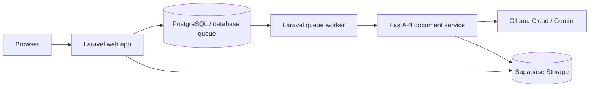

# TriLingua

TriLingua translates English, Filipino and Cebuano text and documents. The application combines Laravel 12/PHP 8.2+, Blade, Vite/Tailwind and a Python 3.11+ FastAPI translation engine. PostgreSQL/Supabase deployment and local SQLite testing appear in the historical records; this cleanup did not inspect live settings or verify a deployment.

The four canonical documents are this README, [Current state](CURRENT_STATE.md), [System walkthrough](SYSTEM_WALKTHROUGH.md) and [Testing findings](TESTING_FINDINGS.md). Superseded material remains under `archive_candidates/`; required licenses, fixtures and source-referenced instructions retain their paths. There are four canonical entry points, rather than a claim that package/runtime documentation has been eliminated.

## Setup

Work from `trilingua-code/`. Requirements and package manifests, rather than old model-download instructions, define the dependencies:

- [PHP dependencies and scripts](trilingua-code/composer.json): PHP 8.2+, Composer and Laravel 12.
- [Frontend dependencies](trilingua-code/package.json): Vite 7 and Tailwind 4; use a Node version supported by the locked dependencies.
- [Python engine dependencies](trilingua-code/Model/requirements.txt), [development requirements](trilingua-code/requirements-dev.txt) and [optional OCR/layout dependencies](trilingua-code/requirements-ocr-layout.txt).

For an operator preparing a new environment, install dependencies first. Composer's normal setup script also runs migrations; review those separately against the intended database and backup. The following dependency-only commands do not start the application:

```sh
cd trilingua-code
composer install --no-scripts
npm ci
python -m pip install -r Model/requirements.txt
npm run build
```

Provision private environment settings outside version control. Template filenames are allowed, but an example file is not proof that its values are safe. Laravel and Python must agree on the service token, provider endpoints, storage and queue settings. Do not publish live credentials. Provision schema, application key, storage and queues through a reviewed deployment procedure; this cleanup ran no migration or provisioning commands.

OCR additionally needs the Tesseract executable and applicable `eng`, `ceb` or `fil` language data. Production OCR acceptance requires the representative, independently reviewed evidence described in [Current state](CURRENT_STATE.md). A successful preview is not production acceptance.

## Run

The existing Windows launcher is [start-all.bat](trilingua-code/start-all.bat). Review it and stop existing services before using it. It manages more than a web page: document jobs need queue processing, and provider warmup can make real requests. The documented launcher prefers the installed `.venv-ocr-layout` environment when present.

For separately managed services, the source defines the Python application as `server:app` with app directory `Model`, normally port 5000; Laravel normally serves the browser interface on port 8000. Queue names, retry intervals and worker timeouts must agree with the application configuration. Do not run multiple competing launchers against the same queue without checking their ownership.

## Deploy

Deploy the Laravel frontend/queue application and Python engine with compatible commits, private service authentication, durable storage and deliberate queue/timeout configuration. Provider/analysis selection is configurable; the source default is GPT-OSS translation with Gemini fallback, and Gemini analysis with Ollama fallback. Actual environment values were not inspected. NLLB is a selectable historical/optional provider, not evidence that it is the active production model.

Historical cloud-release reports are preserved below. Their passing checks apply to the recorded revision and date. Current production acceptance, pending migrations, credential rotation, provider meaning quality and strict OCR acceptance were not established by this repository cleanup. Consult [Testing findings](TESTING_FINDINGS.md) before release.

## Documentation policy

Use the four root documents for current orientation. Historical appendices retain the full extracted text of merged documents, including rejected approaches and conflicting old instructions. Those passages are provenance, not current setup instructions. Original files retain their bytes and binary formatting; potentially sensitive diagnostics and environments were left unopened. This cleanup does not reclassify historical test results as new results.

## Other preserved material

Full extracted historical text follows. Original binary documents preserve images, tables and formatting beyond this text representation. Older commands/settings and contradicted claims are historical evidence. Sensitive-looking values are redacted only in the canonical copy; original files remain unchanged and private backup precautions still apply.

- [docs/DEPLOYMENT_STRATEGY_REPORT_2026-09-13.md](#source-c9b53d34acd7cb74) — [docs/DEPLOYMENT_STRATEGY_REPORT_2026-09-13.md](archive_candidates/docs/DEPLOYMENT_STRATEGY_REPORT_2026-09-13.md)
- [docs/hosting-options-2026-10-19.md](#source-b85783c08fc9f145) — [docs/hosting-options-2026-10-19.md](archive_candidates/docs/hosting-options-2026-10-19.md)
- [GITHUB_DESCRIPTION.md](#source-968241be041cd655) — [GITHUB_DESCRIPTION.md](archive_candidates/GITHUB_DESCRIPTION.md)
- [GITHUB_SETUP_COMPLETE.md](#source-220dcaf449450a37) — [GITHUB_SETUP_COMPLETE.md](archive_candidates/GITHUB_SETUP_COMPLETE.md)
- [output/ocr-acceptance/lion-mouse-review-2026-10-26/START_HERE.md](#source-4ecee5209bbf70c4) — [output/ocr-acceptance/lion-mouse-review-2026-10-26/START_HERE.md](output/ocr-acceptance/lion-mouse-review-2026-10-26/START_HERE.md)
- [output/pdf/ocr-poster-pack-2026-10-27/cebuano-reference/README.md](#source-f9e454af889cb044) — [output/pdf/ocr-poster-pack-2026-10-27/cebuano-reference/README.md](archive_candidates/output/pdf/ocr-poster-pack-2026-10-27/cebuano-reference/README.md)
- [output/pdf/ocr-poster-pack-2026-10-27/README.md](#source-aee6882f3d45d1c6) — [output/pdf/ocr-poster-pack-2026-10-27/README.md](archive_candidates/output/pdf/ocr-poster-pack-2026-10-27/README.md)
- [output/reviews/hybrid-pdf-implementation/baseline/finish-start/dirty/SETUP.md](#source-565020023ad17cb0) — [output/reviews/hybrid-pdf-implementation/baseline/finish-start/dirty/SETUP.md](archive_candidates/output/reviews/hybrid-pdf-implementation/baseline/finish-start/dirty/SETUP.md)
- [output/reviews/hybrid-pdf-implementation/baseline/finish-start/dirty/trilingua-code/DEMO.md](#source-71cb7332a7bfd6ce) — [output/reviews/hybrid-pdf-implementation/baseline/finish-start/dirty/trilingua-code/DEMO.md](archive_candidates/output/reviews/hybrid-pdf-implementation/baseline/finish-start/dirty/trilingua-code/DEMO.md)
- [output/reviews/hybrid-pdf-implementation/baseline/review-start/dirty/SETUP.md](#source-351c96d2a7a320bf) — [output/reviews/hybrid-pdf-implementation/baseline/review-start/dirty/SETUP.md](archive_candidates/output/reviews/hybrid-pdf-implementation/baseline/review-start/dirty/SETUP.md)
- [output/reviews/hybrid-pdf-implementation/baseline/review-start/dirty/trilingua-code/DEMO.md](#source-119aae08d5dfd44d) — [output/reviews/hybrid-pdf-implementation/baseline/review-start/dirty/trilingua-code/DEMO.md](archive_candidates/output/reviews/hybrid-pdf-implementation/baseline/review-start/dirty/trilingua-code/DEMO.md)
- [output/reviews/hybrid-pdf-implementation/baseline/source/trilingua-code/DEMO.md](#source-38cb1f47b18c6de5) — [output/reviews/hybrid-pdf-implementation/baseline/source/trilingua-code/DEMO.md](archive_candidates/output/reviews/hybrid-pdf-implementation/baseline/source/trilingua-code/DEMO.md)
- [output/reviews/hybrid-pdf-implementation/baseline/source/trilingua-code/README.md](#source-6fe1a0b75f976b81) — [output/reviews/hybrid-pdf-implementation/baseline/source/trilingua-code/README.md](archive_candidates/output/reviews/hybrid-pdf-implementation/baseline/source/trilingua-code/README.md)
- [output/reviews/ocr-functional-implementation/baseline/dirty/SETUP.md](#source-920f67c1dbd48aed) — [output/reviews/ocr-functional-implementation/baseline/dirty/SETUP.md](archive_candidates/output/reviews/ocr-functional-implementation/baseline/dirty/SETUP.md)
- [output/reviews/ocr-functional-implementation/baseline/dirty/trilingua-code/DEMO.md](#source-5ff359c37bc411dc) — [output/reviews/ocr-functional-implementation/baseline/dirty/trilingua-code/DEMO.md](archive_candidates/output/reviews/ocr-functional-implementation/baseline/dirty/trilingua-code/DEMO.md)
- [output/reviews/ocr-key-setup-2026-10-27/SETUP_REPORT.md](#source-07f427e35a5ece9b) — [output/reviews/ocr-key-setup-2026-10-27/SETUP_REPORT.md](archive_candidates/output/reviews/ocr-key-setup-2026-10-27/SETUP_REPORT.md)
- [output/reviews/ocr-preview-implementation-2026-10-27/baseline/dirty/SETUP.md](#source-20e313c9001b1cce) — [output/reviews/ocr-preview-implementation-2026-10-27/baseline/dirty/SETUP.md](archive_candidates/output/reviews/ocr-preview-implementation-2026-10-27/baseline/dirty/SETUP.md)
- [output/reviews/ocr-preview-implementation-2026-10-27/baseline/dirty/trilingua-code/DEMO.md](#source-5f28ab73e0fe4414) — [output/reviews/ocr-preview-implementation-2026-10-27/baseline/dirty/trilingua-code/DEMO.md](archive_candidates/output/reviews/ocr-preview-implementation-2026-10-27/baseline/dirty/trilingua-code/DEMO.md)
- [README.md](#source-b335630551682c19) — [README.md](archive_candidates/README.md)
- [SETUP.md](#source-0040e607148899ae) — [SETUP.md](archive_candidates/SETUP.md)
- [trilingua-code/DEMO.md](#source-fd2f0c52d5026c88) — [trilingua-code/DEMO.md](archive_candidates/trilingua-code/DEMO.md)
- [trilingua-code/README.md](#source-20ba7d0f4971ba56) — [trilingua-code/README.md](archive_candidates/trilingua-code/README.md)

<a id="source-c9b53d34acd7cb74"></a>

### Preserved source: docs/DEPLOYMENT_STRATEGY_REPORT_2026-09-13.md

Original: [docs/DEPLOYMENT_STRATEGY_REPORT_2026-09-13.md](archive_candidates/docs/DEPLOYMENT_STRATEGY_REPORT_2026-09-13.md). SHA-256: `32f02396a7c79d0a266617348e34286fd5968e8a817e31bfe061fc4dee0eb92d`.

````text
# TriLingua deployment strategy report

**Prepared:** September 13, 2026  
**Decision scope:** Low-cost public deployment without making document translation slower or less reliable than the current local setup.

## Executive decision

**Railway Hobby is a reasonable managed-web-hosting choice, but not a “minimal-to-no-cost, same-as-local-performance” solution for the whole application.** Use it only if a predictable **minimum of US$5/month** is acceptable and the application is changed to call an externally reachable LLM API. It has no GPU service in this plan, and running the current three long-lived services continuously can exceed the included credit.

**Recommended primary deployment:** use **Railway Hobby** now, with separate web, worker, and Python translator services, while keeping Supabase and the cloud AI providers external. It removes this personal PC from the serving path, resolves the present single-process web-server bottleneck, and needs no GPU because translation inference stays in Ollama Cloud/Gemini. Budget a US$5 monthly minimum and validate direct Ollama Cloud authentication before release.

> **Clarification added after validating the current launch path:** A full Railway deployment is technically viable with Ollama Cloud, Supabase, and the Python service all in Railway. It does not need a GPU because inference remains in Ollama Cloud. The current `localhost:11434` setup, however, is a local Ollama client acting as the cloud-model gateway; a Railway container needs direct Ollama Cloud API configuration and an API-key authorization header instead. This is a small, necessary deployment change—not a reason to reject Railway.

The final choice should be based on the availability requirement:

| Need | Best fit |
|---|---|
| Public capstone demo, controlled pilot, or small invited user group; PC can stay on | Local PC + named Cloudflare Tunnel |
| Always-on public web app; operator does not want to maintain a PC | **Railway Hobby + Supabase + direct Ollama Cloud/Gemini API** |
| Railway cannot meet the US$5 budget or direct API test | **Oracle Cloud Always Free ARM VM + Docker + Supabase** |
| High traffic, strict uptime, or fully local/private model inference | Neither low-cost option; budget for a GPU host or a more capable on-premise machine |

## What the codebase actually requires

TriLingua is not a simple Laravel site. The deployed runtime has these parts:



- Laravel 12 provides authentication, the UI, history, uploads, reviews, and job status.
- Document work is asynchronous: `TranslateDocumentJob` runs through the **database queue** and calls a FastAPI service. One HTTP web process alone is insufficient.
- The Python service parses and reconstructs PDF, DOCX, PPTX, XLSX, and text formats. It uses external AI providers for translation/analysis.
- The current environment defaults to `gpt-oss:20b-cloud` through an Ollama service at `http://localhost:11434`, with Gemini as fallback/analysis. The README’s older NLLB-200 description is not the active translation architecture.
- Results and originals are designed to live in Supabase Storage, rather than a transient worker disk. The UI allows up to 50 MB per upload and the default per-user daily limit is 250 MB.

This PC has an Intel i5-14400, 16 GB RAM, and Intel integrated graphics. It is appropriate for the Laravel/FastAPI/document-processing workload. It is **not** an appropriate host for a performant local `gpt-oss:20b` model: there is no discrete GPU/VRAM. The existing configuration consequently uses cloud inference.

### Actual performance constraint

The checked-in local benchmark report shows the current external providers, not PHP or Python CPU, dominate latency:

- GPT-OSS live calls averaged about **8.9 seconds** at one request, about **16.2 seconds** at two concurrent requests, and became much slower at higher concurrency.
- Gemini live calls averaged about **1.7 seconds** at one request and **1.9 seconds** at two; the tested four- and eight-request runs produced rate-limit failures.

Therefore, moving the app from this PC to Railway will not materially make translations faster. Over-parallelising them can make them less reliable. Start production with **one document queue worker**, `TRANSLATION_MAX_CONCURRENT=1–2`, and provider concurrency capped at the empirically stable level; then load-test before raising it.

## Assessment: Railway Hobby

### Strengths

- Railway provides an always-on public endpoint, HTTPS/domain support, deployment from GitHub/Docker, health checks, restart policies, private service networking, and a 99.9% availability target on Hobby. Its Laravel guide explicitly supports separate app, queue-worker, and scheduled-task services. [Railway pricing](https://railway.com/pricing), [Laravel deployment guide](https://docs.railway.com/guides/laravel)
- Hobby includes US$5 of usage each month and allows enough resource headroom for this non-GPU stack. Railway charges by actual RAM, CPU, volume storage, and egress use, rather than by the configured ceiling. [Railway plan and usage details](https://docs.railway.com/pricing/plans)
- Supabase can remain the shared PostgreSQL/storage provider. The free tier currently includes 500 MB database, 1 GB file storage, and 5 GB egress—adequate for a short pilot, but not for large document retention. [Supabase pricing](https://supabase.com/pricing)

### Why it is not a complete fit yet

1. **It is not free.** Hobby is a US$5 monthly minimum, even when use remains within its included usage. Its current metering is US$10/GB-month of RAM, US$20/vCPU-month, US$0.15/GB-month volume storage, and US$0.05/GB egress. [Railway pricing details](https://docs.railway.com/pricing)
2. **There is no GPU assumption to rely on.** Railway is a good place for the web, worker, and Python document service, but it will not reproduce a local GPU model setup. In this project this matters less because inference is already cloud-based.
3. **The current Ollama endpoint breaks after a move.** `http://localhost:11434` would mean “inside the Railway container,” not this computer. The Python provider currently sends only `Content-Type`; Ollama’s direct cloud API requires a bearer API key. Before a full Railway deployment, either:
   - change the provider to use `https://ollama.com/api/chat` plus `Authorization: Bearer $OLLAMA_API_KEY`, and verify the direct-cloud model name from `/api/tags`; or
   - use Gemini as the translation provider, which already has remote API authentication in the code; or
   - keep the Python service local and expose only a protected private route—an unnecessary and fragile split.

   Ollama documents both local cloud-model access and direct API access through `ollama.com` with an API key. [Ollama Cloud documentation](https://docs.ollama.com/cloud)
4. **Three persistent services consume budget.** A web app, queue worker, and FastAPI service should be separate so a document job cannot block login/page requests. That is operationally correct, but their combined idle RAM plus CPU polling can push actual resource use past the US$5 credit. An illustrative 24/7 footprint of 0.4–0.8 GB combined resident RAM and 0.03–0.10 average vCPU is roughly **US$4.60–US$10.00/month before egress and storage**. This is a planning range, not a quote; measure Railway metrics in the first billing cycle.
5. **Provider cost and limits remain.** Railway does not include Gemini/Ollama usage. Free AI tiers may be suitable for a capstone demo but should not be presented as a production SLA. Rate limits are already visible in the project’s live benchmark results.

### Correction: the earlier Cloudflare “one-user” observation

The restriction was **not caused by Cloudflare Tunnel**. A named tunnel has four outbound connections by default, and Cloudflare permits additional replicas for availability; the 200-in-flight-request limit is documented only for temporary Quick Tunnels. [Cloudflare Tunnel configuration](https://developers.cloudflare.com/tunnel/configuration/), [Quick Tunnel limit](https://developers.cloudflare.com/tunnel/setup/)

The local launch scripts expose Laravel through `php artisan serve`. That runs PHP’s built-in development server. PHP documents it as one single-threaded process, says that a blocked request stalls the application, and explicitly says its multi-worker test mode is unsupported on Windows. The repository scripts intentionally start exactly this single worker.

There are two code/runtime limits that explain the observed behaviour:

| Layer | Current limit | User-visible effect |
|---|---:|---|
| Laravel HTTP origin | One Windows PHP development-server process | Concurrent page loads, uploads, status polling, or slow requests queue behind each other |
| FastAPI translation service | `TRANSLATION_MAX_CONCURRENT=2`; then a 30-second wait | Two active translation pipelines total; a third waits and then can receive HTTP 503 |
| Laravel database queue | Two workers in `start-demo.ps1` by default | At most two document jobs are fetched at once; the FastAPI cap is still the final translation limit |

The first is a server-launch problem, not an account/session problem. The second is intentional provider protection, not a Cloudflare limitation. Multiple people can sign in and use the app, but they cannot all execute translations at once under those caps. [PHP built-in web-server documentation](https://www.php.net/commandline.webserver)

**How to validate it cleanly:** use three separate browser profiles/accounts. While account A uploads a sizeable document, load a normal page and submit text translation from accounts B and C. Check: (1) PHP/Laravel request timing, (2) FastAPI responses for `Server busy`/503, and (3) queue depth. If the tunnel is healthy, Cloudflare is not the bottleneck; its tunnel-health page also notes that a healthy tunnel does not prove the internal origin is healthy. [Cloudflare monitoring](https://developers.cloudflare.com/tunnel/monitoring/)

### Railway architecture if chosen

Deploy three services from the same repository, all in one Railway project:

| Service | Public? | Start responsibility |
|---|---:|---|
| `web` | Yes | Laravel HTTP server, built Vite assets |
| `worker` | No | `php artisan queue:work --tries=3 --timeout=900 --sleep=1` |
| `translator` | No | Uvicorn/FastAPI on port 5000 |

Set `PYTHON_SERVICE_URL` on both `web` and `worker` to the translator’s private Railway hostname, for example `http://translator.railway.internal:5000`. Railway’s private network is intended for exactly this service-to-service traffic. [Railway private networking](https://docs.railway.com/guides/docker-compose)

For the translator service, configure direct cloud inference rather than `localhost`:

| Variable / code concern | Railway-safe intent |
|---|---|
| `OLLAMA_CLOUD_URL` | `https://ollama.com/api/chat` |
| `OLLAMA_API_KEY` | Railway secret, never committed |
| GPT-OSS request headers | Send `Authorization: Bearer <OLLAMA_API_KEY>` when calling the direct API |
| model name | Query Ollama’s direct `/api/tags` endpoint and use the listed direct-cloud name; do not assume the local `-cloud` suffix is identical |
| `PYTHON_SERVICE_URL` | Railway private FastAPI URL, not a public URL |

Ollama’s official Cloud documentation specifically supports direct `ollama.com` API access with a bearer key. The present provider implementation has the correct chat payload but only supplies `Content-Type`; it needs the authorization addition for this topology. [Ollama Cloud documentation](https://docs.ollama.com/cloud)

Use Supabase PostgreSQL for the shared database, Supabase Storage for files, and database-backed sessions/cache/queue for the pilot. Do **not** use SQLite, file sessions, file cache, or local output storage across the separated cloud services; their filesystems are not shared or durable. A later Redis upgrade can reduce database queue polling, but it is not necessary for the first low-volume release.

### Railway go/no-go checklist

- [ ] Add a production Dockerfile or Railway build/start configuration for PHP + built Vite assets, and a separate Python image/service.
- [ ] Make the LLM provider externally reachable and authenticated; test a real text translation from Railway before inviting users.
- [ ] Set `APP_ENV=production`, `APP_DEBUG=false`, a unique `APP_KEY`, HTTPS-only secure cookies, a strong `PYTHON_SERVICE_TOKEN`, and production `APP_URL`/Google OAuth callback.
- [ ] Use Supabase PostgreSQL and Supabase Storage; run all migrations once from a controlled release process.
- [ ] Run exactly one worker initially and cap provider concurrency at 1–2.
- [ ] Set a strict Railway spending alert/limit and watch RAM, CPU, egress, queue depth, and provider failures for one month.
- [ ] Establish retention/deletion rules. At 50 MB per file, Supabase’s 1 GB free storage could be consumed by roughly 20 maximum-size files before accounting for original+translated copies.

## Alternative: no-PC, near-zero-cost VM deployment

If Railway fails the direct-provider test, cannot stay within the budget, or its deployment experience does not suit the project, use an **Oracle Cloud Always Free ARM VM**. The current Always Free allocation is up to **2 OCPUs and 12 GB RAM total**, plus 200 GB block storage in the home region; this comfortably fits a low-volume Laravel/Python/queue stack that delegates inference to cloud AI. [Oracle Always Free resources](https://docs.oracle.com/en-us/iaas/Content/FreeTier/freetier_topic-Always_Free_Resources.htm)

Run Docker Compose on one Ubuntu ARM VM:

- Caddy or Nginx + PHP-FPM Laravel web container (public); 
- Laravel queue-worker container (private); 
- FastAPI/Uvicorn container (private); 
- Supabase remains the managed database and document store; 
- Ollama Cloud and Gemini are reached with API keys from the FastAPI container.

This is a valid free fallback that does **not** use this PC. It involves more Linux/Docker/server administration than Railway, ARM-compatible images must be tested, and Always Free VM capacity can be unavailable in a home region. Oracle may also reclaim an instance that it classifies as idle for seven days, so automated backups and a redeploy runbook are mandatory. It is suitable for a capstone or pilot, not a contractual-uptime production service.

## Local-first public deployment (available, but not recommended for this decision)

### Architecture

Run the current components on this PC:

- Laravel web app, Laravel queue worker, FastAPI service, and the local Ollama client;
- Supabase PostgreSQL and Storage for durable cross-device data;
- a **named Cloudflare Tunnel** that exposes only the Laravel HTTP port at `https://app.yourdomain.tld`.

Cloudflare Tunnel makes outbound encrypted connections from this computer; it needs no open inbound firewall ports or public IP. Named tunnels use a stable hostname, unlike temporary `trycloudflare.com` URLs. Cloudflare recommends named tunnels for production traffic and OAuth callbacks. [Cloudflare Tunnel overview](https://developers.cloudflare.com/tunnel/), [setup guide](https://developers.cloudflare.com/tunnel/setup/)

The repository already has `deploy-named-tunnel.ps1`, `undeploy-named-tunnel.ps1`, and `start-demo.ps1`. The named-tunnel script already handles the stable `APP_URL`, secure cookie settings, and Google redirect URI. It is much closer to a viable deployment than the quick tunnel path, which is explicitly for short-lived demos and has no uptime guarantee. [Cloudflare’s Quick Tunnel limitations](https://developers.cloudflare.com/cloudflare-one/networks/connectors/cloudflare-tunnel/do-more-with-tunnels/trycloudflare/)

### Why this is the best low-cost/performance option

- The processor, memory, installed services, provider settings, and document pipeline are identical to local use—so document execution performance is the same.
- Translation still relies on the same cloud model services, so it does not impose an impossible local 20B-model workload on this integrated GPU.
- There is no Railway compute charge. A Cloudflare account/tunnel is available on all Cloudflare plans; the only likely additional cost is a domain if one is not already owned. [Cloudflare Tunnel](https://developers.cloudflare.com/tunnel/)
- Supabase remains the durable data system, so a computer restart does not lose users, history, or stored documents.

### Non-negotiable limitations

- This PC, its electricity, Windows updates, residential ISP, and upstream bandwidth become the uptime boundary. It is not suitable for an advertised 24/7 commercial service.
- A remote user has extra latency through the tunnel and uploads first traverse the home connection. Large document uploads are the weak point.
- The current scripts are a strong demo baseline, not an unattended production supervisor. Run the app/tunnel through a Windows service manager or scheduled tasks configured to restart on boot/failure, and check health externally.
- Do not use the rotating Quick Tunnel for real logins: its URL changes and cannot safely support a stable Google OAuth redirect.

### Practical hardening before public access

1. Use a custom domain and named tunnel, not Quick Tunnel. Add its exact HTTPS callback to Google OAuth.
2. Keep only Laravel exposed; bind FastAPI and Ollama to `127.0.0.1`. Keep the existing Python service token enabled.
3. Set a non-empty `PYTHON_SERVICE_TOKEN`, production `APP_KEY`, `APP_DEBUG=false`, `SESSION_SECURE_COOKIE=true`, and a restrictive CORS/host configuration.
4. Run application, FastAPI, queue worker, and `cloudflared` as restartable background services; configure automatic startup after a reboot.
5. Monitor `/up` and Python `/health` from outside the network. Back up Supabase data and test a restore/download path.
6. Rotate every credential that has ever been kept in local password/environment files, then ensure those files stay ignored. The repository’s own security inventory identifies prior credential-handling risk; treat this as a release blocker, without moving secrets into Git or scripts.
7. Keep the present user upload quotas until real load testing establishes safe CPU, network, and provider limits.

## Recommendation and staged rollout

**Stage 1 — now:** Deploy to Railway Hobby. First prove direct Ollama Cloud authentication, then release `web`, `worker`, and `translator` as separate services. Use Caddy/Nginx + PHP-FPM for `web`; never use `artisan serve` in Railway.

**Stage 2 — acceptance test before public release:** Run three independent accounts concurrently: normal navigation, a document upload, and multiple text/document translations. Pass only if pages remain responsive, the third translation is queued or receives a clear capacity response, files persist in Supabase, and all jobs complete correctly. Set a Railway hard budget/alert before inviting users.

**Stage 3 — fallback:** If the direct Ollama request cannot authenticate, or Railway’s measured cost is unsuitable, deploy the same Docker services to an Oracle Always Free ARM VM. This keeps the system off the personal PC with no recurring compute bill, subject to Oracle capacity/reclamation caveats.

**Stage 4 — when reliability is required:** Measure real document count, file retention, provider tokens/requests, and response times. Only then choose paid Supabase capacity, a managed Redis queue, and, if local inference is still a goal, a GPU-capable host. Do not buy bigger Railway CPU/RAM as a substitute for provider quota or GPU inference.

## Conclusion

Railway Hobby is the recommended path because it removes the personal PC from hosting, resolves the demonstrated single-user web-origin bottleneck, and gives the project normal deploy/restart/health-check operations. It is viable once the Ollama provider uses the direct authenticated cloud API. Budget a minimum US$5/month and treat provider quotas as the true translation throughput limit.

If that validation fails, use an Oracle Always Free ARM VM with Docker—not Cloudflare Tunnel on this PC. It is the closest no-recurring-compute-cost fallback, with the trade-offs of ARM testing, capacity availability, and possible idle reclamation. 

````

<a id="source-b85783c08fc9f145"></a>

### Preserved source: docs/hosting-options-2026-10-19.md

Original: [docs/hosting-options-2026-10-19.md](archive_candidates/docs/hosting-options-2026-10-19.md). SHA-256: `eeff16985afa72878cd7fc641b5c45c33aea02907310e3f5f86a301d9162a09c`.

````text
# TriLingua hosting options for adviser testing

Verified against official documentation on **19 October 2026 (Asia/Manila)**. The user confirmed that both Laravel and Python are deployed on Laravel Cloud, that the reported $5 monthly free allowance is exhausted, and that the next reset is **7 November**. Adviser testing is likely **20 October afternoon**, with a work cutoff described as “tomorrow 10”; the exact cutoff time is unconfirmed. These are user-reported account/timing facts. Actual resource sizes, invoice breakdown, account plan, and reset mechanics have not been independently verified. No accounts, billing settings, infrastructure, or application code were changed.

## Decision

**For the likely 20 October adviser test, restore the existing Laravel Cloud deployment with an agreed, bounded paid budget and rehearse it. Do not spend the remaining preparation window migrating hosts.** Check the account's actual plan and reason for suspension before selecting the restoration action. Use the local tunnel as the test-session fallback. Railway is a reasonable managed migration candidate after the test; Oracle is a longer-term low-cash-cost candidate after account acceptance, capacity allocation, ARM compatibility checks, and a rehearsal. These are judgments about deployment effort and failure modes, not measured performance comparisons.

Another path is a scheduled test from the existing local demo setup and its tunnel, while the PC and network remain online. Repository inspection found `start-all-demo-deploy.bat` → `start-demo.ps1 -Tunnel`. This avoids a migration for one supervised session, but is unsuitable for unattended adviser access and still needs a rehearsal and access control.

## Why an unused deployment still costs money

Not opening the app does not stop provisioned resources. Running web processes, database compute, queue workers, cache, and retained storage can all remain allocated. On Railway, memory held by running services costs money even while CPU use is low; on Laravel Cloud, running replicas accrue per-second compute charges. Storage has a separate meter. These billing models explain a possible idle bill; only the actual usage breakdown can establish which resources consumed this project's credits. [Railway pricing](https://railway.com/pricing), [Laravel Cloud pricing](https://laravel.com/cloud/docs/pricing).

For scale only: **1 GB RAM held continuously for 11 days costs approximately $3.67 on Railway**, using $0.00000386 per GB-second × 950,400 seconds. CPU, database RAM, other services, storage, egress, tax, and any plan minimum are separate. This is an illustration, not an estimate of the existing deployment's invoice. [Railway pricing](https://railway.com/pricing).

## Railway

- Hobby costs at least **$5/month**, including $5 of resource usage; excess usage is billed. The minimum is not an unlimited hosting bundle. RAM is $0.00000386/GB-second (roughly $10/GB for 30 days), CPU $0.00000772/vCPU-second (roughly $20 for a full vCPU for 30 days), and public egress $0.05/GB. [Pricing](https://railway.com/pricing).
- Set a **compute hard limit**, in addition to email alerts. Reaching it takes workloads offline; it trades availability for spend protection. Low resource limits can cause application failures, so measure a representative translation before choosing sizes. [Cost control](https://docs.railway.com/pricing/cost-control).
- Serverless sleep requires at least five minutes without outbound traffic. Database connections, polling and telemetry can prevent sleep. Incoming requests wake HTTP services; a polling-only worker has no incoming HTTP request to wake it. Do not assume enabling sleep makes the whole stack free while idle. [Serverless](https://docs.railway.com/deployments/serverless).

Repository inspection found a database queue default and a development launcher polling it every second. Railway sleep therefore needs specific verification with the production worker configuration. The normal translation path uses external GPT-OSS/Gemini inference; the optional NLLB loader is for controlled benchmarks. This does not establish measured RAM use or adviser-session latency.

## Oracle Cloud

### Current free allowance and availability

The current Always Free documentation specifies **1,500 OCPU-hours and 9,000 GB-hours of A1 memory per month**, equivalent to **2 OCPUs and 12 GB RAM continuously** for an Always Free tenancy. It also includes two small AMD instances and **200 GB combined boot/block storage** in the home region. Capacity shortages can prevent VM creation. Idle instances may be reclaimed if, over seven days, CPU 95th-percentile utilization and network utilization are below 20%, and A1 memory utilization is also below 20%. [Always Free resources](https://docs.oracle.com/en-us/iaas/Content/FreeTier/freetier_topic-Always_Free_Resources.htm).

**Do not reuse the older blanket “4 cores/24 GB free” claim.** Oracle's current price list separately grants **paid tenancies** 3,000 OCPU-hours and 18,000 GB-hours monthly for A1, shared across VM, bare metal, and container instances. The free-account documentation and paid-tenancy allowance are different. Confirm the account's own entitlements before provisioning. [Oracle price list](https://www.oracle.com/cloud/price-list/).

### Card, charging and controls

Oracle accepts credit cards and debit cards that function as credit cards; its FAQ excludes PIN-based debit, virtual, single-use and prepaid cards. Temporary verification holds may occur. A card that works elsewhere is not evidence Oracle will accept it. Only one free account is allowed per person. [Free Tier FAQ](https://www.oracle.com/cloud/free/faq/).

The free trial provides up to $300 for 30 days. Oracle says the card is not charged unless the account is upgraded; paid trial resources are reclaimed if the user does not upgrade. Staying within Always Free resources avoids relying on expiring trial credit. [Free Tier documentation](https://docs.oracle.com/en-us/iaas/Content/FreeTier/freetier.htm).

PAYG adds billing exposure above applicable free entitlements. **OCI budgets are soft limits with alerts, not a monetary shutdown cap**; published budget alerts are periodically evaluated, so they are not instantaneous protection. Resource quotas can restrict provisioning but are not a universal dollar cap. [Budgets](https://docs.oracle.com/en-us/iaas/Content/Billing/Concepts/budgetsoverview.htm), [Always Free resources](https://docs.oracle.com/en-us/iaas/Content/FreeTier/freetier_topic-Always_Free_Resources.htm).

Stopping a standard VM through the Console/API pauses its compute billing. An OS shutdown alone does not. Provisioned disks remain separate resources and can keep accruing charges outside free allowances; terminating a VM does not automatically mean all retained storage has been deleted. Preserve backups deliberately before deleting anything. [Stopped-instance billing](https://docs.oracle.com/en-us/iaas/Content/Compute/Tasks/resource-billing-stopped-instances.htm), [Block Volume FAQ](https://www.oracle.com/cloud/storage/block-volumes/faq/).

### Operational tradeoff

An Oracle VM means taking responsibility for OS updates, firewall rules, HTTPS, PHP/Python services, a database, queue supervision, backups, and restart behavior. A1 is ARM, so dependencies must be installed and exercised there. There is no verified TriLingua A1 benchmark in this research. Oracle offers more memory within its free allocation than a small metered service, but that does not establish the app's throughput or reliability. Do not add artificial load to evade idle reclamation.

## Existing Laravel Cloud deployment

The user reports using a free $5/month mode. Current public documentation lists Starter at **$5/month with $5 monthly usage credit**, first 31 days free; excess usage can be billed. Credits reset each billing cycle. The account may have legacy terms: check its actual plan instead of treating the current new-account pricing as proof of this account's charges. [Plans and pricing](https://laravel.com/cloud/docs/pricing), [Free trial](https://laravel.com/cloud/docs/free-trial).

Only Flex compute can scale to zero. Inbound requests reset the sleep timer; scheduled tasks wake sleeping apps, and a wake interval shorter than the sleep timeout can keep an app awake continuously. Worker clusters can stay awake or follow the app. This makes scanners, monitors, schedules and worker settings relevant when diagnosing unexpected awake time. [Compute and Scale-to-Zero](https://laravel.com/cloud/docs/compute).

Queued jobs do not wake a sleeping app, and jobs still running when its sleep timeout expires can be interrupted. Simply switching sleep on is therefore unsafe for long translations without exercising the queue lifecycle. Moving to managed queues is an implementation choice requiring review, not a routine hosting checkbox. [Compute and Scale-to-Zero](https://laravel.com/cloud/docs/compute).

The current spending-limit screen defaults to **alerts only**. Enable **“Stop all compute”** for enforced shutdown: at the limit it pauses app, database and cache compute and blocks new provisioning. In-flight operations and retained object/database storage can create a small overage. Compute resumes automatically at the next cycle or when the limit is raised. If the deployment is paused by this feature, raising the limit can restore it before the next reset. This is a possible route, not confirmation of this account's state. [Spending limits](https://laravel.com/cloud/docs/spending-limits).

## Minimum next steps before paying or migrating

1. Inspect the current provider's usage by resource and the reason it stopped. Confirm whether the missing amount is free credit or a paid balance, and whether November 7 is a monthly credit refresh, plan renewal, or spend-limit reset.
2. Set the chosen provider's enforceable spend control and alert recipients before restoring compute. Keep database and file backups. Treat API/model-provider charges as separate unless the host explicitly includes them.
3. Rehearse one representative upload, translation, status polling, and final download using the adviser-facing URL; record resource use and latency. Choose resource sizes from this evidence.
4. For scheduled testing, stop compute immediately after the session and verify the provider reports it stopped. Review retained storage separately. If adviser access must remain available between sessions, budget for that explicitly instead of assuming idle means free.

The outstanding decisions are the acceptable restoration/monthly spend and exact test/cutoff time. No provider purchase or migration was performed.

````

<a id="source-968241be041cd655"></a>

### Preserved source: GITHUB_DESCRIPTION.md

Original: [GITHUB_DESCRIPTION.md](archive_candidates/GITHUB_DESCRIPTION.md). SHA-256: `1c822d8532c111fc018340bdd612d95822d0efcc4ab7381ce965f8b3ddf40f5f`.

````text
# GitHub Repository Settings

## Repository Description

Use this as your GitHub repository description (Settings → General → Description):

```
🎓 Capstone Project: 3-way translation system for Cebuano, Filipino, and English. Document-level translation powered by NLLB-200 AI model. Built with Laravel, Python, and FastAPI.
```

## Repository Topics/Tags

Add these topics to your repository (Settings → General → Topics):

- `capstone-project`
- `translation`
- `nlp`
- `machine-learning`
- `laravel`
- `python`
- `fastapi`
- `nllb`
- `cebuano`
- `filipino`
- `tagalog`
- `philippine-languages`
- `document-translation`
- `ai`
- `pytorch`
- `transformers`

## About Section

**Website:** (Add your deployed URL if available)

**Topics:** See above

**Description:** 
```
Capstone Project - TriLingua is a 3-way translation system for Cebuano, Filipino, and English languages. Features document-level translation (DOCX, PDF, TXT), text translation, user authentication, and translation history. Powered by Facebook's NLLB-200 AI model.
```

## Social Preview Image

Consider creating a social preview image (1280x640px) with:
- Project name: "TriLingua"
- Tagline: "3-Way Philippine Language Translator"
- Subtitle: "Capstone Project 2026"
- Flags: 🇵🇭
- Tech stack icons: Laravel, Python, AI

Upload at: Settings → General → Social preview

## README Badges

The README now includes these badges:
- Laravel version
- Python version
- License

## Repository Settings Recommendations

### General
- ✅ Enable Issues
- ✅ Enable Discussions (optional, for Q&A)
- ✅ Enable Projects (optional, for task tracking)
- ✅ Enable Wiki (optional, for documentation)

### Features
- ✅ Require contributors to sign off on web-based commits
- ✅ Allow merge commits
- ✅ Allow squash merging
- ✅ Allow rebase merging

### Pull Requests
- ✅ Allow auto-merge
- ✅ Automatically delete head branches

## License

Add a LICENSE file if you haven't already. MIT License is recommended for open-source projects.

## .gitignore

Make sure your `.gitignore` includes:
```
# Laravel
/vendor
/node_modules
.env
.env.backup
.phpunit.result.cache
Homestead.json
Homestead.yaml
npm-debug.log
yarn-error.log

# Python
__pycache__/
*.py[cod]
*$py.class
*.so
.Python
venv/
ENV/

# IDE
.idea/
.vscode/
*.swp
*.swo
*~

# OS
.DS_Store
Thumbs.db

# Logs
storage/logs/*.log
```

## How to Update GitHub

1. **Commit and push the new README:**
   ```bash
   git add README.md
   git commit -m "docs: Add comprehensive README for capstone project"
   git push origin main
   ```

2. **Update repository description:**
   - Go to: https://github.com/KenUsa-31/Trilingua
   - Click the ⚙️ gear icon next to "About"
   - Paste the description
   - Add topics/tags
   - Save changes

3. **Add a banner/logo (optional):**
   - Create a banner image
   - Add to repository: `docs/banner.png`
   - Reference in README: ``

4. **Create a CONTRIBUTING.md (optional):**
   - Guidelines for contributors
   - Code of conduct
   - Development setup

5. **Add GitHub Actions (optional):**
   - Automated testing
   - Code quality checks
   - Deployment workflows

````

<a id="source-220dcaf449450a37"></a>

### Preserved source: GITHUB_SETUP_COMPLETE.md

Original: [GITHUB_SETUP_COMPLETE.md](archive_candidates/GITHUB_SETUP_COMPLETE.md). SHA-256: `187f976d05741db0d97f04442e6f93fbc244a9e824e563950c46dc5d5150efb2`.

````text
# ✅ GitHub Repository Setup Complete!

Your TriLingua capstone project has been successfully pushed to GitHub!

## 🔗 Repository URL
https://github.com/KenUsa-31/Trilingua

## 📋 Next Steps

### 1. Update Repository Description

Go to: https://github.com/KenUsa-31/Trilingua

Click the ⚙️ **gear icon** next to "About" and add:

**Description:**
```
🎓 Capstone Project: 3-way translation system for Cebuano, Filipino, and English. Document-level translation powered by NLLB-200 AI model. Built with Laravel, Python, and FastAPI.
```

**Website:** (Leave empty or add your deployed URL if you have one)

### 2. Add Topics/Tags

In the same "About" section, add these topics:

```
capstone-project
translation
nlp
machine-learning
laravel
python
fastapi
nllb
cebuano
filipino
tagalog
philippine-languages
document-translation
ai
pytorch
transformers
```

### 3. Enable Repository Features

Go to: https://github.com/KenUsa-31/Trilingua/settings

Under "Features":
- ✅ **Issues** - For bug reports and feature requests
- ✅ **Discussions** (optional) - For Q&A and community
- ✅ **Projects** (optional) - For task management
- ✅ **Wiki** (optional) - For additional documentation

### 4. Add a License (Optional but Recommended)

Go to: https://github.com/KenUsa-31/Trilingua/community/license/new

Choose: **MIT License** (most common for open-source projects)

### 5. Create a Release (Optional)

When you're ready to mark a milestone:

1. Go to: https://github.com/KenUsa-31/Trilingua/releases/new
2. Tag version: `v1.0.0`
3. Release title: `TriLingua v1.0.0 - Initial Release`
4. Description: Summarize the features
5. Click "Publish release"

## 📊 What's Been Pushed

### Documentation
- ✅ Comprehensive README.md with capstone project badge
- ✅ Installation and setup instructions
- ✅ Technology stack details
- ✅ Project structure overview
- ✅ Contributing guidelines

### New Features
- ✅ Password reset functionality (forgot password flow)
- ✅ Local database fallback for translation history
- ✅ Python model download script
- ✅ Dashboard error handling

### Additional Documentation
- ✅ `GITHUB_DESCRIPTION.md` - Repository setup guide
- ✅ `PASSWORD_RESET_GUIDE.md` - Password reset documentation
- ✅ `DASHBOARD_FIX.md` - Dashboard troubleshooting

### Code Improvements
- ✅ ForgotPasswordController and ResetPasswordController
- ✅ ResetPasswordNotification for email templates
- ✅ TranslationHistory model for local database
- ✅ Enhanced HistoryService with local DB fallback
- ✅ Updated .gitignore for Python files
- ✅ Enhanced login CSS with alert styles

## 🎨 Make It Look Professional

### Add a Banner (Optional)

Create a banner image (1280x640px) with:
- Project name: "TriLingua"
- Tagline: "3-Way Philippine Language Translator"
- Subtitle: "Capstone Project 2026"
- Philippine flag: 🇵🇭
- Tech stack icons

Save as `docs/banner.png` and add to README:
```markdown

```

### Add Screenshots

Create a `docs/screenshots/` folder and add:
- Dashboard view
- Translation interface
- Login page
- Translation history

Reference in README:
```markdown
## 📸 Screenshots


```

## 🌟 Repository Stats

Your repository now has:
- **20 files changed**
- **1,038 insertions**
- **24 deletions**
- **Complete documentation**
- **Professional README**
- **Working features**

## 📱 Share Your Project

Share your capstone project:
- LinkedIn: "Excited to share my capstone project: TriLingua - A 3-way translation system for Philippine languages! 🇵🇭"
- Twitter/X: "Built a translation system for Cebuano, Filipino, and English using AI! Check it out: [link]"
- Portfolio: Add to your developer portfolio

## 🎓 For Your Capstone Presentation

Key points to highlight:
1. **Problem**: Language barriers in the Philippines
2. **Solution**: AI-powered 3-way translation system
3. **Technology**: Modern web stack + NLLB-200 AI model
4. **Features**: Text & document translation, user management, history tracking
5. **Impact**: Preserving and promoting Philippine languages

## 🔗 Quick Links

- **Repository**: https://github.com/KenUsa-31/Trilingua
- **Issues**: https://github.com/KenUsa-31/Trilingua/issues
- **Commits**: https://github.com/KenUsa-31/Trilingua/commits/main
- **Settings**: https://github.com/KenUsa-31/Trilingua/settings

---

**Congratulations! Your capstone project is now live on GitHub!** 🎉

Made with ❤️ for Philippine Languages 🇵🇭

````

<a id="source-4ecee5209bbf70c4"></a>

### Preserved source: output/ocr-acceptance/lion-mouse-review-2026-10-26/START_HERE.md

Original: [output/ocr-acceptance/lion-mouse-review-2026-10-26/START_HERE.md](output/ocr-acceptance/lion-mouse-review-2026-10-26/START_HERE.md). SHA-256: `279f1808f23c274870cb91f6676b9a69f0d42842212ee7579aa319e51161afa1`.

````text
# OCR review packet

This is an unreviewed draft, not an acceptance report. It has not enabled OCR in the translation service. You can provide corrections in plain language and have the operator enter them; you do not need to edit JSON yourself.

1. Open review.html to compare source pages with the candidate text. Check for missing text, wrong words, boxes and reading order.
2. Correct the matching .txt and .regions.json files in incoming before requesting review. Keep their complete text consistent.
3. Fill the actual capture type, collector and rights basis in incoming/info.csv. This prepared document stays calibration. Add genuinely unseen documents as separate files/rows; do not split pages of one book across calibration and held-out.
4. Run the command below. It prepares a blank second-review.csv when metadata is complete. A person other than the collector checks the originals and completes it. The corpus-review.json file also requires actual coverage review.
5. Run the same command again to resume. It reports blockers or evaluates at the unchanged95% gate. Only a valid passing evaluation plus a private signing key can produce a verified report. The command never changes live configuration.

```powershell
Set-Location 'C:\dev\Trilingua\trilingua-code\Model'
& 'C:\dev\Trilingua\trilingua-code\.venv-ocr-layout\Scripts\python.exe' -m tools.ocr_kit advance --workspace 'C:\dev\Trilingua\output\ocr-acceptance\lion-mouse-review-2026-10-26'
```

workflow-status.json lists the current step and missing material. Independent review and source permissions have not been supplied or invented.

````

<a id="source-f9e454af889cb044"></a>

### Preserved source: output/pdf/ocr-poster-pack-2026-10-27/cebuano-reference/README.md

Original: [output/pdf/ocr-poster-pack-2026-10-27/cebuano-reference/README.md](archive_candidates/output/pdf/ocr-poster-pack-2026-10-27/cebuano-reference/README.md). SHA-256: `d6c7b8e430d85e1c08e613c156855197c028b5702600374e5a8e141dbc0e24b9`.

````text
# Complete Cebuano reference PDFs

Five two-page PDFs translated into Cebuano. Page 1 uses the source artwork with a solid panel replacing its English lettering; it is rasterized without an OCR layer. Page 2 contains selectable Cebuano text. Planet names and the proper name Cold Faithful are retained, except Earth is translated as Yuta.

These are assistant-authored reference translations, not successful TriLingua OCR results. No native-speaker review was performed. The original poster typography is not preserved.

Raw TriLingua Balanced/strict results and their batch report are in the sibling cebuano folder. Those results are partial: image-only poster regions were held, and source coverage is unknown. They must not be reported as complete translations.

Artwork source: https://www.jpl.nasa.gov/galleries/visions-of-the-future/
Credit: NASA/JPL-Caltech.

````

<a id="source-aee6882f3d45d1c6"></a>

### Preserved source: output/pdf/ocr-poster-pack-2026-10-27/README.md

Original: [output/pdf/ocr-poster-pack-2026-10-27/README.md](archive_candidates/output/pdf/ocr-poster-pack-2026-10-27/README.md). SHA-256: `d4e41612c3dc2f6a2ddf307f09c5ddc449b5b6349e7147688a30343fdcbd18b5`.

````text
# OCR poster test pack

Five derived test PDFs, exactly 2 pages each. These are not original two-page NASA publications.

- Page 1: NASA/JPL poster embedded as one raster image, with no selectable text or hidden OCR layer.
- Page 2: a plain selectable-text rendering of the poster wording in one authored text region.
- Poster artwork retains its original visual text groups. OCR may split these into several blocks; one image region does not imply one OCR block.
- Wording uses normalized capitalization, punctuation and line wrapping; the manifest is a content guide, not a pixel-level transcription benchmark.
- Sources are the 1024-pixel-wide gallery JPEGs. Fine print is deliberately more difficult than the large headings.

Source gallery: https://www.jpl.nasa.gov/galleries/visions-of-the-future/
Credit: NASA/JPL-Caltech (individual artwork credits appear in the gallery).
Image policy: https://www.jpl.nasa.gov/jpl-image-use-policy/
Original downloaded images and source URLs are included for traceability.

Verified: 2 pages per file; page 1 extracts no native text and contains one image; page 2 extracts exactly the expected text.
Not run through TriLingua.

````

<a id="source-565020023ad17cb0"></a>

### Preserved source: output/reviews/hybrid-pdf-implementation/baseline/finish-start/dirty/SETUP.md

Original: [output/reviews/hybrid-pdf-implementation/baseline/finish-start/dirty/SETUP.md](archive_candidates/output/reviews/hybrid-pdf-implementation/baseline/finish-start/dirty/SETUP.md). SHA-256: `2d7269ce408f277b7a9fbbcce93ec0147988baa62e03b6a2e4101364e2102d23`.

````text
# TriLingua Python Engine — Setup Guide

## Prerequisites

- **Python 3.11+** — [python.org](https://python.org)
- **Ollama** — [ollama.com](https://ollama.com) (for GPT-OSS provider or local analysis fallback)
- **Tesseract OCR** — [github.com/tesseract-ocr/tesseract](https://github.com/tesseract-ocr/tesseract) (optional, only for scanned/image-based PDFs)

## 1. Install Python Dependencies

```bash
cd trilingua-code
pip install fastapi uvicorn python-multipart requests pydantic
pip install python-docx PyMuPDF python-pptx openpyxl odfpy striprtf
pip install pytesseract Pillow   # optional: OCR fallback for scanned PDFs
pip install pytest hypothesis sacrebleu   # dev/testing only
```

## 2. Pull Ollama Models

**Cloud models** (require Ollama Cloud running at localhost:11434):

Will be pulled automatically on first request:
- `minimax-m3:cloud`
- `qwen3.5:397b-cloud`
- `gemma4:31b-cloud`
- `gpt-oss:20b-cloud`

**Local analysis model** (only needed as the analysis fallback when no Gemini API key is set):

```bash
ollama pull llama3.2:1b
```

Set `OLLAMA_ANALYSIS_MODEL` in `.env` to whatever model you pull (code default is `llama3.1:8b`).

## 3. Configure .env

The file `trilingua-code/.env` controls all provider and pipeline settings.

### Translation Provider

```
TRANSLATION_PROVIDER=gemini        # "gemini" or "gptoss"
```

| Provider | Key | Model |
|----------|-----|-------|
| Gemini | `GEMINI_API_KEY` | `GEMINI_MODEL=gemini-2.5-flash` |
| GPT-OSS (Ollama Cloud) | — | `OLLAMA_CLOUD_MODEL=gpt-oss:20b-cloud` |

**Switching providers:** Change `TRANSLATION_PROVIDER`, restart server. That's it.

### Analysis Provider

Analysis (document analysis, quality review, layout planning) uses a separate provider from translation:

```
GEMINI_ANALYSIS_MODEL=gemini-2.5-flash
```

- **Gemini (default when `GEMINI_API_KEY` is set)** — the server picks `GeminiAnalysisProvider` whenever a Gemini API key is present. Uses the same key as the translation provider, model controlled by `GEMINI_ANALYSIS_MODEL`.
- **Ollama (fallback)** — if no `GEMINI_API_KEY` is set, the server falls back to the local `OllamaAnalysisProvider` using `OLLAMA_ANALYSIS_MODEL`.

Falls back gracefully if unavailable.

### Concurrency

```
TRANSLATION_CONCURRENCY=16
```

How many parallel API calls the pipeline sends. Auto-capped at 4 when using Gemini (to avoid rate limits). Default 16 for GPT-OSS.

| Provider | Recommended |
|----------|------------|
| Gemini | `4` (auto-capped, override not needed) |
| GPT-OSS (Ollama Cloud) | `16` (default if line is deleted) |

### All .env Variables

| Variable | Required | Default | Purpose |
|----------|----------|---------|---------|
| `TRANSLATION_PROVIDER` | Yes | `gemini` | `gemini` or `gptoss` |
| `GEMINI_API_KEY` | If Gemini | — | Gemini API key |
| `GEMINI_MODEL` | No | `gemini-2.5-flash` | Gemini model name (translation) |
| `OLLAMA_CLOUD_URL` | No | `http://localhost:11434/api/chat` | Ollama Cloud endpoint |
| `OLLAMA_CLOUD_MODEL` | No | `gpt-oss:20b-cloud` | Ollama Cloud model |
| `GEMINI_ANALYSIS_MODEL` | No | `gemini-2.5-flash` | Analysis model (Gemini cloud) |
| `OLLAMA_ANALYSIS_MODEL` | No | `llama3.1:8b` | Analysis model (local Ollama fallback) |
| `TRANSLATION_CONCURRENCY` | No | `8` | Maximum per-document GPT-OSS batch submissions; shared slots are scheduled fairly |
| `GPTOSS_TRANSLATION_SLOTS` | No | `8` | Shared GPT-OSS document-batch capacity across all active documents |
| `TRANSLATION_MAX_CONCURRENT` | No | `2` | Active document pipelines accepted by the Python service |
| `DOCUMENT_QUEUE_WORKERS` | No | `2` | Laravel queue workers launched for document jobs |
| `GEMINI_FALLBACK_CONCURRENCY` | No | `1` | Serialized Gemini translation-fallback capacity |
| `GPTOSS_MAX_OUTPUT_TOKENS` | No | `0` | Use Ollama's normal output budget; empty GPT-OSS replies retry at 8192 then 16384 |
| `TRANSLATION_CACHE_ENABLED` | No | `true` | Enable the persistent SQLite cache |
| `TRANSLATION_CACHE_TTL_DAYS` | No | `30` | SQLite cache entry lifetime |
| `TRANSLATION_PORT` | No | `5000` | Port the FastAPI server listens on |
| `TRI_SHRINK_FLOOR` | No | `0.70` | PDF shrink-to-fit floor (× base font size) |
| `SUPABASE_URL` | For storage | — | Supabase project URL |
| `SUPABASE_SERVICE_ROLE_KEY` | For storage | — | Supabase service key |

## 4. Start the Server

```bash
cd trilingua-code
python Model/server.py
```

Expected startup log (with `GEMINI_API_KEY` set, analysis uses Gemini):

```
[OK] Active translation provider: gemini (gemini-2.5-flash)
[OK] Analysis provider: gemini_analysis (gemini-2.5-flash)
[OK] Available providers: ['gemini', 'gptoss']
[WARMUP] Pre-warming cold-start dependencies...
  [WARMUP] [OK] python-docx
  [WARMUP] [OK] PyMuPDF (fitz)
  ...
  [WARMUP] [OK] gemini connection pool warmed
  [WARMUP] Complete in 6ms
INFO:     Started server process [12345]
INFO:     Application startup complete.
```

Without a `GEMINI_API_KEY`, the analysis provider falls back to local Ollama (`ollama_analysis`).

GPT-OSS warmup includes a model loading step (may take 1-2 min):

```
[WARMUP] Loading gpt-oss:20b-cloud (may take 1-2 min)...
[WARMUP] [OK] gpt-oss:20b-cloud loaded into memory
```

The server listens on `http://127.0.0.1:5000`.

## 5. PDF Handling

PDFs are processed via **PyMuPDF** — text is extracted per line (with per-span font/size/color/run metadata), translated, then written back with a **per-line redact-and-reinsert** strategy that preserves images, vector graphics, links, and as much original formatting as possible.

### PDF Reconstruction Strategy (write path)

`write_pdf_preserved()` in ``reconstructor.py`` replaces original text line-by-line:

1. **Per-line extraction** — ``read_pdf()`` in ``extractor.py`` records each source line's bbox, baseline, x0, alignment, hyperlinks, and per-span runs (font family, size, color, bold/italic).
2. **Per-line redaction** — original lines are covered with background-sampled redaction rects via ``apply_redactions(images=0, graphics=0, text=0)`` so images and vector graphics survive untouched.
3. **Re-insertion** — translated text is re-flowed into the original line boxes at their exact baseline/x0 with per-line font/size/colour and block alignment.
4. **Run-level formatting** — lines that mixed bold/italic/size in the source reproduce that split in the output: whole translated words are assigned to the source run whose style they keep (unchanged tokens like numbers/proper nouns are matched verbatim to preserve style bit-for-bit). No mid-word style splits are introduced.
5. **Overflow rules** — text is never merged into the next block. Excess words first expand into collision-checked whitespace, then shrink down to a 70% font-size floor, then wrap to continuation lines inside the block's own box.
6. **Hyperlink recreation** — link annotations are re-created at the translated line positions; any source links lost to redaction are restored afterward.
7. **Page-copy fallback** — if a post-redaction invariant fails (I1 image bytes changed, I2 leftover original glyphs, I3 bbox collision, I4 exception), the page is rebuilt from a pristine copy and processed again.

### PDF Glyph Complement (Cebuano/Filipino Accented Characters)

Cebuano and Filipino translations use accented Latin-1 characters (``ñ``, ``á``, ``é``, ``í``, ``ó``, ``ú``, ``ü`` and uppercase variants). Many PDFs use subsetted embedded fonts that contain **only the glyphs used in the original English text**, which typically lack these accented characters.

Font resolution during reconstruction guarantees glyph coverage in this order:

1. Required Unicode codepoints are derived from the translated line text
2. A matching **system TrueType font** is used first when one is available — Tahoma, Verdana, Calibri, Segoe UI, Georgia, Cambria, etc. are mapped from `C:\Windows\Fonts` (bold/italic variants included) and embedded via ``page.insert_font()``
3. Otherwise a **Base-14 built-in variant** (Helvetica / Times / Courier, bold/italic variants) with full Latin-1 support is used
4. CID/Type0 subset fonts are **never** re-embedded — PyMuPDF's ``insert_text`` corrupts spaces/letters with them, so the mapper prefers clean Base-14/system paths instead

`FontMapper` in ``layout.py`` still handles the embedded-font resolution used elsewhere, but the PDF write path now prefers system fonts for guaranteed accented coverage.

### Page-Level OCR (Quality Gated)

PDFs retain native extraction on selectable pages and classify each remaining page. Scan-only pages use Tesseract at 300 DPI only when the source-language scan category has a matching representative acceptance report at **95% minimum word accuracy**. Unavailable/unvalidated OCR fails explicitly instead of omitting scanned pages. Low-confidence words remain in the text and are marked for source review.

Install `Model/requirements.txt` and the external Tesseract binary. Set `OCR_TESSERACT_CMD` if it is not on PATH, and `TESSDATA_PREFIX` for a custom language-data directory. Packs are `eng`, `ceb`, and `fil` (not `tgl`). Set `OCR_ACCEPTANCE_REPORT` to the evaluator's accepted JSON report; engine version, pack checksum, processing settings and language/input category must match. `/ocr/readiness` is service-token protected and does not call a translation provider.

PNG/JPEG-to-PDF support is implemented but hidden by default (`TRANSLATION_IMAGE_UPLOADS=false`); enable it only after the applicable photo categories pass. Documents using OCR produce a separate translated-text PDF with source-page labels, not replacement of words inside scanned artwork. Region-level OCR and scanned-word replacement remain deferred. Photo acceptance and any required perspective/deskew improvements remain unfinished. See `trilingua-code/docs/OCR_IMPLEMENTATION_2026-10-25.md` for the current evidence and acceptance procedure.

### PDF Column Modes

For bilingual PDFs (text in two columns), the API/pipeline supports:
- `auto` — detect columns automatically (default)
- `single` — read top-to-bottom as one column
- `left` — only translate left column
- `right` — only translate right column

## 6. Troubleshooting

| Error | Cause | Fix |
|-------|-------|-----|
| `Cannot connect to Ollama Cloud` | Ollama not running | Start Ollama, verify at http://localhost:11434 |
| `Timeout` | GPU spin-up longer than 60s | Timeout is now 300s, wait or check Ollama status |
| `404 Client Error ... /api/chat` | Analysis model doesn't exist | Run `ollama pull <model>` or change `OLLAMA_ANALYSIS_MODEL` |
| `Rate limited, retrying...` | Too many concurrent requests | Gemini caps at 4 automatically; or lower `TRANSLATION_CONCURRENCY` |
| `Unknown provider '...'` | Wrong `TRANSLATION_PROVIDER` value | Use `gemini` or `gptoss`, NOT model name |
| `OCR runtime unavailable` | Missing Tesseract/Python dependency or incorrect binary path | Install runtime requirements and Tesseract; check `OCR_TESSERACT_CMD` |
| `OCR ... is on hold` | Missing, stale or insufficient category acceptance evidence | Complete the representative 95% evaluation; configure `OCR_ACCEPTANCE_REPORT` |
| `OCR found no readable text` | Unreadable scan, blank raster or recognition failure | Check the original; do not treat the page as successfully translated |
| `No translatable text extracted` | Empty input or native text excluded by the column filter | Check content and the selected column mode |

### Running PDF Font Regression Tests

```bash
cd trilingua-code/Model
pytest tests/test_regression.py -v -k font_regression
```

Runs full ``write_pdf_preserved`` round-trips against generated accented PDFs plus a real mixed-run document (``tests/testPDFs/M1_Q1_ENGLISH 8.pdf``). Verifies:

- Accented glyphs survive and font fallback triggers when embedded fonts lack codepoints
- Original font is kept when no accented characters are needed
- Overflow words are rescued into free continuation rows (and stop at occupied rows)
- Mixed bold/italic/size runs are preserved with no mid-word style splits

## 7. Quick Reference

```bash
# Start server (Gemini)
python Model/server.py

# Or with GPT-OSS
TRANSLATION_PROVIDER=gptoss python Model/server.py

# Test analysis provider is working
# (Gemini if GEMINI_API_KEY is set, else local Ollama)
curl http://127.0.0.1:5000/health        # shows active provider + model
ollama list                               # verify local analysis model is pulled
ollama ps                                 # check if model is loaded in memory
```

For Laravel frontend setup, see `README.md` in the repo root.

````

<a id="source-71cb7332a7bfd6ce"></a>

### Preserved source: output/reviews/hybrid-pdf-implementation/baseline/finish-start/dirty/trilingua-code/DEMO.md

Original: [output/reviews/hybrid-pdf-implementation/baseline/finish-start/dirty/trilingua-code/DEMO.md](archive_candidates/output/reviews/hybrid-pdf-implementation/baseline/finish-start/dirty/trilingua-code/DEMO.md). SHA-256: `1887a0f98d3a474871bafd120e646f79f0145fd623b2b7990347febebdda9133`.

````text
# TriLingua Demo Runbook

One-command launcher for running TriLingua from this PC as a demo server.

## Quick start

```powershell
cd C:\dev\Trilingua\trilingua-code
.\start-demo.ps1 -Tunnel     # public HTTPS URL (share with audience)
.\start-demo.ps1             # local only -> http://127.0.0.1:8000
```

Stop everything:

```powershell
.\stop-demo.ps1
```

## What start-demo.ps1 does, in order

1. Preflight: `.env` present, `vendor/` present, ports free, Ollama alive
2. Builds frontend assets if `public/build` is missing (`-RebuildAssets` forces it)
3. Starts Cloudflare quick tunnel first, captures the `*.trycloudflare.com` URL
4. Rewrites `APP_URL` in `.env`, runs migrations, caches config+views
5. Starts Python translation API (`:5000`) and waits for health
6. Starts queue worker (document translations run through the DB queue)
7. Starts Laravel (`php artisan serve --host=0.0.0.0`, 4 workers)
8. Prints a banner with the URL(s)

## Pre-demo checklist (2 minutes)

- [ ] Ollama app is running (system tray icon)
- [ ] Internet connected (Supabase, Gemini, Ollama Cloud, tunnel all need it)
- [ ] `.\start-demo.ps1 -Tunnel` printed **DEMO READY**
- [ ] Opened the URL once on your phone to confirm it loads from outside
- [ ] Logged in with an **email/password** account

> Google OAuth will NOT work through the rotating quick-tunnel URL — each new
> session gets a new hostname and Google rejects unknown redirect URIs.
> Always demo with email/password accounts.

## Troubleshooting

| Symptom | Fix |
|---|---|
| `Port 8000 already in use` | Run `.\stop-demo.ps1`, then retry |
| `Ollama is NOT running` | Launch the Ollama desktop app, wait ~10 s, retry |
| Tunnel URL never appears | Check `storage\demo\tunnel.err.log`; usually corporate WiFi/VPN blocking outbound :443 — try phone hotspot |
| Translation spins forever | Is Ollama signed in? Test: `ollama run gpt-oss:20b-cloud "hi"` |
| Document translation stuck "processing" | Queue worker died — rerun `.\start-demo.ps1` (it restarts one) |
| `Migration failed` | Supabase project paused or offline internet — restore project at supabase.com |
| Page shows mixed-content / broken CSS on tunnel URL | Re-run script; APP_URL sync step must run AFTER tunnel starts (script handles order) |

## Files & logs

| Path | Purpose |
|---|---|
| `storage\demo\tunnel.err.log` | cloudflared output incl. generated URL |
| `storage\demo\*.pid` | PIDs of launched processes |
| Python/queue/serve windows | Minimized windows; close via stop-demo.ps1 only |

## Notes

- The quick-tunnel URL **changes every run** — expect that, it's normal.
- Everything binds locally except `php artisan serve` which listens on
  `0.0.0.0` so LAN devices can also reach `http://<your-pc-ip>:8000`
  without any tunnel (handy fallback if Cloudflare is blocked).
---

## Stable named tunnel (optional — for real demos / stable logins)

The quick tunnel above gets a **new random hostname every run**, which breaks
session cookies and CSRF (users see "page expired" / logins drop). For a demo
with a custom domain, use the named-tunnel scripts instead:

```powershell
# one-time: authorize Cloudflare (opens a browser)
cloudflared tunnel login

# deploy (requires your domain zone added to your Cloudflare account)
.\deploy-named-tunnel.ps1 -Hostname demo.yourdomain.com -Zone yourdomain.com

# include the Python service + 3 DB queue workers for full document translation
.\deploy-named-tunnel.ps1 -Hostname demo.yourdomain.com -Zone yourdomain.com -StartPythonQueue

# fully remove everything (stops processes, deletes tunnel/DNS, restores .env)
.\undeploy-named-tunnel.ps1 -Hostname demo.yourdomain.com
```

What it does:
- Creates a named `cloudflared` tunnel + DNS `CNAME` to your hostname (static URL)
- Points ingress at the local Laravel server (`http://127.0.0.1:8000`)
- Sets the hostname-dependent `.env` values (`APP_URL`, `SESSION_DOMAIN`,
  `SESSION_SECURE_COOKIE=true`, `GOOGLE_REDIRECT_URI`) and re-caches config
- Backs up the original `.env` values to `storage\demo\tunnel\env.backup.json`
  so `undeploy-named-tunnel.ps1` can restore them

Enable Google login on the stable URL by adding this to the Google OAuth
console (authorized redirect URI): `https://demo.yourdomain.com/auth/google/callback`

Templates/config live under `storage\demo\tunnel\` and are removed on undeploy.
Your data (Supabase DB/users/translations) is never touched.

````

<a id="source-351c96d2a7a320bf"></a>

### Preserved source: output/reviews/hybrid-pdf-implementation/baseline/review-start/dirty/SETUP.md

Original: [output/reviews/hybrid-pdf-implementation/baseline/review-start/dirty/SETUP.md](archive_candidates/output/reviews/hybrid-pdf-implementation/baseline/review-start/dirty/SETUP.md). SHA-256: `2d7269ce408f277b7a9fbbcce93ec0147988baa62e03b6a2e4101364e2102d23`.

````text
# TriLingua Python Engine — Setup Guide

## Prerequisites

- **Python 3.11+** — [python.org](https://python.org)
- **Ollama** — [ollama.com](https://ollama.com) (for GPT-OSS provider or local analysis fallback)
- **Tesseract OCR** — [github.com/tesseract-ocr/tesseract](https://github.com/tesseract-ocr/tesseract) (optional, only for scanned/image-based PDFs)

## 1. Install Python Dependencies

```bash
cd trilingua-code
pip install fastapi uvicorn python-multipart requests pydantic
pip install python-docx PyMuPDF python-pptx openpyxl odfpy striprtf
pip install pytesseract Pillow   # optional: OCR fallback for scanned PDFs
pip install pytest hypothesis sacrebleu   # dev/testing only
```

## 2. Pull Ollama Models

**Cloud models** (require Ollama Cloud running at localhost:11434):

Will be pulled automatically on first request:
- `minimax-m3:cloud`
- `qwen3.5:397b-cloud`
- `gemma4:31b-cloud`
- `gpt-oss:20b-cloud`

**Local analysis model** (only needed as the analysis fallback when no Gemini API key is set):

```bash
ollama pull llama3.2:1b
```

Set `OLLAMA_ANALYSIS_MODEL` in `.env` to whatever model you pull (code default is `llama3.1:8b`).

## 3. Configure .env

The file `trilingua-code/.env` controls all provider and pipeline settings.

### Translation Provider

```
TRANSLATION_PROVIDER=gemini        # "gemini" or "gptoss"
```

| Provider | Key | Model |
|----------|-----|-------|
| Gemini | `GEMINI_API_KEY` | `GEMINI_MODEL=gemini-2.5-flash` |
| GPT-OSS (Ollama Cloud) | — | `OLLAMA_CLOUD_MODEL=gpt-oss:20b-cloud` |

**Switching providers:** Change `TRANSLATION_PROVIDER`, restart server. That's it.

### Analysis Provider

Analysis (document analysis, quality review, layout planning) uses a separate provider from translation:

```
GEMINI_ANALYSIS_MODEL=gemini-2.5-flash
```

- **Gemini (default when `GEMINI_API_KEY` is set)** — the server picks `GeminiAnalysisProvider` whenever a Gemini API key is present. Uses the same key as the translation provider, model controlled by `GEMINI_ANALYSIS_MODEL`.
- **Ollama (fallback)** — if no `GEMINI_API_KEY` is set, the server falls back to the local `OllamaAnalysisProvider` using `OLLAMA_ANALYSIS_MODEL`.

Falls back gracefully if unavailable.

### Concurrency

```
TRANSLATION_CONCURRENCY=16
```

How many parallel API calls the pipeline sends. Auto-capped at 4 when using Gemini (to avoid rate limits). Default 16 for GPT-OSS.

| Provider | Recommended |
|----------|------------|
| Gemini | `4` (auto-capped, override not needed) |
| GPT-OSS (Ollama Cloud) | `16` (default if line is deleted) |

### All .env Variables

| Variable | Required | Default | Purpose |
|----------|----------|---------|---------|
| `TRANSLATION_PROVIDER` | Yes | `gemini` | `gemini` or `gptoss` |
| `GEMINI_API_KEY` | If Gemini | — | Gemini API key |
| `GEMINI_MODEL` | No | `gemini-2.5-flash` | Gemini model name (translation) |
| `OLLAMA_CLOUD_URL` | No | `http://localhost:11434/api/chat` | Ollama Cloud endpoint |
| `OLLAMA_CLOUD_MODEL` | No | `gpt-oss:20b-cloud` | Ollama Cloud model |
| `GEMINI_ANALYSIS_MODEL` | No | `gemini-2.5-flash` | Analysis model (Gemini cloud) |
| `OLLAMA_ANALYSIS_MODEL` | No | `llama3.1:8b` | Analysis model (local Ollama fallback) |
| `TRANSLATION_CONCURRENCY` | No | `8` | Maximum per-document GPT-OSS batch submissions; shared slots are scheduled fairly |
| `GPTOSS_TRANSLATION_SLOTS` | No | `8` | Shared GPT-OSS document-batch capacity across all active documents |
| `TRANSLATION_MAX_CONCURRENT` | No | `2` | Active document pipelines accepted by the Python service |
| `DOCUMENT_QUEUE_WORKERS` | No | `2` | Laravel queue workers launched for document jobs |
| `GEMINI_FALLBACK_CONCURRENCY` | No | `1` | Serialized Gemini translation-fallback capacity |
| `GPTOSS_MAX_OUTPUT_TOKENS` | No | `0` | Use Ollama's normal output budget; empty GPT-OSS replies retry at 8192 then 16384 |
| `TRANSLATION_CACHE_ENABLED` | No | `true` | Enable the persistent SQLite cache |
| `TRANSLATION_CACHE_TTL_DAYS` | No | `30` | SQLite cache entry lifetime |
| `TRANSLATION_PORT` | No | `5000` | Port the FastAPI server listens on |
| `TRI_SHRINK_FLOOR` | No | `0.70` | PDF shrink-to-fit floor (× base font size) |
| `SUPABASE_URL` | For storage | — | Supabase project URL |
| `SUPABASE_SERVICE_ROLE_KEY` | For storage | — | Supabase service key |

## 4. Start the Server

```bash
cd trilingua-code
python Model/server.py
```

Expected startup log (with `GEMINI_API_KEY` set, analysis uses Gemini):

```
[OK] Active translation provider: gemini (gemini-2.5-flash)
[OK] Analysis provider: gemini_analysis (gemini-2.5-flash)
[OK] Available providers: ['gemini', 'gptoss']
[WARMUP] Pre-warming cold-start dependencies...
  [WARMUP] [OK] python-docx
  [WARMUP] [OK] PyMuPDF (fitz)
  ...
  [WARMUP] [OK] gemini connection pool warmed
  [WARMUP] Complete in 6ms
INFO:     Started server process [12345]
INFO:     Application startup complete.
```

Without a `GEMINI_API_KEY`, the analysis provider falls back to local Ollama (`ollama_analysis`).

GPT-OSS warmup includes a model loading step (may take 1-2 min):

```
[WARMUP] Loading gpt-oss:20b-cloud (may take 1-2 min)...
[WARMUP] [OK] gpt-oss:20b-cloud loaded into memory
```

The server listens on `http://127.0.0.1:5000`.

## 5. PDF Handling

PDFs are processed via **PyMuPDF** — text is extracted per line (with per-span font/size/color/run metadata), translated, then written back with a **per-line redact-and-reinsert** strategy that preserves images, vector graphics, links, and as much original formatting as possible.

### PDF Reconstruction Strategy (write path)

`write_pdf_preserved()` in ``reconstructor.py`` replaces original text line-by-line:

1. **Per-line extraction** — ``read_pdf()`` in ``extractor.py`` records each source line's bbox, baseline, x0, alignment, hyperlinks, and per-span runs (font family, size, color, bold/italic).
2. **Per-line redaction** — original lines are covered with background-sampled redaction rects via ``apply_redactions(images=0, graphics=0, text=0)`` so images and vector graphics survive untouched.
3. **Re-insertion** — translated text is re-flowed into the original line boxes at their exact baseline/x0 with per-line font/size/colour and block alignment.
4. **Run-level formatting** — lines that mixed bold/italic/size in the source reproduce that split in the output: whole translated words are assigned to the source run whose style they keep (unchanged tokens like numbers/proper nouns are matched verbatim to preserve style bit-for-bit). No mid-word style splits are introduced.
5. **Overflow rules** — text is never merged into the next block. Excess words first expand into collision-checked whitespace, then shrink down to a 70% font-size floor, then wrap to continuation lines inside the block's own box.
6. **Hyperlink recreation** — link annotations are re-created at the translated line positions; any source links lost to redaction are restored afterward.
7. **Page-copy fallback** — if a post-redaction invariant fails (I1 image bytes changed, I2 leftover original glyphs, I3 bbox collision, I4 exception), the page is rebuilt from a pristine copy and processed again.

### PDF Glyph Complement (Cebuano/Filipino Accented Characters)

Cebuano and Filipino translations use accented Latin-1 characters (``ñ``, ``á``, ``é``, ``í``, ``ó``, ``ú``, ``ü`` and uppercase variants). Many PDFs use subsetted embedded fonts that contain **only the glyphs used in the original English text**, which typically lack these accented characters.

Font resolution during reconstruction guarantees glyph coverage in this order:

1. Required Unicode codepoints are derived from the translated line text
2. A matching **system TrueType font** is used first when one is available — Tahoma, Verdana, Calibri, Segoe UI, Georgia, Cambria, etc. are mapped from `C:\Windows\Fonts` (bold/italic variants included) and embedded via ``page.insert_font()``
3. Otherwise a **Base-14 built-in variant** (Helvetica / Times / Courier, bold/italic variants) with full Latin-1 support is used
4. CID/Type0 subset fonts are **never** re-embedded — PyMuPDF's ``insert_text`` corrupts spaces/letters with them, so the mapper prefers clean Base-14/system paths instead

`FontMapper` in ``layout.py`` still handles the embedded-font resolution used elsewhere, but the PDF write path now prefers system fonts for guaranteed accented coverage.

### Page-Level OCR (Quality Gated)

PDFs retain native extraction on selectable pages and classify each remaining page. Scan-only pages use Tesseract at 300 DPI only when the source-language scan category has a matching representative acceptance report at **95% minimum word accuracy**. Unavailable/unvalidated OCR fails explicitly instead of omitting scanned pages. Low-confidence words remain in the text and are marked for source review.

Install `Model/requirements.txt` and the external Tesseract binary. Set `OCR_TESSERACT_CMD` if it is not on PATH, and `TESSDATA_PREFIX` for a custom language-data directory. Packs are `eng`, `ceb`, and `fil` (not `tgl`). Set `OCR_ACCEPTANCE_REPORT` to the evaluator's accepted JSON report; engine version, pack checksum, processing settings and language/input category must match. `/ocr/readiness` is service-token protected and does not call a translation provider.

PNG/JPEG-to-PDF support is implemented but hidden by default (`TRANSLATION_IMAGE_UPLOADS=false`); enable it only after the applicable photo categories pass. Documents using OCR produce a separate translated-text PDF with source-page labels, not replacement of words inside scanned artwork. Region-level OCR and scanned-word replacement remain deferred. Photo acceptance and any required perspective/deskew improvements remain unfinished. See `trilingua-code/docs/OCR_IMPLEMENTATION_2026-10-25.md` for the current evidence and acceptance procedure.

### PDF Column Modes

For bilingual PDFs (text in two columns), the API/pipeline supports:
- `auto` — detect columns automatically (default)
- `single` — read top-to-bottom as one column
- `left` — only translate left column
- `right` — only translate right column

## 6. Troubleshooting

| Error | Cause | Fix |
|-------|-------|-----|
| `Cannot connect to Ollama Cloud` | Ollama not running | Start Ollama, verify at http://localhost:11434 |
| `Timeout` | GPU spin-up longer than 60s | Timeout is now 300s, wait or check Ollama status |
| `404 Client Error ... /api/chat` | Analysis model doesn't exist | Run `ollama pull <model>` or change `OLLAMA_ANALYSIS_MODEL` |
| `Rate limited, retrying...` | Too many concurrent requests | Gemini caps at 4 automatically; or lower `TRANSLATION_CONCURRENCY` |
| `Unknown provider '...'` | Wrong `TRANSLATION_PROVIDER` value | Use `gemini` or `gptoss`, NOT model name |
| `OCR runtime unavailable` | Missing Tesseract/Python dependency or incorrect binary path | Install runtime requirements and Tesseract; check `OCR_TESSERACT_CMD` |
| `OCR ... is on hold` | Missing, stale or insufficient category acceptance evidence | Complete the representative 95% evaluation; configure `OCR_ACCEPTANCE_REPORT` |
| `OCR found no readable text` | Unreadable scan, blank raster or recognition failure | Check the original; do not treat the page as successfully translated |
| `No translatable text extracted` | Empty input or native text excluded by the column filter | Check content and the selected column mode |

### Running PDF Font Regression Tests

```bash
cd trilingua-code/Model
pytest tests/test_regression.py -v -k font_regression
```

Runs full ``write_pdf_preserved`` round-trips against generated accented PDFs plus a real mixed-run document (``tests/testPDFs/M1_Q1_ENGLISH 8.pdf``). Verifies:

- Accented glyphs survive and font fallback triggers when embedded fonts lack codepoints
- Original font is kept when no accented characters are needed
- Overflow words are rescued into free continuation rows (and stop at occupied rows)
- Mixed bold/italic/size runs are preserved with no mid-word style splits

## 7. Quick Reference

```bash
# Start server (Gemini)
python Model/server.py

# Or with GPT-OSS
TRANSLATION_PROVIDER=gptoss python Model/server.py

# Test analysis provider is working
# (Gemini if GEMINI_API_KEY is set, else local Ollama)
curl http://127.0.0.1:5000/health        # shows active provider + model
ollama list                               # verify local analysis model is pulled
ollama ps                                 # check if model is loaded in memory
```

For Laravel frontend setup, see `README.md` in the repo root.

````

<a id="source-119aae08d5dfd44d"></a>

### Preserved source: output/reviews/hybrid-pdf-implementation/baseline/review-start/dirty/trilingua-code/DEMO.md

Original: [output/reviews/hybrid-pdf-implementation/baseline/review-start/dirty/trilingua-code/DEMO.md](archive_candidates/output/reviews/hybrid-pdf-implementation/baseline/review-start/dirty/trilingua-code/DEMO.md). SHA-256: `1887a0f98d3a474871bafd120e646f79f0145fd623b2b7990347febebdda9133`.

````text
# TriLingua Demo Runbook

One-command launcher for running TriLingua from this PC as a demo server.

## Quick start

```powershell
cd C:\dev\Trilingua\trilingua-code
.\start-demo.ps1 -Tunnel     # public HTTPS URL (share with audience)
.\start-demo.ps1             # local only -> http://127.0.0.1:8000
```

Stop everything:

```powershell
.\stop-demo.ps1
```

## What start-demo.ps1 does, in order

1. Preflight: `.env` present, `vendor/` present, ports free, Ollama alive
2. Builds frontend assets if `public/build` is missing (`-RebuildAssets` forces it)
3. Starts Cloudflare quick tunnel first, captures the `*.trycloudflare.com` URL
4. Rewrites `APP_URL` in `.env`, runs migrations, caches config+views
5. Starts Python translation API (`:5000`) and waits for health
6. Starts queue worker (document translations run through the DB queue)
7. Starts Laravel (`php artisan serve --host=0.0.0.0`, 4 workers)
8. Prints a banner with the URL(s)

## Pre-demo checklist (2 minutes)

- [ ] Ollama app is running (system tray icon)
- [ ] Internet connected (Supabase, Gemini, Ollama Cloud, tunnel all need it)
- [ ] `.\start-demo.ps1 -Tunnel` printed **DEMO READY**
- [ ] Opened the URL once on your phone to confirm it loads from outside
- [ ] Logged in with an **email/password** account

> Google OAuth will NOT work through the rotating quick-tunnel URL — each new
> session gets a new hostname and Google rejects unknown redirect URIs.
> Always demo with email/password accounts.

## Troubleshooting

| Symptom | Fix |
|---|---|
| `Port 8000 already in use` | Run `.\stop-demo.ps1`, then retry |
| `Ollama is NOT running` | Launch the Ollama desktop app, wait ~10 s, retry |
| Tunnel URL never appears | Check `storage\demo\tunnel.err.log`; usually corporate WiFi/VPN blocking outbound :443 — try phone hotspot |
| Translation spins forever | Is Ollama signed in? Test: `ollama run gpt-oss:20b-cloud "hi"` |
| Document translation stuck "processing" | Queue worker died — rerun `.\start-demo.ps1` (it restarts one) |
| `Migration failed` | Supabase project paused or offline internet — restore project at supabase.com |
| Page shows mixed-content / broken CSS on tunnel URL | Re-run script; APP_URL sync step must run AFTER tunnel starts (script handles order) |

## Files & logs

| Path | Purpose |
|---|---|
| `storage\demo\tunnel.err.log` | cloudflared output incl. generated URL |
| `storage\demo\*.pid` | PIDs of launched processes |
| Python/queue/serve windows | Minimized windows; close via stop-demo.ps1 only |

## Notes

- The quick-tunnel URL **changes every run** — expect that, it's normal.
- Everything binds locally except `php artisan serve` which listens on
  `0.0.0.0` so LAN devices can also reach `http://<your-pc-ip>:8000`
  without any tunnel (handy fallback if Cloudflare is blocked).
---

## Stable named tunnel (optional — for real demos / stable logins)

The quick tunnel above gets a **new random hostname every run**, which breaks
session cookies and CSRF (users see "page expired" / logins drop). For a demo
with a custom domain, use the named-tunnel scripts instead:

```powershell
# one-time: authorize Cloudflare (opens a browser)
cloudflared tunnel login

# deploy (requires your domain zone added to your Cloudflare account)
.\deploy-named-tunnel.ps1 -Hostname demo.yourdomain.com -Zone yourdomain.com

# include the Python service + 3 DB queue workers for full document translation
.\deploy-named-tunnel.ps1 -Hostname demo.yourdomain.com -Zone yourdomain.com -StartPythonQueue

# fully remove everything (stops processes, deletes tunnel/DNS, restores .env)
.\undeploy-named-tunnel.ps1 -Hostname demo.yourdomain.com
```

What it does:
- Creates a named `cloudflared` tunnel + DNS `CNAME` to your hostname (static URL)
- Points ingress at the local Laravel server (`http://127.0.0.1:8000`)
- Sets the hostname-dependent `.env` values (`APP_URL`, `SESSION_DOMAIN`,
  `SESSION_SECURE_COOKIE=true`, `GOOGLE_REDIRECT_URI`) and re-caches config
- Backs up the original `.env` values to `storage\demo\tunnel\env.backup.json`
  so `undeploy-named-tunnel.ps1` can restore them

Enable Google login on the stable URL by adding this to the Google OAuth
console (authorized redirect URI): `https://demo.yourdomain.com/auth/google/callback`

Templates/config live under `storage\demo\tunnel\` and are removed on undeploy.
Your data (Supabase DB/users/translations) is never touched.

````

<a id="source-38cb1f47b18c6de5"></a>

### Preserved source: output/reviews/hybrid-pdf-implementation/baseline/source/trilingua-code/DEMO.md

Original: [output/reviews/hybrid-pdf-implementation/baseline/source/trilingua-code/DEMO.md](archive_candidates/output/reviews/hybrid-pdf-implementation/baseline/source/trilingua-code/DEMO.md). SHA-256: `1887a0f98d3a474871bafd120e646f79f0145fd623b2b7990347febebdda9133`.

````text
# TriLingua Demo Runbook

One-command launcher for running TriLingua from this PC as a demo server.

## Quick start

```powershell
cd C:\dev\Trilingua\trilingua-code
.\start-demo.ps1 -Tunnel     # public HTTPS URL (share with audience)
.\start-demo.ps1             # local only -> http://127.0.0.1:8000
```

Stop everything:

```powershell
.\stop-demo.ps1
```

## What start-demo.ps1 does, in order

1. Preflight: `.env` present, `vendor/` present, ports free, Ollama alive
2. Builds frontend assets if `public/build` is missing (`-RebuildAssets` forces it)
3. Starts Cloudflare quick tunnel first, captures the `*.trycloudflare.com` URL
4. Rewrites `APP_URL` in `.env`, runs migrations, caches config+views
5. Starts Python translation API (`:5000`) and waits for health
6. Starts queue worker (document translations run through the DB queue)
7. Starts Laravel (`php artisan serve --host=0.0.0.0`, 4 workers)
8. Prints a banner with the URL(s)

## Pre-demo checklist (2 minutes)

- [ ] Ollama app is running (system tray icon)
- [ ] Internet connected (Supabase, Gemini, Ollama Cloud, tunnel all need it)
- [ ] `.\start-demo.ps1 -Tunnel` printed **DEMO READY**
- [ ] Opened the URL once on your phone to confirm it loads from outside
- [ ] Logged in with an **email/password** account

> Google OAuth will NOT work through the rotating quick-tunnel URL — each new
> session gets a new hostname and Google rejects unknown redirect URIs.
> Always demo with email/password accounts.

## Troubleshooting

| Symptom | Fix |
|---|---|
| `Port 8000 already in use` | Run `.\stop-demo.ps1`, then retry |
| `Ollama is NOT running` | Launch the Ollama desktop app, wait ~10 s, retry |
| Tunnel URL never appears | Check `storage\demo\tunnel.err.log`; usually corporate WiFi/VPN blocking outbound :443 — try phone hotspot |
| Translation spins forever | Is Ollama signed in? Test: `ollama run gpt-oss:20b-cloud "hi"` |
| Document translation stuck "processing" | Queue worker died — rerun `.\start-demo.ps1` (it restarts one) |
| `Migration failed` | Supabase project paused or offline internet — restore project at supabase.com |
| Page shows mixed-content / broken CSS on tunnel URL | Re-run script; APP_URL sync step must run AFTER tunnel starts (script handles order) |

## Files & logs

| Path | Purpose |
|---|---|
| `storage\demo\tunnel.err.log` | cloudflared output incl. generated URL |
| `storage\demo\*.pid` | PIDs of launched processes |
| Python/queue/serve windows | Minimized windows; close via stop-demo.ps1 only |

## Notes

- The quick-tunnel URL **changes every run** — expect that, it's normal.
- Everything binds locally except `php artisan serve` which listens on
  `0.0.0.0` so LAN devices can also reach `http://<your-pc-ip>:8000`
  without any tunnel (handy fallback if Cloudflare is blocked).
---

## Stable named tunnel (optional — for real demos / stable logins)

The quick tunnel above gets a **new random hostname every run**, which breaks
session cookies and CSRF (users see "page expired" / logins drop). For a demo
with a custom domain, use the named-tunnel scripts instead:

```powershell
# one-time: authorize Cloudflare (opens a browser)
cloudflared tunnel login

# deploy (requires your domain zone added to your Cloudflare account)
.\deploy-named-tunnel.ps1 -Hostname demo.yourdomain.com -Zone yourdomain.com

# include the Python service + 3 DB queue workers for full document translation
.\deploy-named-tunnel.ps1 -Hostname demo.yourdomain.com -Zone yourdomain.com -StartPythonQueue

# fully remove everything (stops processes, deletes tunnel/DNS, restores .env)
.\undeploy-named-tunnel.ps1 -Hostname demo.yourdomain.com
```

What it does:
- Creates a named `cloudflared` tunnel + DNS `CNAME` to your hostname (static URL)
- Points ingress at the local Laravel server (`http://127.0.0.1:8000`)
- Sets the hostname-dependent `.env` values (`APP_URL`, `SESSION_DOMAIN`,
  `SESSION_SECURE_COOKIE=true`, `GOOGLE_REDIRECT_URI`) and re-caches config
- Backs up the original `.env` values to `storage\demo\tunnel\env.backup.json`
  so `undeploy-named-tunnel.ps1` can restore them

Enable Google login on the stable URL by adding this to the Google OAuth
console (authorized redirect URI): `https://demo.yourdomain.com/auth/google/callback`

Templates/config live under `storage\demo\tunnel\` and are removed on undeploy.
Your data (Supabase DB/users/translations) is never touched.

````

<a id="source-6fe1a0b75f976b81"></a>

### Preserved source: output/reviews/hybrid-pdf-implementation/baseline/source/trilingua-code/README.md

Original: [output/reviews/hybrid-pdf-implementation/baseline/source/trilingua-code/README.md](archive_candidates/output/reviews/hybrid-pdf-implementation/baseline/source/trilingua-code/README.md). SHA-256: `d8b15dfcda5b6e61a96730afedc1ed5376e46ba367e21749a9d789cc222009c4`.

````text
<p align="center"><a href="https://laravel.com" target="_blank"></a></p>

<p align="center">
<a href="https://github.com/laravel/framework/actions"></a>
<a href="https://packagist.org/packages/laravel/framework"></a>
<a href="https://packagist.org/packages/laravel/framework"></a>
<a href="https://packagist.org/packages/laravel/framework"></a>
</p>

## About Laravel

Laravel is a web application framework with expressive, elegant syntax. We believe development must be an enjoyable and creative experience to be truly fulfilling. Laravel takes the pain out of development by easing common tasks used in many web projects, such as:

- [Simple, fast routing engine](https://laravel.com/docs/routing).
- [Powerful dependency injection container](https://laravel.com/docs/container).
- Multiple back-ends for [session](https://laravel.com/docs/session) and [cache](https://laravel.com/docs/cache) storage.
- Expressive, intuitive [database ORM](https://laravel.com/docs/eloquent).
- Database agnostic [schema migrations](https://laravel.com/docs/migrations).
- [Robust background job processing](https://laravel.com/docs/queues).
- [Real-time event broadcasting](https://laravel.com/docs/broadcasting).

Laravel is accessible, powerful, and provides tools required for large, robust applications.

## Learning Laravel

Laravel has the most extensive and thorough [documentation](https://laravel.com/docs) and video tutorial library of all modern web application frameworks, making it a breeze to get started with the framework. You can also check out [Laravel Learn](https://laravel.com/learn), where you will be guided through building a modern Laravel application.

If you don't feel like reading, [Laracasts](https://laracasts.com) can help. Laracasts contains thousands of video tutorials on a range of topics including Laravel, modern PHP, unit testing, and JavaScript. Boost your skills by digging into our comprehensive video library.

## Laravel Sponsors

We would like to extend our thanks to the following sponsors for funding Laravel development. If you are interested in becoming a sponsor, please visit the [Laravel Partners program](https://partners.laravel.com).

### Premium Partners

- **[Vehikl](https://vehikl.com)**
- **[Tighten Co.](https://tighten.co)**
- **[Kirschbaum Development Group](https://kirschbaumdevelopment.com)**
- **[64 Robots](https://64robots.com)**
- **[Curotec](https://www.curotec.com/services/technologies/laravel)**
- **[DevSquad](https://devsquad.com/hire-laravel-developers)**
- **[Redberry](https://redberry.international/laravel-development)**
- **[Active Logic](https://activelogic.com)**

## Contributing

Thank you for considering contributing to the Laravel framework! The contribution guide can be found in the [Laravel documentation](https://laravel.com/docs/contributions).

## Code of Conduct

In order to ensure that the Laravel community is welcoming to all, please review and abide by the [Code of Conduct](https://laravel.com/docs/contributions#code-of-conduct).

## Security Vulnerabilities

If you discover a security vulnerability within Laravel, please send an e-mail to Taylor Otwell via [taylor@laravel.com](mailto:taylor@laravel.com). All security vulnerabilities will be promptly addressed.

## License

The Laravel framework is open-sourced software licensed under the [MIT license](https://opensource.org/licenses/MIT).

````

<a id="source-920f67c1dbd48aed"></a>

### Preserved source: output/reviews/ocr-functional-implementation/baseline/dirty/SETUP.md

Original: [output/reviews/ocr-functional-implementation/baseline/dirty/SETUP.md](archive_candidates/output/reviews/ocr-functional-implementation/baseline/dirty/SETUP.md). SHA-256: `2d7269ce408f277b7a9fbbcce93ec0147988baa62e03b6a2e4101364e2102d23`.

````text
# TriLingua Python Engine — Setup Guide

## Prerequisites

- **Python 3.11+** — [python.org](https://python.org)
- **Ollama** — [ollama.com](https://ollama.com) (for GPT-OSS provider or local analysis fallback)
- **Tesseract OCR** — [github.com/tesseract-ocr/tesseract](https://github.com/tesseract-ocr/tesseract) (optional, only for scanned/image-based PDFs)

## 1. Install Python Dependencies

```bash
cd trilingua-code
pip install fastapi uvicorn python-multipart requests pydantic
pip install python-docx PyMuPDF python-pptx openpyxl odfpy striprtf
pip install pytesseract Pillow   # optional: OCR fallback for scanned PDFs
pip install pytest hypothesis sacrebleu   # dev/testing only
```

## 2. Pull Ollama Models

**Cloud models** (require Ollama Cloud running at localhost:11434):

Will be pulled automatically on first request:
- `minimax-m3:cloud`
- `qwen3.5:397b-cloud`
- `gemma4:31b-cloud`
- `gpt-oss:20b-cloud`

**Local analysis model** (only needed as the analysis fallback when no Gemini API key is set):

```bash
ollama pull llama3.2:1b
```

Set `OLLAMA_ANALYSIS_MODEL` in `.env` to whatever model you pull (code default is `llama3.1:8b`).

## 3. Configure .env

The file `trilingua-code/.env` controls all provider and pipeline settings.

### Translation Provider

```
TRANSLATION_PROVIDER=gemini        # "gemini" or "gptoss"
```

| Provider | Key | Model |
|----------|-----|-------|
| Gemini | `GEMINI_API_KEY` | `GEMINI_MODEL=gemini-2.5-flash` |
| GPT-OSS (Ollama Cloud) | — | `OLLAMA_CLOUD_MODEL=gpt-oss:20b-cloud` |

**Switching providers:** Change `TRANSLATION_PROVIDER`, restart server. That's it.

### Analysis Provider

Analysis (document analysis, quality review, layout planning) uses a separate provider from translation:

```
GEMINI_ANALYSIS_MODEL=gemini-2.5-flash
```

- **Gemini (default when `GEMINI_API_KEY` is set)** — the server picks `GeminiAnalysisProvider` whenever a Gemini API key is present. Uses the same key as the translation provider, model controlled by `GEMINI_ANALYSIS_MODEL`.
- **Ollama (fallback)** — if no `GEMINI_API_KEY` is set, the server falls back to the local `OllamaAnalysisProvider` using `OLLAMA_ANALYSIS_MODEL`.

Falls back gracefully if unavailable.

### Concurrency

```
TRANSLATION_CONCURRENCY=16
```

How many parallel API calls the pipeline sends. Auto-capped at 4 when using Gemini (to avoid rate limits). Default 16 for GPT-OSS.

| Provider | Recommended |
|----------|------------|
| Gemini | `4` (auto-capped, override not needed) |
| GPT-OSS (Ollama Cloud) | `16` (default if line is deleted) |

### All .env Variables

| Variable | Required | Default | Purpose |
|----------|----------|---------|---------|
| `TRANSLATION_PROVIDER` | Yes | `gemini` | `gemini` or `gptoss` |
| `GEMINI_API_KEY` | If Gemini | — | Gemini API key |
| `GEMINI_MODEL` | No | `gemini-2.5-flash` | Gemini model name (translation) |
| `OLLAMA_CLOUD_URL` | No | `http://localhost:11434/api/chat` | Ollama Cloud endpoint |
| `OLLAMA_CLOUD_MODEL` | No | `gpt-oss:20b-cloud` | Ollama Cloud model |
| `GEMINI_ANALYSIS_MODEL` | No | `gemini-2.5-flash` | Analysis model (Gemini cloud) |
| `OLLAMA_ANALYSIS_MODEL` | No | `llama3.1:8b` | Analysis model (local Ollama fallback) |
| `TRANSLATION_CONCURRENCY` | No | `8` | Maximum per-document GPT-OSS batch submissions; shared slots are scheduled fairly |
| `GPTOSS_TRANSLATION_SLOTS` | No | `8` | Shared GPT-OSS document-batch capacity across all active documents |
| `TRANSLATION_MAX_CONCURRENT` | No | `2` | Active document pipelines accepted by the Python service |
| `DOCUMENT_QUEUE_WORKERS` | No | `2` | Laravel queue workers launched for document jobs |
| `GEMINI_FALLBACK_CONCURRENCY` | No | `1` | Serialized Gemini translation-fallback capacity |
| `GPTOSS_MAX_OUTPUT_TOKENS` | No | `0` | Use Ollama's normal output budget; empty GPT-OSS replies retry at 8192 then 16384 |
| `TRANSLATION_CACHE_ENABLED` | No | `true` | Enable the persistent SQLite cache |
| `TRANSLATION_CACHE_TTL_DAYS` | No | `30` | SQLite cache entry lifetime |
| `TRANSLATION_PORT` | No | `5000` | Port the FastAPI server listens on |
| `TRI_SHRINK_FLOOR` | No | `0.70` | PDF shrink-to-fit floor (× base font size) |
| `SUPABASE_URL` | For storage | — | Supabase project URL |
| `SUPABASE_SERVICE_ROLE_KEY` | For storage | — | Supabase service key |

## 4. Start the Server

```bash
cd trilingua-code
python Model/server.py
```

Expected startup log (with `GEMINI_API_KEY` set, analysis uses Gemini):

```
[OK] Active translation provider: gemini (gemini-2.5-flash)
[OK] Analysis provider: gemini_analysis (gemini-2.5-flash)
[OK] Available providers: ['gemini', 'gptoss']
[WARMUP] Pre-warming cold-start dependencies...
  [WARMUP] [OK] python-docx
  [WARMUP] [OK] PyMuPDF (fitz)
  ...
  [WARMUP] [OK] gemini connection pool warmed
  [WARMUP] Complete in 6ms
INFO:     Started server process [12345]
INFO:     Application startup complete.
```

Without a `GEMINI_API_KEY`, the analysis provider falls back to local Ollama (`ollama_analysis`).

GPT-OSS warmup includes a model loading step (may take 1-2 min):

```
[WARMUP] Loading gpt-oss:20b-cloud (may take 1-2 min)...
[WARMUP] [OK] gpt-oss:20b-cloud loaded into memory
```

The server listens on `http://127.0.0.1:5000`.

## 5. PDF Handling

PDFs are processed via **PyMuPDF** — text is extracted per line (with per-span font/size/color/run metadata), translated, then written back with a **per-line redact-and-reinsert** strategy that preserves images, vector graphics, links, and as much original formatting as possible.

### PDF Reconstruction Strategy (write path)

`write_pdf_preserved()` in ``reconstructor.py`` replaces original text line-by-line:

1. **Per-line extraction** — ``read_pdf()`` in ``extractor.py`` records each source line's bbox, baseline, x0, alignment, hyperlinks, and per-span runs (font family, size, color, bold/italic).
2. **Per-line redaction** — original lines are covered with background-sampled redaction rects via ``apply_redactions(images=0, graphics=0, text=0)`` so images and vector graphics survive untouched.
3. **Re-insertion** — translated text is re-flowed into the original line boxes at their exact baseline/x0 with per-line font/size/colour and block alignment.
4. **Run-level formatting** — lines that mixed bold/italic/size in the source reproduce that split in the output: whole translated words are assigned to the source run whose style they keep (unchanged tokens like numbers/proper nouns are matched verbatim to preserve style bit-for-bit). No mid-word style splits are introduced.
5. **Overflow rules** — text is never merged into the next block. Excess words first expand into collision-checked whitespace, then shrink down to a 70% font-size floor, then wrap to continuation lines inside the block's own box.
6. **Hyperlink recreation** — link annotations are re-created at the translated line positions; any source links lost to redaction are restored afterward.
7. **Page-copy fallback** — if a post-redaction invariant fails (I1 image bytes changed, I2 leftover original glyphs, I3 bbox collision, I4 exception), the page is rebuilt from a pristine copy and processed again.

### PDF Glyph Complement (Cebuano/Filipino Accented Characters)

Cebuano and Filipino translations use accented Latin-1 characters (``ñ``, ``á``, ``é``, ``í``, ``ó``, ``ú``, ``ü`` and uppercase variants). Many PDFs use subsetted embedded fonts that contain **only the glyphs used in the original English text**, which typically lack these accented characters.

Font resolution during reconstruction guarantees glyph coverage in this order:

1. Required Unicode codepoints are derived from the translated line text
2. A matching **system TrueType font** is used first when one is available — Tahoma, Verdana, Calibri, Segoe UI, Georgia, Cambria, etc. are mapped from `C:\Windows\Fonts` (bold/italic variants included) and embedded via ``page.insert_font()``
3. Otherwise a **Base-14 built-in variant** (Helvetica / Times / Courier, bold/italic variants) with full Latin-1 support is used
4. CID/Type0 subset fonts are **never** re-embedded — PyMuPDF's ``insert_text`` corrupts spaces/letters with them, so the mapper prefers clean Base-14/system paths instead

`FontMapper` in ``layout.py`` still handles the embedded-font resolution used elsewhere, but the PDF write path now prefers system fonts for guaranteed accented coverage.

### Page-Level OCR (Quality Gated)

PDFs retain native extraction on selectable pages and classify each remaining page. Scan-only pages use Tesseract at 300 DPI only when the source-language scan category has a matching representative acceptance report at **95% minimum word accuracy**. Unavailable/unvalidated OCR fails explicitly instead of omitting scanned pages. Low-confidence words remain in the text and are marked for source review.

Install `Model/requirements.txt` and the external Tesseract binary. Set `OCR_TESSERACT_CMD` if it is not on PATH, and `TESSDATA_PREFIX` for a custom language-data directory. Packs are `eng`, `ceb`, and `fil` (not `tgl`). Set `OCR_ACCEPTANCE_REPORT` to the evaluator's accepted JSON report; engine version, pack checksum, processing settings and language/input category must match. `/ocr/readiness` is service-token protected and does not call a translation provider.

PNG/JPEG-to-PDF support is implemented but hidden by default (`TRANSLATION_IMAGE_UPLOADS=false`); enable it only after the applicable photo categories pass. Documents using OCR produce a separate translated-text PDF with source-page labels, not replacement of words inside scanned artwork. Region-level OCR and scanned-word replacement remain deferred. Photo acceptance and any required perspective/deskew improvements remain unfinished. See `trilingua-code/docs/OCR_IMPLEMENTATION_2026-10-25.md` for the current evidence and acceptance procedure.

### PDF Column Modes

For bilingual PDFs (text in two columns), the API/pipeline supports:
- `auto` — detect columns automatically (default)
- `single` — read top-to-bottom as one column
- `left` — only translate left column
- `right` — only translate right column

## 6. Troubleshooting

| Error | Cause | Fix |
|-------|-------|-----|
| `Cannot connect to Ollama Cloud` | Ollama not running | Start Ollama, verify at http://localhost:11434 |
| `Timeout` | GPU spin-up longer than 60s | Timeout is now 300s, wait or check Ollama status |
| `404 Client Error ... /api/chat` | Analysis model doesn't exist | Run `ollama pull <model>` or change `OLLAMA_ANALYSIS_MODEL` |
| `Rate limited, retrying...` | Too many concurrent requests | Gemini caps at 4 automatically; or lower `TRANSLATION_CONCURRENCY` |
| `Unknown provider '...'` | Wrong `TRANSLATION_PROVIDER` value | Use `gemini` or `gptoss`, NOT model name |
| `OCR runtime unavailable` | Missing Tesseract/Python dependency or incorrect binary path | Install runtime requirements and Tesseract; check `OCR_TESSERACT_CMD` |
| `OCR ... is on hold` | Missing, stale or insufficient category acceptance evidence | Complete the representative 95% evaluation; configure `OCR_ACCEPTANCE_REPORT` |
| `OCR found no readable text` | Unreadable scan, blank raster or recognition failure | Check the original; do not treat the page as successfully translated |
| `No translatable text extracted` | Empty input or native text excluded by the column filter | Check content and the selected column mode |

### Running PDF Font Regression Tests

```bash
cd trilingua-code/Model
pytest tests/test_regression.py -v -k font_regression
```

Runs full ``write_pdf_preserved`` round-trips against generated accented PDFs plus a real mixed-run document (``tests/testPDFs/M1_Q1_ENGLISH 8.pdf``). Verifies:

- Accented glyphs survive and font fallback triggers when embedded fonts lack codepoints
- Original font is kept when no accented characters are needed
- Overflow words are rescued into free continuation rows (and stop at occupied rows)
- Mixed bold/italic/size runs are preserved with no mid-word style splits

## 7. Quick Reference

```bash
# Start server (Gemini)
python Model/server.py

# Or with GPT-OSS
TRANSLATION_PROVIDER=gptoss python Model/server.py

# Test analysis provider is working
# (Gemini if GEMINI_API_KEY is set, else local Ollama)
curl http://127.0.0.1:5000/health        # shows active provider + model
ollama list                               # verify local analysis model is pulled
ollama ps                                 # check if model is loaded in memory
```

For Laravel frontend setup, see `README.md` in the repo root.

````

<a id="source-5ff359c37bc411dc"></a>

### Preserved source: output/reviews/ocr-functional-implementation/baseline/dirty/trilingua-code/DEMO.md

Original: [output/reviews/ocr-functional-implementation/baseline/dirty/trilingua-code/DEMO.md](archive_candidates/output/reviews/ocr-functional-implementation/baseline/dirty/trilingua-code/DEMO.md). SHA-256: `1887a0f98d3a474871bafd120e646f79f0145fd623b2b7990347febebdda9133`.

````text
# TriLingua Demo Runbook

One-command launcher for running TriLingua from this PC as a demo server.

## Quick start

```powershell
cd C:\dev\Trilingua\trilingua-code
.\start-demo.ps1 -Tunnel     # public HTTPS URL (share with audience)
.\start-demo.ps1             # local only -> http://127.0.0.1:8000
```

Stop everything:

```powershell
.\stop-demo.ps1
```

## What start-demo.ps1 does, in order

1. Preflight: `.env` present, `vendor/` present, ports free, Ollama alive
2. Builds frontend assets if `public/build` is missing (`-RebuildAssets` forces it)
3. Starts Cloudflare quick tunnel first, captures the `*.trycloudflare.com` URL
4. Rewrites `APP_URL` in `.env`, runs migrations, caches config+views
5. Starts Python translation API (`:5000`) and waits for health
6. Starts queue worker (document translations run through the DB queue)
7. Starts Laravel (`php artisan serve --host=0.0.0.0`, 4 workers)
8. Prints a banner with the URL(s)

## Pre-demo checklist (2 minutes)

- [ ] Ollama app is running (system tray icon)
- [ ] Internet connected (Supabase, Gemini, Ollama Cloud, tunnel all need it)
- [ ] `.\start-demo.ps1 -Tunnel` printed **DEMO READY**
- [ ] Opened the URL once on your phone to confirm it loads from outside
- [ ] Logged in with an **email/password** account

> Google OAuth will NOT work through the rotating quick-tunnel URL — each new
> session gets a new hostname and Google rejects unknown redirect URIs.
> Always demo with email/password accounts.

## Troubleshooting

| Symptom | Fix |
|---|---|
| `Port 8000 already in use` | Run `.\stop-demo.ps1`, then retry |
| `Ollama is NOT running` | Launch the Ollama desktop app, wait ~10 s, retry |
| Tunnel URL never appears | Check `storage\demo\tunnel.err.log`; usually corporate WiFi/VPN blocking outbound :443 — try phone hotspot |
| Translation spins forever | Is Ollama signed in? Test: `ollama run gpt-oss:20b-cloud "hi"` |
| Document translation stuck "processing" | Queue worker died — rerun `.\start-demo.ps1` (it restarts one) |
| `Migration failed` | Supabase project paused or offline internet — restore project at supabase.com |
| Page shows mixed-content / broken CSS on tunnel URL | Re-run script; APP_URL sync step must run AFTER tunnel starts (script handles order) |

## Files & logs

| Path | Purpose |
|---|---|
| `storage\demo\tunnel.err.log` | cloudflared output incl. generated URL |
| `storage\demo\*.pid` | PIDs of launched processes |
| Python/queue/serve windows | Minimized windows; close via stop-demo.ps1 only |

## Notes

- The quick-tunnel URL **changes every run** — expect that, it's normal.
- Everything binds locally except `php artisan serve` which listens on
  `0.0.0.0` so LAN devices can also reach `http://<your-pc-ip>:8000`
  without any tunnel (handy fallback if Cloudflare is blocked).
---

## Stable named tunnel (optional — for real demos / stable logins)

The quick tunnel above gets a **new random hostname every run**, which breaks
session cookies and CSRF (users see "page expired" / logins drop). For a demo
with a custom domain, use the named-tunnel scripts instead:

```powershell
# one-time: authorize Cloudflare (opens a browser)
cloudflared tunnel login

# deploy (requires your domain zone added to your Cloudflare account)
.\deploy-named-tunnel.ps1 -Hostname demo.yourdomain.com -Zone yourdomain.com

# include the Python service + 3 DB queue workers for full document translation
.\deploy-named-tunnel.ps1 -Hostname demo.yourdomain.com -Zone yourdomain.com -StartPythonQueue

# fully remove everything (stops processes, deletes tunnel/DNS, restores .env)
.\undeploy-named-tunnel.ps1 -Hostname demo.yourdomain.com
```

What it does:
- Creates a named `cloudflared` tunnel + DNS `CNAME` to your hostname (static URL)
- Points ingress at the local Laravel server (`http://127.0.0.1:8000`)
- Sets the hostname-dependent `.env` values (`APP_URL`, `SESSION_DOMAIN`,
  `SESSION_SECURE_COOKIE=true`, `GOOGLE_REDIRECT_URI`) and re-caches config
- Backs up the original `.env` values to `storage\demo\tunnel\env.backup.json`
  so `undeploy-named-tunnel.ps1` can restore them

Enable Google login on the stable URL by adding this to the Google OAuth
console (authorized redirect URI): `https://demo.yourdomain.com/auth/google/callback`

Templates/config live under `storage\demo\tunnel\` and are removed on undeploy.
Your data (Supabase DB/users/translations) is never touched.

````

<a id="source-07f427e35a5ece9b"></a>

### Preserved source: output/reviews/ocr-key-setup-2026-10-27/SETUP_REPORT.md

Original: [output/reviews/ocr-key-setup-2026-10-27/SETUP_REPORT.md](archive_candidates/output/reviews/ocr-key-setup-2026-10-27/SETUP_REPORT.md). SHA-256: `76bb4ca6a9e5702f5a6b699ecab3f79dc7edfd6eb8713c2116597514c59fb0da`.

````text
# Persistent local OCR keys - 27 October 2026

Completed the two durable private-key settings in the shared local .env:
- OCR_ACCEPTANCE_KEY_FILE: a valid private acceptance-verification key.
- OCR_PLAN_KEY_FILE: a separate valid private rendering-plan key.

Keys are stored outside the repository under the current account's LocalAppData/TriLingua/ocr/keys folder. Folder and file ACL checks allow only the current Windows account, SYSTEM and Administrators. No key values were printed or committed. A byte-verified .env backup is in the same protected folder. Only the two key-path entries were added; unrelated .env content was preserved. The .env file is ignored by Git.

Checked purpose/version/material and independent32-byte secrets, rendering-signature round-trip, and tamper rejection. A second fresh Python process loaded the persistent settings, inventoried the actual Lion/Mouse source and signed/verified its reconstruction plan without a temporary override. The source stayed unchanged; six native blocks and four held image regions were recorded. No translated PDF, acceptance report or provider request was produced by this setup test.

Still pending:
- OCR_ACCEPTANCE_REPORT: there is no qualifying reviewed evaluation report yet.
- OCR_CORPUS_MANIFEST: there is no frozen, reviewed corpus catalog yet.

No placeholder or AI-generated approval was installed. English scan/photo/screenshot acceptance still holds. This is a configuration improvement, not evidence that hybrid translation is ready.

The already-running backend was not inspected/restarted. A fresh process sees the keys; a running service must reload settings before relying on them. This setup does not rotate any previously configured persistent key. Older test plans signed with temporary keys retain their original key association; their downloaded PDFs are unaffected.

Evidence: setup-result.json and fresh-process-check.json in this folder. No application code or default provider was changed.

````

<a id="source-20e313c9001b1cce"></a>

### Preserved source: output/reviews/ocr-preview-implementation-2026-10-27/baseline/dirty/SETUP.md

Original: [output/reviews/ocr-preview-implementation-2026-10-27/baseline/dirty/SETUP.md](archive_candidates/output/reviews/ocr-preview-implementation-2026-10-27/baseline/dirty/SETUP.md). SHA-256: `2d7269ce408f277b7a9fbbcce93ec0147988baa62e03b6a2e4101364e2102d23`.

````text
# TriLingua Python Engine — Setup Guide

## Prerequisites

- **Python 3.11+** — [python.org](https://python.org)
- **Ollama** — [ollama.com](https://ollama.com) (for GPT-OSS provider or local analysis fallback)
- **Tesseract OCR** — [github.com/tesseract-ocr/tesseract](https://github.com/tesseract-ocr/tesseract) (optional, only for scanned/image-based PDFs)

## 1. Install Python Dependencies

```bash
cd trilingua-code
pip install fastapi uvicorn python-multipart requests pydantic
pip install python-docx PyMuPDF python-pptx openpyxl odfpy striprtf
pip install pytesseract Pillow   # optional: OCR fallback for scanned PDFs
pip install pytest hypothesis sacrebleu   # dev/testing only
```

## 2. Pull Ollama Models

**Cloud models** (require Ollama Cloud running at localhost:11434):

Will be pulled automatically on first request:
- `minimax-m3:cloud`
- `qwen3.5:397b-cloud`
- `gemma4:31b-cloud`
- `gpt-oss:20b-cloud`

**Local analysis model** (only needed as the analysis fallback when no Gemini API key is set):

```bash
ollama pull llama3.2:1b
```

Set `OLLAMA_ANALYSIS_MODEL` in `.env` to whatever model you pull (code default is `llama3.1:8b`).

## 3. Configure .env

The file `trilingua-code/.env` controls all provider and pipeline settings.

### Translation Provider

```
TRANSLATION_PROVIDER=gemini        # "gemini" or "gptoss"
```

| Provider | Key | Model |
|----------|-----|-------|
| Gemini | `GEMINI_API_KEY` | `GEMINI_MODEL=gemini-2.5-flash` |
| GPT-OSS (Ollama Cloud) | — | `OLLAMA_CLOUD_MODEL=gpt-oss:20b-cloud` |

**Switching providers:** Change `TRANSLATION_PROVIDER`, restart server. That's it.

### Analysis Provider

Analysis (document analysis, quality review, layout planning) uses a separate provider from translation:

```
GEMINI_ANALYSIS_MODEL=gemini-2.5-flash
```

- **Gemini (default when `GEMINI_API_KEY` is set)** — the server picks `GeminiAnalysisProvider` whenever a Gemini API key is present. Uses the same key as the translation provider, model controlled by `GEMINI_ANALYSIS_MODEL`.
- **Ollama (fallback)** — if no `GEMINI_API_KEY` is set, the server falls back to the local `OllamaAnalysisProvider` using `OLLAMA_ANALYSIS_MODEL`.

Falls back gracefully if unavailable.

### Concurrency

```
TRANSLATION_CONCURRENCY=16
```

How many parallel API calls the pipeline sends. Auto-capped at 4 when using Gemini (to avoid rate limits). Default 16 for GPT-OSS.

| Provider | Recommended |
|----------|------------|
| Gemini | `4` (auto-capped, override not needed) |
| GPT-OSS (Ollama Cloud) | `16` (default if line is deleted) |

### All .env Variables

| Variable | Required | Default | Purpose |
|----------|----------|---------|---------|
| `TRANSLATION_PROVIDER` | Yes | `gemini` | `gemini` or `gptoss` |
| `GEMINI_API_KEY` | If Gemini | — | Gemini API key |
| `GEMINI_MODEL` | No | `gemini-2.5-flash` | Gemini model name (translation) |
| `OLLAMA_CLOUD_URL` | No | `http://localhost:11434/api/chat` | Ollama Cloud endpoint |
| `OLLAMA_CLOUD_MODEL` | No | `gpt-oss:20b-cloud` | Ollama Cloud model |
| `GEMINI_ANALYSIS_MODEL` | No | `gemini-2.5-flash` | Analysis model (Gemini cloud) |
| `OLLAMA_ANALYSIS_MODEL` | No | `llama3.1:8b` | Analysis model (local Ollama fallback) |
| `TRANSLATION_CONCURRENCY` | No | `8` | Maximum per-document GPT-OSS batch submissions; shared slots are scheduled fairly |
| `GPTOSS_TRANSLATION_SLOTS` | No | `8` | Shared GPT-OSS document-batch capacity across all active documents |
| `TRANSLATION_MAX_CONCURRENT` | No | `2` | Active document pipelines accepted by the Python service |
| `DOCUMENT_QUEUE_WORKERS` | No | `2` | Laravel queue workers launched for document jobs |
| `GEMINI_FALLBACK_CONCURRENCY` | No | `1` | Serialized Gemini translation-fallback capacity |
| `GPTOSS_MAX_OUTPUT_TOKENS` | No | `0` | Use Ollama's normal output budget; empty GPT-OSS replies retry at 8192 then 16384 |
| `TRANSLATION_CACHE_ENABLED` | No | `true` | Enable the persistent SQLite cache |
| `TRANSLATION_CACHE_TTL_DAYS` | No | `30` | SQLite cache entry lifetime |
| `TRANSLATION_PORT` | No | `5000` | Port the FastAPI server listens on |
| `TRI_SHRINK_FLOOR` | No | `0.70` | PDF shrink-to-fit floor (× base font size) |
| `SUPABASE_URL` | For storage | — | Supabase project URL |
| `SUPABASE_SERVICE_ROLE_KEY` | For storage | — | Supabase service key |

## 4. Start the Server

```bash
cd trilingua-code
python Model/server.py
```

Expected startup log (with `GEMINI_API_KEY` set, analysis uses Gemini):

```
[OK] Active translation provider: gemini (gemini-2.5-flash)
[OK] Analysis provider: gemini_analysis (gemini-2.5-flash)
[OK] Available providers: ['gemini', 'gptoss']
[WARMUP] Pre-warming cold-start dependencies...
  [WARMUP] [OK] python-docx
  [WARMUP] [OK] PyMuPDF (fitz)
  ...
  [WARMUP] [OK] gemini connection pool warmed
  [WARMUP] Complete in 6ms
INFO:     Started server process [12345]
INFO:     Application startup complete.
```

Without a `GEMINI_API_KEY`, the analysis provider falls back to local Ollama (`ollama_analysis`).

GPT-OSS warmup includes a model loading step (may take 1-2 min):

```
[WARMUP] Loading gpt-oss:20b-cloud (may take 1-2 min)...
[WARMUP] [OK] gpt-oss:20b-cloud loaded into memory
```

The server listens on `http://127.0.0.1:5000`.

## 5. PDF Handling

PDFs are processed via **PyMuPDF** — text is extracted per line (with per-span font/size/color/run metadata), translated, then written back with a **per-line redact-and-reinsert** strategy that preserves images, vector graphics, links, and as much original formatting as possible.

### PDF Reconstruction Strategy (write path)

`write_pdf_preserved()` in ``reconstructor.py`` replaces original text line-by-line:

1. **Per-line extraction** — ``read_pdf()`` in ``extractor.py`` records each source line's bbox, baseline, x0, alignment, hyperlinks, and per-span runs (font family, size, color, bold/italic).
2. **Per-line redaction** — original lines are covered with background-sampled redaction rects via ``apply_redactions(images=0, graphics=0, text=0)`` so images and vector graphics survive untouched.
3. **Re-insertion** — translated text is re-flowed into the original line boxes at their exact baseline/x0 with per-line font/size/colour and block alignment.
4. **Run-level formatting** — lines that mixed bold/italic/size in the source reproduce that split in the output: whole translated words are assigned to the source run whose style they keep (unchanged tokens like numbers/proper nouns are matched verbatim to preserve style bit-for-bit). No mid-word style splits are introduced.
5. **Overflow rules** — text is never merged into the next block. Excess words first expand into collision-checked whitespace, then shrink down to a 70% font-size floor, then wrap to continuation lines inside the block's own box.
6. **Hyperlink recreation** — link annotations are re-created at the translated line positions; any source links lost to redaction are restored afterward.
7. **Page-copy fallback** — if a post-redaction invariant fails (I1 image bytes changed, I2 leftover original glyphs, I3 bbox collision, I4 exception), the page is rebuilt from a pristine copy and processed again.

### PDF Glyph Complement (Cebuano/Filipino Accented Characters)

Cebuano and Filipino translations use accented Latin-1 characters (``ñ``, ``á``, ``é``, ``í``, ``ó``, ``ú``, ``ü`` and uppercase variants). Many PDFs use subsetted embedded fonts that contain **only the glyphs used in the original English text**, which typically lack these accented characters.

Font resolution during reconstruction guarantees glyph coverage in this order:

1. Required Unicode codepoints are derived from the translated line text
2. A matching **system TrueType font** is used first when one is available — Tahoma, Verdana, Calibri, Segoe UI, Georgia, Cambria, etc. are mapped from `C:\Windows\Fonts` (bold/italic variants included) and embedded via ``page.insert_font()``
3. Otherwise a **Base-14 built-in variant** (Helvetica / Times / Courier, bold/italic variants) with full Latin-1 support is used
4. CID/Type0 subset fonts are **never** re-embedded — PyMuPDF's ``insert_text`` corrupts spaces/letters with them, so the mapper prefers clean Base-14/system paths instead

`FontMapper` in ``layout.py`` still handles the embedded-font resolution used elsewhere, but the PDF write path now prefers system fonts for guaranteed accented coverage.

### Page-Level OCR (Quality Gated)

PDFs retain native extraction on selectable pages and classify each remaining page. Scan-only pages use Tesseract at 300 DPI only when the source-language scan category has a matching representative acceptance report at **95% minimum word accuracy**. Unavailable/unvalidated OCR fails explicitly instead of omitting scanned pages. Low-confidence words remain in the text and are marked for source review.

Install `Model/requirements.txt` and the external Tesseract binary. Set `OCR_TESSERACT_CMD` if it is not on PATH, and `TESSDATA_PREFIX` for a custom language-data directory. Packs are `eng`, `ceb`, and `fil` (not `tgl`). Set `OCR_ACCEPTANCE_REPORT` to the evaluator's accepted JSON report; engine version, pack checksum, processing settings and language/input category must match. `/ocr/readiness` is service-token protected and does not call a translation provider.

PNG/JPEG-to-PDF support is implemented but hidden by default (`TRANSLATION_IMAGE_UPLOADS=false`); enable it only after the applicable photo categories pass. Documents using OCR produce a separate translated-text PDF with source-page labels, not replacement of words inside scanned artwork. Region-level OCR and scanned-word replacement remain deferred. Photo acceptance and any required perspective/deskew improvements remain unfinished. See `trilingua-code/docs/OCR_IMPLEMENTATION_2026-10-25.md` for the current evidence and acceptance procedure.

### PDF Column Modes

For bilingual PDFs (text in two columns), the API/pipeline supports:
- `auto` — detect columns automatically (default)
- `single` — read top-to-bottom as one column
- `left` — only translate left column
- `right` — only translate right column

## 6. Troubleshooting

| Error | Cause | Fix |
|-------|-------|-----|
| `Cannot connect to Ollama Cloud` | Ollama not running | Start Ollama, verify at http://localhost:11434 |
| `Timeout` | GPU spin-up longer than 60s | Timeout is now 300s, wait or check Ollama status |
| `404 Client Error ... /api/chat` | Analysis model doesn't exist | Run `ollama pull <model>` or change `OLLAMA_ANALYSIS_MODEL` |
| `Rate limited, retrying...` | Too many concurrent requests | Gemini caps at 4 automatically; or lower `TRANSLATION_CONCURRENCY` |
| `Unknown provider '...'` | Wrong `TRANSLATION_PROVIDER` value | Use `gemini` or `gptoss`, NOT model name |
| `OCR runtime unavailable` | Missing Tesseract/Python dependency or incorrect binary path | Install runtime requirements and Tesseract; check `OCR_TESSERACT_CMD` |
| `OCR ... is on hold` | Missing, stale or insufficient category acceptance evidence | Complete the representative 95% evaluation; configure `OCR_ACCEPTANCE_REPORT` |
| `OCR found no readable text` | Unreadable scan, blank raster or recognition failure | Check the original; do not treat the page as successfully translated |
| `No translatable text extracted` | Empty input or native text excluded by the column filter | Check content and the selected column mode |

### Running PDF Font Regression Tests

```bash
cd trilingua-code/Model
pytest tests/test_regression.py -v -k font_regression
```

Runs full ``write_pdf_preserved`` round-trips against generated accented PDFs plus a real mixed-run document (``tests/testPDFs/M1_Q1_ENGLISH 8.pdf``). Verifies:

- Accented glyphs survive and font fallback triggers when embedded fonts lack codepoints
- Original font is kept when no accented characters are needed
- Overflow words are rescued into free continuation rows (and stop at occupied rows)
- Mixed bold/italic/size runs are preserved with no mid-word style splits

## 7. Quick Reference

```bash
# Start server (Gemini)
python Model/server.py

# Or with GPT-OSS
TRANSLATION_PROVIDER=gptoss python Model/server.py

# Test analysis provider is working
# (Gemini if GEMINI_API_KEY is set, else local Ollama)
curl http://127.0.0.1:5000/health        # shows active provider + model
ollama list                               # verify local analysis model is pulled
ollama ps                                 # check if model is loaded in memory
```

For Laravel frontend setup, see `README.md` in the repo root.

````

<a id="source-5f28ab73e0fe4414"></a>

### Preserved source: output/reviews/ocr-preview-implementation-2026-10-27/baseline/dirty/trilingua-code/DEMO.md

Original: [output/reviews/ocr-preview-implementation-2026-10-27/baseline/dirty/trilingua-code/DEMO.md](archive_candidates/output/reviews/ocr-preview-implementation-2026-10-27/baseline/dirty/trilingua-code/DEMO.md). SHA-256: `1887a0f98d3a474871bafd120e646f79f0145fd623b2b7990347febebdda9133`.

````text
# TriLingua Demo Runbook

One-command launcher for running TriLingua from this PC as a demo server.

## Quick start

```powershell
cd C:\dev\Trilingua\trilingua-code
.\start-demo.ps1 -Tunnel     # public HTTPS URL (share with audience)
.\start-demo.ps1             # local only -> http://127.0.0.1:8000
```

Stop everything:

```powershell
.\stop-demo.ps1
```

## What start-demo.ps1 does, in order

1. Preflight: `.env` present, `vendor/` present, ports free, Ollama alive
2. Builds frontend assets if `public/build` is missing (`-RebuildAssets` forces it)
3. Starts Cloudflare quick tunnel first, captures the `*.trycloudflare.com` URL
4. Rewrites `APP_URL` in `.env`, runs migrations, caches config+views
5. Starts Python translation API (`:5000`) and waits for health
6. Starts queue worker (document translations run through the DB queue)
7. Starts Laravel (`php artisan serve --host=0.0.0.0`, 4 workers)
8. Prints a banner with the URL(s)

## Pre-demo checklist (2 minutes)

- [ ] Ollama app is running (system tray icon)
- [ ] Internet connected (Supabase, Gemini, Ollama Cloud, tunnel all need it)
- [ ] `.\start-demo.ps1 -Tunnel` printed **DEMO READY**
- [ ] Opened the URL once on your phone to confirm it loads from outside
- [ ] Logged in with an **email/password** account

> Google OAuth will NOT work through the rotating quick-tunnel URL — each new
> session gets a new hostname and Google rejects unknown redirect URIs.
> Always demo with email/password accounts.

## Troubleshooting

| Symptom | Fix |
|---|---|
| `Port 8000 already in use` | Run `.\stop-demo.ps1`, then retry |
| `Ollama is NOT running` | Launch the Ollama desktop app, wait ~10 s, retry |
| Tunnel URL never appears | Check `storage\demo\tunnel.err.log`; usually corporate WiFi/VPN blocking outbound :443 — try phone hotspot |
| Translation spins forever | Is Ollama signed in? Test: `ollama run gpt-oss:20b-cloud "hi"` |
| Document translation stuck "processing" | Queue worker died — rerun `.\start-demo.ps1` (it restarts one) |
| `Migration failed` | Supabase project paused or offline internet — restore project at supabase.com |
| Page shows mixed-content / broken CSS on tunnel URL | Re-run script; APP_URL sync step must run AFTER tunnel starts (script handles order) |

## Files & logs

| Path | Purpose |
|---|---|
| `storage\demo\tunnel.err.log` | cloudflared output incl. generated URL |
| `storage\demo\*.pid` | PIDs of launched processes |
| Python/queue/serve windows | Minimized windows; close via stop-demo.ps1 only |

## Notes

- The quick-tunnel URL **changes every run** — expect that, it's normal.
- Everything binds locally except `php artisan serve` which listens on
  `0.0.0.0` so LAN devices can also reach `http://<your-pc-ip>:8000`
  without any tunnel (handy fallback if Cloudflare is blocked).
---

## Stable named tunnel (optional — for real demos / stable logins)

The quick tunnel above gets a **new random hostname every run**, which breaks
session cookies and CSRF (users see "page expired" / logins drop). For a demo
with a custom domain, use the named-tunnel scripts instead:

```powershell
# one-time: authorize Cloudflare (opens a browser)
cloudflared tunnel login

# deploy (requires your domain zone added to your Cloudflare account)
.\deploy-named-tunnel.ps1 -Hostname demo.yourdomain.com -Zone yourdomain.com

# include the Python service + 3 DB queue workers for full document translation
.\deploy-named-tunnel.ps1 -Hostname demo.yourdomain.com -Zone yourdomain.com -StartPythonQueue

# fully remove everything (stops processes, deletes tunnel/DNS, restores .env)
.\undeploy-named-tunnel.ps1 -Hostname demo.yourdomain.com
```

What it does:
- Creates a named `cloudflared` tunnel + DNS `CNAME` to your hostname (static URL)
- Points ingress at the local Laravel server (`http://127.0.0.1:8000`)
- Sets the hostname-dependent `.env` values (`APP_URL`, `SESSION_DOMAIN`,
  `SESSION_SECURE_COOKIE=true`, `GOOGLE_REDIRECT_URI`) and re-caches config
- Backs up the original `.env` values to `storage\demo\tunnel\env.backup.json`
  so `undeploy-named-tunnel.ps1` can restore them

Enable Google login on the stable URL by adding this to the Google OAuth
console (authorized redirect URI): `https://demo.yourdomain.com/auth/google/callback`

Templates/config live under `storage\demo\tunnel\` and are removed on undeploy.
Your data (Supabase DB/users/translations) is never touched.

````

<a id="source-b335630551682c19"></a>

### Preserved source: README.md

Original: [README.md](archive_candidates/README.md). SHA-256: `a0edb740bb6ad493b84d0c1cf7849ea0f9509ed45e6f962b0bad7a877cb8b325`.

````text
# TriLingua - 3-Way Translation System


> **Capstone Project** - A multilingual document translation system for English, Filipino, and Cebuano languages

[](https://laravel.com)
[](https://python.org)
[](LICENSE)

## 📖 About This Project

**TriLingua** is a capstone project that provides seamless translation between three Philippine languages: **Cebuano**, **Filipino (Tagalog)**, and **English**. Built with modern web technologies and powered by the NLLB-200 AI model, TriLingua enables both text and document-level translations with high accuracy.

### 🎯 Project Goals

- Preserve and promote Philippine languages through accessible translation technology
- Provide accurate document-level translation for educational and professional use
- Bridge communication gaps between different language communities in the Philippines
- Demonstrate practical application of modern AI/ML models in language processing

## ✨ Features

- **🔄 3-Way Translation**: Translate between Cebuano, Filipino, and English in any direction
- **📄 Document Support**: Upload and translate DOCX, PDF, TXT, MD, CSV, RTF, and ODT files
- **💬 Text Translation**: Quick translation for short texts and phrases
- **📊 Translation History**: Track and manage all your translations
- **🎨 Modern UI**: Clean, responsive interface with dark/light theme support
- **🔐 User Authentication**: Secure account system with password reset
- **📈 Dashboard Analytics**: View translation statistics and activity

## 🛠️ Technology Stack

### Frontend
- **Laravel Blade** - Server-side templating
- **Vite** - Modern build tool
- **Tailwind CSS** - Utility-first CSS framework
- **Vanilla JavaScript** - No framework overhead

### Backend
- **Laravel 12** - PHP web framework
- **PHP 8.2+** - Server-side language
- **SQLite** - Local database
- **Supabase** - Cloud storage (optional)

### AI/ML
- **Python 3.8+** - ML runtime
- **FastAPI** - Translation API server
- **NLLB-200 (600M)** - Facebook's multilingual translation model
- **PyTorch** - Deep learning framework
- **Transformers** - Hugging Face library

## 📋 Prerequisites

Before installation, ensure you have:

- **PHP 8.2+** with extensions: `fileinfo`, `zip`, `pdo_sqlite`, `sqlite3`
- **Composer** - PHP dependency manager
- **Node.js 18+** & npm - JavaScript runtime and package manager
- **Python 3.8+** & pip - Python runtime and package manager
- **Git** - Version control

## 🚀 Installation

### 1. Clone the Repository

```bash
git clone https://github.com/KenUsa-31/Trilingua.git
cd Trilingua/trilingua-code
```

### 2. Install PHP Dependencies

```bash
composer install
```

### 3. Install Node.js Dependencies

```bash
npm install
```

### 4. Install Python Dependencies

```bash
pip install transformers sentencepiece python-docx pdfplumber odfpy striprtf PyMuPDF fastapi uvicorn torch python-multipart
```

### 5. Download the AI Model

```bash
python Model/download_model.py
```

This will download the NLLB-200 model (~2.5GB). It may take several minutes.

### 6. Configure Environment

```bash
cp .env.example .env
php artisan key:generate
```

Edit `.env` and update:
- `APP_NAME=TriLingua`
- `APP_URL=http://localhost:8000`
- Supabase credentials (optional, for document storage)

### 7. Set Up Database

```bash
php artisan migrate
```

### 8. Build Frontend Assets

```bash
npm run build
```

## 🎮 Running the Application

You need to run **two servers** simultaneously:

### Terminal 1: Python Translation Server

```bash
python Model/server.py
```

This starts the ML translation service on `http://127.0.0.1:5000`

### Terminal 2: Laravel Web Server

```bash
php artisan serve
```

This starts the web application on `http://127.0.0.1:8000`

### Access the Application

Open your browser and navigate to: **http://localhost:8000**

## 📚 Documentation

- [Installation Guide](trilingua-code/README.md)
- [Password Reset Guide](trilingua-code/PASSWORD_RESET_GUIDE.md)
- [Dashboard Fix](trilingua-code/DASHBOARD_FIX.md)
- [Authentication Testing](trilingua-code/AUTHENTICATION_TESTING.md)

## 🧪 Testing

### Create a Test User

```bash
php artisan tinker
```

```php
User::create([
    'name' => 'Test User',
    'email' => 'test@example.com',
    'password' => bcrypt('password123')
]);
```

### Run Tests

```bash
php artisan test
```

## 🌐 Supported Languages

| Language | Code | Direction |
|----------|------|-----------|
| English | `eng_Latn` | ↔️ Cebuano, Filipino |
| Cebuano | `ceb_Latn` | ↔️ English, Filipino |
| Filipino | `fil_Latn` | ↔️ English, Cebuano |

## 📁 Project Structure

```
Trilingua/
├── trilingua-code/          # Main application
│   ├── app/                 # Laravel application code
│   │   ├── Http/           # Controllers, Middleware
│   │   ├── Models/         # Eloquent models
│   │   └── Services/       # Business logic
│   ├── Model/              # Python ML server
│   │   ├── server.py       # FastAPI translation server
│   │   └── document_translator_v3.py
│   ├── resources/          # Frontend assets
│   │   ├── views/          # Blade templates
│   │   ├── css/            # Stylesheets
│   │   └── js/             # JavaScript
│   ├── routes/             # Web routes
│   ├── database/           # Migrations, seeders
│   └── public/             # Public assets
└── README.md               # This file
```

## 🤝 Contributing

This is a capstone project, but contributions, issues, and feature requests are welcome!

1. Fork the repository
2. Create your feature branch (`git checkout -b feature/AmazingFeature`)
3. Commit your changes (`git commit -m 'Add some AmazingFeature'`)
4. Push to the branch (`git push origin feature/AmazingFeature`)
5. Open a Pull Request


## 👥 Authors

- **KenUsa-31** - [GitHub Profile](https://github.com/KenUsa-31)

## 🙏 Acknowledgments

- **Facebook AI Research** - For the NLLB-200 translation model
- **Laravel Community** - For the excellent PHP framework
- **Hugging Face** - For the Transformers library
- **University/Institution** - For supporting this capstone project

## 📧 Contact

For questions or feedback about this capstone project, please open an issue on GitHub.

---


````

<a id="source-0040e607148899ae"></a>

### Preserved source: SETUP.md

Original: [SETUP.md](archive_candidates/SETUP.md). SHA-256: `2d7269ce408f277b7a9fbbcce93ec0147988baa62e03b6a2e4101364e2102d23`.

````text
# TriLingua Python Engine — Setup Guide

## Prerequisites

- **Python 3.11+** — [python.org](https://python.org)
- **Ollama** — [ollama.com](https://ollama.com) (for GPT-OSS provider or local analysis fallback)
- **Tesseract OCR** — [github.com/tesseract-ocr/tesseract](https://github.com/tesseract-ocr/tesseract) (optional, only for scanned/image-based PDFs)

## 1. Install Python Dependencies

```bash
cd trilingua-code
pip install fastapi uvicorn python-multipart requests pydantic
pip install python-docx PyMuPDF python-pptx openpyxl odfpy striprtf
pip install pytesseract Pillow   # optional: OCR fallback for scanned PDFs
pip install pytest hypothesis sacrebleu   # dev/testing only
```

## 2. Pull Ollama Models

**Cloud models** (require Ollama Cloud running at localhost:11434):

Will be pulled automatically on first request:
- `minimax-m3:cloud`
- `qwen3.5:397b-cloud`
- `gemma4:31b-cloud`
- `gpt-oss:20b-cloud`

**Local analysis model** (only needed as the analysis fallback when no Gemini API key is set):

```bash
ollama pull llama3.2:1b
```

Set `OLLAMA_ANALYSIS_MODEL` in `.env` to whatever model you pull (code default is `llama3.1:8b`).

## 3. Configure .env

The file `trilingua-code/.env` controls all provider and pipeline settings.

### Translation Provider

```
TRANSLATION_PROVIDER=gemini        # "gemini" or "gptoss"
```

| Provider | Key | Model |
|----------|-----|-------|
| Gemini | `GEMINI_API_KEY` | `GEMINI_MODEL=gemini-2.5-flash` |
| GPT-OSS (Ollama Cloud) | — | `OLLAMA_CLOUD_MODEL=gpt-oss:20b-cloud` |

**Switching providers:** Change `TRANSLATION_PROVIDER`, restart server. That's it.

### Analysis Provider

Analysis (document analysis, quality review, layout planning) uses a separate provider from translation:

```
GEMINI_ANALYSIS_MODEL=gemini-2.5-flash
```

- **Gemini (default when `GEMINI_API_KEY` is set)** — the server picks `GeminiAnalysisProvider` whenever a Gemini API key is present. Uses the same key as the translation provider, model controlled by `GEMINI_ANALYSIS_MODEL`.
- **Ollama (fallback)** — if no `GEMINI_API_KEY` is set, the server falls back to the local `OllamaAnalysisProvider` using `OLLAMA_ANALYSIS_MODEL`.

Falls back gracefully if unavailable.

### Concurrency

```
TRANSLATION_CONCURRENCY=16
```

How many parallel API calls the pipeline sends. Auto-capped at 4 when using Gemini (to avoid rate limits). Default 16 for GPT-OSS.

| Provider | Recommended |
|----------|------------|
| Gemini | `4` (auto-capped, override not needed) |
| GPT-OSS (Ollama Cloud) | `16` (default if line is deleted) |

### All .env Variables

| Variable | Required | Default | Purpose |
|----------|----------|---------|---------|
| `TRANSLATION_PROVIDER` | Yes | `gemini` | `gemini` or `gptoss` |
| `GEMINI_API_KEY` | If Gemini | — | Gemini API key |
| `GEMINI_MODEL` | No | `gemini-2.5-flash` | Gemini model name (translation) |
| `OLLAMA_CLOUD_URL` | No | `http://localhost:11434/api/chat` | Ollama Cloud endpoint |
| `OLLAMA_CLOUD_MODEL` | No | `gpt-oss:20b-cloud` | Ollama Cloud model |
| `GEMINI_ANALYSIS_MODEL` | No | `gemini-2.5-flash` | Analysis model (Gemini cloud) |
| `OLLAMA_ANALYSIS_MODEL` | No | `llama3.1:8b` | Analysis model (local Ollama fallback) |
| `TRANSLATION_CONCURRENCY` | No | `8` | Maximum per-document GPT-OSS batch submissions; shared slots are scheduled fairly |
| `GPTOSS_TRANSLATION_SLOTS` | No | `8` | Shared GPT-OSS document-batch capacity across all active documents |
| `TRANSLATION_MAX_CONCURRENT` | No | `2` | Active document pipelines accepted by the Python service |
| `DOCUMENT_QUEUE_WORKERS` | No | `2` | Laravel queue workers launched for document jobs |
| `GEMINI_FALLBACK_CONCURRENCY` | No | `1` | Serialized Gemini translation-fallback capacity |
| `GPTOSS_MAX_OUTPUT_TOKENS` | No | `0` | Use Ollama's normal output budget; empty GPT-OSS replies retry at 8192 then 16384 |
| `TRANSLATION_CACHE_ENABLED` | No | `true` | Enable the persistent SQLite cache |
| `TRANSLATION_CACHE_TTL_DAYS` | No | `30` | SQLite cache entry lifetime |
| `TRANSLATION_PORT` | No | `5000` | Port the FastAPI server listens on |
| `TRI_SHRINK_FLOOR` | No | `0.70` | PDF shrink-to-fit floor (× base font size) |
| `SUPABASE_URL` | For storage | — | Supabase project URL |
| `SUPABASE_SERVICE_ROLE_KEY` | For storage | — | Supabase service key |

## 4. Start the Server

```bash
cd trilingua-code
python Model/server.py
```

Expected startup log (with `GEMINI_API_KEY` set, analysis uses Gemini):

```
[OK] Active translation provider: gemini (gemini-2.5-flash)
[OK] Analysis provider: gemini_analysis (gemini-2.5-flash)
[OK] Available providers: ['gemini', 'gptoss']
[WARMUP] Pre-warming cold-start dependencies...
  [WARMUP] [OK] python-docx
  [WARMUP] [OK] PyMuPDF (fitz)
  ...
  [WARMUP] [OK] gemini connection pool warmed
  [WARMUP] Complete in 6ms
INFO:     Started server process [12345]
INFO:     Application startup complete.
```

Without a `GEMINI_API_KEY`, the analysis provider falls back to local Ollama (`ollama_analysis`).

GPT-OSS warmup includes a model loading step (may take 1-2 min):

```
[WARMUP] Loading gpt-oss:20b-cloud (may take 1-2 min)...
[WARMUP] [OK] gpt-oss:20b-cloud loaded into memory
```

The server listens on `http://127.0.0.1:5000`.

## 5. PDF Handling

PDFs are processed via **PyMuPDF** — text is extracted per line (with per-span font/size/color/run metadata), translated, then written back with a **per-line redact-and-reinsert** strategy that preserves images, vector graphics, links, and as much original formatting as possible.

### PDF Reconstruction Strategy (write path)

`write_pdf_preserved()` in ``reconstructor.py`` replaces original text line-by-line:

1. **Per-line extraction** — ``read_pdf()`` in ``extractor.py`` records each source line's bbox, baseline, x0, alignment, hyperlinks, and per-span runs (font family, size, color, bold/italic).
2. **Per-line redaction** — original lines are covered with background-sampled redaction rects via ``apply_redactions(images=0, graphics=0, text=0)`` so images and vector graphics survive untouched.
3. **Re-insertion** — translated text is re-flowed into the original line boxes at their exact baseline/x0 with per-line font/size/colour and block alignment.
4. **Run-level formatting** — lines that mixed bold/italic/size in the source reproduce that split in the output: whole translated words are assigned to the source run whose style they keep (unchanged tokens like numbers/proper nouns are matched verbatim to preserve style bit-for-bit). No mid-word style splits are introduced.
5. **Overflow rules** — text is never merged into the next block. Excess words first expand into collision-checked whitespace, then shrink down to a 70% font-size floor, then wrap to continuation lines inside the block's own box.
6. **Hyperlink recreation** — link annotations are re-created at the translated line positions; any source links lost to redaction are restored afterward.
7. **Page-copy fallback** — if a post-redaction invariant fails (I1 image bytes changed, I2 leftover original glyphs, I3 bbox collision, I4 exception), the page is rebuilt from a pristine copy and processed again.

### PDF Glyph Complement (Cebuano/Filipino Accented Characters)

Cebuano and Filipino translations use accented Latin-1 characters (``ñ``, ``á``, ``é``, ``í``, ``ó``, ``ú``, ``ü`` and uppercase variants). Many PDFs use subsetted embedded fonts that contain **only the glyphs used in the original English text**, which typically lack these accented characters.

Font resolution during reconstruction guarantees glyph coverage in this order:

1. Required Unicode codepoints are derived from the translated line text
2. A matching **system TrueType font** is used first when one is available — Tahoma, Verdana, Calibri, Segoe UI, Georgia, Cambria, etc. are mapped from `C:\Windows\Fonts` (bold/italic variants included) and embedded via ``page.insert_font()``
3. Otherwise a **Base-14 built-in variant** (Helvetica / Times / Courier, bold/italic variants) with full Latin-1 support is used
4. CID/Type0 subset fonts are **never** re-embedded — PyMuPDF's ``insert_text`` corrupts spaces/letters with them, so the mapper prefers clean Base-14/system paths instead

`FontMapper` in ``layout.py`` still handles the embedded-font resolution used elsewhere, but the PDF write path now prefers system fonts for guaranteed accented coverage.

### Page-Level OCR (Quality Gated)

PDFs retain native extraction on selectable pages and classify each remaining page. Scan-only pages use Tesseract at 300 DPI only when the source-language scan category has a matching representative acceptance report at **95% minimum word accuracy**. Unavailable/unvalidated OCR fails explicitly instead of omitting scanned pages. Low-confidence words remain in the text and are marked for source review.

Install `Model/requirements.txt` and the external Tesseract binary. Set `OCR_TESSERACT_CMD` if it is not on PATH, and `TESSDATA_PREFIX` for a custom language-data directory. Packs are `eng`, `ceb`, and `fil` (not `tgl`). Set `OCR_ACCEPTANCE_REPORT` to the evaluator's accepted JSON report; engine version, pack checksum, processing settings and language/input category must match. `/ocr/readiness` is service-token protected and does not call a translation provider.

PNG/JPEG-to-PDF support is implemented but hidden by default (`TRANSLATION_IMAGE_UPLOADS=false`); enable it only after the applicable photo categories pass. Documents using OCR produce a separate translated-text PDF with source-page labels, not replacement of words inside scanned artwork. Region-level OCR and scanned-word replacement remain deferred. Photo acceptance and any required perspective/deskew improvements remain unfinished. See `trilingua-code/docs/OCR_IMPLEMENTATION_2026-10-25.md` for the current evidence and acceptance procedure.

### PDF Column Modes

For bilingual PDFs (text in two columns), the API/pipeline supports:
- `auto` — detect columns automatically (default)
- `single` — read top-to-bottom as one column
- `left` — only translate left column
- `right` — only translate right column

## 6. Troubleshooting

| Error | Cause | Fix |
|-------|-------|-----|
| `Cannot connect to Ollama Cloud` | Ollama not running | Start Ollama, verify at http://localhost:11434 |
| `Timeout` | GPU spin-up longer than 60s | Timeout is now 300s, wait or check Ollama status |
| `404 Client Error ... /api/chat` | Analysis model doesn't exist | Run `ollama pull <model>` or change `OLLAMA_ANALYSIS_MODEL` |
| `Rate limited, retrying...` | Too many concurrent requests | Gemini caps at 4 automatically; or lower `TRANSLATION_CONCURRENCY` |
| `Unknown provider '...'` | Wrong `TRANSLATION_PROVIDER` value | Use `gemini` or `gptoss`, NOT model name |
| `OCR runtime unavailable` | Missing Tesseract/Python dependency or incorrect binary path | Install runtime requirements and Tesseract; check `OCR_TESSERACT_CMD` |
| `OCR ... is on hold` | Missing, stale or insufficient category acceptance evidence | Complete the representative 95% evaluation; configure `OCR_ACCEPTANCE_REPORT` |
| `OCR found no readable text` | Unreadable scan, blank raster or recognition failure | Check the original; do not treat the page as successfully translated |
| `No translatable text extracted` | Empty input or native text excluded by the column filter | Check content and the selected column mode |

### Running PDF Font Regression Tests

```bash
cd trilingua-code/Model
pytest tests/test_regression.py -v -k font_regression
```

Runs full ``write_pdf_preserved`` round-trips against generated accented PDFs plus a real mixed-run document (``tests/testPDFs/M1_Q1_ENGLISH 8.pdf``). Verifies:

- Accented glyphs survive and font fallback triggers when embedded fonts lack codepoints
- Original font is kept when no accented characters are needed
- Overflow words are rescued into free continuation rows (and stop at occupied rows)
- Mixed bold/italic/size runs are preserved with no mid-word style splits

## 7. Quick Reference

```bash
# Start server (Gemini)
python Model/server.py

# Or with GPT-OSS
TRANSLATION_PROVIDER=gptoss python Model/server.py

# Test analysis provider is working
# (Gemini if GEMINI_API_KEY is set, else local Ollama)
curl http://127.0.0.1:5000/health        # shows active provider + model
ollama list                               # verify local analysis model is pulled
ollama ps                                 # check if model is loaded in memory
```

For Laravel frontend setup, see `README.md` in the repo root.

````

<a id="source-fd2f0c52d5026c88"></a>

### Preserved source: trilingua-code/DEMO.md

Original: [trilingua-code/DEMO.md](archive_candidates/trilingua-code/DEMO.md). SHA-256: `1887a0f98d3a474871bafd120e646f79f0145fd623b2b7990347febebdda9133`.

````text
# TriLingua Demo Runbook

One-command launcher for running TriLingua from this PC as a demo server.

## Quick start

```powershell
cd C:\dev\Trilingua\trilingua-code
.\start-demo.ps1 -Tunnel     # public HTTPS URL (share with audience)
.\start-demo.ps1             # local only -> http://127.0.0.1:8000
```

Stop everything:

```powershell
.\stop-demo.ps1
```

## What start-demo.ps1 does, in order

1. Preflight: `.env` present, `vendor/` present, ports free, Ollama alive
2. Builds frontend assets if `public/build` is missing (`-RebuildAssets` forces it)
3. Starts Cloudflare quick tunnel first, captures the `*.trycloudflare.com` URL
4. Rewrites `APP_URL` in `.env`, runs migrations, caches config+views
5. Starts Python translation API (`:5000`) and waits for health
6. Starts queue worker (document translations run through the DB queue)
7. Starts Laravel (`php artisan serve --host=0.0.0.0`, 4 workers)
8. Prints a banner with the URL(s)

## Pre-demo checklist (2 minutes)

- [ ] Ollama app is running (system tray icon)
- [ ] Internet connected (Supabase, Gemini, Ollama Cloud, tunnel all need it)
- [ ] `.\start-demo.ps1 -Tunnel` printed **DEMO READY**
- [ ] Opened the URL once on your phone to confirm it loads from outside
- [ ] Logged in with an **email/password** account

> Google OAuth will NOT work through the rotating quick-tunnel URL — each new
> session gets a new hostname and Google rejects unknown redirect URIs.
> Always demo with email/password accounts.

## Troubleshooting

| Symptom | Fix |
|---|---|
| `Port 8000 already in use` | Run `.\stop-demo.ps1`, then retry |
| `Ollama is NOT running` | Launch the Ollama desktop app, wait ~10 s, retry |
| Tunnel URL never appears | Check `storage\demo\tunnel.err.log`; usually corporate WiFi/VPN blocking outbound :443 — try phone hotspot |
| Translation spins forever | Is Ollama signed in? Test: `ollama run gpt-oss:20b-cloud "hi"` |
| Document translation stuck "processing" | Queue worker died — rerun `.\start-demo.ps1` (it restarts one) |
| `Migration failed` | Supabase project paused or offline internet — restore project at supabase.com |
| Page shows mixed-content / broken CSS on tunnel URL | Re-run script; APP_URL sync step must run AFTER tunnel starts (script handles order) |

## Files & logs

| Path | Purpose |
|---|---|
| `storage\demo\tunnel.err.log` | cloudflared output incl. generated URL |
| `storage\demo\*.pid` | PIDs of launched processes |
| Python/queue/serve windows | Minimized windows; close via stop-demo.ps1 only |

## Notes

- The quick-tunnel URL **changes every run** — expect that, it's normal.
- Everything binds locally except `php artisan serve` which listens on
  `0.0.0.0` so LAN devices can also reach `http://<your-pc-ip>:8000`
  without any tunnel (handy fallback if Cloudflare is blocked).
---

## Stable named tunnel (optional — for real demos / stable logins)

The quick tunnel above gets a **new random hostname every run**, which breaks
session cookies and CSRF (users see "page expired" / logins drop). For a demo
with a custom domain, use the named-tunnel scripts instead:

```powershell
# one-time: authorize Cloudflare (opens a browser)
cloudflared tunnel login

# deploy (requires your domain zone added to your Cloudflare account)
.\deploy-named-tunnel.ps1 -Hostname demo.yourdomain.com -Zone yourdomain.com

# include the Python service + 3 DB queue workers for full document translation
.\deploy-named-tunnel.ps1 -Hostname demo.yourdomain.com -Zone yourdomain.com -StartPythonQueue

# fully remove everything (stops processes, deletes tunnel/DNS, restores .env)
.\undeploy-named-tunnel.ps1 -Hostname demo.yourdomain.com
```

What it does:
- Creates a named `cloudflared` tunnel + DNS `CNAME` to your hostname (static URL)
- Points ingress at the local Laravel server (`http://127.0.0.1:8000`)
- Sets the hostname-dependent `.env` values (`APP_URL`, `SESSION_DOMAIN`,
  `SESSION_SECURE_COOKIE=true`, `GOOGLE_REDIRECT_URI`) and re-caches config
- Backs up the original `.env` values to `storage\demo\tunnel\env.backup.json`
  so `undeploy-named-tunnel.ps1` can restore them

Enable Google login on the stable URL by adding this to the Google OAuth
console (authorized redirect URI): `https://demo.yourdomain.com/auth/google/callback`

Templates/config live under `storage\demo\tunnel\` and are removed on undeploy.
Your data (Supabase DB/users/translations) is never touched.

````

<a id="source-20ba7d0f4971ba56"></a>

### Preserved source: trilingua-code/README.md

Original: [trilingua-code/README.md](archive_candidates/trilingua-code/README.md). SHA-256: `d8b15dfcda5b6e61a96730afedc1ed5376e46ba367e21749a9d789cc222009c4`.

````text
<p align="center"><a href="https://laravel.com" target="_blank"></a></p>

<p align="center">
<a href="https://github.com/laravel/framework/actions"></a>
<a href="https://packagist.org/packages/laravel/framework"></a>
<a href="https://packagist.org/packages/laravel/framework"></a>
<a href="https://packagist.org/packages/laravel/framework"></a>
</p>

## About Laravel

Laravel is a web application framework with expressive, elegant syntax. We believe development must be an enjoyable and creative experience to be truly fulfilling. Laravel takes the pain out of development by easing common tasks used in many web projects, such as:

- [Simple, fast routing engine](https://laravel.com/docs/routing).
- [Powerful dependency injection container](https://laravel.com/docs/container).
- Multiple back-ends for [session](https://laravel.com/docs/session) and [cache](https://laravel.com/docs/cache) storage.
- Expressive, intuitive [database ORM](https://laravel.com/docs/eloquent).
- Database agnostic [schema migrations](https://laravel.com/docs/migrations).
- [Robust background job processing](https://laravel.com/docs/queues).
- [Real-time event broadcasting](https://laravel.com/docs/broadcasting).

Laravel is accessible, powerful, and provides tools required for large, robust applications.

## Learning Laravel

Laravel has the most extensive and thorough [documentation](https://laravel.com/docs) and video tutorial library of all modern web application frameworks, making it a breeze to get started with the framework. You can also check out [Laravel Learn](https://laravel.com/learn), where you will be guided through building a modern Laravel application.

If you don't feel like reading, [Laracasts](https://laracasts.com) can help. Laracasts contains thousands of video tutorials on a range of topics including Laravel, modern PHP, unit testing, and JavaScript. Boost your skills by digging into our comprehensive video library.

## Laravel Sponsors

We would like to extend our thanks to the following sponsors for funding Laravel development. If you are interested in becoming a sponsor, please visit the [Laravel Partners program](https://partners.laravel.com).

### Premium Partners

- **[Vehikl](https://vehikl.com)**
- **[Tighten Co.](https://tighten.co)**
- **[Kirschbaum Development Group](https://kirschbaumdevelopment.com)**
- **[64 Robots](https://64robots.com)**
- **[Curotec](https://www.curotec.com/services/technologies/laravel)**
- **[DevSquad](https://devsquad.com/hire-laravel-developers)**
- **[Redberry](https://redberry.international/laravel-development)**
- **[Active Logic](https://activelogic.com)**

## Contributing

Thank you for considering contributing to the Laravel framework! The contribution guide can be found in the [Laravel documentation](https://laravel.com/docs/contributions).

## Code of Conduct

In order to ensure that the Laravel community is welcoming to all, please review and abide by the [Code of Conduct](https://laravel.com/docs/contributions#code-of-conduct).

## Security Vulnerabilities

If you discover a security vulnerability within Laravel, please send an e-mail to Taylor Otwell via [taylor@laravel.com](mailto:taylor@laravel.com). All security vulnerabilities will be promptly addressed.

## License

The Laravel framework is open-sourced software licensed under the [MIT license](https://opensource.org/licenses/MIT).

````
