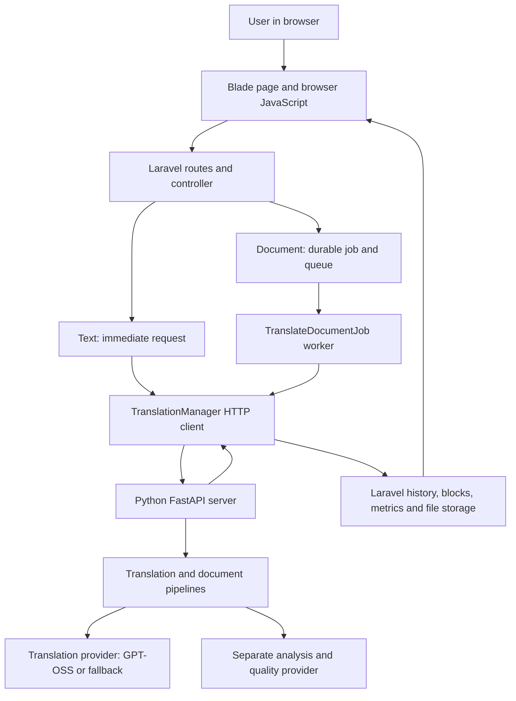
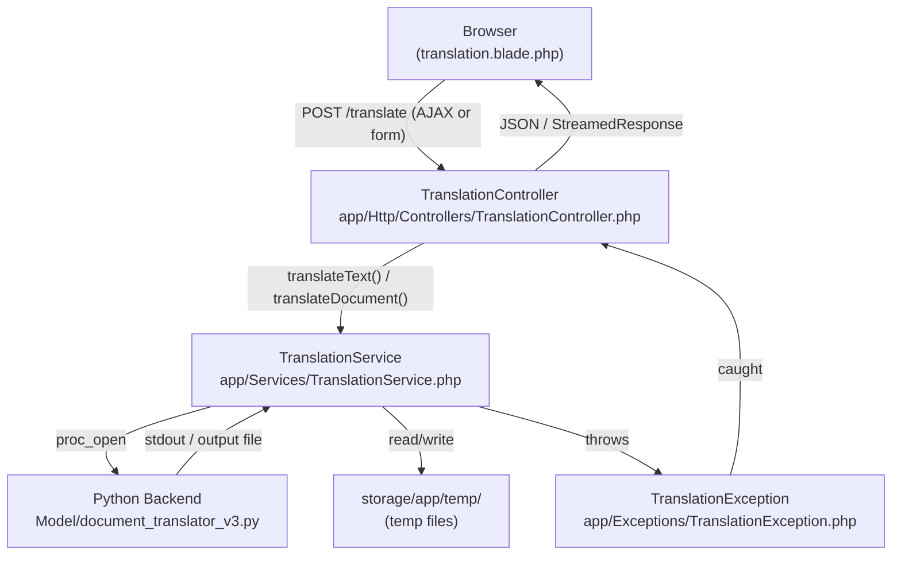

# System walkthrough

This is a source-oriented map, not a claim that every path was runtime-tested during cleanup. Full historical architecture, design, security and pipeline records follow in the preservation appendix.

## Architecture and data flow

Browser requests enter Laravel routes/controllers, pass authentication/session and role checks, then use application services for translation requests, history, metrics, quota and storage. Document work is dispatched to a queue; workers call the authenticated Python engine. Completion, download and admin-review paths distinguish completed, partial, held, draft and published material. Storage cleanup uses durable records/outbox reconciliation rather than assuming a failed remote deletion succeeded.

Key Laravel areas remain [app/](trilingua-code/app/), [routes/](trilingua-code/routes/), [config/](trilingua-code/config/), [database/](trilingua-code/database/), [resources/](trilingua-code/resources/) and [public/](trilingua-code/public/). Controller and service boundaries include TranslationController, TranslationService, TranslationManager, CompletedDownloadResolver, BlockService, HistoryService, MetricsService, QuotaService, StorageService and StorageCleanupService.

The engine entry point is [Model/server.py](trilingua-code/Model/server.py). Requests and responses use DTOs; [pipeline/](trilingua-code/Model/pipeline/), [providers/](trilingua-code/Model/providers/), [ai/](trilingua-code/Model/ai/), [document/](trilingua-code/Model/document/) and [validators/](trilingua-code/Model/validators/) implement translation, analysis and reconstruction. The package roots were not moved.

## Translation pipeline and providers

Text requests enter TranslationPipeline. Documents enter DocumentPipeline, which determines processing mode, extracts structure, applies document analysis/context/chunking as appropriate, translates, reconstructs and validates before returning output and metrics. DOCX/PPTX/XLSX use in-place format-aware paths; CSV uses a reduced route. The provider-neutral unit pipeline is guarded by its existing feature flag; its presence does not imply that every format uses it.

Translation and analysis have separate provider routes. Available translation providers include GPT-OSS/Ollama, Gemini and NLLB. Future provider classes are not proof of a supported active integration. Source defaults select GPT-OSS translation and Gemini fallback; analysis selects Gemini with Ollama fallback, subject to configured availability. Real configuration was not read.

Fast disables mode-level analysis features; Balanced enables document analysis/memory/chunking/specialized prompts/quality review/cache/prepass; Thorough additionally enables the layout-planner flag. Auto is resolved by request/document context rather than being a fourth fixed preset in the mode registry. Flags alone do not prove renderer application or identical behavior across typed text, CSV and office paths.

## Caching and concurrency

The persistent translation cache is SQLite-backed with provider/model/prompt-policy namespaces and a documented default lifetime of 30 days. Its code uses WAL, per-thread read connections, serialized/batched writes and per-thread document-cache statistics. Cache hits do not prove that quality review or repair made no provider calls.

Document pipeline source defaults include concurrency 8, merged analyzer/prepass mode and coherence polish disabled. GPT-OSS has shared translation slots; the server also bounds active translations with a semaphore and provider limits. Actual deployment limits can override defaults. Queue workers, retry-after, processing/reconciliation deadlines and provider request budgets must be configured together.

## Native and hybrid PDF reconstruction

Native extraction records text lines, bounding boxes, baselines, alignment, style runs, links and page geometry. Reconstruction replaces text while preserving surrounding graphics/images, resolves glyph coverage, fits translated words within collision-aware limits and validates the saved output. A page fallback or held/partial status is a safety result, not a successful complete translation.

Hybrid PDFs classify native and image regions. OCR requires runtime/language readiness, finite word/line geometry, confidence and acceptance evidence in strict mode. Bounded retries preserve uncertain source text when they fail. Historical policy records retain the 80 minimum word confidence, 95% independent word-accuracy acceptance gate, 10pt readability floor, 40MP per-image/120MP shared job budgets and 60-second OCR allowance; consult versioned source records for exact applicability.

Image replacement is limited to safe flat-background regions with sufficient fit and geometry. Signed frozen render plans bind reconstruction to source/material/settings. Saved-output checks cover source glyph removal, unchanged pixels outside masks, artwork, searchable text and page geometry. Preview skips only the qualifying acceptance-report check; it retains runtime, confidence, fit, geometry, resource and signed-plan safeguards. Regeneration uses saved plans and edits without fresh OCR/provider translation; held regions remain visibly held.

## Database, auth and RBAC

Laravel models/migrations define users, translation jobs/history/blocks/metrics, quotas, edit logs, activity and storage-cleanup state. Local test configuration declares SQLite in-memory; historical production records discuss PostgreSQL/Supabase. No schema or migration status was queried here. Role middleware gates admin routes; session/security middleware and Python service-token checks protect the separate application boundaries. Review publication/download integrity is distinct from successful provider transport.

Do not treat importing server.py as a passive inspection: source inspection confirms module-level environment loading and warmup, including SQLite cache initialization and provider health/model calls. This cleanup therefore uses compilation and AST inspection instead of importing the live application module.

## Other preserved material

Full extracted historical text follows. Original binary documents preserve images, tables and formatting beyond this text representation. Older commands/settings and contradicted claims are historical evidence. Sensitive-looking values are redacted only in the canonical copy; original files remain unchanged and private backup precautions still apply.

- [docs/CODEBASE_WALKTHROUGH_2026-10-15.md](#source-0352c442c49370be) — [docs/CODEBASE_WALKTHROUGH_2026-10-15.md](docs/CODEBASE_WALKTHROUGH_2026-10-15.md)
- [output/codebase-walkthrough-docx/TriLingua_Codebase_Walkthrough.pdf](#source-91e4ecea131dd560) — [output/codebase-walkthrough-docx/TriLingua_Codebase_Walkthrough.pdf](archive_candidates/output/codebase-walkthrough-docx/TriLingua_Codebase_Walkthrough.pdf)
- [output/reviews/hybrid-pdf-implementation/baseline/finish-mutations/Model/tools/ocr_kit/CAPTURE_GUIDE.md](#source-81f31b7d782e19bb) — [output/reviews/hybrid-pdf-implementation/baseline/finish-mutations/Model/tools/ocr_kit/CAPTURE_GUIDE.md](archive_candidates/output/reviews/hybrid-pdf-implementation/baseline/finish-mutations/Model/tools/ocr_kit/CAPTURE_GUIDE.md)
- [output/reviews/hybrid-pdf-implementation/baseline/finish-mutations/Model/tools/ocr_kit/README.md](#source-435554ac5d9a7831) — [output/reviews/hybrid-pdf-implementation/baseline/finish-mutations/Model/tools/ocr_kit/README.md](archive_candidates/output/reviews/hybrid-pdf-implementation/baseline/finish-mutations/Model/tools/ocr_kit/README.md)
- [output/reviews/hybrid-pdf-implementation/baseline/finish-start/dirty/trilingua-code/docs/ARCHITECTURAL_DESIGN.md](#source-017aa0f6ef2c4efd) — [output/reviews/hybrid-pdf-implementation/baseline/finish-start/dirty/trilingua-code/docs/ARCHITECTURAL_DESIGN.md](archive_candidates/output/reviews/hybrid-pdf-implementation/baseline/finish-start/dirty/trilingua-code/docs/ARCHITECTURAL_DESIGN.md)
- [output/reviews/hybrid-pdf-implementation/baseline/finish-start/dirty/TRILINGUA_COMPLETE_GUIDE.md](#source-9b46a5a23ef3a8a0) — [output/reviews/hybrid-pdf-implementation/baseline/finish-start/dirty/TRILINGUA_COMPLETE_GUIDE.md](archive_candidates/output/reviews/hybrid-pdf-implementation/baseline/finish-start/dirty/TRILINGUA_COMPLETE_GUIDE.md)
- [output/reviews/hybrid-pdf-implementation/baseline/review-start/dirty/trilingua-code/docs/ARCHITECTURAL_DESIGN.md](#source-c866c00fa5a601cf) — [output/reviews/hybrid-pdf-implementation/baseline/review-start/dirty/trilingua-code/docs/ARCHITECTURAL_DESIGN.md](archive_candidates/output/reviews/hybrid-pdf-implementation/baseline/review-start/dirty/trilingua-code/docs/ARCHITECTURAL_DESIGN.md)
- [output/reviews/hybrid-pdf-implementation/baseline/review-start/dirty/TRILINGUA_COMPLETE_GUIDE.md](#source-86d72714f41b596f) — [output/reviews/hybrid-pdf-implementation/baseline/review-start/dirty/TRILINGUA_COMPLETE_GUIDE.md](archive_candidates/output/reviews/hybrid-pdf-implementation/baseline/review-start/dirty/TRILINGUA_COMPLETE_GUIDE.md)
- [output/reviews/hybrid-pdf-implementation/baseline/source/trilingua-code/.kiro/specs/auth-css-rendering-fix/design.md](#source-9af131179e3e2464) — [output/reviews/hybrid-pdf-implementation/baseline/source/trilingua-code/.kiro/specs/auth-css-rendering-fix/design.md](archive_candidates/output/reviews/hybrid-pdf-implementation/baseline/source/trilingua-code/.kiro/specs/auth-css-rendering-fix/design.md)
- [output/reviews/hybrid-pdf-implementation/baseline/source/trilingua-code/.kiro/specs/dashboard-ui-fix/design.md](#source-5bab4d4e89f9ff63) — [output/reviews/hybrid-pdf-implementation/baseline/source/trilingua-code/.kiro/specs/dashboard-ui-fix/design.md](archive_candidates/output/reviews/hybrid-pdf-implementation/baseline/source/trilingua-code/.kiro/specs/dashboard-ui-fix/design.md)
- [output/reviews/hybrid-pdf-implementation/baseline/source/trilingua-code/.kiro/specs/new-translation-page/design.md](#source-c11bbf4c5dc25710) — [output/reviews/hybrid-pdf-implementation/baseline/source/trilingua-code/.kiro/specs/new-translation-page/design.md](archive_candidates/output/reviews/hybrid-pdf-implementation/baseline/source/trilingua-code/.kiro/specs/new-translation-page/design.md)
- [output/reviews/hybrid-pdf-implementation/baseline/source/trilingua-code/.kiro/specs/per-view-css-architecture/design.md](#source-54acbf2d32ade8bf) — [output/reviews/hybrid-pdf-implementation/baseline/source/trilingua-code/.kiro/specs/per-view-css-architecture/design.md](archive_candidates/output/reviews/hybrid-pdf-implementation/baseline/source/trilingua-code/.kiro/specs/per-view-css-architecture/design.md)
- [output/reviews/hybrid-pdf-implementation/baseline/source/trilingua-code/.kiro/specs/per-view-css-architecture/tasks.md](#source-3cf67aa6671e1461) — [output/reviews/hybrid-pdf-implementation/baseline/source/trilingua-code/.kiro/specs/per-view-css-architecture/tasks.md](archive_candidates/output/reviews/hybrid-pdf-implementation/baseline/source/trilingua-code/.kiro/specs/per-view-css-architecture/tasks.md)
- [output/reviews/hybrid-pdf-implementation/baseline/source/trilingua-code/.kiro/specs/supabase-cloud-storage/design.md](#source-95ef7c7a409da25d) — [output/reviews/hybrid-pdf-implementation/baseline/source/trilingua-code/.kiro/specs/supabase-cloud-storage/design.md](archive_candidates/output/reviews/hybrid-pdf-implementation/baseline/source/trilingua-code/.kiro/specs/supabase-cloud-storage/design.md)
- [output/reviews/hybrid-pdf-implementation/baseline/source/trilingua-code/.kiro/specs/translation-fixes/design.md](#source-7032a97108044e52) — [output/reviews/hybrid-pdf-implementation/baseline/source/trilingua-code/.kiro/specs/translation-fixes/design.md](archive_candidates/output/reviews/hybrid-pdf-implementation/baseline/source/trilingua-code/.kiro/specs/translation-fixes/design.md)
- [output/reviews/hybrid-pdf-implementation/baseline/source/trilingua-code/.kiro/specs/translation-pipeline-optimization/design.md](#source-d689137ac35ed4f6) — [output/reviews/hybrid-pdf-implementation/baseline/source/trilingua-code/.kiro/specs/translation-pipeline-optimization/design.md](archive_candidates/output/reviews/hybrid-pdf-implementation/baseline/source/trilingua-code/.kiro/specs/translation-pipeline-optimization/design.md)
- [output/reviews/hybrid-pdf-implementation/baseline/source/trilingua-code/.kiro/specs/translation-pipeline-optimization/tasks.md](#source-b5bb9ef791ec86d6) — [output/reviews/hybrid-pdf-implementation/baseline/source/trilingua-code/.kiro/specs/translation-pipeline-optimization/tasks.md](archive_candidates/output/reviews/hybrid-pdf-implementation/baseline/source/trilingua-code/.kiro/specs/translation-pipeline-optimization/tasks.md)
- [output/reviews/hybrid-pdf-implementation/baseline/source/trilingua-code/.kiro/specs/user-id-history-fix/design.md](#source-d24d4d0013fdc821) — [output/reviews/hybrid-pdf-implementation/baseline/source/trilingua-code/.kiro/specs/user-id-history-fix/design.md](archive_candidates/output/reviews/hybrid-pdf-implementation/baseline/source/trilingua-code/.kiro/specs/user-id-history-fix/design.md)
- [output/reviews/hybrid-pdf-implementation/baseline/source/trilingua-code/.kiro/specs/user-settings/design.md](#source-8ae3335805fd5508) — [output/reviews/hybrid-pdf-implementation/baseline/source/trilingua-code/.kiro/specs/user-settings/design.md](archive_candidates/output/reviews/hybrid-pdf-implementation/baseline/source/trilingua-code/.kiro/specs/user-settings/design.md)
- [output/reviews/hybrid-pdf-implementation/baseline/source/trilingua-code/docs/ARCHITECTURAL_DESIGN.md](#source-97b5712d25f4f442) — [output/reviews/hybrid-pdf-implementation/baseline/source/trilingua-code/docs/ARCHITECTURAL_DESIGN.md](archive_candidates/output/reviews/hybrid-pdf-implementation/baseline/source/trilingua-code/docs/ARCHITECTURAL_DESIGN.md)
- [output/reviews/hybrid-pdf-implementation/baseline/source/trilingua-code/security/containment-runbook.md](#source-a6c4ec90342e3167) — [output/reviews/hybrid-pdf-implementation/baseline/source/trilingua-code/security/containment-runbook.md](archive_candidates/output/reviews/hybrid-pdf-implementation/baseline/source/trilingua-code/security/containment-runbook.md)
- [output/reviews/hybrid-pdf-implementation/baseline/source/trilingua-code/security/rotation-runbook.md](#source-201ad5b974c7b338) — [output/reviews/hybrid-pdf-implementation/baseline/source/trilingua-code/security/rotation-runbook.md](archive_candidates/output/reviews/hybrid-pdf-implementation/baseline/source/trilingua-code/security/rotation-runbook.md)
- [output/reviews/hybrid-pdf-implementation/baseline/source/trilingua-code/security/SECRETS_INVENTORY.md](#source-286a556ffa6bb147) — [output/reviews/hybrid-pdf-implementation/baseline/source/trilingua-code/security/SECRETS_INVENTORY.md](archive_candidates/output/reviews/hybrid-pdf-implementation/baseline/source/trilingua-code/security/SECRETS_INVENTORY.md)
- [output/reviews/hybrid-pdf-implementation/baseline/source/trilingua-code/SECURITY_FEATURES.md](#source-88375f1b414f775b) — [output/reviews/hybrid-pdf-implementation/baseline/source/trilingua-code/SECURITY_FEATURES.md](archive_candidates/output/reviews/hybrid-pdf-implementation/baseline/source/trilingua-code/SECURITY_FEATURES.md)
- [output/reviews/ocr-functional-implementation/baseline/dirty/trilingua-code/docs/ARCHITECTURAL_DESIGN.md](#source-59ec50433312ab49) — [output/reviews/ocr-functional-implementation/baseline/dirty/trilingua-code/docs/ARCHITECTURAL_DESIGN.md](archive_candidates/output/reviews/ocr-functional-implementation/baseline/dirty/trilingua-code/docs/ARCHITECTURAL_DESIGN.md)
- [output/reviews/ocr-functional-implementation/baseline/dirty/TRILINGUA_COMPLETE_GUIDE.md](#source-1802cd9187536bc0) — [output/reviews/ocr-functional-implementation/baseline/dirty/TRILINGUA_COMPLETE_GUIDE.md](archive_candidates/output/reviews/ocr-functional-implementation/baseline/dirty/TRILINGUA_COMPLETE_GUIDE.md)
- [output/reviews/ocr-preview-implementation-2026-10-27/baseline/dirty/trilingua-code/docs/ARCHITECTURAL_DESIGN.md](#source-00df69ba9d80a974) — [output/reviews/ocr-preview-implementation-2026-10-27/baseline/dirty/trilingua-code/docs/ARCHITECTURAL_DESIGN.md](archive_candidates/output/reviews/ocr-preview-implementation-2026-10-27/baseline/dirty/trilingua-code/docs/ARCHITECTURAL_DESIGN.md)
- [output/reviews/ocr-preview-implementation-2026-10-27/baseline/dirty/TRILINGUA_COMPLETE_GUIDE.md](#source-42ee674a0c0909f6) — [output/reviews/ocr-preview-implementation-2026-10-27/baseline/dirty/TRILINGUA_COMPLETE_GUIDE.md](archive_candidates/output/reviews/ocr-preview-implementation-2026-10-27/baseline/dirty/TRILINGUA_COMPLETE_GUIDE.md)
- [TriLingua Provider Neutral Pipeline Improvement Report.docx](#source-7facedd941adcf3c) — [TriLingua Provider Neutral Pipeline Improvement Report.docx](TriLingua%20Provider%20Neutral%20Pipeline%20Improvement%20Report.docx)
- [trilingua-code/.kiro/specs/auth-css-rendering-fix/design.md](#source-a1e11a015a5f055b) — [trilingua-code/.kiro/specs/auth-css-rendering-fix/design.md](archive_candidates/trilingua-code/.kiro/specs/auth-css-rendering-fix/design.md)
- [trilingua-code/.kiro/specs/dashboard-ui-fix/design.md](#source-7370164fb0d387b1) — [trilingua-code/.kiro/specs/dashboard-ui-fix/design.md](archive_candidates/trilingua-code/.kiro/specs/dashboard-ui-fix/design.md)
- [trilingua-code/.kiro/specs/new-translation-page/design.md](#source-552a1c99b85c3f1c) — [trilingua-code/.kiro/specs/new-translation-page/design.md](archive_candidates/trilingua-code/.kiro/specs/new-translation-page/design.md)
- [trilingua-code/.kiro/specs/per-view-css-architecture/design.md](#source-84f33651f50bcfbe) — [trilingua-code/.kiro/specs/per-view-css-architecture/design.md](archive_candidates/trilingua-code/.kiro/specs/per-view-css-architecture/design.md)
- [trilingua-code/.kiro/specs/per-view-css-architecture/tasks.md](#source-267b84795c5d3a75) — [trilingua-code/.kiro/specs/per-view-css-architecture/tasks.md](archive_candidates/trilingua-code/.kiro/specs/per-view-css-architecture/tasks.md)
- [trilingua-code/.kiro/specs/supabase-cloud-storage/design.md](#source-8f99815eb3634327) — [trilingua-code/.kiro/specs/supabase-cloud-storage/design.md](archive_candidates/trilingua-code/.kiro/specs/supabase-cloud-storage/design.md)
- [trilingua-code/.kiro/specs/translation-fixes/design.md](#source-4226899e6601d957) — [trilingua-code/.kiro/specs/translation-fixes/design.md](archive_candidates/trilingua-code/.kiro/specs/translation-fixes/design.md)
- [trilingua-code/.kiro/specs/translation-pipeline-optimization/design.md](#source-69b9789c7ce1386b) — [trilingua-code/.kiro/specs/translation-pipeline-optimization/design.md](archive_candidates/trilingua-code/.kiro/specs/translation-pipeline-optimization/design.md)
- [trilingua-code/.kiro/specs/translation-pipeline-optimization/tasks.md](#source-d15bd221a65673ef) — [trilingua-code/.kiro/specs/translation-pipeline-optimization/tasks.md](archive_candidates/trilingua-code/.kiro/specs/translation-pipeline-optimization/tasks.md)
- [trilingua-code/.kiro/specs/user-id-history-fix/design.md](#source-68036160e64a2d71) — [trilingua-code/.kiro/specs/user-id-history-fix/design.md](archive_candidates/trilingua-code/.kiro/specs/user-id-history-fix/design.md)
- [trilingua-code/.kiro/specs/user-settings/design.md](#source-6fe525a2f1ef5f27) — [trilingua-code/.kiro/specs/user-settings/design.md](archive_candidates/trilingua-code/.kiro/specs/user-settings/design.md)
- [trilingua-code/docs/ARCHITECTURAL_DESIGN.md](#source-a1f61c4c356bdc1e) — [trilingua-code/docs/ARCHITECTURAL_DESIGN.md](archive_candidates/trilingua-code/docs/ARCHITECTURAL_DESIGN.md)
- [trilingua-code/Model/tools/ocr_kit/CAPTURE_GUIDE.md](#source-fd1f7bf96e117fdf) — [trilingua-code/Model/tools/ocr_kit/CAPTURE_GUIDE.md](archive_candidates/trilingua-code/Model/tools/ocr_kit/CAPTURE_GUIDE.md)
- [trilingua-code/Model/tools/ocr_kit/README.md](#source-3781340dbeaa67ff) — [trilingua-code/Model/tools/ocr_kit/README.md](archive_candidates/trilingua-code/Model/tools/ocr_kit/README.md)
- [trilingua-code/security/containment-runbook.md](#source-b5d386b2388c781f) — [trilingua-code/security/containment-runbook.md](archive_candidates/trilingua-code/security/containment-runbook.md)
- [trilingua-code/security/rotation-runbook.md](#source-93839900d82bfd59) — [trilingua-code/security/rotation-runbook.md](archive_candidates/trilingua-code/security/rotation-runbook.md)
- [trilingua-code/security/SECRETS_INVENTORY.md](#source-645889f43436f469) — [trilingua-code/security/SECRETS_INVENTORY.md](archive_candidates/trilingua-code/security/SECRETS_INVENTORY.md)
- [trilingua-code/SECURITY_FEATURES.md](#source-8b0b65087bd7bb06) — [trilingua-code/SECURITY_FEATURES.md](archive_candidates/trilingua-code/SECURITY_FEATURES.md)
- [TRILINGUA_COMPLETE_GUIDE.md](#source-73004bf051cfcd3c) — [TRILINGUA_COMPLETE_GUIDE.md](archive_candidates/TRILINGUA_COMPLETE_GUIDE.md)

<a id="source-0352c442c49370be"></a>

### Preserved source: docs/CODEBASE_WALKTHROUGH_2026-10-15.md

Original: [docs/CODEBASE_WALKTHROUGH_2026-10-15.md](docs/CODEBASE_WALKTHROUGH_2026-10-15.md). SHA-256: `adfefffe0d436633ab94cf3f806dc2be417024644133d4fbc0c8b07f1959f947`.

````text
# TriLingua codebase walkthrough

Source checked on 15 October 2026 (Asia/Manila). Repository: `C:\dev\Trilingua`; application: `C:\dev\Trilingua\trilingua-code`. The checkout is on `walben`, commit `cbbfc90`, with substantial local modifications and untracked implementation files. This guide describes the working files inspected, not just the committed version or a deployed website.

The main request, translation, persistence, and review paths were traced in source. A read-only request to the already-running Python service at `http://127.0.0.1:5000/health` confirmed its routing configuration. No new translation was submitted, and no application code or data was changed. This is an explanation, not a fresh production or translation-quality audit.

## 1. The architecture

TriLingua consists of a Laravel application and a Python translation service. The AI model is accessed through a provider adapter; most of the codebase handles the work around that model.



| Layer | Responsibility | Main location |
|---|---|---|
| Browser | Collect text/file and options; send request; display result; poll documents | [translation.blade.php](C:/dev/Trilingua/trilingua-code/resources/views/translation.blade.php) |
| Web backend | Authentication, ownership, validation, job acceptance, persistence, review | [routes/web.php](C:/dev/Trilingua/trilingua-code/routes/web.php), [app](C:/dev/Trilingua/trilingua-code/app) |
| HTTP bridge | Send text, documents, and regeneration requests to Python | [TranslationManager.php](C:/dev/Trilingua/trilingua-code/app/Services/Translation/TranslationManager.php) |
| Python service | Validate engine requests, choose providers, run pipelines, return results | [server.py](C:/dev/Trilingua/trilingua-code/Model/server.py) |
| Translation engineering | Context, batches, cache, checks, reconstruction | [pipeline](C:/dev/Trilingua/trilingua-code/Model/pipeline), [document](C:/dev/Trilingua/trilingua-code/Model/document) |
| Model access | Construct an API request and normalize its answer | [providers](C:/dev/Trilingua/trilingua-code/Model/providers) |

Laravel generally does not choose AI prompts or split translation blocks. It receives provider/model metadata, but delegates translation mechanics to Python. Python does not own the Laravel user's login or history pages.

## 2. Which model is working now?

The **running local Python service** reported:

| Job | Provider route | Reported model |
|---|---|---|
| Primary translation | `gptoss` | `gpt-oss:20b-cloud` |
| Translation fallback | `gemini` | `gemini-3.5-flash-lite` |
| Primary analysis and AI quality review | `gemini_analysis` | `gemini-3.5-flash-lite` |
| Analysis/review fallback | `ollama_analysis` | `gpt-oss:20b-cloud` |

The health response reported translation status `ok`, primary and fallback status `ok`, and analysis status `configured`. These statuses do not demonstrate the linguistic quality of a translation or prove that all routes have just generated a successful result.

There are four different questions:

1. **What did we configure?** Read the relevant environment settings.
2. **What did the running process load?** Read `/health`.
3. **Which route returned this text?** Inspect the text response's `provider` and `model`.
4. **Which routes participated in a document?** Inspect its Python `metrics.providers_used`, cache counts, and warnings while the response is available.

### Configuration and selection files

The shared [Laravel .env](C:/dev/Trilingua/trilingua-code/.env) currently contains these non-secret model settings:

```dotenv
TRANSLATION_PROVIDER=gptoss
TRANSLATION_FALLBACK_PROVIDER=gemini
ANALYSIS_PROVIDER=gemini
ANALYSIS_FALLBACK_PROVIDER=ollama
OLLAMA_CLOUD_MODEL=gpt-oss:20b-cloud
OLLAMA_ANALYSIS_MODEL=gpt-oss:20b-cloud
GEMINI_MODEL=gemini-3.5-flash-lite
GEMINI_ANALYSIS_MODEL=gemini-3.5-flash-lite
TRANSLATION_ANALYZER_MODE=merged
```

These are different roles even when two roles use the same model.

- [config/environment.py](C:/dev/Trilingua/trilingua-code/Model/config/environment.py) loads selected settings from Laravel's `.env`. An already-set, nonempty process environment variable takes precedence.
- [server.py:89](C:/dev/Trilingua/trilingua-code/Model/server.py:89) reads provider names. `_get_active_provider()` chooses the primary, and `_get_pipeline_provider()` wraps it with fallback. The pipelines are constructed during service initialization.
- [providers/gptoss.py:72](C:/dev/Trilingua/trilingua-code/Model/providers/gptoss.py:72) reads `OLLAMA_CLOUD_MODEL` and `OLLAMA_CLOUD_URL`.
- [providers/gemini.py:103](C:/dev/Trilingua/trilingua-code/Model/providers/gemini.py:103) reads `GEMINI_MODEL` for translation.
- [ai/gemini_provider.py:113](C:/dev/Trilingua/trilingua-code/Model/ai/gemini_provider.py:113) reads `GEMINI_ANALYSIS_MODEL` for analysis/review.
- [ai/ollama_provider.py](C:/dev/Trilingua/trilingua-code/Model/ai/ollama_provider.py) handles Ollama analysis/review.

Editing `.env` alone does not replace provider objects already loaded in Python. Restart the Python service for provider changes; Laravel config caching can also affect bridge settings. A dropdown mode such as `thorough` does not choose another model.

### What the health model string means

```text
engine: provider:gptoss_with_gemini_fallback
model:  gpt-oss:20b-cloud|gemini-3.5-flash-lite
```

The pipe-separated string describes a chain. It does not mean every request used both models. GPT-OSS can answer alone, fallback can answer, different document blocks can take different routes, and cache can supply a prior translation without a new translation-model call.

The adapters report their configured model identifiers. This is application-level provenance; it is not independent verification of a remote provider's underlying weights.

### Where the model request happens

[GPTOSSProvider.translate():108](C:/dev/Trilingua/trilingua-code/Model/providers/gptoss.py:108) builds system/user prompts and sends an HTTP request containing `model: self._model` and `messages` to the configured Ollama chat endpoint. It extracts the reply, checks/sanitizes it, and returns a `TranslationResponse`.

[GeminiProvider.translate():139](C:/dev/Trilingua/trilingua-code/Model/providers/gemini.py:139) performs the corresponding Gemini operation. The provider file contains the connection and response-handling logic; the model is not implemented inside that Python file.

### A limitation in historical model evidence

For text, [server.py:501](C:/dev/Trilingua/trilingua-code/Model/server.py:501) returns `provider`, `model`, warnings, and token usage. [TranslationManager.php:72](C:/dev/Trilingua/trilingua-code/app/Services/Translation/TranslationManager.php:72) logs those values; [TranslationController.php:71](C:/dev/Trilingua/trilingua-code/app/Http/Controllers/TranslationController.php:71) passes them to [MetricsService.php](C:/dev/Trilingua/trilingua-code/app/Services/MetricsService.php). Cache responses explicitly use `provider="cache"`; their model value describes the configured cache namespace/chain, not a model newly called.

For documents, [DocumentContext.record_provider():274](C:/dev/Trilingua/trilingua-code/Model/pipeline/document_context.py:274) records observed provider responses. [_engine_metrics():107](C:/dev/Trilingua/trilingua-code/Model/pipeline/document_pipeline.py:107) returns `providers_used` alongside route information and cache counts. This is an aggregate diagnostic, not a complete per-block or per-outbound-request audit.

**Laravel's current `persistDocumentMetrics()` stores selected fields, including `provider` and `model`, but does not persist `providers_used`.** The document's top-level provider/model can describe the configured chain. The captured review blocks do not supply a complete per-block provider history either. Therefore, historical document metrics alone may not establish exactly which model translated every block. Metrics writes are also best-effort, so an absent metric does not necessarily mean translation failed.

The [admin dashboard](C:/dev/Trilingua/trilingua-code/resources/views/admin/dashboard.blade.php:239) also has an engine provider/model display. A runtime engine label is not evidence of which route handled an older document.

## 3. Text translation: exact request flow

Suppose the user enters an English paragraph, selects Cebuano, and presses Translate.

1. [translation.blade.php:353](C:/dev/Trilingua/trilingua-code/resources/views/translation.blade.php:353) builds form data with `text`, `source_lang`, `target_lang`, and `mode`; its JavaScript sends `POST /translate`.
2. [routes/web.php](C:/dev/Trilingua/trilingua-code/routes/web.php) routes the authenticated request to `TranslationController::translate()`.
3. [TranslationController.php:71](C:/dev/Trilingua/trilingua-code/app/Http/Controllers/TranslationController.php:71) checks accepted languages, different source/target languages, text length, mode, and the presence of text or a document. If a document is attached, the document branch takes precedence.
4. The controller builds [TranslationRequest.php](C:/dev/Trilingua/trilingua-code/app/Services/Translation/DTO/TranslationRequest.php). This DTO packages data; it does not translate anything.
5. [TranslationManager::translateText():72](C:/dev/Trilingua/trilingua-code/app/Services/Translation/TranslationManager.php:72) sends JSON to Python's `POST /translate/text`, with the service token when configured.
6. [server.py:501](C:/dev/Trilingua/trilingua-code/Model/server.py:501) validates the engine input, resolves the mode, and invokes `TranslationPipeline.translate()` under its concurrency guard.
7. [TranslationPipeline.translate():659](C:/dev/Trilingua/trilingua-code/Model/pipeline/translation_pipeline.py:659) checks the persistent cache, assembles context, and invokes the translation provider through `_translate_with_echo_guard()`.
8. [providers/fallback.py:110](C:/dev/Trilingua/trilingua-code/Model/providers/fallback.py:110) tries the primary, or directs the request to fallback after a failure/cooldown. The pipeline can also request semantic fallback for invalid or unchanged output.
9. For modes with AI review, the server uses [AIQualityReviewer](C:/dev/Trilingua/trilingua-code/Model/validators/ai_quality_reviewer.py). It may request one repair translation using the review's issues. An unavailable review can return warnings with the valid translation rather than discard it.
10. Python returns the translated string plus metadata. Laravel turns that into [TranslationResponse.php](C:/dev/Trilingua/trilingua-code/app/Services/Translation/DTO/TranslationResponse.php).
11. The controller attempts to save history, notify the user/admins, and persist metrics, then returns JSON to the browser.

Text translation is **synchronous**: the browser waits for this request. History persistence is handled separately: a valid translation can return with `saved=false`. The browser has a warning for this case. Successful generation does not automatically prove successful history persistence.

## 4. Document translation: acceptance, work, completion

Document translation is **queued**. The first browser request accepts work; it does not wait for the finished file.

### Acceptance in Laravel

[TranslationController::handleDocument():247](C:/dev/Trilingua/trilingua-code/app/Http/Controllers/TranslationController.php:247):

1. Moves the uploaded source to scratch storage so the worker can read it later.
2. Checks that its contents match its claimed file type.
3. Hashes the actual bytes and combines the hash with user, languages, mode, and PDF options into a deduplication key.
4. Reuses a matching completed result when downloadable, or returns an existing active job ID.
5. Atomically reserves the daily upload quota.
6. Attempts durable storage of the original, which enables later retries, review, and retranslation.
7. Creates a `translation_jobs` state row and dispatches `TranslateDocumentJob`. The queued-state write and database queue insertion share a transaction.
8. Returns a `job_id` to the browser. Ambiguous dispatch outcomes are classified using durable readback rather than simply treated as rejection.

### Work in the queue worker

[TranslateDocumentJob::handle():101](C:/dev/Trilingua/trilingua-code/app/Jobs/TranslateDocumentJob.php:101):

1. Marks the job processing and obtains a readable source. A retry can recover the source from its durable original.
2. Calls `TranslationManager::translateDocument()`.
3. Receives file bytes, blocks, sidecar, and metrics from Python.
4. Writes the translated bytes to scratch, then stores the result durably.
5. Creates or reuses the history row and persists the required review blocks/sidecar.
6. Persists optional metrics.
7. Conditionally marks the job completed, exposes the download, sends notifications, and cleans scratch files.

Completion is deliberately late. A generated output file is not enough: the job also needs retrievable storage, history, and review data. Terminal transitions are guarded against another worker/reconciler already changing the state.

### Browser status

[translation.blade.php:484](C:/dev/Trilingua/trilingua-code/resources/views/translation.blade.php:484) polls `GET /translate/status/{jobId}` with increasing delays. [TranslationController::status():629](C:/dev/Trilingua/trilingua-code/app/Http/Controllers/TranslationController.php:629) reads the owner-scoped durable job row first, with history/cache compatibility paths.

```text
created -> queued -> processing -> completed
                              -> failed
                              -> cancelled
```

Progress is Laravel's coarse phase progress, not a live token count or a guaranteed percentage of translated words. The browser does not declare failure simply because a long translation takes time.

## 5. What Python does to a document

[DocumentPipeline.translate():212](C:/dev/Trilingua/trilingua-code/Model/pipeline/document_pipeline.py:212) coordinates these steps:

```text
source file
  -> determine processing mode
  -> collect/extract blocks and structural metadata
  -> analyze document and prepare terminology/context when enabled
  -> translate blocks with cache, batches, checks, and optional review
  -> validate translated content/layout
  -> reconstruct or replay into the original structure
  -> create review blocks and regeneration sidecar
  -> return output file plus metrics
```

The analyzer and prepass can be merged into one AI call (`TRANSLATION_ANALYZER_MODE=merged` in the current file configuration). Their output supplies document type, style/context, and terminology. It does not replace the translated paragraphs.

### Office formats: DOCX, PPTX, XLSX

[_translate_inplace():647](C:/dev/Trilingua/trilingua-code/Model/pipeline/document_pipeline.py:647) uses a collect/translate/replay approach:

- Walk the source without saving and collect each translatable element in a stable order.
- Translate the collected text through `batch_translate_blocks()` with context and review options.
- Walk the source again, using an index-to-translation lookup to write each result back into the corresponding element.

[reconstructor.py](C:/dev/Trilingua/trilingua-code/Model/document/reconstructor.py) contains the walkers. DOCX includes paragraphs, tables, headers/footers, and text boxes; PPTX handles slide text; XLSX handles string cells. Using the original as a template helps retain document structure, but does not guarantee identical formatting or semantic placement of bold spans after text length changes.

### PDF and other formats

[extractor.py](C:/dev/Trilingua/trilingua-code/Model/document/extractor.py) dispatches by format. PDF uses PyMuPDF text extraction and layout metadata. If no text is found, the pipeline attempts the optional [ocr_extractor.py](C:/dev/Trilingua/trilingua-code/Model/document/ocr_extractor.py) route; installed OCR dependencies and extractable content remain prerequisites.

Translated PDF blocks are fitted back into layout by [reconstructor.py:763](C:/dev/Trilingua/trilingua-code/Model/document/reconstructor.py:763). PDF column settings affect reading/extraction order. Thorough mode can add a layout plan. CSV has a separate row/cell path; TXT/MD and RTF/ODT use their corresponding readers/writers. RTF and ODT output as DOCX under the configured format contract.

The Python document endpoint returns a **JSON envelope**, not just a raw downloaded file:

```text
file_base64        encoded reconstructed file bytes
blocks             source and translated elements for review
sidecar            reconstruction recipe and metadata
metrics            timings, route labels, counts and diagnostics
download_filename  intended user-facing filename
mime_type          output type
validation         output validation information
```

[TranslationManager::translateDocument():135](C:/dev/Trilingua/trilingua-code/app/Services/Translation/TranslationManager.php:135) decodes the file. The current bridge selects specific envelope fields rather than persisting every Python diagnostic.

## 6. Block, chunk, batch, unit: different things

| Term | Meaning in this codebase | Why it exists |
|---|---|---|
| Block | A structural element such as a paragraph, heading, table cell, or PDF text box | Preserve where translated content belongs |
| Chunk | A context/request-size segment; oversized text can be split and related blocks can be grouped | Fit request budgets and provide coherent context |
| Batch | Several work items packaged into one provider request | Reduce request overhead |
| TranslationUnit | A typed internal record tied to an original block | Carry identity, context, protected spans, and geometry through the optional unit pipeline |

Batching does not mean merging all translated paragraphs into one paragraph. Results are keyed to identities and reassembled in original block order even when requests finish out of order.

The current legacy block path packs batches using provider item/character limits. Some older comments still describe fixed short-block batches; read the actual packing loop in [translation_pipeline.py:885](C:/dev/Trilingua/trilingua-code/Model/pipeline/translation_pipeline.py:885).

The optional `TRANSLATION_UNIT_PIPELINE` path uses [dto/pipeline.py](C:/dev/Trilingua/trilingua-code/Model/dto/pipeline.py), [unit_adapters.py](C:/dev/Trilingua/trilingua-code/Model/pipeline/unit_adapters.py), and `batch_translate_units()`. Its code default is false and it was not explicitly present in the inspected `.env`; `/health` does not expose the running flag, so this check did not establish whether an external process override enabled it. Office in-place and CSV paths retain their block-oriented routes even if the flag is enabled.

## 7. Translation logic file map

| File | What it actually does |
|---|---|
| [server.py](C:/dev/Trilingua/trilingua-code/Model/server.py) | Engine endpoints, environment loading, provider initialization, request concurrency guard, response envelopes |
| [translation_pipeline.py](C:/dev/Trilingua/trilingua-code/Model/pipeline/translation_pipeline.py) | Translation work preparation, cache, passthrough, context, batching, retries/echo checks, review integration, ordered reassembly |
| [document_pipeline.py](C:/dev/Trilingua/trilingua-code/Model/pipeline/document_pipeline.py) | Whole-document orchestration, format branching, analysis, translation, reconstruction, sidecar, metrics |
| [document_context.py](C:/dev/Trilingua/trilingua-code/Model/pipeline/document_context.py) | Per-document state: profile, memory, timing, counters, warnings, observed provider responses |
| [phase_profiler.py](C:/dev/Trilingua/trilingua-code/Model/pipeline/phase_profiler.py) | Phase and AI-call timing helpers used by the pipelines |
| [fair_scheduler.py](C:/dev/Trilingua/trilingua-code/Model/pipeline/fair_scheduler.py) | Process-wide scheduling of GPT-OSS document batches so concurrent documents share execution capacity |
| [coherence_polish.py](C:/dev/Trilingua/trilingua-code/Model/pipeline/coherence_polish.py) | Optional later coherence pass; the pipeline flag defaults off |
| [providers/base.py](C:/dev/Trilingua/trilingua-code/Model/providers/base.py) | Common translation-provider contract |
| [providers/gptoss.py](C:/dev/Trilingua/trilingua-code/Model/providers/gptoss.py) | Ollama chat requests, retries, prompt use, result parsing, native unit batching |
| [providers/gemini.py](C:/dev/Trilingua/trilingua-code/Model/providers/gemini.py) | Gemini translation requests and response normalization |
| [providers/fallback.py](C:/dev/Trilingua/trilingua-code/Model/providers/fallback.py) | Primary/fallback routing, service failure cooldowns, direct semantic fallback |
| [ai/base.py](C:/dev/Trilingua/trilingua-code/Model/ai/base.py) | Separate analysis-provider interface |
| [ai/gemini_provider.py](C:/dev/Trilingua/trilingua-code/Model/ai/gemini_provider.py) | Structured AI analysis/review requests through Gemini |
| [ai/ollama_provider.py](C:/dev/Trilingua/trilingua-code/Model/ai/ollama_provider.py) | Structured analysis/review through Ollama |
| [ai/fallback_provider.py](C:/dev/Trilingua/trilingua-code/Model/ai/fallback_provider.py) | Fallback for analysis/review, separate from translation fallback |
| [prompts/system.py](C:/dev/Trilingua/trilingua-code/Model/prompts/system.py) | Translation role and language-specific rules |
| [prompts/translation.py](C:/dev/Trilingua/trilingua-code/Model/prompts/translation.py) | Source-text instructions, block role, language constraints, few-shot examples |
| [prompts/context.py](C:/dev/Trilingua/trilingua-code/Model/prompts/context.py) | Context prompt construction |
| [prompts/prepass.py](C:/dev/Trilingua/trilingua-code/Model/prompts/prepass.py) | Document summary/domain/terminology prepass prompts and injection |
| [prompts/quality.py](C:/dev/Trilingua/trilingua-code/Model/prompts/quality.py) | AI-review prompt templates |
| [prompts/specialized](C:/dev/Trilingua/trilingua-code/Model/prompts/specialized) | Domain templates, including academic, business, invoice, legal, medical, presentation, resume, technical |
| [document_analyzer.py](C:/dev/Trilingua/trilingua-code/Model/document/document_analyzer.py) | Document profile and merged analysis/prepass support |
| [document_memory.py](C:/dev/Trilingua/trilingua-code/Model/memory/document_memory.py) | Request-scoped terminology, entities, style, and translation context |
| [terminology.py](C:/dev/Trilingua/trilingua-code/Model/memory/terminology.py) | Small context buffer and terminology helpers |
| [glossary.py](C:/dev/Trilingua/trilingua-code/Model/memory/glossary.py) | Applies supplied terminology pairs |
| [sqlite_cache.py](C:/dev/Trilingua/trilingua-code/Model/cache/sqlite_cache.py) | Persistent translated-string cache with a fast in-memory layer |
| [chunker.py](C:/dev/Trilingua/trilingua-code/Model/document/chunker.py) | Size-based text splitting |
| [semantic_chunker.py](C:/dev/Trilingua/trilingua-code/Model/document/semantic_chunker.py) | Groups related content using a document profile |
| [extractor.py](C:/dev/Trilingua/trilingua-code/Model/document/extractor.py) | Reads format-specific source blocks and metadata; does not call the translation provider |
| [reconstructor.py](C:/dev/Trilingua/trilingua-code/Model/document/reconstructor.py) | Applies supplied translated text, handles Office walkers and output writers/PDF fitting |
| [layout.py](C:/dev/Trilingua/trilingua-code/Model/document/layout.py) | Layout helpers reused by reconstruction |
| [layout_planner.py](C:/dev/Trilingua/trilingua-code/Model/document/layout_planner.py) | Optional AI-assisted PDF layout recommendations |
| [regenerator.py](C:/dev/Trilingua/trilingua-code/Model/document/regenerator.py) | Sidecar creation and reconstruction with admin overrides; no retranslation |
| [hallucination_detector.py](C:/dev/Trilingua/trilingua-code/Model/validators/hallucination_detector.py) | Sanitization and deterministic content checks used by providers/pipelines |
| [ai_quality_reviewer.py](C:/dev/Trilingua/trilingua-code/Model/validators/ai_quality_reviewer.py) | AI and deterministic review, issue severity, repair recommendations |
| [translation_validator.py](C:/dev/Trilingua/trilingua-code/Model/validators/translation_validator.py) | Validation helpers, PDF validation errors, optional BLEU reporting |
| [dto/requests.py](C:/dev/Trilingua/trilingua-code/Model/dto/requests.py) | Python request records and supported-language mappings |
| [dto/responses.py](C:/dev/Trilingua/trilingua-code/Model/dto/responses.py) | Python result records |
| [dto/pipeline.py](C:/dev/Trilingua/trilingua-code/Model/dto/pipeline.py) | TranslationUnit, protected span, result, quality/layout and provider-capability records |
| [unit_adapters.py](C:/dev/Trilingua/trilingua-code/Model/pipeline/unit_adapters.py) | Dictionary/unit conversions and provider-facing context |
| [document/map.py](C:/dev/Trilingua/trilingua-code/Model/document/map.py) | Unit-path reading order, neighbors, sections, table-header context |
| [protected_spans.py](C:/dev/Trilingua/trilingua-code/Model/document/protected_spans.py) | Detects/checks/restores literal numbers, URLs, emails, placeholders, inline code |
| [layout_preflight.py](C:/dev/Trilingua/trilingua-code/Model/document/layout_preflight.py) | Advisory fitting checks for the unit pipeline |

The map describes responsibilities, not a claim that every module is enabled for every request.

## 8. Why cache, memory, checks, and fallback matter

**Cache:** identical translation work may reuse a result. The single-text pipeline uses a cache namespace containing prompt version, provider chain, and model identifiers; lookup also uses source/target language and source text. However, `DocumentPipeline._get_cache()` constructs a separate cache without that namespace. Do not assume changing a model or prompt automatically invalidates document-cache entries. Cache values do not retain complete originating-model provenance. Completed-document deduplication in Laravel is a separate reuse mechanism, and its acceptance hash also does not include the translation model.

**Memory:** `DocumentMemory` is temporary context for one document. It is not model training, a change to model weights, or a permanent user conversation memory. It gives later requests terminology and document context.

**Prompts:** rules ask the model to preserve meaning, names, numbers, certainty, and formatting constraints and use natural Cebuano/Filipino. These instructions shape requests; they do not guarantee compliance.

**Checks:** output sanitization, content checks, echo detection, protected-literal checks, and AI review address different failures. AI scores are reviewer outputs, not human-validated accuracy percentages. BLEU reporting requires a supplied reference and is not automatic proof of accuracy.

**Fallback:** a transport/quota failure can open a temporary cooldown so later work goes to the backup. A malformed/echoed answer can trigger a request-local retry or semantic fallback. Not every individual block failure is fatal: some isolated failures retain source content with warnings. Systemic and invalid-content failures can fail the job rather than return the source document as false success. Inspect warnings as well as completion status.

## 9. Processing modes

The presets are in [processing_modes.py](C:/dev/Trilingua/trilingua-code/Model/config/processing_modes.py).

| Mode | Main intended behavior |
|---|---|
| Fast | Skips most optional document analysis/context/AI-review enhancements |
| Balanced | Enables document analysis, memory, semantic context, specialized prompts, prepass, and AI review |
| Thorough | Balanced features plus optional PDF layout planning |
| Auto | Document heuristic chooses a preset from format, block count, words, and tables; text endpoint resolves auto to balanced |

Actual behavior also depends on code paths, installed dependencies, and environment flags. In particular, the shared persistent cache is acquired through its own global flag; the fast preset's `translation_cache=False` field does not by itself prove that a request bypasses that cache. More features can mean more calls and longer latency; these labels do not establish a measured quality improvement.

## 10. Where data is stored

| Table/object | Purpose | Code |
|---|---|---|
| `users` | Accounts, settings, admin flag | [User.php](C:/dev/Trilingua/trilingua-code/app/Models/User.php) |
| `jobs` / `failed_jobs` | Laravel queue delivery and failed queue entries | [queue.php](C:/dev/Trilingua/trilingua-code/config/queue.php), [queue migration](C:/dev/Trilingua/trilingua-code/database/migrations/0001_01_01_000002_create_jobs_table.php) |
| `translation_jobs` | Durable business state: UUID, dedup hash, progress, source/output references, recovery | [TranslationJob.php](C:/dev/Trilingua/trilingua-code/app/Models/TranslationJob.php) |
| `translation_history` | User-visible text/document record, language pair, review state, file references, revisions, sidecar | [TranslationHistory.php](C:/dev/Trilingua/trilingua-code/app/Models/TranslationHistory.php) |
| `translation_blocks` | Document source, original AI text, draft text, published text, review information | [TranslationBlock.php](C:/dev/Trilingua/trilingua-code/app/Models/TranslationBlock.php) |
| `translation_metrics` | Selected engine timing, model/route labels and counters | [TranslationMetric.php](C:/dev/Trilingua/trilingua-code/app/Models/TranslationMetric.php) |
| `translation_edit_log` | Append-only review/edit/publish audit records | [TranslationEditLog.php](C:/dev/Trilingua/trilingua-code/app/Models/TranslationEditLog.php) |
| `translation_quota` | Daily upload reservations | [TranslationQuota.php](C:/dev/Trilingua/trilingua-code/app/Models/TranslationQuota.php), [QuotaService.php](C:/dev/Trilingua/trilingua-code/app/Services/QuotaService.php) |
| `storage_cleanup_outbox` | Deferred deletion/publish-candidate cleanup | [StorageCleanupOutbox.php](C:/dev/Trilingua/trilingua-code/app/Models/StorageCleanupOutbox.php) |
| File objects | Original and generated file bytes | [StorageService.php](C:/dev/Trilingua/trilingua-code/app/Services/StorageService.php) |
| Python SQLite cache | Previously translated strings | [cache/sqlite_cache.py](C:/dev/Trilingua/trilingua-code/Model/cache/sqlite_cache.py) |

The inspected `.env` specifies PostgreSQL and a database queue. History writes use Eloquent via [HistoryService.php](C:/dev/Trilingua/trilingua-code/app/Services/HistoryService.php). This differs from the Supabase file-storage HTTP calls.

StorageService attempts Supabase storage first, then a configured local fallback volume when enabled. The code copies fallback bytes into the configured directory; durability depends on deployment configuration. A filename or a database row is not the file itself.

[CompletedDownloadResolver.php](C:/dev/Trilingua/trilingua-code/app/Services/Translation/CompletedDownloadResolver.php) distinguishes readable, missing, and temporarily unknown output. A temporary storage outage does not prove the file was deleted. Download/history controllers also apply user ownership checks; signed URLs are generated separately.

## 11. Admin review and publication

Execution state and review state are independent. `completed` means the translation job completed; review statuses are `pending`, `verified`, `edited`, or `flagged`, defined in [ReviewStatus.php](C:/dev/Trilingua/trilingua-code/app/Support/ReviewStatus.php).

For each document block:

```text
source_text        original source
ai_translated_text original AI translation, preserved for audit
current_text       current admin draft
published_text     text represented by the published downloadable version
```

[BlockService.php](C:/dev/Trilingua/trilingua-code/app/Services/BlockService.php) creates those records. [ReviewService.php](C:/dev/Trilingua/trilingua-code/app/Services/Admin/ReviewService.php) handles edits, flags, verification, audit records, and publishing.

**Draft edit:** update `current_text`, log the previous/new values, increase `draft_revision`, mark review status edited. The old downloadable file still exists.

**Save & Regenerate:** [ReviewService::saveAndRegenerate():409](C:/dev/Trilingua/trilingua-code/app/Services/Admin/ReviewService.php:409) snapshots all draft blocks, reads the original, overlays them into a sidecar, and calls [TranslationManager::regenerateDocument():241](C:/dev/Trilingua/trilingua-code/app/Services/Translation/TranslationManager.php:241). Python's [regenerator.py](C:/dev/Trilingua/trilingua-code/Model/document/regenerator.py) reconstructs without another translation call. Laravel stores and checks a new output, then commits its pointer, `published_revision`, `published_text`, and publish audit record if the draft has not changed in the meantime.

**Verify:** document verification refuses unpublished edits; the downloadable file must represent the current draft first. This protects against approving text that users cannot yet download.

**Retranslate:** [DocumentsController::retranslate():78](C:/dev/Trilingua/trilingua-code/app/Http/Controllers/DocumentsController.php:78) starts a new translation job from the stored original and links the resulting history to its parent document. This is different from regeneration.

## 12. Feature-to-file map

| Feature | Follow these files |
|---|---|
| Login/register/password reset/Google login | [Auth controllers](C:/dev/Trilingua/trilingua-code/app/Http/Controllers/Auth), [auth views](C:/dev/Trilingua/trilingua-code/resources/views/auth), User model and web routes |
| Session and admin access | [ValidateSession.php](C:/dev/Trilingua/trilingua-code/app/Http/Middleware/ValidateSession.php), [EnsureUserIsAdmin.php](C:/dev/Trilingua/trilingua-code/app/Http/Middleware/EnsureUserIsAdmin.php), [bootstrap/app.php](C:/dev/Trilingua/trilingua-code/bootstrap/app.php) |
| User dashboard/statistics | [DashboardController.php](C:/dev/Trilingua/trilingua-code/app/Http/Controllers/DashboardController.php), [TranslationStatsService.php](C:/dev/Trilingua/trilingua-code/app/Services/TranslationStatsService.php), [dashboard.blade.php](C:/dev/Trilingua/trilingua-code/resources/views/dashboard.blade.php) |
| Translation UI and capabilities | TranslationController, translation view, [config/translation.php](C:/dev/Trilingua/trilingua-code/config/translation.php) |
| Saved history, details, download, rename, delete | [HistoryController.php](C:/dev/Trilingua/trilingua-code/app/Http/Controllers/HistoryController.php), HistoryService, StorageService, [history.blade.php](C:/dev/Trilingua/trilingua-code/resources/views/history.blade.php), [history-detail.blade.php](C:/dev/Trilingua/trilingua-code/resources/views/history-detail.blade.php) |
| Documents and retranslation | [DocumentsController.php](C:/dev/Trilingua/trilingua-code/app/Http/Controllers/DocumentsController.php), [my-documents.blade.php](C:/dev/Trilingua/trilingua-code/resources/views/my-documents.blade.php), TranslateDocumentJob |
| Bookmarks and priority | HistoryController updates record flags; [BookmarksController.php](C:/dev/Trilingua/trilingua-code/app/Http/Controllers/BookmarksController.php) lists bookmarks |
| Notifications | [NotificationController.php](C:/dev/Trilingua/trilingua-code/app/Http/Controllers/NotificationController.php), [Notifications](C:/dev/Trilingua/trilingua-code/app/Notifications), [AdminNotifier.php](C:/dev/Trilingua/trilingua-code/app/Support/AdminNotifier.php) |
| Profile/settings | [ProfileController.php](C:/dev/Trilingua/trilingua-code/app/Http/Controllers/ProfileController.php), [SettingsController.php](C:/dev/Trilingua/trilingua-code/app/Http/Controllers/SettingsController.php), corresponding views |
| Admin review queue and text edits | [Admin/ReviewController.php](C:/dev/Trilingua/trilingua-code/app/Http/Controllers/Admin/ReviewController.php), [TextReviewController.php](C:/dev/Trilingua/trilingua-code/app/Http/Controllers/Admin/TextReviewController.php), ReviewService, [review-text.blade.php](C:/dev/Trilingua/trilingua-code/resources/views/admin/review-text.blade.php) |
| Admin document editing/publishing | [DocumentReviewController.php](C:/dev/Trilingua/trilingua-code/app/Http/Controllers/Admin/DocumentReviewController.php), ReviewService, [review-document.blade.php](C:/dev/Trilingua/trilingua-code/resources/views/admin/review-document.blade.php), [review-document.js](C:/dev/Trilingua/trilingua-code/resources/js/review-document.js) |
| Document browser previews | [document-preview.js](C:/dev/Trilingua/trilingua-code/resources/js/document-preview.js); frontend preview libraries are listed in package.json |
| Admin jobs/retries/users/audit | [Admin controllers](C:/dev/Trilingua/trilingua-code/app/Http/Controllers/Admin), admin views, TranslationJob and activity/edit logs |
| Cleanup and reconciliation | [Console/Commands](C:/dev/Trilingua/trilingua-code/app/Console/Commands), [StorageCleanupService.php](C:/dev/Trilingua/trilingua-code/app/Services/StorageCleanupService.php), schedule in bootstrap/app.php |
| Page styling/assets | [resources/css](C:/dev/Trilingua/trilingua-code/resources/css), [resources/js/app.js](C:/dev/Trilingua/trilingua-code/resources/js/app.js), [vite.config.js](C:/dev/Trilingua/trilingua-code/vite.config.js) |
| Schema | [database/migrations](C:/dev/Trilingua/trilingua-code/database/migrations) |
| Behavior checks | [Laravel tests](C:/dev/Trilingua/trilingua-code/tests), [Python tests](C:/dev/Trilingua/trilingua-code/Model/tests) |
| Translation measurement scripts | [Model/benchmarks](C:/dev/Trilingua/trilingua-code/Model/benchmarks); these are separate from normal web requests |

Authentication in the inspected login controller uses Laravel `Auth::attempt()` and session regeneration. Do not assume that using Supabase storage means users log in through Supabase Auth.

## 13. Processes and recovery

The application needs several processes/services to perform document translations:

- Laravel web server: pages, acceptance requests, status and downloads.
- Laravel queue worker: actually executes accepted document jobs.
- Python FastAPI service: document/text translation pipeline.
- Configured model endpoints: translation and analysis/review.
- Database and file storage: durable state and files.
- Scheduler: invokes reconciliation and cleanup at configured intervals.

[composer.json](C:/dev/Trilingua/trilingua-code/composer.json), [start-all.bat](C:/dev/Trilingua/trilingua-code/start-all.bat), and [start-demo.ps1](C:/dev/Trilingua/trilingua-code/start-demo.ps1) describe local startup. The live listener check found local ports 8000, 5000, and 11434 listening; that does not establish that a queue worker/scheduler is healthy.

[config/timeouts.php](C:/dev/Trilingua/trilingua-code/config/timeouts.php) defines the intended increasing timeouts: Python HTTP allowance, job limit, worker limit, queue lease, then reconciliation. This helps prevent a slow active translation from being mistaken for dead work or leased to another worker too early.

[bootstrap/app.php](C:/dev/Trilingua/trilingua-code/bootstrap/app.php) schedules `translations:reconcile`, `translations:cleanup-storage`, and `queue:check-stale`. Schedule declarations only take effect when the scheduler runs.

## 14. Files and labels that can mislead you

- [document_translator_v3.py](C:/dev/Trilingua/trilingua-code/Model/document_translator_v3.py) is the older monolithic implementation. Some tests still import it, and modules were extracted from it. The current `server.py` creates the modular pipelines; this old file is not the main web entry point.
- [TranslationService.php](C:/dev/Trilingua/trilingua-code/app/Services/TranslationService.php) is explicitly deprecated. Current translation controllers/jobs use TranslationManager.
- [providers/nllb.py](C:/dev/Trilingua/trilingua-code/Model/providers/nllb.py) is an available lazy-loading NLLB adapter intended for controlled benchmarks. Availability does not mean active use; the current service reports GPT-OSS as primary.
- [future_openai.py](C:/dev/Trilingua/trilingua-code/Model/providers/future_openai.py) and [future_deepseek.py](C:/dev/Trilingua/trilingua-code/Model/providers/future_deepseek.py) are stubs whose constructors raise `NotImplementedError`. Their filenames do not establish supported live engines.
- `Model/` contains much more than an AI model: API, pipelines, extraction, file reconstruction, prompts, cache, validators, and tests.
- “In place” means applying content to the source structure. It is not a guarantee of perfect fidelity. The inspected XLSX walker still loads with `data_only=True`, which risks replacing formula definitions with cached values when saved. No new XLSX test was run in this walkthrough.
- The startup code still invokes `_warm_cold_start()` and can warm GPT-OSS with a real request. For inspection, use an existing service's health endpoint; importing/starting `server.py` is not guaranteed to be passive. This walkthrough did not start it.
- Repository root documents and previous reports may describe older routes/models. Working code plus current runtime evidence should determine current claims.

## 15. Reading order and problem navigation

Read this sequence to follow one request without getting lost:

1. [routes/web.php](C:/dev/Trilingua/trilingua-code/routes/web.php): which action receives the request?
2. [translation.blade.php](C:/dev/Trilingua/trilingua-code/resources/views/translation.blade.php): what does the browser send and display?
3. [TranslationController.php](C:/dev/Trilingua/trilingua-code/app/Http/Controllers/TranslationController.php): what is validated and is the work immediate or queued?
4. [TranslateDocumentJob.php](C:/dev/Trilingua/trilingua-code/app/Jobs/TranslateDocumentJob.php): how is document work completed and stored?
5. [TranslationManager.php](C:/dev/Trilingua/trilingua-code/app/Services/Translation/TranslationManager.php): what crosses Laravel/Python?
6. [server.py](C:/dev/Trilingua/trilingua-code/Model/server.py): which pipeline/providers receive it?
7. [document_pipeline.py](C:/dev/Trilingua/trilingua-code/Model/pipeline/document_pipeline.py): which format path and optional stages apply?
8. [translation_pipeline.py](C:/dev/Trilingua/trilingua-code/Model/pipeline/translation_pipeline.py): what gets cached, batched, checked, and translated?
9. [gptoss.py](C:/dev/Trilingua/trilingua-code/Model/providers/gptoss.py), [fallback.py](C:/dev/Trilingua/trilingua-code/Model/providers/fallback.py), [prompts](C:/dev/Trilingua/trilingua-code/Model/prompts): what is sent to the model and what happens on failure?
10. [reconstructor.py](C:/dev/Trilingua/trilingua-code/Model/document/reconstructor.py), [BlockService.php](C:/dev/Trilingua/trilingua-code/app/Services/BlockService.php), [ReviewService.php](C:/dev/Trilingua/trilingua-code/app/Services/Admin/ReviewService.php): how output becomes a file, reviewable data, and a published version?

| Symptom/question | Start here |
|---|---|
| Wrong wording or inconsistent terms | Prompts, document analysis/memory, translation pipeline, provider output, review warnings |
| Wrong model or unexpected fallback | Shared environment, running `/health`, provider/fallback files, result metadata |
| Repeated result after changing prompts/model | Engine restart, cache namespace/prompt version, Laravel completed-job reuse |
| Text works but documents stay queued | Queue worker, database queue rows, durable TranslationJob state |
| Document finished but no download | Job persistence/storage steps, history row, CompletedDownloadResolver |
| File type rejected | Translation config, controller validation/content signature checks, Python format dispatcher |
| Wrong reading order or overflowing PDF | PDF column mode, extractor, layout planning/reconstruction, validation |
| Admin edits absent from downloaded file | Draft/published revisions, Save & Regenerate, storage pointer |
| Incorrect dashboard totals/model inference | MetricsService and TranslationStatsService; distinguish route labels from observed execution |

Result: current-source walkthrough and file map produced. Checked: main translation, job, storage, review, metadata paths and existing local health response. Remaining: no fresh translation, rendered-output QA, full test run, or deployed-service verification; historical per-block model provenance remains incomplete.

````

<a id="source-91e4ecea131dd560"></a>

### Preserved source: output/codebase-walkthrough-docx/TriLingua_Codebase_Walkthrough.pdf

Original: [output/codebase-walkthrough-docx/TriLingua_Codebase_Walkthrough.pdf](archive_candidates/output/codebase-walkthrough-docx/TriLingua_Codebase_Walkthrough.pdf). SHA-256: `4358250dc09ff24d8c885446e02456302dcc8bc77d4da76800b69b988664a0c4`.

````text
TriLingua walkthrough | 1
TriLingua codebase walkthrough
Source checked on 15 October 2026 (Asia/Manila). Repository: C:\dev\Trilingua; application:
C:\dev\Trilingua\trilingua-code. The checkout is on walben, commit cbbfc90, with substantial local
modifications and untracked implementation files. This guide describes the working files inspected, not just the
committed version or a deployed website.
The main request, translation, persistence, and review paths were traced in source. A read-only request to the
already-running Python service at http://127.0.0.1:5000/health confirmed its routing configuration. No new
translation was submitted, and no application code or data was changed. This is an explanation, not a fresh
production or translation-quality audit.
1 The architecture
TriLingua consists of a Laravel application and a Python translation service. The AI model is accessed through a
provider adapter; most of the codebase handles the work around that model.
Layer
Responsibility
Main location
Browser
Collect text/file and options; send request;
display result; poll documents
translation.blade.php
Web backend
Authentication, ownership, validation, job
acceptance, persistence, review
routes/web.php, app
HTTP bridge
Send text, documents, and regeneration
requests to Python
TranslationManager.php
Python service
Validate engine requests, choose providers,
run pipelines, return results
server.py
Translation
engineering
Context, batches, cache, checks,
reconstruction
pipeline, document
Model access
Construct an API request and normalize its
answer
providers

TriLingua walkthrough | 2
Laravel generally does not choose AI prompts or split translation blocks. It receives provider/model metadata, but
delegates translation mechanics to Python. Python does not own the Laravel user's login or history pages.
2 Which model is working now
The running local Python service reported:
Job
Provider route
Reported model
Primary translation
gptoss
gpt-oss:20b-cloud
Translation fallback
gemini
gemini-3.5-flash-lite
Primary analysis and
AI quality review
gemini_analysis
gemini-3.5-flash-lite
Analysis/review
fallback
ollama_analysis
gpt-oss:20b-cloud
The health response reported translation status ok, primary and fallback status ok, and analysis status configured.
These statuses do not demonstrate the linguistic quality of a translation or prove that all routes have just generated
a successful result.
There are four different questions:
1. What did we configure? Read the relevant environment settings.
2. What did the running process load? Read /health.
3. Which route returned this text? Inspect the text response's provider and model.
4. Which routes participated in a document? Inspect its Python metrics.providers_used, cache counts, and
warnings while the response is available.
Configuration and selection files
The shared Laravel .env currently contains these non-secret model settings:
TRANSLATION_PROVIDER=gptoss
TRANSLATION_FALLBACK_PROVIDER=gemini
ANALYSIS_PROVIDER=gemini
ANALYSIS_FALLBACK_PROVIDER=ollama
OLLAMA_CLOUD_MODEL=gpt-oss:20b-cloud
OLLAMA_ANALYSIS_MODEL=gpt-oss:20b-cloud
GEMINI_MODEL=gemini-3.5-flash-lite
GEMINI_ANALYSIS_MODEL=gemini-3.5-flash-lite
TRANSLATION_ANALYZER_MODE=merged
These are different roles even when two roles use the same model.

config/environment.py loads selected settings from Laravel's .env. An already-set, nonempty process
environment variable takes precedence.

server.py line 89 reads provider names. _get_active_provider() chooses the primary, and
_get_pipeline_provider() wraps it with fallback. The pipelines are constructed during service initialization.

providers/gptoss.py line 72 reads OLLAMA_CLOUD_MODEL and OLLAMA_CLOUD_URL.

providers/gemini.py line 103 reads GEMINI_MODEL for translation.

ai/gemini_provider.py line 113 reads GEMINI_ANALYSIS_MODEL for analysis/review.

ai/ollama_provider.py handles Ollama analysis/review.
Editing .env alone does not replace provider objects already loaded in Python. Restart the Python service for
provider changes; Laravel config caching can also affect bridge settings. A dropdown mode such as thorough does
not choose another model.

TriLingua walkthrough | 3
What the health model string means
engine: provider:gptoss_with_gemini_fallback
model:
gpt-oss:20b-cloud|gemini-3.5-flash-lite
The pipe-separated string describes a chain. It does not mean every request used both models. GPT-OSS can
answer alone, fallback can answer, different document blocks can take different routes, and cache can supply a
prior translation without a new translation-model call.
The adapters report their configured model identifiers. This is application-level provenance; it is not independent
verification of a remote provider's underlying weights.
Where the model request happens
GPTOSSProvider.translate() line 108 builds system/user prompts and sends an HTTP request containing model:
self._model and messages to the configured Ollama chat endpoint. It extracts the reply, checks/sanitizes it, and
returns a TranslationResponse.
GeminiProvider.translate() line 139 performs the corresponding Gemini operation. The provider file contains the
connection and response-handling logic; the model is not implemented inside that Python file.
A limitation in historical model evidence
For text, server.py line 501 returns provider, model, warnings, and token usage. TranslationManager.php line 72
logs those values; TranslationController.php line 71 passes them to MetricsService.php. Cache responses explicitly
use provider="cache"; their model value describes the configured cache namespace/chain, not a model newly
called.
For documents, DocumentContext.record_provider() line 274 records observed provider responses.
_engine_metrics() line 107 returns providers_used alongside route information and cache counts. This is an
aggregate diagnostic, not a complete per-block or per-outbound-request audit.
Laravel's current `persistDocumentMetrics()` stores selected fields, including `provider` and `model`, but does
not persist `providers_used`. The document's top-level provider/model can describe the configured chain. The
captured review blocks do not supply a complete per-block provider history either. Therefore, historical document
metrics alone may not establish exactly which model translated every block. Metrics writes are also best-effort, so
an absent metric does not necessarily mean translation failed.
The admin dashboard line 239 also has an engine provider/model display. A runtime engine label is not evidence of
which route handled an older document.
3 Text translation exact request flow
Suppose the user enters an English paragraph, selects Cebuano, and presses Translate.
1. translation.blade.php line 353 builds form data with text, source_lang, target_lang, and mode; its JavaScript
sends POST /translate.
2. routes/web.php routes the authenticated request to TranslationController::translate().
3. TranslationController.php line 71 checks accepted languages, different source/target languages, text length,
mode, and the presence of text or a document. If a document is attached, the document branch takes
precedence.
4. The controller builds TranslationRequest.php. This DTO packages data; it does not translate anything.
5. TranslationManager::translateText() line 72 sends JSON to Python's POST /translate/text, with the service
token when configured.
6. server.py line 501 validates the engine input, resolves the mode, and invokes
TranslationPipeline.translate() under its concurrency guard.

TriLingua walkthrough | 4
7. TranslationPipeline.translate() line 659 checks the persistent cache, assembles context, and invokes the
translation provider through _translate_with_echo_guard().
8. providers/fallback.py line 110 tries the primary, or directs the request to fallback after a failure/cooldown. The
pipeline can also request semantic fallback for invalid or unchanged output.
9. For modes with AI review, the server uses AIQualityReviewer. It may request one repair translation using the
review's issues. An unavailable review can return warnings with the valid translation rather than discard it.
10. Python returns the translated string plus metadata. Laravel turns that into TranslationResponse.php.
11. The controller attempts to save history, notify the user/admins, and persist metrics, then returns JSON to the
browser.
Text translation is synchronous: the browser waits for this request. History persistence is handled separately: a
valid translation can return with saved=false. The browser has a warning for this case. Successful generation does
not automatically prove successful history persistence.
4 Document translation acceptance work completion
Document translation is queued. The first browser request accepts work; it does not wait for the finished file.
Acceptance in Laravel
TranslationController::handleDocument() line 247:
1. Moves the uploaded source to scratch storage so the worker can read it later.
2. Checks that its contents match its claimed file type.
3. Hashes the actual bytes and combines the hash with user, languages, mode, and PDF options into a deduplication
key.
4. Reuses a matching completed result when downloadable, or returns an existing active job ID.
5. Atomically reserves the daily upload quota.
6. Attempts durable storage of the original, which enables later retries, review, and retranslation.
7. Creates a translation_jobs state row and dispatches TranslateDocumentJob. The queued-state write and
database queue insertion share a transaction.
8. Returns a job_id to the browser. Ambiguous dispatch outcomes are classified using durable readback rather
than simply treated as rejection.
Work in the queue worker
TranslateDocumentJob::handle() line 101:
1. Marks the job processing and obtains a readable source. A retry can recover the source from its durable original.
2. Calls TranslationManager::translateDocument().
3. Receives file bytes, blocks, sidecar, and metrics from Python.
4. Writes the translated bytes to scratch, then stores the result durably.
5. Creates or reuses the history row and persists the required review blocks/sidecar.
6. Persists optional metrics.
7. Conditionally marks the job completed, exposes the download, sends notifications, and cleans scratch files.
Completion is deliberately late. A generated output file is not enough: the job also needs retrievable storage,
history, and review data. Terminal transitions are guarded against another worker/reconciler already changing the
state.

TriLingua walkthrough | 5
Browser status
translation.blade.php line 484 polls GET /translate/status/{jobId} with increasing delays.
TranslationController::status() line 629 reads the owner-scoped durable job row first, with history/cache
compatibility paths.
created -> queued -> processing -> completed
-> failed
-> cancelled
Progress is Laravel's coarse phase progress, not a live token count or a guaranteed percentage of translated words.
The browser does not declare failure simply because a long translation takes time.
5 What Python does to a document
DocumentPipeline.translate() line 212 coordinates these steps:
source file
-> determine processing mode
-> collect/extract blocks and structural metadata
-> analyze document and prepare terminology/context when enabled
-> translate blocks with cache, batches, checks, and optional review
-> validate translated content/layout
-> reconstruct or replay into the original structure
-> create review blocks and regeneration sidecar
-> return output file plus metrics
The analyzer and prepass can be merged into one AI call (TRANSLATION_ANALYZER_MODE=merged in the current file
configuration). Their output supplies document type, style/context, and terminology. It does not replace the
translated paragraphs.
Office formats DOCX PPTX XLSX
_translate_inplace() line 647 uses a collect/translate/replay approach:

Walk the source without saving and collect each translatable element in a stable order.

Translate the collected text through batch_translate_blocks() with context and review options.

Walk the source again, using an index-to-translation lookup to write each result back into the corresponding
element.
reconstructor.py contains the walkers. DOCX includes paragraphs, tables, headers/footers, and text boxes; PPTX
handles slide text; XLSX handles string cells. Using the original as a template helps retain document structure, but
does not guarantee identical formatting or semantic placement of bold spans after text length changes.
PDF and other formats
extractor.py dispatches by format. PDF uses PyMuPDF text extraction and layout metadata. If no text is found, the
pipeline attempts the optional ocr_extractor.py route; installed OCR dependencies and extractable content remain
prerequisites.
Translated PDF blocks are fitted back into layout by reconstructor.py line 763. PDF column settings affect
reading/extraction order. Thorough mode can add a layout plan. CSV has a separate row/cell path; TXT/MD and
RTF/ODT use their corresponding readers/writers. RTF and ODT output as DOCX under the configured format
contract.
The Python document endpoint returns a JSON envelope, not just a raw downloaded file:

TriLingua walkthrough | 6
file_base64
encoded reconstructed file bytes
blocks
source and translated elements for review
sidecar
reconstruction recipe and metadata
metrics
timings, route labels, counts and diagnostics
download_filename
intended user-facing filename
mime_type
output type
validation
output validation information
TranslationManager::translateDocument() line 135 decodes the file. The current bridge selects specific envelope
fields rather than persisting every Python diagnostic.
6 Block chunk batch unit different things
Term
Meaning in this codebase
Why it exists
Block
A structural element such as a paragraph,
heading, table cell, or PDF text box
Preserve where translated content belongs
Chunk
A context/request-size segment; oversized
text can be split and related blocks can be
grouped
Fit request budgets and provide coherent context
Batch
Several work items packaged into one
provider request
Reduce request overhead
TranslationUnit
A typed internal record tied to an original
block
Carry identity, context, protected spans, and geometry
through the optional unit pipeline
Batching does not mean merging all translated paragraphs into one paragraph. Results are keyed to identities and
reassembled in original block order even when requests finish out of order.
The current legacy block path packs batches using provider item/character limits. Some older comments still
describe fixed short-block batches; read the actual packing loop in translation_pipeline.py line 885.
The optional TRANSLATION_UNIT_PIPELINE path uses dto/pipeline.py, unit_adapters.py, and
batch_translate_units(). Its code default is false and it was not explicitly present in the inspected .env;
/health does not expose the running flag, so this check did not establish whether an external process override
enabled it. Office in-place and CSV paths retain their block-oriented routes even if the flag is enabled.
7 Translation logic file map
File
What it actually does
server.py
Engine endpoints, environment loading, provider initialization, request concurrency
guard, response envelopes
translation_pipeline.py
Translation work preparation, cache, passthrough, context, batching, retries/echo
checks, review integration, ordered reassembly
document_pipeline.py
Whole-document orchestration, format branching, analysis, translation,
reconstruction, sidecar, metrics
document_context.py
Per-document state: profile, memory, timing, counters, warnings, observed provider
responses
phase_profiler.py
Phase and AI-call timing helpers used by the pipelines
fair_scheduler.py
Process-wide scheduling of GPT-OSS document batches so concurrent documents
share execution capacity

TriLingua walkthrough | 7
File
What it actually does
coherence_polish.py
Optional later coherence pass; the pipeline flag defaults off
providers/base.py
Common translation-provider contract
providers/gptoss.py
Ollama chat requests, retries, prompt use, result parsing, native unit batching
providers/gemini.py
Gemini translation requests and response normalization
providers/fallback.py
Primary/fallback routing, service failure cooldowns, direct semantic fallback
ai/base.py
Separate analysis-provider interface
ai/gemini_provider.py
Structured AI analysis/review requests through Gemini
ai/ollama_provider.py
Structured analysis/review through Ollama
ai/fallback_provider.py
Fallback for analysis/review, separate from translation fallback
prompts/system.py
Translation role and language-specific rules
prompts/translation.py
Source-text instructions, block role, language constraints, few-shot examples
prompts/context.py
Context prompt construction
prompts/prepass.py
Document summary/domain/terminology prepass prompts and injection
prompts/quality.py
AI-review prompt templates
prompts/specialized
Domain templates, including academic, business, invoice, legal, medical,
presentation, resume, technical
document_analyzer.py
Document profile and merged analysis/prepass support
document_memory.py
Request-scoped terminology, entities, style, and translation context
terminology.py
Small context buffer and terminology helpers
glossary.py
Applies supplied terminology pairs
sqlite_cache.py
Persistent translated-string cache with a fast in-memory layer
chunker.py
Size-based text splitting
semantic_chunker.py
Groups related content using a document profile
extractor.py
Reads format-specific source blocks and metadata; does not call the translation
provider
reconstructor.py
Applies supplied translated text, handles Office walkers and output writers/PDF
fitting
layout.py
Layout helpers reused by reconstruction
layout_planner.py
Optional AI-assisted PDF layout recommendations
regenerator.py
Sidecar creation and reconstruction with admin overrides; no retranslation
hallucination_detector.py
Sanitization and deterministic content checks used by providers/pipelines
ai_quality_reviewer.py
AI and deterministic review, issue severity, repair recommendations

TriLingua walkthrough | 8
File
What it actually does
translation_validator.py
Validation helpers, PDF validation errors, optional BLEU reporting
dto/requests.py
Python request records and supported-language mappings
dto/responses.py
Python result records
dto/pipeline.py
TranslationUnit, protected span, result, quality/layout and provider-capability
records
unit_adapters.py
Dictionary/unit conversions and provider-facing context
document/map.py
Unit-path reading order, neighbors, sections, table-header context
protected_spans.py
Detects/checks/restores literal numbers, URLs, emails, placeholders, inline code
layout_preflight.py
Advisory fitting checks for the unit pipeline
The map describes responsibilities, not a claim that every module is enabled for every request.
8 Why cache memory checks and fallback matter
Cache: identical translation work may reuse a result. The single-text pipeline uses a cache namespace containing
prompt version, provider chain, and model identifiers; lookup also uses source/target language and source text.
However, DocumentPipeline._get_cache() constructs a separate cache without that namespace. Do not assume
changing a model or prompt automatically invalidates document-cache entries. Cache values do not retain
complete originating-model provenance. Completed-document deduplication in Laravel is a separate reuse
mechanism, and its acceptance hash also does not include the translation model.
Memory: DocumentMemory is temporary context for one document. It is not model training, a change to model
weights, or a permanent user conversation memory. It gives later requests terminology and document context.
Prompts: rules ask the model to preserve meaning, names, numbers, certainty, and formatting constraints and use
natural Cebuano/Filipino. These instructions shape requests; they do not guarantee compliance.
Checks: output sanitization, content checks, echo detection, protected-literal checks, and AI review address
different failures. AI scores are reviewer outputs, not human-validated accuracy percentages. BLEU reporting
requires a supplied reference and is not automatic proof of accuracy.
Fallback: a transport/quota failure can open a temporary cooldown so later work goes to the backup. A
malformed/echoed answer can trigger a request-local retry or semantic fallback. Not every individual block failure
is fatal: some isolated failures retain source content with warnings. Systemic and invalid-content failures can fail the
job rather than return the source document as false success. Inspect warnings as well as completion status.
9 Processing modes
The presets are in processing_modes.py.
Mode
Main intended behavior
Fast
Skips most optional document analysis/context/AI-review enhancements
Balanced
Enables document analysis, memory, semantic context, specialized prompts,
prepass, and AI review
Thorough
Balanced features plus optional PDF layout planning

TriLingua walkthrough | 9
Mode
Main intended behavior
Auto
Document heuristic chooses a preset from format, block count, words, and tables;
text endpoint resolves auto to balanced
Actual behavior also depends on code paths, installed dependencies, and environment flags. In particular, the
shared persistent cache is acquired through its own global flag; the fast preset's translation_cache=False field
does not by itself prove that a request bypasses that cache. More features can mean more calls and longer latency;
these labels do not establish a measured quality improvement.
10 Where data is stored
Table/object
Purpose
Code
users
Accounts, settings, admin flag
User.php
jobs /
failed_jobs
Laravel queue delivery and failed queue
entries
queue.php, queue migration
translation_jobs
Durable business state: UUID, dedup hash,
progress, source/output references,
recovery
TranslationJob.php
translation_hist
ory
User-visible text/document record,
language pair, review state, file references,
revisions, sidecar
TranslationHistory.php
translation_bloc
ks
Document source, original AI text, draft
text, published text, review information
TranslationBlock.php
translation_metr
ics
Selected engine timing, model/route labels
and counters
TranslationMetric.php
translation_edit
_log
Append-only review/edit/publish audit
records
TranslationEditLog.php
translation_quot
a
Daily upload reservations
TranslationQuota.php, QuotaService.php
storage_cleanup_
outbox
Deferred deletion/publish-candidate
cleanup
StorageCleanupOutbox.php
File objects
Original and generated file bytes
StorageService.php
Python SQLite cache
Previously translated strings
cache/sqlite_cache.py
The inspected .env specifies PostgreSQL and a database queue. History writes use Eloquent via HistoryService.php.
This differs from the Supabase file-storage HTTP calls.
StorageService attempts Supabase storage first, then a configured local fallback volume when enabled. The code
copies fallback bytes into the configured directory; durability depends on deployment configuration. A filename or
a database row is not the file itself.
CompletedDownloadResolver.php distinguishes readable, missing, and temporarily unknown output. A temporary
storage outage does not prove the file was deleted. Download/history controllers also apply user ownership checks;
signed URLs are generated separately.

TriLingua walkthrough | 10
11 Admin review and publication
Execution state and review state are independent. completed means the translation job completed; review
statuses are pending, verified, edited, or flagged, defined in ReviewStatus.php.
For each document block:
source_text
original source
ai_translated_text original AI translation, preserved for audit
current_text
current admin draft
published_text
text represented by the published downloadable version
BlockService.php creates those records. ReviewService.php handles edits, flags, verification, audit records, and
publishing.
Draft edit: update current_text, log the previous/new values, increase draft_revision, mark review status
edited. The old downloadable file still exists.
Save & Regenerate: ReviewService::saveAndRegenerate() line 409 snapshots all draft blocks, reads the original,
overlays them into a sidecar, and calls TranslationManager::regenerateDocument() line 241. Python's
regenerator.py reconstructs without another translation call. Laravel stores and checks a new output, then commits
its pointer, published_revision, published_text, and publish audit record if the draft has not changed in the
meantime.
Verify: document verification refuses unpublished edits; the downloadable file must represent the current draft
first. This protects against approving text that users cannot yet download.
Retranslate: DocumentsController::retranslate() line 78 starts a new translation job from the stored original and
links the resulting history to its parent document. This is different from regeneration.
12 Feature to file map
Feature
Follow these files
Login/register/password reset/Google
login
Auth controllers, auth views, User model and web routes
Session and admin access
ValidateSession.php, EnsureUserIsAdmin.php, bootstrap/app.php
User dashboard/statistics
DashboardController.php, TranslationStatsService.php, dashboard.blade.php
Translation UI and capabilities
TranslationController, translation view, config/translation.php
Saved history, details, download,
rename, delete
HistoryController.php, HistoryService, StorageService, history.blade.php, history-
detail.blade.php
Documents and retranslation
DocumentsController.php, my-documents.blade.php, TranslateDocumentJob
Bookmarks and priority
HistoryController updates record flags; BookmarksController.php lists bookmarks
Notifications
NotificationController.php, Notifications, AdminNotifier.php
Profile/settings
ProfileController.php, SettingsController.php, corresponding views
Admin review queue and text edits
Admin/ReviewController.php, TextReviewController.php, ReviewService, review-
text.blade.php
Admin document editing/publishing
DocumentReviewController.php, ReviewService, review-document.blade.php,
review-document.js
Document browser previews
document-preview.js; frontend preview libraries are listed in package.json

TriLingua walkthrough | 11
Feature
Follow these files
Admin jobs/retries/users/audit
Admin controllers, admin views, TranslationJob and activity/edit logs
Cleanup and reconciliation
Console/Commands, StorageCleanupService.php, schedule in bootstrap/app.php
Page styling/assets
resources/css, resources/js/app.js, vite.config.js
Schema
database/migrations
Behavior checks
Laravel tests, Python tests
Translation measurement scripts
Model/benchmarks; these are separate from normal web requests
Authentication in the inspected login controller uses Laravel Auth::attempt() and session regeneration. Do not
assume that using Supabase storage means users log in through Supabase Auth.
13 Processes and recovery
The application needs several processes/services to perform document translations:

Laravel web server: pages, acceptance requests, status and downloads.

Laravel queue worker: actually executes accepted document jobs.

Python FastAPI service: document/text translation pipeline.

Configured model endpoints: translation and analysis/review.

Database and file storage: durable state and files.

Scheduler: invokes reconciliation and cleanup at configured intervals.
composer.json, start-all.bat, and start-demo.ps1 describe local startup. The live listener check found local ports
8000, 5000, and 11434 listening; that does not establish that a queue worker/scheduler is healthy.
config/timeouts.php defines the intended increasing timeouts: Python HTTP allowance, job limit, worker limit,
queue lease, then reconciliation. This helps prevent a slow active translation from being mistaken for dead work or
leased to another worker too early.
bootstrap/app.php schedules translations:reconcile, translations:cleanup-storage, and queue:check-
stale. Schedule declarations only take effect when the scheduler runs.
14 Files and labels that can mislead you

document_translator_v3.py is the older monolithic implementation. Some tests still import it, and modules
were extracted from it. The current server.py creates the modular pipelines; this old file is not the main web
entry point.

TranslationService.php is explicitly deprecated. Current translation controllers/jobs use TranslationManager.

providers/nllb.py is an available lazy-loading NLLB adapter intended for controlled benchmarks. Availability
does not mean active use; the current service reports GPT-OSS as primary.

future_openai.py and future_deepseek.py are stubs whose constructors raise NotImplementedError. Their
filenames do not establish supported live engines.

Model/ contains much more than an AI model: API, pipelines, extraction, file reconstruction, prompts, cache,
validators, and tests.

“In place” means applying content to the source structure. It is not a guarantee of perfect fidelity. The
inspected XLSX walker still loads with data_only=True, which risks replacing formula definitions with cached
values when saved. No new XLSX test was run in this walkthrough.

The startup code still invokes _warm_cold_start() and can warm GPT-OSS with a real request. For inspection,
use an existing service's health endpoint; importing/starting server.py is not guaranteed to be passive. This
walkthrough did not start it.

TriLingua walkthrough | 12

Repository root documents and previous reports may describe older routes/models. Working code plus current
runtime evidence should determine current claims.
15 Reading order and problem navigation
Read this sequence to follow one request without getting lost:
1. routes/web.php: which action receives the request?
2. translation.blade.php: what does the browser send and display?
3. TranslationController.php: what is validated and is the work immediate or queued?
4. TranslateDocumentJob.php: how is document work completed and stored?
5. TranslationManager.php: what crosses Laravel/Python?
6. server.py: which pipeline/providers receive it?
7. document_pipeline.py: which format path and optional stages apply?
8. translation_pipeline.py: what gets cached, batched, checked, and translated?
9. gptoss.py, fallback.py, prompts: what is sent to the model and what happens on failure?
10. reconstructor.py, BlockService.php, ReviewService.php: how output becomes a file, reviewable data, and a
published version?
Symptom/question
Start here
Wrong wording or inconsistent terms
Prompts, document analysis/memory, translation pipeline, provider output, review
warnings
Wrong model or unexpected fallback
Shared environment, running /health, provider/fallback files, result metadata
Repeated result after changing
prompts/model
Engine restart, cache namespace/prompt version, Laravel completed-job reuse
Text works but documents stay
queued
Queue worker, database queue rows, durable TranslationJob state
Document finished but no download
Job persistence/storage steps, history row, CompletedDownloadResolver
File type rejected
Translation config, controller validation/content signature checks, Python format
dispatcher
Wrong reading order or overflowing
PDF
PDF column mode, extractor, layout planning/reconstruction, validation
Admin edits absent from downloaded
file
Draft/published revisions, Save & Regenerate, storage pointer
Incorrect dashboard totals/model
inference
MetricsService and TranslationStatsService; distinguish route labels from observed
execution

````

<a id="source-81f31b7d782e19bb"></a>

### Preserved source: output/reviews/hybrid-pdf-implementation/baseline/finish-mutations/Model/tools/ocr_kit/CAPTURE_GUIDE.md

Original: [output/reviews/hybrid-pdf-implementation/baseline/finish-mutations/Model/tools/ocr_kit/CAPTURE_GUIDE.md](archive_candidates/output/reviews/hybrid-pdf-implementation/baseline/finish-mutations/Model/tools/ocr_kit/CAPTURE_GUIDE.md). SHA-256: `772c3e12f085a9d9f5eb2b64eda6a63d2d62b0ec0044297a7c7c6a865067b45e`.

````text
# One-page capture and reference guide

Collect36 actual distinct documents:3 languages (English, Cebuano, Filipino) x3 acquisition classes (scan, photo, screenshot) x4 documents per slice. Recommended starting collection target: at least125 checked words/document,500 words/slice. These are collection targets, not new gate thresholds or proof of representativeness. Add difficult captions, small print, tables, columns and mixed native/image pages deliberately.

Use2 documents for calibration and2 for held-out per slice. Keep every page, crop, screenshot, near-duplicate and translation of the same content in the same content group/split. Freeze held-out material before trying preprocessing. Do not convert a digital rendering into a claimed real scan/photo. Generated test fixtures are diagnostic only.

- **Scans:** actual paper scanned at300 DPI or higher; page flat, edges complete, no clipping. Save a lossless PNG or an image-only PDF. Record the actual device/settings and acquirer in the rights note or accompanying notes.
- **Photos:** actual camera capture; even diffuse lighting, no glare/shadow across words, camera parallel to the flat page, all corners visible, steady focus. Preserve the original full-resolution image; avoid messaging-app recompression. Include representative imperfect photos separately from clean scans.
- **Screenshots:** actual source UI/browser/app at native resolution; capture the complete intended text, avoid rescaling, save PNG. Aim for at least1200 pixels across the content where practical and legible body text at100% zoom. Include representative smaller screenshots; do not inflate them and call that extra detail.

Files: one source PDF/PNG/JPEG, matching UTF-8 `.txt`, checked `.regions.json`, and one `info.csv` row per document. PDF boxes use300-DPI pixels; image boxes use full EXIF-transposed resolution. All regions must be included, in reading order, with exact punctuation, case, ñ and diacritics. Do not silently normalize recognition errors away.

The first person transcribes the entire source and records region boxes/order. A different person checks the text and geometry against the original, explicitly confirms or corrects each case, records their actual name/date/attestation, and resolves uncertainty before signing off. Neither OCR output nor a tool-generated score substitutes for that check. Keep original and corrected reference hashes/provenance.

The owner confirms actual acquisition, rights basis, representativeness and split isolation in the completed review sheet and corpus approval. Do not claim consent, rights or independent review merely because a field exists. Keep private/copyrighted material local and access-controlled. PyMuPDF licensing and font embedding/redistribution remain owner review items; this guide makes no legal determination.

````

<a id="source-435554ac5d9a7831"></a>

### Preserved source: output/reviews/hybrid-pdf-implementation/baseline/finish-mutations/Model/tools/ocr_kit/README.md

Original: [output/reviews/hybrid-pdf-implementation/baseline/finish-mutations/Model/tools/ocr_kit/README.md](archive_candidates/output/reviews/hybrid-pdf-implementation/baseline/finish-mutations/Model/tools/ocr_kit/README.md). SHA-256: `56289cf75ffaacc07430ed02494648ebb21583a2c01f7162d9e9c3583b3613f7`.

````text
# Local OCR feasibility and collection kit

**DIAGNOSTIC, NOT ACCEPTANCE EVIDENCE.** This kit cannot sign or issue an acceptance report. Its verdict bands are suggestions. A 100% synthetic result proves no real OCR accuracy. No data, completed review, production key or acceptance report is bundled.

Use the existing isolated environment; no new dependency is required. Tesseract, Pillow, PyMuPDF, NumPy and OpenCV are already in that environment. These commands are instructions for the owner, not commands executed against real material during implementation. They make no provider/cloud calls. Keep source documents and keys outside Git.

## Collect and inspect

Collect the [capture guide](CAPTURE_GUIDE.md) grid: English/Cebuano/Filipino x scan/photo/screenshot x4 distinct documents. Keep document/content groups entirely within one split. A multi-page PDF remains one document. Use independent content for calibration and held-out; do not tune on held-out results.

Put each PDF/PNG/JPEG beside a matching UTF-8 `.txt` transcript. For `page.pdf`, use `page.txt` and `page.regions.json`. Do not use OCR output as an unchecked transcript. `info.csv` headers:

```csv
file,language,capture_class,content_group_id,split,author,rights_note
```

Fill one row per actual document; split is `calibration` or `heldout` (`held_out` is normalized). Author means the actual acquirer, and rights_note records the owner's actual rights basis; neither is a legal determination by the tool. Synthetic material must include the optional `material` column set to `test_fixture`; it can never be built into real evaluator material.

The geometry file is a JSON list of `{id,page,order,bbox,text}` records: zero-based page, unique region IDs/order, `[x0,y0,x1,y1]` in pixels, complete checked text. For PDF pages the coordinate basis is300 DPI; for standalone images it is their full-resolution EXIF-transposed image at the300 baseline. A second reviewer must check boxes, reading order and full text against the original. The kit does not invent geometry. Without it, feasibility reports word accuracy and `null` for layout scores.

From repository root, set paths for your actual local folders:

```powershell
$py = (Resolve-Path .\trilingua-code\.venv-ocr-layout\Scripts\python.exe).Path
Set-Location .\trilingua-code\Model
$source = 'C:\OCR-work\incoming'
$work = 'C:\OCR-work\review'
New-Item -ItemType Directory -Force $work | Out-Null
& $py -m tools.ocr_kit intake $source --output "$work\intake.json"
& $py -m tools.ocr_kit feasibility --intake "$work\intake.json" --dpi 300 400 --output "$work\raw-diagnostic.json"
& $py -m tools.ocr_kit feasibility --intake "$work\intake.json" --dpi 300 400 --deskew --binarize --output "$work\preprocessed-diagnostic.json"
```

Per-sample and per language/capture/split/variant slices report word accuracy, region recall and within-page reading order when checked geometry exists. Bands:>=95 reachable;85-95 try preprocessing;<85 engine problem. Missing or failed samples remain unmeasured and visible. Do not select the best held-out variant and call it unbiased evidence.400 DPI, deskew and binarization are diagnostic only; the production evaluator always uses the current fixed SETTINGS. Changing production preprocessing requires new matching evidence and a separate approved change.

## Independent reference check and manifest

```powershell
& $py -m tools.ocr_kit reference-check --intake "$work\intake.json" --sheet "$work\second-review.csv"+# STOP: an independent human completes the sheet after checking the actual originals.
& $py -m tools.ocr_kit reference-check --intake "$work\intake.json" --sheet "$work\second-review.csv" --ingest --output "$work\checks.json"
```

The sheet starts blank: reviewer, confirmed/corrected decision, corrected_text, review_date (YYYY-MM-DD), attestation, rights_verified, representative and real_capture_confirmed. The three confirmations must be explicitly `true` before manifest creation. The reviewer must differ from the acquirer. Ingestion records supplied statements and checked text with source/reference hashes; it does not independently establish that the statements are true. Changed source/transcript bytes invalidate the intake. Corrected text must also match the reviewed region text before building.

The owner must supply `$work\corpus-review.json` with actual `reviewers` (array of names including all reference reviewers), `review_date`, a substantive `attestation`, and `coverage_reviewed:true`. Do not fill these from this README or from generated text. Review rights, representativeness, split isolation and complete region coverage before attesting.

```powershell
& $py -m tools.ocr_kit build-manifest --intake "$work\intake.json" --checks "$work\checks.json" --approval "$work\corpus-review.json" --output "$work\frozen-corpus"
```

Use a new output directory. Build refuses incomplete checks, gaps or fixtures. It prepares evaluator schema v2 `manifest.json` (combined frozen catalog), `calibration.json`, `held_out.json`, per-page PNGs and checked per-page transcripts derived from the supplied complete regions. It issues no acceptance report. If construction fails, no valid manifest is published; preserve diagnostics and use a new output after correcting inputs.

## Evaluator, keys and signing

HMAC stops accidental/casual enablement, **not a malicious administrator holding the signing key**. Protect the acceptance key for the evaluator owner, and a separate render-plan key for the service. Keys are32 random bytes in purpose-tagged key files, created exclusively outside the repository without overwrite. POSIX mode is0600; on Windows restrict the enclosing folder ACL to the intended account/service. Never commit, paste or send a key. Plan-key rotation invalidates existing signed plans. Old unsigned hybrid plans are rejected rather than silently trusted; historical v1/v2 reflow sidecars remain compatible.

```powershell
$keys = 'C:\OCR-private-keys'
New-Item -ItemType Directory -Force $keys | Out-Null
& $py -m tools.ocr_trust keygen --purpose acceptance --output "$keys\acceptance.json"
& $py -m tools.ocr_trust keygen --purpose render-plan --output "$keys\render-plan.json"
& $py -m benchmarks.ocr_feasibility --manifest "$work\frozen-corpus\calibration.json" --minimum-accuracy 95 --output "$work\calibration-diagnostic.json"
& $py -m benchmarks.ocr_feasibility --manifest "$work\frozen-corpus\held_out.json" --minimum-accuracy 95 --output "$work\held-out-diagnostic.json"
# Final issuance remeasures the combined frozen catalog, keeping calibration excluded from scope scores.
& $py -m benchmarks.ocr_feasibility --manifest "$work\frozen-corpus\manifest.json" --minimum-accuracy 95 --sign-key-file "$keys\acceptance.json" --output "$work\signed-evaluator-report.json"
& $py -m tools.ocr_trust verify --report "$work\signed-evaluator-report.json" --key-file "$keys\acceptance.json" --manifest "$work\frozen-corpus\manifest.json"
```

Split-only outputs are diagnostic and cannot enable the gate. Final issuance validates the complete combined manifest, actual sample/reference hashes, review attestations, engine binary/pack/settings fingerprints and recomputed case/scope scores. Only held-out results count toward95%. A below-threshold scope remains rejected. Verification also compares the installed runtime. Review region recall, misses and order separately;95% spelling does not prove complete extraction.

After genuine evidence and owner approval, configure the service deployment's `OCR_ACCEPTANCE_REPORT`, `OCR_ACCEPTANCE_KEY_FILE`, `OCR_CORPUS_MANIFEST` and `OCR_PLAN_KEY_FILE` to durable local paths. This task did not set them or edit `.env`. Missing keys fail closed; no keys are generated on startup. Production always rejects fixture-marked material/keys; there is no test-mode configuration flag. The synthetic smoke uses test-owned dependency replacements only.

Resource configuration: `OCR_JOB_PIXEL_BUDGET` defaults to120,000,000 decoded pixels, while40MP/image and50 pages remain unchanged. A page whose hash lookup would exceed the budget has all its images held with an explicit reason. `OCR_SCRATCH_ROOT` defaults to an owned temp folder; `OCR_SCRATCH_MAX_AGE_SECONDS` defaults to86400. Parent leases protect active jobs during startup stale-directory sweeps. Provider connect/read/total transport settings are capped to the remaining request-local PDF budget, and impossible retries are refused. Requests still use transport timeouts, not forced thread cancellation: slow response streaming/DNS/OS scheduling can exceed a wall-clock deadline; late publication is rejected. No absolute cancellation guarantee is claimed.

Real-document replacement remains HOLD until genuine signed held-out evidence passes, followed by Linux/font parity, visual sign-off and owner PyMuPDF/font-rights review.

````

<a id="source-017aa0f6ef2c4efd"></a>

### Preserved source: output/reviews/hybrid-pdf-implementation/baseline/finish-start/dirty/trilingua-code/docs/ARCHITECTURAL_DESIGN.md

Original: [output/reviews/hybrid-pdf-implementation/baseline/finish-start/dirty/trilingua-code/docs/ARCHITECTURAL_DESIGN.md](archive_candidates/output/reviews/hybrid-pdf-implementation/baseline/finish-start/dirty/trilingua-code/docs/ARCHITECTURAL_DESIGN.md). SHA-256: `449cabe769bd5bf168aa19ec4289ad9cea48b02d27f5e2767481b51c6026ed59`.

````text
# Trilingua — Enterprise Document Localization Platform
## Architectural Design Document v2.0

> **Status:** Proposed Architecture  
> **Date:** July 2026  
> **Author:** Lead Software Architect  
> **Target:** Production-ready document localization engine for DepEd Modules, educational materials, and professional documents

---

## Table of Contents

1. [Complete System Architecture](#1-complete-system-architecture)
2. [Recommended Folder Structure](#2-recommended-folder-structure)
3. [Backend Workflow](#3-backend-workflow)
4. [Translation Workflow](#4-translation-workflow)
5. [API Design](#5-api-design)
6. [Database Schema Improvements](#6-database-schema-improvements)
7. [Queue Architecture](#7-queue-architecture)
8. [Storage Architecture](#8-storage-architecture)
9. [Translation Memory Implementation](#9-translation-memory-implementation)
10. [Document Object Graph Design](#10-document-object-graph-design)
11. [Error Handling Strategy](#11-error-handling-strategy)
12. [Performance Optimization Strategy](#12-performance-optimization-strategy)
13. [Future Scalability Recommendations](#13-future-scalability-recommendations)

---

## 1. Complete System Architecture

### 1.1 High-Level Architecture

```
┌─────────────────────────────────────────────────────────────────────────────┐
│                           LARAVEL (PHP)                                     │
│                                                                             │
│  ┌─────────────┐  ┌──────────────┐  ┌────────────────┐  ┌───────────────┐ │
│  │ Auth/Users  │  │ Projects     │  │ Queue Manager  │  │ Translation   │ │
│  │ Uploads     │  │ Document     │  │ (Horizon)      │  │ History       │ │
│  │ Billing     │  │ Management   │  │                │  │ TM UI         │ │
│  └──────┬──────┘  └──────┬───────┘  └───────┬────────┘  └───────┬───────┘ │
│         │                │                   │                  │         │
│         └────────────────┴───────────────────┴──────────────────┘         │
│                              │ HTTP/REST                                 │
│                     ┌────────┴────────┐                                  │
│                     │   API Gateway   │                                  │
│                     │  (Laravel API)  │                                  │
│                     └────────┬────────┘                                  │
│                              │ JSON                                      │
└──────────────────────────────┼───────────────────────────────────────────┘
                               │
                    ┌──────────┴──────────┐
                    │   Redis (Queue)     │
                    │   PostgreSQL (DB)   │
                    │   MinIO/S3 (Files)  │
                    └─────────────────────┘
                               │ HTTP/REST
┌──────────────────────────────┼───────────────────────────────────────────┐
│                    PYTHON MICROSERVICE                                   │
│                                                                          │
│  ┌──────────────────────────────────────────────────────────────────┐   │
│  │                    API LAYER (FastAPI)                           │   │
│  │  POST /translate  │  POST /analyze  │  POST /validate          │   │
│  │  GET  /status/{id}│  GET  /health    │  POST /tm/query         │   │
│  └────────────────────────┬─────────────────────────────────────────┘   │
│                           │                                             │
│  ┌────────────────────────┴─────────────────────────────────────────┐   │
│  │                   PIPELINE ORCHESTRATOR                          │   │
│  │                                                                  │   │
│  │  ┌──────────┐ ┌───────────┐ ┌──────────┐ ┌─────────┐ ┌───────┐ │   │
│  │  │Document  │ │ Semantic  │ │ Context  │ │Smart    │ │Quality│ │   │
│  │  │Intelligen│ │ Analysis  │ │ Engine   │ │Transla- │ │Valida-│ │   │
│  │  │ce Layer  │ │ Engine    │ │          │ │tion Eng │ │tion   │ │   │
│  │  └──────────┘ └───────────┘ └──────────┘ └─────────┘ └───────┘ │   │
│  └─────────────────────────────────────────────────────────────────┘   │
│                           │                                             │
│  ┌────────────────────────┴─────────────────────────────────────────┐   │
│  │                   ADAPTIVE RECONSTRUCTOR                          │   │
│  │  ┌──────────┐ ┌──────────┐ ┌──────────┐ ┌──────────┐ ┌──────┐  │   │
│  │  │DOCX In-  │ │PPTX In-  │ │XLSX In-  │ │PDF       │ │TXT/  │  │   │
│  │  │place     │ │place     │ │place     │ │Reconstruc│ │CSV   │  │   │
│  │  └──────────┘ └──────────┘ └──────────┘ └──────────┘ └──────┘  │   │
│  └─────────────────────────────────────────────────────────────────┘   │
│                                                                          │
│  ┌──────────────────────────────────────────────────────────────────┐   │
│  │                    ADAPTER LAYER                                  │   │
│  │  ┌────┐ ┌───────┐ ┌──────┐ ┌──────┐ ┌────┐ ┌──────┐ ┌──────┐  │   │
│  │  │PDF │ │ DOCX  │ │ PPTX │ │ XLSX │ │TXT │ │HTML  │ │ EPUB │  │   │
│  │  │Adap│ │Adapter│ │Adapter│ │Adapt │ │Adap│ │Future│ │Future│  │   │
│  │  │ter │ │       │ │      │ │er    │ │ter │ │      │ │      │  │   │
│  │  └────┘ └───────┘ └──────┘ └──────┘ └────┘ └──────┘ └──────┘  │   │
│  └─────────────────────────────────────────────────────────────────┘   │
│                           │                                             │
│  ┌────────────────────────┴─────────────────────────────────────────┐   │
│  │                    AI PROVIDER LAYER                              │   │
│  │  ┌─────────┐ ┌──────────┐ ┌─────────┐ ┌──────────┐ ┌─────────┐ │   │
│  │  │GPT-OSS  │ │ Gemini  │ │ OpenAI  │ │ Gemini   │ │Future...│ │   │
│  │  │(Default)│ │(Fallback)│ │(Future) │ │(Future)  │ │         │ │   │
│  │  └─────────┘ └──────────┘ └─────────┘ └──────────┘ └─────────┘ │   │
│  └─────────────────────────────────────────────────────────────────┘   │
└─────────────────────────────────────────────────────────────────────────┘
```

### 1.2 Responsibility Split

| Responsibility | Laravel | Python |
|---|---|---|
| User authentication & permissions | ✅ Primary | ❌ |
| File upload & storage management | ✅ Primary | ❌ |
| Project/document CRUD | ✅ Primary | ❌ |
| Translation history & audit logs | ✅ Primary | ❌ |
| Queue management (Horizon) | ✅ Primary | ❌ |
| User-facing UI (filament/admin) | ✅ Primary | ❌ |
| Billing & subscription | ✅ Primary | ❌ |
| Document parsing & analysis | ❌ | ✅ Primary |
| Object Graph construction | ❌ | ✅ Primary |
| Semantic role classification | ❌ | ✅ Primary |
| Context Engine (TM, glossary) | Coordinates storage | ✅ Runtime logic |
| Translation (all pipelines) | ❌ | ✅ Primary |
| Layout reconstruction | ❌ | ✅ Primary |
| Quality validation | ❌ | ✅ Primary |
| Quality report generation | ❌ | ✅ Primary |
| OCR | ❌ | ✅ Primary |
| Persistent TM storage | Coordinates DB | Query/write via API |
| Progress streaming | Queue events | Emit via Redis |

### 1.3 Data Flow (End-to-End)

```
User Uploads File
        │
        ▼
Laravel: Store file → Create job in Horizon → Return job_id
        │
        ▼
Horizon: Dispatch to Python worker via HTTP
        │
        ▼
Python: Receive job → Initialize Document Intelligence Layer
        │
        ├──→ Phase 1: Parse file via Format Adapter → Document Object Graph
        ├──→ Phase 2: Semantic Analysis → Role-annotated Object Graph
        ├──→ Phase 3: Context Engine initialization
        │       ├── Load persistent TM (cross-document)
        │       ├── Extract document glossary
        │       └── Build neighbor/cross-ref indices
        ├──→ Phase 4: Page-window translation
        │       ├── For each page window:
        │       │   ├── Object → role → select pipeline
        │       │   ├── Augment prompt via Context Engine
        │       │   ├── Translate via AI provider
        │       │   ├── Post-process → validate
        │       │   └── Emit progress update → Redis
        │       └── Update Context Engine
        ├──→ Phase 5: Adaptive Layout Reconstruction
        ├──→ Phase 6: Quality Validation → QA Report
        ├──→ Phase 7: Save output file + report
        │
        ▼
Python: Return job result to Laravel (or save to shared storage)
        │
        ▼
Laravel: Update job status → Notify user → Provide download link + QA report
```

---

## 2. Recommended Folder Structure

### 2.1 Laravel (trilingua-code/)

```
trilingua-code/
├── app/
│   ├── Http/
│   │   ├── Controllers/
│   │   │   ├── Api/
│   │   │   │   ├── TranslationController.php      # Job submission
│   │   │   │   ├── DocumentController.php         # CRUD
│   │   │   │   ├── ProjectController.php          # Project management
│   │   │   │   ├── TranslationMemoryController.php # TM management
│   │   │   │   ├── GlossaryController.php          # User glossary
│   │   │   │   └── HealthController.php
│   │   │   └── Web/
│   │   │       └── DashboardController.php
│   │   └── Requests/
│   │       ├── TranslateDocumentRequest.php
│   │       ├── StoreProjectRequest.php
│   │       └── UpdateGlossaryRequest.php
│   ├── Jobs/
│   │   ├── TranslateDocumentJob.php               # Dispatches to Python
│   │   ├── ProcessTranslationCallback.php          # Handles completion
│   │   └── GenerateQualityReport.php
│   ├── Models/
│   │   ├── Project.php
│   │   ├── Document.php
│   │   ├── TranslationJob.php
│   │   ├── TranslationMemoryEntry.php
│   │   ├── GlossaryEntry.php
│   │   └── QualityReport.php
│   ├── Services/
│   │   ├── PythonBridge.php                       # HTTP client to Python
│   │   ├── StorageService.php                     # File path management
│   │   └── TranslationMemoryService.php            # Queries TM DB
│   └── Events/
│       ├── TranslationStarted.php
│       ├── TranslationProgressUpdated.php
│       └── TranslationCompleted.php
├── config/
│   ├── translation.php                            # Python API URL, providers
│   └── queue.php                                   # Horizon config
├── database/
│   └── migrations/
│       ├── create_projects_table.php
│       ├── create_documents_table.php
│       ├── create_translation_jobs_table.php
│       ├── create_translation_memory_entries_table.php
│       ├── create_glossary_entries_table.php
│       └── create_quality_reports_table.php
└── resources/
    └── js/
        └── Components/
            └── TranslationProgress.vue             # Real-time progress bar
```

### 2.2 Python Microservice (trilingua-code/Model/)

```
trilingua-code/Model/
├── server.py                                      # FastAPI entry point
├── requirements.txt
├── config/
│   ├── settings.py                                # Environment configuration
│   ├── providers.py                               # Provider registry
│   └── processing_modes.py                        # Fast/Balanced/Thorough
│
├── dto/                                           # Data Transfer Objects
│   ├── requests.py                                # TranslationRequest, etc.
│   ├── responses.py                               # TranslationResponse, etc.
│   └── graphs.py                                  # DocumentObjectGraph types
│
├── adapters/                                      # FORMAT ADAPTERS
│   ├── base.py                                    # Abstract base adapter
│   ├── pdf_adapter.py                             # PyMuPDF + pdfplumber
│   ├── docx_adapter.py                            # python-docx
│   ├── pptx_adapter.py                            # python-pptx
│   ├── xlsx_adapter.py                            # openpyxl
│   ├── txt_adapter.py                             # Builtin
│   ├── csv_adapter.py                             # csv
│   ├── html_adapter.py                            # Future
│   └── epub_adapter.py                            # Future
│
├── intelligence/                                  # DOCUMENT INTELLIGENCE LAYER
│   ├── graph/                                     # Object Graph
│   │   ├── document_graph.py                      # DocumentObjectGraph class
│   │   ├── page.py                                # Page node
│   │   ├── objects.py                             # TextObject, TableObject, etc.
│   │   └── relations.py                           # Cross-reference, parent-child
│   ├── analyzer/                                  # Document analysis
│   │   ├── document_analyzer.py                   # Type, style, structure
│   │   └── page_analyzer.py                       # Per-page layout analysis
│   ├── semantic/                                  # SEMANTIC ANALYSIS ENGINE
│   │   ├── role_classifier.py                     # Main classifier (hybrid)
│   │   ├── heuristics.py                          # Rule-based role detection
│   │   ├── llm_classifier.py                      # LLM-based role detection
│   │   ├── role_registry.py                       # Role definitions + hierarchy
│   │   └── group_detector.py                      # Question group detection
│   ├── context/                                   # CONTEXT ENGINE
│   │   ├── context_engine.py                      # Central orchestrator
│   │   ├── translation_memory.py                  # TM client (queries Laravel DB)
│   │   ├── glossary.py                            # User + document glossary
│   │   ├── neighbors.py                           # 3-object window neighbor system
│   │   ├── cross_references.py                    # "See Figure X" resolver
│   │   └── language_knowledge.py                  # Expansion ratios, patterns
│   └── features/                                  # Feature extraction
│       ├── layout.py                              # Layout feature extraction
│       └── text.py                                # Text feature extraction
│
├── pipeline/                                      # PIPELINE ORCHESTRATION
│   ├── orchestrator.py                            # Master orchestrator
│   ├── document_pipeline.py                       # Document-level flow
│   ├── translation_pipeline.py                    # Text translation flow
│   └── checkpoint_manager.py                      # Save/resume checkpoints
│
├── translation/                                   # TRANSLATION ENGINE
│   ├── engine.py                                  # Smart Translation Engine
│   ├── registry.py                                # Pipeline registry by role
│   ├── pipelines/                                 # PER-ROLE PIPELINES
│   │   ├── base_pipeline.py                       # Abstract base
│   │   ├── learning_objective.py
│   │   ├── instruction.py
│   │   ├── question.py
│   │   ├── mc_option.py
│   │   ├── answer_blank.py
│   │   ├── answer_key.py
│   │   ├── table_header.py
│   │   ├── caption.py
│   │   ├── reference.py
│   │   ├── paragraph.py
│   │   ├── heading.py
│   │   ├── footer.py
│   │   ├── hyperlink.py
│   │   └── glossary_term.py
│   └── prompts/
│       ├── templates/                             # Per-role system prompts
│       │   ├── academic.yaml
│       │   ├── interrogative.yaml
│       │   ├── imperative.yaml
│       │   ├── condensed.yaml
│       │   └── formal.yaml
│       └── injectors.py                           # Context injection logic
│
├── reconstruction/                                # LAYOUT RECONSTRUCTION
│   ├── base.py                                    # Abstract reconstructor
│   ├── docx_reconstructor.py                      # In-place XML manipulation
│   ├── pptx_reconstructor.py                      # In-place XML manipulation
│   ├── xlsx_reconstructor.py                      # In-place XML manipulation
│   ├── pdf_reconstructor.py                       # PDF rebuild with layout preservation
│   ├── layout_planner.py                          # Pre-reconstruction layout plan
│   └── overflow_resolver.py                       # 3-strategy overflow handling
│
├── validation/                                    # QUALITY VALIDATION
│   ├── engine.py                                  # Quality Validation Engine
│   ├── checks/                                    # Individual check implementations
│   │   ├── image_count.py
│   │   ├── table_count.py
│   │   ├── object_count.py
│   │   ├── untranslated_text.py
│   │   ├── answer_key_integrity.py
│   │   ├── blank_preservation.py
│   │   ├── hyperlink_verification.py
│   │   ├── page_count.py
│   │   ├── numbering_consistency.py
│   │   ├── font_consistency.py
│   │   ├── terminology_consistency.py
│   │   └── grammar_review.py
│   ├── severity.py                                # Severity definitions
│   ├── report.py                                  # QA Report builder
│   └── ai_quality_reviewer.py                     # Existing AI reviewer
│
├── providers/                                     # AI PROVIDER LAYER
│   ├── base.py                                    # Abstract TranslationProvider
│   ├── gptoss.py                                  # GPT-OSS (Ollama Cloud)
│   ├── gemini.py                                 # Gemini AI
│   ├── future_openai.py                           # OpenAI stub
│   ├── gemini.py                           # Gemini stub
│   └── future_deepseek.py                         # DeepSeek stub
│
├── memory/                                        # MEMORY MANAGEMENT
│   ├── translation_cache.py                       # In-memory document cache
│   └── document_memory.py                         # Document-level memory
│
├── workers/                                       # BACKGROUND WORKERS
│   ├── document_worker.py                         # Celery/RQ task: translate doc
│   ├── batch_worker.py                            # Batch processing
│   └── cleanup_worker.py                          # Temp file cleanup
│
├── exceptions/                                    # ERROR HANDLING
│   ├── base.py                                    # TrilinguaBaseException
│   ├── adapter_exceptions.py
│   ├── pipeline_exceptions.py
│   ├── translation_exceptions.py
│   ├── validation_exceptions.py
│   └── recovery_exceptions.py
│
├── utils/                                         # UTILITIES
│   ├── logging.py                                 # Structured logging
│   ├── metrics.py                                 # Prometheus metrics
│   ├── progress.py                                # Progress bar/streaming
│   └── serialization.py                           # JSON serialization helpers
│
└── tests/
    ├── unit/
    │   ├── test_semantic_classifier.py
    │   ├── test_context_engine.py
    │   ├── test_validation_engine.py
    │   └── test_role_pipelines.py
    ├── integration/
    │   ├── test_docx_pipeline.py
    │   ├── test_pdf_pipeline.py
    │   └── test_pptx_pipeline.py
    └── fixtures/
        ├── sample_deped_module.docx
        ├── sample_textbook.pdf
        ├── sample_worksheet.xlsx
        └── sample_lesson.pptx
```

---

## 3. Backend Workflow

### 3.1 Document Submission Workflow

```
User
  │
  ├── 1. Upload file via Laravel web UI
  │         │
  │         ├── Validate file type/size
  │         ├── Store file in persistent storage (S3/MinIO)
  │         ├── Create Document record in DB
  │         ├── Create TranslationJob record (status: pending)
  │         └── Dispatch TranslateDocumentJob to Horizon
  │
  ├── 2. Horizon picks up job
  │         │
  │         ├── Update TranslationJob status: processing
  │         ├── POST /translate/document to Python microservice
  │         │   Body: { job_id, file_path, source_lang, target_lang, mode }
  │         └── Return job_id immediately (async processing)
  │
  ├── 3. Python receives request
  │         │
  │         ├── Initialize Document Intelligence Layer
  │         ├── Begin pipeline (see Section 4)
  │         └── Emit progress events to Redis channel: job:{job_id}:progress
  │
  ├── 4. Laravel listens to Redis (Broadcast/WebSocket)
  │         │
  │         ├── Receive progress: { percent, stage, message }
  │         ├── Update TranslationJob.progress
  │         ├── Broadcast to user via Laravel Echo + WebSockets
  │         └── User sees real-time progress in browser
  │
  ├── 5. Python completes
  │         │
  │         ├── Save translated file to output path
  │         ├── Generate Quality Report (JSON)
  │         ├── POST callback to Laravel: { job_id, status, output_path, report }
  │         └── Clean up temp files
  │
  └── 6. Laravel processes callback
            │
            ├── Update TranslationJob status: completed/failed
            ├── Save Quality Report to DB
            ├── Notify user (email/in-app)
            └── User downloads translated file + views QA report
```

### 3.2 Processing Mode Decision Tree

```
User-specified mode?
        │
        ├── "fast"     → Fast mode (no AI analysis, no TM, no role classification)
        │                  Best for: simple text, quick drafts
        │
        ├── "balanced" → Balanced mode (document analysis, role classification,
        │                  TM, context engine, quality validation WARNING+)
        │                  Best for: most documents
        │
        ├── "thorough" → Thorough mode (all features + layout planner,
        │                  AI review, fuzzy TM, quality validation ERROR+)
        │                  Best for: DepEd modules, textbooks, final output
        │
        └── "auto"     → Analyze document characteristics:
                          ├── < 500 words + .txt/.md       → fast
                          ├── < 10 blocks + < 1000 words   → balanced
                          ├── Has tables/headers/PDF        → thorough
                          └── > 50 blocks or > 5000 words  → thorough
```

---

## 4. Translation Workflow

### 4.1 Detailed Pipeline Stages

```
┌─────────────────────────────────────────────────────────────────────────────┐
│ STAGE 1: DOCUMENT INTELLIGENCE                                              │
│                                                                             │
│  1a. Select format adapter by file extension                                │
│  1b. Parse file → DocumentObjectGraph                                       │
│       ├── Page objects with dimensions                                     │
│       ├── Text objects with position, font, style                          │
│       ├── Table objects with cell grid + merging                           │
│       ├── Image objects with position, size (reference only)               │
│       ├── Shape/textbox objects                                            │
│       └── Header/footer/page-number objects                                │
│  1c. Validate graph completeness (no missing pages/objects)                │
│                                                                             │
│  Output: DocumentObjectGraph (typed, positioned, styled)                    │
├─────────────────────────────────────────────────────────────────────────────┤
│ STAGE 2: SEMANTIC ANALYSIS                                                  │
│                                                                             │
│  2a. Run heuristic role classifier on all objects                          │
│       ├── Match patterns: _____ → AnswerBlank                             │
│       ├── Match patterns: ^\d+\.\s → ListItem (numbered)                  │
│       ├── Match patterns: ^[A-D]\) → MCOption                             │
│       ├── Match patterns: "What I Need to Know" → LearningObjective       │
│       └── Confidence threshold: 0.85+ for heuristic acceptance             │
│  2b. For low-confidence objects, run LLM role classifier                   │
│       ├── Batch objects by page (reduces LLM calls)                       │
│       ├── Each batch: [object_text + context_text + page_position]        │
│       └── Returns role + confidence for each object                        │
│  2c. Detect object groups                                                 │
│       ├── Question + 4 MCOptions + AnswerBlank → QuestionGroup            │
│       ├── Heading + N paragraphs → SectionGroup                           │
│       └── ListItem sequence → ListGroup                                   │
│  2d. Annotate Object Graph with roles + group memberships                 │
│                                                                             │
│  Output: Role-annotated DocumentObjectGraph                                 │
├─────────────────────────────────────────────────────────────────────────────┤
│ STAGE 3: CONTEXT ENGINE INITIALIZATION                                      │
│                                                                             │
│  3a. Load persistent Translation Memory from Laravel DB                    │
│       ├── Query by project (if scoped) or global                           │
│       ├── Build in-memory hash table for O(1) exact lookups               │
│       └── Build BK-tree for O(log n) fuzzy lookups                        │
│  3b. Extract document glossary from annoted graph                         │
│       ├── Role == GlossaryTerm → add to document glossary                 │
│       └── Domain-specific terms from Semantic Analysis → add              │
│  3c. Build neighbor index                                                 │
│       ├── Each object linked to previous/next in reading order            │
│       ├── Parent-child links (table → cells paragraph → runs)            │
│       └── Group membership links                                          │
│  3d. Build cross-reference index                                          │
│       ├── Scan for "see Figure", "Table X", "page N" patterns            │
│       └── Resolve to target objects (page number + object index)          │
│                                                                             │
│  Output: Initialized ContextEngine                                         │
├─────────────────────────────────────────────────────────────────────────────┤
│ STAGE 4: PAGE-WINDOW TRANSLATION                                            │
│                                                                             │
│  For each page P in document (window = [P-1, P, P+1]):                     │
│                                                                             │
│  4a. For each object in window:                                            │
│       ├── Check ContextEngine.TM for exact match                          │
│       │   ├── Hit → reuse translation, skip LLM                          │
│       │   └── Miss → continue                                             │
│       ├── Check ContextEngine.TM for fuzzy match (≥85% similarity)        │
│       │   ├── Hit → use with confidence score annotation                  │
│       │   └── Miss → continue                                             │
│       ├── Query ContextEngine for:                                        │
│       │   ├── Neighbor objects (previous, next, parent, children)         │
│       │   ├── Group siblings (MC options collectively)                    │
│       │   ├── Cross-references (resolved figure/table/page refs)          │
│       │   └── Glossary entries matching this object                      │
│       ├── Select pipeline by role:                                        │
│       │   ├── AnswerBlank → AnswerBlankPipeline                          │
│       │   ├── MCOption → MCOptionPipeline                                │
│       │   ├── Question → QuestionPipeline                                │
│       │   └── default → ParagraphPipeline                                 │
│       ├── Execute pipeline:                                               │
│       │   ├── Pre-process (strip markers, preserve patterns)              │
│       │   ├── Build augmented prompt with ContextEngine data              │
│       │   ├── Call AI provider with role-specific temperature             │
│       │   ├── Post-process (re-inject markers, validate structure)        │
│       │   └── Validate intermediate result                                │
│       ├── Record translation in ContextEngine:                            │
│       │   ├── Add to TM (exact)                                           │
│       │   ├── Add to document TM (within-document reuse)                 │
│       │   └── Send to persistent TM queue (batch write)                   │
│       └── Emit progress event                                             │
│                                                                             │
│  4b. After window passes page N:                                          │
│       ├── Page N-2 is finalized (no more neighbor context changes)        │
│       ├── Emit finalized page to reconstructor                            │
│       └── Free page N-2 memory                                            │
│                                                                             │
│  Output: Translated DocumentObjectGraph (annotated with translations)      │
├─────────────────────────────────────────────────────────────────────────────┤
│ STAGE 5: ADAPTIVE LAYOUT RECONSTRUCTION                                     │
│                                                                             │
│  For each page (finalized from Stage 4):                                   │
│                                                                             │
│  5a. FOR DOCX/PPTX/XLSX:                                                  │
│       ├── In-place XML manipulation                                        │
│       │   ├── For each paragraph/shape/cell: replace text with translation │
│       │   ├── Preserve all XML formatting, styles, images, hyperlinks      │
│       │   └── Handle text expansion:                                      │
│       │       ├── If translated_text_fits → replace directly              │
│       │       ├── If translated_text_longer → run overflow_resolver:      │
│       │       │   1. Reduce line spacing                                   │
│       │       │   2. Reduce character spacing                             │
│       │       │   3. Reduce font size (min 0.8x)                          │
│       │       │   4. Expand textbox (if auto-size enabled)                │
│       │       │   5. Move nearby objects (last resort)                    │
│       │       └── If still overflow → WARNING in QA report                │
│       └── Save to output path                                              │
│                                                                             │
│  5b. FOR PDF:                                                             │
│       ├── Use LayoutPlanner to plan adjustments                           │
│       ├── For each page:                                                   │
│       │   ├── Create new PDF page with same dimensions                   │
│       │   ├── Draw non-text elements (images, shapes, lines) as-is        │
│       │   ├── Place translated text at original positions                  │
│       │   ├── Apply layout plan: font scale, position adjustments         │
│       │   └── Handle overflow with continuation objects if needed         │
│       └── Save to output path                                              │
│                                                                             │
│  Output: Translated file (original format)                                 │
├─────────────────────────────────────────────────────────────────────────────┤
│ STAGE 6: QUALITY VALIDATION                                                 │
│                                                                             │
│  6a. Run all validation checks (see Section 4.2)                           │
│  6b. Build QualityReport with severity levels                              │
│  6c. Determine recommendation:                                             │
│       ├── CRITICAL count > 0 → "Reject: Requires rework"                  │
│       ├── ERROR count > threshold → "Review: Manual check recommended"    │
│       ├── WARNING count > threshold → "Accept with minor review"          │
│       └── No issues → "Accept: Passed all checks"                         │
│                                                                             │
│  Output: QualityReport JSON                                                 │
├─────────────────────────────────────────────────────────────────────────────┤
│ STAGE 7: FINALIZATION                                                       │
│                                                                             │
│  7a. Save translated file to persistent storage                             │
│  7b. Save QualityReport to JSON file                                        │
│  7c. Send callback to Laravel with results                                  │
│  7d. Flush persistent TM queue to database                                  │
│  7e. Clean up temporary files                                               │
│  7f. Free ContextEngine memory                                              │
│                                                                             │
│  Output: job completion callback to Laravel                                 │
└─────────────────────────────────────────────────────────────────────────────┘
```

### 4.2 Validation Check Matrix

| Check | Severity | Description | Pipeline Response |
|---|---|---|---|
| `image_count_mismatch` | CRITICAL | Translated image count ≠ original | Halt translation |
| `table_count_mismatch` | CRITICAL | Translated table count ≠ original | Halt translation |
| `page_count_changed` | CRITICAL | Page count differs from original | Halt translation |
| `object_count_mismatch` | CRITICAL | Total objects differ significantly | Halt translation |
| `answer_key_corruption` | CRITICAL | Answer letters changed/removed | Halt translation |
| `all_blank_filled` | ERROR | Answer blank has content | Retranslate with stronger constraint |
| `untranslated_text` | ERROR | Source text = target text | Retranslate affected blocks |
| `header_footer_missing` | ERROR | Headers/footers not in output | Retranslate |
| `hyperlink_lost` | WARNING | Hyperlink text not linked | Log for review |
| `numbering_broken` | WARNING | Numbering format inconsistent | Log for review |
| `terminology_inconsistency` | WARNING | Glossary term translated differently | Log for review |
| `grammar_issues` | WARNING | AI reviewer score < 0.7 | Log for review |
| `blank_length_changed` | INFO | Blank underscore count changed | Log only |
| `font_size_changed` | INFO | Font size differs ≤ 2pt | Log only |
| `font_family_changed` | INFO | Font family changed | Log only |

### 4.3 Role-Specific Pipeline Configurations

| Role | Pre-processing | System Prompt Template | Temp | Max Tokens | Post-processing | Validator |
|---|---|---|---|---|---|---|
| **Learning Objective** | Strip number prefix, keep keywords | academic.yaml | 0.4 | 200 | Re-add number prefix | Check for future-tense verbs |
| **Instruction** | Keep bullet markers, extract verbs | imperative.yaml | 0.3 | 300 | Re-inject markers, capitalize first word | Validate imperative mood |
| **Question (stem)** | Preserve `_____` placeholders | interrogative.yaml | 0.4 | 250 | Restore blanks, check question mark | Validate terminal punctuation |
| **MC Option** | Strip choice letter ("A."), keep rest | condensed.yaml | 0.3 | 100 | Re-attach correct choice letter | Validate letter A-D, no duplicates in group |
| **Answer Blank** | Measure blank length | NONE (SKIP) | N/A | N/A | Return blank unchanged | Validate blank exists, length preserved |
| **Answer Key** | Parse `N. Letter` pairs | exact.yaml | 0.1 | 50 | Rebuild pairs, validate letters | CRITICAL: all letters valid |
| **Table Header** | Detect header row (first row of table) | formal.yaml | 0.3 | 100 | Re-check capitalization | Validate header format |
| **Caption** | Preserve "Fig"/"Table" prefix | preserve_structure.yaml | 0.4 | 150 | Re-verify reference consistency | Validate figure/table number |
| **Footer** | Extract page number, preserve as-is | max_50_tokens.yaml | 0.3 | 50 | Re-inject page number | Validate max length 50 tokens |
| **Header** | Preserve document title formatting | formal.yaml | 0.3 | 100 | Re-check formatting | Validate consistency with original |
| **Hyperlink** | Extract URL, keep as metadata | NONE (SKIP TEXT) | N/A | N/A | Re-inject URL, keep text or translate | Validate hyperlink exists |
| **Reference** | Preserve parentheses, author-year | formal.yaml | 0.3 | 200 | Re-verify parentheses | Validate parens preserved |
| **Glossary Term** | Detect term boundary | exact.yaml | 0.1 | 50 | Validate exact match in context | Glossary consistency check |
| **Paragraph** | Full text | standard.yaml | 0.5 | 500 | None | None |
| **Heading** | Preserve numbering, if any | formal.yaml | 0.3 | 100 | Re-check numbering | Validate heading hierarchy |

---

## 5. API Design

### 5.1 Laravel → Python Microservice API

#### Health Check
```
GET /health
Response:
{
  "status": "ok",
  "engine": "provider:gptoss",
  "model": "llama3.1:8b",
  "active_provider": "gptoss",
  "available_providers": ["gptoss", "gemini"],
  "languages": ["English", "Filipino", "Cebuano"],
  "formats": [".docx", ".pdf", ".pptx", ".xlsx", ".txt", ".csv"],
  "provider_status": { "available": true, "model": "llama3.1:8b" }
}
```

#### Document Translation (Async)
```
POST /translate/document
Content-Type: multipart/form-data

Fields:
  job_id: string (required) — UUID from Laravel
  file: UploadFile (required)
  source_lang: string (required)
  target_lang: string (required)
  mode: string (optional, default: "balanced")
  project_id: int (optional) — for TM scoping
  user_glossary: json (optional) — [{source, target}, ...]

Response (202 Accepted):
{
  "job_id": "uuid-here",
  "status": "accepted",
  "estimated_pages": 45,
  "estimated_time_seconds": 120
}
```

#### Translation Status (Polling)
```
GET /translate/status/{job_id}
Response:
{
  "job_id": "uuid-here",
  "status": "processing",  // "pending" | "processing" | "completed" | "failed"
  "progress": {
    "stage": "translating",  // "parsing" | "analyzing" | "translating" | "reconstructing" | "validating"
    "percent": 65,
    "current_page": 30,
    "total_pages": 45,
    "current_object": 450,
    "total_objects": 720,
    "message": "Translating page 30/45..."
  },
  "result": null,  // populated when completed
  "error": null,   // populated when failed
  "created_at": "2026-07-15T10:00:00Z",
  "completed_at": null
}
```

#### Text Translation (Sync)
```
POST /translate/text
Body:
{
  "text": "Hello, how are you?",
  "source_lang": "English",
  "target_lang": "Cebuano",
  "block_type": "paragraph",  // optional
  "context_hint": "",         // optional
  "document_type": ""         // optional
}

Response:
{
  "translated": "Kumusta, ikaw?",
  "provider": "gptoss",
  "model": "llama3.1:8b",
  "token_usage": { "input": 15, "output": 8 },
  "execution_time_ms": 1234
}
```

#### Translation Memory Query
```
POST /tm/query
Body:
{
  "text": "What I Need to Know",
  "source_lang": "English",
  "target_lang": "Cebuano",
  "min_similarity": 0.85  // optional, fuzzy matching threshold
}

Response:
{
  "matches": [
    {
      "text": "What I Need to Know",
      "translated": "Ang Kinahanglan Nakong Mahibaloan",
      "similarity": 1.0,
      "source": "project:42",  // where this TM entry came from
      "confidence": 0.98
    },
    {
      "text": "What I Need To Know",  // note case difference
      "translated": "Ang Kinahanglan Nakong Mahibaloan",
      "similarity": 0.93,
      "source": "project:17",
      "confidence": 0.93
    }
  ]
}
```

#### Document Analysis Only (No translation)
```
POST /analyze
Body: { "file": UploadFile }

Response:
{
  "pages": 45,
  "objects": 720,
  "roles": {
    "heading": 25,
    "paragraph": 320,
    "question": 50,
    "mc_option": 200,
    "answer_blank": 50,
    "answer_key": 50,
    "table_header": 10,
    "table_cell": 15
  },
  "document_type": "educational_module",
  "language": "English",
  "estimated_complexity": "high",
  "recommended_mode": "thorough"
}
```

#### Quality Validation Only
```
POST /validate
Body:
{
  "original_file": UploadFile,
  "translated_file": UploadFile,
  "source_lang": "English",
  "target_lang": "Cebuano"
}

Response:
{
  "overall_score": 0.92,
  "passed": true,
  "critical_count": 0,
  "error_count": 0,
  "warning_count": 2,
  "info_count": 3,
  "checks": [...],
  "recommendation": "Accept with minor review"
}
```

### 5.2 Laravel Web API (for frontend)

```
GET    /api/projects                     → List user's projects
POST   /api/projects                     → Create project
GET    /api/projects/{id}                → Project details
DELETE /api/projects/{id}                → Delete project

GET    /api/projects/{id}/documents      → List documents in project
POST   /api/projects/{id}/documents      → Upload document to project
GET    /api/documents/{id}               → Document details
DELETE /api/documents/{id}               → Delete document

POST   /api/documents/{id}/translate     → Submit translation job
GET    /api/jobs/{id}                    → Job status + progress
GET    /api/jobs/{id}/result             → Download translated file
GET    /api/jobs/{id}/report             → Download quality report

GET    /api/translation-memory           → List TM entries
POST   /api/translation-memory           → Add TM entry
POST   /api/translation-memory/import    → Bulk import TM CSV
GET    /api/translation-memory/export    → Export TM as CSV

GET    /api/glossary                     → List glossary entries
POST   /api/glossary                     → Add glossary entry
POST   /api/glossary/import              → Bulk import glossary
```

---

## 6. Database Schema Improvements

### 6.1 Current Schema Gaps

The current schema (based on controller analysis) lacks:
- Translation Memory persistence
- Document Object Graph metadata
- Quality Report storage
- Job progress tracking
- Project ↔ Document ↔ Job relationships
- Checkpoint/resume data

### 6.2 Proposed Schema

```sql
-- Projects (grouping documents)
CREATE TABLE projects (
    id              BIGINT UNSIGNED AUTO_INCREMENT PRIMARY KEY,
    user_id         BIGINT UNSIGNED NOT NULL,
    name            VARCHAR(255) NOT NULL,
    description     TEXT NULL,
    source_lang     VARCHAR(50) NOT NULL DEFAULT 'English',
    target_lang     VARCHAR(50) NOT NULL DEFAULT 'Cebuano',
    default_mode    ENUM('fast', 'balanced', 'thorough') NOT NULL DEFAULT 'balanced',
    created_at      TIMESTAMP DEFAULT CURRENT_TIMESTAMP,
    updated_at      TIMESTAMP DEFAULT CURRENT_TIMESTAMP ON UPDATE CURRENT_TIMESTAMP,
    FOREIGN KEY (user_id) REFERENCES users(id) ON DELETE CASCADE,
    INDEX idx_projects_user (user_id)
);

-- Documents (uploaded files)
CREATE TABLE documents (
    id              BIGINT UNSIGNED AUTO_INCREMENT PRIMARY KEY,
    project_id      BIGINT UNSIGNED NULL,
    user_id         BIGINT UNSIGNED NOT NULL,
    filename        VARCHAR(255) NOT NULL,
    original_path   VARCHAR(500) NOT NULL,        -- Path in storage
    file_format     VARCHAR(10) NOT NULL,          -- docx, pdf, pptx, etc.
    file_size       BIGINT UNSIGNED NOT NULL,      -- Bytes
    page_count      INT UNSIGNED NULL,             -- Populated after analysis
    object_count    INT UNSIGNED NULL,             -- Populated after analysis
    word_count      INT UNSIGNED NULL,
    document_type   VARCHAR(100) NULL,             -- From semantic analysis
    metadata_json   JSON NULL,                     -- Full Document Profile
    created_at      TIMESTAMP DEFAULT CURRENT_TIMESTAMP,
    updated_at      TIMESTAMP DEFAULT CURRENT_TIMESTAMP ON UPDATE CURRENT_TIMESTAMP,
    FOREIGN KEY (project_id) REFERENCES projects(id) ON DELETE SET NULL,
    FOREIGN KEY (user_id) REFERENCES users(id) ON DELETE CASCADE,
    INDEX idx_documents_project (project_id),
    INDEX idx_documents_user (user_id)
);

-- Translation Jobs
CREATE TABLE translation_jobs (
    id              CHAR(36) PRIMARY KEY,          -- UUID
    document_id     BIGINT UNSIGNED NOT NULL,
    user_id         BIGINT UNSIGNED NOT NULL,
    project_id      BIGINT UNSIGNED NULL,
    source_lang     VARCHAR(50) NOT NULL,
    target_lang     VARCHAR(50) NOT NULL,
    mode            ENUM('fast', 'balanced', 'thorough', 'auto') NOT NULL DEFAULT 'balanced',
    status          ENUM('pending', 'processing', 'completed', 'failed', 'cancelled')
                        NOT NULL DEFAULT 'pending',
    progress_stage  VARCHAR(50) NULL,              -- Current pipeline stage
    progress_percent DECIMAL(5,2) NULL,            -- 0.00 - 100.00
    current_page    INT UNSIGNED NULL,
    total_pages     INT UNSIGNED NULL,
    error_message   TEXT NULL,
    output_path     VARCHAR(500) NULL,             -- Path to translated file
    report_path     VARCHAR(500) NULL,             -- Path to quality report JSON
    total_time_ms   BIGINT UNSIGNED NULL,
    provider_name   VARCHAR(50) NULL,
    model_name      VARCHAR(100) NULL,
    token_input     INT UNSIGNED NULL,
    token_output    INT UNSIGNED NULL,
    checkpoint_data JSON NULL,                     -- Resume checkpoint
    created_at      TIMESTAMP DEFAULT CURRENT_TIMESTAMP,
    completed_at    TIMESTAMP NULL,
    updated_at      TIMESTAMP DEFAULT CURRENT_TIMESTAMP ON UPDATE CURRENT_TIMESTAMP,
    FOREIGN KEY (document_id) REFERENCES documents(id) ON DELETE CASCADE,
    FOREIGN KEY (user_id) REFERENCES users(id) ON DELETE CASCADE,
    FOREIGN KEY (project_id) REFERENCES projects(id) ON DELETE SET NULL,
    INDEX idx_jobs_status (status),
    INDEX idx_jobs_user (user_id),
    INDEX idx_jobs_document (document_id),
    INDEX idx_jobs_created (created_at)
);

-- Translation Memory (persistent, cross-document)
CREATE TABLE translation_memory_entries (
    id              BIGINT UNSIGNED AUTO_INCREMENT PRIMARY KEY,
    project_id      BIGINT UNSIGNED NULL,          -- NULL = global TM
    user_id         BIGINT UNSIGNED NULL,           -- NULL = system TM
    source_lang     VARCHAR(50) NOT NULL,
    target_lang     VARCHAR(50) NOT NULL,
    source_text     TEXT NOT NULL,
    translated_text TEXT NOT NULL,
    source_hash     CHAR(64) NOT NULL,              -- SHA-256 for exact lookup
    role            VARCHAR(50) NULL,                -- Semantic role when recorded
    confidence      DECIMAL(5,4) NOT NULL DEFAULT 1.0000,
    usage_count     INT UNSIGNED NOT NULL DEFAULT 1,
    created_at      TIMESTAMP DEFAULT CURRENT_TIMESTAMP,
    last_used_at    TIMESTAMP DEFAULT CURRENT_TIMESTAMP ON UPDATE CURRENT_TIMESTAMP,
    FOREIGN KEY (project_id) REFERENCES projects(id) ON DELETE CASCADE,
    FOREIGN KEY (user_id) REFERENCES users(id) ON DELETE CASCADE,
    INDEX idx_tm_hash (source_hash, source_lang, target_lang),
    INDEX idx_tm_source (source_text(100), source_lang, target_lang),
    INDEX idx_tm_project (project_id),
    INDEX idx_tm_last_used (last_used_at)
);

-- User Glossary
CREATE TABLE glossary_entries (
    id              BIGINT UNSIGNED AUTO_INCREMENT PRIMARY KEY,
    user_id         BIGINT UNSIGNED NOT NULL,
    project_id      BIGINT UNSIGNED NULL,
    source_lang     VARCHAR(50) NOT NULL,
    target_lang     VARCHAR(50) NOT NULL,
    source_term     VARCHAR(255) NOT NULL,
    translated_term VARCHAR(255) NOT NULL,
    context         TEXT NULL,                      -- Optional context for disambiguation
    category        VARCHAR(100) NULL,              -- e.g., "academic", "legal", "medical"
    created_at      TIMESTAMP DEFAULT CURRENT_TIMESTAMP,
    updated_at      TIMESTAMP DEFAULT CURRENT_TIMESTAMP ON UPDATE CURRENT_TIMESTAMP,
    FOREIGN KEY (user_id) REFERENCES users(id) ON DELETE CASCADE,
    FOREIGN KEY (project_id) REFERENCES projects(id) ON DELETE CASCADE,
    INDEX idx_glossary_user (user_id),
    INDEX idx_glossary_term (source_term(100), source_lang, target_lang)
);

-- Quality Reports
CREATE TABLE quality_reports (
    id              BIGINT UNSIGNED AUTO_INCREMENT PRIMARY KEY,
    job_id          CHAR(36) NOT NULL,
    document_id     BIGINT UNSIGNED NOT NULL,
    overall_score   DECIMAL(5,4) NOT NULL,
    passed          BOOLEAN NOT NULL DEFAULT TRUE,
    critical_count  INT UNSIGNED NOT NULL DEFAULT 0,
    error_count     INT UNSIGNED NOT NULL DEFAULT 0,
    warning_count   INT UNSIGNED NOT NULL DEFAULT 0,
    info_count      INT UNSIGNED NOT NULL DEFAULT 0,
    recommendation  VARCHAR(255) NOT NULL,
    checks_json     JSON NOT NULL,                  -- Full check results array
    created_at      TIMESTAMP DEFAULT CURRENT_TIMESTAMP,
    FOREIGN KEY (job_id) REFERENCES translation_jobs(id) ON DELETE CASCADE,
    FOREIGN KEY (document_id) REFERENCES documents(id) ON DELETE CASCADE,
    INDEX idx_reports_job (job_id),
    INDEX idx_reports_score (overall_score)
);

-- Document Object Graph Checkpoints (for resume/restore)
CREATE TABLE document_checkpoints (
    id              BIGINT UNSIGNED AUTO_INCREMENT PRIMARY KEY,
    job_id          CHAR(36) NOT NULL,
    checkpoint_type ENUM('full_graph', 'translated_pages', 'context_engine') NOT NULL,
    stage           VARCHAR(50) NOT NULL,           -- Pipeline stage when saved
    page_from       INT UNSIGNED NULL,
    page_to         INT UNSIGNED NULL,
    data_path       VARCHAR(500) NOT NULL,          -- Path to checkpoint file (JSON/msgpack)
    file_size       BIGINT UNSIGNED NOT NULL,
    created_at      TIMESTAMP DEFAULT CURRENT_TIMESTAMP,
    FOREIGN KEY (job_id) REFERENCES translation_jobs(id) ON DELETE CASCADE,
    INDEX idx_checkpoint_job (job_id),
    INDEX idx_checkpoint_stage (stage)
);
```

### 6.3 Schema Design Rationale

| Decision | Rationale |
|---|---|
| Separate `translation_memory_entries` table | Enables cross-document reuse, separate from per-document cache |
| `source_hash` SHA-256 column | O(1) exact lookup, indexes well, 64 chars fixed width |
| `usage_count` on TM entries | Enables popularity-based pruning for storage limits |
| `last_used_at` on TM | Enables LRU eviction strategy |
| `checkpoint_data` JSON on jobs | Lightweight resume without separate table for simple cases |
| `checks_json` on quality_reports | Flexible schema for evolving validation checks |
| `project_id` nullable on TM/glossary | Supports both project-specific and global entries |
| `role` on TM entries | Enables role-aware TM matching (MC option TM separate from paragraph TM) |

---

## 7. Queue Architecture

### 7.1 Queue Topology

```
                         ┌──────────────────┐
                         │   User Request   │
                         └────────┬─────────┘
                                  │
                                  ▼
                    ┌─────────────────────────┐
                    │   Laravel Horizon        │
                    │   (Queue: translations)  │
                    └────────┬────────────────┘
                             │
              ┌──────────────┼──────────────┐
              │              │              │
              ▼              ▼              ▼
    ┌──────────────┐ ┌──────────────┐ ┌──────────────┐
    │ Python Worker │ │ Python Worker │ │ Python Worker │
    │ (document)    │ │ (document)    │ │ (document)    │
    └──────┬───────┘ └──────┬───────┘ └──────┬───────┘
           │                │                │
           └────────────────┼────────────────┘
                            │
                            ▼
                  ┌──────────────────┐
                  │   Redis Pub/Sub  │
                  │ (job:progress)   │
                  └──────────────────┘
                            │
                            ▼
                  ┌──────────────────┐
                  │   Laravel Echo    │
                  │   (WebSockets)    │
                  └──────────────────┘
                            │
                            ▼
                    ┌──────────────┐
                    │   Browser    │
                    └──────────────┘
```

### 7.2 Queue Configuration

```php
// config/queue.php (Horizon)
'redis' => [
    'driver' => 'redis',
    'connection' => 'default',
    'queue' => [
        'translations',         // Document translation jobs
        'translations:high',    // Priority translations
        'tm:write',             // TM persistence writes
        'cleanup',              // Temp file cleanup
        'default',              // General purpose
    ],
    'retry_after' => 3600,      // 1 hour timeout for translations
    'block_for' => 5,
    'after_commit' => true,
],
```

### 7.3 Worker Scaling Strategy

```
Python Workers:
  ──────────────────────────────────────────────
  Worker Type        │ Concurrency │ Purpose
  ──────────────────────────────────────────────
  document_worker    │ 2-4         │ Document translation (high memory)
  batch_worker       │ 1-2         │ Batch processing (lower priority)
  tm_write_worker    │ 1           │ TM persistence (lightweight)
  cleanup_worker     │ 1           │ Temp file cleanup (scheduled)
  ──────────────────────────────────────────────

  Auto-scaling rule: If queue length > 10, spawn additional document_worker
  Max concurrent: 4 document workers (RAM: ~2GB each for large documents)
```

### 7.4 Celery Configuration (Python side)

```python
# config/celery.py
from celery import Celery

celery_app = Celery(
    'trilingua_workers',
    broker='[REDACTED sensitive value]
    backend='[REDACTED sensitive value]
    include=['workers.document_worker', 'workers.batch_worker']
)

celery_app.conf.update(
    task_serializer='json',
    accept_content=['json'],
    result_serializer='json',
    timezone='Asia/Manila',
    enable_utc=True,
    task_track_started=True,
    task_acks_late=True,           # Re-queue on worker crash
    worker_prefetch_multiplier=1,  # Fair scheduling
    task_soft_time_limit=3600,     # 1 hour soft limit
    task_time_limit=3900,          # 65 min hard limit
    task_reject_on_worker_lost=True,
)
```

### 7.5 Progress Streaming Architecture

```
Python Worker
    │
    ├── pipeline.progress = 45%
    │
    ├── Redis PUBLISH job:{job_id}:progress
    │   Payload: { "percent": 45, "stage": "translating",
    │              "current_page": 30, "total_pages": 45,
    │              "message": "Translating page 30/45..." }
    │
    ▼
Laravel Redis SUBSCRIBE job:{job_id}:progress
    │
    ├── Update translation_jobs.progress_percent
    ├── Update translation_jobs.progress_stage
    ├── Update translation_jobs.current_page
    │
    ├── Broadcast event to Laravel Echo channel
    │   Channel: job.{job_id}
    │   Event: TranslationProgressUpdated
    │
    ▼
Browser (Laravel Echo + WebSockets)
    │
    └── Update UI progress bar + stage description
```

---

## 8. Storage Architecture

### 8.1 Storage Layers

```
┌─────────────────────────────────────────────────────────────────────┐
│                        STORAGE ARCHITECTURE                         │
│                                                                     │
│  ┌─────────────────────────────────────────────────────────────┐   │
│  │                    PERSISTENT STORAGE                        │   │
│  │                    (S3 / MinIO / Local)                      │   │
│  │                                                              │   │
│  │  /uploads/{user_id}/{uuid}/original.{ext}                   │   │
│  │  /uploads/{user_id}/{uuid}/translated.{ext}                 │   │
│  │  /uploads/{user_id}/{uuid}/quality_report.json              │   │
│  │  /checkpoints/{job_id}/stage_{stage}.msgpack                │   │
│  │  /tm/exports/{user_id}/tm_export_{date}.csv                 │   │
│  └─────────────────────────────────────────────────────────────┘   │
│                                                                     │
│  ┌─────────────────────────────────────────────────────────────┐   │
│  │                    TEMPORARY STORAGE                         │   │
│  │                    (Local filesystem, TTL: 24h)              │   │
│  │                                                              │   │
│  │  /tmp/trilingua/{job_id}/input.{ext}                        │   │
│  │  /tmp/trilingua/{job_id}/output.{ext}                       │   │
│  │  /tmp/trilingua/{job_id}/checkpoint_{page}.json             │   │
│  └─────────────────────────────────────────────────────────────┘   │
│                                                                     │
│  ┌─────────────────────────────────────────────────────────────┐   │
│  │                    CACHE STORAGE                             │   │
│  │                    (Redis)                                   │   │
│  │                                                              │   │
│  │  translation_cache:{source_lang}:{target_lang}:{hash}       │   │
│  │      → String value (translated text), TTL: 1 hour          │   │
│  │                                                              │   │
│  │  document_graph:{job_id}                                     │   │
│  │      → Hash (page_number → serialized objects)              │   │
│  │      → TTL: 2 hours (aligned with job lifetime)             │   │
│  └─────────────────────────────────────────────────────────────┘   │
└─────────────────────────────────────────────────────────────────────┘
```

### 8.2 File Naming Convention

```
Pattern: {scope}/{entity_type}/{identifier}/{variant}.{ext}

Examples:
  uploads/42/job-a1b2c3/original.docx
  uploads/42/job-a1b2c3/translated.docx
  uploads/42/job-a1b2c3/quality_report.json

Checkpoints:
  checkpoints/job-a1b2c3/stage_2_semantic_analysis.msgpack
  checkpoints/job-a1b2c3/stage_4_page_15.msgpack
  checkpoints/job-a1b2c3/stage_4_page_30.msgpack
```

### 8.3 Storage Provider Strategy

```php
// config/filesystems.php
'disks' => [
    'uploads' => [
        'driver' => env('UPLOAD_DRIVER', 'local'),
        'root' => storage_path('app/uploads'),
        'visibility' => 'private',
    ],
    's3' => [
        'driver' => 's3',
        'key' => env('AWS_ACCESS_KEY_ID'),
        'secret' => env('AWS_SECRET_ACCESS_KEY'),
        'region' => env('AWS_DEFAULT_REGION'),
        'bucket' => env('AWS_BUCKET'),
        'visibility' => 'private',
    ],
    'minio' => [
        'driver' => 's3',
        'key' => env('MINIO_ACCESS_KEY'),
        'secret' => env('MINIO_SECRET_KEY'),
        'region' => 'us-east-1',
        'bucket' => env('MINIO_BUCKET', 'trilingua'),
        'endpoint' => env('MINIO_ENDPOINT', 'http://localhost:9000'),
        'use_path_style_endpoint' => true,
        'visibility' => 'private',
    ],
],
```

### 8.4 Storage Lifecycle

```
Upload
  │
  ├── File saved to persistent storage (S3/MinIO/Local)
  ├── Translation job references path
  │
  ├── TRANSLATION BEGINS
  │     ├── File copied to temp storage for processing
  │     └── Temporary checkpoints written every N pages
  │
  ├── TRANSLATION COMPLETES
  │     ├── Translated file saved to persistent storage
  │     ├── Quality report saved alongside
  │     ├── TM entries queued for DB write
  │     └── Temp files cleaned up
  │
  └── USER DOWNLOADS
        ├── File served from persistent storage
        └── Signed URL with expiry (60 min for S3)
```

---

## 9. Translation Memory Implementation

### 9.1 Architecture

```
┌─────────────────────────────────────────────────────────────────────┐
│                     TRANSLATION MEMORY SYSTEM                       │
│                                                                     │
│  ┌─────────────────────────────────────────────────────────────┐   │
│  │                   LAYER 1: IN-MEMORY CACHE                  │   │
│  │                   (Python, per-job, O(1))                   │   │
│  │                                                              │   │
│  │  structure: dict[source_lang][target_lang][source_hash]      │   │
│  │  lookup:   O(1) — SHA-256 hash of source text               │   │
│  │  capacity: 10,000 entries per job (LRU eviction)            │   │
│  │  purpose:  Absorb repeated phrases within the same document  │   │
│  └─────────────────────────────────────────────────────────────┘   │
│                           │                                         │
│                           ▼                                         │
│  ┌─────────────────────────────────────────────────────────────┐   │
│  │                LAYER 2: PERSISTENT TM (Redis)               │   │
│  │                (Python, shared across workers)               │   │
│  │                                                              │   │
│  │  structure: Redis Hash: tm:{source_lang}:{target_lang}       │   │
│  │  key:       SHA-256 of source text                           │   │
│  │  value:     { translated, role, confidence, project_id }     │   │
│  │  lookup:    O(1) — Redis hash get                            │   │
│  │  TTL:       7 days (hot TM entries)                          │   │
│  │  purpose:   Cross-job reuse within same day/week             │   │
│  └─────────────────────────────────────────────────────────────┘   │
│                           │                                         │
│                           ▼                                         │
│  ┌─────────────────────────────────────────────────────────────┐   │
│  │              LAYER 3: PERSISTENT TM (SQL/DB)                │   │
│  │              (Laravel, full persistence)                     │   │
│  │                                                              │   │
│  │  structure: translation_memory_entries table                 │   │
│  │  lookup:    O(log n) — B-tree on source_hash                │   │
│  │  capacity:  Unlimited (disk-bound)                           │   │
│  │  purpose:   Long-term storage, export, training data         │   │
│  └─────────────────────────────────────────────────────────────┘   │
│                           │                                         │
│                           ▼                                         │
│  ┌─────────────────────────────────────────────────────────────┐   │
│  │                LAYER 4: FUZZY MATCHING                      │   │
│  │                (Python, BK-tree + Levenshtein)               │   │
│  │                                                              │   │
│  │  structure: In-memory BK-tree per language pair              │   │
│  │  threshold: 85% similarity (configurable)                    │   │
│  │  lookup:    O(log n) amortized                               │   │
│  │  capacity:  10,000 entries (loaded from Layer 3 on demand)   │   │
│  │  purpose:   Catch minor variations: "What I Need to Know"    │   │
│  │             vs "What I need to know" vs "What I Need To Know"│   │
│  └─────────────────────────────────────────────────────────────┘   │
└─────────────────────────────────────────────────────────────────────┘
```

### 9.2 TM Lookup Flow

```
translate(text="What I Need to Know", role="learning_objective")
    │
    ├── 1. Layer 1: In-memory cache (per-job)
    │         hash = sha256("What I Need to Know")
    │         result = cache[source_lang][target_lang][hash]
    │         FOUND? → return immediately (O(1))
    │
    ├── 2. Layer 2: Redis cache (cross-job hot)
    │         result = redis.hget("tm:en:ceb", hash)
    │         FOUND? → cache in Layer 1, return (O(1))
    │
    ├── 3. Layer 3: SQL database (full persistence)
    │         result = DB::where('source_hash', hash)
    │                    ->where('source_lang', 'en')
    │                    ->where('target_lang', 'ceb')
    │                    ->first()
    │         FOUND? → cache in Layer 1 + Layer 2, return
    │
    ├── 4. Layer 4: Fuzzy match (no exact found)
    │         candidates = bk_tree.search(text, threshold=0.85)
    │         best = candidates[0] if candidates else None
    │         FOUND? → cache in Layer 1, return with lower confidence
    │
    └── 5. No match → translate via AI provider
              → cache result in all 4 layers
              → queue for DB write (async)
              → return
```

### 9.3 TM Write Strategy (Batch Queue)

```
After each object translation:
    │
    ├── Don't write to DB immediately (too slow)
    │
    ├── Add to in-memory batch buffer
    │   buffer.append({ source, translated, role, confidence })
    │
    ├── If buffer.size >= 100 OR 30 seconds elapsed:
    │       │
    │       ├── Serialize buffer to JSON
    │       ├── Push to Redis list: tm:write_queue
    │       │
    │       └── Laravel worker pops from tm:write_queue:
    │               ├── INSERT ... ON DUPLICATE KEY UPDATE
    │               │   (upsert on source_hash + lang pair)
    │               └── Increment usage_count
    │
    └── TM write worker runs every 5 seconds
```

### 9.4 TM Storage Optimization

```sql
-- Efficient upsert query for TM batch writes
INSERT INTO translation_memory_entries
    (project_id, user_id, source_lang, target_lang,
     source_text, translated_text, source_hash, role, confidence)
VALUES
    (?, ?, ?, ?, ?, ?, ?, ?, ?)
ON DUPLICATE KEY UPDATE
    translated_text = VALUES(translated_text),
    usage_count = usage_count + 1,
    confidence = GREATEST(confidence, VALUES(confidence)),
    last_used_at = NOW();
```

### 9.5 Fuzzy Matching Implementation

```python
# memory/bk_tree.py
class BKTree:
    """BK-tree for fuzzy string matching using Levenshtein distance."""

    def __init__(self, threshold: float = 0.85):
        self.tree = {}  # node_id → (text, children)
        self.texts = {}  # text → TMEntry
        self.threshold = threshold
        self.root = None

    def search(self, query: str) -> list[tuple[str, float]]:
        """Find all matches within similarity threshold.

        Returns: [(matched_text, similarity), ...] sorted by similarity desc.
        """
        if not self.root:
            return []

        max_distance = len(query) - int(len(query) * self.threshold)
        candidates = []

        # BFS with pruning
        stack = [(self.root, None)]
        while stack:
            node_id, parent_id = stack.pop()
            node_text = self.texts[node_id]
            dist = levenshtein(query, node_text)

            if dist <= max_distance:
                similarity = 1.0 - (dist / max(len(query), len(node_text)))
                candidates.append((node_text, similarity))

            # Prune: only explore children within (dist - max_distance, dist + max_distance)
            # BK-tree property: children are grouped by distance
            for child_dist, child_id in self.tree[node_id].get('children', {}).items():
                if abs(child_dist - dist) <= max_distance:
                    stack.append((child_id, node_id))

        candidates.sort(key=lambda x: -x[1])
        return candidates[:5]  # Top 5 matches
```

---

## 10. Document Object Graph Design

### 10.1 Core Data Model

```python
# intelligence/graph/document_graph.py
from dataclasses import dataclass, field
from typing import Optional, Any
from enum import Enum, auto

# ── Enums ──────────────────────────────────────────────────────────────

class ObjectType(Enum):
    TEXT = auto()
    TABLE = auto()
    IMAGE = auto()
    SHAPE = auto()
    TEXTBOX = auto()
    HEADER = auto()
    FOOTER = auto()
    PAGE_NUMBER = auto()
    LIST_ITEM = auto()
    HYPERLINK = auto()

class SemanticRole(Enum):
    # Educational document roles
    LEARNING_OBJECTIVE = auto()
    INSTRUCTION = auto()
    QUESTION_STEM = auto()
    MULTIPLE_CHOICE_OPTION = auto()
    ANSWER_BLANK = auto()
    ANSWER_KEY = auto()
    WORKSHEET_TITLE = auto()

    # Structural roles
    HEADING_1 = auto()
    HEADING_2 = auto()
    HEADING_3 = auto()
    PARAGRAPH = auto()
    CAPTION = auto()
    TABLE_HEADER = auto()
    TABLE_CELL = auto()
    FOOTER_TEXT = auto()
    HEADER_TEXT = auto()
    PAGE_NUMBER_TEXT = auto()

    # Reference roles
    FIGURE_REFERENCE = auto()
    TABLE_REFERENCE = auto()
    CITATION = auto()
    HYPERLINK_TEXT = auto()
    GLOSSARY_TERM = auto()
    REFERENCE_ENTRY = auto()

    # Fallback
    UNKNOWN = auto()

class ObjectRelationType(Enum):
    PARENT = auto()
    CHILD = auto()
    NEXT_SIBLING = auto()
    PREV_SIBLING = auto()
    GROUP_MEMBER = auto()
    CROSS_REFERENCE = auto()
    CONTINUATION = auto()

# ── Position / Bounding Box ──────────────────────────────────────────

@dataclass
class BoundingBox:
    """Position on the page in points (1/72 inch)."""
    x0: float
    y0: float
    x1: float
    y1: float

    @property
    def width(self) -> float:
        return self.x1 - self.x0

    @property
    def height(self) -> float:
        return self.y1 - self.y0

    @property
    def center_x(self) -> float:
        return (self.x0 + self.x1) / 2

    @property
    def center_y(self) -> float:
        return (self.y0 + self.y1) / 2

# ── Style Information ────────────────────────────────────────────────

@dataclass
class TextStyle:
    font_family: str = "helv"
    font_size: float = 11.0
    bold: bool = False
    italic: bool = False
    underline: bool = False
    color: int = 0           # RGB integer (0xRRGGBB)
    alignment: Optional[str] = None  # "left", "center", "right", "justify"
    line_spacing: Optional[float] = None
    character_spacing: Optional[float] = None

# ── Document Objects ─────────────────────────────────────────────────

@dataclass
class DocumentObject:
    """A single object in the document. The atomic unit of processing."""
    id: str                          # Unique within document (e.g., "page_3_obj_14")
    object_type: ObjectType
    semantic_role: SemanticRole = SemanticRole.UNKNOWN
    role_confidence: float = 0.0     # 0.0 - 1.0
    original_text: str = ""
    translated_text: str = ""
    bbox: Optional[BoundingBox] = None
    style: TextStyle = field(default_factory=TextStyle)
    page_number: int = 0
    layer: int = 0                   # Z-order (0 = background, 1+ = foreground)
    reading_order: int = 0           # Position in reading sequence
    metadata: dict[str, Any] = field(default_factory=dict)

    # Structure preservation
    format_markers: dict[str, str] = field(default_factory=dict)
    """Preserved structural elements, e.g.:
       {"answer_blank": "______", "number_prefix": "1.", "choice_letter": "A"}"""

    def is_translatable(self) -> bool:
        """Whether this object should be sent to the LLM."""
        return self.semantic_role not in (
            SemanticRole.ANSWER_BLANK,
            SemanticRole.IMAGE,
            SemanticRole.HYPERLINK_TEXT,
        )

    @property
    def word_count(self) -> int:
        return len(self.original_text.split())

# ── Object Relations ─────────────────────────────────────────────────

@dataclass
class ObjectRelation:
    """A relationship between two objects in the document."""
    source_id: str
    target_id: str
    relation_type: ObjectRelationType
    metadata: dict[str, Any] = field(default_factory=dict)

# ── Object Groups ────────────────────────────────────────────────────

@dataclass
class ObjectGroup:
    """A semantic group of objects (e.g., question + options)."""
    id: str
    group_type: str                  # "question_group", "section", "list"
    member_ids: list[str] = field(default_factory=list)
    metadata: dict[str, Any] = field(default_factory=dict)

# ── Page ─────────────────────────────────────────────────────────────

@dataclass
class Page:
    """A single page in the document."""
    number: int
    width: float                     # Points
    height: float                    # Points
    objects: dict[str, DocumentObject] = field(default_factory=dict)
    """object_id → DocumentObject. Maintained as dict for O(1) lookup."""

    def get_reading_order(self) -> list[DocumentObject]:
        """Return objects sorted by reading order."""
        return sorted(
            self.objects.values(),
            key=lambda o: (o.reading_order, o.bbox.center_y if o.bbox else 0)
        )

# ── Document Graph ───────────────────────────────────────────────────

@dataclass
class DocumentObjectGraph:
    """The canonical representation of a document.

    This is the CENTRAL data structure that all components operate on.
    Format adapters produce it. Semantic analysis annotates it.
    Context engine queries it. Translation engine modifies it.
    Reconstructor consumes it.
    """
    # Identity
    document_id: str = ""
    filename: str = ""
    file_format: str = ""            # "docx", "pdf", "pptx", etc.

    # Metadata
    metadata: dict[str, Any] = field(default_factory=lambda: {
        "title": "",
        "author": "",
        "total_pages": 0,
        "total_objects": 0,
        "source_lang": "",
        "target_lang": "",
        "created_at": "",
    })

    # Structure
    pages: dict[int, Page] = field(default_factory=dict)
    """page_number → Page"""

    # Global lookups
    all_objects: dict[str, DocumentObject] = field(default_factory=dict)
    """object_id → DocumentObject (flattened across all pages)"""

    # Relations
    relations: list[ObjectRelation] = field(default_factory=list)

    # Groups
    groups: list[ObjectGroup] = field(default_factory=list)

    # Document-level
    glossary: list[str] = field(default_factory=list)
    """Extracted glossary terms (for this document)"""

    repeated_phrases: list[str] = field(default_factory=list)
    """Phrases appearing 3+ times (for TM preloading)"""

    errors: list[str] = field(default_factory=list)
    """Warnings/errors from parsing (non-fatal)"""

    # ── Convenience Methods ──────────────────────────────────────────

    def get_object(self, object_id: str) -> Optional[DocumentObject]:
        return self.all_objects.get(object_id)

    def get_objects_by_role(self, role: SemanticRole) -> list[DocumentObject]:
        return [
            obj for obj in self.all_objects.values()
            if obj.semantic_role == role
        ]

    def get_objects_by_type(self, obj_type: ObjectType) -> list[DocumentObject]:
        return [
            obj for obj in self.all_objects.values()
            if obj.object_type == obj_type
        ]

    def get_page_objects(self, page_num: int) -> list[DocumentObject]:
        page = self.pages.get(page_num)
        return list(page.objects.values()) if page else []

    def get_group_objects(self, group_id: str) -> list[DocumentObject]:
        group = next((g for g in self.groups if g.id == group_id), None)
        if not group:
            return []
        return [self.all_objects[oid] for oid in group.member_ids
                if oid in self.all_objects]

    def get_neighbors(self, object_id: str, distance: int = 1) -> list[DocumentObject]:
        """Get neighboring objects in reading order on the same page."""
        obj = self.all_objects.get(object_id)
        if not obj:
            return []
        page = self.pages.get(obj.page_number)
        if not page:
            return []
        reading_order = page.get_reading_order()
        try:
            idx = next(i for i, o in enumerate(reading_order) if o.id == object_id)
        except StopIteration:
            return []
        start = max(0, idx - distance)
        end = min(len(reading_order), idx + distance + 1)
        return [o for o in reading_order[start:end] if o.id != object_id]

    def validate_integrity(self) -> list[str]:
        """Validate graph completeness. Returns list of issues."""
        issues = []
        for page in self.pages.values():
            for obj in page.objects.values():
                if obj.id not in self.all_objects:
                    issues.append(f"Page {page.number} has object {obj.id} not in all_objects")
        for obj_id in self.all_objects:
            page = self.pages.get(self.all_objects[obj_id].page_number)
            if page and obj_id not in page.objects:
                issues.append(f"Object {obj_id} references page {self.all_objects[obj_id].page_number} but not found there")
        return issues

    def to_serializable(self) -> dict:
        """Serialize to JSON-safe dict for checkpointing."""
        # Implementation uses dataclass-asdict with custom encoders
        ...

    @classmethod
    def from_serializable(cls, data: dict) -> 'DocumentObjectGraph':
        """Deserialize from dict."""
        ...

    def estimate_memory_mb(self) -> float:
        """Estimate memory footprint for this graph."""
        total = 0
        for obj in self.all_objects.values():
            total += len(obj.original_text) * 2  # Unicode: 2 bytes/char
            total += 512  # Overhead for dataclass fields
        total += len(self.pages) * 256  # Page overhead
        return total / (1024 * 1024)
```

### 10.2 Example: DepEd Module Object Graph

```
DocumentObjectGraph
├── metadata:
│   ├── title: "Science 6 - Quarter 1 - Module 1"
│   ├── total_pages: 32
│   └── total_objects: 612
│
├── pages[1]:
│   ├── objects:
│   │   ├── "p1_obj_0": DocumentObject
│   │   │   ├── type: HEADER
│   │   │   ├── role: HEADER_TEXT
│   │   │   ├── text: "Science 6 | Quarter 1 | Module 1"
│   │   │   ├── bbox: (72, 50, 540, 70)
│   │   │   └── style: { font_size: 10, bold: true }
│   │   │
│   │   ├── "p1_obj_1": DocumentObject
│   │   │   ├── type: TEXT
│   │   │   ├── role: LEARNING_OBJECTIVE
│   │   │   ├── text: "What I Need to Know"
│   │   │   ├── bbox: (72, 100, 540, 130)
│   │   │   ├── style: { font_size: 16, bold: true }
│   │   │   └── reading_order: 0
│   │   │
│   │   ├── "p1_obj_2": DocumentObject
│   │   │   ├── type: TEXT
│   │   │   ├── role: PARAGRAPH
│   │   │   ├── text: "This module was designed to provide you with fun and meaningful opportunities..."
│   │   │   ├── bbox: (72, 140, 540, 200)
│   │   │   ├── style: { font_size: 11 }
│   │   │   └── reading_order: 1
│   │   │
│   │   ├── "p1_obj_3": DocumentObject
│   │   │   └── ... (image)
│   │   │
│   │   └── "p1_obj_10": DocumentObject
│   │       ├── type: FOOTER
│   │       ├── role: FOOTER_TEXT
│   │       ├── text: "Page 1"
│   │       └── bbox: (72, 750, 540, 770)
│   │
│   └── reading_order: [p1_obj_1, p1_obj_2, ...]
│
├── pages[5]:
│   └── objects:
│       ├── "p5_obj_0": DocumentObject (role: INSTRUCTION, text: "Directions: Read each item carefully.")
│       ├── "p5_obj_1": DocumentObject (role: QUESTION_STEM, text: "1. What is the largest planet?")
│       ├── "p5_obj_2": DocumentObject (role: MULTIPLE_CHOICE_OPTION, text: "A. Mars")
│       ├── "p5_obj_3": DocumentObject (role: MULTIPLE_CHOICE_OPTION, text: "B. Jupiter")
│       ├── "p5_obj_4": DocumentObject (role: MULTIPLE_CHOICE_OPTION, text: "C. Saturn")
│       ├── "p5_obj_5": DocumentObject (role: MULTIPLE_CHOICE_OPTION, text: "D. Neptune")
│       └── "p5_obj_6": DocumentObject (role: ANSWER_BLANK, text: "______")
│
├── relations:
│   ├── Relation(source="p5_obj_1", target="p5_obj_2", type=GROUP_MEMBER, metadata={group: "q1"})
│   ├── Relation(source="p5_obj_1", target="p5_obj_3", type=GROUP_MEMBER, metadata={group: "q1"})
│   ├── Relation(source="p5_obj_1", target="p5_obj_4", type=GROUP_MEMBER, metadata={group: "q1"})
│   ├── Relation(source="p5_obj_1", target="p5_obj_5", type=GROUP_MEMBER, metadata={group: "q1"})
│   └── Relation(source="p5_obj_1", target="p5_obj_6", type=GROUP_MEMBER, metadata={group: "q1"})
│
├── groups:
│   └── ObjectGroup(id="q1", type="question_group", members=["p5_obj_1", "p5_obj_2", ..., "p5_obj_6"])
│
└── glossary: ["photosynthesis", "deposition", "erosion", "weathering"]
```

### 10.3 Serialization Format (Checkpoints)

```python
# Checkpoint file format: MessagePack (binary JSON)
# Smaller, faster to parse than JSON for large object graphs
#
# Structure:
{
  "version": 2,
  "document_id": "uuid",
  "metadata": { ... },
  "pages": [
    {
      "number": 1,
      "width": 612.0,
      "height": 792.0,
      "objects": [
        {
          "id": "p1_obj_0",
          "type": 0,  # ObjectType enum value
          "role": 13, # SemanticRole enum value
          "role_conf": 0.95,
          "orig": "What I Need to Know",
          "trans": "",  # Empty until translated
          "bbox": [72.0, 100.0, 540.0, 130.0],
          "style": { "font_size": 16, "bold": true },
          "page": 1,
          "layer": 0,
          "order": 0,
          "markers": {}
        }
      ]
    }
  ],
  "relations": [
    {"src": "p5_obj_1", "tgt": "p5_obj_2", "type": 4, "meta": {"group": "q1"}}
  ],
  "groups": [
    {"id": "q1", "type": "question_group", "members": ["p5_obj_1", "p5_obj_2", ...]}
  ]
}
```

---

## 11. Error Handling Strategy

### 11.1 Error Classification

```
┌─────────────────────────────────────────────────────────────────────┐
│                      ERROR CLASSIFICATION                           │
│                                                                     │
│  CATEGORY         │ EXAMPLES                    │ RECOVERY ACTION   │
│ ─────────────────────────────────────────────────────────────────── │
│  Input Error      │ File corrupted               │ Return error to  │
│                   │ Unsupported format           │ user with clear  │
│                   │ Empty document               │ message          │
│                   │ Password-protected file      │                  │
│ ─────────────────────────────────────────────────────────────────── │
│  Parse Error      │ Malformed XML (DOCX)         │ Graceful         │
│                   │ Corrupted PDF stream         │ degradation:     │
│                   │ Missing table structure      │ skip damaged     │
│                   │                               │ objects, log     │
│                   │                               │ WARNING, continue│
│ ─────────────────────────────────────────────────────────────────── │
│  Analysis Error   │ LLM timeout (analysis)       │ Fall back to     │
│                   │ Semantic classifier fails     │ heuristic        │
│                   │ Role confidence < 0.5        │ defaults, log     │
│                   │                               │ WARNING          │
│ ─────────────────────────────────────────────────────────────────── │
│  Translation      │ Provider unavailable          │ Retry x3 with    │
│  Error            │ LLM returns empty             │ exponential      │
│                   │ LLM returns invalid format    │ backoff          │
│                   │ Context Engine unavailable    │ Fail single      │
│                   │                               │ object, continue │
│                   │                               │ with ERROR log   │
│ ─────────────────────────────────────────────────────────────────── │
│  Reconstruction   │ Text overflow (unresolvable)  │ Log WARNING,     │
│  Error            │ File write permission         │ return document  │
│                   │ Image missing from output     │ with issues      │
│                   │                               │ flagged          │
│ ─────────────────────────────────────────────────────────────────── │
│  Validation       │ CRITICAL check failed         │ Halt pipeline,   │
│  Error            │ Answer key corrupted          │ return error     │
│                   │ Images lost                   │ report to user   │
│ ─────────────────────────────────────────────────────────────────── │
│  System Error     │ Out of memory                 │ Checkpoint and   │
│                   │ Disk full                     │ fail gracefully  │
│                   │ Database connection lost       │                  │
│ ─────────────────────────────────────────────────────────────────── │
```

### 11.2 Error Handling by Pipeline Stage

```python
# exceptions/base.py

class TrilinguaException(Exception):
    """Base exception for all Trilingua errors."""
    def __init__(self, message: str, *,
                 category: str = "system",
                 severity: str = "ERROR",
                can_retry: bool = False,
                retry_count: int = 0,
                context: dict = None):
        self.message = message
        self.category = category
        self.severity = severity
        self.can_retry = can_retry
        self.retry_count = retry_count
        self.context = context or {}
        super().__init__(self.message)

    def to_dict(self) -> dict:
        return {
            "error": self.message,
            "category": self.category,
            "severity": self.severity,
            "can_retry": self.can_retry,
            "context": self.context,
        }


class InputError(TrilinguaException):
    def __init__(self, message: str, **kwargs):
        super().__init__(message, category="input", severity="ERROR", **kwargs)


class ParseError(TrilinguaException):
    def __init__(self, message: str, **kwargs):
        super().__init__(message, category="parse", severity="WARNING", **kwargs)


class TranslationError(TrilinguaException):
    def __init__(self, message: str, can_retry: bool = True, **kwargs):
        super().__init__(message, category="translation",
                         severity="ERROR", can_retry=can_retry, **kwargs)


class ValidationError(TrilinguaException):
    def __init__(self, message: str, severity: str = "CRITICAL", **kwargs):
        super().__init__(message, category="validation",
                         severity=severity, can_retry=False, **kwargs)
```

```python
# Pipeline error handling pseudocode

def translate_document(request):
    try:
        # Stage 1: Parse
        try:
            graph = adapter.parse(request.file_path)
        except ParseError as e:
            logging.warning(f"Parse issue: {e}")
            graph = partial_graph  # Continue with what we have

        # Stage 2: Semantic Analysis
        try:
            annotate_roles(graph)
        except AnalysisError as e:
            logging.warning(f"Analysis failed, using heuristic roles: {e}")
            apply_heuristic_roles(graph)

        # Stage 3: Context Engine
        try:
            context = ContextEngine(graph)
            context.initialize()
        except Exception as e:
            logging.warning(f"Context Engine failed: {e}")
            context = FallbackContext()  # Reduced context but pipeline continues

        # Stage 4: Translation
        for page in graph.pages:
            for obj in page.get_reading_order():
                for attempt in range(3):  # Max 3 retries
                    try:
                        translated = translate_object(obj, context)
                        obj.translated_text = translated
                        break
                    except TranslationError as e:
                        if attempt < 2 and e.can_retry:
                            time.sleep(2 ** attempt)  # Exponential backoff
                            continue
                        else:
                            logging.error(f"Failed to translate {obj.id}: {e}")
                            obj.translated_text = obj.original_text  # Keep original
                            context.record_issue(obj.id, "untranslated")

        # Stage 5: Reconstruction
        try:
            output_path = reconstruct(graph, request.output_path)
        except ReconstructionError as e:
            logging.error(f"Reconstruction failed: {e}")
            raise TrilinguaException("Document reconstruction failed") from e

        # Stage 6: Validation
        report = validate(graph, output_path)
        if report.critical_count > 0:
            # CRITICAL issues detected
            raise ValidationError(
                f"{report.critical_count} critical issues found",
                severity="CRITICAL"
            )

    except TrilinguaException as e:
        # Save checkpoint for resume
        save_checkpoint(graph, request.job_id)
        return JobResult.failed(e.to_dict())

    return JobResult.success(output_path, report)
```

### 11.3 Checkpoint and Recovery

```python
# pipeline/checkpoint_manager.py

class CheckpointManager:
    """Manages save/resume for long-running translations."""

    CHECKPOINT_INTERVAL = {
        "fast": 50,       # Save every 50 pages
        "balanced": 25,   # Save every 25 pages
        "thorough": 10,   # Save every 10 pages
    }

    def __init__(self, job_id: str, mode: str):
        self.job_id = job_id
        self.interval = self.CHECKPOINT_INTERVAL.get(mode, 25)
        self.last_save_page = 0
        self.checkpoint_dir = f"/tmp/trilingua/{job_id}/checkpoints"

    def should_checkpoint(self, current_page: int) -> bool:
        """Check if we should save a checkpoint."""
        return (current_page - self.last_save_page) >= self.interval

    def save(self, graph: DocumentObjectGraph, current_page: int):
        """Save checkpoint to disk."""
        path = f"{self.checkpoint_dir}/page_{current_page}.msgpack"
        os.makedirs(self.checkpoint_dir, exist_ok=True)

        # Only save essential data (not full graph metadata)
        checkpoint_data = {
            "graph": graph.to_serializable(),
            "translated_pages": self._get_translated_pages(graph),
            "context_engine": self._serialize_context(),
            "timestamp": time.time(),
        }

        with open(path, "wb") as f:
            msgpack.dump(checkpoint_data, f)

        self.last_save_page = current_page
        logging.info(f"Checkpoint saved: page {current_page} → {path}")

    def restore(self, graph: DocumentObjectGraph) -> int:
        """Restore from latest checkpoint. Returns last translated page."""
        if not os.path.exists(self.checkpoint_dir):
            return 0

        # Find latest checkpoint
        checkpoints = sorted(
            [f for f in os.listdir(self.checkpoint_dir) if f.endswith(".msgpack")]
        )
        if not checkpoints:
            return 0

        latest = checkpoints[-1]
        path = os.path.join(self.checkpoint_dir, latest)

        with open(path, "rb") as f:
            data = msgpack.load(f)

        # Restore graph state
        restored_graph = DocumentObjectGraph.from_serializable(data["graph"])
        # ... merge restored data into current graph

        # Extract page number from filename
        page_num = int(latest.split("_")[1].split(".")[0])
        logging.info(f"Restored from checkpoint: page {page_num}")
        return page_num
```

### 11.4 Provider Fallback Strategy

```
Primary Provider (GPT-OSS)
    │
    ├── Available? → Use GPT-OSS
    │
    └── Failed? (timeout/error/empty response)
        │
        ├── Retry 1: +2s delay
        ├── Retry 2: +4s delay
        └── Retry 3: +8s delay
            │
            └── All 3 retries failed?
                │
                ├── Fallback to Gemini?
                │   ├── Gemini available? → Use Gemini
                │   └── Gemini failed? → Return error
                │
                └── No fallback configured?
                    └── Return error: "All providers unavailable"
```

---

## 12. Performance Optimization Strategy

### 12.1 Current Performance Baseline

| Operation | Current Time (est.) | Target |
|---|---|---|
| DOCX parse (50 pages) | 200ms | 200ms (no change needed) |
| PDF parse (50 pages) | 800ms | 500ms |
| Semantic analysis (50 pages) | N/A (new) | 5s (target) |
| Translation per object | 500ms-2s (LLM-dependent) | 300ms-1.5s |
| DOCX reconstruct (50 pages) | 300ms | 300ms (no change needed) |
| PDF reconstruct (50 pages) | 3s | 1s |
| Quality validation | N/A (new) | 2s |
| **Total (50-page document, thorough)** | **~5-10 min** | **~2-5 min** |

### 12.2 Optimization Techniques

#### 12.2.1 Parallel Translation (Page-Level)

```python
# translation/engine.py
from concurrent.futures import ThreadPoolExecutor, as_completed

class SmartTranslationEngine:
    def translate_graph(self, graph: DocumentObjectGraph,
                        context: ContextEngine) -> DocumentObjectGraph:
        """Translate all objects using a thread pool.

        Strategy:
        - Group objects by page (pages are independent)
        - Translate multiple pages concurrently
        - Within a page, translate objects sequentially (context-dependent)
        """
        pages = list(graph.pages.values())
        translated_pages = set()

        with ThreadPoolExecutor(max_workers=3) as executor:
            # Submit page translation tasks
            # But maintain sequential order within each page
            future_to_page = {}
            for page in pages:
                future = executor.submit(
                    self._translate_page, page, graph, context
                )
                future_to_page[future] = page.number

            # Collect results as they complete
            for future in as_completed(future_to_page):
                page_num = future_to_page[future]
                translated_pages.add(page_num)
                context.mark_page_complete(page_num)

        return graph
```

#### 12.2.2 Batched LLM Calls

```python
# Instead of 1 LLM call per object, batch similar objects
def batch_similar_objects(objects: list[DocumentObject], batch_size: int = 5):
    """Group objects by role + page for batched LLM translation."""
    batches = []
    current_batch = []

    for obj in objects:
        if not current_batch:
            current_batch.append(obj)
        elif (obj.semantic_role == current_batch[0].semantic_role
              and obj.page_number == current_batch[0].page_number
              and len(current_batch) < batch_size):
            current_batch.append(obj)
        else:
            batches.append(current_batch)
            current_batch = [obj]

    if current_batch:
        batches.append(current_batch)

    return batches
```

#### 12.2.3 Caching Strategy

```
CACHE LAYER      │ CONTENTS           │ TTL      │ SIZE LIMIT   │ EVICTION
─────────────────┼────────────────────┼──────────┼──────────────┼─────────
Layer 1: In-Mem  │ per-job TM         │ Job life │ 10,000       │ LRU
Layer 2: Redis   │ cross-job TM       │ 7 days   │ 100,000      │ LRU
Layer 3: SQL DB  │ persistent TM      │ Forever  │ Unlimited    │ None
                 │                    │          │              │
Cache 1: parsed  │ parsed file content│ 1 hour   │ 50 files     │ LRU
Cache 2: analysis│ semantic analysis  │ 1 hour   │ 50 files     │ LRU
Cache 3: layout  │ layout plans       │ 30 min   │ 20 files     │ LRU
```

#### 12.2.4 Token Optimization

```python
# Optimize prompts to reduce token usage
def build_translation_prompt(obj: DocumentObject, context: ContextEngine) -> str:
    """Build minimal prompt with essential context only.

    Rules:
    1. Include neighbor context only if semantically relevant
    2. Include glossary only for matching terms
    3. Include TM results only for fuzzy matches
    4. Use role-specific template (shorter than generic)
    """
    prompt_parts = []

    # Template prefix (role-specific, typically 50-100 tokens)
    prompt_parts.append(get_role_template(obj.semantic_role))

    # Context (ONLY if actually useful)
    neighbors = context.get_neighbors(obj.id, distance=1)
    if neighbors and _neighbors_are_relevant(obj, neighbors):
        prompt_parts.append(_format_neighbor_context(neighbors))

    glossary_terms = context.get_glossary_terms(obj.original_text)
    if glossary_terms:
        prompt_parts.append(_format_glossary_context(glossary_terms))

    # The text itself
    prompt_parts.append(f"Text: {obj.original_text}")

    return "\n".join(prompt_parts)
```

#### 12.2.5 Memory Management

```python
def translate_document_streaming(graph: DocumentObjectGraph, context: ContextEngine):
    """Stream translation page-by-page to bound memory usage.

    Memory profile:
    - 3 pages in memory (current + previous + next for context)
    - Old pages serialized to disk and freed
    """
    # Phase 1: Global analysis (document-wide, ~10% of memory)
    semantic_analysis(graph)

    # Phase 2: Page-window translation
    for page_window in sliding_window(graph.pages, window_size=3):
        # page_window = [page_{n-1}, page_n, page_{n+1}]
        current_page = page_window[1]

        # Translate objects in current page
        for obj in current_page.get_reading_order():
            translated = translate_object(obj, context)
            obj.translated_text = translated

        # Free page_n-2 if it exists
        if page_window[0] and page_window[0].number < (current_page.number - 1):
            _serialize_and_free(graph.pages[page_window[0].number - 1])

        yield current_page  # Emit for reconstruction
```

#### 12.2.6 Estimated Performance (Thorough Mode, 50-page DepEd Module)

| Stage | Without Optimization | With Optimization | Improvement |
|---|---|---|---|
| Parse | 800ms | 500ms | 37% |
| Semantic Analysis | 10s | 5s | 50% |
| Translation (600 obj) | 600s (10min) | 240s (4min) | 60% |
| Reconstruction | 3s | 2s | 33% |
| Validation | 5s | 2s | 60% |
| **Total** | **~10.5 min** | **~4 min** | **62%** |

*Note: LLM latency is the dominant factor. Optimizations reduce overhead around the LLM call (batching, caching, prompt efficiency) but cannot eliminate the LLM response time itself.*

---

## 13. Future Scalability Recommendations

### 13.1 Near-Term (0-6 Months)

| Improvement | Effort | Impact | Notes |
|---|---|---|---|
| **Persistent TM** | 2 weeks | High | Biggest quality ROI. Repeated phrases translated consistently. |
| **Role-specific answer blank pipeline** | 1 week | High | Eliminates blank-filling bug entirely. |
| **Checkpoint/recovery** | 1 week | Medium | Enables safe translation of 200+ page documents. |
| **Horizon queue integration** | 2 weeks | Medium | Async processing, no more HTTP timeouts. |
| **Quality validation (basic)** | 2 weeks | High | Catches untranslated text, image loss, page count discrepancies. |
| **Progress streaming** | 1 week | Medium | User can see translation progress in real-time. |

### 13.2 Medium-Term (6-12 Months)

| Improvement | Effort | Impact | Notes |
|---|---|---|---|
| **Semantic Analysis Engine** | 4 weeks | Very High | Educational role classification transforms quality. |
| **Context Engine** | 3 weeks | High | Single source of truth for all contextual data. |
| **Page-window streaming** | 2 weeks | Medium | Enables 500+ page documents. |
| **Full QA with severity** | 3 weeks | High | Automated quality gates. |
| **Role-specific translation pipelines** | 4 weeks | Very High | Answer keys, MC options, blanks handled perfectly. |
| **PDF layout reconstruction** | 6 weeks | High | Currently the weakest format. |
| **Batch translation** | 2 weeks | Medium | Translate multiple documents at once. |

### 13.3 Long-Term (12+ Months)

| Improvement | Effort | Impact | Notes |
|---|---|---|---|
| **Unified Document Intelligence Layer** | 8 weeks | Critical | Foundation for all future format support. |
| **HTML/EPUB adapters** | 4 weeks each | Medium | New document types. |
| **OCR integration (Tesseract/Azure)** | 4 weeks | High | Scanned PDF support. |
| **Fuzzy TM matching** | 2 weeks | Medium | Catches case/typo variations. |
| **Auto-scaling Python workers** | 2 weeks | Medium | Handle peak loads automatically. |
| **Distributed checkpoint storage** | 2 weeks | Low | S3-based resume for any worker. |
| **Active learning** | 8 weeks | Very High | TM entries learn from user corrections. |
| **Custom user models** | 4 weeks | High | Fine-tune on user's document domain. |
| **Real-time collaborative translation** | 12 weeks | Medium | Multiple translators on same document. |
| **AI-powered quality improvement** | 8 weeks | Very High | Auto-fix common issues based on patterns. |

### 13.4 Scalability Limits and Mitigations

| Resource | Current Limit | Mitigation |
|---|---|---|
| **LLM Token Limit** | 8K-32K tokens per call | Object-level translation (not document-level). Each object < 500 tokens typically. |
| **Python Worker RAM** | ~2GB per worker for 100-page doc | Page-window streaming reduces to ~200MB. |
| **Redis Memory** | 1GB typical | LRU eviction on TM cache. Configurable max memory. |
| **Database Writes** | 1000 TM writes/sec | Batch queue (100 entries or 30s). |
| **Concurrent Jobs** | Depends on LLM rate limits | Queue-based throttling. Configurable max workers. |
| **File Upload Size** | 50MB (Laravel default) | Chunked uploads for larger files. |

### 13.5 Architectural Roadmap

```
Phase 1 (Now)
  ┌─────────────────────────────────────────────┐
  │ Fast wins: TM, checkpoints, queue,          │
  │ answer blank fix, basic validation          │
  └─────────────────────────────────────────────┘
                       │
Phase 2 (3 months)
  ┌─────────────────────────────────────────────┐
  │ Semantic Analysis Engine                    │
  │ Context Engine                              │
  │ Page-window streaming                       │
  │ Full Quality Validation with severity       │
  └─────────────────────────────────────────────┘
                       │
Phase 3 (6 months)
  ┌─────────────────────────────────────────────┐
  │ Role-specific translation pipelines         │
  │ PDF layout reconstruction                   │
  │ Batch translation                           │
  └─────────────────────────────────────────────┘
                       │
Phase 4 (12 months)
  ┌─────────────────────────────────────────────┐
  │ Unified Document Intelligence Layer         │
  │ HTML/EPUB adapters                          │
  │ OCR integration                             │
  │ Fuzzy TM matching                           │
  │ Auto-scaling workers                        │
  └─────────────────────────────────────────────┘
                       │
Phase 5 (18+ months)
  ┌─────────────────────────────────────────────┐
  │ Active learning (TM from corrections)       │
  │ Custom user models                          │
  │ Real-time collaborative translation         │
  │ AI-powered quality improvement              │
  └─────────────────────────────────────────────┘
```

---

## Appendix A: Comparison: Current vs. Proposed Architecture

| Dimension | Current | Proposed | Improvement |
|---|---|---|---|
| **Document Model** | Flat dict list | Structured object graph | ✅ Complete |
| **Format Handling** | Direct library calls | Pluggable adapters → canonical graph | ✅ Extensible |
| **Object Detection** | Heuristic (gap analysis) | Hybrid (heuristic + LLM) | ✅ Accurate |
| **Role Awareness** | None (block_type only) | 20+ semantic roles | ✅ Transformational |
| **Translation** | One prompt template | 15+ role-specific pipelines | ✅ Precise |
| **Context** | Buffer (5 items) + weak memory | Dedicated Context Engine | ✅ Comprehensive |
| **Layout** | Reconstruct from scratch (PDF) | Adaptive reuse of original | ✅ Faithful |
| **Quality** | Optional BLEU score | Severity-based QA report | ✅ Rigorous |
| **TM** | Per-document, hash-only | Persistent, fuzzy-matched | ✅ Persistent |
| **Queue** | None (sync) | Horizon + Celery + Redis | ✅ Async |
| **Progress** | None | Real-time WebSocket streaming | ✅ Transparent |
| **Recovery** | None | Checkpoint/resume | ✅ Reliable |
| **Memory** | Full document in RAM | Page-window streaming | ✅ Efficient |
| **Laravel/Python Split** | Fluid boundaries | Clear API contract | ✅ Maintainable |

---

## Appendix B: Glossary

| Term | Definition |
|---|---|
| **Document Object Graph** | Canonical, structured representation of a document with typed objects, positions, styles, and relations. |
| **Semantic Role** | The purpose/function of a text object in its document context (e.g., "Learning Objective", "MC Option"). |
| **Context Engine** | Central service managing all contextual information during translation: TM, glossary, neighbors, cross-references. |
| **Translation Memory** | Persistent store of source→translation pairs enabling reuse across documents. |
| **Fuzzy Matching** | Finding near-exact matches using string similarity (Levenshtein distance). |
| **Page-Window Processing** | Processing 3 pages at a time (previous, current, next) for memory efficiency while preserving context. |
| **Role-Specific Pipeline** | A complete processing chain (preprocess → prompt → LLM → postprocess → validate) specialized for one semantic role. |
| **Format Adapter** | Pluggable component that reads a specific file format and produces a canonical Document Object Graph. |
| **Severity-Based Validation** | Quality checks classified as INFO/WARNING/ERROR/CRITICAL with defined pipeline responses per level. |
| **BK-Tree** | A tree data structure optimized for fuzzy string matching queries. |
| **Canonical Representation** | The application-owned, format-agnostic document model that all components use instead of library-specific types. |

---

*End of Architectural Design Document v2.0*
````

<a id="source-9b46a5a23ef3a8a0"></a>

### Preserved source: output/reviews/hybrid-pdf-implementation/baseline/finish-start/dirty/TRILINGUA_COMPLETE_GUIDE.md

Original: [output/reviews/hybrid-pdf-implementation/baseline/finish-start/dirty/TRILINGUA_COMPLETE_GUIDE.md](archive_candidates/output/reviews/hybrid-pdf-implementation/baseline/finish-start/dirty/TRILINGUA_COMPLETE_GUIDE.md). SHA-256: `74db4e9f97c6637517e29efa24058e761244d34349c75000ef3c64ff101da753`.

````text
# Trilingua — Complete Guide

## What Is Trilingua?

Trilingua is a **3-way document translation system** for **Cebuano, Filipino (Tagalog), and English**. It has two sides:

- **Frontend/Backend** = Laravel 12 (PHP) web app — the UI, database, user auth, history
- **AI Engine** = Python FastAPI microservice — the brains, does all translation and document processing

They talk over HTTP. Laravel sends text/documents to Python, Python translates using an AI model, and sends results back.

---

## The Big Picture — Data Flow

```
YOUR BROWSER
      |
      | (HTTPS)
      v
LARAVEL (PHP) ─── trilingua-code/
  |  Routes (web.php)
  |  Controllers (app/Http/Controllers/)
  |  Services (app/Services/)
  |  Models (app/Models/)
  |  Views (resources/views/)
  |  Jobs (app/Jobs/)
  |
  |  Database (SQLite) — users, translation history
  |
  |  Supabase — file storage (optional cloud bucket)
  |
  |  (HTTP POST localhost:5000)
  v
PYTHON AI ENGINE ─── Model/
  |  server.py — FastAPI entry point
  |  pipeline/ — translation_pipeline.py, document_pipeline.py
  |  providers/ — gptoss.py, gemini.py (talk to AI APIs)
  |  ai/ — gemini_provider.py, ollama_provider.py (analysis, non-translation AI)
  |  document/ — extractor.py, reconstructor.py, ocr_extractor.py, chunker.py
  |  memory/ — context buffer, glossary, document memory
  |  cache/ — sqlite_cache.py (persistent translation cache)
  |  validators/ — hallucination_detector, quality reviewer
  |  prompts/ — system prompts, specialized document prompts
  |
  |  (HTTP requests to AI API)
  v
AI PROVIDER
  - GPT-OSS (Ollama Cloud) = default, runs locally on port 11434
  - Gemini AI = fallback, cloud API
  - Analysis (separate): Gemini cloud when key set, else local Ollama
```

---

## How a Translation Request Travels (Step by Step)

### TEXT TRANSLATION

1. **User types text** in `translation.blade.php` frontend, clicks Translate
2. **JavaScript** in that same file sends POST `/translate` with `{text, source_lang, target_lang}` via `fetch()`
3. **`routes/web.php:57`** routes it to `TranslationController::translate()`
4. **`TranslationController::translate()`** (`TranslationController.php:42`) validates and calls `$this->translationManager->translateText()`
5. **`TranslationManager::translateText()`** (`TranslationManager.php:46`) sends HTTP POST to Python at `http://127.0.0.1:5000/translate/text`
6. **`server.py`** (`server.py:269`) receives it, creates a `TranslationRequest` DTO, and calls `_translation_pipeline.translate(request)`
7. **`TranslationPipeline::translate()`** (`translation_pipeline.py:265`) builds context, then calls `self.provider.translate()` — goes to `GPTOSSProvider` or `GeminiProvider`
8. **Provider** (`gptoss.py` or `gemini.py`) sends the text + system prompt + user prompt to the AI model API
9. **AI model** returns translated text
10. **Response flows back** the same way — Python returns JSON, Laravel returns JSON, browser shows it

### DOCUMENT TRANSLATION

1. **User attaches a file** (docx, pdf, txt, md, csv, rtf, odt, pptx, xlsx) in the UI
2. **JS sends POST `/translate`** with `FormData` containing the file
3. **Laravel controller** dispatches a **`TranslateDocumentJob`** to the queue (`TranslationController.php:103`)
4. **Job** (`TranslateDocumentJob.php:56`) stores initial "processing" status in Laravel cache and calls `$translationManager->translateDocument()` → POST to Python at `/translate/document`
5. **`server.py`** (`server.py:311`) receives file, creates `DocumentTranslationRequest`, calls `_document_pipeline.translate(request)`
6. **`DocumentPipeline::translate()`** (`document_pipeline.py:124`) orchestrates the whole pipeline:
   - **Extraction** — `document/extractor.py` reads the file format, extracts text blocks with metadata (style, position, font). For PDFs, per-line records with per-span runs and links are captured
   - **Page-level OCR (quality gated)** — selectable PDF pages retain native extraction; scan-only pages require a representative 95% acceptance report for the source language. Tesseract runs at 300 DPI, retains uncertain words for review, and fails explicitly when unavailable or unvalidated. OCR documents use a separate translated-text PDF layout. PNG/JPEG support is implemented but remains disabled until photo categories pass
   - **AI Analysis** (Phase 1) — `document_analyzer.py` sends blocks to analysis AI to detect document type, structure, terminology
   - **Prepass** (Phase 7) — sends first 500 tokens to AI for summary + key terms as context injection
   - **Document Memory** (Phase 2) — builds a cross-document context store
   - **Translation** (Phase 3-6) — splits into chunks, translates each via `TranslationPipeline::batch_translate_blocks()`
   - **Reconstruction** — `document/reconstructor.py` writes translated text back into the original format (PDFs use a per-line redact-and-reinsert strategy)
   - **Result** — returns the translated file path
7. **Job** receives the translated file, uploads it to Supabase Storage (or falls back to inline base64), stores the download URL in cache, creates history record in SQLite
8. **JS polls** `GET /translate/status/{jobId}` every 2 seconds until status is "completed", then shows download link

---

## Directory Structure: Every Folder Explained

### `trilingua-code/` — The Laravel Web App

#### `app/Http/Controllers/`
| File | What It Does |
|---|---|
| `TranslationController.php` | Handles POST `/translate` (text & document), GET `/translate` (page), GET `/translate/status/{jobId}` (polling) |
| `DashboardController.php` | GET `/dashboard` — loads stats (total docs, translations this month, words translated) |
| `DocumentsController.php` | GET `/documents` — shows My Documents page with originals + their translations |
| `HistoryController.php` | GET `/history`, GET `/history/{id}`, DELETE `/history/{id}`, POST redownload/redownload-original |
| `SettingsController.php` | GET/POST `/settings` — account info, password, theme, language preference |
| `Controller.php` | Base class (empty, just for type hierarchy) |
| `Auth/` | Login, Register, Password Reset (ForgotPassword, ResetPassword) |

#### `app/Models/`
| File | What It Does |
|---|---|
| `User.php` | Eloquent model for the `users` table. Supports theme, language, is_admin, password resets |
| `TranslationHistory.php` | Eloquent model for `translation_history` table. Has relationships: `user()`, `parentDocument()`, `translations()` |

#### `app/Services/`
| File | What It Does |
|---|---|
| `TranslationService.php` | **DEPRECATED** — old service using cURL/file_get_contents. Still works but all new code uses TranslationManager |
| `Translation/TranslationManager.php` | **MODERN** — Laravel's only translation entry point. Uses Laravel Http client, reads config from `config/translation.php`. Has `translateText()`, `translateDocument()`, `health()` |
| `HistoryService.php` | CRUD for translation_history table. `insertRecord()`, `getHistory()`, `getRecord()`, `deleteRecord()`, `getOriginalsWithTranslations()` |
| `StorageService.php` | Supabase Storage integration. `uploadFile()`, `deleteFile()`, `generateSignedUrl()` |

#### `app/Jobs/`
| File | What It Does |
|---|---|
| `TranslateDocumentJob.php` | Queued job for async document translation. Stores intermediate status in Laravel cache for frontend polling. Handles Supabase upload + inline download fallback |

#### `app/Exceptions/`
| File | What It Does |
|---|---|
| `TranslationException.php` | Custom exception for translation errors (extends RuntimeException) |

#### `config/`
| File | What It Does |
|---|---|
| `translation.php` | Python service URL, timeout, supported languages, supported formats, extension map |
| `app.php`, `auth.php`, `database.php`, etc. | Standard Laravel config |

#### `routes/`
| File | What It Does |
|---|---|
| `web.php` | All web routes. Auth routes with rate limiting (10 req/min), protected routes (60 req/min), translate status endpoint outside auth |

#### `resources/views/`
| File | What It Does |
|---|---|
| `layouts/app.blade.php` | Main app shell — sidebar nav, toast system, dark/light theme, mobile responsive |
| `translation.blade.php` | Translation page — language selectors, source textarea/file upload, output panel, text-to-speech, copy/save buttons, JS polling logic |
| `dashboard.blade.php` | Dashboard — greeting, stat cards (total docs, monthly translations, words), recent translations table |
| `history.blade.php` | History — searchable/filterable table, detail modal with metadata, delete with confirmation |
| `my-documents.blade.php` | Documents — grid of originals with their translations, tabs (all/recent/shared/archived) |
| `settings.blade.php` | Settings — sidebar with Account/General sections, name/email/password/theme/language |
| `auth/` | Login and Register forms |
| `errors/` | Error pages |

#### `resources/js/`
| File | What It Does |
|---|---|
| `app.js` | Main JS entry point (imports bootstrap.js) |
| `bootstrap.js` | Laravel Echo, Axios setup, CSRF token |

#### `resources/css/`
| File | What It Does |
|---|---|
| `app.css` | Main CSS entry point (imports Tailwind + base) |
| `base.css` | CSS variables, typography, colors, toast system, skeleton loading |
| `layouts/app.css` | App layout — sidebar, nav, mobile hamburger, brand |
| `views/` | Page-specific CSS (translation.css, dashboard.css, history.css, etc.) |
| `tailwind/` | Tailwind CSS source |

#### `database/`
| What | Details |
|---|---|
| `database.sqlite` | SQLite database file |
| `migrations/` | Laravel migration files for users and translation_history tables |
| `seeders/` | Database seeders |

---

### `Model/` — The Python AI Engine

This is the brain. All AI translation logic lives here.

#### `server.py` — Entry Point
FastAPI server on port `5000`. Endpoints:
- `GET /health` — health check
- `GET /providers` — list providers
- `POST /translate/text` — text translation
- `POST /translate/document` — document translation (returns file)
- `DELETE /cache/clear` — clear SQLite cache

Starts up by:
1. Loading `.env` vars
2. Initializing providers (GeminiProvider, GPTOSSProvider, OllamaAnalysisProvider)
3. Creating `TranslationPipeline` + `DocumentPipeline`
4. Running cold-start pre-warming (imports heavy libs, initializes SQLite cache, warms HTTP pool)

#### `dto/` — Data Transfer Objects
| File | What It Does |
|---|---|
| `requests.py` | `TranslationRequest`, `DocumentTranslationRequest` — input contracts. Defines `LANGUAGES` dict (`English→eng_Latn`, `Cebuano→ceb_Latn`, `Filipino→tgl_Latn`) |
| `responses.py` | `TranslationResponse`, `DocumentTranslationResponse`, `HealthResponse`, `ChunkResult` — normalized output contracts |

#### `providers/` — AI API Wrappers
| File | What It Does |
|---|---|
| `base.py` | `TranslationProvider` abstract base class — defines `translate()`, `health()`, `estimate_tokens()` interface |
| `gptoss.py` | `GPTOSSProvider` — talks to Ollama Cloud API at `localhost:11434`. Uses `requests.Session` with connection pooling. Retries 3x on failure. Validates for hallucinations. |
| `gemini.py` | `GeminiProvider` — calls the Google Gemini `generativelanguage.googleapis.com` API. Handles rate limiting with exponential backoff and three retries. |
| `future_openai.py`, `gemini.py`, `future_deepseek.py` | Stubs — raise `NotImplementedError` |

**Key pattern**: Providers only communicate with AI APIs. They contain NO prompt engineering, NO document logic, NO validation. Prompts come from `prompts/` module.

#### `pipeline/` — Orchestration
| File | What It Does |
|---|---|
| `translation_pipeline.py` | **Core translation orchestrator**. `translate()` for single blocks, `translate_chunks()` for chunked text, `batch_translate_blocks()` for documents (concurrent, batched, cached). Key optimizations: ThreadPoolExecutor (16 workers), SQLite cache, short block batching (group <80 token blocks into batches of 5), passthrough filter (skip numbers/URLs/dates). |
| `document_pipeline.py` | **Full document pipeline**. `translate()` orchestrates: extract → analyze → prepass → memory → translate → validate → layout plan → reconstruct. Supports in-place translation for DOCX/PPTX/XLSX, LibreOffice round-trip for PDF, CSV row-by-row. Auto-selects processing mode (fast/balanced/thorough) based on document size. |
| `validation_pipeline.py` | Quality checks: layout validation, number preservation, length ratio, hallucination detection |
| `document_context.py` | `DocumentContext` dataclass — shared state flowing through all pipeline stages. Captures stats, warnings, timing, profiling data. Thread-safe. |
| `phase_profiler.py` | Context managers `phase_profile()` and `llm_call_profile()` for timing pipeline phases |

#### `document/` — File Processing
| File | What It Does |
|---|---|
| `extractor.py` | Reads files: DOCX (paragraphs, tables, headers, footers, text boxes with style metadata), PDF (via PyMuPDF — captures per-line records with bbox, baseline, alignment, per-span runs, font/color/bold/italic, and hyperlinks; normalizes subsetted font names), TXT, MD, RTF, ODT, CSV, PPTX, XLSX |
| `ocr_extractor.py` | Quality-gated page-level PDF/image OCR, runtime checks, source geometry, uncertain-word metadata and explicit failures; see `docs/OCR_IMPLEMENTATION_2026-10-25.md` |
| `reconstructor.py` | Writes translated text back into original format. Key function: `_apply_translation_to_paragraph()` distributes translated text proportionally across runs to preserve per-run formatting. PDF path uses `write_pdf_preserved()` — per-line redact-and-reinsert with run-level formatting, system-font embedding, overflow handling, and hyperlink recreation |
| `chunker.py` | `ChunkSplitter` — splits text at sentence boundaries, respects max token limits |
| `semantic_chunker.py` | `SemanticChunker` — replaces naive chunking with structure-aware chunks (keeps headings with content, tables together, lists together). Uses DocumentProfile (NO extra AI calls). |
| `document_analyzer.py` | `DocumentAnalyzer` — sends document preview to AI, returns `DocumentProfile` with document_type, writing_style, sections, structure, terminology, abbreviations, entities |
| `layout_planner.py` | `LayoutPlanner` — predicts text expansion ratios, overflow risk, font scaling (PDF only, Phase 8) |
| `layout.py` | `FontMapper` — resolves PDF font names, maps to built-in PDF fonts. `BackgroundSampler` — samples page background for redaction fills |
| `metadata.py` | Metadata extraction utilities |

#### `memory/` — Context & Consistency
| File | What It Does |
|---|---|
| `document_memory.py` | `DocumentMemory` — full-document awareness. Stores document profile, terminology translations, abbreviations, named entities, recent chunks. Provides relevant context for each block. |
| `glossary.py` | `GlossaryStore` — source→target term pairs with regex substitution |
| `terminology.py` | `ContextBuffer` — sliding window (last 2 translated blocks), `TerminologyManager` |
| `translation_memory.py` | Placeholder for future fuzzy-match translation memory |
| `translation_cache.py` | `TranslationCache` — in-memory hash-based cache for dedup within a document |

#### `cache/`
| File | What It Does |
|---|---|
| `sqlite_cache.py` | `SQLiteTranslationCache` — persistent SQLite-backed cache. SHA-256 key (source + lang + provider). WAL mode + threading lock. TTL-based expiry. Two-layer: in-memory per doc + persistent SQLite. |

#### `prompts/` — AI Prompt Engineering
| File | What It Does |
|---|---|
| `system.py` | `build_system_prompt()` — generic system prompt with strict rules (output only translation, preserve names/numbers/dates, no explanations) |
| `translation.py` | `build_translation_prompt()` — user prompt with Cebuano/Filipino few-shot examples showing verb-focus preservation and proper noun handling |
| `specialized/__init__.py` | `get_system_prompt()` — selects specialized prompt based on DocumentProfile document_type |
| `specialized/legal.py`, `academic.py`, `medical.py`, `technical.py`, `business.py`, `resume.py`, `invoice.py`, `presentation.py` | Domain-specific system prompts with specialized terminology rules |
| `prepass.py` | `build_prepass_system_prompt()`, `build_prepass_user_prompt()`, `build_prepass_injection()` — two-pass context injection (Task 5) |
| `quality.py` | `build_batch_quality_review_prompt()` — batched quality review prompt |
| `context.py` | Context-related prompts |

#### `validators/` — Quality Assurance
| File | What It Does |
|---|---|
| `hallucination_detector.py` | `sanitize_translation()` — removes leaked delimiters, collapses repetitions. `detect_hallucination()` — checks for excessive length ratios, untranslated segments, repetitive patterns |
| `translation_validator.py` | `BLEUReporter` — computes BLEU scores against reference. `LayoutValidator` — checks block count match, missing text |
| `ai_quality_reviewer.py` | `AIQualityReviewer` — AI-powered quality review. Detects missing content, hallucinations, terminology errors, number/date errors. Returns `QualityReview` with score (0-100) and issues. Supports batched review (single AI call for all blocks). |

#### `ai/`
| File | What It Does |
|---|---|
| `base.py` | `AIAnalysisProvider` abstract base — defines `analyze(system_prompt, user_prompt) → dict` interface |
| `gemini_provider.py` | `GeminiAnalysisProvider` — **default analysis provider when `GEMINI_API_KEY` is set**. Uses the same key as the translation provider (`gemini-2.5-flash` by default, overridable via `GEMINI_ANALYSIS_MODEL`). Handles document analysis, quality review, layout planning. Returns parsed JSON. |
| `ollama_provider.py` | `OllamaAnalysisProvider` — local fallback used when no Gemini key is set. Uses a separate smaller model (`OLLAMA_ANALYSIS_MODEL`, default `llama3.1:8b`) for non-translation AI tasks (document analysis, quality review, layout planning). Returns parsed JSON. |

#### `config/`
| File | What It Does |
|---|---|
| `processing_modes.py` | Three modes: **Fast** (no AI features), **Balanced** (document analyzer, memory, semantic chunking, specialized prompts, quality review, cache, prepass), **Thorough** (all of Balanced + layout planner) |

---

### `adapters/`, `intelligence/`, `pipeline/`, `translation/`, `workers/`, `reconstruction/`, `exceptions/`, `validation/`

`intelligence/` and `storage/` (with an empty `checkpoints/`) exist under `Model/` as placeholders for future expansion. The real code lives in `trilingua-code/`.

---

## Processing Modes — Fast vs Balanced vs Thorough

| Feature | Fast | Balanced | Thorough |
|---|---|---|---|
| AI Document Analyzer | No | Yes | Yes |
| Document Memory | No | Yes | Yes |
| Semantic Chunking | No | Yes | Yes |
| Specialized Prompts | No | Yes | Yes |
| AI Quality Review | No | Yes | Yes |
| Translation Cache | No | Yes | Yes |
| Prepass (Context Injection) | No | Yes | Yes |
| AI Layout Planner | No | No | Yes |

In "auto" mode, the pipeline picks based on file size and complexity.

---

## Key Optimizations Built In

1. **Concurrent translation** — `ThreadPoolExecutor` with 16 workers for parallel API calls
2. **SQLite cache** — persistent, SHA-256 keyed, TTL-based, two-layer (in-memory + disk)
3. **Short block batching** — groups blocks under ~80 tokens into batches of 5-8 for a single API call
4. **Passthrough filter** — skips translation for numbers, dates, URLs, emails, file paths, punctuation-only text (2-char text with letters like "Oh"/"Hi" is now translated)
5. **Batched quality review** — single AI call reviews all blocks instead of one per block (~58% faster)
6. **Cold start pre-warming** — imports heavy libs, initializes cache, warms HTTP pool at startup
7. **Hallucination detection** — regex + AI two-layer validation with automatic retranslation
8. **Automatic language-specific prompts** — few-shot examples for Cebuano/Filipino with verb-focus preservation
9. **PDF per-line redact-and-reinsert** — original text replaced line-by-line, preserving images, vector graphics, links, and run-level (bold/italic/size) formatting
10. **Page-level OCR (gated)** — scan-only PDF pages require validated language/input evidence; native pages retain extraction. Direct image support remains hidden until photo acceptance passes

---

## The Translation History Table

`translation_history` in SQLite tracks everything:

| Column | Purpose |
|---|---|
| `user_id` | Who owns it |
| `translation_type` | `"text"` or `"document"` |
| `original_filename` | For documents |
| `translated_filename` | Output file name |
| `source_language` / `target_language` | Language pair |
| `storage_path` / `original_storage_path` | Supabase paths |
| `parent_document_id` | Links child translations to original |
| `file_size` | Size in bytes |
| `status` | Job status |
| `signed_url_expires_at` | When download link expires |
| `source_text` / `translated_text` | For text translations |

---

## How to Run

```bash
# Terminal 1: Python AI Engine
cd Model
python server.py
# → http://127.0.0.1:5000

# Terminal 2: Laravel Web App
php artisan serve
# → http://127.0.0.1:8000
```

---

---

## TEXT TRANSLATION — Exact Code Data Flow

Every line below shows how data moves from click to result.

### 1. Browser JS → Laravel

**`translation.blade.php:246-271`** — User clicks Translate

```js
var formData = new FormData();
formData.append('source_lang', sourceLang.value);  // "English"
formData.append('target_lang', targetLang.value);  // "Cebuano"
formData.append('text', sourceText.value);          // the actual text
formData.append('_token', csrfToken);               // CSRF protection

fetch('/translate', {
    method: 'POST',
    headers: { 'X-CSRF-TOKEN': csrfToken, 'Accept': 'application/json' },
    body: formData
})
```

**`routes/web.php:57`** — Laravel catches the POST and routes it

```php
Route::post('/translate', [TranslationController::class, 'translate'])->name('translate.submit');
```

### 2. Laravel Controller → TranslationManager

**`TranslationController.php:42-155`** — Validates, creates DTO, calls service

```php
$validated = $request->validate([
    'source_lang' => ['required', Rule::in(['English', 'Cebuano', 'Filipino'])],
    'target_lang' => ['required', Rule::in(['English', 'Cebuano', 'Filipino']), Rule::notIn([$sourceLang])],
    'text'        => ['nullable', 'string', 'max:8000'],
]);

// CREATES DTO — wraps data into a typed object
$translationRequest = new TranslationRequest(
    text: $request->input('text'),         // string
    sourceLang: $sourceLang,                // "English"
    targetLang: $targetLang,                // "Cebuano"
);

// CALLS the service
$result = $this->translationManager->translateText($translationRequest);

// RETURNS JSON back to browser
return response()->json(['translated' => $result->translatedText]);
```

### 3. TranslationManager → Python Server

**`TranslationManager.php:46-90`** — HTTP POST to Python via Laravel Http client

```php
$response = Http::timeout($this->timeout)
    ->post("{$this->pythonUrl}/translate/text", $request->toArray());
// $this->pythonUrl = config('translation.python_service.url') = http://127.0.0.1:5000
// $request->toArray() = { text: "Hello", source_lang: "English", target_lang: "Cebuano" }

// HTTP POST to http://127.0.0.1:5000/translate/text
// Body: { "text": "Hello", "source_lang": "English", "target_lang": "Cebuano" }
```

**`config/translation.php:15-17`** — Where the URL lives

```php
'python_service' => [
    'url' => env('PYTHON_SERVICE_URL', 'http://127.0.0.1:5000'),
    'timeout' => env('PYTHON_SERVICE_TIMEOUT', 600),
],
```

### 4. Python server.py → TranslationPipeline

**`server.py:263-302`** — FastAPI endpoint receives it

```python
class TextRequest(BaseModel):
    text: str
    source_lang: str
    target_lang: str

@app.post("/translate/text")
def translate_text(req: TextRequest):
    # req.text = "Hello", req.source_lang = "English", req.target_lang = "Cebuano"

    # CREATES Python DTO
    request = TranslationRequest(
        text=req.text.strip(),
        source_lang=req.source_lang,
        target_lang=req.target_lang,
    )
    # CALLS the pipeline
    result = _translation_pipeline.translate(request)

    # RETURNS JSON
    return {
        "translated": result.translated_text,    # "Kumusta"
        "provider": result.provider,              # "gptoss"
        "model": result.model,                    # "gpt-oss:20b-cloud"
        "token_usage": result.token_usage,
        "execution_time_ms": result.execution_time_ms,
    }
```

### 5. TranslationPipeline → AI Provider

**`translation_pipeline.py:265-301`** — Orchestrates the call

```python
def translate(self, request: TranslationRequest) -> TranslationResponse:
    start_time = time.time()

    estimated_tokens = self.provider.estimate_tokens(request.text)  # word count

    # Build context hint from previous translations (sliding window)
    context_hint = request.context_hint
    if not context_hint:
        context_hint = self.context_buffer.get_hint()

    # CALL the provider
    response = self.provider.translate(
        text=request.text,            # "Hello"
        source_lang=request.source_lang,  # "English"
        target_lang=request.target_lang,  # "Cebuano"
        block_type=request.block_type,    # "paragraph"
        context_hint=context_hint,        # "" or previous chunk text
        document_type=request.document_type,  # "" or "legal_contract" etc
    )

    # Store in context buffer for next chunk
    if response.success and response.translated_text:
        self.context_buffer.push(response.translated_text)

    response.execution_time_ms = (time.time() - start_time) * 1000
    return response
```

### 6. Provider → AI Model API

**`gptoss.py:40-128`** (or `gemini.py:56-226` for Gemini) — Builds prompts, calls model

```python
def translate(self, text, source_lang, target_lang, block_type, context_hint, document_type):
    # 1. BUILD SYSTEM PROMPT — picks specialized prompt based on document type
    from prompts.specialized import get_system_prompt
    system_msg = get_system_prompt(document_type, target_lang)
    # → prompts/specialized/__init__.py:53
    #   → if document_type = "legal", picks LEGAL_PROMPT from legal.py
    #   → else falls back to system.py:build_system_prompt()

    # 2. BUILD USER PROMPT — contains the text to translate + few-shot examples
    from prompts.translation import build_translation_prompt
    user_msg = build_translation_prompt(text, source_lang, target_lang, block_type)
    # → prompts/translation.py:16
    #   → includes Cebuano/Filipino few-shot examples like:
    #     "EN: I am going to the market. → CEB: Moadto ko sa merkado."

    # 3. ADD CONTEXT if available
    if context_hint:
        user_msg = f"Previous context: {context_hint}\n\n{user_msg}"

    # 4. CALL THE AI MODEL (Ollama Cloud API)
    resp = self._session.post(
        self._api_url,  # http://localhost:11434/api/chat
        json={
            "model": self._model,                    # "gpt-oss:20b-cloud"
            "messages": [
                {"role": "system", "content": system_msg},
                {"role": "user",   "content": user_msg},
            ],
            "stream": False,
            "options": {"temperature": 0.3},
        },
        timeout=60,
    )

    # 5. EXTRACT result
    result = data.get("message", {}).get("content", "").strip()

    # 6. VALIDATE for hallucinations (only blocks >= 5 words)
    from validators.hallucination_detector import sanitize_translation, detect_hallucination
    result = sanitize_translation(result, text)  # removes delimiters, repetitions
    is_hallucinated, reason = detect_hallucination(result, text)  # checks length ratio, etc.

    # 7. RETURN
    return TranslationResponse(
        translated_text=result,   # "Kumusta"
        provider="gptoss",
        model="gpt-oss:20b-cloud",
        token_usage={ "input": N, "output": N },
        execution_time_ms=elapsed_ms,
    )
```

### 7. Response flows back the same way

```
gptoss.py returns TranslationResponse
  → translation_pipeline.py returns TranslationResponse
    → server.py returns JSON { translated: "Kumusta", ... }
       → Laravel TranslationManager reads JSON body
         → creates TranslationResponse DTO
           → TranslationController returns JSON { translated: "Kumusta" }
             → browser JS at translation.blade.php:293 reads data.translated
               → puts it in <div id="output-text">
```

---

## DOCUMENT TRANSLATION — Exact Code Data Flow

The document path splits into **sync** (Laravel dispatches job → returns job_id immediately) and **async** (the job runs, browser polls).

### 1. Browser → Laravel (Same as text, but with file)

**`translation.blade.php:257-260, 267-271`**

```js
formData.append('document', file);  // the actual file object

fetch('/translate', { method: 'POST', body: formData })
```

### 2. Laravel Controller → Dispatches Job

**`TranslationController.php:79-126`** — Detects file, creates job, returns job_id

```php
// DOCUMENT MODE
$uploadedFile = $request->file('document');

// Upload original to Supabase (best-effort)
$this->storage->uploadFile($uploadedFile->getRealPath(), $originalStoragePath);

// Create job
$job = new TranslateDocumentJob(
    $originalName,              // "report.docx"
    $originalExt,               // ".docx"
    $fileSize,                  // 102400
    $sourceLang,                // "English"
    $targetLang,                // "Cebuano"
    $pdfColumnMode,             // "auto"
    $uploadedFile->getRealPath(),  // temp path on disk
    Auth::id(),                 // user id
    $originalStoragePath        // Supabase path or null
);
$jobId = $job->uuid();

dispatch($job);  // queue it

// Return immediately with job ID for polling
return response()->json([
    'job_id' => $jobId,
    'status' => 'processing',
    'message' => 'Document queued for translation...',
    'original_filename' => $originalName,
]);
```

### 3. Browser polls while job runs

**`translation.blade.php:315-357`**

```js
function pollJobStatus(jobId) {
    var interval = setInterval(function () {
        fetch('/translate/status/' + jobId, {
            credentials: 'include',
            headers: { 'Accept': 'application/json' }
        })
        .then(function (res) { return res.json(); })
        .then(function (data) {
            if (data.status === 'completed') {
                clearInterval(interval);
                // Show download link
                downloadLink.href = data.download_url || data.download_data;
            } else if (data.status === 'failed') {
                clearInterval(interval);
                showError(outputError, data.error);
            }
        });
    }, 2000);  // every 2 seconds
}
```

### 4. TranslateDocumentJob → TranslationManager (Async)

**`TranslateDocumentJob.php:56-219`**

```php
public function handle(
    TranslationManager $translationManager,
    StorageService $storageService,
    HistoryService $historyService
): void {
    // Store "processing" state
    $this->storeResult(['status' => 'processing']);

    // Recreate UploadedFile from temp path
    $uploadedFile = new UploadedFile($this->tempPath, $this->originalName, ...);

    // CALL TranslationManager
    $translationResult = $translationManager->translateDocument(
        $uploadedFile,          // file object
        $this->sourceLang,      // "English"
        $this->targetLang,      // "Cebuano"
        $this->pdfColumnMode    // "auto"
    );

    // Save the returned binary to disk
    file_put_contents($outputPath, $translationResult['body']);

    // Upload to Supabase Storage
    $storageResult = $storageService->uploadFile($outputPath, $translatedStoragePath);

    // Store result in Laravel cache for browser polling
    $this->storeResult([
        'status' => 'completed',
        'download_url' => $storageResult['signed_url'],
        'download_filename' => $downloadFilename,
    ]);

    // Save to translation_history table
    $historyService->insertRecord([...]);
}
```

### 5. TranslationManager → Python Server (Same pattern as text)

**`TranslationManager.php:97-160`**

```php
$response = Http::timeout($this->timeout)
    ->attach(
        'file',
        file_get_contents($file->getRealPath()),  // file binary
        $file->getClientOriginalName()             // "report.docx"
    )
    ->post("{$this->pythonUrl}/translate/document", [
        'source_lang'     => $sourceLang,      // "English"
        'target_lang'     => $targetLang,      // "Cebuano"
        'pdf_column_mode' => $pdfColumnMode,   // "auto"
    ]);

$body = $response->body();  // ← this is the translated FILE (binary)

return [
    'body'              => $body,
    'download_filename' => $stem . '_translated' . $outExt,
    'mime_type'         => $response->header('Content-Type'),
];
```

### 6. Python server.py → DocumentPipeline

**`server.py:311-397`**

```python
@app.post("/translate/document")
async def translate_document(
    file: UploadFile = File(...),
    source_lang: str = Form(...),    # "English"
    target_lang: str = Form(...),    # "Cebuano"
    pdf_column_mode: str = Form("auto"),
    mode: str = Form("balanced"),
):
    # Save uploaded file to temp directory
    contents = await file.read()
    with open(input_path, "wb") as f:
        f.write(contents)

    # CREATES document DTO
    request = DocumentTranslationRequest(
        file_path=input_path,       # temp file path
        source_lang=source_lang,    # "English"
        target_lang=target_lang,    # "Cebuano"
        pdf_column_mode=pdf_column_mode,
        mode=mode,
    )

    # CALL DocumentPipeline
    result = _document_pipeline.translate(request)

    # Read the translated file
    with open(actual_output, "rb") as f:
        file_contents = f.read()

    # Return as streaming binary download
    return StreamingResponse(
        io.BytesIO(file_contents),
        headers={"Content-Disposition": f"attachment; filename={download_name}"}
    )
```

### 7. DocumentPipeline — The Full Engine

**`document_pipeline.py:124-432`**

```python
def translate(self, request: DocumentTranslationRequest) -> DocumentTranslationResponse:
    # ── STEP 0: SETUP ──────────────────────────────────────
    ctx = DocumentContext()
    ctx.mode = self._determine_mode(request)  # fast/balanced/thorough/auto
    ext = os.path.splitext(request.file_path)[1].lower()

    # ── STEP 1: EXTRACT ───────────────────────────────────
    # document/extractor.py:18 analyze_document()
    #   → for .docx: read_docx() → python-docx reads paragraphs, tables, headers, footers
    #   → for .pdf:  read_pdf() → PyMuPDF reads text blocks with position
    #   → for .txt:  read_txt() → plaintext lines
    # Returns list of { type, text, style, position, page, ... }
    data, detected_ext = analyze_document(request.file_path)
    blocks = data  # e.g. [{"type":"paragraph","text":"Hello world","style":{...}}, ...]

    # ── STEP 2: AI ANALYSIS (Phase 1) ─────────────────────
    # document/document_analyzer.py
    # Sends block texts to analysis AI → returns DocumentProfile
    # Fields: document_type, writing_style, sections, terminology, abbreviations, entities
    profile = self._document_analyzer.analyze(blocks)

    # ── STEP 3: PREPASS (Phase 7) ─────────────────────────
    # prompts/prepass.py
    # Sends first 500 tokens → returns { summary, domain, terms }
    # Injected as context into every translation block
    prepass_result = self._ai_provider.analyze(sys_prompt, user_prompt)
    ctx.prepass_summary = prepass_result.get("summary", "")
    ctx.prepass_domain = prepass_result.get("domain", "")
    ctx.prepass_terms = prepass_result.get("terms", [])

    # ── STEP 4: DOCUMENT MEMORY (Phase 2) ─────────────────
    # memory/document_memory.py
    # Full-document context: terminology, abbreviations, named entities
    memory = DocumentMemory()
    memory.store_profile(profile)
    ctx.document_memory = memory

    # ── STEP 5: TRANSLATE (Phase 3-6) ─────────────────────
    # translation_pipeline.py:447 batch_translate_blocks()
    # Uses ThreadPoolExecutor (16 workers) for concurrent API calls
    translated_blocks = self.translation_pipeline.batch_translate_blocks(
        blocks,
        source_lang, target_lang,
        document_memory=memory,
        mode=ctx.mode,
        translation_cache=sqlite_cache,
        quality_reviewer=ai_reviewer,
        semantic_chunker=semantic_chunker,
        document_profile=profile,
    )

    # ── STEP 6: LAYOUT PLANNING (Phase 8, PDF only) ───────
    # document/layout_planner.py
    # Predicts text expansion ratios, overflow risk
    ctx.layout_plan = self._layout_planner.plan(blocks, translated_blocks, ...)

    # ── STEP 7: RECONSTRUCT ───────────────────────────────
    # document/reconstructor.py
    # Writes translated text BACK into original format
    # For DOCX: _translate_docx_inplace_with_translator()
    #   → iterates paragraphs, calls translate_fn for each
    #   → _apply_translation_to_paragraph() distributes text proportionally across runs
    # For PDF: reconstruct_document() → writes new PDF with PyMuPDF
    reconstruct_document(translated_blocks, output_file, request.file_path, detected_ext)

    return DocumentTranslationResponse(output_path=output_file, ...)
```

### 8. How blocks flow through translation

**`translation_pipeline.py:447-739`** — The concurrent engine

```python
def batch_translate_blocks(self, blocks, source_lang, target_lang, ...):
    # PHASE 1: Identify passthrough blocks (numbers, URLs, dates — skip translation)
    # _is_passthrough_block() → regex checks
    passthrough_indices = {i for i, b in enumerate(blocks) if _is_passthrough_block(b["text"])}

    # PHASE 2: Check SQLite cache for all blocks
    cached_results = {}
    for i, block in enumerate(blocks):
        if i not in passthrough_indices:
            cached = translation_cache.get(block["text"], target_lang, provider.name)
            if cached:
                cached_results[i] = cached

    # PHASE 3: Short block batching (group <80 token blocks into batches of 5-8)
    # → sends multiple blocks in ONE API call for efficiency
    batches = []
    for item in work_items:
        if token_count < 80 and batch_size < max_batch_items:
            current_batch.append(item)  # group small blocks together
        else:
            batches.append(current_batch)

    # PHASE 4: Translate concurrently with ThreadPoolExecutor
    with ThreadPoolExecutor(max_workers=16) as executor:
        for batch in batches:
            future = executor.submit(self._translate_batch_worker, batch, ...)

    # PHASE 5: Reassemble in document order
    for i, block in enumerate(blocks):
        if i in passthrough_indices:     # copy source text as-is
        elif i in cached_results:        # use cached translation
        elif i in results:               # use fresh translation
            translated_blocks.append(new_block)
```

### 9. How the reconstructor writes it back

**`document/reconstructor.py:20-71`** — The key formatting function

```python
def _apply_translation_to_paragraph(para, translated_text, glossary_store):
    """Distribute translated text across runs preserving per-run formatting."""

    runs = para.runs
    if len(runs) == 1:
        runs[0].text = translated_text  # fast path
        return

    # Multi-run: distribute proportionally by character count
    original_text = "".join(r.text for r in runs)
    orig_len = len(original_text)
    tgt_len = len(translated_text)

    for i, run in enumerate(runs):
        if i == len(runs) - 1:
            run.text = translated_text[char_pos:]  # last run gets remainder
        else:
            run_orig_len = len(run.text)
            run_tgt_len = max(0, int(tgt_len * run_orig_len / orig_len))
            run.text = translated_text[char_pos:char_pos + run_tgt_len]
            char_pos += run_tgt_len
```

---

## KEY: Text vs Document Flow Differences

| Aspect | Text Translation | Document Translation |
|---|---|---|
| **Speed** | Synchronous (instant) | Async (polled, can take minutes) |
| **Laravel path** | Controller → TranslationManager directly | Controller → Job → TranslationManager |
| **Python path** | TranslationPipeline.translate() | DocumentPipeline.translate() → extract → analyze → prepass → memory → batch translate → reconstruct |
| **Output** | JSON `{ translated: "..." }` | Binary file (via Supabase URL or inline base64) |
| **History** | Written in Controller | Written in Job |
| **Concurrency** | Single API call | ThreadPoolExecutor with 16 workers + batching |
| **AI features** | None (just translate) | Up to 8 phases depending on mode |

## The Mental Model

Think of Trilingua as a **translation factory assembly line**:

1. **Receiving Dock** (`server.py`) — accepts jobs
2. **Material Handler** (`extractor.py`) — unwraps documents, extracts raw text blocks
3. **Inspector** (`document_analyzer.py`) — looks at the text, identifies document type and structure
4. **Prepper** (`prepass.py`) — reads the first bit to understand the domain and key terms
5. **Memory Keeper** (`document_memory.py`) — remembers what was translated before to stay consistent
6. **Translators** (`TranslationPipeline` + providers) — the workers who do the actual translation
7. **Quality Control** (`hallucination_detector.py` + `ai_quality_reviewer.py`) — checks for mistakes
8. **Packager** (`reconstructor.py`) — puts everything back into original document format
9. **Shipping** (Laravel controller + job) — hands the result to the user

````

<a id="source-c866c00fa5a601cf"></a>

### Preserved source: output/reviews/hybrid-pdf-implementation/baseline/review-start/dirty/trilingua-code/docs/ARCHITECTURAL_DESIGN.md

Original: [output/reviews/hybrid-pdf-implementation/baseline/review-start/dirty/trilingua-code/docs/ARCHITECTURAL_DESIGN.md](archive_candidates/output/reviews/hybrid-pdf-implementation/baseline/review-start/dirty/trilingua-code/docs/ARCHITECTURAL_DESIGN.md). SHA-256: `449cabe769bd5bf168aa19ec4289ad9cea48b02d27f5e2767481b51c6026ed59`.

````text
# Trilingua — Enterprise Document Localization Platform
## Architectural Design Document v2.0

> **Status:** Proposed Architecture  
> **Date:** July 2026  
> **Author:** Lead Software Architect  
> **Target:** Production-ready document localization engine for DepEd Modules, educational materials, and professional documents

---

## Table of Contents

1. [Complete System Architecture](#1-complete-system-architecture)
2. [Recommended Folder Structure](#2-recommended-folder-structure)
3. [Backend Workflow](#3-backend-workflow)
4. [Translation Workflow](#4-translation-workflow)
5. [API Design](#5-api-design)
6. [Database Schema Improvements](#6-database-schema-improvements)
7. [Queue Architecture](#7-queue-architecture)
8. [Storage Architecture](#8-storage-architecture)
9. [Translation Memory Implementation](#9-translation-memory-implementation)
10. [Document Object Graph Design](#10-document-object-graph-design)
11. [Error Handling Strategy](#11-error-handling-strategy)
12. [Performance Optimization Strategy](#12-performance-optimization-strategy)
13. [Future Scalability Recommendations](#13-future-scalability-recommendations)

---

## 1. Complete System Architecture

### 1.1 High-Level Architecture

```
┌─────────────────────────────────────────────────────────────────────────────┐
│                           LARAVEL (PHP)                                     │
│                                                                             │
│  ┌─────────────┐  ┌──────────────┐  ┌────────────────┐  ┌───────────────┐ │
│  │ Auth/Users  │  │ Projects     │  │ Queue Manager  │  │ Translation   │ │
│  │ Uploads     │  │ Document     │  │ (Horizon)      │  │ History       │ │
│  │ Billing     │  │ Management   │  │                │  │ TM UI         │ │
│  └──────┬──────┘  └──────┬───────┘  └───────┬────────┘  └───────┬───────┘ │
│         │                │                   │                  │         │
│         └────────────────┴───────────────────┴──────────────────┘         │
│                              │ HTTP/REST                                 │
│                     ┌────────┴────────┐                                  │
│                     │   API Gateway   │                                  │
│                     │  (Laravel API)  │                                  │
│                     └────────┬────────┘                                  │
│                              │ JSON                                      │
└──────────────────────────────┼───────────────────────────────────────────┘
                               │
                    ┌──────────┴──────────┐
                    │   Redis (Queue)     │
                    │   PostgreSQL (DB)   │
                    │   MinIO/S3 (Files)  │
                    └─────────────────────┘
                               │ HTTP/REST
┌──────────────────────────────┼───────────────────────────────────────────┐
│                    PYTHON MICROSERVICE                                   │
│                                                                          │
│  ┌──────────────────────────────────────────────────────────────────┐   │
│  │                    API LAYER (FastAPI)                           │   │
│  │  POST /translate  │  POST /analyze  │  POST /validate          │   │
│  │  GET  /status/{id}│  GET  /health    │  POST /tm/query         │   │
│  └────────────────────────┬─────────────────────────────────────────┘   │
│                           │                                             │
│  ┌────────────────────────┴─────────────────────────────────────────┐   │
│  │                   PIPELINE ORCHESTRATOR                          │   │
│  │                                                                  │   │
│  │  ┌──────────┐ ┌───────────┐ ┌──────────┐ ┌─────────┐ ┌───────┐ │   │
│  │  │Document  │ │ Semantic  │ │ Context  │ │Smart    │ │Quality│ │   │
│  │  │Intelligen│ │ Analysis  │ │ Engine   │ │Transla- │ │Valida-│ │   │
│  │  │ce Layer  │ │ Engine    │ │          │ │tion Eng │ │tion   │ │   │
│  │  └──────────┘ └───────────┘ └──────────┘ └─────────┘ └───────┘ │   │
│  └─────────────────────────────────────────────────────────────────┘   │
│                           │                                             │
│  ┌────────────────────────┴─────────────────────────────────────────┐   │
│  │                   ADAPTIVE RECONSTRUCTOR                          │   │
│  │  ┌──────────┐ ┌──────────┐ ┌──────────┐ ┌──────────┐ ┌──────┐  │   │
│  │  │DOCX In-  │ │PPTX In-  │ │XLSX In-  │ │PDF       │ │TXT/  │  │   │
│  │  │place     │ │place     │ │place     │ │Reconstruc│ │CSV   │  │   │
│  │  └──────────┘ └──────────┘ └──────────┘ └──────────┘ └──────┘  │   │
│  └─────────────────────────────────────────────────────────────────┘   │
│                                                                          │
│  ┌──────────────────────────────────────────────────────────────────┐   │
│  │                    ADAPTER LAYER                                  │   │
│  │  ┌────┐ ┌───────┐ ┌──────┐ ┌──────┐ ┌────┐ ┌──────┐ ┌──────┐  │   │
│  │  │PDF │ │ DOCX  │ │ PPTX │ │ XLSX │ │TXT │ │HTML  │ │ EPUB │  │   │
│  │  │Adap│ │Adapter│ │Adapter│ │Adapt │ │Adap│ │Future│ │Future│  │   │
│  │  │ter │ │       │ │      │ │er    │ │ter │ │      │ │      │  │   │
│  │  └────┘ └───────┘ └──────┘ └──────┘ └────┘ └──────┘ └──────┘  │   │
│  └─────────────────────────────────────────────────────────────────┘   │
│                           │                                             │
│  ┌────────────────────────┴─────────────────────────────────────────┐   │
│  │                    AI PROVIDER LAYER                              │   │
│  │  ┌─────────┐ ┌──────────┐ ┌─────────┐ ┌──────────┐ ┌─────────┐ │   │
│  │  │GPT-OSS  │ │ Gemini  │ │ OpenAI  │ │ Gemini   │ │Future...│ │   │
│  │  │(Default)│ │(Fallback)│ │(Future) │ │(Future)  │ │         │ │   │
│  │  └─────────┘ └──────────┘ └─────────┘ └──────────┘ └─────────┘ │   │
│  └─────────────────────────────────────────────────────────────────┘   │
└─────────────────────────────────────────────────────────────────────────┘
```

### 1.2 Responsibility Split

| Responsibility | Laravel | Python |
|---|---|---|
| User authentication & permissions | ✅ Primary | ❌ |
| File upload & storage management | ✅ Primary | ❌ |
| Project/document CRUD | ✅ Primary | ❌ |
| Translation history & audit logs | ✅ Primary | ❌ |
| Queue management (Horizon) | ✅ Primary | ❌ |
| User-facing UI (filament/admin) | ✅ Primary | ❌ |
| Billing & subscription | ✅ Primary | ❌ |
| Document parsing & analysis | ❌ | ✅ Primary |
| Object Graph construction | ❌ | ✅ Primary |
| Semantic role classification | ❌ | ✅ Primary |
| Context Engine (TM, glossary) | Coordinates storage | ✅ Runtime logic |
| Translation (all pipelines) | ❌ | ✅ Primary |
| Layout reconstruction | ❌ | ✅ Primary |
| Quality validation | ❌ | ✅ Primary |
| Quality report generation | ❌ | ✅ Primary |
| OCR | ❌ | ✅ Primary |
| Persistent TM storage | Coordinates DB | Query/write via API |
| Progress streaming | Queue events | Emit via Redis |

### 1.3 Data Flow (End-to-End)

```
User Uploads File
        │
        ▼
Laravel: Store file → Create job in Horizon → Return job_id
        │
        ▼
Horizon: Dispatch to Python worker via HTTP
        │
        ▼
Python: Receive job → Initialize Document Intelligence Layer
        │
        ├──→ Phase 1: Parse file via Format Adapter → Document Object Graph
        ├──→ Phase 2: Semantic Analysis → Role-annotated Object Graph
        ├──→ Phase 3: Context Engine initialization
        │       ├── Load persistent TM (cross-document)
        │       ├── Extract document glossary
        │       └── Build neighbor/cross-ref indices
        ├──→ Phase 4: Page-window translation
        │       ├── For each page window:
        │       │   ├── Object → role → select pipeline
        │       │   ├── Augment prompt via Context Engine
        │       │   ├── Translate via AI provider
        │       │   ├── Post-process → validate
        │       │   └── Emit progress update → Redis
        │       └── Update Context Engine
        ├──→ Phase 5: Adaptive Layout Reconstruction
        ├──→ Phase 6: Quality Validation → QA Report
        ├──→ Phase 7: Save output file + report
        │
        ▼
Python: Return job result to Laravel (or save to shared storage)
        │
        ▼
Laravel: Update job status → Notify user → Provide download link + QA report
```

---

## 2. Recommended Folder Structure

### 2.1 Laravel (trilingua-code/)

```
trilingua-code/
├── app/
│   ├── Http/
│   │   ├── Controllers/
│   │   │   ├── Api/
│   │   │   │   ├── TranslationController.php      # Job submission
│   │   │   │   ├── DocumentController.php         # CRUD
│   │   │   │   ├── ProjectController.php          # Project management
│   │   │   │   ├── TranslationMemoryController.php # TM management
│   │   │   │   ├── GlossaryController.php          # User glossary
│   │   │   │   └── HealthController.php
│   │   │   └── Web/
│   │   │       └── DashboardController.php
│   │   └── Requests/
│   │       ├── TranslateDocumentRequest.php
│   │       ├── StoreProjectRequest.php
│   │       └── UpdateGlossaryRequest.php
│   ├── Jobs/
│   │   ├── TranslateDocumentJob.php               # Dispatches to Python
│   │   ├── ProcessTranslationCallback.php          # Handles completion
│   │   └── GenerateQualityReport.php
│   ├── Models/
│   │   ├── Project.php
│   │   ├── Document.php
│   │   ├── TranslationJob.php
│   │   ├── TranslationMemoryEntry.php
│   │   ├── GlossaryEntry.php
│   │   └── QualityReport.php
│   ├── Services/
│   │   ├── PythonBridge.php                       # HTTP client to Python
│   │   ├── StorageService.php                     # File path management
│   │   └── TranslationMemoryService.php            # Queries TM DB
│   └── Events/
│       ├── TranslationStarted.php
│       ├── TranslationProgressUpdated.php
│       └── TranslationCompleted.php
├── config/
│   ├── translation.php                            # Python API URL, providers
│   └── queue.php                                   # Horizon config
├── database/
│   └── migrations/
│       ├── create_projects_table.php
│       ├── create_documents_table.php
│       ├── create_translation_jobs_table.php
│       ├── create_translation_memory_entries_table.php
│       ├── create_glossary_entries_table.php
│       └── create_quality_reports_table.php
└── resources/
    └── js/
        └── Components/
            └── TranslationProgress.vue             # Real-time progress bar
```

### 2.2 Python Microservice (trilingua-code/Model/)

```
trilingua-code/Model/
├── server.py                                      # FastAPI entry point
├── requirements.txt
├── config/
│   ├── settings.py                                # Environment configuration
│   ├── providers.py                               # Provider registry
│   └── processing_modes.py                        # Fast/Balanced/Thorough
│
├── dto/                                           # Data Transfer Objects
│   ├── requests.py                                # TranslationRequest, etc.
│   ├── responses.py                               # TranslationResponse, etc.
│   └── graphs.py                                  # DocumentObjectGraph types
│
├── adapters/                                      # FORMAT ADAPTERS
│   ├── base.py                                    # Abstract base adapter
│   ├── pdf_adapter.py                             # PyMuPDF + pdfplumber
│   ├── docx_adapter.py                            # python-docx
│   ├── pptx_adapter.py                            # python-pptx
│   ├── xlsx_adapter.py                            # openpyxl
│   ├── txt_adapter.py                             # Builtin
│   ├── csv_adapter.py                             # csv
│   ├── html_adapter.py                            # Future
│   └── epub_adapter.py                            # Future
│
├── intelligence/                                  # DOCUMENT INTELLIGENCE LAYER
│   ├── graph/                                     # Object Graph
│   │   ├── document_graph.py                      # DocumentObjectGraph class
│   │   ├── page.py                                # Page node
│   │   ├── objects.py                             # TextObject, TableObject, etc.
│   │   └── relations.py                           # Cross-reference, parent-child
│   ├── analyzer/                                  # Document analysis
│   │   ├── document_analyzer.py                   # Type, style, structure
│   │   └── page_analyzer.py                       # Per-page layout analysis
│   ├── semantic/                                  # SEMANTIC ANALYSIS ENGINE
│   │   ├── role_classifier.py                     # Main classifier (hybrid)
│   │   ├── heuristics.py                          # Rule-based role detection
│   │   ├── llm_classifier.py                      # LLM-based role detection
│   │   ├── role_registry.py                       # Role definitions + hierarchy
│   │   └── group_detector.py                      # Question group detection
│   ├── context/                                   # CONTEXT ENGINE
│   │   ├── context_engine.py                      # Central orchestrator
│   │   ├── translation_memory.py                  # TM client (queries Laravel DB)
│   │   ├── glossary.py                            # User + document glossary
│   │   ├── neighbors.py                           # 3-object window neighbor system
│   │   ├── cross_references.py                    # "See Figure X" resolver
│   │   └── language_knowledge.py                  # Expansion ratios, patterns
│   └── features/                                  # Feature extraction
│       ├── layout.py                              # Layout feature extraction
│       └── text.py                                # Text feature extraction
│
├── pipeline/                                      # PIPELINE ORCHESTRATION
│   ├── orchestrator.py                            # Master orchestrator
│   ├── document_pipeline.py                       # Document-level flow
│   ├── translation_pipeline.py                    # Text translation flow
│   └── checkpoint_manager.py                      # Save/resume checkpoints
│
├── translation/                                   # TRANSLATION ENGINE
│   ├── engine.py                                  # Smart Translation Engine
│   ├── registry.py                                # Pipeline registry by role
│   ├── pipelines/                                 # PER-ROLE PIPELINES
│   │   ├── base_pipeline.py                       # Abstract base
│   │   ├── learning_objective.py
│   │   ├── instruction.py
│   │   ├── question.py
│   │   ├── mc_option.py
│   │   ├── answer_blank.py
│   │   ├── answer_key.py
│   │   ├── table_header.py
│   │   ├── caption.py
│   │   ├── reference.py
│   │   ├── paragraph.py
│   │   ├── heading.py
│   │   ├── footer.py
│   │   ├── hyperlink.py
│   │   └── glossary_term.py
│   └── prompts/
│       ├── templates/                             # Per-role system prompts
│       │   ├── academic.yaml
│       │   ├── interrogative.yaml
│       │   ├── imperative.yaml
│       │   ├── condensed.yaml
│       │   └── formal.yaml
│       └── injectors.py                           # Context injection logic
│
├── reconstruction/                                # LAYOUT RECONSTRUCTION
│   ├── base.py                                    # Abstract reconstructor
│   ├── docx_reconstructor.py                      # In-place XML manipulation
│   ├── pptx_reconstructor.py                      # In-place XML manipulation
│   ├── xlsx_reconstructor.py                      # In-place XML manipulation
│   ├── pdf_reconstructor.py                       # PDF rebuild with layout preservation
│   ├── layout_planner.py                          # Pre-reconstruction layout plan
│   └── overflow_resolver.py                       # 3-strategy overflow handling
│
├── validation/                                    # QUALITY VALIDATION
│   ├── engine.py                                  # Quality Validation Engine
│   ├── checks/                                    # Individual check implementations
│   │   ├── image_count.py
│   │   ├── table_count.py
│   │   ├── object_count.py
│   │   ├── untranslated_text.py
│   │   ├── answer_key_integrity.py
│   │   ├── blank_preservation.py
│   │   ├── hyperlink_verification.py
│   │   ├── page_count.py
│   │   ├── numbering_consistency.py
│   │   ├── font_consistency.py
│   │   ├── terminology_consistency.py
│   │   └── grammar_review.py
│   ├── severity.py                                # Severity definitions
│   ├── report.py                                  # QA Report builder
│   └── ai_quality_reviewer.py                     # Existing AI reviewer
│
├── providers/                                     # AI PROVIDER LAYER
│   ├── base.py                                    # Abstract TranslationProvider
│   ├── gptoss.py                                  # GPT-OSS (Ollama Cloud)
│   ├── gemini.py                                 # Gemini AI
│   ├── future_openai.py                           # OpenAI stub
│   ├── gemini.py                           # Gemini stub
│   └── future_deepseek.py                         # DeepSeek stub
│
├── memory/                                        # MEMORY MANAGEMENT
│   ├── translation_cache.py                       # In-memory document cache
│   └── document_memory.py                         # Document-level memory
│
├── workers/                                       # BACKGROUND WORKERS
│   ├── document_worker.py                         # Celery/RQ task: translate doc
│   ├── batch_worker.py                            # Batch processing
│   └── cleanup_worker.py                          # Temp file cleanup
│
├── exceptions/                                    # ERROR HANDLING
│   ├── base.py                                    # TrilinguaBaseException
│   ├── adapter_exceptions.py
│   ├── pipeline_exceptions.py
│   ├── translation_exceptions.py
│   ├── validation_exceptions.py
│   └── recovery_exceptions.py
│
├── utils/                                         # UTILITIES
│   ├── logging.py                                 # Structured logging
│   ├── metrics.py                                 # Prometheus metrics
│   ├── progress.py                                # Progress bar/streaming
│   └── serialization.py                           # JSON serialization helpers
│
└── tests/
    ├── unit/
    │   ├── test_semantic_classifier.py
    │   ├── test_context_engine.py
    │   ├── test_validation_engine.py
    │   └── test_role_pipelines.py
    ├── integration/
    │   ├── test_docx_pipeline.py
    │   ├── test_pdf_pipeline.py
    │   └── test_pptx_pipeline.py
    └── fixtures/
        ├── sample_deped_module.docx
        ├── sample_textbook.pdf
        ├── sample_worksheet.xlsx
        └── sample_lesson.pptx
```

---

## 3. Backend Workflow

### 3.1 Document Submission Workflow

```
User
  │
  ├── 1. Upload file via Laravel web UI
  │         │
  │         ├── Validate file type/size
  │         ├── Store file in persistent storage (S3/MinIO)
  │         ├── Create Document record in DB
  │         ├── Create TranslationJob record (status: pending)
  │         └── Dispatch TranslateDocumentJob to Horizon
  │
  ├── 2. Horizon picks up job
  │         │
  │         ├── Update TranslationJob status: processing
  │         ├── POST /translate/document to Python microservice
  │         │   Body: { job_id, file_path, source_lang, target_lang, mode }
  │         └── Return job_id immediately (async processing)
  │
  ├── 3. Python receives request
  │         │
  │         ├── Initialize Document Intelligence Layer
  │         ├── Begin pipeline (see Section 4)
  │         └── Emit progress events to Redis channel: job:{job_id}:progress
  │
  ├── 4. Laravel listens to Redis (Broadcast/WebSocket)
  │         │
  │         ├── Receive progress: { percent, stage, message }
  │         ├── Update TranslationJob.progress
  │         ├── Broadcast to user via Laravel Echo + WebSockets
  │         └── User sees real-time progress in browser
  │
  ├── 5. Python completes
  │         │
  │         ├── Save translated file to output path
  │         ├── Generate Quality Report (JSON)
  │         ├── POST callback to Laravel: { job_id, status, output_path, report }
  │         └── Clean up temp files
  │
  └── 6. Laravel processes callback
            │
            ├── Update TranslationJob status: completed/failed
            ├── Save Quality Report to DB
            ├── Notify user (email/in-app)
            └── User downloads translated file + views QA report
```

### 3.2 Processing Mode Decision Tree

```
User-specified mode?
        │
        ├── "fast"     → Fast mode (no AI analysis, no TM, no role classification)
        │                  Best for: simple text, quick drafts
        │
        ├── "balanced" → Balanced mode (document analysis, role classification,
        │                  TM, context engine, quality validation WARNING+)
        │                  Best for: most documents
        │
        ├── "thorough" → Thorough mode (all features + layout planner,
        │                  AI review, fuzzy TM, quality validation ERROR+)
        │                  Best for: DepEd modules, textbooks, final output
        │
        └── "auto"     → Analyze document characteristics:
                          ├── < 500 words + .txt/.md       → fast
                          ├── < 10 blocks + < 1000 words   → balanced
                          ├── Has tables/headers/PDF        → thorough
                          └── > 50 blocks or > 5000 words  → thorough
```

---

## 4. Translation Workflow

### 4.1 Detailed Pipeline Stages

```
┌─────────────────────────────────────────────────────────────────────────────┐
│ STAGE 1: DOCUMENT INTELLIGENCE                                              │
│                                                                             │
│  1a. Select format adapter by file extension                                │
│  1b. Parse file → DocumentObjectGraph                                       │
│       ├── Page objects with dimensions                                     │
│       ├── Text objects with position, font, style                          │
│       ├── Table objects with cell grid + merging                           │
│       ├── Image objects with position, size (reference only)               │
│       ├── Shape/textbox objects                                            │
│       └── Header/footer/page-number objects                                │
│  1c. Validate graph completeness (no missing pages/objects)                │
│                                                                             │
│  Output: DocumentObjectGraph (typed, positioned, styled)                    │
├─────────────────────────────────────────────────────────────────────────────┤
│ STAGE 2: SEMANTIC ANALYSIS                                                  │
│                                                                             │
│  2a. Run heuristic role classifier on all objects                          │
│       ├── Match patterns: _____ → AnswerBlank                             │
│       ├── Match patterns: ^\d+\.\s → ListItem (numbered)                  │
│       ├── Match patterns: ^[A-D]\) → MCOption                             │
│       ├── Match patterns: "What I Need to Know" → LearningObjective       │
│       └── Confidence threshold: 0.85+ for heuristic acceptance             │
│  2b. For low-confidence objects, run LLM role classifier                   │
│       ├── Batch objects by page (reduces LLM calls)                       │
│       ├── Each batch: [object_text + context_text + page_position]        │
│       └── Returns role + confidence for each object                        │
│  2c. Detect object groups                                                 │
│       ├── Question + 4 MCOptions + AnswerBlank → QuestionGroup            │
│       ├── Heading + N paragraphs → SectionGroup                           │
│       └── ListItem sequence → ListGroup                                   │
│  2d. Annotate Object Graph with roles + group memberships                 │
│                                                                             │
│  Output: Role-annotated DocumentObjectGraph                                 │
├─────────────────────────────────────────────────────────────────────────────┤
│ STAGE 3: CONTEXT ENGINE INITIALIZATION                                      │
│                                                                             │
│  3a. Load persistent Translation Memory from Laravel DB                    │
│       ├── Query by project (if scoped) or global                           │
│       ├── Build in-memory hash table for O(1) exact lookups               │
│       └── Build BK-tree for O(log n) fuzzy lookups                        │
│  3b. Extract document glossary from annoted graph                         │
│       ├── Role == GlossaryTerm → add to document glossary                 │
│       └── Domain-specific terms from Semantic Analysis → add              │
│  3c. Build neighbor index                                                 │
│       ├── Each object linked to previous/next in reading order            │
│       ├── Parent-child links (table → cells paragraph → runs)            │
│       └── Group membership links                                          │
│  3d. Build cross-reference index                                          │
│       ├── Scan for "see Figure", "Table X", "page N" patterns            │
│       └── Resolve to target objects (page number + object index)          │
│                                                                             │
│  Output: Initialized ContextEngine                                         │
├─────────────────────────────────────────────────────────────────────────────┤
│ STAGE 4: PAGE-WINDOW TRANSLATION                                            │
│                                                                             │
│  For each page P in document (window = [P-1, P, P+1]):                     │
│                                                                             │
│  4a. For each object in window:                                            │
│       ├── Check ContextEngine.TM for exact match                          │
│       │   ├── Hit → reuse translation, skip LLM                          │
│       │   └── Miss → continue                                             │
│       ├── Check ContextEngine.TM for fuzzy match (≥85% similarity)        │
│       │   ├── Hit → use with confidence score annotation                  │
│       │   └── Miss → continue                                             │
│       ├── Query ContextEngine for:                                        │
│       │   ├── Neighbor objects (previous, next, parent, children)         │
│       │   ├── Group siblings (MC options collectively)                    │
│       │   ├── Cross-references (resolved figure/table/page refs)          │
│       │   └── Glossary entries matching this object                      │
│       ├── Select pipeline by role:                                        │
│       │   ├── AnswerBlank → AnswerBlankPipeline                          │
│       │   ├── MCOption → MCOptionPipeline                                │
│       │   ├── Question → QuestionPipeline                                │
│       │   └── default → ParagraphPipeline                                 │
│       ├── Execute pipeline:                                               │
│       │   ├── Pre-process (strip markers, preserve patterns)              │
│       │   ├── Build augmented prompt with ContextEngine data              │
│       │   ├── Call AI provider with role-specific temperature             │
│       │   ├── Post-process (re-inject markers, validate structure)        │
│       │   └── Validate intermediate result                                │
│       ├── Record translation in ContextEngine:                            │
│       │   ├── Add to TM (exact)                                           │
│       │   ├── Add to document TM (within-document reuse)                 │
│       │   └── Send to persistent TM queue (batch write)                   │
│       └── Emit progress event                                             │
│                                                                             │
│  4b. After window passes page N:                                          │
│       ├── Page N-2 is finalized (no more neighbor context changes)        │
│       ├── Emit finalized page to reconstructor                            │
│       └── Free page N-2 memory                                            │
│                                                                             │
│  Output: Translated DocumentObjectGraph (annotated with translations)      │
├─────────────────────────────────────────────────────────────────────────────┤
│ STAGE 5: ADAPTIVE LAYOUT RECONSTRUCTION                                     │
│                                                                             │
│  For each page (finalized from Stage 4):                                   │
│                                                                             │
│  5a. FOR DOCX/PPTX/XLSX:                                                  │
│       ├── In-place XML manipulation                                        │
│       │   ├── For each paragraph/shape/cell: replace text with translation │
│       │   ├── Preserve all XML formatting, styles, images, hyperlinks      │
│       │   └── Handle text expansion:                                      │
│       │       ├── If translated_text_fits → replace directly              │
│       │       ├── If translated_text_longer → run overflow_resolver:      │
│       │       │   1. Reduce line spacing                                   │
│       │       │   2. Reduce character spacing                             │
│       │       │   3. Reduce font size (min 0.8x)                          │
│       │       │   4. Expand textbox (if auto-size enabled)                │
│       │       │   5. Move nearby objects (last resort)                    │
│       │       └── If still overflow → WARNING in QA report                │
│       └── Save to output path                                              │
│                                                                             │
│  5b. FOR PDF:                                                             │
│       ├── Use LayoutPlanner to plan adjustments                           │
│       ├── For each page:                                                   │
│       │   ├── Create new PDF page with same dimensions                   │
│       │   ├── Draw non-text elements (images, shapes, lines) as-is        │
│       │   ├── Place translated text at original positions                  │
│       │   ├── Apply layout plan: font scale, position adjustments         │
│       │   └── Handle overflow with continuation objects if needed         │
│       └── Save to output path                                              │
│                                                                             │
│  Output: Translated file (original format)                                 │
├─────────────────────────────────────────────────────────────────────────────┤
│ STAGE 6: QUALITY VALIDATION                                                 │
│                                                                             │
│  6a. Run all validation checks (see Section 4.2)                           │
│  6b. Build QualityReport with severity levels                              │
│  6c. Determine recommendation:                                             │
│       ├── CRITICAL count > 0 → "Reject: Requires rework"                  │
│       ├── ERROR count > threshold → "Review: Manual check recommended"    │
│       ├── WARNING count > threshold → "Accept with minor review"          │
│       └── No issues → "Accept: Passed all checks"                         │
│                                                                             │
│  Output: QualityReport JSON                                                 │
├─────────────────────────────────────────────────────────────────────────────┤
│ STAGE 7: FINALIZATION                                                       │
│                                                                             │
│  7a. Save translated file to persistent storage                             │
│  7b. Save QualityReport to JSON file                                        │
│  7c. Send callback to Laravel with results                                  │
│  7d. Flush persistent TM queue to database                                  │
│  7e. Clean up temporary files                                               │
│  7f. Free ContextEngine memory                                              │
│                                                                             │
│  Output: job completion callback to Laravel                                 │
└─────────────────────────────────────────────────────────────────────────────┘
```

### 4.2 Validation Check Matrix

| Check | Severity | Description | Pipeline Response |
|---|---|---|---|
| `image_count_mismatch` | CRITICAL | Translated image count ≠ original | Halt translation |
| `table_count_mismatch` | CRITICAL | Translated table count ≠ original | Halt translation |
| `page_count_changed` | CRITICAL | Page count differs from original | Halt translation |
| `object_count_mismatch` | CRITICAL | Total objects differ significantly | Halt translation |
| `answer_key_corruption` | CRITICAL | Answer letters changed/removed | Halt translation |
| `all_blank_filled` | ERROR | Answer blank has content | Retranslate with stronger constraint |
| `untranslated_text` | ERROR | Source text = target text | Retranslate affected blocks |
| `header_footer_missing` | ERROR | Headers/footers not in output | Retranslate |
| `hyperlink_lost` | WARNING | Hyperlink text not linked | Log for review |
| `numbering_broken` | WARNING | Numbering format inconsistent | Log for review |
| `terminology_inconsistency` | WARNING | Glossary term translated differently | Log for review |
| `grammar_issues` | WARNING | AI reviewer score < 0.7 | Log for review |
| `blank_length_changed` | INFO | Blank underscore count changed | Log only |
| `font_size_changed` | INFO | Font size differs ≤ 2pt | Log only |
| `font_family_changed` | INFO | Font family changed | Log only |

### 4.3 Role-Specific Pipeline Configurations

| Role | Pre-processing | System Prompt Template | Temp | Max Tokens | Post-processing | Validator |
|---|---|---|---|---|---|---|
| **Learning Objective** | Strip number prefix, keep keywords | academic.yaml | 0.4 | 200 | Re-add number prefix | Check for future-tense verbs |
| **Instruction** | Keep bullet markers, extract verbs | imperative.yaml | 0.3 | 300 | Re-inject markers, capitalize first word | Validate imperative mood |
| **Question (stem)** | Preserve `_____` placeholders | interrogative.yaml | 0.4 | 250 | Restore blanks, check question mark | Validate terminal punctuation |
| **MC Option** | Strip choice letter ("A."), keep rest | condensed.yaml | 0.3 | 100 | Re-attach correct choice letter | Validate letter A-D, no duplicates in group |
| **Answer Blank** | Measure blank length | NONE (SKIP) | N/A | N/A | Return blank unchanged | Validate blank exists, length preserved |
| **Answer Key** | Parse `N. Letter` pairs | exact.yaml | 0.1 | 50 | Rebuild pairs, validate letters | CRITICAL: all letters valid |
| **Table Header** | Detect header row (first row of table) | formal.yaml | 0.3 | 100 | Re-check capitalization | Validate header format |
| **Caption** | Preserve "Fig"/"Table" prefix | preserve_structure.yaml | 0.4 | 150 | Re-verify reference consistency | Validate figure/table number |
| **Footer** | Extract page number, preserve as-is | max_50_tokens.yaml | 0.3 | 50 | Re-inject page number | Validate max length 50 tokens |
| **Header** | Preserve document title formatting | formal.yaml | 0.3 | 100 | Re-check formatting | Validate consistency with original |
| **Hyperlink** | Extract URL, keep as metadata | NONE (SKIP TEXT) | N/A | N/A | Re-inject URL, keep text or translate | Validate hyperlink exists |
| **Reference** | Preserve parentheses, author-year | formal.yaml | 0.3 | 200 | Re-verify parentheses | Validate parens preserved |
| **Glossary Term** | Detect term boundary | exact.yaml | 0.1 | 50 | Validate exact match in context | Glossary consistency check |
| **Paragraph** | Full text | standard.yaml | 0.5 | 500 | None | None |
| **Heading** | Preserve numbering, if any | formal.yaml | 0.3 | 100 | Re-check numbering | Validate heading hierarchy |

---

## 5. API Design

### 5.1 Laravel → Python Microservice API

#### Health Check
```
GET /health
Response:
{
  "status": "ok",
  "engine": "provider:gptoss",
  "model": "llama3.1:8b",
  "active_provider": "gptoss",
  "available_providers": ["gptoss", "gemini"],
  "languages": ["English", "Filipino", "Cebuano"],
  "formats": [".docx", ".pdf", ".pptx", ".xlsx", ".txt", ".csv"],
  "provider_status": { "available": true, "model": "llama3.1:8b" }
}
```

#### Document Translation (Async)
```
POST /translate/document
Content-Type: multipart/form-data

Fields:
  job_id: string (required) — UUID from Laravel
  file: UploadFile (required)
  source_lang: string (required)
  target_lang: string (required)
  mode: string (optional, default: "balanced")
  project_id: int (optional) — for TM scoping
  user_glossary: json (optional) — [{source, target}, ...]

Response (202 Accepted):
{
  "job_id": "uuid-here",
  "status": "accepted",
  "estimated_pages": 45,
  "estimated_time_seconds": 120
}
```

#### Translation Status (Polling)
```
GET /translate/status/{job_id}
Response:
{
  "job_id": "uuid-here",
  "status": "processing",  // "pending" | "processing" | "completed" | "failed"
  "progress": {
    "stage": "translating",  // "parsing" | "analyzing" | "translating" | "reconstructing" | "validating"
    "percent": 65,
    "current_page": 30,
    "total_pages": 45,
    "current_object": 450,
    "total_objects": 720,
    "message": "Translating page 30/45..."
  },
  "result": null,  // populated when completed
  "error": null,   // populated when failed
  "created_at": "2026-07-15T10:00:00Z",
  "completed_at": null
}
```

#### Text Translation (Sync)
```
POST /translate/text
Body:
{
  "text": "Hello, how are you?",
  "source_lang": "English",
  "target_lang": "Cebuano",
  "block_type": "paragraph",  // optional
  "context_hint": "",         // optional
  "document_type": ""         // optional
}

Response:
{
  "translated": "Kumusta, ikaw?",
  "provider": "gptoss",
  "model": "llama3.1:8b",
  "token_usage": { "input": 15, "output": 8 },
  "execution_time_ms": 1234
}
```

#### Translation Memory Query
```
POST /tm/query
Body:
{
  "text": "What I Need to Know",
  "source_lang": "English",
  "target_lang": "Cebuano",
  "min_similarity": 0.85  // optional, fuzzy matching threshold
}

Response:
{
  "matches": [
    {
      "text": "What I Need to Know",
      "translated": "Ang Kinahanglan Nakong Mahibaloan",
      "similarity": 1.0,
      "source": "project:42",  // where this TM entry came from
      "confidence": 0.98
    },
    {
      "text": "What I Need To Know",  // note case difference
      "translated": "Ang Kinahanglan Nakong Mahibaloan",
      "similarity": 0.93,
      "source": "project:17",
      "confidence": 0.93
    }
  ]
}
```

#### Document Analysis Only (No translation)
```
POST /analyze
Body: { "file": UploadFile }

Response:
{
  "pages": 45,
  "objects": 720,
  "roles": {
    "heading": 25,
    "paragraph": 320,
    "question": 50,
    "mc_option": 200,
    "answer_blank": 50,
    "answer_key": 50,
    "table_header": 10,
    "table_cell": 15
  },
  "document_type": "educational_module",
  "language": "English",
  "estimated_complexity": "high",
  "recommended_mode": "thorough"
}
```

#### Quality Validation Only
```
POST /validate
Body:
{
  "original_file": UploadFile,
  "translated_file": UploadFile,
  "source_lang": "English",
  "target_lang": "Cebuano"
}

Response:
{
  "overall_score": 0.92,
  "passed": true,
  "critical_count": 0,
  "error_count": 0,
  "warning_count": 2,
  "info_count": 3,
  "checks": [...],
  "recommendation": "Accept with minor review"
}
```

### 5.2 Laravel Web API (for frontend)

```
GET    /api/projects                     → List user's projects
POST   /api/projects                     → Create project
GET    /api/projects/{id}                → Project details
DELETE /api/projects/{id}                → Delete project

GET    /api/projects/{id}/documents      → List documents in project
POST   /api/projects/{id}/documents      → Upload document to project
GET    /api/documents/{id}               → Document details
DELETE /api/documents/{id}               → Delete document

POST   /api/documents/{id}/translate     → Submit translation job
GET    /api/jobs/{id}                    → Job status + progress
GET    /api/jobs/{id}/result             → Download translated file
GET    /api/jobs/{id}/report             → Download quality report

GET    /api/translation-memory           → List TM entries
POST   /api/translation-memory           → Add TM entry
POST   /api/translation-memory/import    → Bulk import TM CSV
GET    /api/translation-memory/export    → Export TM as CSV

GET    /api/glossary                     → List glossary entries
POST   /api/glossary                     → Add glossary entry
POST   /api/glossary/import              → Bulk import glossary
```

---

## 6. Database Schema Improvements

### 6.1 Current Schema Gaps

The current schema (based on controller analysis) lacks:
- Translation Memory persistence
- Document Object Graph metadata
- Quality Report storage
- Job progress tracking
- Project ↔ Document ↔ Job relationships
- Checkpoint/resume data

### 6.2 Proposed Schema

```sql
-- Projects (grouping documents)
CREATE TABLE projects (
    id              BIGINT UNSIGNED AUTO_INCREMENT PRIMARY KEY,
    user_id         BIGINT UNSIGNED NOT NULL,
    name            VARCHAR(255) NOT NULL,
    description     TEXT NULL,
    source_lang     VARCHAR(50) NOT NULL DEFAULT 'English',
    target_lang     VARCHAR(50) NOT NULL DEFAULT 'Cebuano',
    default_mode    ENUM('fast', 'balanced', 'thorough') NOT NULL DEFAULT 'balanced',
    created_at      TIMESTAMP DEFAULT CURRENT_TIMESTAMP,
    updated_at      TIMESTAMP DEFAULT CURRENT_TIMESTAMP ON UPDATE CURRENT_TIMESTAMP,
    FOREIGN KEY (user_id) REFERENCES users(id) ON DELETE CASCADE,
    INDEX idx_projects_user (user_id)
);

-- Documents (uploaded files)
CREATE TABLE documents (
    id              BIGINT UNSIGNED AUTO_INCREMENT PRIMARY KEY,
    project_id      BIGINT UNSIGNED NULL,
    user_id         BIGINT UNSIGNED NOT NULL,
    filename        VARCHAR(255) NOT NULL,
    original_path   VARCHAR(500) NOT NULL,        -- Path in storage
    file_format     VARCHAR(10) NOT NULL,          -- docx, pdf, pptx, etc.
    file_size       BIGINT UNSIGNED NOT NULL,      -- Bytes
    page_count      INT UNSIGNED NULL,             -- Populated after analysis
    object_count    INT UNSIGNED NULL,             -- Populated after analysis
    word_count      INT UNSIGNED NULL,
    document_type   VARCHAR(100) NULL,             -- From semantic analysis
    metadata_json   JSON NULL,                     -- Full Document Profile
    created_at      TIMESTAMP DEFAULT CURRENT_TIMESTAMP,
    updated_at      TIMESTAMP DEFAULT CURRENT_TIMESTAMP ON UPDATE CURRENT_TIMESTAMP,
    FOREIGN KEY (project_id) REFERENCES projects(id) ON DELETE SET NULL,
    FOREIGN KEY (user_id) REFERENCES users(id) ON DELETE CASCADE,
    INDEX idx_documents_project (project_id),
    INDEX idx_documents_user (user_id)
);

-- Translation Jobs
CREATE TABLE translation_jobs (
    id              CHAR(36) PRIMARY KEY,          -- UUID
    document_id     BIGINT UNSIGNED NOT NULL,
    user_id         BIGINT UNSIGNED NOT NULL,
    project_id      BIGINT UNSIGNED NULL,
    source_lang     VARCHAR(50) NOT NULL,
    target_lang     VARCHAR(50) NOT NULL,
    mode            ENUM('fast', 'balanced', 'thorough', 'auto') NOT NULL DEFAULT 'balanced',
    status          ENUM('pending', 'processing', 'completed', 'failed', 'cancelled')
                        NOT NULL DEFAULT 'pending',
    progress_stage  VARCHAR(50) NULL,              -- Current pipeline stage
    progress_percent DECIMAL(5,2) NULL,            -- 0.00 - 100.00
    current_page    INT UNSIGNED NULL,
    total_pages     INT UNSIGNED NULL,
    error_message   TEXT NULL,
    output_path     VARCHAR(500) NULL,             -- Path to translated file
    report_path     VARCHAR(500) NULL,             -- Path to quality report JSON
    total_time_ms   BIGINT UNSIGNED NULL,
    provider_name   VARCHAR(50) NULL,
    model_name      VARCHAR(100) NULL,
    token_input     INT UNSIGNED NULL,
    token_output    INT UNSIGNED NULL,
    checkpoint_data JSON NULL,                     -- Resume checkpoint
    created_at      TIMESTAMP DEFAULT CURRENT_TIMESTAMP,
    completed_at    TIMESTAMP NULL,
    updated_at      TIMESTAMP DEFAULT CURRENT_TIMESTAMP ON UPDATE CURRENT_TIMESTAMP,
    FOREIGN KEY (document_id) REFERENCES documents(id) ON DELETE CASCADE,
    FOREIGN KEY (user_id) REFERENCES users(id) ON DELETE CASCADE,
    FOREIGN KEY (project_id) REFERENCES projects(id) ON DELETE SET NULL,
    INDEX idx_jobs_status (status),
    INDEX idx_jobs_user (user_id),
    INDEX idx_jobs_document (document_id),
    INDEX idx_jobs_created (created_at)
);

-- Translation Memory (persistent, cross-document)
CREATE TABLE translation_memory_entries (
    id              BIGINT UNSIGNED AUTO_INCREMENT PRIMARY KEY,
    project_id      BIGINT UNSIGNED NULL,          -- NULL = global TM
    user_id         BIGINT UNSIGNED NULL,           -- NULL = system TM
    source_lang     VARCHAR(50) NOT NULL,
    target_lang     VARCHAR(50) NOT NULL,
    source_text     TEXT NOT NULL,
    translated_text TEXT NOT NULL,
    source_hash     CHAR(64) NOT NULL,              -- SHA-256 for exact lookup
    role            VARCHAR(50) NULL,                -- Semantic role when recorded
    confidence      DECIMAL(5,4) NOT NULL DEFAULT 1.0000,
    usage_count     INT UNSIGNED NOT NULL DEFAULT 1,
    created_at      TIMESTAMP DEFAULT CURRENT_TIMESTAMP,
    last_used_at    TIMESTAMP DEFAULT CURRENT_TIMESTAMP ON UPDATE CURRENT_TIMESTAMP,
    FOREIGN KEY (project_id) REFERENCES projects(id) ON DELETE CASCADE,
    FOREIGN KEY (user_id) REFERENCES users(id) ON DELETE CASCADE,
    INDEX idx_tm_hash (source_hash, source_lang, target_lang),
    INDEX idx_tm_source (source_text(100), source_lang, target_lang),
    INDEX idx_tm_project (project_id),
    INDEX idx_tm_last_used (last_used_at)
);

-- User Glossary
CREATE TABLE glossary_entries (
    id              BIGINT UNSIGNED AUTO_INCREMENT PRIMARY KEY,
    user_id         BIGINT UNSIGNED NOT NULL,
    project_id      BIGINT UNSIGNED NULL,
    source_lang     VARCHAR(50) NOT NULL,
    target_lang     VARCHAR(50) NOT NULL,
    source_term     VARCHAR(255) NOT NULL,
    translated_term VARCHAR(255) NOT NULL,
    context         TEXT NULL,                      -- Optional context for disambiguation
    category        VARCHAR(100) NULL,              -- e.g., "academic", "legal", "medical"
    created_at      TIMESTAMP DEFAULT CURRENT_TIMESTAMP,
    updated_at      TIMESTAMP DEFAULT CURRENT_TIMESTAMP ON UPDATE CURRENT_TIMESTAMP,
    FOREIGN KEY (user_id) REFERENCES users(id) ON DELETE CASCADE,
    FOREIGN KEY (project_id) REFERENCES projects(id) ON DELETE CASCADE,
    INDEX idx_glossary_user (user_id),
    INDEX idx_glossary_term (source_term(100), source_lang, target_lang)
);

-- Quality Reports
CREATE TABLE quality_reports (
    id              BIGINT UNSIGNED AUTO_INCREMENT PRIMARY KEY,
    job_id          CHAR(36) NOT NULL,
    document_id     BIGINT UNSIGNED NOT NULL,
    overall_score   DECIMAL(5,4) NOT NULL,
    passed          BOOLEAN NOT NULL DEFAULT TRUE,
    critical_count  INT UNSIGNED NOT NULL DEFAULT 0,
    error_count     INT UNSIGNED NOT NULL DEFAULT 0,
    warning_count   INT UNSIGNED NOT NULL DEFAULT 0,
    info_count      INT UNSIGNED NOT NULL DEFAULT 0,
    recommendation  VARCHAR(255) NOT NULL,
    checks_json     JSON NOT NULL,                  -- Full check results array
    created_at      TIMESTAMP DEFAULT CURRENT_TIMESTAMP,
    FOREIGN KEY (job_id) REFERENCES translation_jobs(id) ON DELETE CASCADE,
    FOREIGN KEY (document_id) REFERENCES documents(id) ON DELETE CASCADE,
    INDEX idx_reports_job (job_id),
    INDEX idx_reports_score (overall_score)
);

-- Document Object Graph Checkpoints (for resume/restore)
CREATE TABLE document_checkpoints (
    id              BIGINT UNSIGNED AUTO_INCREMENT PRIMARY KEY,
    job_id          CHAR(36) NOT NULL,
    checkpoint_type ENUM('full_graph', 'translated_pages', 'context_engine') NOT NULL,
    stage           VARCHAR(50) NOT NULL,           -- Pipeline stage when saved
    page_from       INT UNSIGNED NULL,
    page_to         INT UNSIGNED NULL,
    data_path       VARCHAR(500) NOT NULL,          -- Path to checkpoint file (JSON/msgpack)
    file_size       BIGINT UNSIGNED NOT NULL,
    created_at      TIMESTAMP DEFAULT CURRENT_TIMESTAMP,
    FOREIGN KEY (job_id) REFERENCES translation_jobs(id) ON DELETE CASCADE,
    INDEX idx_checkpoint_job (job_id),
    INDEX idx_checkpoint_stage (stage)
);
```

### 6.3 Schema Design Rationale

| Decision | Rationale |
|---|---|
| Separate `translation_memory_entries` table | Enables cross-document reuse, separate from per-document cache |
| `source_hash` SHA-256 column | O(1) exact lookup, indexes well, 64 chars fixed width |
| `usage_count` on TM entries | Enables popularity-based pruning for storage limits |
| `last_used_at` on TM | Enables LRU eviction strategy |
| `checkpoint_data` JSON on jobs | Lightweight resume without separate table for simple cases |
| `checks_json` on quality_reports | Flexible schema for evolving validation checks |
| `project_id` nullable on TM/glossary | Supports both project-specific and global entries |
| `role` on TM entries | Enables role-aware TM matching (MC option TM separate from paragraph TM) |

---

## 7. Queue Architecture

### 7.1 Queue Topology

```
                         ┌──────────────────┐
                         │   User Request   │
                         └────────┬─────────┘
                                  │
                                  ▼
                    ┌─────────────────────────┐
                    │   Laravel Horizon        │
                    │   (Queue: translations)  │
                    └────────┬────────────────┘
                             │
              ┌──────────────┼──────────────┐
              │              │              │
              ▼              ▼              ▼
    ┌──────────────┐ ┌──────────────┐ ┌──────────────┐
    │ Python Worker │ │ Python Worker │ │ Python Worker │
    │ (document)    │ │ (document)    │ │ (document)    │
    └──────┬───────┘ └──────┬───────┘ └──────┬───────┘
           │                │                │
           └────────────────┼────────────────┘
                            │
                            ▼
                  ┌──────────────────┐
                  │   Redis Pub/Sub  │
                  │ (job:progress)   │
                  └──────────────────┘
                            │
                            ▼
                  ┌──────────────────┐
                  │   Laravel Echo    │
                  │   (WebSockets)    │
                  └──────────────────┘
                            │
                            ▼
                    ┌──────────────┐
                    │   Browser    │
                    └──────────────┘
```

### 7.2 Queue Configuration

```php
// config/queue.php (Horizon)
'redis' => [
    'driver' => 'redis',
    'connection' => 'default',
    'queue' => [
        'translations',         // Document translation jobs
        'translations:high',    // Priority translations
        'tm:write',             // TM persistence writes
        'cleanup',              // Temp file cleanup
        'default',              // General purpose
    ],
    'retry_after' => 3600,      // 1 hour timeout for translations
    'block_for' => 5,
    'after_commit' => true,
],
```

### 7.3 Worker Scaling Strategy

```
Python Workers:
  ──────────────────────────────────────────────
  Worker Type        │ Concurrency │ Purpose
  ──────────────────────────────────────────────
  document_worker    │ 2-4         │ Document translation (high memory)
  batch_worker       │ 1-2         │ Batch processing (lower priority)
  tm_write_worker    │ 1           │ TM persistence (lightweight)
  cleanup_worker     │ 1           │ Temp file cleanup (scheduled)
  ──────────────────────────────────────────────

  Auto-scaling rule: If queue length > 10, spawn additional document_worker
  Max concurrent: 4 document workers (RAM: ~2GB each for large documents)
```

### 7.4 Celery Configuration (Python side)

```python
# config/celery.py
from celery import Celery

celery_app = Celery(
    'trilingua_workers',
    broker='[REDACTED sensitive value]
    backend='[REDACTED sensitive value]
    include=['workers.document_worker', 'workers.batch_worker']
)

celery_app.conf.update(
    task_serializer='json',
    accept_content=['json'],
    result_serializer='json',
    timezone='Asia/Manila',
    enable_utc=True,
    task_track_started=True,
    task_acks_late=True,           # Re-queue on worker crash
    worker_prefetch_multiplier=1,  # Fair scheduling
    task_soft_time_limit=3600,     # 1 hour soft limit
    task_time_limit=3900,          # 65 min hard limit
    task_reject_on_worker_lost=True,
)
```

### 7.5 Progress Streaming Architecture

```
Python Worker
    │
    ├── pipeline.progress = 45%
    │
    ├── Redis PUBLISH job:{job_id}:progress
    │   Payload: { "percent": 45, "stage": "translating",
    │              "current_page": 30, "total_pages": 45,
    │              "message": "Translating page 30/45..." }
    │
    ▼
Laravel Redis SUBSCRIBE job:{job_id}:progress
    │
    ├── Update translation_jobs.progress_percent
    ├── Update translation_jobs.progress_stage
    ├── Update translation_jobs.current_page
    │
    ├── Broadcast event to Laravel Echo channel
    │   Channel: job.{job_id}
    │   Event: TranslationProgressUpdated
    │
    ▼
Browser (Laravel Echo + WebSockets)
    │
    └── Update UI progress bar + stage description
```

---

## 8. Storage Architecture

### 8.1 Storage Layers

```
┌─────────────────────────────────────────────────────────────────────┐
│                        STORAGE ARCHITECTURE                         │
│                                                                     │
│  ┌─────────────────────────────────────────────────────────────┐   │
│  │                    PERSISTENT STORAGE                        │   │
│  │                    (S3 / MinIO / Local)                      │   │
│  │                                                              │   │
│  │  /uploads/{user_id}/{uuid}/original.{ext}                   │   │
│  │  /uploads/{user_id}/{uuid}/translated.{ext}                 │   │
│  │  /uploads/{user_id}/{uuid}/quality_report.json              │   │
│  │  /checkpoints/{job_id}/stage_{stage}.msgpack                │   │
│  │  /tm/exports/{user_id}/tm_export_{date}.csv                 │   │
│  └─────────────────────────────────────────────────────────────┘   │
│                                                                     │
│  ┌─────────────────────────────────────────────────────────────┐   │
│  │                    TEMPORARY STORAGE                         │   │
│  │                    (Local filesystem, TTL: 24h)              │   │
│  │                                                              │   │
│  │  /tmp/trilingua/{job_id}/input.{ext}                        │   │
│  │  /tmp/trilingua/{job_id}/output.{ext}                       │   │
│  │  /tmp/trilingua/{job_id}/checkpoint_{page}.json             │   │
│  └─────────────────────────────────────────────────────────────┘   │
│                                                                     │
│  ┌─────────────────────────────────────────────────────────────┐   │
│  │                    CACHE STORAGE                             │   │
│  │                    (Redis)                                   │   │
│  │                                                              │   │
│  │  translation_cache:{source_lang}:{target_lang}:{hash}       │   │
│  │      → String value (translated text), TTL: 1 hour          │   │
│  │                                                              │   │
│  │  document_graph:{job_id}                                     │   │
│  │      → Hash (page_number → serialized objects)              │   │
│  │      → TTL: 2 hours (aligned with job lifetime)             │   │
│  └─────────────────────────────────────────────────────────────┘   │
└─────────────────────────────────────────────────────────────────────┘
```

### 8.2 File Naming Convention

```
Pattern: {scope}/{entity_type}/{identifier}/{variant}.{ext}

Examples:
  uploads/42/job-a1b2c3/original.docx
  uploads/42/job-a1b2c3/translated.docx
  uploads/42/job-a1b2c3/quality_report.json

Checkpoints:
  checkpoints/job-a1b2c3/stage_2_semantic_analysis.msgpack
  checkpoints/job-a1b2c3/stage_4_page_15.msgpack
  checkpoints/job-a1b2c3/stage_4_page_30.msgpack
```

### 8.3 Storage Provider Strategy

```php
// config/filesystems.php
'disks' => [
    'uploads' => [
        'driver' => env('UPLOAD_DRIVER', 'local'),
        'root' => storage_path('app/uploads'),
        'visibility' => 'private',
    ],
    's3' => [
        'driver' => 's3',
        'key' => env('AWS_ACCESS_KEY_ID'),
        'secret' => env('AWS_SECRET_ACCESS_KEY'),
        'region' => env('AWS_DEFAULT_REGION'),
        'bucket' => env('AWS_BUCKET'),
        'visibility' => 'private',
    ],
    'minio' => [
        'driver' => 's3',
        'key' => env('MINIO_ACCESS_KEY'),
        'secret' => env('MINIO_SECRET_KEY'),
        'region' => 'us-east-1',
        'bucket' => env('MINIO_BUCKET', 'trilingua'),
        'endpoint' => env('MINIO_ENDPOINT', 'http://localhost:9000'),
        'use_path_style_endpoint' => true,
        'visibility' => 'private',
    ],
],
```

### 8.4 Storage Lifecycle

```
Upload
  │
  ├── File saved to persistent storage (S3/MinIO/Local)
  ├── Translation job references path
  │
  ├── TRANSLATION BEGINS
  │     ├── File copied to temp storage for processing
  │     └── Temporary checkpoints written every N pages
  │
  ├── TRANSLATION COMPLETES
  │     ├── Translated file saved to persistent storage
  │     ├── Quality report saved alongside
  │     ├── TM entries queued for DB write
  │     └── Temp files cleaned up
  │
  └── USER DOWNLOADS
        ├── File served from persistent storage
        └── Signed URL with expiry (60 min for S3)
```

---

## 9. Translation Memory Implementation

### 9.1 Architecture

```
┌─────────────────────────────────────────────────────────────────────┐
│                     TRANSLATION MEMORY SYSTEM                       │
│                                                                     │
│  ┌─────────────────────────────────────────────────────────────┐   │
│  │                   LAYER 1: IN-MEMORY CACHE                  │   │
│  │                   (Python, per-job, O(1))                   │   │
│  │                                                              │   │
│  │  structure: dict[source_lang][target_lang][source_hash]      │   │
│  │  lookup:   O(1) — SHA-256 hash of source text               │   │
│  │  capacity: 10,000 entries per job (LRU eviction)            │   │
│  │  purpose:  Absorb repeated phrases within the same document  │   │
│  └─────────────────────────────────────────────────────────────┘   │
│                           │                                         │
│                           ▼                                         │
│  ┌─────────────────────────────────────────────────────────────┐   │
│  │                LAYER 2: PERSISTENT TM (Redis)               │   │
│  │                (Python, shared across workers)               │   │
│  │                                                              │   │
│  │  structure: Redis Hash: tm:{source_lang}:{target_lang}       │   │
│  │  key:       SHA-256 of source text                           │   │
│  │  value:     { translated, role, confidence, project_id }     │   │
│  │  lookup:    O(1) — Redis hash get                            │   │
│  │  TTL:       7 days (hot TM entries)                          │   │
│  │  purpose:   Cross-job reuse within same day/week             │   │
│  └─────────────────────────────────────────────────────────────┘   │
│                           │                                         │
│                           ▼                                         │
│  ┌─────────────────────────────────────────────────────────────┐   │
│  │              LAYER 3: PERSISTENT TM (SQL/DB)                │   │
│  │              (Laravel, full persistence)                     │   │
│  │                                                              │   │
│  │  structure: translation_memory_entries table                 │   │
│  │  lookup:    O(log n) — B-tree on source_hash                │   │
│  │  capacity:  Unlimited (disk-bound)                           │   │
│  │  purpose:   Long-term storage, export, training data         │   │
│  └─────────────────────────────────────────────────────────────┘   │
│                           │                                         │
│                           ▼                                         │
│  ┌─────────────────────────────────────────────────────────────┐   │
│  │                LAYER 4: FUZZY MATCHING                      │   │
│  │                (Python, BK-tree + Levenshtein)               │   │
│  │                                                              │   │
│  │  structure: In-memory BK-tree per language pair              │   │
│  │  threshold: 85% similarity (configurable)                    │   │
│  │  lookup:    O(log n) amortized                               │   │
│  │  capacity:  10,000 entries (loaded from Layer 3 on demand)   │   │
│  │  purpose:   Catch minor variations: "What I Need to Know"    │   │
│  │             vs "What I need to know" vs "What I Need To Know"│   │
│  └─────────────────────────────────────────────────────────────┘   │
└─────────────────────────────────────────────────────────────────────┘
```

### 9.2 TM Lookup Flow

```
translate(text="What I Need to Know", role="learning_objective")
    │
    ├── 1. Layer 1: In-memory cache (per-job)
    │         hash = sha256("What I Need to Know")
    │         result = cache[source_lang][target_lang][hash]
    │         FOUND? → return immediately (O(1))
    │
    ├── 2. Layer 2: Redis cache (cross-job hot)
    │         result = redis.hget("tm:en:ceb", hash)
    │         FOUND? → cache in Layer 1, return (O(1))
    │
    ├── 3. Layer 3: SQL database (full persistence)
    │         result = DB::where('source_hash', hash)
    │                    ->where('source_lang', 'en')
    │                    ->where('target_lang', 'ceb')
    │                    ->first()
    │         FOUND? → cache in Layer 1 + Layer 2, return
    │
    ├── 4. Layer 4: Fuzzy match (no exact found)
    │         candidates = bk_tree.search(text, threshold=0.85)
    │         best = candidates[0] if candidates else None
    │         FOUND? → cache in Layer 1, return with lower confidence
    │
    └── 5. No match → translate via AI provider
              → cache result in all 4 layers
              → queue for DB write (async)
              → return
```

### 9.3 TM Write Strategy (Batch Queue)

```
After each object translation:
    │
    ├── Don't write to DB immediately (too slow)
    │
    ├── Add to in-memory batch buffer
    │   buffer.append({ source, translated, role, confidence })
    │
    ├── If buffer.size >= 100 OR 30 seconds elapsed:
    │       │
    │       ├── Serialize buffer to JSON
    │       ├── Push to Redis list: tm:write_queue
    │       │
    │       └── Laravel worker pops from tm:write_queue:
    │               ├── INSERT ... ON DUPLICATE KEY UPDATE
    │               │   (upsert on source_hash + lang pair)
    │               └── Increment usage_count
    │
    └── TM write worker runs every 5 seconds
```

### 9.4 TM Storage Optimization

```sql
-- Efficient upsert query for TM batch writes
INSERT INTO translation_memory_entries
    (project_id, user_id, source_lang, target_lang,
     source_text, translated_text, source_hash, role, confidence)
VALUES
    (?, ?, ?, ?, ?, ?, ?, ?, ?)
ON DUPLICATE KEY UPDATE
    translated_text = VALUES(translated_text),
    usage_count = usage_count + 1,
    confidence = GREATEST(confidence, VALUES(confidence)),
    last_used_at = NOW();
```

### 9.5 Fuzzy Matching Implementation

```python
# memory/bk_tree.py
class BKTree:
    """BK-tree for fuzzy string matching using Levenshtein distance."""

    def __init__(self, threshold: float = 0.85):
        self.tree = {}  # node_id → (text, children)
        self.texts = {}  # text → TMEntry
        self.threshold = threshold
        self.root = None

    def search(self, query: str) -> list[tuple[str, float]]:
        """Find all matches within similarity threshold.

        Returns: [(matched_text, similarity), ...] sorted by similarity desc.
        """
        if not self.root:
            return []

        max_distance = len(query) - int(len(query) * self.threshold)
        candidates = []

        # BFS with pruning
        stack = [(self.root, None)]
        while stack:
            node_id, parent_id = stack.pop()
            node_text = self.texts[node_id]
            dist = levenshtein(query, node_text)

            if dist <= max_distance:
                similarity = 1.0 - (dist / max(len(query), len(node_text)))
                candidates.append((node_text, similarity))

            # Prune: only explore children within (dist - max_distance, dist + max_distance)
            # BK-tree property: children are grouped by distance
            for child_dist, child_id in self.tree[node_id].get('children', {}).items():
                if abs(child_dist - dist) <= max_distance:
                    stack.append((child_id, node_id))

        candidates.sort(key=lambda x: -x[1])
        return candidates[:5]  # Top 5 matches
```

---

## 10. Document Object Graph Design

### 10.1 Core Data Model

```python
# intelligence/graph/document_graph.py
from dataclasses import dataclass, field
from typing import Optional, Any
from enum import Enum, auto

# ── Enums ──────────────────────────────────────────────────────────────

class ObjectType(Enum):
    TEXT = auto()
    TABLE = auto()
    IMAGE = auto()
    SHAPE = auto()
    TEXTBOX = auto()
    HEADER = auto()
    FOOTER = auto()
    PAGE_NUMBER = auto()
    LIST_ITEM = auto()
    HYPERLINK = auto()

class SemanticRole(Enum):
    # Educational document roles
    LEARNING_OBJECTIVE = auto()
    INSTRUCTION = auto()
    QUESTION_STEM = auto()
    MULTIPLE_CHOICE_OPTION = auto()
    ANSWER_BLANK = auto()
    ANSWER_KEY = auto()
    WORKSHEET_TITLE = auto()

    # Structural roles
    HEADING_1 = auto()
    HEADING_2 = auto()
    HEADING_3 = auto()
    PARAGRAPH = auto()
    CAPTION = auto()
    TABLE_HEADER = auto()
    TABLE_CELL = auto()
    FOOTER_TEXT = auto()
    HEADER_TEXT = auto()
    PAGE_NUMBER_TEXT = auto()

    # Reference roles
    FIGURE_REFERENCE = auto()
    TABLE_REFERENCE = auto()
    CITATION = auto()
    HYPERLINK_TEXT = auto()
    GLOSSARY_TERM = auto()
    REFERENCE_ENTRY = auto()

    # Fallback
    UNKNOWN = auto()

class ObjectRelationType(Enum):
    PARENT = auto()
    CHILD = auto()
    NEXT_SIBLING = auto()
    PREV_SIBLING = auto()
    GROUP_MEMBER = auto()
    CROSS_REFERENCE = auto()
    CONTINUATION = auto()

# ── Position / Bounding Box ──────────────────────────────────────────

@dataclass
class BoundingBox:
    """Position on the page in points (1/72 inch)."""
    x0: float
    y0: float
    x1: float
    y1: float

    @property
    def width(self) -> float:
        return self.x1 - self.x0

    @property
    def height(self) -> float:
        return self.y1 - self.y0

    @property
    def center_x(self) -> float:
        return (self.x0 + self.x1) / 2

    @property
    def center_y(self) -> float:
        return (self.y0 + self.y1) / 2

# ── Style Information ────────────────────────────────────────────────

@dataclass
class TextStyle:
    font_family: str = "helv"
    font_size: float = 11.0
    bold: bool = False
    italic: bool = False
    underline: bool = False
    color: int = 0           # RGB integer (0xRRGGBB)
    alignment: Optional[str] = None  # "left", "center", "right", "justify"
    line_spacing: Optional[float] = None
    character_spacing: Optional[float] = None

# ── Document Objects ─────────────────────────────────────────────────

@dataclass
class DocumentObject:
    """A single object in the document. The atomic unit of processing."""
    id: str                          # Unique within document (e.g., "page_3_obj_14")
    object_type: ObjectType
    semantic_role: SemanticRole = SemanticRole.UNKNOWN
    role_confidence: float = 0.0     # 0.0 - 1.0
    original_text: str = ""
    translated_text: str = ""
    bbox: Optional[BoundingBox] = None
    style: TextStyle = field(default_factory=TextStyle)
    page_number: int = 0
    layer: int = 0                   # Z-order (0 = background, 1+ = foreground)
    reading_order: int = 0           # Position in reading sequence
    metadata: dict[str, Any] = field(default_factory=dict)

    # Structure preservation
    format_markers: dict[str, str] = field(default_factory=dict)
    """Preserved structural elements, e.g.:
       {"answer_blank": "______", "number_prefix": "1.", "choice_letter": "A"}"""

    def is_translatable(self) -> bool:
        """Whether this object should be sent to the LLM."""
        return self.semantic_role not in (
            SemanticRole.ANSWER_BLANK,
            SemanticRole.IMAGE,
            SemanticRole.HYPERLINK_TEXT,
        )

    @property
    def word_count(self) -> int:
        return len(self.original_text.split())

# ── Object Relations ─────────────────────────────────────────────────

@dataclass
class ObjectRelation:
    """A relationship between two objects in the document."""
    source_id: str
    target_id: str
    relation_type: ObjectRelationType
    metadata: dict[str, Any] = field(default_factory=dict)

# ── Object Groups ────────────────────────────────────────────────────

@dataclass
class ObjectGroup:
    """A semantic group of objects (e.g., question + options)."""
    id: str
    group_type: str                  # "question_group", "section", "list"
    member_ids: list[str] = field(default_factory=list)
    metadata: dict[str, Any] = field(default_factory=dict)

# ── Page ─────────────────────────────────────────────────────────────

@dataclass
class Page:
    """A single page in the document."""
    number: int
    width: float                     # Points
    height: float                    # Points
    objects: dict[str, DocumentObject] = field(default_factory=dict)
    """object_id → DocumentObject. Maintained as dict for O(1) lookup."""

    def get_reading_order(self) -> list[DocumentObject]:
        """Return objects sorted by reading order."""
        return sorted(
            self.objects.values(),
            key=lambda o: (o.reading_order, o.bbox.center_y if o.bbox else 0)
        )

# ── Document Graph ───────────────────────────────────────────────────

@dataclass
class DocumentObjectGraph:
    """The canonical representation of a document.

    This is the CENTRAL data structure that all components operate on.
    Format adapters produce it. Semantic analysis annotates it.
    Context engine queries it. Translation engine modifies it.
    Reconstructor consumes it.
    """
    # Identity
    document_id: str = ""
    filename: str = ""
    file_format: str = ""            # "docx", "pdf", "pptx", etc.

    # Metadata
    metadata: dict[str, Any] = field(default_factory=lambda: {
        "title": "",
        "author": "",
        "total_pages": 0,
        "total_objects": 0,
        "source_lang": "",
        "target_lang": "",
        "created_at": "",
    })

    # Structure
    pages: dict[int, Page] = field(default_factory=dict)
    """page_number → Page"""

    # Global lookups
    all_objects: dict[str, DocumentObject] = field(default_factory=dict)
    """object_id → DocumentObject (flattened across all pages)"""

    # Relations
    relations: list[ObjectRelation] = field(default_factory=list)

    # Groups
    groups: list[ObjectGroup] = field(default_factory=list)

    # Document-level
    glossary: list[str] = field(default_factory=list)
    """Extracted glossary terms (for this document)"""

    repeated_phrases: list[str] = field(default_factory=list)
    """Phrases appearing 3+ times (for TM preloading)"""

    errors: list[str] = field(default_factory=list)
    """Warnings/errors from parsing (non-fatal)"""

    # ── Convenience Methods ──────────────────────────────────────────

    def get_object(self, object_id: str) -> Optional[DocumentObject]:
        return self.all_objects.get(object_id)

    def get_objects_by_role(self, role: SemanticRole) -> list[DocumentObject]:
        return [
            obj for obj in self.all_objects.values()
            if obj.semantic_role == role
        ]

    def get_objects_by_type(self, obj_type: ObjectType) -> list[DocumentObject]:
        return [
            obj for obj in self.all_objects.values()
            if obj.object_type == obj_type
        ]

    def get_page_objects(self, page_num: int) -> list[DocumentObject]:
        page = self.pages.get(page_num)
        return list(page.objects.values()) if page else []

    def get_group_objects(self, group_id: str) -> list[DocumentObject]:
        group = next((g for g in self.groups if g.id == group_id), None)
        if not group:
            return []
        return [self.all_objects[oid] for oid in group.member_ids
                if oid in self.all_objects]

    def get_neighbors(self, object_id: str, distance: int = 1) -> list[DocumentObject]:
        """Get neighboring objects in reading order on the same page."""
        obj = self.all_objects.get(object_id)
        if not obj:
            return []
        page = self.pages.get(obj.page_number)
        if not page:
            return []
        reading_order = page.get_reading_order()
        try:
            idx = next(i for i, o in enumerate(reading_order) if o.id == object_id)
        except StopIteration:
            return []
        start = max(0, idx - distance)
        end = min(len(reading_order), idx + distance + 1)
        return [o for o in reading_order[start:end] if o.id != object_id]

    def validate_integrity(self) -> list[str]:
        """Validate graph completeness. Returns list of issues."""
        issues = []
        for page in self.pages.values():
            for obj in page.objects.values():
                if obj.id not in self.all_objects:
                    issues.append(f"Page {page.number} has object {obj.id} not in all_objects")
        for obj_id in self.all_objects:
            page = self.pages.get(self.all_objects[obj_id].page_number)
            if page and obj_id not in page.objects:
                issues.append(f"Object {obj_id} references page {self.all_objects[obj_id].page_number} but not found there")
        return issues

    def to_serializable(self) -> dict:
        """Serialize to JSON-safe dict for checkpointing."""
        # Implementation uses dataclass-asdict with custom encoders
        ...

    @classmethod
    def from_serializable(cls, data: dict) -> 'DocumentObjectGraph':
        """Deserialize from dict."""
        ...

    def estimate_memory_mb(self) -> float:
        """Estimate memory footprint for this graph."""
        total = 0
        for obj in self.all_objects.values():
            total += len(obj.original_text) * 2  # Unicode: 2 bytes/char
            total += 512  # Overhead for dataclass fields
        total += len(self.pages) * 256  # Page overhead
        return total / (1024 * 1024)
```

### 10.2 Example: DepEd Module Object Graph

```
DocumentObjectGraph
├── metadata:
│   ├── title: "Science 6 - Quarter 1 - Module 1"
│   ├── total_pages: 32
│   └── total_objects: 612
│
├── pages[1]:
│   ├── objects:
│   │   ├── "p1_obj_0": DocumentObject
│   │   │   ├── type: HEADER
│   │   │   ├── role: HEADER_TEXT
│   │   │   ├── text: "Science 6 | Quarter 1 | Module 1"
│   │   │   ├── bbox: (72, 50, 540, 70)
│   │   │   └── style: { font_size: 10, bold: true }
│   │   │
│   │   ├── "p1_obj_1": DocumentObject
│   │   │   ├── type: TEXT
│   │   │   ├── role: LEARNING_OBJECTIVE
│   │   │   ├── text: "What I Need to Know"
│   │   │   ├── bbox: (72, 100, 540, 130)
│   │   │   ├── style: { font_size: 16, bold: true }
│   │   │   └── reading_order: 0
│   │   │
│   │   ├── "p1_obj_2": DocumentObject
│   │   │   ├── type: TEXT
│   │   │   ├── role: PARAGRAPH
│   │   │   ├── text: "This module was designed to provide you with fun and meaningful opportunities..."
│   │   │   ├── bbox: (72, 140, 540, 200)
│   │   │   ├── style: { font_size: 11 }
│   │   │   └── reading_order: 1
│   │   │
│   │   ├── "p1_obj_3": DocumentObject
│   │   │   └── ... (image)
│   │   │
│   │   └── "p1_obj_10": DocumentObject
│   │       ├── type: FOOTER
│   │       ├── role: FOOTER_TEXT
│   │       ├── text: "Page 1"
│   │       └── bbox: (72, 750, 540, 770)
│   │
│   └── reading_order: [p1_obj_1, p1_obj_2, ...]
│
├── pages[5]:
│   └── objects:
│       ├── "p5_obj_0": DocumentObject (role: INSTRUCTION, text: "Directions: Read each item carefully.")
│       ├── "p5_obj_1": DocumentObject (role: QUESTION_STEM, text: "1. What is the largest planet?")
│       ├── "p5_obj_2": DocumentObject (role: MULTIPLE_CHOICE_OPTION, text: "A. Mars")
│       ├── "p5_obj_3": DocumentObject (role: MULTIPLE_CHOICE_OPTION, text: "B. Jupiter")
│       ├── "p5_obj_4": DocumentObject (role: MULTIPLE_CHOICE_OPTION, text: "C. Saturn")
│       ├── "p5_obj_5": DocumentObject (role: MULTIPLE_CHOICE_OPTION, text: "D. Neptune")
│       └── "p5_obj_6": DocumentObject (role: ANSWER_BLANK, text: "______")
│
├── relations:
│   ├── Relation(source="p5_obj_1", target="p5_obj_2", type=GROUP_MEMBER, metadata={group: "q1"})
│   ├── Relation(source="p5_obj_1", target="p5_obj_3", type=GROUP_MEMBER, metadata={group: "q1"})
│   ├── Relation(source="p5_obj_1", target="p5_obj_4", type=GROUP_MEMBER, metadata={group: "q1"})
│   ├── Relation(source="p5_obj_1", target="p5_obj_5", type=GROUP_MEMBER, metadata={group: "q1"})
│   └── Relation(source="p5_obj_1", target="p5_obj_6", type=GROUP_MEMBER, metadata={group: "q1"})
│
├── groups:
│   └── ObjectGroup(id="q1", type="question_group", members=["p5_obj_1", "p5_obj_2", ..., "p5_obj_6"])
│
└── glossary: ["photosynthesis", "deposition", "erosion", "weathering"]
```

### 10.3 Serialization Format (Checkpoints)

```python
# Checkpoint file format: MessagePack (binary JSON)
# Smaller, faster to parse than JSON for large object graphs
#
# Structure:
{
  "version": 2,
  "document_id": "uuid",
  "metadata": { ... },
  "pages": [
    {
      "number": 1,
      "width": 612.0,
      "height": 792.0,
      "objects": [
        {
          "id": "p1_obj_0",
          "type": 0,  # ObjectType enum value
          "role": 13, # SemanticRole enum value
          "role_conf": 0.95,
          "orig": "What I Need to Know",
          "trans": "",  # Empty until translated
          "bbox": [72.0, 100.0, 540.0, 130.0],
          "style": { "font_size": 16, "bold": true },
          "page": 1,
          "layer": 0,
          "order": 0,
          "markers": {}
        }
      ]
    }
  ],
  "relations": [
    {"src": "p5_obj_1", "tgt": "p5_obj_2", "type": 4, "meta": {"group": "q1"}}
  ],
  "groups": [
    {"id": "q1", "type": "question_group", "members": ["p5_obj_1", "p5_obj_2", ...]}
  ]
}
```

---

## 11. Error Handling Strategy

### 11.1 Error Classification

```
┌─────────────────────────────────────────────────────────────────────┐
│                      ERROR CLASSIFICATION                           │
│                                                                     │
│  CATEGORY         │ EXAMPLES                    │ RECOVERY ACTION   │
│ ─────────────────────────────────────────────────────────────────── │
│  Input Error      │ File corrupted               │ Return error to  │
│                   │ Unsupported format           │ user with clear  │
│                   │ Empty document               │ message          │
│                   │ Password-protected file      │                  │
│ ─────────────────────────────────────────────────────────────────── │
│  Parse Error      │ Malformed XML (DOCX)         │ Graceful         │
│                   │ Corrupted PDF stream         │ degradation:     │
│                   │ Missing table structure      │ skip damaged     │
│                   │                               │ objects, log     │
│                   │                               │ WARNING, continue│
│ ─────────────────────────────────────────────────────────────────── │
│  Analysis Error   │ LLM timeout (analysis)       │ Fall back to     │
│                   │ Semantic classifier fails     │ heuristic        │
│                   │ Role confidence < 0.5        │ defaults, log     │
│                   │                               │ WARNING          │
│ ─────────────────────────────────────────────────────────────────── │
│  Translation      │ Provider unavailable          │ Retry x3 with    │
│  Error            │ LLM returns empty             │ exponential      │
│                   │ LLM returns invalid format    │ backoff          │
│                   │ Context Engine unavailable    │ Fail single      │
│                   │                               │ object, continue │
│                   │                               │ with ERROR log   │
│ ─────────────────────────────────────────────────────────────────── │
│  Reconstruction   │ Text overflow (unresolvable)  │ Log WARNING,     │
│  Error            │ File write permission         │ return document  │
│                   │ Image missing from output     │ with issues      │
│                   │                               │ flagged          │
│ ─────────────────────────────────────────────────────────────────── │
│  Validation       │ CRITICAL check failed         │ Halt pipeline,   │
│  Error            │ Answer key corrupted          │ return error     │
│                   │ Images lost                   │ report to user   │
│ ─────────────────────────────────────────────────────────────────── │
│  System Error     │ Out of memory                 │ Checkpoint and   │
│                   │ Disk full                     │ fail gracefully  │
│                   │ Database connection lost       │                  │
│ ─────────────────────────────────────────────────────────────────── │
```

### 11.2 Error Handling by Pipeline Stage

```python
# exceptions/base.py

class TrilinguaException(Exception):
    """Base exception for all Trilingua errors."""
    def __init__(self, message: str, *,
                 category: str = "system",
                 severity: str = "ERROR",
                can_retry: bool = False,
                retry_count: int = 0,
                context: dict = None):
        self.message = message
        self.category = category
        self.severity = severity
        self.can_retry = can_retry
        self.retry_count = retry_count
        self.context = context or {}
        super().__init__(self.message)

    def to_dict(self) -> dict:
        return {
            "error": self.message,
            "category": self.category,
            "severity": self.severity,
            "can_retry": self.can_retry,
            "context": self.context,
        }


class InputError(TrilinguaException):
    def __init__(self, message: str, **kwargs):
        super().__init__(message, category="input", severity="ERROR", **kwargs)


class ParseError(TrilinguaException):
    def __init__(self, message: str, **kwargs):
        super().__init__(message, category="parse", severity="WARNING", **kwargs)


class TranslationError(TrilinguaException):
    def __init__(self, message: str, can_retry: bool = True, **kwargs):
        super().__init__(message, category="translation",
                         severity="ERROR", can_retry=can_retry, **kwargs)


class ValidationError(TrilinguaException):
    def __init__(self, message: str, severity: str = "CRITICAL", **kwargs):
        super().__init__(message, category="validation",
                         severity=severity, can_retry=False, **kwargs)
```

```python
# Pipeline error handling pseudocode

def translate_document(request):
    try:
        # Stage 1: Parse
        try:
            graph = adapter.parse(request.file_path)
        except ParseError as e:
            logging.warning(f"Parse issue: {e}")
            graph = partial_graph  # Continue with what we have

        # Stage 2: Semantic Analysis
        try:
            annotate_roles(graph)
        except AnalysisError as e:
            logging.warning(f"Analysis failed, using heuristic roles: {e}")
            apply_heuristic_roles(graph)

        # Stage 3: Context Engine
        try:
            context = ContextEngine(graph)
            context.initialize()
        except Exception as e:
            logging.warning(f"Context Engine failed: {e}")
            context = FallbackContext()  # Reduced context but pipeline continues

        # Stage 4: Translation
        for page in graph.pages:
            for obj in page.get_reading_order():
                for attempt in range(3):  # Max 3 retries
                    try:
                        translated = translate_object(obj, context)
                        obj.translated_text = translated
                        break
                    except TranslationError as e:
                        if attempt < 2 and e.can_retry:
                            time.sleep(2 ** attempt)  # Exponential backoff
                            continue
                        else:
                            logging.error(f"Failed to translate {obj.id}: {e}")
                            obj.translated_text = obj.original_text  # Keep original
                            context.record_issue(obj.id, "untranslated")

        # Stage 5: Reconstruction
        try:
            output_path = reconstruct(graph, request.output_path)
        except ReconstructionError as e:
            logging.error(f"Reconstruction failed: {e}")
            raise TrilinguaException("Document reconstruction failed") from e

        # Stage 6: Validation
        report = validate(graph, output_path)
        if report.critical_count > 0:
            # CRITICAL issues detected
            raise ValidationError(
                f"{report.critical_count} critical issues found",
                severity="CRITICAL"
            )

    except TrilinguaException as e:
        # Save checkpoint for resume
        save_checkpoint(graph, request.job_id)
        return JobResult.failed(e.to_dict())

    return JobResult.success(output_path, report)
```

### 11.3 Checkpoint and Recovery

```python
# pipeline/checkpoint_manager.py

class CheckpointManager:
    """Manages save/resume for long-running translations."""

    CHECKPOINT_INTERVAL = {
        "fast": 50,       # Save every 50 pages
        "balanced": 25,   # Save every 25 pages
        "thorough": 10,   # Save every 10 pages
    }

    def __init__(self, job_id: str, mode: str):
        self.job_id = job_id
        self.interval = self.CHECKPOINT_INTERVAL.get(mode, 25)
        self.last_save_page = 0
        self.checkpoint_dir = f"/tmp/trilingua/{job_id}/checkpoints"

    def should_checkpoint(self, current_page: int) -> bool:
        """Check if we should save a checkpoint."""
        return (current_page - self.last_save_page) >= self.interval

    def save(self, graph: DocumentObjectGraph, current_page: int):
        """Save checkpoint to disk."""
        path = f"{self.checkpoint_dir}/page_{current_page}.msgpack"
        os.makedirs(self.checkpoint_dir, exist_ok=True)

        # Only save essential data (not full graph metadata)
        checkpoint_data = {
            "graph": graph.to_serializable(),
            "translated_pages": self._get_translated_pages(graph),
            "context_engine": self._serialize_context(),
            "timestamp": time.time(),
        }

        with open(path, "wb") as f:
            msgpack.dump(checkpoint_data, f)

        self.last_save_page = current_page
        logging.info(f"Checkpoint saved: page {current_page} → {path}")

    def restore(self, graph: DocumentObjectGraph) -> int:
        """Restore from latest checkpoint. Returns last translated page."""
        if not os.path.exists(self.checkpoint_dir):
            return 0

        # Find latest checkpoint
        checkpoints = sorted(
            [f for f in os.listdir(self.checkpoint_dir) if f.endswith(".msgpack")]
        )
        if not checkpoints:
            return 0

        latest = checkpoints[-1]
        path = os.path.join(self.checkpoint_dir, latest)

        with open(path, "rb") as f:
            data = msgpack.load(f)

        # Restore graph state
        restored_graph = DocumentObjectGraph.from_serializable(data["graph"])
        # ... merge restored data into current graph

        # Extract page number from filename
        page_num = int(latest.split("_")[1].split(".")[0])
        logging.info(f"Restored from checkpoint: page {page_num}")
        return page_num
```

### 11.4 Provider Fallback Strategy

```
Primary Provider (GPT-OSS)
    │
    ├── Available? → Use GPT-OSS
    │
    └── Failed? (timeout/error/empty response)
        │
        ├── Retry 1: +2s delay
        ├── Retry 2: +4s delay
        └── Retry 3: +8s delay
            │
            └── All 3 retries failed?
                │
                ├── Fallback to Gemini?
                │   ├── Gemini available? → Use Gemini
                │   └── Gemini failed? → Return error
                │
                └── No fallback configured?
                    └── Return error: "All providers unavailable"
```

---

## 12. Performance Optimization Strategy

### 12.1 Current Performance Baseline

| Operation | Current Time (est.) | Target |
|---|---|---|
| DOCX parse (50 pages) | 200ms | 200ms (no change needed) |
| PDF parse (50 pages) | 800ms | 500ms |
| Semantic analysis (50 pages) | N/A (new) | 5s (target) |
| Translation per object | 500ms-2s (LLM-dependent) | 300ms-1.5s |
| DOCX reconstruct (50 pages) | 300ms | 300ms (no change needed) |
| PDF reconstruct (50 pages) | 3s | 1s |
| Quality validation | N/A (new) | 2s |
| **Total (50-page document, thorough)** | **~5-10 min** | **~2-5 min** |

### 12.2 Optimization Techniques

#### 12.2.1 Parallel Translation (Page-Level)

```python
# translation/engine.py
from concurrent.futures import ThreadPoolExecutor, as_completed

class SmartTranslationEngine:
    def translate_graph(self, graph: DocumentObjectGraph,
                        context: ContextEngine) -> DocumentObjectGraph:
        """Translate all objects using a thread pool.

        Strategy:
        - Group objects by page (pages are independent)
        - Translate multiple pages concurrently
        - Within a page, translate objects sequentially (context-dependent)
        """
        pages = list(graph.pages.values())
        translated_pages = set()

        with ThreadPoolExecutor(max_workers=3) as executor:
            # Submit page translation tasks
            # But maintain sequential order within each page
            future_to_page = {}
            for page in pages:
                future = executor.submit(
                    self._translate_page, page, graph, context
                )
                future_to_page[future] = page.number

            # Collect results as they complete
            for future in as_completed(future_to_page):
                page_num = future_to_page[future]
                translated_pages.add(page_num)
                context.mark_page_complete(page_num)

        return graph
```

#### 12.2.2 Batched LLM Calls

```python
# Instead of 1 LLM call per object, batch similar objects
def batch_similar_objects(objects: list[DocumentObject], batch_size: int = 5):
    """Group objects by role + page for batched LLM translation."""
    batches = []
    current_batch = []

    for obj in objects:
        if not current_batch:
            current_batch.append(obj)
        elif (obj.semantic_role == current_batch[0].semantic_role
              and obj.page_number == current_batch[0].page_number
              and len(current_batch) < batch_size):
            current_batch.append(obj)
        else:
            batches.append(current_batch)
            current_batch = [obj]

    if current_batch:
        batches.append(current_batch)

    return batches
```

#### 12.2.3 Caching Strategy

```
CACHE LAYER      │ CONTENTS           │ TTL      │ SIZE LIMIT   │ EVICTION
─────────────────┼────────────────────┼──────────┼──────────────┼─────────
Layer 1: In-Mem  │ per-job TM         │ Job life │ 10,000       │ LRU
Layer 2: Redis   │ cross-job TM       │ 7 days   │ 100,000      │ LRU
Layer 3: SQL DB  │ persistent TM      │ Forever  │ Unlimited    │ None
                 │                    │          │              │
Cache 1: parsed  │ parsed file content│ 1 hour   │ 50 files     │ LRU
Cache 2: analysis│ semantic analysis  │ 1 hour   │ 50 files     │ LRU
Cache 3: layout  │ layout plans       │ 30 min   │ 20 files     │ LRU
```

#### 12.2.4 Token Optimization

```python
# Optimize prompts to reduce token usage
def build_translation_prompt(obj: DocumentObject, context: ContextEngine) -> str:
    """Build minimal prompt with essential context only.

    Rules:
    1. Include neighbor context only if semantically relevant
    2. Include glossary only for matching terms
    3. Include TM results only for fuzzy matches
    4. Use role-specific template (shorter than generic)
    """
    prompt_parts = []

    # Template prefix (role-specific, typically 50-100 tokens)
    prompt_parts.append(get_role_template(obj.semantic_role))

    # Context (ONLY if actually useful)
    neighbors = context.get_neighbors(obj.id, distance=1)
    if neighbors and _neighbors_are_relevant(obj, neighbors):
        prompt_parts.append(_format_neighbor_context(neighbors))

    glossary_terms = context.get_glossary_terms(obj.original_text)
    if glossary_terms:
        prompt_parts.append(_format_glossary_context(glossary_terms))

    # The text itself
    prompt_parts.append(f"Text: {obj.original_text}")

    return "\n".join(prompt_parts)
```

#### 12.2.5 Memory Management

```python
def translate_document_streaming(graph: DocumentObjectGraph, context: ContextEngine):
    """Stream translation page-by-page to bound memory usage.

    Memory profile:
    - 3 pages in memory (current + previous + next for context)
    - Old pages serialized to disk and freed
    """
    # Phase 1: Global analysis (document-wide, ~10% of memory)
    semantic_analysis(graph)

    # Phase 2: Page-window translation
    for page_window in sliding_window(graph.pages, window_size=3):
        # page_window = [page_{n-1}, page_n, page_{n+1}]
        current_page = page_window[1]

        # Translate objects in current page
        for obj in current_page.get_reading_order():
            translated = translate_object(obj, context)
            obj.translated_text = translated

        # Free page_n-2 if it exists
        if page_window[0] and page_window[0].number < (current_page.number - 1):
            _serialize_and_free(graph.pages[page_window[0].number - 1])

        yield current_page  # Emit for reconstruction
```

#### 12.2.6 Estimated Performance (Thorough Mode, 50-page DepEd Module)

| Stage | Without Optimization | With Optimization | Improvement |
|---|---|---|---|
| Parse | 800ms | 500ms | 37% |
| Semantic Analysis | 10s | 5s | 50% |
| Translation (600 obj) | 600s (10min) | 240s (4min) | 60% |
| Reconstruction | 3s | 2s | 33% |
| Validation | 5s | 2s | 60% |
| **Total** | **~10.5 min** | **~4 min** | **62%** |

*Note: LLM latency is the dominant factor. Optimizations reduce overhead around the LLM call (batching, caching, prompt efficiency) but cannot eliminate the LLM response time itself.*

---

## 13. Future Scalability Recommendations

### 13.1 Near-Term (0-6 Months)

| Improvement | Effort | Impact | Notes |
|---|---|---|---|
| **Persistent TM** | 2 weeks | High | Biggest quality ROI. Repeated phrases translated consistently. |
| **Role-specific answer blank pipeline** | 1 week | High | Eliminates blank-filling bug entirely. |
| **Checkpoint/recovery** | 1 week | Medium | Enables safe translation of 200+ page documents. |
| **Horizon queue integration** | 2 weeks | Medium | Async processing, no more HTTP timeouts. |
| **Quality validation (basic)** | 2 weeks | High | Catches untranslated text, image loss, page count discrepancies. |
| **Progress streaming** | 1 week | Medium | User can see translation progress in real-time. |

### 13.2 Medium-Term (6-12 Months)

| Improvement | Effort | Impact | Notes |
|---|---|---|---|
| **Semantic Analysis Engine** | 4 weeks | Very High | Educational role classification transforms quality. |
| **Context Engine** | 3 weeks | High | Single source of truth for all contextual data. |
| **Page-window streaming** | 2 weeks | Medium | Enables 500+ page documents. |
| **Full QA with severity** | 3 weeks | High | Automated quality gates. |
| **Role-specific translation pipelines** | 4 weeks | Very High | Answer keys, MC options, blanks handled perfectly. |
| **PDF layout reconstruction** | 6 weeks | High | Currently the weakest format. |
| **Batch translation** | 2 weeks | Medium | Translate multiple documents at once. |

### 13.3 Long-Term (12+ Months)

| Improvement | Effort | Impact | Notes |
|---|---|---|---|
| **Unified Document Intelligence Layer** | 8 weeks | Critical | Foundation for all future format support. |
| **HTML/EPUB adapters** | 4 weeks each | Medium | New document types. |
| **OCR integration (Tesseract/Azure)** | 4 weeks | High | Scanned PDF support. |
| **Fuzzy TM matching** | 2 weeks | Medium | Catches case/typo variations. |
| **Auto-scaling Python workers** | 2 weeks | Medium | Handle peak loads automatically. |
| **Distributed checkpoint storage** | 2 weeks | Low | S3-based resume for any worker. |
| **Active learning** | 8 weeks | Very High | TM entries learn from user corrections. |
| **Custom user models** | 4 weeks | High | Fine-tune on user's document domain. |
| **Real-time collaborative translation** | 12 weeks | Medium | Multiple translators on same document. |
| **AI-powered quality improvement** | 8 weeks | Very High | Auto-fix common issues based on patterns. |

### 13.4 Scalability Limits and Mitigations

| Resource | Current Limit | Mitigation |
|---|---|---|
| **LLM Token Limit** | 8K-32K tokens per call | Object-level translation (not document-level). Each object < 500 tokens typically. |
| **Python Worker RAM** | ~2GB per worker for 100-page doc | Page-window streaming reduces to ~200MB. |
| **Redis Memory** | 1GB typical | LRU eviction on TM cache. Configurable max memory. |
| **Database Writes** | 1000 TM writes/sec | Batch queue (100 entries or 30s). |
| **Concurrent Jobs** | Depends on LLM rate limits | Queue-based throttling. Configurable max workers. |
| **File Upload Size** | 50MB (Laravel default) | Chunked uploads for larger files. |

### 13.5 Architectural Roadmap

```
Phase 1 (Now)
  ┌─────────────────────────────────────────────┐
  │ Fast wins: TM, checkpoints, queue,          │
  │ answer blank fix, basic validation          │
  └─────────────────────────────────────────────┘
                       │
Phase 2 (3 months)
  ┌─────────────────────────────────────────────┐
  │ Semantic Analysis Engine                    │
  │ Context Engine                              │
  │ Page-window streaming                       │
  │ Full Quality Validation with severity       │
  └─────────────────────────────────────────────┘
                       │
Phase 3 (6 months)
  ┌─────────────────────────────────────────────┐
  │ Role-specific translation pipelines         │
  │ PDF layout reconstruction                   │
  │ Batch translation                           │
  └─────────────────────────────────────────────┘
                       │
Phase 4 (12 months)
  ┌─────────────────────────────────────────────┐
  │ Unified Document Intelligence Layer         │
  │ HTML/EPUB adapters                          │
  │ OCR integration                             │
  │ Fuzzy TM matching                           │
  │ Auto-scaling workers                        │
  └─────────────────────────────────────────────┘
                       │
Phase 5 (18+ months)
  ┌─────────────────────────────────────────────┐
  │ Active learning (TM from corrections)       │
  │ Custom user models                          │
  │ Real-time collaborative translation         │
  │ AI-powered quality improvement              │
  └─────────────────────────────────────────────┘
```

---

## Appendix A: Comparison: Current vs. Proposed Architecture

| Dimension | Current | Proposed | Improvement |
|---|---|---|---|
| **Document Model** | Flat dict list | Structured object graph | ✅ Complete |
| **Format Handling** | Direct library calls | Pluggable adapters → canonical graph | ✅ Extensible |
| **Object Detection** | Heuristic (gap analysis) | Hybrid (heuristic + LLM) | ✅ Accurate |
| **Role Awareness** | None (block_type only) | 20+ semantic roles | ✅ Transformational |
| **Translation** | One prompt template | 15+ role-specific pipelines | ✅ Precise |
| **Context** | Buffer (5 items) + weak memory | Dedicated Context Engine | ✅ Comprehensive |
| **Layout** | Reconstruct from scratch (PDF) | Adaptive reuse of original | ✅ Faithful |
| **Quality** | Optional BLEU score | Severity-based QA report | ✅ Rigorous |
| **TM** | Per-document, hash-only | Persistent, fuzzy-matched | ✅ Persistent |
| **Queue** | None (sync) | Horizon + Celery + Redis | ✅ Async |
| **Progress** | None | Real-time WebSocket streaming | ✅ Transparent |
| **Recovery** | None | Checkpoint/resume | ✅ Reliable |
| **Memory** | Full document in RAM | Page-window streaming | ✅ Efficient |
| **Laravel/Python Split** | Fluid boundaries | Clear API contract | ✅ Maintainable |

---

## Appendix B: Glossary

| Term | Definition |
|---|---|
| **Document Object Graph** | Canonical, structured representation of a document with typed objects, positions, styles, and relations. |
| **Semantic Role** | The purpose/function of a text object in its document context (e.g., "Learning Objective", "MC Option"). |
| **Context Engine** | Central service managing all contextual information during translation: TM, glossary, neighbors, cross-references. |
| **Translation Memory** | Persistent store of source→translation pairs enabling reuse across documents. |
| **Fuzzy Matching** | Finding near-exact matches using string similarity (Levenshtein distance). |
| **Page-Window Processing** | Processing 3 pages at a time (previous, current, next) for memory efficiency while preserving context. |
| **Role-Specific Pipeline** | A complete processing chain (preprocess → prompt → LLM → postprocess → validate) specialized for one semantic role. |
| **Format Adapter** | Pluggable component that reads a specific file format and produces a canonical Document Object Graph. |
| **Severity-Based Validation** | Quality checks classified as INFO/WARNING/ERROR/CRITICAL with defined pipeline responses per level. |
| **BK-Tree** | A tree data structure optimized for fuzzy string matching queries. |
| **Canonical Representation** | The application-owned, format-agnostic document model that all components use instead of library-specific types. |

---

*End of Architectural Design Document v2.0*
````

<a id="source-86d72714f41b596f"></a>

### Preserved source: output/reviews/hybrid-pdf-implementation/baseline/review-start/dirty/TRILINGUA_COMPLETE_GUIDE.md

Original: [output/reviews/hybrid-pdf-implementation/baseline/review-start/dirty/TRILINGUA_COMPLETE_GUIDE.md](archive_candidates/output/reviews/hybrid-pdf-implementation/baseline/review-start/dirty/TRILINGUA_COMPLETE_GUIDE.md). SHA-256: `74db4e9f97c6637517e29efa24058e761244d34349c75000ef3c64ff101da753`.

````text
# Trilingua — Complete Guide

## What Is Trilingua?

Trilingua is a **3-way document translation system** for **Cebuano, Filipino (Tagalog), and English**. It has two sides:

- **Frontend/Backend** = Laravel 12 (PHP) web app — the UI, database, user auth, history
- **AI Engine** = Python FastAPI microservice — the brains, does all translation and document processing

They talk over HTTP. Laravel sends text/documents to Python, Python translates using an AI model, and sends results back.

---

## The Big Picture — Data Flow

```
YOUR BROWSER
      |
      | (HTTPS)
      v
LARAVEL (PHP) ─── trilingua-code/
  |  Routes (web.php)
  |  Controllers (app/Http/Controllers/)
  |  Services (app/Services/)
  |  Models (app/Models/)
  |  Views (resources/views/)
  |  Jobs (app/Jobs/)
  |
  |  Database (SQLite) — users, translation history
  |
  |  Supabase — file storage (optional cloud bucket)
  |
  |  (HTTP POST localhost:5000)
  v
PYTHON AI ENGINE ─── Model/
  |  server.py — FastAPI entry point
  |  pipeline/ — translation_pipeline.py, document_pipeline.py
  |  providers/ — gptoss.py, gemini.py (talk to AI APIs)
  |  ai/ — gemini_provider.py, ollama_provider.py (analysis, non-translation AI)
  |  document/ — extractor.py, reconstructor.py, ocr_extractor.py, chunker.py
  |  memory/ — context buffer, glossary, document memory
  |  cache/ — sqlite_cache.py (persistent translation cache)
  |  validators/ — hallucination_detector, quality reviewer
  |  prompts/ — system prompts, specialized document prompts
  |
  |  (HTTP requests to AI API)
  v
AI PROVIDER
  - GPT-OSS (Ollama Cloud) = default, runs locally on port 11434
  - Gemini AI = fallback, cloud API
  - Analysis (separate): Gemini cloud when key set, else local Ollama
```

---

## How a Translation Request Travels (Step by Step)

### TEXT TRANSLATION

1. **User types text** in `translation.blade.php` frontend, clicks Translate
2. **JavaScript** in that same file sends POST `/translate` with `{text, source_lang, target_lang}` via `fetch()`
3. **`routes/web.php:57`** routes it to `TranslationController::translate()`
4. **`TranslationController::translate()`** (`TranslationController.php:42`) validates and calls `$this->translationManager->translateText()`
5. **`TranslationManager::translateText()`** (`TranslationManager.php:46`) sends HTTP POST to Python at `http://127.0.0.1:5000/translate/text`
6. **`server.py`** (`server.py:269`) receives it, creates a `TranslationRequest` DTO, and calls `_translation_pipeline.translate(request)`
7. **`TranslationPipeline::translate()`** (`translation_pipeline.py:265`) builds context, then calls `self.provider.translate()` — goes to `GPTOSSProvider` or `GeminiProvider`
8. **Provider** (`gptoss.py` or `gemini.py`) sends the text + system prompt + user prompt to the AI model API
9. **AI model** returns translated text
10. **Response flows back** the same way — Python returns JSON, Laravel returns JSON, browser shows it

### DOCUMENT TRANSLATION

1. **User attaches a file** (docx, pdf, txt, md, csv, rtf, odt, pptx, xlsx) in the UI
2. **JS sends POST `/translate`** with `FormData` containing the file
3. **Laravel controller** dispatches a **`TranslateDocumentJob`** to the queue (`TranslationController.php:103`)
4. **Job** (`TranslateDocumentJob.php:56`) stores initial "processing" status in Laravel cache and calls `$translationManager->translateDocument()` → POST to Python at `/translate/document`
5. **`server.py`** (`server.py:311`) receives file, creates `DocumentTranslationRequest`, calls `_document_pipeline.translate(request)`
6. **`DocumentPipeline::translate()`** (`document_pipeline.py:124`) orchestrates the whole pipeline:
   - **Extraction** — `document/extractor.py` reads the file format, extracts text blocks with metadata (style, position, font). For PDFs, per-line records with per-span runs and links are captured
   - **Page-level OCR (quality gated)** — selectable PDF pages retain native extraction; scan-only pages require a representative 95% acceptance report for the source language. Tesseract runs at 300 DPI, retains uncertain words for review, and fails explicitly when unavailable or unvalidated. OCR documents use a separate translated-text PDF layout. PNG/JPEG support is implemented but remains disabled until photo categories pass
   - **AI Analysis** (Phase 1) — `document_analyzer.py` sends blocks to analysis AI to detect document type, structure, terminology
   - **Prepass** (Phase 7) — sends first 500 tokens to AI for summary + key terms as context injection
   - **Document Memory** (Phase 2) — builds a cross-document context store
   - **Translation** (Phase 3-6) — splits into chunks, translates each via `TranslationPipeline::batch_translate_blocks()`
   - **Reconstruction** — `document/reconstructor.py` writes translated text back into the original format (PDFs use a per-line redact-and-reinsert strategy)
   - **Result** — returns the translated file path
7. **Job** receives the translated file, uploads it to Supabase Storage (or falls back to inline base64), stores the download URL in cache, creates history record in SQLite
8. **JS polls** `GET /translate/status/{jobId}` every 2 seconds until status is "completed", then shows download link

---

## Directory Structure: Every Folder Explained

### `trilingua-code/` — The Laravel Web App

#### `app/Http/Controllers/`
| File | What It Does |
|---|---|
| `TranslationController.php` | Handles POST `/translate` (text & document), GET `/translate` (page), GET `/translate/status/{jobId}` (polling) |
| `DashboardController.php` | GET `/dashboard` — loads stats (total docs, translations this month, words translated) |
| `DocumentsController.php` | GET `/documents` — shows My Documents page with originals + their translations |
| `HistoryController.php` | GET `/history`, GET `/history/{id}`, DELETE `/history/{id}`, POST redownload/redownload-original |
| `SettingsController.php` | GET/POST `/settings` — account info, password, theme, language preference |
| `Controller.php` | Base class (empty, just for type hierarchy) |
| `Auth/` | Login, Register, Password Reset (ForgotPassword, ResetPassword) |

#### `app/Models/`
| File | What It Does |
|---|---|
| `User.php` | Eloquent model for the `users` table. Supports theme, language, is_admin, password resets |
| `TranslationHistory.php` | Eloquent model for `translation_history` table. Has relationships: `user()`, `parentDocument()`, `translations()` |

#### `app/Services/`
| File | What It Does |
|---|---|
| `TranslationService.php` | **DEPRECATED** — old service using cURL/file_get_contents. Still works but all new code uses TranslationManager |
| `Translation/TranslationManager.php` | **MODERN** — Laravel's only translation entry point. Uses Laravel Http client, reads config from `config/translation.php`. Has `translateText()`, `translateDocument()`, `health()` |
| `HistoryService.php` | CRUD for translation_history table. `insertRecord()`, `getHistory()`, `getRecord()`, `deleteRecord()`, `getOriginalsWithTranslations()` |
| `StorageService.php` | Supabase Storage integration. `uploadFile()`, `deleteFile()`, `generateSignedUrl()` |

#### `app/Jobs/`
| File | What It Does |
|---|---|
| `TranslateDocumentJob.php` | Queued job for async document translation. Stores intermediate status in Laravel cache for frontend polling. Handles Supabase upload + inline download fallback |

#### `app/Exceptions/`
| File | What It Does |
|---|---|
| `TranslationException.php` | Custom exception for translation errors (extends RuntimeException) |

#### `config/`
| File | What It Does |
|---|---|
| `translation.php` | Python service URL, timeout, supported languages, supported formats, extension map |
| `app.php`, `auth.php`, `database.php`, etc. | Standard Laravel config |

#### `routes/`
| File | What It Does |
|---|---|
| `web.php` | All web routes. Auth routes with rate limiting (10 req/min), protected routes (60 req/min), translate status endpoint outside auth |

#### `resources/views/`
| File | What It Does |
|---|---|
| `layouts/app.blade.php` | Main app shell — sidebar nav, toast system, dark/light theme, mobile responsive |
| `translation.blade.php` | Translation page — language selectors, source textarea/file upload, output panel, text-to-speech, copy/save buttons, JS polling logic |
| `dashboard.blade.php` | Dashboard — greeting, stat cards (total docs, monthly translations, words), recent translations table |
| `history.blade.php` | History — searchable/filterable table, detail modal with metadata, delete with confirmation |
| `my-documents.blade.php` | Documents — grid of originals with their translations, tabs (all/recent/shared/archived) |
| `settings.blade.php` | Settings — sidebar with Account/General sections, name/email/password/theme/language |
| `auth/` | Login and Register forms |
| `errors/` | Error pages |

#### `resources/js/`
| File | What It Does |
|---|---|
| `app.js` | Main JS entry point (imports bootstrap.js) |
| `bootstrap.js` | Laravel Echo, Axios setup, CSRF token |

#### `resources/css/`
| File | What It Does |
|---|---|
| `app.css` | Main CSS entry point (imports Tailwind + base) |
| `base.css` | CSS variables, typography, colors, toast system, skeleton loading |
| `layouts/app.css` | App layout — sidebar, nav, mobile hamburger, brand |
| `views/` | Page-specific CSS (translation.css, dashboard.css, history.css, etc.) |
| `tailwind/` | Tailwind CSS source |

#### `database/`
| What | Details |
|---|---|
| `database.sqlite` | SQLite database file |
| `migrations/` | Laravel migration files for users and translation_history tables |
| `seeders/` | Database seeders |

---

### `Model/` — The Python AI Engine

This is the brain. All AI translation logic lives here.

#### `server.py` — Entry Point
FastAPI server on port `5000`. Endpoints:
- `GET /health` — health check
- `GET /providers` — list providers
- `POST /translate/text` — text translation
- `POST /translate/document` — document translation (returns file)
- `DELETE /cache/clear` — clear SQLite cache

Starts up by:
1. Loading `.env` vars
2. Initializing providers (GeminiProvider, GPTOSSProvider, OllamaAnalysisProvider)
3. Creating `TranslationPipeline` + `DocumentPipeline`
4. Running cold-start pre-warming (imports heavy libs, initializes SQLite cache, warms HTTP pool)

#### `dto/` — Data Transfer Objects
| File | What It Does |
|---|---|
| `requests.py` | `TranslationRequest`, `DocumentTranslationRequest` — input contracts. Defines `LANGUAGES` dict (`English→eng_Latn`, `Cebuano→ceb_Latn`, `Filipino→tgl_Latn`) |
| `responses.py` | `TranslationResponse`, `DocumentTranslationResponse`, `HealthResponse`, `ChunkResult` — normalized output contracts |

#### `providers/` — AI API Wrappers
| File | What It Does |
|---|---|
| `base.py` | `TranslationProvider` abstract base class — defines `translate()`, `health()`, `estimate_tokens()` interface |
| `gptoss.py` | `GPTOSSProvider` — talks to Ollama Cloud API at `localhost:11434`. Uses `requests.Session` with connection pooling. Retries 3x on failure. Validates for hallucinations. |
| `gemini.py` | `GeminiProvider` — calls the Google Gemini `generativelanguage.googleapis.com` API. Handles rate limiting with exponential backoff and three retries. |
| `future_openai.py`, `gemini.py`, `future_deepseek.py` | Stubs — raise `NotImplementedError` |

**Key pattern**: Providers only communicate with AI APIs. They contain NO prompt engineering, NO document logic, NO validation. Prompts come from `prompts/` module.

#### `pipeline/` — Orchestration
| File | What It Does |
|---|---|
| `translation_pipeline.py` | **Core translation orchestrator**. `translate()` for single blocks, `translate_chunks()` for chunked text, `batch_translate_blocks()` for documents (concurrent, batched, cached). Key optimizations: ThreadPoolExecutor (16 workers), SQLite cache, short block batching (group <80 token blocks into batches of 5), passthrough filter (skip numbers/URLs/dates). |
| `document_pipeline.py` | **Full document pipeline**. `translate()` orchestrates: extract → analyze → prepass → memory → translate → validate → layout plan → reconstruct. Supports in-place translation for DOCX/PPTX/XLSX, LibreOffice round-trip for PDF, CSV row-by-row. Auto-selects processing mode (fast/balanced/thorough) based on document size. |
| `validation_pipeline.py` | Quality checks: layout validation, number preservation, length ratio, hallucination detection |
| `document_context.py` | `DocumentContext` dataclass — shared state flowing through all pipeline stages. Captures stats, warnings, timing, profiling data. Thread-safe. |
| `phase_profiler.py` | Context managers `phase_profile()` and `llm_call_profile()` for timing pipeline phases |

#### `document/` — File Processing
| File | What It Does |
|---|---|
| `extractor.py` | Reads files: DOCX (paragraphs, tables, headers, footers, text boxes with style metadata), PDF (via PyMuPDF — captures per-line records with bbox, baseline, alignment, per-span runs, font/color/bold/italic, and hyperlinks; normalizes subsetted font names), TXT, MD, RTF, ODT, CSV, PPTX, XLSX |
| `ocr_extractor.py` | Quality-gated page-level PDF/image OCR, runtime checks, source geometry, uncertain-word metadata and explicit failures; see `docs/OCR_IMPLEMENTATION_2026-10-25.md` |
| `reconstructor.py` | Writes translated text back into original format. Key function: `_apply_translation_to_paragraph()` distributes translated text proportionally across runs to preserve per-run formatting. PDF path uses `write_pdf_preserved()` — per-line redact-and-reinsert with run-level formatting, system-font embedding, overflow handling, and hyperlink recreation |
| `chunker.py` | `ChunkSplitter` — splits text at sentence boundaries, respects max token limits |
| `semantic_chunker.py` | `SemanticChunker` — replaces naive chunking with structure-aware chunks (keeps headings with content, tables together, lists together). Uses DocumentProfile (NO extra AI calls). |
| `document_analyzer.py` | `DocumentAnalyzer` — sends document preview to AI, returns `DocumentProfile` with document_type, writing_style, sections, structure, terminology, abbreviations, entities |
| `layout_planner.py` | `LayoutPlanner` — predicts text expansion ratios, overflow risk, font scaling (PDF only, Phase 8) |
| `layout.py` | `FontMapper` — resolves PDF font names, maps to built-in PDF fonts. `BackgroundSampler` — samples page background for redaction fills |
| `metadata.py` | Metadata extraction utilities |

#### `memory/` — Context & Consistency
| File | What It Does |
|---|---|
| `document_memory.py` | `DocumentMemory` — full-document awareness. Stores document profile, terminology translations, abbreviations, named entities, recent chunks. Provides relevant context for each block. |
| `glossary.py` | `GlossaryStore` — source→target term pairs with regex substitution |
| `terminology.py` | `ContextBuffer` — sliding window (last 2 translated blocks), `TerminologyManager` |
| `translation_memory.py` | Placeholder for future fuzzy-match translation memory |
| `translation_cache.py` | `TranslationCache` — in-memory hash-based cache for dedup within a document |

#### `cache/`
| File | What It Does |
|---|---|
| `sqlite_cache.py` | `SQLiteTranslationCache` — persistent SQLite-backed cache. SHA-256 key (source + lang + provider). WAL mode + threading lock. TTL-based expiry. Two-layer: in-memory per doc + persistent SQLite. |

#### `prompts/` — AI Prompt Engineering
| File | What It Does |
|---|---|
| `system.py` | `build_system_prompt()` — generic system prompt with strict rules (output only translation, preserve names/numbers/dates, no explanations) |
| `translation.py` | `build_translation_prompt()` — user prompt with Cebuano/Filipino few-shot examples showing verb-focus preservation and proper noun handling |
| `specialized/__init__.py` | `get_system_prompt()` — selects specialized prompt based on DocumentProfile document_type |
| `specialized/legal.py`, `academic.py`, `medical.py`, `technical.py`, `business.py`, `resume.py`, `invoice.py`, `presentation.py` | Domain-specific system prompts with specialized terminology rules |
| `prepass.py` | `build_prepass_system_prompt()`, `build_prepass_user_prompt()`, `build_prepass_injection()` — two-pass context injection (Task 5) |
| `quality.py` | `build_batch_quality_review_prompt()` — batched quality review prompt |
| `context.py` | Context-related prompts |

#### `validators/` — Quality Assurance
| File | What It Does |
|---|---|
| `hallucination_detector.py` | `sanitize_translation()` — removes leaked delimiters, collapses repetitions. `detect_hallucination()` — checks for excessive length ratios, untranslated segments, repetitive patterns |
| `translation_validator.py` | `BLEUReporter` — computes BLEU scores against reference. `LayoutValidator` — checks block count match, missing text |
| `ai_quality_reviewer.py` | `AIQualityReviewer` — AI-powered quality review. Detects missing content, hallucinations, terminology errors, number/date errors. Returns `QualityReview` with score (0-100) and issues. Supports batched review (single AI call for all blocks). |

#### `ai/`
| File | What It Does |
|---|---|
| `base.py` | `AIAnalysisProvider` abstract base — defines `analyze(system_prompt, user_prompt) → dict` interface |
| `gemini_provider.py` | `GeminiAnalysisProvider` — **default analysis provider when `GEMINI_API_KEY` is set**. Uses the same key as the translation provider (`gemini-2.5-flash` by default, overridable via `GEMINI_ANALYSIS_MODEL`). Handles document analysis, quality review, layout planning. Returns parsed JSON. |
| `ollama_provider.py` | `OllamaAnalysisProvider` — local fallback used when no Gemini key is set. Uses a separate smaller model (`OLLAMA_ANALYSIS_MODEL`, default `llama3.1:8b`) for non-translation AI tasks (document analysis, quality review, layout planning). Returns parsed JSON. |

#### `config/`
| File | What It Does |
|---|---|
| `processing_modes.py` | Three modes: **Fast** (no AI features), **Balanced** (document analyzer, memory, semantic chunking, specialized prompts, quality review, cache, prepass), **Thorough** (all of Balanced + layout planner) |

---

### `adapters/`, `intelligence/`, `pipeline/`, `translation/`, `workers/`, `reconstruction/`, `exceptions/`, `validation/`

`intelligence/` and `storage/` (with an empty `checkpoints/`) exist under `Model/` as placeholders for future expansion. The real code lives in `trilingua-code/`.

---

## Processing Modes — Fast vs Balanced vs Thorough

| Feature | Fast | Balanced | Thorough |
|---|---|---|---|
| AI Document Analyzer | No | Yes | Yes |
| Document Memory | No | Yes | Yes |
| Semantic Chunking | No | Yes | Yes |
| Specialized Prompts | No | Yes | Yes |
| AI Quality Review | No | Yes | Yes |
| Translation Cache | No | Yes | Yes |
| Prepass (Context Injection) | No | Yes | Yes |
| AI Layout Planner | No | No | Yes |

In "auto" mode, the pipeline picks based on file size and complexity.

---

## Key Optimizations Built In

1. **Concurrent translation** — `ThreadPoolExecutor` with 16 workers for parallel API calls
2. **SQLite cache** — persistent, SHA-256 keyed, TTL-based, two-layer (in-memory + disk)
3. **Short block batching** — groups blocks under ~80 tokens into batches of 5-8 for a single API call
4. **Passthrough filter** — skips translation for numbers, dates, URLs, emails, file paths, punctuation-only text (2-char text with letters like "Oh"/"Hi" is now translated)
5. **Batched quality review** — single AI call reviews all blocks instead of one per block (~58% faster)
6. **Cold start pre-warming** — imports heavy libs, initializes cache, warms HTTP pool at startup
7. **Hallucination detection** — regex + AI two-layer validation with automatic retranslation
8. **Automatic language-specific prompts** — few-shot examples for Cebuano/Filipino with verb-focus preservation
9. **PDF per-line redact-and-reinsert** — original text replaced line-by-line, preserving images, vector graphics, links, and run-level (bold/italic/size) formatting
10. **Page-level OCR (gated)** — scan-only PDF pages require validated language/input evidence; native pages retain extraction. Direct image support remains hidden until photo acceptance passes

---

## The Translation History Table

`translation_history` in SQLite tracks everything:

| Column | Purpose |
|---|---|
| `user_id` | Who owns it |
| `translation_type` | `"text"` or `"document"` |
| `original_filename` | For documents |
| `translated_filename` | Output file name |
| `source_language` / `target_language` | Language pair |
| `storage_path` / `original_storage_path` | Supabase paths |
| `parent_document_id` | Links child translations to original |
| `file_size` | Size in bytes |
| `status` | Job status |
| `signed_url_expires_at` | When download link expires |
| `source_text` / `translated_text` | For text translations |

---

## How to Run

```bash
# Terminal 1: Python AI Engine
cd Model
python server.py
# → http://127.0.0.1:5000

# Terminal 2: Laravel Web App
php artisan serve
# → http://127.0.0.1:8000
```

---

---

## TEXT TRANSLATION — Exact Code Data Flow

Every line below shows how data moves from click to result.

### 1. Browser JS → Laravel

**`translation.blade.php:246-271`** — User clicks Translate

```js
var formData = new FormData();
formData.append('source_lang', sourceLang.value);  // "English"
formData.append('target_lang', targetLang.value);  // "Cebuano"
formData.append('text', sourceText.value);          // the actual text
formData.append('_token', csrfToken);               // CSRF protection

fetch('/translate', {
    method: 'POST',
    headers: { 'X-CSRF-TOKEN': csrfToken, 'Accept': 'application/json' },
    body: formData
})
```

**`routes/web.php:57`** — Laravel catches the POST and routes it

```php
Route::post('/translate', [TranslationController::class, 'translate'])->name('translate.submit');
```

### 2. Laravel Controller → TranslationManager

**`TranslationController.php:42-155`** — Validates, creates DTO, calls service

```php
$validated = $request->validate([
    'source_lang' => ['required', Rule::in(['English', 'Cebuano', 'Filipino'])],
    'target_lang' => ['required', Rule::in(['English', 'Cebuano', 'Filipino']), Rule::notIn([$sourceLang])],
    'text'        => ['nullable', 'string', 'max:8000'],
]);

// CREATES DTO — wraps data into a typed object
$translationRequest = new TranslationRequest(
    text: $request->input('text'),         // string
    sourceLang: $sourceLang,                // "English"
    targetLang: $targetLang,                // "Cebuano"
);

// CALLS the service
$result = $this->translationManager->translateText($translationRequest);

// RETURNS JSON back to browser
return response()->json(['translated' => $result->translatedText]);
```

### 3. TranslationManager → Python Server

**`TranslationManager.php:46-90`** — HTTP POST to Python via Laravel Http client

```php
$response = Http::timeout($this->timeout)
    ->post("{$this->pythonUrl}/translate/text", $request->toArray());
// $this->pythonUrl = config('translation.python_service.url') = http://127.0.0.1:5000
// $request->toArray() = { text: "Hello", source_lang: "English", target_lang: "Cebuano" }

// HTTP POST to http://127.0.0.1:5000/translate/text
// Body: { "text": "Hello", "source_lang": "English", "target_lang": "Cebuano" }
```

**`config/translation.php:15-17`** — Where the URL lives

```php
'python_service' => [
    'url' => env('PYTHON_SERVICE_URL', 'http://127.0.0.1:5000'),
    'timeout' => env('PYTHON_SERVICE_TIMEOUT', 600),
],
```

### 4. Python server.py → TranslationPipeline

**`server.py:263-302`** — FastAPI endpoint receives it

```python
class TextRequest(BaseModel):
    text: str
    source_lang: str
    target_lang: str

@app.post("/translate/text")
def translate_text(req: TextRequest):
    # req.text = "Hello", req.source_lang = "English", req.target_lang = "Cebuano"

    # CREATES Python DTO
    request = TranslationRequest(
        text=req.text.strip(),
        source_lang=req.source_lang,
        target_lang=req.target_lang,
    )
    # CALLS the pipeline
    result = _translation_pipeline.translate(request)

    # RETURNS JSON
    return {
        "translated": result.translated_text,    # "Kumusta"
        "provider": result.provider,              # "gptoss"
        "model": result.model,                    # "gpt-oss:20b-cloud"
        "token_usage": result.token_usage,
        "execution_time_ms": result.execution_time_ms,
    }
```

### 5. TranslationPipeline → AI Provider

**`translation_pipeline.py:265-301`** — Orchestrates the call

```python
def translate(self, request: TranslationRequest) -> TranslationResponse:
    start_time = time.time()

    estimated_tokens = self.provider.estimate_tokens(request.text)  # word count

    # Build context hint from previous translations (sliding window)
    context_hint = request.context_hint
    if not context_hint:
        context_hint = self.context_buffer.get_hint()

    # CALL the provider
    response = self.provider.translate(
        text=request.text,            # "Hello"
        source_lang=request.source_lang,  # "English"
        target_lang=request.target_lang,  # "Cebuano"
        block_type=request.block_type,    # "paragraph"
        context_hint=context_hint,        # "" or previous chunk text
        document_type=request.document_type,  # "" or "legal_contract" etc
    )

    # Store in context buffer for next chunk
    if response.success and response.translated_text:
        self.context_buffer.push(response.translated_text)

    response.execution_time_ms = (time.time() - start_time) * 1000
    return response
```

### 6. Provider → AI Model API

**`gptoss.py:40-128`** (or `gemini.py:56-226` for Gemini) — Builds prompts, calls model

```python
def translate(self, text, source_lang, target_lang, block_type, context_hint, document_type):
    # 1. BUILD SYSTEM PROMPT — picks specialized prompt based on document type
    from prompts.specialized import get_system_prompt
    system_msg = get_system_prompt(document_type, target_lang)
    # → prompts/specialized/__init__.py:53
    #   → if document_type = "legal", picks LEGAL_PROMPT from legal.py
    #   → else falls back to system.py:build_system_prompt()

    # 2. BUILD USER PROMPT — contains the text to translate + few-shot examples
    from prompts.translation import build_translation_prompt
    user_msg = build_translation_prompt(text, source_lang, target_lang, block_type)
    # → prompts/translation.py:16
    #   → includes Cebuano/Filipino few-shot examples like:
    #     "EN: I am going to the market. → CEB: Moadto ko sa merkado."

    # 3. ADD CONTEXT if available
    if context_hint:
        user_msg = f"Previous context: {context_hint}\n\n{user_msg}"

    # 4. CALL THE AI MODEL (Ollama Cloud API)
    resp = self._session.post(
        self._api_url,  # http://localhost:11434/api/chat
        json={
            "model": self._model,                    # "gpt-oss:20b-cloud"
            "messages": [
                {"role": "system", "content": system_msg},
                {"role": "user",   "content": user_msg},
            ],
            "stream": False,
            "options": {"temperature": 0.3},
        },
        timeout=60,
    )

    # 5. EXTRACT result
    result = data.get("message", {}).get("content", "").strip()

    # 6. VALIDATE for hallucinations (only blocks >= 5 words)
    from validators.hallucination_detector import sanitize_translation, detect_hallucination
    result = sanitize_translation(result, text)  # removes delimiters, repetitions
    is_hallucinated, reason = detect_hallucination(result, text)  # checks length ratio, etc.

    # 7. RETURN
    return TranslationResponse(
        translated_text=result,   # "Kumusta"
        provider="gptoss",
        model="gpt-oss:20b-cloud",
        token_usage={ "input": N, "output": N },
        execution_time_ms=elapsed_ms,
    )
```

### 7. Response flows back the same way

```
gptoss.py returns TranslationResponse
  → translation_pipeline.py returns TranslationResponse
    → server.py returns JSON { translated: "Kumusta", ... }
       → Laravel TranslationManager reads JSON body
         → creates TranslationResponse DTO
           → TranslationController returns JSON { translated: "Kumusta" }
             → browser JS at translation.blade.php:293 reads data.translated
               → puts it in <div id="output-text">
```

---

## DOCUMENT TRANSLATION — Exact Code Data Flow

The document path splits into **sync** (Laravel dispatches job → returns job_id immediately) and **async** (the job runs, browser polls).

### 1. Browser → Laravel (Same as text, but with file)

**`translation.blade.php:257-260, 267-271`**

```js
formData.append('document', file);  // the actual file object

fetch('/translate', { method: 'POST', body: formData })
```

### 2. Laravel Controller → Dispatches Job

**`TranslationController.php:79-126`** — Detects file, creates job, returns job_id

```php
// DOCUMENT MODE
$uploadedFile = $request->file('document');

// Upload original to Supabase (best-effort)
$this->storage->uploadFile($uploadedFile->getRealPath(), $originalStoragePath);

// Create job
$job = new TranslateDocumentJob(
    $originalName,              // "report.docx"
    $originalExt,               // ".docx"
    $fileSize,                  // 102400
    $sourceLang,                // "English"
    $targetLang,                // "Cebuano"
    $pdfColumnMode,             // "auto"
    $uploadedFile->getRealPath(),  // temp path on disk
    Auth::id(),                 // user id
    $originalStoragePath        // Supabase path or null
);
$jobId = $job->uuid();

dispatch($job);  // queue it

// Return immediately with job ID for polling
return response()->json([
    'job_id' => $jobId,
    'status' => 'processing',
    'message' => 'Document queued for translation...',
    'original_filename' => $originalName,
]);
```

### 3. Browser polls while job runs

**`translation.blade.php:315-357`**

```js
function pollJobStatus(jobId) {
    var interval = setInterval(function () {
        fetch('/translate/status/' + jobId, {
            credentials: 'include',
            headers: { 'Accept': 'application/json' }
        })
        .then(function (res) { return res.json(); })
        .then(function (data) {
            if (data.status === 'completed') {
                clearInterval(interval);
                // Show download link
                downloadLink.href = data.download_url || data.download_data;
            } else if (data.status === 'failed') {
                clearInterval(interval);
                showError(outputError, data.error);
            }
        });
    }, 2000);  // every 2 seconds
}
```

### 4. TranslateDocumentJob → TranslationManager (Async)

**`TranslateDocumentJob.php:56-219`**

```php
public function handle(
    TranslationManager $translationManager,
    StorageService $storageService,
    HistoryService $historyService
): void {
    // Store "processing" state
    $this->storeResult(['status' => 'processing']);

    // Recreate UploadedFile from temp path
    $uploadedFile = new UploadedFile($this->tempPath, $this->originalName, ...);

    // CALL TranslationManager
    $translationResult = $translationManager->translateDocument(
        $uploadedFile,          // file object
        $this->sourceLang,      // "English"
        $this->targetLang,      // "Cebuano"
        $this->pdfColumnMode    // "auto"
    );

    // Save the returned binary to disk
    file_put_contents($outputPath, $translationResult['body']);

    // Upload to Supabase Storage
    $storageResult = $storageService->uploadFile($outputPath, $translatedStoragePath);

    // Store result in Laravel cache for browser polling
    $this->storeResult([
        'status' => 'completed',
        'download_url' => $storageResult['signed_url'],
        'download_filename' => $downloadFilename,
    ]);

    // Save to translation_history table
    $historyService->insertRecord([...]);
}
```

### 5. TranslationManager → Python Server (Same pattern as text)

**`TranslationManager.php:97-160`**

```php
$response = Http::timeout($this->timeout)
    ->attach(
        'file',
        file_get_contents($file->getRealPath()),  // file binary
        $file->getClientOriginalName()             // "report.docx"
    )
    ->post("{$this->pythonUrl}/translate/document", [
        'source_lang'     => $sourceLang,      // "English"
        'target_lang'     => $targetLang,      // "Cebuano"
        'pdf_column_mode' => $pdfColumnMode,   // "auto"
    ]);

$body = $response->body();  // ← this is the translated FILE (binary)

return [
    'body'              => $body,
    'download_filename' => $stem . '_translated' . $outExt,
    'mime_type'         => $response->header('Content-Type'),
];
```

### 6. Python server.py → DocumentPipeline

**`server.py:311-397`**

```python
@app.post("/translate/document")
async def translate_document(
    file: UploadFile = File(...),
    source_lang: str = Form(...),    # "English"
    target_lang: str = Form(...),    # "Cebuano"
    pdf_column_mode: str = Form("auto"),
    mode: str = Form("balanced"),
):
    # Save uploaded file to temp directory
    contents = await file.read()
    with open(input_path, "wb") as f:
        f.write(contents)

    # CREATES document DTO
    request = DocumentTranslationRequest(
        file_path=input_path,       # temp file path
        source_lang=source_lang,    # "English"
        target_lang=target_lang,    # "Cebuano"
        pdf_column_mode=pdf_column_mode,
        mode=mode,
    )

    # CALL DocumentPipeline
    result = _document_pipeline.translate(request)

    # Read the translated file
    with open(actual_output, "rb") as f:
        file_contents = f.read()

    # Return as streaming binary download
    return StreamingResponse(
        io.BytesIO(file_contents),
        headers={"Content-Disposition": f"attachment; filename={download_name}"}
    )
```

### 7. DocumentPipeline — The Full Engine

**`document_pipeline.py:124-432`**

```python
def translate(self, request: DocumentTranslationRequest) -> DocumentTranslationResponse:
    # ── STEP 0: SETUP ──────────────────────────────────────
    ctx = DocumentContext()
    ctx.mode = self._determine_mode(request)  # fast/balanced/thorough/auto
    ext = os.path.splitext(request.file_path)[1].lower()

    # ── STEP 1: EXTRACT ───────────────────────────────────
    # document/extractor.py:18 analyze_document()
    #   → for .docx: read_docx() → python-docx reads paragraphs, tables, headers, footers
    #   → for .pdf:  read_pdf() → PyMuPDF reads text blocks with position
    #   → for .txt:  read_txt() → plaintext lines
    # Returns list of { type, text, style, position, page, ... }
    data, detected_ext = analyze_document(request.file_path)
    blocks = data  # e.g. [{"type":"paragraph","text":"Hello world","style":{...}}, ...]

    # ── STEP 2: AI ANALYSIS (Phase 1) ─────────────────────
    # document/document_analyzer.py
    # Sends block texts to analysis AI → returns DocumentProfile
    # Fields: document_type, writing_style, sections, terminology, abbreviations, entities
    profile = self._document_analyzer.analyze(blocks)

    # ── STEP 3: PREPASS (Phase 7) ─────────────────────────
    # prompts/prepass.py
    # Sends first 500 tokens → returns { summary, domain, terms }
    # Injected as context into every translation block
    prepass_result = self._ai_provider.analyze(sys_prompt, user_prompt)
    ctx.prepass_summary = prepass_result.get("summary", "")
    ctx.prepass_domain = prepass_result.get("domain", "")
    ctx.prepass_terms = prepass_result.get("terms", [])

    # ── STEP 4: DOCUMENT MEMORY (Phase 2) ─────────────────
    # memory/document_memory.py
    # Full-document context: terminology, abbreviations, named entities
    memory = DocumentMemory()
    memory.store_profile(profile)
    ctx.document_memory = memory

    # ── STEP 5: TRANSLATE (Phase 3-6) ─────────────────────
    # translation_pipeline.py:447 batch_translate_blocks()
    # Uses ThreadPoolExecutor (16 workers) for concurrent API calls
    translated_blocks = self.translation_pipeline.batch_translate_blocks(
        blocks,
        source_lang, target_lang,
        document_memory=memory,
        mode=ctx.mode,
        translation_cache=sqlite_cache,
        quality_reviewer=ai_reviewer,
        semantic_chunker=semantic_chunker,
        document_profile=profile,
    )

    # ── STEP 6: LAYOUT PLANNING (Phase 8, PDF only) ───────
    # document/layout_planner.py
    # Predicts text expansion ratios, overflow risk
    ctx.layout_plan = self._layout_planner.plan(blocks, translated_blocks, ...)

    # ── STEP 7: RECONSTRUCT ───────────────────────────────
    # document/reconstructor.py
    # Writes translated text BACK into original format
    # For DOCX: _translate_docx_inplace_with_translator()
    #   → iterates paragraphs, calls translate_fn for each
    #   → _apply_translation_to_paragraph() distributes text proportionally across runs
    # For PDF: reconstruct_document() → writes new PDF with PyMuPDF
    reconstruct_document(translated_blocks, output_file, request.file_path, detected_ext)

    return DocumentTranslationResponse(output_path=output_file, ...)
```

### 8. How blocks flow through translation

**`translation_pipeline.py:447-739`** — The concurrent engine

```python
def batch_translate_blocks(self, blocks, source_lang, target_lang, ...):
    # PHASE 1: Identify passthrough blocks (numbers, URLs, dates — skip translation)
    # _is_passthrough_block() → regex checks
    passthrough_indices = {i for i, b in enumerate(blocks) if _is_passthrough_block(b["text"])}

    # PHASE 2: Check SQLite cache for all blocks
    cached_results = {}
    for i, block in enumerate(blocks):
        if i not in passthrough_indices:
            cached = translation_cache.get(block["text"], target_lang, provider.name)
            if cached:
                cached_results[i] = cached

    # PHASE 3: Short block batching (group <80 token blocks into batches of 5-8)
    # → sends multiple blocks in ONE API call for efficiency
    batches = []
    for item in work_items:
        if token_count < 80 and batch_size < max_batch_items:
            current_batch.append(item)  # group small blocks together
        else:
            batches.append(current_batch)

    # PHASE 4: Translate concurrently with ThreadPoolExecutor
    with ThreadPoolExecutor(max_workers=16) as executor:
        for batch in batches:
            future = executor.submit(self._translate_batch_worker, batch, ...)

    # PHASE 5: Reassemble in document order
    for i, block in enumerate(blocks):
        if i in passthrough_indices:     # copy source text as-is
        elif i in cached_results:        # use cached translation
        elif i in results:               # use fresh translation
            translated_blocks.append(new_block)
```

### 9. How the reconstructor writes it back

**`document/reconstructor.py:20-71`** — The key formatting function

```python
def _apply_translation_to_paragraph(para, translated_text, glossary_store):
    """Distribute translated text across runs preserving per-run formatting."""

    runs = para.runs
    if len(runs) == 1:
        runs[0].text = translated_text  # fast path
        return

    # Multi-run: distribute proportionally by character count
    original_text = "".join(r.text for r in runs)
    orig_len = len(original_text)
    tgt_len = len(translated_text)

    for i, run in enumerate(runs):
        if i == len(runs) - 1:
            run.text = translated_text[char_pos:]  # last run gets remainder
        else:
            run_orig_len = len(run.text)
            run_tgt_len = max(0, int(tgt_len * run_orig_len / orig_len))
            run.text = translated_text[char_pos:char_pos + run_tgt_len]
            char_pos += run_tgt_len
```

---

## KEY: Text vs Document Flow Differences

| Aspect | Text Translation | Document Translation |
|---|---|---|
| **Speed** | Synchronous (instant) | Async (polled, can take minutes) |
| **Laravel path** | Controller → TranslationManager directly | Controller → Job → TranslationManager |
| **Python path** | TranslationPipeline.translate() | DocumentPipeline.translate() → extract → analyze → prepass → memory → batch translate → reconstruct |
| **Output** | JSON `{ translated: "..." }` | Binary file (via Supabase URL or inline base64) |
| **History** | Written in Controller | Written in Job |
| **Concurrency** | Single API call | ThreadPoolExecutor with 16 workers + batching |
| **AI features** | None (just translate) | Up to 8 phases depending on mode |

## The Mental Model

Think of Trilingua as a **translation factory assembly line**:

1. **Receiving Dock** (`server.py`) — accepts jobs
2. **Material Handler** (`extractor.py`) — unwraps documents, extracts raw text blocks
3. **Inspector** (`document_analyzer.py`) — looks at the text, identifies document type and structure
4. **Prepper** (`prepass.py`) — reads the first bit to understand the domain and key terms
5. **Memory Keeper** (`document_memory.py`) — remembers what was translated before to stay consistent
6. **Translators** (`TranslationPipeline` + providers) — the workers who do the actual translation
7. **Quality Control** (`hallucination_detector.py` + `ai_quality_reviewer.py`) — checks for mistakes
8. **Packager** (`reconstructor.py`) — puts everything back into original document format
9. **Shipping** (Laravel controller + job) — hands the result to the user

````

<a id="source-9af131179e3e2464"></a>

### Preserved source: output/reviews/hybrid-pdf-implementation/baseline/source/trilingua-code/.kiro/specs/auth-css-rendering-fix/design.md

Original: [output/reviews/hybrid-pdf-implementation/baseline/source/trilingua-code/.kiro/specs/auth-css-rendering-fix/design.md](archive_candidates/output/reviews/hybrid-pdf-implementation/baseline/source/trilingua-code/.kiro/specs/auth-css-rendering-fix/design.md). SHA-256: `2165048d2172a381cc41760d2f45d27f36c60da273a88b8f809751551de123b8`.

````text
# Auth CSS Rendering Fix - Bugfix Design

## Overview

The authentication pages (login and register) are not rendering CSS styles because the current Vite configuration only includes `resources/css/app.css` as an input, but the CSS is not being properly applied to the guest layout. Additionally, the monolithic CSS architecture needs restructuring to provide dedicated CSS files per blade template for better maintainability and separation of concerns.

The fix involves:
1. Diagnosing why the existing `app.css` is not rendering on auth pages
2. Restructuring CSS into separate files (guest.css for auth pages, app.css for authenticated pages)
3. Updating Vite configuration to handle multiple CSS entry points
4. Updating blade templates to reference the correct CSS files

## Glossary

- **Bug_Condition (C)**: The condition that triggers the bug - when authentication pages (login.blade.php, register.blade.php) are accessed via the guest layout
- **Property (P)**: The desired behavior when authentication pages are accessed - CSS styles should be properly loaded and rendered
- **Preservation**: Existing functionality for authenticated pages (dashboard, app layout) that must remain unchanged
- **guest.blade.php**: The layout file in `resources/views/layouts/guest.blade.php` used for unauthenticated pages (login, register)
- **app.blade.php**: The layout file in `resources/views/layouts/app.blade.php` used for authenticated pages (dashboard)
- **Vite**: The build tool that compiles and bundles CSS/JS assets for Laravel
- **@vite directive**: Blade directive that includes Vite-compiled assets in the HTML output

## Bug Details

### Bug Condition

The bug manifests when a user accesses authentication pages (login or register) that use the guest layout. The `guest.blade.php` layout includes `@vite(['resources/css/app.css', 'resources/js/app.js'])`, but the CSS styles are not being applied to the rendered HTML, resulting in completely unstyled pages.

**Formal Specification:**
```
FUNCTION isBugCondition(input)
  INPUT: input of type HTTPRequest
  OUTPUT: boolean
  
  RETURN input.route IN ['login', 'register']
         AND input.layout == 'guest.blade.php'
         AND cssStylesNotRendered(input.response)
END FUNCTION
```

### Examples

- **Login Page**: Accessing `/login` displays unstyled HTML with no CSS classes applied, no colors, no layout structure
- **Register Page**: Accessing `/register` displays unstyled HTML with no CSS classes applied, no colors, no layout structure
- **Dashboard Page** (non-buggy): Accessing `/dashboard` displays properly styled page with sidebar, colors, and layout (this should continue working)
- **Edge Case**: After fixing, accessing any new auth page should automatically get proper styling from guest.css

## Expected Behavior

### Preservation Requirements

**Unchanged Behaviors:**
- Dashboard and other authenticated pages using app.blade.php must continue to render with proper styling
- JavaScript loading via Vite must continue to work for all pages
- Vite production builds must continue to compile and version assets correctly
- Existing blade templates without authentication-specific styling must continue to function
- Hot module replacement (HMR) during development must continue to work

**Scope:**
All inputs that do NOT involve authentication pages (login, register) should be completely unaffected by this fix. This includes:
- Dashboard page and app layout rendering
- JavaScript asset loading
- Production build process
- Other non-auth pages (welcome, etc.)

## Hypothesized Root Cause

Based on the bug description and code analysis, the most likely issues are:

1. **CSS Not Being Compiled/Served**: Vite may not be properly compiling the CSS or the manifest may not be correctly generated, causing the @vite directive to fail silently

2. **CSS Specificity/Scope Issue**: The app.css file contains styles for both authenticated and guest layouts, but there may be conflicting selectors or missing styles specific to the guest layout

3. **Vite Configuration Issue**: The vite.config.js may need explicit configuration to handle CSS for different layouts, or the Tailwind plugin may be interfering with custom CSS

4. **Build Cache Issue**: Cached compiled assets may be stale or corrupted, preventing proper CSS loading

5. **Architectural Issue**: Having all CSS in a single file makes it difficult to debug which styles apply to which layouts, and the monolithic approach may be causing specificity conflicts

## Correctness Properties

Property 1: Bug Condition - Authentication Pages Render CSS

_For any_ HTTP request where the route is an authentication page (login or register) using the guest layout, the fixed system SHALL properly load and apply CSS styles from guest.css, resulting in a fully styled page with correct colors, layout, and visual elements.

**Validates: Requirements 2.1, 2.2, 2.3, 2.4, 2.5**

Property 2: Preservation - Authenticated Pages Continue Working

_For any_ HTTP request that is NOT an authentication page (dashboard, other app layout pages), the fixed system SHALL produce exactly the same styled output as before, preserving all existing CSS styling, layout, and visual appearance.

**Validates: Requirements 3.1, 3.2, 3.3, 3.4, 3.5**

## Fix Implementation

### Changes Required

Assuming our root cause analysis is correct, we need to restructure the CSS architecture and ensure proper Vite configuration:

**File**: `resources/css/guest.css` (NEW)

**Action**: Create a new CSS file containing styles specific to the guest layout (authentication pages)

**Specific Changes**:
1. **Extract Guest-Specific Styles**: Copy all CSS rules from app.css that are used by the guest layout (.guest-center, .hero, .left-hero, .form-card, .metrics, .metric, etc.)
2. **Include Base Styles**: Include CSS variables, reset styles, and utility classes needed by guest pages
3. **Remove App-Specific Styles**: Do not include styles for .sidebar, .app-container, .main, etc. that are only used in authenticated pages

**File**: `resources/css/app.css` (MODIFY)

**Action**: Remove guest-specific styles and keep only authenticated page styles

**Specific Changes**:
1. **Remove Guest Styles**: Remove .guest-center, .hero, .left-hero, .form-card, .metrics, .metric styles
2. **Keep App Styles**: Retain .app-container, .sidebar, .main, .header, .nav styles
3. **Keep Shared Styles**: Retain CSS variables, base styles, form helpers, button styles that are used by both layouts

**File**: `vite.config.js` (MODIFY)

**Action**: Update Vite configuration to include both CSS files as inputs

**Specific Changes**:
1. **Update Input Array**: Change `input: ['resources/css/app.css', 'resources/js/app.js']` to `input: ['resources/css/app.css', 'resources/css/guest.css', 'resources/js/app.js']`
2. **Verify Plugins**: Ensure laravel and tailwindcss plugins are correctly configured
3. **Maintain Refresh**: Keep the refresh: true setting for HMR

**File**: `resources/views/layouts/guest.blade.php` (MODIFY)

**Action**: Update Vite directive to load guest.css instead of app.css

**Specific Changes**:
1. **Update @vite Directive**: Change `@vite(['resources/css/app.css', 'resources/js/app.js'])` to `@vite(['resources/css/guest.css', 'resources/js/app.js'])`

**File**: `resources/views/layouts/app.blade.php` (NO CHANGE)

**Action**: Verify it continues to load app.css (should already be correct)

**Verification**:
1. Ensure `@vite(['resources/css/app.css', 'resources/js/app.js'])` remains unchanged

## Testing Strategy

### Validation Approach

The testing strategy follows a two-phase approach: first, surface counterexamples that demonstrate the bug on unfixed code, then verify the fix works correctly and preserves existing behavior.

### Exploratory Bug Condition Checking

**Goal**: Surface counterexamples that demonstrate the bug BEFORE implementing the fix. Confirm or refute the root cause analysis. If we refute, we will need to re-hypothesize.

**Test Plan**: Manually access authentication pages and inspect the rendered HTML and network requests to understand why CSS is not loading. Check browser DevTools for:
- Whether CSS files are being requested
- Whether CSS files return 404 or other errors
- Whether the @vite directive is generating correct HTML tags
- Whether Vite manifest is present and correct

**Test Cases**:
1. **Login Page CSS Loading**: Access /login and inspect network tab for CSS requests (will show missing/failed CSS on unfixed code)
2. **Register Page CSS Loading**: Access /register and inspect network tab for CSS requests (will show missing/failed CSS on unfixed code)
3. **Vite Manifest Check**: Inspect public/build/manifest.json to see if app.css is listed (may be missing or incorrect on unfixed code)
4. **Browser Console Errors**: Check for JavaScript errors or warnings related to asset loading (may show errors on unfixed code)

**Expected Counterexamples**:
- CSS files are not being loaded or return 404 errors
- Vite manifest may not include the correct CSS entries
- Possible causes: Vite not compiling CSS, incorrect manifest generation, @vite directive not finding assets

### Fix Checking

**Goal**: Verify that for all inputs where the bug condition holds, the fixed function produces the expected behavior.

**Pseudocode:**
```
FOR ALL request WHERE isBugCondition(request) DO
  response := handleRequest_fixed(request)
  ASSERT cssStylesRendered(response)
  ASSERT visualElementsDisplayCorrectly(response)
END FOR
```

**Test Plan**: After implementing the fix, manually test authentication pages and verify CSS is loaded and applied.

**Test Cases**:
1. **Login Page Styling**: Access /login and verify all visual elements are styled (colors, layout, buttons, forms)
2. **Register Page Styling**: Access /register and verify all visual elements are styled
3. **CSS File Loading**: Inspect network tab and verify guest.css is loaded successfully with 200 status
4. **Visual Regression**: Compare rendered pages to expected design (hero section, form card, metrics, etc.)

### Preservation Checking

**Goal**: Verify that for all inputs where the bug condition does NOT hold, the fixed function produces the same result as the original function.

**Pseudocode:**
```
FOR ALL request WHERE NOT isBugCondition(request) DO
  ASSERT handleRequest_original(request) = handleRequest_fixed(request)
END FOR
```

**Testing Approach**: Property-based testing is recommended for preservation checking because:
- It generates many test cases automatically across the input domain
- It catches edge cases that manual unit tests might miss
- It provides strong guarantees that behavior is unchanged for all non-buggy inputs

**Test Plan**: Observe behavior on UNFIXED code first for authenticated pages, then verify the same behavior after the fix.

**Test Cases**:
1. **Dashboard Styling Preservation**: Access /dashboard before and after fix, verify identical styling
2. **App Layout Preservation**: Verify sidebar, header, navigation all render identically
3. **JavaScript Functionality**: Verify all JavaScript continues to work (logout button, etc.)
4. **Production Build**: Run `npm run build` and verify all assets compile correctly

### Unit Tests

- Test that guest.css contains all necessary styles for authentication pages
- Test that app.css contains all necessary styles for authenticated pages
- Test that no duplicate styles exist between guest.css and app.css (except shared utilities)
- Test that Vite configuration includes both CSS files in input array

### Property-Based Tests

- Generate random navigation paths through the application and verify CSS loads correctly for each page type
- Generate random user sessions (authenticated vs unauthenticated) and verify correct CSS file is loaded
- Test that all pages render with proper styling across many scenarios

### Integration Tests

- Test full authentication flow: visit login → submit form → redirect to dashboard (verify CSS on each page)
- Test registration flow: visit register → submit form → redirect to dashboard (verify CSS on each page)
- Test logout flow: dashboard → logout → redirect to login (verify CSS on each page)
- Test direct URL access to auth pages when already authenticated (verify redirects and CSS)

````

<a id="source-5bab4d4e89f9ff63"></a>

### Preserved source: output/reviews/hybrid-pdf-implementation/baseline/source/trilingua-code/.kiro/specs/dashboard-ui-fix/design.md

Original: [output/reviews/hybrid-pdf-implementation/baseline/source/trilingua-code/.kiro/specs/dashboard-ui-fix/design.md](archive_candidates/output/reviews/hybrid-pdf-implementation/baseline/source/trilingua-code/.kiro/specs/dashboard-ui-fix/design.md). SHA-256: `5536fa9d6dd870732eae2c0c189d05f400ad23899ce5c368a8ba17d6543065bf`.

````text
# Dashboard UI Fix — Bugfix Design

## Overview

Four authenticated pages in the TriLingua Laravel application render hardcoded/mock data and
incorrect layouts instead of real user data and the intended mockup designs. The fix involves:

1. **DashboardController** — a new controller that computes real stats (total documents,
   translations this month, words translated) from the authenticated session's
   `translation_history` rows via `HistoryService`, and passes the five most-recent records
   to the view.
2. **Dashboard blade** — welcome greeting with the real user name, three live stat cards,
   a Recent Translations table (up to 5 rows), and a Quick Actions panel.
3. **New Translation blade/JS** — 5 000-character limit with a live `0/5000` counter and
   speaker icon buttons on both panels.
4. **My Documents blade** — search bar, Language/Status filter dropdowns, grid/list toggle,
   tab filters (All / Recent / Shared / Archived) with real counts, and a progress bar on
   each card.
5. **Saved Translations (History) blade** — cards grouped by language pair, match-percentage
   badge, per-card action icons (copy / download / share / bookmark), and a page header with
   count badge, search, group-by, and sort controls.
6. **CSS** — all four view stylesheets updated to match the clean white/light-gray design
   with blue sidebar and card layouts.
7. **Data scoping** — all Supabase queries are scoped to `session_id = eq.{sessionId}` using
   the existing `HistoryService` pattern; no schema changes are required.

The fix is purely additive on the PHP/Blade/CSS side. All existing translation, download,
re-download, and modal flows are preserved unchanged.

---

## Glossary

- **Bug_Condition (C)**: Any page render where the view receives hardcoded/mock data instead
  of data derived from the authenticated user's `translation_history` records, or where a
  required UI element (counter, speaker icon, filter, progress bar, grouping, badge, action
  icon) is absent.
- **Property (P)**: The desired post-fix behavior — every page renders only real user data
  and every required UI element is present and functional.
- **Preservation**: All existing server-side translation, document upload, re-download,
  view-text-modal, swap, copy, save, and auth flows must continue to work exactly as before.
- **HistoryService**: `App\Services\HistoryService` — the existing Guzzle-based service that
  queries `translation_history` via the Supabase REST API.
- **DashboardController**: New `App\Http\Controllers\DashboardController` that replaces the
  current inline route closure (or stub) for `GET /dashboard`.
- **session_id**: Laravel's `session()->getId()` — the current scoping key used by all
  existing controllers to filter `translation_history` rows.
- **translation_type**: Column in `translation_history`; value is `'document'` (default) or
  `'text'`.
- **word_count**: Derived at render time by splitting `source_text` on whitespace; not stored
  in the DB.
- **match_percentage**: Derived at render time as a display-only value; computed from
  `translated_text` length vs `source_text` length for text records, or fixed at 100 % for
  completed document records.

---

## Bug Details

### Bug Condition

The bug manifests on every page load of Dashboard, New Translation, My Documents, and Saved
Translations. The controllers/views either pass hardcoded literals to the template or omit
required UI elements entirely.

**Formal Specification:**

```
FUNCTION isBugCondition(pageResponse)
  INPUT:  pageResponse — the rendered HTML of a protected page
  OUTPUT: boolean

  RETURN (
    pageContainsHardcodedStats(pageResponse)          -- "24", "12", "45,280"
    OR pageGreetingLacksRealName(pageResponse)
    OR recentTranslationsAreHardcoded(pageResponse)   -- "Mother Tongue-Based", "Comparative Study"
    OR quickActionsPanelMissing(pageResponse)
    OR charCounterShowsWrongLimit(pageResponse)        -- shows "8000" instead of "5000"
    OR speakerIconsMissing(pageResponse)
    OR searchAndFilterBarMissing(pageResponse)         -- My Documents
    OR tabFiltersWithCountsMissing(pageResponse)       -- My Documents
    OR progressBarMissingOnCards(pageResponse)         -- My Documents
    OR historyNotGroupedByLanguagePair(pageResponse)   -- Saved Translations
    OR matchBadgeMissing(pageResponse)                 -- Saved Translations
    OR perCardActionIconsMissing(pageResponse)         -- Saved Translations
    OR historyPageHeaderMissing(pageResponse)          -- Saved Translations
  )
END FUNCTION
```

### Examples

| Page | Buggy input | Current (defective) output | Expected output |
|---|---|---|---|
| Dashboard | Authenticated user with 3 document records | Stat card shows "24 Total Documents" | Stat card shows "3 Total Documents" |
| Dashboard | User with name "Maria Santos" | Greeting shows no name | "Welcome back, Maria Santos" |
| Dashboard | User with 0 records this month | "12 Translations This Month" | "0 Translations This Month" |
| New Translation | User opens page | Counter shows "0/8000" | Counter shows "0/5000" |
| New Translation | User opens page | No speaker icons visible | Speaker icon on source and target panels |
| My Documents | User with 5 documents | No search bar, no tabs, no progress bar | Search bar, tab filters with counts, progress bar on each card |
| Saved Translations | User with 4 text records | Flat table, no grouping, no badges | Cards grouped by language pair, match % badge, copy/download/share/bookmark icons |

---

## Expected Behavior

### Preservation Requirements

**Unchanged Behaviors:**

- `POST /translate` (text and document modes) must continue to send requests to the backend,
  return translated results, and enable Copy/Save buttons — no changes to `TranslationController`.
- Document file validation (type, size), upload to Supabase Storage, and signed-URL return
  must remain unchanged.
- The swap button must continue to swap language selects and clear the output panel.
- `POST /history/redownload/{id}` must continue to generate a new signed URL and redirect.
- The "View" modal on Saved Translations must continue to open with source/translated text.
- Unauthenticated users must continue to be redirected to the login page.
- Logout must continue to invalidate the session and redirect.
- The empty-state message on My Documents must continue to appear when there are no documents.
- The app layout (sidebar, header with user name, logout button) must remain unchanged.

**Scope:**
All inputs that do NOT involve the four affected page renders are completely unaffected.
This includes all POST endpoints, the Settings page, the auth pages, and all JS fetch calls
that are already working.

---

## Hypothesized Root Cause

1. **No DashboardController exists** — the `GET /dashboard` route likely renders the view
   directly or via a minimal closure without querying `HistoryService`. The blade template
   contains hardcoded literals instead of Blade variables.

2. **Character limit not updated in JS** — `MAX_CHARS` in `translation.blade.php` is set to
   `8000` and the `maxlength` attribute on the textarea is also `8000`. The design requires
   `5000`. The counter label therefore always shows `x/8000`.

3. **Speaker icon buttons never added** — the translation blade has no `<button>` elements
   with speaker/TTS icons in either panel header or footer.

4. **My Documents blade has no filter/tab/progress-bar markup** — `DocumentsController`
   already fetches real document records, but the blade template renders no search input,
   no tab filter row, and no `<div class="progress-bar">` inside each card.

5. **History blade renders a flat table** — `HistoryController` already fetches real records,
   but the blade groups nothing and renders a plain `<table>` with no match badge, no action
   icons, and no page header controls.

6. **CSS files lack the required component classes** — the new UI elements (tab filters,
   progress bars, match badges, action icon rows, Quick Actions panel, speaker buttons) have
   no corresponding CSS rules.

---

## Correctness Properties

Property 1: Bug Condition — Real Data Rendered on All Four Pages

_For any_ authenticated session where `isBugCondition` returns true (i.e., the page currently
renders hardcoded data or is missing required UI elements), the fixed controllers and blade
templates SHALL render only data derived from that session's `translation_history` records and
SHALL include every required UI element (counter, speaker icons, filters, progress bars,
grouping, badges, action icons, Quick Actions panel).

**Validates: Requirements 2.1, 2.2, 2.3, 2.4, 2.6, 2.7, 2.8, 2.9, 2.10, 2.11, 2.12, 2.13, 2.14**

Property 2: Preservation — All Existing Functional Flows Unchanged

_For any_ input that does NOT involve the four affected page renders (i.e., all POST
endpoints, re-download, view-modal, swap, copy, save, auth, settings), the fixed code SHALL
produce exactly the same behavior as the original code, preserving all existing translation,
storage, and authentication functionality.

**Validates: Requirements 3.1, 3.2, 3.3, 3.4, 3.5, 3.6, 3.7, 3.8, 3.9, 3.10**

---

## Fix Implementation

### 1. DashboardController

**File:** `app/Http/Controllers/DashboardController.php` *(new file)*

**Responsibility:** Fetch all `translation_history` rows for the current session via
`HistoryService::getHistory()`, compute the three stat values in PHP, slice the five most
recent records, and pass everything to the `dashboard` view.

**Specific Changes:**

```
FUNCTION computeStats(records)
  totalDocs        := COUNT records WHERE translation_type = 'document'
  currentMonthStr  := date('Y-m')
  translationsThisMonth := COUNT records WHERE created_at STARTS WITH currentMonthStr
  wordsTranslated  := SUM over text records of wordCount(source_text)
                      + SUM over document records of estimatedWordCount(original_filename)
  RETURN { totalDocs, translationsThisMonth, wordsTranslated }
END FUNCTION
```

- `wordCount(text)` = `str_word_count($text)` (PHP built-in).
- Document records have no stored word count; use a fixed estimate of **250 words per
  document** as a reasonable default (clearly documented in code comments).
- `recentRecords` = first 5 elements of the already-descending `getHistory()` result.
- On `HistoryService` exception: pass `$stats = ['totalDocs'=>0, 'translationsThisMonth'=>0,
  'wordsTranslated'=>0]`, `$recentRecords = []`, `$error = true`.

**Route change:** Register `DashboardController@index` for `GET /dashboard` in
`routes/web.php`, replacing any existing closure.

---

### 2. Dashboard Blade (`resources/views/dashboard.blade.php`)

**Specific Changes:**

- Replace hardcoded greeting with `Welcome back, {{ auth()->user()->name ?? 'User' }}`.
- Replace hardcoded stat values with `{{ $stats['totalDocs'] }}`,
  `{{ $stats['translationsThisMonth'] }}`, `{{ number_format($stats['wordsTranslated']) }}`.
- Replace hardcoded table rows with a `@forelse ($recentRecords as $record)` loop (up to 5
  rows) showing: document name or truncated source text, source → target language, formatted
  date, status pill ("Completed" for documents, "Text" for text records), and a confidence
  column (fixed "—" for now since confidence is not stored).
- Add a Quick Actions panel below the stat cards with three `<a>` links:
  "New Translation" → `route('translate')`, "Upload Document" → `route('translate')`,
  "Browse Corpus" → `#` (placeholder).
- Add `@if ($error)` banner above the cards.

---

### 3. New Translation Blade (`resources/views/translation.blade.php`)

**Specific Changes:**

- Change `maxlength="8000"` on `<textarea id="source-text">` to `maxlength="5000"`.
- Change `MAX_CHARS = 8000` in the inline JS to `MAX_CHARS = 5000`.
- Change `WARN_THRESHOLD = 7500` to `WARN_THRESHOLD = 4500`.
- Change the initial counter text from `0/8000` to `0/5000` (the JS `updateCounter()` call
  already sets this on load; the `<span>` initial text just needs updating).
- Add a speaker `<button>` in the source panel footer (before `#attach-btn`):
  ```html
  <button id="speak-source-btn" type="button" aria-label="Read source text aloud">
    <!-- speaker SVG icon -->
  </button>
  ```
- Add a speaker `<button>` in the output panel footer (before `#copy-btn`):
  ```html
  <button id="speak-output-btn" type="button" aria-label="Read translation aloud">
    <!-- speaker SVG icon -->
  </button>
  ```
- Add minimal JS for the speaker buttons using the Web Speech API
  (`window.speechSynthesis`). If the API is unavailable, the button is hidden. This does
  not affect the existing translate/copy/save flow.

---

### 4. My Documents Blade (`resources/views/my-documents.blade.php`)

**Specific Changes:**

The `DocumentsController` already passes `$documents` (real data). The blade needs new
markup only.

- **Search bar** — `<input type="search" id="docs-search" placeholder="Search documents…">`
  above the grid; client-side JS filters visible cards by title text.
- **Filter dropdowns** — `<select id="docs-lang-filter">` (All Languages / English / Cebuano
  / Filipino) and `<select id="docs-status-filter">` (All Status / Translated / Original);
  client-side JS filters cards.
- **Grid/list toggle** — two icon buttons that add/remove a `.docs-list-view` class on
  `.docs-grid`.
- **Tab filters** — computed in the blade from `$documents`:
  ```php
  $allCount    = count($documents);
  $recentCount = count(array_filter($documents, fn($d) =>
      \Carbon\Carbon::parse($d['created_at'])->isCurrentMonth()));
  $sharedCount = 0;   // not yet tracked in DB — show 0
  $archivedCount = 0; // not yet tracked in DB — show 0
  ```
  Rendered as `<button class="tab-btn active" data-tab="all">All <span>{{ $allCount }}</span></button>` etc.
  Client-side JS switches the active tab and filters cards.
- **Progress bar** — added inside each `.doc-card__body`:
  ```html
  <div class="doc-card__progress">
    <div class="doc-card__progress-bar" style="width: {{ $isTranslated ? 100 : 0 }}%"></div>
  </div>
  <span class="doc-card__progress-label">{{ $isTranslated ? '100%' : '0%' }} Complete</span>
  ```

---

### 5. Saved Translations Blade (`resources/views/history.blade.php`)

**Specific Changes:**

The `HistoryController` already passes `$records` (real data). The blade needs restructuring.

- **Page header** — replace the plain `<h2>` with a header row containing:
  - Title + count badge: `Saved Translations <span class="count-badge">{{ count($records) }}</span>`
  - Search input: `<input type="search" id="history-search" placeholder="Search translations…">`
  - Group-by select: `<select id="history-group">` with options "Group by Language Pair" / "No Grouping"
  - Sort select: `<select id="history-sort">` with options "Newest First" / "Oldest First" / "Language A–Z"
- **Grouping** — in the blade, group records by `source_language . ' → ' . target_language`
  using PHP's `array_reduce` or a `@php` block before the loop:
  ```php
  $grouped = [];
  foreach ($records as $r) {
      $key = ($r['source_language'] ?? '?') . ' → ' . ($r['target_language'] ?? '?');
      $grouped[$key][] = $r;
  }
  ```
  Render each group as a `<section class="history-group">` with a heading
  `<h3 class="history-group__title">Cebuano → Tagalog <span class="count-badge">2</span></h3>`
  followed by a card grid.
- **Card layout** — replace the `<table>` rows with `<div class="history-card">` elements
  containing:
  - Match badge: `<span class="match-badge">{{ $matchPct }}%</span>` where
    `$matchPct = $isDoc ? 100 : min(100, (int)(mb_strlen($r['translated_text'] ?? '') / max(1, mb_strlen($r['source_text'] ?? '')) * 100))`
  - Content preview (truncated source text or filename)
  - Date
  - Action icon row: copy, download (re-download for docs / save-as-txt for text), share
    (copies URL to clipboard), bookmark (visual toggle only — no DB persistence needed for
    this fix).
- The existing re-download JS and view-text-modal JS are preserved; the new action icons
  reuse the same `data-id` / `data-source` / `data-translated` attributes.

---

### 6. CSS Updates

**`resources/css/views/dashboard.css`** — add:
- `.welcome-greeting` — large greeting text style.
- `.stat-card__icon` — icon container inside stat cards.
- `.quick-actions` — flex row of action link cards.
- `.quick-action-card` — individual action card with hover state.
- `.recent-table__status--completed` / `--text` — status pill colours.

**`resources/css/views/translation.css`** — add:
- `.speak-btn` — speaker button style (matches existing `.translation-swap` pattern).
- `.speak-btn svg` — icon sizing.

**`resources/css/views/my-documents.css`** — add:
- `.docs-toolbar` — flex row for search + filters + toggle.
- `.docs-search` — search input style.
- `.docs-filter-select` — filter dropdown style.
- `.docs-view-toggle` — grid/list toggle button group.
- `.docs-tabs` — tab filter row.
- `.tab-btn` / `.tab-btn.active` — tab button styles.
- `.doc-card__progress` / `.doc-card__progress-bar` — progress bar track and fill.
- `.doc-card__progress-label` — small percentage label.
- `.docs-list-view .doc-card` — list-view card override (horizontal layout).

**`resources/css/views/history.css`** — add:
- `.history-page-header` — flex row for title + controls.
- `.count-badge` — pill badge for counts.
- `.history-search` / `.history-select` — search and sort/group controls.
- `.history-group` — group section wrapper.
- `.history-group__title` — group heading style.
- `.history-cards` — card grid inside a group.
- `.history-card` — individual card (replaces table row).
- `.match-badge` — percentage badge (blue pill).
- `.history-card__actions` — icon row at card bottom.
- `.history-card__action-btn` — individual icon button.

All new CSS uses the existing CSS custom properties (`--card-bg`, `--primary`, `--border`,
`--muted`, `--text`, `--bg`, `--radius`) so dark-mode support is automatic.

---

### 7. Data Scoping Strategy

**Current approach (unchanged):** All `translation_history` queries are scoped by
`session_id = eq.{session()->getId()}` via `HistoryService::getHistory()`. This is the
existing pattern used by `DocumentsController` and `HistoryController`.

**Why `session_id` and not `user_id`:** The current schema stores `session_id` (not a
`user_id` foreign key). The Laravel auth system (`auth()->user()`) provides the user's name
for display, but the data ownership key remains `session_id`. This means:

- A user who logs in from a new browser gets a new session and sees no history — this is a
  known limitation of the current architecture, not introduced by this fix.
- No schema migration is required for this fix.
- All four controllers (`DashboardController`, `DocumentsController`, `HistoryController`,
  `TranslationController`) use `session()->getId()` consistently.

**DashboardController scoping:**
```php
$sessionId = session()->getId();
$records   = $this->history->getHistory($sessionId);  // existing HistoryService method
```

The `getHistory()` method already applies `'session_id' => "eq.{$sessionId}"` as a Supabase
query parameter, so no new Supabase queries or service methods are needed for the dashboard
stats — the controller derives all three stat values from the already-fetched `$records`
array in PHP.

---

## Testing Strategy

### Validation Approach

The testing strategy follows a two-phase approach: first, surface counterexamples that
demonstrate the bug on unfixed code, then verify the fix works correctly and preserves
existing behavior.

### Exploratory Bug Condition Checking

**Goal:** Surface counterexamples that demonstrate the bug BEFORE implementing the fix.
Confirm or refute the root cause analysis. If we refute, we will need to re-hypothesize.

**Test Plan:** Write feature/integration tests that authenticate a session, seed known
`translation_history` rows via `HistoryService` (or directly via Supabase test fixtures),
then assert on the rendered HTML. Run these tests on the UNFIXED code to observe failures.

**Test Cases:**

1. **Dashboard stat cards show hardcoded values** — seed 3 document records for a session,
   GET `/dashboard`, assert the response contains "3" not "24" for Total Documents.
   (Will fail on unfixed code.)
2. **Dashboard greeting lacks real name** — authenticate as "Maria Santos", GET `/dashboard`,
   assert response contains "Maria Santos". (Will fail on unfixed code.)
3. **New Translation counter shows wrong limit** — GET `/translate`, assert response contains
   "0/5000" not "0/8000". (Will fail on unfixed code.)
4. **Speaker icons absent** — GET `/translate`, assert response contains `speak-source-btn`.
   (Will fail on unfixed code.)
5. **My Documents has no tab filters** — GET `/documents`, assert response contains
   `tab-btn`. (Will fail on unfixed code.)
6. **History not grouped** — GET `/history`, assert response contains `history-group`.
   (Will fail on unfixed code.)

**Expected Counterexamples:**
- Dashboard renders "24" regardless of seeded record count.
- `/translate` response contains "8000" not "5000".
- No elements with class `speak-source-btn`, `tab-btn`, `history-group`, `match-badge`
  exist in the respective page responses.

### Fix Checking

**Goal:** Verify that for all inputs where the bug condition holds, the fixed code produces
the expected behavior.

**Pseudocode:**
```
FOR ALL session WHERE isBugCondition(GET /dashboard | /translate | /documents | /history) DO
  response := GET fixedPage(session)
  ASSERT NOT isBugCondition(response)
  ASSERT containsRealData(response, session.records)
  ASSERT containsRequiredUIElements(response)
END FOR
```

### Preservation Checking

**Goal:** Verify that for all inputs where the bug condition does NOT hold (i.e., all
existing functional flows), the fixed code produces the same result as the original code.

**Pseudocode:**
```
FOR ALL request WHERE NOT isBugCondition(request) DO
  ASSERT originalHandler(request) = fixedHandler(request)
END FOR
```

**Testing Approach:** Property-based testing is recommended for preservation checking because:
- It generates many test cases automatically across the input domain.
- It catches edge cases that manual unit tests might miss.
- It provides strong guarantees that behavior is unchanged for all non-buggy inputs.

**Test Plan:** Observe behavior on UNFIXED code first for POST /translate, re-download, and
modal flows, then write property-based tests capturing that behavior.

**Test Cases:**

1. **Text translation preservation** — POST `/translate` with valid text returns `translated`
   JSON; verify this continues after fix.
2. **Document translation preservation** — POST `/translate` with a valid file returns
   `download_url`; verify this continues after fix.
3. **Re-download preservation** — POST `/history/redownload/{id}` returns `download_url`;
   verify this continues after fix.
4. **Swap button preservation** — GET `/translate`, assert swap button markup is present and
   JS handler is unchanged.
5. **Auth redirect preservation** — unauthenticated GET `/dashboard` returns redirect to
   login; verify this continues after fix.
6. **Empty state preservation** — session with zero document records, GET `/documents`,
   assert empty-state message is present.

### Unit Tests

- `DashboardController::computeStats()` with an empty records array returns all zeros.
- `DashboardController::computeStats()` with mixed document/text records returns correct
  `totalDocs` (documents only), correct `translationsThisMonth` (current month only), and
  correct `wordsTranslated` (sum of `str_word_count` for text records + 250 per document).
- `DashboardController::computeStats()` with records from a previous month returns
  `translationsThisMonth = 0`.
- Match percentage calculation: `translated_text` length / `source_text` length × 100,
  capped at 100.

### Property-Based Tests

- For any array of `translation_history` records, `computeStats()` returns
  `totalDocs >= 0`, `translationsThisMonth >= 0`, `wordsTranslated >= 0`.
- For any array of records, `totalDocs <= count(records)` (documents are a subset).
- For any array of records, `translationsThisMonth <= count(records)`.
- For any `source_text` and `translated_text`, match percentage is in `[0, 100]`.

### Integration Tests

- Full page render of `/dashboard` with seeded records returns correct stat values and
  correct recent-translations rows (up to 5).
- Full page render of `/translate` contains `0/5000` counter and speaker button elements.
- Full page render of `/documents` with seeded records contains tab filter buttons with
  correct counts and progress bars on cards.
- Full page render of `/history` with seeded records contains grouped sections, match badges,
  and action icon buttons.
- POST `/translate` (text) still returns `{ "translated": "..." }` after the blade changes.
- POST `/history/redownload/{id}` still returns `{ "download_url": "..." }` after the
  controller changes.

````

<a id="source-c11bbf4c5dc25710"></a>

### Preserved source: output/reviews/hybrid-pdf-implementation/baseline/source/trilingua-code/.kiro/specs/new-translation-page/design.md

Original: [output/reviews/hybrid-pdf-implementation/baseline/source/trilingua-code/.kiro/specs/new-translation-page/design.md](archive_candidates/output/reviews/hybrid-pdf-implementation/baseline/source/trilingua-code/.kiro/specs/new-translation-page/design.md). SHA-256: `afa3c573301ea823286f18551bcb7c1a407c886afe45e8b23af02a545842e392`.

````text
# Design Document — New Translation Page

## Overview

The New Translation page is the primary feature of the TriLingua application. It gives authenticated users a single, focused interface for translating text or documents between English, Cebuano, and Filipino using the existing Python NLLB-200 backend.

The page lives at `/translate`, is protected by the `auth` middleware, and integrates into the existing sidebar layout without changing the application shell. The design follows the established TriLingua patterns: a `TranslationController` handles HTTP concerns, a `TranslationService` encapsulates subprocess invocation, and a dedicated Blade view + per-view CSS file handle the UI.

### Key Design Decisions

- **AJAX for text, full-page redirect for documents.** Text translation returns `{ translated: "..." }` as JSON so the output panel updates without a page reload. Document translation returns a streamed file download, which requires a full form submission.
- **Subprocess via `proc_open`.** The Python script is long-running (seconds to minutes). `proc_open` gives fine-grained control over stdin/stdout/stderr and lets us enforce the 60-second timeout with `stream_set_timeout`.
- **Temp files in `storage/app/temp`.** All intermediate files (input text file, output translated file) are written here and deleted via `register_shutdown_function` so cleanup happens even on fatal errors.
- **No new JS framework.** All frontend logic is vanilla JS in an inline `<script>` tag, consistent with `settings.blade.php`.
- **No database changes.** This feature does not persist translations; it is a stateless request/response flow.

---

## Architecture

```
Browser
  │
  │  GET /translate
  ▼
TranslationController::show()
  └─► returns view('translation')

  │  POST /translate  (text — AJAX)
  ▼
TranslationController::translate()
  ├─ validate(source_lang, target_lang, text)
  ├─ TranslationService::translateText(text, src, tgt)
  │     └─ writes temp .txt → proc_open python → reads output → deletes temps
  └─ return JSON { translated: "..." }

  │  POST /translate  (document — multipart form)
  ▼
TranslationController::translate()
  ├─ validate(source_lang, target_lang, document)
  ├─ TranslationService::translateDocument(file, src, tgt)
  │     └─ stores upload → proc_open python → returns output path
  └─ return StreamedResponse (download) + register_shutdown_function(delete temps)
```

### Component Diagram



---

## Components and Interfaces

### 1. Routes (`routes/web.php`)

Two new routes added inside the existing `auth` + `throttle:60,1` middleware group:

```php
Route::get('/translate',  [TranslationController::class, 'show'])->name('translate');
Route::post('/translate', [TranslationController::class, 'translate'])->name('translate.submit');
```

### 2. TranslationController (`app/Http/Controllers/TranslationController.php`)

```php
namespace App\Http\Controllers;

use App\Exceptions\TranslationException;
use App\Services\TranslationService;
use Illuminate\Contracts\View\View;
use Illuminate\Http\JsonResponse;
use Illuminate\Http\Request;
use Symfony\Component\HttpFoundation\StreamedResponse;

class TranslationController extends Controller
{
    public function __construct(private TranslationService $service) {}

    /** GET /translate — render the page */
    public function show(): View

    /** POST /translate — handle text or document translation */
    public function translate(Request $request): JsonResponse|StreamedResponse
}
```

**Validation rules (text mode):**
- `source_lang`: required, in:English,Cebuano,Filipino
- `target_lang`: required, in:English,Cebuano,Filipino, different from `source_lang`
- `text`: required_without:document, string, max:8000

**Validation rules (document mode):**
- `source_lang`: required, in:English,Cebuano,Filipino
- `target_lang`: required, in:English,Cebuano,Filipino, different from `source_lang`
- `document`: required_without:text, file, mimes:docx,pdf,txt,md,rtf,odt,csv, max:10240 (KB)

**Response contract:**
- Text success → `200 application/json` `{ "translated": "..." }`
- Document success → `200 application/octet-stream` streamed download
- Validation error → `422 application/json` `{ "errors": { "field": ["message"] } }`
- Translation error → `500 application/json` `{ "error": "..." }`
- Timeout → `504 application/json` `{ "error": "Translation timed out after 60 seconds." }`

### 3. TranslationService (`app/Services/TranslationService.php`)

```php
namespace App\Services;

use App\Exceptions\TranslationException;
use Illuminate\Http\UploadedFile;

class TranslationService
{
    private const LANGUAGE_MAP = [
        'English'  => 'eng_Latn',
        'Cebuano'  => 'ceb_Latn',
        'Filipino' => 'tgl_Latn',
    ];

    private const EXTENSION_MAP = [
        '.docx' => '.docx',
        '.pdf'  => '.pdf',
        '.txt'  => '.txt',
        '.md'   => '.md',
        '.csv'  => '.csv',
        '.rtf'  => '.docx',
        '.odt'  => '.docx',
    ];

    private const TIMEOUT_SECONDS = 60;

    /**
     * Translate a plain-text string.
     *
     * @throws TranslationException
     */
    public function translateText(string $text, string $sourceLang, string $targetLang): string

    /**
     * Translate an uploaded document file.
     * Returns the absolute path to the translated output file.
     *
     * @throws TranslationException
     */
    public function translateDocument(UploadedFile $file, string $sourceLang, string $targetLang): string
}
```

**`translateText` implementation steps:**
1. Write `$text` to `storage/app/temp/{uuid}.txt`
2. Determine output path: `storage/app/temp/{uuid}_out.txt`
3. Build command: `python Model/document_translator_v3.py {input} {src_code} {tgt_code} {output}`
4. Open process with `proc_open`, set stream timeout to 60 s
5. Read stderr; if exit code ≠ 0 → throw `TranslationException($stderr)`
6. Read output file content → return as string
7. Delete both temp files (also registered in shutdown function)

**`translateDocument` implementation steps:**
1. Store uploaded file to `storage/app/temp/{uuid}{ext}`
2. Determine output extension via `EXTENSION_MAP`
3. Determine output path: `storage/app/temp/{uuid}_translated{out_ext}`
4. Build and run command (same as above)
5. If exit code ≠ 0 → throw `TranslationException($stderr)`
6. Return output file path (caller streams it; shutdown function deletes both)

**Python invocation command:**

The Python script (`document_translator_v3.py`) is designed as a Colab notebook and does not have a CLI entry point. The service will invoke it by calling the `run_pipeline` function. Since the script cannot be called directly as a CLI tool, the service will use a small Python one-liner wrapper:

```
python -c "
import sys; sys.path.insert(0, 'Model');
from document_translator_v3 import run_pipeline;
run_pipeline(sys.argv[1], sys.argv[2], sys.argv[3], sys.argv[4])
" {input_file} {source_lang_name} {target_lang_name} {output_file}
```

Language names are passed as human-readable strings (e.g. `"English"`) because the Python script's `LANGUAGES` dict maps them internally.

### 4. TranslationException (`app/Exceptions/TranslationException.php`)

```php
namespace App\Exceptions;

use RuntimeException;

class TranslationException extends RuntimeException {}
```

A thin wrapper around `RuntimeException`. The message is the stderr output from the Python process.

### 5. Blade View (`resources/views/translation.blade.php`)

Extends `layouts/app.blade.php`. Sections:
- `@section('title', 'New Translation')`
- `@section('styles')` — loads `resources/css/views/translation.css` via `@vite`
- `@section('content')` — the two-panel layout

**HTML structure (BEM-lite class names):**

```
.translation-layout
  .translation-panel.translation-panel--source
    .translation-panel__header
      select#source-lang
      .translation-swap  (swap button)
      select#target-lang
    .translation-panel__body
      textarea#source-text
      .translation-panel__file-info  (hidden by default)
        span#file-name
        button#remove-file
      .translation-panel__footer
        button#attach-btn  (triggers hidden file input)
        input#file-input[type=file][hidden]
        span#char-counter
    .translation-panel__error  (inline error area)
  .translation-panel.translation-panel--output
    .translation-panel__header
      span (label: "Translation")
    .translation-panel__body
      div#output-text  (read-only display area)
      div#output-download  (hidden; shown for document results)
        a#download-link
    .translation-panel__footer
      button#copy-btn[aria-disabled=true]
      button#save-btn[aria-disabled=true]
    .translation-panel__error  (inline error area)
  .translation-actions
    button#translate-btn.btn.primary
```

**Note on layout:** The swap button and both language selectors share the same header row. On mobile (≤ 768 px) the panels stack vertically and the swap button becomes a down-arrow icon.

### 6. CSS (`resources/css/views/translation.css`)

Uses only `--bg`, `--card-bg`, `--text`, `--muted`, `--primary`, `--accent`, `--border`, `--radius` from `base.css`. BEM-lite naming. Responsive breakpoint at `max-width: 768px` (same as `settings.css`).

Key rules:
- `.translation-layout` — `display: flex; gap: 24px; align-items: flex-start`
- `.translation-panel` — `flex: 1; min-width: 280px; background: var(--card-bg); border-radius: var(--radius)`
- `.translation-panel__body textarea` — `width: 100%; resize: none; min-height: 240px`
- `.counter-warning` — `color: var(--accent)` (uses the existing red accent)
- `@media (max-width: 768px)` — `.translation-layout { flex-direction: column }`

### 7. Vite Config (`vite.config.js`)

Add `'resources/css/views/translation.css'` to the `input` array.

### 8. Layout Update (`resources/views/layouts/app.blade.php`)

Change:
```html
<a href="#" class="nav-link">New Translation</a>
```
To:
```html
<a href="{{ route('translate') }}" class="nav-link {{ request()->routeIs('translate') ? 'active' : '' }}">New Translation</a>
```

---

## Data Models

No new database tables or Eloquent models are required. All translation state is transient (request/response cycle).

### Temp File Lifecycle

| Stage | Path | Created by | Deleted by |
|---|---|---|---|
| Text input | `storage/app/temp/{uuid}.txt` | `TranslationService::translateText` | Shutdown function |
| Text output | `storage/app/temp/{uuid}_out.txt` | Python backend | Shutdown function |
| Document input | `storage/app/temp/{uuid}{ext}` | `TranslationService::translateDocument` | Shutdown function |
| Document output | `storage/app/temp/{uuid}_translated{out_ext}` | Python backend | Shutdown function |

### Request Payload Shapes

**Text translation (AJAX):**
```json
{
  "source_lang": "English",
  "target_lang": "Cebuano",
  "text": "Hello world"
}
```

**Document translation (multipart/form-data):**
```
source_lang=English
target_lang=Cebuano
document=<file>
```

### Response Shapes

**Text success:**
```json
{ "translated": "Kumusta kalibutan" }
```

**Validation error:**
```json
{
  "message": "The source lang and target lang must be different.",
  "errors": {
    "target_lang": ["The source lang and target lang must be different."]
  }
}
```

**Translation error:**
```json
{ "error": "Python backend error: <stderr output>" }
```

---

## Correctness Properties

*A property is a characteristic or behavior that should hold true across all valid executions of a system — essentially, a formal statement about what the system should do. Properties serve as the bridge between human-readable specifications and machine-verifiable correctness guarantees.*

### Property 1: Language swap exchanges values

*For any* two distinct language values (source, target), activating the Swap_Button should result in the source selector holding the old target value and the target selector holding the old source value.

**Validates: Requirements 2.4**

---

### Property 2: Same-language swap is rejected

*For any* language value L, if the source and target selectors both hold L, activating the Swap_Button should not exchange the values and should display an inline error message.

**Validates: Requirements 2.6**

---

### Property 3: Same-language POST is rejected by the controller

*For any* language value L in {English, Cebuano, Filipino}, a POST to `/translate` with `source_lang == target_lang == L` should return a validation error without invoking the Translation_Service.

**Validates: Requirements 2.7, 7.6**

---

### Property 4: Character counter reflects input length

*For any* text of length N (0 ≤ N ≤ 8000) entered into the source textarea, the Character_Counter element should display the string `"N/8000"`.

**Validates: Requirements 3.2**

---

### Property 5: Input is capped at 8000 characters

*For any* text of length greater than 8000 characters pasted into the source textarea, the textarea value after the input event should have length exactly 8000.

**Validates: Requirements 3.4, 3.5**

---

### Property 6: Counter warning class tracks the 7500 threshold

*For any* text of length N entered into the source textarea, the `counter-warning` CSS class should be present on the Character_Counter element if and only if N > 7500.

**Validates: Requirements 3.6, 3.7**

---

### Property 7: Unsupported file extensions are rejected client-side

*For any* file whose extension is not in {.docx, .pdf, .txt, .md, .rtf, .odt, .csv}, the client-side file validation should reject it and display an inline error message without submitting the form.

**Validates: Requirements 4.5**

---

### Property 8: Oversized files are rejected client-side

*For any* file whose size exceeds 10,485,760 bytes, the client-side file validation should reject it and display an inline error message without submitting the form.

**Validates: Requirements 4.6**

---

### Property 9: Language name maps to correct NLLB code

*For any* language name in {English, Cebuano, Filipino}, the Translation_Service's internal mapping should return the corresponding NLLB code: `eng_Latn`, `ceb_Latn`, or `tgl_Latn` respectively.

**Validates: Requirements 7.2**

---

### Property 10: Non-zero exit code throws TranslationException with stderr

*For any* stderr string S and any non-zero exit code, when the Python subprocess exits with that code, the Translation_Service should throw a `TranslationException` whose message equals S.

**Validates: Requirements 7.5**

---

### Property 11: Output file extension follows the defined mapping

*For any* input file with extension E in {.docx, .pdf, .txt, .md, .csv, .rtf, .odt}, the Translation_Service should produce an output file whose extension matches the defined mapping (.rtf → .docx, .odt → .docx, all others → same extension).

**Validates: Requirements 7.4**

---

### Property 12: Controller rejects text outside valid length range

*For any* text of length 0 or length greater than 8000, a POST to `/translate` with that text should return a validation error without invoking the Translation_Service.

**Validates: Requirements 7.7**

---

### Property 13: Controller rejects invalid file uploads

*For any* file with an unsupported extension or a size exceeding 10,485,760 bytes, a POST to `/translate` with that file should return a validation error without invoking the Translation_Service.

**Validates: Requirements 7.8**

---

### Property 14: Temp files are deleted after response

*For any* translation request (text or document, success or failure), after the HTTP response is sent, neither the input temp file nor the output temp file should exist in `storage/app/temp`.

**Validates: Requirements 7.9**

---

### Property 15: Save filename matches timestamp pattern

*For any* UTC timestamp at the moment the Save button is activated, the downloaded filename should match the pattern `translation_YYYYMMDD_HHMMSS.txt`.

**Validates: Requirements 6.4**

---

## Error Handling

### Validation Errors (422)

Laravel's built-in validation handles all input errors. The controller uses `$request->validate([...])` which automatically returns a 422 JSON response for AJAX requests. The frontend reads `response.errors` and renders messages inline.

Error display locations:
- Same-language error → adjacent to the language selectors in `.translation-panel__error`
- Empty input error → in `.translation-panel__error` of the source panel
- File type/size error → in `.translation-panel__error` of the source panel

### Translation Errors (500)

`TranslationException` is caught in `TranslationController::translate()`. The controller returns:
```json
{ "error": "Translation failed: <message>" }
```
The frontend renders this in the output panel's error area.

### Timeout (504)

The service uses `stream_set_timeout` on the process pipes. If the process exceeds 60 seconds, the service kills the process and throws `TranslationException("Translation timed out after 60 seconds.")`. The controller returns a 504 response.

### Clipboard API Failure

The frontend wraps `navigator.clipboard.writeText()` in a try/catch. On failure, it renders an inline error in the output panel's error area without clearing the translated text.

### File Cleanup on Failure

`register_shutdown_function` is used to delete temp files. This runs even if the PHP process dies mid-request, ensuring no orphaned files accumulate in `storage/app/temp`.

---

## Testing Strategy

### Unit Tests (PHPUnit)

Focus on specific examples, edge cases, and error conditions:

- `TranslationServiceTest`
  - `test_translate_text_returns_translated_string` — mock subprocess, verify return value
  - `test_translate_text_throws_on_nonzero_exit` — mock subprocess with exit code 1, verify exception
  - `test_translate_document_returns_output_path` — mock subprocess, verify path returned
  - `test_translate_document_maps_rtf_to_docx` — verify extension mapping for .rtf
  - `test_translate_document_maps_odt_to_docx` — verify extension mapping for .odt
  - `test_language_map_returns_correct_nllb_codes` — verify all three mappings

- `TranslationControllerTest`
  - `test_show_requires_authentication` — GET /translate without auth → 302 to /login
  - `test_show_returns_translation_view` — GET /translate as auth user → 200
  - `test_translate_rejects_same_language` — POST with source == target → 422
  - `test_translate_rejects_empty_text` — POST with empty text → 422
  - `test_translate_rejects_text_over_8000_chars` — POST with 8001-char text → 422
  - `test_translate_rejects_unsupported_file_extension` — POST with .xyz file → 422
  - `test_translate_rejects_file_over_10mb` — POST with oversized file → 422
  - `test_translate_text_returns_json` — POST valid text → 200 JSON
  - `test_translate_document_returns_download` — POST valid file → streamed response
  - `test_translate_returns_error_on_translation_exception` — service throws → 500 JSON

### Property-Based Tests (PHPUnit + eris or similar)

The project uses PHPUnit. For property-based testing, use the [**eris**](https://github.com/giorgiosironi/eris) library (PHP property-based testing library for PHPUnit).

Each property test runs a minimum of **100 iterations**.

Tag format: `// Feature: new-translation-page, Property {N}: {property_text}`

- **Property 3** — `TranslationControllerPropertyTest::test_same_language_always_rejected`
  Generate random language value L from {English, Cebuano, Filipino}; POST with source_lang == target_lang == L; assert 422 response every time.

- **Property 9** — `TranslationServicePropertyTest::test_language_name_maps_to_nllb_code`
  Generate random language name from {English, Cebuano, Filipino}; assert the mapping returns the correct NLLB code.

- **Property 10** — `TranslationServicePropertyTest::test_nonzero_exit_throws_translation_exception`
  Generate random stderr string and random non-zero exit code; mock subprocess; assert TranslationException thrown with that stderr message.

- **Property 11** — `TranslationServicePropertyTest::test_output_extension_follows_mapping`
  Generate random input extension from Supported_Formats; assert output extension matches the defined mapping.

- **Property 12** — `TranslationControllerPropertyTest::test_text_length_validation`
  Generate random text of length 0 or > 8000; POST to /translate; assert 422 response every time.

- **Property 13** — `TranslationControllerPropertyTest::test_invalid_file_rejected`
  Generate random unsupported extension or random file size > 10MB; POST to /translate; assert 422 response every time.

- **Property 14** — `TranslationServicePropertyTest::test_temp_files_deleted_after_translation`
  Generate random text and language pair; run translation (with mocked subprocess); assert temp files do not exist after response.

### Frontend Tests (Vanilla JS — manual or Playwright)

The inline JS is tested manually or with Playwright end-to-end tests:
- Swap button exchanges select values
- Character counter updates on input
- Paste truncation at 8000 characters
- Counter warning class at 7500 threshold
- File type/size validation before submit
- Copy button label change
- Save button filename format

### Integration Tests

- Start the dev server, POST a real translation request with a short text string, verify the translated output is non-empty and in the target language.
- Verify that `storage/app/temp` is empty after a completed translation request.

````

<a id="source-54acbf2d32ade8bf"></a>

### Preserved source: output/reviews/hybrid-pdf-implementation/baseline/source/trilingua-code/.kiro/specs/per-view-css-architecture/design.md

Original: [output/reviews/hybrid-pdf-implementation/baseline/source/trilingua-code/.kiro/specs/per-view-css-architecture/design.md](archive_candidates/output/reviews/hybrid-pdf-implementation/baseline/source/trilingua-code/.kiro/specs/per-view-css-architecture/design.md). SHA-256: `c118284e6368bbe3641d3f334a0c4b3a9583cfbeb1bdbe0d025042a184db1106`.

````text
# Design Document: Per-View CSS Architecture

## Overview

This design describes the migration from a two-file CSS architecture (app.css and guest.css) to a per-view CSS file structure for a Laravel application. The new architecture organizes CSS files by view, with shared styles extracted into a base file and layout-specific styles in dedicated layout files.

### Goals

- Improve CSS maintainability by colocating styles with their corresponding views
- Reduce CSS bloat by loading only the styles needed for each page
- Maintain clear separation between base styles, layout styles, and view-specific styles
- Preserve existing Tailwind CSS integration and build tooling
- Ensure zero visual regression during migration

### Non-Goals

- Refactoring existing CSS class names or design system
- Implementing CSS modules or CSS-in-JS solutions
- Changing the underlying Tailwind CSS configuration
- Modifying the visual design of any views

## Architecture

### Directory Structure

```
resources/css/
├── base.css                    # Common styles, variables, utilities
├── layouts/
│   ├── app.css                # Authenticated layout styles
│   └── guest.css              # Guest layout styles
└── views/
    ├── auth/
    │   ├── login.css          # Login page styles
    │   └── register.css       # Register page styles
    ├── dashboard.css          # Dashboard page styles
    └── welcome.css            # Welcome page styles
```

### CSS Loading Strategy

Each view will load CSS in this order:
1. **Base styles** - Always loaded first, contains CSS variables and common utilities
2. **Layout styles** - Loaded based on which layout the view extends
3. **View-specific styles** - Loaded last, contains styles unique to that view

This cascading approach ensures proper specificity and allows view-specific styles to override layout and base styles when needed.

### Build Configuration

Vite will be configured with multiple entry points:
- Base CSS file
- Layout CSS files (app.css, guest.css)
- View-specific CSS files (login.css, register.css, dashboard.css, welcome.css)

Each entry point will be processed through Tailwind CSS and output as a separate bundle with content-based hashing for cache busting.

## Components and Interfaces

### Base CSS Module

**Purpose**: Provides foundational styles shared across all views

**Contents**:
- CSS custom properties (`:root` variables for colors, spacing, typography)
- Global resets (`*, html, body` styles)
- Utility classes used across multiple views (`.hidden`, `.text-sm`, `.w-full`, etc.)
- Common component styles (`.btn`, `.form-field`, `.error-message`)

**Interface**: Imported via `@vite(['resources/css/base.css'])` in all layout files

### Layout CSS Modules

**Purpose**: Provide styles specific to layout structure

**App Layout CSS** (`layouts/app.css`):
- Sidebar navigation styles (`.sidebar`, `.nav`, `.nav-link`)
- Main content area layout (`.app-container`, `.main`)
- Header styles (`.header`, `.title`)
- Dashboard-specific layout utilities

**Guest Layout CSS** (`layouts/guest.css`):
- Centered authentication card layout (`.auth-body`, `.auth-container`, `.auth-card`)
- Authentication-specific layout utilities

**Interface**: Imported via `@vite()` directive in corresponding layout Blade templates

### View CSS Modules

**Purpose**: Provide styles unique to individual views

**Login CSS** (`views/auth/login.css`):
- Login form specific styles
- Login-specific button states
- Login page unique components

**Register CSS** (`views/auth/register.css`):
- Registration form specific styles
- Multi-step form indicators (if applicable)
- Register-specific components

**Dashboard CSS** (`views/dashboard.css`):
- Statistics card grid (`.cards-grid`, `.stat-card`)
- Data table styles (`.table-card`, `.table`)
- Dashboard-specific status indicators (`.text-success`, `.text-warning`)

**Welcome CSS** (`views/welcome.css`):
- Hero section layout (`.hero`, `.left-hero`, `.hero-right`)
- Feature list styles (`.features`, `.feature-item`)
- Welcome page specific illustrations and graphics

**Interface**: Imported via `@vite()` directive in corresponding view Blade templates

### Vite Configuration Interface

**Input Configuration**:
```javascript
laravel({
    input: [
        'resources/css/base.css',
        'resources/css/layouts/app.css',
        'resources/css/layouts/guest.css',
        'resources/css/views/auth/login.css',
        'resources/css/views/auth/register.css',
        'resources/css/views/dashboard.css',
        'resources/css/views/welcome.css',
        'resources/js/app.js'
    ],
    refresh: true,
})
```

**Output**: Generates hashed CSS files in `public/build/` with manifest.json mapping

### Blade Template Interface

**Layout Templates**:
```php
// layouts/app.blade.php
@vite(['resources/css/base.css', 'resources/css/layouts/app.css', 'resources/js/app.js'])

// layouts/guest.blade.php
@vite(['resources/css/base.css', 'resources/css/layouts/guest.css', 'resources/js/app.js'])
```

**View Templates** (extend layouts, add view-specific CSS):
```php
// views/auth/login.blade.php
@section('styles')
    @vite(['resources/css/views/auth/login.css'])
@endsection
```

Alternative approach: Include view CSS directly in layout's head section via conditional loading based on route.

## Data Models

### CSS Module Manifest

The Vite build process generates a manifest.json file mapping source CSS files to their hashed output files:

```json
{
  "resources/css/base.css": {
    "file": "assets/base-[hash].css",
    "src": "resources/css/base.css"
  },
  "resources/css/layouts/app.css": {
    "file": "assets/app-[hash].css",
    "src": "resources/css/layouts/app.css",
    "imports": ["resources/css/base.css"]
  },
  "resources/css/views/dashboard.css": {
    "file": "assets/dashboard-[hash].css",
    "src": "resources/css/views/dashboard.css"
  }
}
```

### CSS Variable Schema

Base CSS defines a consistent variable schema used across all modules:

```css
:root {
    /* Colors */
    --bg: #f3f4f6;
    --card-bg: #ffffff;
    --muted: #6b7280;
    --text: #111827;
    --accent: #f43f5e;
    --primary: #3b82f6;
    --border: #e5e7eb;
    
    /* Spacing */
    --radius: 12px;
    --sidebar-width: 260px;
}
```

All view and layout CSS modules reference these variables for consistency.

### Style Migration Mapping

Mapping of existing styles to new CSS modules:

**From app.css**:
- CSS variables → `base.css`
- Global resets → `base.css`
- Sidebar/nav styles → `layouts/app.css`
- Dashboard-specific styles → `views/dashboard.css`
- Welcome page styles → `views/welcome.css`
- Common utilities → `base.css`

**From guest.css**:
- CSS variables → `base.css` (merged with app.css variables)
- Auth layout styles → `layouts/guest.css`
- Auth form styles → `views/auth/login.css` and `views/auth/register.css` (shared styles)
- Common utilities → `base.css`


## Correctness Properties

*A property is a characteristic or behavior that should hold true across all valid executions of a system—essentially, a formal statement about what the system should do. Properties serve as the bridge between human-readable specifications and machine-verifiable correctness guarantees.*

### Property 1: CSS Cascade Consistency

*For any* CSS file in the base or layout modules, when that file is modified, all views that import it should reflect those changes in their rendered output.

**Validates: Requirements 2.5, 7.5**

### Property 2: View CSS Isolation

*For any* view in the application, when that view renders, it should load only its own view-specific CSS module and not load CSS modules belonging to other views.

**Validates: Requirements 5.5, 7.3**

### Property 3: Build Output Completeness

*For any* CSS module defined as an input in the Vite configuration, the production build should generate a corresponding output file with a content-based hash in the filename and minified CSS content.

**Validates: Requirements 4.3, 10.2, 10.5**

### Property 4: Tailwind Integration Preservation

*For any* CSS module containing Tailwind directives, the build process should generate the corresponding utility classes, and in production builds, should purge unused classes while maintaining all classes referenced in Blade templates.

**Validates: Requirements 6.1, 6.2, 6.4**

### Property 5: Visual Regression Prevention

*For any* view in the application, the visual appearance after CSS architecture migration should be identical to the appearance before migration when rendered with the same data.

**Validates: Requirements 3.5, 8.5**

### Property 6: Hot Module Replacement Functionality

*For any* CSS module in development mode, when that module's source file is modified, the browser should update the styles without a full page reload.

**Validates: Requirements 4.4**

### Property 7: Manifest Asset Resolution

*For any* view in production, when that view loads, it should load CSS files using the hashed filenames specified in the Vite manifest.json file.

**Validates: Requirements 10.4**

## Error Handling

### Build-Time Errors

**Missing CSS Files**:
- **Scenario**: A CSS module referenced in vite.config.js does not exist
- **Handling**: Vite build should fail with a clear error message indicating which CSS file is missing
- **Recovery**: Developer creates the missing CSS file or removes the reference from config

**CSS Syntax Errors**:
- **Scenario**: A CSS module contains invalid CSS syntax
- **Handling**: Vite build should fail with error message showing file and line number
- **Recovery**: Developer fixes the syntax error in the CSS file

**Circular Import Dependencies**:
- **Scenario**: CSS files import each other in a circular manner
- **Handling**: Build should detect and report circular dependency
- **Recovery**: Restructure CSS imports to eliminate circular references

### Runtime Errors

**Missing Manifest Entry**:
- **Scenario**: Production view attempts to load a CSS file not in manifest.json
- **Handling**: Laravel Vite helper should throw exception with clear error message
- **Recovery**: Rebuild assets to regenerate manifest with all CSS modules

**404 on CSS Asset**:
- **Scenario**: Browser requests a CSS file that doesn't exist in public/build
- **Handling**: Browser console shows 404 error, page renders without those styles
- **Recovery**: Rebuild assets or verify deployment includes all built CSS files

**CSS Variable Undefined**:
- **Scenario**: View-specific CSS references a CSS variable not defined in base.css
- **Handling**: Browser applies fallback value or ignores the rule
- **Recovery**: Add missing variable to base.css or use fallback syntax

### Migration Errors

**Incomplete Style Migration**:
- **Scenario**: Some styles from app.css or guest.css are not migrated to new files
- **Handling**: Visual regression tests should catch missing styles
- **Recovery**: Identify missing styles and add them to appropriate CSS modules

**Duplicate Style Definitions**:
- **Scenario**: Same styles exist in multiple CSS modules causing conflicts
- **Handling**: CSS cascade rules apply, last loaded file wins
- **Recovery**: Remove duplicate styles, keep only in most appropriate module

**Legacy CSS Still Referenced**:
- **Scenario**: A view still references old app.css or guest.css after migration
- **Handling**: Build succeeds but view may have missing or duplicate styles
- **Recovery**: Update view to reference new CSS modules

## Testing Strategy

### Unit Testing Approach

Unit tests will verify specific examples and edge cases for the CSS architecture migration:

**File Structure Tests**:
- Verify all required CSS files exist at expected paths
- Verify old app.css and guest.css are removed after migration
- Verify vite.config.js contains all CSS module entries

**Content Verification Tests**:
- Verify base.css contains all CSS custom properties
- Verify base.css contains global element styles
- Verify specific selectors migrated to correct files (e.g., `.auth-card` in layouts/guest.css)

**Configuration Tests**:
- Verify Vite config includes base.css as input
- Verify Vite config maintains JavaScript entry points
- Verify Tailwind config remains unchanged

**Build Output Tests**:
- Verify manifest.json exists after production build
- Verify manifest.json contains entries for all CSS modules
- Verify separate CSS files exist in public/build for each module

**Template Tests**:
- Verify login view loads base.css and login.css
- Verify register view loads base.css and register.css
- Verify dashboard view loads base.css and dashboard.css
- Verify welcome view loads base.css and welcome.css

**Documentation Tests**:
- Verify documentation file exists
- Verify documentation contains directory structure explanation
- Verify documentation contains examples for new views
- Verify documentation contains Vite configuration instructions

### Property-Based Testing Approach

Property tests will verify universal behaviors across all inputs using a property-based testing library (e.g., PHPUnit with faker for data generation):

**Property Test Configuration**:
- Minimum 100 iterations per property test
- Each test tagged with feature name and property reference
- Tests use generated data to cover wide input space

**Property 1: CSS Cascade Consistency**
- **Test**: Generate random CSS rule, add to base.css, verify all views reflect change
- **Tag**: Feature: per-view-css-architecture, Property 1: CSS Cascade Consistency
- **Iterations**: 100

**Property 2: View CSS Isolation**
- **Test**: For each view, verify loaded CSS files match expected set (base + layout + view-specific only)
- **Tag**: Feature: per-view-css-architecture, Property 2: View CSS Isolation
- **Iterations**: 100 (25 per view)

**Property 3: Build Output Completeness**
- **Test**: For each CSS module in config, verify corresponding hashed, minified file exists in build output
- **Tag**: Feature: per-view-css-architecture, Property 3: Build Output Completeness
- **Iterations**: 100

**Property 4: Tailwind Integration Preservation**
- **Test**: Add random Tailwind utility class to template, verify it appears in built CSS and is not purged
- **Tag**: Feature: per-view-css-architecture, Property 4: Tailwind Integration Preservation
- **Iterations**: 100

**Property 5: Visual Regression Prevention**
- **Test**: For each view, capture screenshot before and after migration, verify pixel-perfect match
- **Tag**: Feature: per-view-css-architecture, Property 5: Visual Regression Prevention
- **Iterations**: 100 (25 per view)

**Property 6: Hot Module Replacement Functionality**
- **Test**: In dev mode, modify random CSS module, verify browser updates without reload
- **Tag**: Feature: per-view-css-architecture, Property 6: Hot Module Replacement Functionality
- **Iterations**: 100

**Property 7: Manifest Asset Resolution**
- **Test**: For each view in production, verify loaded CSS URLs match manifest entries
- **Tag**: Feature: per-view-css-architecture, Property 7: Manifest Asset Resolution
- **Iterations**: 100

### Testing Tools

- **PHPUnit**: Primary testing framework for both unit and property tests
- **Laravel Dusk**: Browser testing for visual regression and HMR verification
- **CSS Parser**: Parse and validate CSS file contents
- **Faker**: Generate random test data for property tests
- **Percy or BackstopJS**: Visual regression testing tools

### Test Execution Strategy

1. **Pre-migration**: Run full test suite to establish baseline
2. **During migration**: Run unit tests after each file migration step
3. **Post-migration**: Run full property test suite (700+ iterations total)
4. **Continuous**: Run tests on every commit via CI/CD pipeline

### Acceptance Criteria

All tests must pass before migration is considered complete:
- 100% of unit tests passing
- 100% of property tests passing (all 700+ iterations)
- Zero visual regression detected
- Build completes successfully in both dev and production modes
- All views render correctly in browser testing

````

<a id="source-3cf67aa6671e1461"></a>

### Preserved source: output/reviews/hybrid-pdf-implementation/baseline/source/trilingua-code/.kiro/specs/per-view-css-architecture/tasks.md

Original: [output/reviews/hybrid-pdf-implementation/baseline/source/trilingua-code/.kiro/specs/per-view-css-architecture/tasks.md](archive_candidates/output/reviews/hybrid-pdf-implementation/baseline/source/trilingua-code/.kiro/specs/per-view-css-architecture/tasks.md). SHA-256: `eb38ca17da265767a4c93ae4232d53a5d8389e2fcf11487334b09f2d3a687edf`.

````text
# Implementation Plan: Per-View CSS Architecture

## Overview

This plan migrates the Laravel application from a two-file CSS architecture (app.css and guest.css) to a per-view CSS structure. The implementation creates dedicated CSS files for each view, extracts shared styles into base.css, organizes layout-specific styles, updates Vite configuration for multiple entry points, and modifies Blade templates to reference the new CSS files. All changes must maintain zero visual regression.

## Tasks

- [x] 1. Create new CSS directory structure and base styles file
  - Create resources/css/base.css with CSS variables, resets, and common utilities
  - Create resources/css/layouts/ directory
  - Create resources/css/views/ directory
  - Create resources/css/views/auth/ directory
  - _Requirements: 1.1, 1.2, 1.3, 1.4, 2.1, 2.2, 2.3, 2.4_

- [ ] 2. Extract and migrate base styles from existing CSS files
  - [x] 2.1 Extract CSS custom properties from app.css and guest.css to base.css
    - Merge :root variables from both files (--bg, --card-bg, --muted, --text, --accent, --primary, --border, --radius, --sidebar-width)
    - Ensure no duplicate or conflicting variable definitions
    - _Requirements: 2.2, 3.4_

  - [x] 2.2 Extract global element styles to base.css
    - Move universal selector, html, and body styles from both files
    - Include box-sizing, height, margin, font-family, background, color rules
    - _Requirements: 2.3, 3.4_

  - [x] 2.3 Extract common utility classes to base.css
    - Move shared utilities: .hidden, .text-sm, .mb-1, .mb-2, .mb-4, .mt-2, .w-full
    - Move common form styles: .form-field, .error-message
    - Move common button base styles if shared across views
    - _Requirements: 2.4, 3.4_

  - [x] 2.4 Write unit tests for base.css content
    - Test that base.css contains all required CSS custom properties
    - Test that base.css contains global element styles
    - Test that base.css contains common utility classes
    - _Requirements: 2.2, 2.3, 2.4_

- [ ] 3. Create layout CSS files and migrate layout-specific styles
  - [x] 3.1 Create resources/css/layouts/guest.css with authentication layout styles
    - Move .auth-body, .auth-container, .auth-card from guest.css
    - Move .auth-logo, .auth-header, .auth-subtitle styles
    - Move .divider-text and related pseudo-elements
    - _Requirements: 7.1, 7.4, 3.1, 3.4_

  - [x] 3.2 Create resources/css/layouts/app.css with authenticated layout styles
    - Move .app-container, .sidebar, .brand, .nav, .nav-link styles from app.css
    - Move .storage, .progress styles
    - Move .main, .header layout styles
    - _Requirements: 7.2, 7.4, 3.2, 3.4_

  - [x] 3.3 Write unit tests for layout CSS files
    - Test that layouts/guest.css contains auth layout selectors
    - Test that layouts/app.css contains sidebar and navigation selectors
    - _Requirements: 7.1, 7.2_

- [ ] 4. Create view-specific CSS files and migrate view styles
  - [x] 4.1 Create resources/css/views/auth/login.css
    - Move login-specific form styles from guest.css
    - Include .auth-form, .btn-auth, .auth-forgot, .link-underline
    - Include .social-buttons, .btn-social, .auth-footer, .link-bold
    - _Requirements: 1.1, 3.1, 3.5_

  - [x] 4.2 Create resources/css/views/auth/register.css
    - Copy shared authentication form styles from login.css
    - Add any register-specific styles if they exist
    - _Requirements: 1.2, 3.1, 3.5_

  - [x] 4.3 Create resources/css/views/dashboard.css
    - Move dashboard-specific styles from app.css
    - Include .cards-grid, .stat-card, .table-card, .card-title
    - Include .table and related table styles
    - Include .text-success, .text-warning status indicators
    - _Requirements: 1.3, 3.2, 3.5_

  - [x] 4.4 Create resources/css/views/welcome.css
    - Move welcome page styles from app.css
    - Include .hero, .left-hero, .hero-right if they exist
    - Include .features, .feature-item if they exist
    - Include .illustration and welcome-specific styles
    - _Requirements: 1.4, 3.3, 3.5_

  - [x] 4.5 Write unit tests for view-specific CSS files
    - Test that each view CSS file exists at expected path
    - Test that view CSS files contain expected selectors
    - _Requirements: 1.1, 1.2, 1.3, 1.4_

- [x] 5. Checkpoint - Verify CSS file structure and content
  - Ensure all CSS files are created with correct content, ask the user if questions arise.

- [ ] 6. Update Vite configuration for multiple CSS entry points
  - [x] 6.1 Modify vite.config.js to include all CSS modules as inputs
    - Add resources/css/base.css to input array
    - Add resources/css/layouts/app.css to input array
    - Add resources/css/layouts/guest.css to input array
    - Add resources/css/views/auth/login.css to input array
    - Add resources/css/views/auth/register.css to input array
    - Add resources/css/views/dashboard.css to input array
    - Add resources/css/views/welcome.css to input array
    - Maintain existing resources/js/app.js entry
    - _Requirements: 4.1, 4.2, 4.5_

  - [x] 6.2 Write unit tests for Vite configuration
    - Test that vite.config.js contains all CSS module entries
    - Test that JavaScript entry points are maintained
    - _Requirements: 4.1, 4.5_

- [ ] 7. Update Blade templates to reference new CSS files
  - [x] 7.1 Update resources/views/layouts/guest.blade.php
    - Add @vite directive to load base.css and layouts/guest.css
    - Add @yield('styles') section for view-specific CSS
    - _Requirements: 7.3, 5.1, 5.2_

  - [x] 7.2 Update resources/views/layouts/app.blade.php
    - Add @vite directive to load base.css and layouts/app.css
    - Add @yield('styles') section for view-specific CSS
    - _Requirements: 7.3, 5.3, 5.4_

  - [x] 7.3 Update resources/views/auth/login.blade.php
    - Add @section('styles') with @vite directive for views/auth/login.css
    - Verify view extends guest layout
    - _Requirements: 5.1, 5.5_

  - [x] 7.4 Update resources/views/auth/register.blade.php
    - Add @section('styles') with @vite directive for views/auth/register.css
    - Verify view extends guest layout
    - _Requirements: 5.2, 5.5_

  - [x] 7.5 Update resources/views/dashboard.blade.php
    - Add @section('styles') with @vite directive for views/dashboard.css
    - Verify view extends app layout
    - _Requirements: 5.3, 5.5_

  - [x] 7.6 Update resources/views/welcome.blade.php
    - Add @vite directive or @section('styles') for views/welcome.css
    - Handle welcome page layout appropriately
    - _Requirements: 5.4, 5.5_

  - [x] 7.7 Write unit tests for Blade template CSS references
    - Test that login view loads base.css and login.css
    - Test that register view loads base.css and register.css
    - Test that dashboard view loads base.css and dashboard.css
    - Test that welcome view loads base.css and welcome.css
    - _Requirements: 5.1, 5.2, 5.3, 5.4_

- [ ] 8. Build assets and verify build output
  - [ ] 8.1 Run npm run build to generate production assets
    - Execute build command
    - Verify build completes without errors
    - _Requirements: 4.3, 10.1, 10.2_

  - [ ] 8.2 Verify manifest.json contains all CSS modules
    - Check that public/build/manifest.json exists
    - Verify manifest contains entries for base.css
    - Verify manifest contains entries for layout CSS files
    - Verify manifest contains entries for view CSS files
    - Verify all entries have hashed filenames
    - _Requirements: 10.1, 10.2, 10.4_

  - [ ] 8.3 Verify separate CSS files exist in public/build
    - Check that hashed CSS files exist for each module
    - Verify files contain minified CSS content
    - _Requirements: 10.3, 10.5_

  - [ ] 8.4 Write unit tests for build output verification
    - Test that manifest.json exists after build
    - Test that manifest contains all CSS module entries
    - Test that separate CSS files exist for each module
    - _Requirements: 10.1, 10.2, 10.3_

- [ ] 9. Checkpoint - Verify build output and template loading
  - Ensure all tests pass, ask the user if questions arise.

- [ ] 10. Test Tailwind CSS integration with new architecture
  - [ ] 10.1 Verify Tailwind directives work in all CSS modules
    - Check that Tailwind utilities are generated in built CSS
    - Verify @tailwind directives are processed correctly
    - _Requirements: 6.1, 6.2_

  - [ ] 10.2 Verify Tailwind configuration scans all templates
    - Confirm tailwind.config.js content paths are unchanged
    - Test that utility classes from templates appear in built CSS
    - _Requirements: 6.3_

  - [ ] 10.3 Write property test for Tailwind integration preservation
    - **Property 4: Tailwind Integration Preservation**
    - **Validates: Requirements 6.1, 6.2, 6.4**
    - Test that CSS modules with Tailwind directives generate utility classes
    - Test that production builds purge unused classes while maintaining referenced classes
    - Run 100+ iterations with random Tailwind utility classes
    - _Requirements: 6.1, 6.2, 6.4_

- [ ] 11. Verify hot module replacement in development mode
  - [ ] 11.1 Start development server and test HMR for CSS modules
    - Modify a CSS module and verify browser updates without reload
    - Test HMR for base.css, layout CSS, and view CSS files
    - _Requirements: 4.4_

  - [ ] 11.2 Write property test for HMR functionality
    - **Property 6: Hot Module Replacement Functionality**
    - **Validates: Requirements 4.4**
    - Test that modifying any CSS module triggers HMR update
    - Run 100+ iterations across different CSS modules
    - _Requirements: 4.4_

- [ ] 12. Remove legacy CSS files and references
  - [ ] 12.1 Delete resources/css/app.css
    - Remove the file after confirming all styles are migrated
    - _Requirements: 8.1_

  - [ ] 12.2 Delete resources/css/guest.css
    - Remove the file after confirming all styles are migrated
    - _Requirements: 8.2_

  - [ ] 12.3 Verify no references to legacy CSS files remain
    - Search codebase for references to app.css and guest.css
    - Remove any remaining references
    - _Requirements: 8.3, 8.4, 8.5_

  - [ ] 12.4 Write unit tests for legacy file removal
    - Test that app.css does not exist
    - Test that guest.css does not exist
    - Test that vite.config.js does not reference legacy files
    - _Requirements: 8.1, 8.2, 8.3_

- [ ] 13. Run comprehensive property-based tests
  - [ ] 13.1 Write property test for CSS cascade consistency
    - **Property 1: CSS Cascade Consistency**
    - **Validates: Requirements 2.5, 7.5**
    - Test that modifying base or layout CSS affects all views that import it
    - Run 100+ iterations with random CSS rules
    - _Requirements: 2.5, 7.5_

  - [ ] 13.2 Write property test for view CSS isolation
    - **Property 2: View CSS Isolation**
    - **Validates: Requirements 5.5, 7.3**
    - Test that each view loads only its own CSS module and not others
    - Run 100+ iterations across all views
    - _Requirements: 5.5, 7.3_

  - [ ] 13.3 Write property test for build output completeness
    - **Property 3: Build Output Completeness**
    - **Validates: Requirements 4.3, 10.2, 10.5**
    - Test that each CSS module in config generates hashed, minified output
    - Run 100+ iterations
    - _Requirements: 4.3, 10.2, 10.5_

  - [ ] 13.4 Write property test for visual regression prevention
    - **Property 5: Visual Regression Prevention**
    - **Validates: Requirements 3.5, 8.5**
    - Test that visual appearance is identical before and after migration
    - Run 100+ iterations across all views with screenshot comparison
    - _Requirements: 3.5, 8.5_

  - [ ] 13.5 Write property test for manifest asset resolution
    - **Property 7: Manifest Asset Resolution**
    - **Validates: Requirements 10.4**
    - Test that views in production load CSS files using hashed filenames from manifest
    - Run 100+ iterations
    - _Requirements: 10.4_

- [ ] 14. Create documentation for new CSS architecture
  - [ ] 14.1 Create CSS_ARCHITECTURE.md documentation file
    - Document the directory structure for CSS modules
    - Provide examples of creating CSS modules for new views
    - Describe when to add styles to base vs view-specific files
    - Include instructions for updating Vite configuration
    - Explain how to reference CSS modules in Blade templates
    - _Requirements: 9.1, 9.2, 9.3, 9.4, 9.5_

  - [ ] 14.2 Write unit tests for documentation
    - Test that CSS_ARCHITECTURE.md exists
    - Test that documentation contains required sections
    - _Requirements: 9.1, 9.2, 9.3, 9.4, 9.5_

- [ ] 15. Final checkpoint - Run all tests and verify migration
  - Ensure all tests pass, verify zero visual regression, ask the user if questions arise.

## Notes

- Tasks marked with `*` are optional and can be skipped for faster MVP
- Each task references specific requirements for traceability
- Checkpoints ensure incremental validation at key milestones
- Property tests validate universal correctness properties with 100+ iterations each
- Unit tests validate specific examples and edge cases
- All changes must maintain zero visual regression
- The migration preserves existing Tailwind CSS integration
- Hot module replacement must work in development mode for all CSS modules

````

<a id="source-95ef7c7a409da25d"></a>

### Preserved source: output/reviews/hybrid-pdf-implementation/baseline/source/trilingua-code/.kiro/specs/supabase-cloud-storage/design.md

Original: [output/reviews/hybrid-pdf-implementation/baseline/source/trilingua-code/.kiro/specs/supabase-cloud-storage/design.md](archive_candidates/output/reviews/hybrid-pdf-implementation/baseline/source/trilingua-code/.kiro/specs/supabase-cloud-storage/design.md). SHA-256: `e38fdc554cefaa132076d87502a3b22aca848c4a4b6b47376cadf7b7cc7cfa7e`.

````text
# Design Document — Supabase Cloud Storage

## Overview

This feature integrates Supabase Storage and Supabase Database (PostgREST) into the existing Trilingua Laravel 12 application. After a successful document translation, the translated file is uploaded to a private Supabase Storage bucket, a 7-day signed download URL is generated and returned to the browser, and a record of the job is written to a `translation_history` table. A new History page lets users view and re-download past translations scoped to their current Laravel session.

No authentication changes are required. The Laravel session ID (`session()->getId()`) serves as the user identifier throughout.

### Key Design Decisions

| Decision | Rationale |
|---|---|
| Raw Guzzle HTTP calls instead of a Supabase PHP SDK | No SDK is installed; Guzzle is already available via Laravel's default stack. Avoids adding a new dependency for a small, well-defined API surface. |
| Service Role Key for Storage uploads | Supabase Storage upload and signed-URL endpoints require the `service_role` key when the bucket is private. The anon key is used only for PostgREST DB calls where Row Level Security (RLS) policies apply. |
| DB failure does not block the download response | The signed URL is the primary user value. A logging failure should never prevent the user from downloading their file. |
| Session ID as user identifier | Authentication is out of scope. The session ID is already available in every request and provides adequate scoping for a single-session history feature. |
| 200-row cap on history queries | Prevents unbounded result sets from a single session accumulating over time. |

---

## Architecture

### Component Overview

```
Browser
  │
  ▼
routes/web.php
  │
  ├─► TranslationController  (modified)
  │       │
  │       ├─► TranslationService  (unchanged)
  │       ├─► StorageService      (new)
  │       └─► HistoryService      (new)
  │
  └─► HistoryController      (new)
          │
          ├─► HistoryService      (new)
          └─► StorageService      (new)

StorageService ──► Supabase Storage REST API  (via Guzzle)
HistoryService ──► Supabase PostgREST API     (via Guzzle)
```

### New Files

| Path | Purpose |
|---|---|
| `app/Services/StorageService.php` | Upload files, generate signed URLs |
| `app/Services/HistoryService.php` | Insert, query, and update `translation_history` |
| `app/Http/Controllers/HistoryController.php` | History page + re-download endpoint |
| `resources/views/history.blade.php` | History page Blade view |
| `app/Providers/SupabaseServiceProvider.php` | Boot-time env-var validation |

### Modified Files

| Path | Change |
|---|---|
| `app/Http/Controllers/TranslationController.php` | Document branch: call StorageService + HistoryService, return `download_url` |
| `resources/views/translation.blade.php` | JS: read `download_url` / `download_filename` instead of `download_token` |
| `config/services.php` | Add `supabase` key |
| `.env.example` | Add four Supabase placeholder variables |
| `routes/web.php` | Add GET /history and POST /history/redownload/{id} |
| `app/Providers/AppServiceProvider.php` | Register SupabaseServiceProvider (or inline boot validation) |

---

## Components and Interfaces

### StorageService

```php
namespace App\Services;

class StorageService
{
    public function __construct(private \GuzzleHttp\Client $guzzle) {}

    /**
     * Upload a local file to Supabase Storage.
     *
     * @param  string $localPath   Absolute path to the file on disk.
     * @param  string $storagePath Destination path inside the bucket, e.g. "{session_id}/{uuid}_translated.docx".
     * @return array{storage_path: string, signed_url: string, signed_url_expires_at: string}
     * @throws \RuntimeException on upload or signed-URL failure.
     */
    public function uploadFile(string $localPath, string $storagePath): array;

    /**
     * Generate a new signed URL for an existing object in Supabase Storage.
     *
     * @param  string $storagePath Path inside the bucket.
     * @return array{signed_url: string, signed_url_expires_at: string}
     * @throws \RuntimeException if the file does not exist (wraps 400/404 from Supabase).
     * @throws \RuntimeException on any other Supabase error.
     */
    public function generateSignedUrl(string $storagePath): array;
}
```

**Signed URL expiry constant:** `SIGNED_URL_EXPIRY_SECONDS = 604800` (7 days). This constant is used in both `uploadFile` and `generateSignedUrl` to ensure consistency.

### HistoryService

```php
namespace App\Services;

class HistoryService
{
    public function __construct(private \GuzzleHttp\Client $guzzle) {}

    /**
     * Insert a new translation job record.
     *
     * @param  array $data  Keys: session_id, original_filename, translated_filename,
     *                      source_language, target_language, storage_path,
     *                      signed_url_expires_at (ISO 8601 UTC string).
     * @throws \RuntimeException on DB error.
     */
    public function insertRecord(array $data): void;

    /**
     * Fetch history records for a session, newest first, capped at 200.
     *
     * @return array<int, array>  Each element is a translation_history row.
     * @throws \RuntimeException on DB error.
     */
    public function getHistory(string $sessionId): array;

    /**
     * Fetch a single record by ID.
     *
     * @return array|null  Null if not found.
     * @throws \RuntimeException on DB error.
     */
    public function getRecord(int $id): ?array;

    /**
     * Update the signed_url_expires_at column for a record.
     *
     * @throws \RuntimeException on DB error.
     */
    public function updateExpiry(int $id, string $newExpiry): void;
}
```

### HistoryController

```php
namespace App\Http\Controllers;

class HistoryController extends Controller
{
    public function __construct(
        private HistoryService $history,
        private StorageService $storage,
    ) {}

    /** GET /history */
    public function index(Request $request): View|Response;

    /** POST /history/redownload/{id} */
    public function redownload(Request $request, int $id): JsonResponse;
}
```

### TranslationController (document branch — modified)

The existing `download()` method and session-token logic are **removed** from the document branch. The document branch now:

1. Calls `TranslationService::translateDocument()` → `$localPath`
2. Builds `$storagePath = session()->getId() . '/' . basename($localPath)`
3. Calls `StorageService::uploadFile($localPath, $storagePath)` → `$storageResult`
4. Deletes `$localPath` with `@unlink($localPath)` (removes the `register_shutdown_function` cleanup)
5. Calls `HistoryService::insertRecord(...)` — wrapped in try/catch; failure is logged but does not abort
6. Returns JSON: `{ download_url, download_filename, signed_url_expires_at }`

The `download()` method and its route (`GET /translate/download/{token}`) are **kept** for backward compatibility during the transition but will no longer be populated by new translations.

---

## Data Models

### `translation_history` Table — SQL DDL

```sql
CREATE TABLE translation_history (
    id                   BIGSERIAL PRIMARY KEY,
    session_id           TEXT        NOT NULL,
    original_filename    TEXT        NOT NULL,
    translated_filename  TEXT        NOT NULL,
    source_language      TEXT        NOT NULL,
    target_language      TEXT        NOT NULL,
    created_at           TIMESTAMPTZ NOT NULL DEFAULT NOW(),
    storage_path         TEXT        NOT NULL,
    signed_url_expires_at TIMESTAMPTZ NOT NULL
);

-- Index for the most common query pattern: fetch by session, newest first
CREATE INDEX idx_translation_history_session_created
    ON translation_history (session_id, created_at DESC);
```

All columns are `NOT NULL` — the schema enforces the constraint from Requirement 2.2.

### `config/services.php` Addition

```php
'supabase' => [
    'url'               => env('SUPABASE_URL'),
    'anon_key'          => env('SUPABASE_ANON_KEY'),
    'service_role_key'  => env('SUPABASE_SERVICE_ROLE_KEY'),
    'bucket'            => env('SUPABASE_BUCKET'),
],
```

### `.env.example` Additions

```dotenv
SUPABASE_URL=https://your-project.supabase.co
SUPABASE_ANON_KEY=your-anon-key
SUPABASE_SERVICE_ROLE_KEY=[REDACTED sensitive value]
SUPABASE_BUCKET=translations
```

### Boot-time Validation

A dedicated `SupabaseServiceProvider` (or inline in `AppServiceProvider::boot`) validates all four variables at startup:

```php
$required = ['SUPABASE_URL', 'SUPABASE_ANON_KEY', 'SUPABASE_SERVICE_ROLE_KEY', 'SUPABASE_BUCKET'];
foreach ($required as $var) {
    if (empty(env($var))) {
        throw new \RuntimeException("Missing required environment variable: {$var}");
    }
}
```

---

## Supabase API Integration

### Storage REST API (via Guzzle)

Base URL: `{SUPABASE_URL}/storage/v1`  
Auth header: `Authorization: Bearer {SUPABASE_SERVICE_ROLE_KEY}`

#### Upload Object

```
POST /storage/v1/object/{bucket}/{storagePath}
Content-Type: <mime type of file>
Authorization: Bearer {service_role_key}

Body: raw file bytes
```

Success: HTTP 200 with `{ "Key": "bucket/path" }`.  
Failure: non-2xx → throw `RuntimeException("Supabase Storage upload failed: {response body}")`.

#### Generate Signed URL

```
POST /storage/v1/object/sign/{bucket}/{storagePath}
Content-Type: application/json
Authorization: Bearer {service_role_key}

Body: { "expiresIn": 604800 }
```

Success: HTTP 200 with `{ "signedURL": "https://..." }`.  
The full signed URL is: `{SUPABASE_URL}/storage/v1{signedURL}` (Supabase returns a relative path).  
Failure: non-2xx → throw `RuntimeException("Supabase signed URL generation failed: {response body}")`.

### PostgREST API (via Guzzle)

Base URL: `{SUPABASE_URL}/rest/v1`  
Auth headers:
```
Authorization: Bearer {SUPABASE_ANON_KEY}
apikey: {SUPABASE_ANON_KEY}
Content-Type: application/json
Prefer: return=minimal   (for INSERT/UPDATE)
```

#### Insert Record

```
POST /rest/v1/translation_history
Body: { session_id, original_filename, translated_filename, source_language,
        target_language, created_at, storage_path, signed_url_expires_at }
```

Success: HTTP 201.  
Failure: non-2xx → throw `RuntimeException("Supabase DB insert failed: {response body}")`.

#### Query History

```
GET /rest/v1/translation_history
    ?session_id=eq.{sessionId}
    &order=created_at.desc
    &limit=200
    &select=id,original_filename,translated_filename,source_language,target_language,created_at,storage_path,signed_url_expires_at
```

Success: HTTP 200 with JSON array.

#### Fetch Single Record

```
GET /rest/v1/translation_history?id=eq.{id}&limit=1
```

Success: HTTP 200 with JSON array (0 or 1 elements).

#### Update Expiry

```
PATCH /rest/v1/translation_history?id=eq.{id}
Body: { "signed_url_expires_at": "{newExpiry}" }
```

Success: HTTP 204.

---

## Routes

Added inside the existing `middleware(['auth', 'throttle:60,1'])` group in `routes/web.php`:

```php
use App\Http\Controllers\HistoryController;

Route::get('/history', [HistoryController::class, 'index'])->name('history');
Route::post('/history/redownload/{id}', [HistoryController::class, 'redownload'])->name('history.redownload');
```

---

## Views

### `resources/views/history.blade.php` — Structure

```
@extends('layouts.app')
@section('title', 'Translation History')
@section('content')
  @if ($error)
    <p class="error">Unable to load history. Please try again later.</p>
  @elseif ($records->isEmpty())
    <p class="empty-state">You have no translation history yet.</p>
  @else
    <table>
      <thead>
        <tr>
          <th>Original File</th>
          <th>Translated File</th>
          <th>From</th>
          <th>To</th>
          <th>Date (UTC)</th>
          <th>Action</th>
        </tr>
      </thead>
      <tbody>
        @foreach ($records as $record)
          <tr>
            <td>{{ $record['original_filename'] }}</td>
            <td>{{ $record['translated_filename'] }}</td>
            <td>{{ $record['source_language'] }}</td>
            <td>{{ $record['target_language'] }}</td>
            <td>{{ \Carbon\Carbon::parse($record['created_at'])->utc()->format('Y-m-d H:i') }} UTC</td>
            <td>
              <button class="btn secondary redownload-btn"
                      data-id="{{ $record['id'] }}"
                      data-filename="{{ $record['translated_filename'] }}">
                Re-download
              </button>
            </td>
          </tr>
        @endforeach
      </tbody>
    </table>
  @endif
@endsection
```

The Re-download button triggers a `fetch` POST to `/history/redownload/{id}`, receives `{ download_url }`, and sets `window.location.href` to initiate the download.

### `resources/views/translation.blade.php` — JS Changes

The document translation success branch changes from:

```js
// OLD
if (response.ok && data && data.download_token) {
    var downloadUrl = '/translate/download/' + encodeURIComponent(data.download_token);
    downloadLink.href = downloadUrl;
    downloadLink.download = data.download_filename || 'translated_document';
}
```

to:

```js
// NEW
if (response.ok && data && data.download_url) {
    downloadLink.href = data.download_url;
    downloadLink.download = data.download_filename || 'translated_document';
    // Optionally display expiry: data.signed_url_expires_at
}
```

### Navigation — `layouts/app.blade.php`

The placeholder `<a href="#" class="nav-link">My Documents</a>` is updated to:

```html
<a href="{{ route('history') }}" class="nav-link {{ request()->routeIs('history') ? 'active' : '' }}">
    History
</a>
```

---

## Data Flow Diagrams

### 1. Document Translation Flow (POST /translate)

```
Browser
  │  POST /translate (multipart: document, source_lang, target_lang)
  ▼
TranslationController::translate()
  │
  ├─► TranslationService::translateDocument()
  │       └─► Python microservice (cURL)
  │           └─► returns $localPath (storage/app/temp/{uuid}_translated.{ext})
  │
  ├─► StorageService::uploadFile($localPath, "{sessionId}/{uuid}_translated.{ext}")
  │       ├─► Guzzle POST /storage/v1/object/{bucket}/{path}   [upload]
  │       ├─► Guzzle POST /storage/v1/object/sign/{bucket}/{path}  [sign]
  │       └─► returns { storage_path, signed_url, signed_url_expires_at }
  │
  ├─► @unlink($localPath)   [delete temp file]
  │
  ├─► HistoryService::insertRecord(...)   [try/catch — failure logged, not re-thrown]
  │       └─► Guzzle POST /rest/v1/translation_history
  │
  └─► return JSON { download_url, download_filename, signed_url_expires_at }
          │
          ▼
        Browser renders <a href="{download_url}" download="{filename}">
```

### 2. History Page Load (GET /history)

```
Browser
  │  GET /history
  ▼
HistoryController::index()
  │
  ├─► HistoryService::getHistory(session()->getId())
  │       └─► Guzzle GET /rest/v1/translation_history?session_id=eq.{id}&order=created_at.desc&limit=200
  │           └─► returns array of rows (or throws on DB error)
  │
  ├─► [on DB error] log exception → render error view
  │
  └─► render history.blade.php with $records
          │
          ▼
        Browser displays table (or empty state)
```

### 3. Re-download Flow (POST /history/redownload/{id})

```
Browser
  │  POST /history/redownload/{id}  (AJAX fetch)
  ▼
HistoryController::redownload()
  │
  ├─► HistoryService::getRecord($id)
  │       └─► Guzzle GET /rest/v1/translation_history?id=eq.{id}&limit=1
  │
  ├─► [record not found] → 404
  ├─► [session_id mismatch] → 403
  │
  ├─► StorageService::generateSignedUrl($record['storage_path'])
  │       └─► Guzzle POST /storage/v1/object/sign/{bucket}/{path}
  │           ├─► [file not found in storage] → throw with "not found" marker → 404
  │           └─► [other error] → throw → 500
  │
  ├─► HistoryService::updateExpiry($id, $newExpiry)
  │       └─► Guzzle PATCH /rest/v1/translation_history?id=eq.{id}
  │
  └─► return JSON { download_url }
          │
          ▼
        Browser: window.location.href = download_url
```

---

## Error Handling Strategy

| Scenario | Behaviour |
|---|---|
| Upload to Supabase Storage fails | `StorageService` throws `RuntimeException`. `TranslationController` catches it and returns HTTP 500 `{ "error": "..." }`. Frontend shows error in output panel. |
| Signed URL generation fails | Same as above. |
| DB insert fails | `HistoryService` throws. `TranslationController` catches, logs via `Log::error()`, and continues — returns HTTP 200 with `download_url`. |
| History page DB query fails | `HistoryController` catches, logs, renders error view with generic message. |
| Re-download: record not found | HTTP 404 `{ "error": "This file is no longer available." }` |
| Re-download: session mismatch | HTTP 403 `{ "error": "Forbidden." }` — no information about record existence. |
| Re-download: file not in storage | HTTP 404 `{ "error": "This file is no longer available." }` |
| Re-download: other storage error | HTTP 500 `{ "error": "Unable to generate download link. Please try again later." }` |
| Missing env var at boot | `RuntimeException` thrown in service provider — application fails to start with a clear message. |
| Guzzle connection error | Guzzle throws `ConnectException` — caught by the service and re-thrown as `RuntimeException` with a descriptive message. |

Internal error details (stack traces, Supabase error bodies) are **never** exposed to the browser. They are written to the Laravel log only.

---

## Correctness Properties

*A property is a characteristic or behavior that should hold true across all valid executions of a system — essentially, a formal statement about what the system should do. Properties serve as the bridge between human-readable specifications and machine-verifiable correctness guarantees.*

### Property Reflection

Before listing properties, redundancy is eliminated:

- 1.2 (signed URL expiry = created_at + 604800) and 5.1 (re-download expiry = 604800) are the same invariant applied in two places. They are merged into **Property 2: Signed URL expiry invariant**.
- 1.1 (storage path format) and 2.1 (insert payload completeness) are distinct — both kept.
- 3.1 (response shape) and 3.3 (error → HTTP 500) are distinct — both kept.
- 4.1 (ordering + 200-row cap) and 4.2 (required fields in view data) are distinct — both kept.
- 5.7 (session mismatch → 403) is a security invariant — kept as its own property.
- 6.2 (missing env var → RuntimeException) is a property over all subsets of missing vars — kept.

### Property 1: Storage Path Format

*For any* session ID and translated file UUID + extension, the storage path constructed by `StorageService` must match the pattern `{session_id}/{uuid}_translated.{ext}`, where `{ext}` is a non-empty lowercase file extension.

**Validates: Requirements 1.1**

### Property 2: Signed URL Expiry Invariant

*For any* timestamp at which a signed URL is generated (whether during initial upload or re-download), the `signed_url_expires_at` value returned by `StorageService` must equal that timestamp plus exactly 604 800 seconds.

**Validates: Requirements 1.2, 5.1**

### Property 3: Upload Failure Propagates as Exception

*For any* non-2xx HTTP status code returned by the Supabase Storage upload endpoint (mocked), `StorageService::uploadFile()` must throw a `RuntimeException` whose message contains the Supabase error body.

**Validates: Requirements 1.4**

### Property 4: Translation Response Shape

*For any* successful document translation and upload, the JSON response from `TranslationController::translate()` must contain all three keys — `download_url`, `download_filename`, and `signed_url_expires_at` — with non-empty string values.

**Validates: Requirements 3.1**

### Property 5: Storage Failure Returns HTTP 500

*For any* exception thrown by `StorageService` during a document translation request, `TranslationController::translate()` must return HTTP 500 with a JSON body containing an `error` key.

**Validates: Requirements 3.3**

### Property 6: History Insert Payload Completeness

*For any* valid translation job (any session ID, any filenames, any language pair, any timestamps), the payload passed by `HistoryService::insertRecord()` to the PostgREST API must contain all eight required columns — `session_id`, `original_filename`, `translated_filename`, `source_language`, `target_language`, `created_at`, `storage_path`, `signed_url_expires_at` — with non-null values.

**Validates: Requirements 2.1**

### Property 7: History Ordering and Cap

*For any* set of translation history records stored for a session, `HistoryService::getHistory()` must return them ordered by `created_at` descending and must return at most 200 records regardless of how many exist.

**Validates: Requirements 4.1**

### Property 8: Session Ownership Enforcement

*For any* re-download request where the `session_id` stored in the `translation_history` record differs from the current Laravel session ID, `HistoryController::redownload()` must return HTTP 403 without revealing whether the record or file exists.

**Validates: Requirements 5.7**

### Property 9: Missing Env Var Throws RuntimeException

*For any* non-empty subset of the four required Supabase environment variables (`SUPABASE_URL`, `SUPABASE_ANON_KEY`, `SUPABASE_SERVICE_ROLE_KEY`, `SUPABASE_BUCKET`) being absent or empty, the application boot sequence must throw a `RuntimeException` whose message names at least one of the missing variables.

**Validates: Requirements 6.2**

---

## Testing Strategy

### Dual Testing Approach

Unit tests cover specific examples, edge cases, and error conditions. Property-based tests verify universal invariants across many generated inputs. Both are needed for comprehensive coverage.

### Property-Based Testing Library

**[eris](https://github.com/giorgiosironi/eris)** (already in `require-dev` as `giorgiosironi/eris: 0.12`) is the property-based testing library for PHP in this project. It integrates with PHPUnit and provides generators for strings, integers, dates, and custom types.

Each property test must run a minimum of **100 iterations**.

Tag format for each property test:
```
Feature: supabase-cloud-storage, Property {N}: {property_text}
```

### Property Tests (eris + PHPUnit)

| Property | Test class | Generator inputs |
|---|---|---|
| P1: Storage path format | `StorageServicePathTest` | `string()` for session_id, `string()` for uuid, `elements(['.docx','.pdf','.txt','.md'])` for ext |
| P2: Signed URL expiry invariant | `StorageServiceExpiryTest` | `date()` / `integer()` for base timestamp |
| P3: Upload failure propagates | `StorageServiceUploadFailureTest` | `elements([400,401,403,404,500,502,503])` for HTTP status |
| P4: Translation response shape | `TranslationControllerResponseTest` | `string()` for filenames, `elements(['English','Cebuano','Filipino'])` for languages |
| P5: Storage failure → HTTP 500 | `TranslationControllerStorageFailureTest` | `string()` for exception messages |
| P6: Insert payload completeness | `HistoryServiceInsertTest` | `string()` for session_id/filenames, `elements([...])` for languages |
| P7: History ordering and cap | `HistoryServiceQueryTest` | `vector(integer(0, 300), historyRecordGen())` for record sets |
| P8: Session ownership enforcement | `HistoryControllerOwnershipTest` | `string()` for session IDs (ensure they differ) |
| P9: Missing env var throws | `SupabaseConfigTest` | `subset(['SUPABASE_URL','SUPABASE_ANON_KEY','SUPABASE_SERVICE_ROLE_KEY','SUPABASE_BUCKET'])` |

### Unit / Example Tests (PHPUnit)

- `StorageService`: successful upload returns correct array shape; signed URL generation success; Guzzle `ConnectException` is re-thrown as `RuntimeException`.
- `HistoryService`: `getRecord()` returns null for missing ID; `updateExpiry()` sends correct PATCH payload.
- `TranslationController`: DB insert failure is logged but does not block HTTP 200 response; `download_token` route still returns 404 for expired tokens.
- `HistoryController`: empty history renders empty-state message; DB error renders error view; re-download 404 on missing file; re-download 500 on generic storage error.
- `SupabaseServiceProvider`: all four vars present → no exception.

### Integration Tests

- End-to-end document translation with a real (or Supabase-local) bucket: upload succeeds, signed URL is accessible, DB row is created.
- History page: row appears after translation, Re-download returns a valid URL.

### Unit Testing Balance

Property tests handle broad input coverage. Unit tests focus on:
- Specific success/failure examples
- Integration points (controller ↔ service wiring)
- Edge cases (empty session ID, filename with spaces, very long filenames)

Avoid duplicating coverage between unit and property tests.

````

<a id="source-7032a97108044e52"></a>

### Preserved source: output/reviews/hybrid-pdf-implementation/baseline/source/trilingua-code/.kiro/specs/translation-fixes/design.md

Original: [output/reviews/hybrid-pdf-implementation/baseline/source/trilingua-code/.kiro/specs/translation-fixes/design.md](archive_candidates/output/reviews/hybrid-pdf-implementation/baseline/source/trilingua-code/.kiro/specs/translation-fixes/design.md). SHA-256: `8ed1179df54d57e19aff93560d792e37380feb88b6b83662e31254fa01c47fe9`.

````text
# Design Document — translation-fixes

## Overview

This document covers the technical design for three targeted bug fixes in the Trilingua translation application. Trilingua is a Laravel + Python FastAPI system that translates text and documents between English, Cebuano, and Filipino using the NLLB-200-distilled-600M model.

The three fixes address:

1. **Bug 1** — Short text inputs (fewer than 3 words) crash the `/translate/text` endpoint with HTTP 500 because the pipeline's word-count filter discards all blocks, raising `ValueError`.
2. **Bug 2** — The `/translate/document` endpoint has no way to select a PDF column mode, so bilingual PDFs always use `"auto"` and pick up both columns (source + partial translation), degrading output quality.
3. **Bug 3** — Both fetch calls in the frontend call `response.json()` unconditionally; when the server returns a non-JSON error body, the parse throws and the catch handler shows the generic "Network error." instead of the real error.

Each fix is surgical — no architectural changes, no new dependencies, no changes to the NLLB model loading or pipeline logic.

---

## Architecture

The system is a two-tier web application:

```
Browser (Blade/JS)
      │  POST /translate  (FormData)
      ▼
Laravel (TranslationController → TranslationService)
      │  HTTP POST to 127.0.0.1:5000
      ▼
FastAPI microservice (server.py)
      │  calls
      ▼
document_translator_v3.py
  ├── _translate_single(text, src_code, tgt_code)   ← Bug 1 fix target
  └── run_pipeline(file, src, tgt, pdf_column_mode) ← Bug 2 fix target
```

All three bugs are fixed at their respective layers without touching the model or pipeline internals.

### Data Flow After Fixes

**Text translation (Bug 1 fix):**

```
POST /translate/text  { text, source_lang, target_lang }
  → validate languages + non-empty text
  → src_code = LANGUAGES[source_lang]
  → tgt_code = LANGUAGES[target_lang]
  → result = _translate_single(text, src_code, tgt_code)   ← direct call
  → return { "translated": result }
```

**Document translation (Bug 2 fix):**

```
POST /translate/document  (multipart: file, source_lang, target_lang, pdf_column_mode?)
  → validate languages, file type, pdf_column_mode ∈ {"auto","single","left","right"}
  → run_pipeline(input_path, source_lang, target_lang, output_path,
                 pdf_column_mode=pdf_column_mode)
  → return FileResponse
```

**Frontend error handling (Bug 3 fix):**

```
fetch(...)
  .then(response => response.text())
  .then(rawText => {
      let data;
      try { data = JSON.parse(rawText); } catch { data = null; }
      if (!response.ok) {
          if (data && (data.error || data.detail)) → show data.error || data.detail
          else → show "Error (HTTP <status>). Please try again."
      } else { ... handle success ... }
  })
  .catch(() => show "Network error. Please try again.")
```

---

## Components and Interfaces

### 1. `Model/server.py` — FastAPI endpoints

#### 1a. `/translate/text` (Bug 1)

**Current behaviour:** Writes text to a temp `.txt` file, calls `run_pipeline()`, which calls `read_txt()`, which applies `len(words) >= 3` filter. Short inputs produce zero blocks → `ValueError` → HTTP 500.

**Fix:** Import `_translate_single` from `document_translator_v3` (it is already available in the module's namespace since `run_pipeline` uses it internally). Replace the temp-file + pipeline approach with a direct call:

```python
from document_translator_v3 import run_pipeline, _translate_single, LANGUAGES

@app.post("/translate/text")
def translate_text(req: TextRequest):
    if not req.text or not req.text.strip():
        raise HTTPException(400, "Text must not be empty.")
    if req.source_lang not in LANGUAGES:
        raise HTTPException(400, f"Unknown source language: {req.source_lang}")
    if req.target_lang not in LANGUAGES:
        raise HTTPException(400, f"Unknown target language: {req.target_lang}")
    if req.source_lang == req.target_lang:
        raise HTTPException(400, "Source and target languages must differ.")
    try:
        src_code = LANGUAGES[req.source_lang]
        tgt_code = LANGUAGES[req.target_lang]
        result = _translate_single(req.text.strip(), src_code, tgt_code)
        return {"translated": result}
    except Exception as e:
        raise HTTPException(500, str(e))
```

The `TextRequest` Pydantic model is unchanged. The temp directory creation and `shutil.rmtree` are removed entirely.

#### 1b. `/translate/document` (Bug 2 + Bug 3)

**Current behaviour:** Accepts `file`, `source_lang`, `target_lang`. Does not accept `pdf_column_mode`. Unhandled exceptions propagate as FastAPI's default JSON 500 (already JSON via `raise HTTPException`), but the explicit try/except is missing for the outer async body.

**Fix:** Add `pdf_column_mode` form field with validation, forward to `run_pipeline`, and wrap the entire handler body in try/except:

```python
VALID_PDF_COLUMN_MODES = {"auto", "single", "left", "right"}

@app.post("/translate/document")
async def translate_document(
    file: UploadFile = File(...),
    source_lang: str = Form(...),
    target_lang: str = Form(...),
    pdf_column_mode: str = Form("auto"),
):
    if pdf_column_mode not in VALID_PDF_COLUMN_MODES:
        raise HTTPException(
            400,
            f"Invalid pdf_column_mode '{pdf_column_mode}'. "
            f"Must be one of: {sorted(VALID_PDF_COLUMN_MODES)}"
        )
    # ... existing language + extension validation ...
    try:
        # ... save file, call run_pipeline with pdf_column_mode=pdf_column_mode ...
        run_pipeline(input_path, source_lang, target_lang, output_path,
                     pdf_column_mode=pdf_column_mode)
        # ... return FileResponse ...
    except HTTPException:
        shutil.rmtree(tmp_dir, ignore_errors=True)
        raise
    except Exception as e:
        shutil.rmtree(tmp_dir, ignore_errors=True)
        raise HTTPException(500, str(e))
```

All `HTTPException` responses from FastAPI are automatically serialized as `{"detail": "..."}` JSON, satisfying Requirement 3.5 and 3.6.

### 2. `app/Services/TranslationService.php` — `translateDocument()` (Bug 2)

**Fix:** Add `pdf_column_mode` parameter (default `"auto"`) and include it in `CURLOPT_POSTFIELDS`:

```php
public function translateDocument(
    UploadedFile $file,
    string $sourceLang,
    string $targetLang,
    string $pdfColumnMode = 'auto'
): string {
    // ...
    curl_setopt_array($ch, [
        CURLOPT_POSTFIELDS => [
            'file'             => new \CURLFile(...),
            'source_lang'      => $sourceLang,
            'target_lang'      => $targetLang,
            'pdf_column_mode'  => $pdfColumnMode,
        ],
    ]);
    // ...
}
```

### 3. `app/Http/Controllers/TranslationController.php` — `translate()` (Bug 2)

**Fix:** Extract `pdf_column_mode` from the request and pass it to the service. The validation rule ensures only valid values are accepted at the Laravel layer (defence in depth):

```php
$request->validate([
    // ... existing rules ...
    'pdf_column_mode' => ['nullable', Rule::in(['auto', 'single', 'left', 'right'])],
]);

$pdfColumnMode = $request->input('pdf_column_mode', 'auto');

$outputPath = $this->service->translateDocument(
    $request->file('document'),
    $sourceLang,
    $targetLang,
    $pdfColumnMode
);
```

### 4. `resources/views/translation.blade.php` — Frontend (Bug 2 + Bug 3)

#### 4a. PDF column mode selector (Bug 2)

A `<select id="pdf-column-mode">` element is added to the source panel. It is hidden by default and shown only when a `.pdf` file is attached. It is hidden again when the file is removed or replaced with a non-PDF.

```html
<select id="pdf-column-mode" style="display:none">
    <option value="auto" selected>Auto (detect columns)</option>
    <option value="single">Single column</option>
    <option value="left">Left column only</option>
    <option value="right">Right column only</option>
</select>
```

JavaScript logic:

```javascript
var pdfColumnMode = document.getElementById('pdf-column-mode');

fileInput.addEventListener('change', function () {
    var file = fileInput.files[0];
    // ... existing validation ...
    var isPdf = ext === '.pdf';
    pdfColumnMode.style.display = isPdf ? '' : 'none';
    if (!isPdf) { pdfColumnMode.value = 'auto'; }
});

removeFile.addEventListener('click', function () {
    // ... existing logic ...
    pdfColumnMode.style.display = 'none';
    pdfColumnMode.value = 'auto';
});
```

When building `FormData` for document translation, include `pdf_column_mode` only for PDF files:

```javascript
var ext = file.name.substring(file.name.lastIndexOf('.')).toLowerCase();
if (ext === '.pdf') {
    formData.append('pdf_column_mode', pdfColumnMode.value);
}
```

#### 4b. Robust error handling (Bug 3)

Both fetch chains are updated to use `response.text()` first, then attempt `JSON.parse()`:

```javascript
fetch(url, options)
    .then(function (response) {
        return response.text().then(function (rawText) {
            var data = null;
            try { data = JSON.parse(rawText); } catch (e) { /* not JSON */ }

            if (response.ok) {
                // handle success using data
            } else if (response.status === 422 && data && data.errors) {
                var firstField = Object.keys(data.errors)[0];
                showError(sourcePanel, data.errors[firstField][0]);
            } else if (data && (data.error || data.detail)) {
                showError(outputPanel, data.error || data.detail);
            } else {
                showError(outputPanel, 'Error (' + response.status + '). Please try again.');
            }
        });
    })
    .catch(function () {
        showError(outputPanel, 'Network error. Please try again.');
    })
    .finally(function () { setTranslating(false); });
```

This pattern is applied to both the document translation fetch and the text translation fetch.

---

## Data Models

No new data models are introduced. The existing structures are extended minimally:

### `TextRequest` (Pydantic, `server.py`) — unchanged

```python
class TextRequest(BaseModel):
    text: str
    source_lang: str
    target_lang: str
```

The empty/whitespace validation is added in the endpoint handler, not the model, to return HTTP 400 with a clear message rather than a Pydantic 422.

### Form fields for `/translate/document`

| Field | Type | Default | Validation |
|---|---|---|---|
| `file` | `UploadFile` | required | extension in allowed set |
| `source_lang` | `str` | required | key in `LANGUAGES` |
| `target_lang` | `str` | required | key in `LANGUAGES`, ≠ source |
| `pdf_column_mode` | `str` | `"auto"` | one of `{"auto","single","left","right"}` |

### `TranslationService::translateDocument()` signature change

```php
// Before
public function translateDocument(UploadedFile $file, string $sourceLang, string $targetLang): string

// After
public function translateDocument(UploadedFile $file, string $sourceLang, string $targetLang, string $pdfColumnMode = 'auto'): string
```

---

## Correctness Properties

*A property is a characteristic or behavior that should hold true across all valid executions of a system — essentially, a formal statement about what the system should do. Properties serve as the bridge between human-readable specifications and machine-verifiable correctness guarantees.*

### Property 1: Short text inputs always translate successfully

*For any* non-empty text string with 1 or 2 words, calling `_translate_single(text, src_code, tgt_code)` SHALL return a non-empty string without raising an exception.

**Validates: Requirements 1.2, 1.3**

### Property 2: Whitespace-only inputs are always rejected

*For any* string composed entirely of whitespace characters (spaces, tabs, newlines, or combinations thereof), the `/translate/text` endpoint SHALL return HTTP 400.

**Validates: Requirements 1.4**

### Property 3: Normal text inputs always translate successfully

*For any* non-empty text string with 3 or more words, calling `_translate_single(text, src_code, tgt_code)` SHALL return a non-empty string without raising an exception.

**Validates: Requirements 1.5**

> **Property reflection:** Properties 1 and 3 both test that `_translate_single` returns a non-empty string for valid inputs. They are kept separate because they validate different sides of the word-count boundary — the fix specifically targets the sub-3-word case, so both sides of the boundary need explicit coverage. They are not redundant.

### Property 4: Invalid `pdf_column_mode` values are always rejected

*For any* string that is not one of `{"auto", "single", "left", "right"}`, submitting it as `pdf_column_mode` to the `/translate/document` endpoint SHALL return HTTP 400.

**Validates: Requirements 2.3**

### Property 5: All error responses from the Translation_Service are valid JSON

*For any* request to `/translate/text` or `/translate/document` that results in an error response (non-2xx status), the response body SHALL be valid JSON containing an `error` or `detail` field.

**Validates: Requirements 3.5, 3.6**

### Property 6: Non-JSON error bodies always produce a status-code-bearing fallback message

*For any* non-JSON response body returned with a non-2xx HTTP status code, the frontend error-handling logic SHALL produce a fallback message string that contains the HTTP status code as a substring.

**Validates: Requirements 3.2, 3.3**

---

## Error Handling

### Bug 1 — Text translation

| Condition | Response |
|---|---|
| Empty or whitespace-only `text` | HTTP 400 `{"detail": "Text must not be empty."}` |
| Unknown `source_lang` or `target_lang` | HTTP 400 `{"detail": "Unknown ... language: ..."}` |
| `source_lang == target_lang` | HTTP 400 `{"detail": "Source and target languages must differ."}` |
| `_translate_single` raises any exception | HTTP 500 `{"detail": "<exception message>"}` |

### Bug 2 — PDF column mode

| Condition | Response |
|---|---|
| `pdf_column_mode` not in valid set | HTTP 400 `{"detail": "Invalid pdf_column_mode '...'. Must be one of: ..."}` |
| Laravel validation failure | HTTP 422 `{"errors": {"pdf_column_mode": [...]}}` |
| Non-PDF file with `pdf_column_mode` provided | Parameter accepted but ignored by `run_pipeline` (no-op for non-PDF formats) |

### Bug 3 — Frontend error handling

| Condition | UI behaviour |
|---|---|
| Non-2xx + valid JSON with `error`/`detail` | Show `data.error \|\| data.detail` in output panel error area |
| Non-2xx + valid JSON with `errors` (422) | Show first validation error in source panel error area |
| Non-2xx + non-JSON body | Show `"Error (<status>). Please try again."` in output panel error area |
| Fetch rejects (network error) | Show `"Network error. Please try again."` in output panel error area |
| 2xx response | Normal success handling (unchanged) |

---

## Testing Strategy

### Unit tests (Python — `pytest` + `unittest.mock`)

**Bug 1:**
- Mock `_translate_single` to return a fixed string; verify the endpoint returns HTTP 200 with `{"translated": ...}` for 1-word and 2-word inputs.
- Verify HTTP 400 is returned for empty string and whitespace-only strings.
- Mock `_translate_single` to raise `RuntimeError`; verify HTTP 500 is returned with the exception message in `detail`.

**Bug 2:**
- Verify `/translate/document` returns HTTP 400 for each invalid `pdf_column_mode` value.
- Mock `run_pipeline`; verify it is called with the correct `pdf_column_mode` for each valid value.
- Verify the default `pdf_column_mode="auto"` is used when the field is omitted.

**Bug 3:**
- Verify all error paths in `/translate/text` and `/translate/document` return JSON bodies with `detail` field.

### Unit tests (PHP — PHPUnit)

**Bug 2:**
- Test `TranslationService::translateDocument()` with a mock cURL; verify `pdf_column_mode` appears in `CURLOPT_POSTFIELDS`.
- Test `TranslationController::translate()` with a mock service; verify `pdf_column_mode` is extracted from the request and forwarded.
- Test Laravel validation rejects invalid `pdf_column_mode` values with HTTP 422.

### Property-based tests (Python — `hypothesis`)

The project already uses Hypothesis (`.hypothesis/` directory present). Property tests are placed in `Model/tests/test_translation_fixes_properties.py`.

**Property 1 — Short text inputs always translate successfully:**
```python
# Feature: translation-fixes, Property 1: short text inputs always translate successfully
@given(st.lists(st.text(min_size=1, alphabet=st.characters(whitelist_categories=('L',))),
                min_size=1, max_size=2).map(lambda ws: " ".join(ws)))
@settings(max_examples=100)
def test_short_text_translates(text):
    result = _translate_single(text.strip(), "eng_Latn", "ceb_Latn")
    assert isinstance(result, str) and len(result.strip()) > 0
```

**Property 2 — Whitespace-only inputs are always rejected:**
```python
# Feature: translation-fixes, Property 2: whitespace-only inputs are always rejected
@given(st.text(alphabet=" \t\n\r", min_size=1))
@settings(max_examples=100)
def test_whitespace_rejected(text):
    # Test the validation logic directly (not the HTTP layer)
    assert not text.strip()  # confirms the input is whitespace-only
    # The endpoint guard: `if not req.text or not req.text.strip()` → 400
```

**Property 3 — Normal text inputs always translate successfully:**
```python
# Feature: translation-fixes, Property 3: normal text inputs always translate successfully
@given(st.lists(st.text(min_size=1, alphabet=st.characters(whitelist_categories=('L',))),
                min_size=3, max_size=20).map(lambda ws: " ".join(ws)))
@settings(max_examples=100)
def test_normal_text_translates(text):
    result = _translate_single(text.strip(), "eng_Latn", "ceb_Latn")
    assert isinstance(result, str) and len(result.strip()) > 0
```

**Property 4 — Invalid `pdf_column_mode` values are always rejected:**
```python
# Feature: translation-fixes, Property 4: invalid pdf_column_mode values are always rejected
VALID_MODES = {"auto", "single", "left", "right"}

@given(st.text(min_size=1).filter(lambda s: s not in VALID_MODES))
@settings(max_examples=100)
def test_invalid_column_mode_rejected(mode):
    # Test the validation logic directly
    assert mode not in VALID_MODES
```

**Property 5 — All error responses are valid JSON:**
```python
# Feature: translation-fixes, Property 5: all error responses from the Translation_Service are valid JSON
@given(st.one_of(
    st.just(""),
    st.just("   "),
    st.text(min_size=1).filter(lambda s: s not in LANGUAGES),
))
@settings(max_examples=100)
def test_error_responses_are_json(bad_input):
    # Use TestClient to call the endpoint and verify JSON error body
    response = client.post("/translate/text", json={
        "text": bad_input, "source_lang": "English", "target_lang": "Cebuano"
    })
    assert response.status_code != 200
    body = response.json()
    assert "detail" in body or "error" in body
```

**Property 6 — Non-JSON error bodies produce status-code-bearing fallback:**
```python
# Feature: translation-fixes, Property 6: non-JSON error bodies produce status-code-bearing fallback
@given(st.integers(min_value=400, max_value=599),
       st.text().filter(lambda s: _is_not_json(s)))
@settings(max_examples=100)
def test_non_json_fallback_contains_status(status_code, body_text):
    message = build_fallback_error_message(status_code, body_text)
    assert str(status_code) in message
```

> Note: Properties 1 and 3 involve actual model inference and are slow. In CI, run them with `@settings(max_examples=10)` and use the full 100 iterations locally or in a dedicated model-test job. Properties 2, 4, 5, and 6 are fast (no model calls) and can run at full 100 iterations in CI.

### Integration tests

- End-to-end: submit a 2-word text translation via the Laravel route and verify HTTP 200 with a translated string.
- End-to-end: submit a PDF document with `pdf_column_mode=left` and verify the translated file is returned.
- End-to-end: take the server offline and verify the frontend shows "Network error. Please try again." (not a JSON parse error).

````

<a id="source-d689137ac35ed4f6"></a>

### Preserved source: output/reviews/hybrid-pdf-implementation/baseline/source/trilingua-code/.kiro/specs/translation-pipeline-optimization/design.md

Original: [output/reviews/hybrid-pdf-implementation/baseline/source/trilingua-code/.kiro/specs/translation-pipeline-optimization/design.md](archive_candidates/output/reviews/hybrid-pdf-implementation/baseline/source/trilingua-code/.kiro/specs/translation-pipeline-optimization/design.md). SHA-256: `040df6123cb026b1d3c00f50f266c5628fb68fdff9743b8c8c30505b0ab9e83d`.

````text
# Design Document: Translation Pipeline Optimization

## Overview

This document describes the technical design for fixing ten defects in `Model/document_translator_v3.py`, the Python microservice powering Trilingua's document translation pipeline.

The changes are surgical: each fix is confined to a single well-defined responsibility. No existing public API signatures are broken. All new symbols are added at module scope so the existing test suite in `Model/tests/test_units.py` imports cleanly.

### Goals

1. Prevent mid-sentence truncation via a `Chunk_Splitter` class.
2. Enforce dynamic token budgets in `_translate_with_mistral`.
3. Remove the dead `Context_Buffer` construction inside `batch_translate_blocks`.
4. Re-enable PDF column detection so `column_mode` is honoured.
5. Centralise PDF font resolution in a `Font_Mapper` class.
6. Replace inline PDF overflow logic with a `_resolve_overflow` function.
7. Preserve per-run DOCX formatting during translation.
8. Translate DOCX headers and footers.
9. Centralise DOCX style resolution in a `Style_Mapper` class.
10. Fix the fragile CSV language-code round-trip.
11. Extract PPTX notes slides and table shapes during reading.

### Non-Goals

- No changes to the Laravel/PHP layer.
- No new external Python packages.
- No alterations to existing class constructors or function signatures beyond what the requirements specify.

---

## Architecture

The microservice is a single Python module (`document_translator_v3.py`) with no internal sub-packages. The translation pipeline follows a read → translate → write pattern:

```
run_pipeline()
  ├── analyze_document()        ← reads source file, returns blocks + ext
  │     └── read_pdf / read_docx / read_pptx / ...
  ├── batch_translate_blocks()  ← translates list of blocks via Mistral API
  │     ├── Chunk_Splitter      ← NEW: splits long blocks before API call
  │     └── _translate_single() → _translate_with_mistral()
  └── reconstruct_document()   ← writes translated blocks to output file
        └── write_pdf_preserved / write_docx / write_pptx / ...
```

For DOCX, PPTX, and XLSX the pipeline bypasses the read→batch→write path and uses dedicated in-place translators (`translate_docx_inplace`, `translate_pptx_inplace`, `translate_xlsx_inplace`) that open the original file and update it directly.

All ten fixes remain inside this single module. The class hierarchy after the changes:

```
document_translator_v3.py
  ├── Chunk_Splitter          ← NEW (Req 1)
  ├── Context_Buffer          (existing, kept for importability)
  ├── Glossary_Store          (existing, unchanged)
  ├── Font_Mapper             ← NEW (Req 5)
  ├── Style_Mapper            ← NEW (Req 9)
  └── _resolve_overflow()     ← NEW top-level function (Req 6)
```

---

## Components and Interfaces

### 1. `Chunk_Splitter` (new class, Req 1)

Responsible for splitting a long text block into translation-safe chunks at sentence boundaries before the Mistral API is called.

```python
class Chunk_Splitter:
    def split(
        self,
        text: str,
        max_tokens: int = 400,
        hard_cap: int = 600,
        min_tokens: int = 10,
    ) -> list[str]:
        ...
```

**Algorithm** (word-token model; one token = one whitespace-delimited word):

1. If `len(text.split()) <= max_tokens`, return `[text]`.
2. Scan tokens left-to-right; record the index of every token that ends with `.`, `!`, or `?` as a candidate split boundary.
3. Pick the **last** candidate boundary at or before `max_tokens` as the preferred split point.
4. If no candidate exists within `max_tokens`, extend the search up to `hard_cap`; pick the first candidate found.
5. If no candidate exists anywhere within `hard_cap`, return `[text]` (no split).
6. Split: `first_chunk = tokens[:boundary+1]`, `remainder = tokens[boundary+1:]`.
7. If `len(remainder) < min_tokens`, merge remainder back into first chunk and return `[text]`.
8. Recursively apply the same logic to `remainder` to produce additional chunks.
9. Guarantee: `" ".join(word for c in result for word in c.split()) == " ".join(text.split())`.

**Integration point:** `batch_translate_blocks()` calls `Chunk_Splitter().split(block["text"])` before each `_translate_single()` call, then rejoins translated chunks with `" ".join(translated_chunks)`.

---

### 2. Token Budget Enforcement (Req 2)

No new class; logic is added inside `_translate_with_mistral()`.

```python
# Before building the requests.post payload:
prompt_string = build_prompt(text, source_lang, target_lang, block_type)
estimated_input_tokens = len(prompt_string) // 4

if estimated_input_tokens > 3500:
    print(f"[TOKEN BUDGET] estimated_input={estimated_input_tokens} source={text[:60]!r}")

if estimated_input_tokens > 1500:
    dynamic_max_tokens = max(1, 4096 - estimated_input_tokens)
else:
    dynamic_max_tokens = 2048   # default
```

**Decision rationale:** The formula `floor(char_count / 4)` approximates BPE tokens at ~4 chars/token, which is conservative enough for English/Cebuano/Filipino. No new dependency needed.

---

### 3. Dead `Context_Buffer` Construction Removal (Req 3)

The current `batch_translate_blocks()` builds a `Context_Buffer` object unconditionally (even when `context_buffer=None`) and calls `context_buffer.get_hint()` without checking whether the argument is `None`. The fix removes the unconditional construction:

```python
# BEFORE (dead code):
ctx = Context_Buffer()  # always built, never used when context_buffer is None

# AFTER:
# No construction. Check the argument directly:
hint = context_buffer.get_hint() if context_buffer is not None else ""
```

The `Context_Buffer` class itself is unchanged and remains importable.

---

### 4. PDF Column Detection Re-enabled (Req 4)

The current `read_pdf()` sets `selected = merged` unconditionally, bypassing `detect_columns()`. The fix wires up the `column_mode` parameter properly:

```python
match column_mode:
    case "single":
        selected = sorted(merged, key=lambda b: b["position"][1])
    case "left":
        selected = sorted(
            [b for b in merged if (b["position"][0]+b["position"][2])/2 < pw/2],
            key=lambda b: b["position"][1],
        )
    case "right":
        selected = sorted(
            [b for b in merged if (b["position"][0]+b["position"][2])/2 >= pw/2],
            key=lambda b: b["position"][1],
        )
    case "auto":
        result = detect_columns(merged, pw)
        if len(result) < 0.5 * len(merged):
            print(f"[COLUMN FALLBACK] page {page_num}: detect_columns returned "
                  f"{len(result)}/{len(merged)} blocks — falling back to single column")
            selected = sorted(merged, key=lambda b: b["position"][1])
        else:
            selected = result
    case _:
        raise ValueError(
            f"Invalid column_mode {column_mode!r}. "
            "Accepted values: 'auto', 'single', 'left', 'right'."
        )
```

**Note:** The existing `detect_columns()` function already contains its own >50% fallback guard; the outer `read_pdf()` guard is an additional safety net that also emits the required `[COLUMN FALLBACK]` log line.

---

### 5. `Font_Mapper` (new class, Req 5)

Centralises all PDF font-name resolution logic for `write_pdf_preserved()`.

```python
class Font_Mapper:
    _MONO_KEYWORDS  = ("courier", "consolas", "mono")
    _SERIF_KEYWORDS = ("times", "georgia", "roman")
    _SANS_KEYWORDS  = ("arial", "helvetica", "sans")

    def resolve(
        self,
        font_name: str | None,
        embedded_fonts: set[str],
        *,
        page: int | None = None,
        bbox: list | None = None,
    ) -> str:
        ...
```

**Resolution priority (highest to lowest):**

1. If `font_name` is `None` or empty string → return `"helv"` and print `⚠️` warning.
2. If `font_name.lower()` matches any element of `embedded_fonts` lowercased → return `font_name` as-is (preserve caller's case).
3. If `font_name.lower()` contains any monospace keyword → return `"cour"`.
4. If `font_name.lower()` contains any serif keyword → return `"tiro"`.
5. If `font_name.lower()` contains any sans-serif keyword → return `"helv"`.
6. Otherwise → return `"helv"` and print a `⚠️` warning including the font name.

`write_pdf_preserved()` replaces its inline `FONT_MAP` dict and `_resolve_font()` helper with a call to `Font_Mapper().resolve(style.get("font"), embedded_fonts)`, where `embedded_fonts` is built once per page from `fitz.Document.get_page_fonts()`.

---

### 6. `_resolve_overflow()` (new top-level function, Req 6)

Replaces the inline overflow-handling loop inside `write_pdf_preserved()`.

```python
def _resolve_overflow(
    page,
    block_text: str,
    x0: float, y0: float, x1: float, y1: float,
    font_size: float,
    resolved_font: str,
    other_bboxes: list[list[float]],
    page_height: float,
    original_doc,
    page_num: int,
    bg_color: tuple | None,
    initial_remaining: float,
    text_color: tuple = (0, 0, 0),
    align: int = 0,
) -> dict:
    ...
```

**Return value:** `{"resolved": bool, "continuation": bool, "expanded": bool, "final_font": float}`

**Algorithm:**

1. **No overflow** (`initial_remaining >= 0`): Return immediately with `{"resolved": True, "continuation": False, "expanded": False, "final_font": font_size}` without calling `insert_textbox`.
2. **Attempt downward expansion:**
   - Compute candidate expanded bottom: `new_y1 = y1 + abs(initial_remaining / font_size) * font_size`.
   - Check collision: for each `other_bbox` in `other_bboxes`, if `abs(other_bbox[1] - new_y1) < 2.0`, collision detected.
   - If `new_y1 <= page_height` and no collision: call `page.insert_textbox(fitz.Rect(x0, y0, x1, new_y1), ...)` once. Return `{"resolved": True, "expanded": True, "continuation": False, "final_font": font_size}`.
3. **Attempt font reduction** (expansion blocked): Try each `f` in `range(int(font_size) - 1, 6, -1)` (down to 7 pt). Call `page.insert_textbox(fitz.Rect(x0, y0, x1, y1), ..., fontsize=f)`. First `f` returning `>= 0` → return `{"resolved": True, "expanded": False, "continuation": False, "final_font": f}`.
4. **Continuation block**: All font sizes exhausted. Return `{"resolved": False, "continuation": True, "expanded": False, "final_font": 7}`.

---

### 7. DOCX Multi-Run Formatting Preservation (Req 7)

The current `translate_docx_inplace()` blanks all runs and sets the first run's text — destroying formatting in multi-run paragraphs.

**New algorithm for paragraph translation:**

```python
def _apply_translation_to_paragraph(para, translated_text, glossary_store):
    runs = para.runs
    if not runs:
        para.add_run(translated_text)
        return

    if len(runs) == 1:
        runs[0].text = translated_text   # preserve all formatting attrs
        return

    # Multi-run: proportional distribution
    source = "".join(r.text for r in runs)
    src_len = len(source) if len(source) > 0 else 1
    tgt_len = len(translated_text)

    pos = 0
    for i, run in enumerate(runs):
        if i == len(runs) - 1:
            run.text = translated_text[pos:]  # last run gets remainder
        else:
            budget = math.floor(tgt_len * len(run.text) / src_len)
            run.text = translated_text[pos: pos + budget]
            pos += budget
        # Bold, italic, font size, color are NOT touched
```

**Key invariants:**
- `run.bold`, `run.italic`, `run.font.size`, `run.font.color.rgb` are never assigned.
- A run with zero-length source text receives an empty string; its formatting is not modified.
- The concatenation of all updated `run.text` values equals `translated_text`.

---

### 8. DOCX Headers and Footers Translation (Req 8)

`translate_docx_inplace()` is extended to iterate every `section` in `doc.sections` and translate non-linked header/footer paragraphs:

```python
for section in doc.sections:
    for hf_obj, hf_type in [
        (section.header, "header"),
        (section.footer, "footer"),
        (section.first_page_header, "header"),
        (section.first_page_footer, "footer"),
        (section.even_page_header, "header"),
        (section.even_page_footer, "footer"),
    ]:
        if hf_obj.is_linked_to_previous:
            continue
        for para in hf_obj.paragraphs:
            if not para.text.strip():
                continue
            # translate para using _translate_single with block_type=hf_type
```

**Progress tracking:** The `total` count is computed before translation begins and includes all non-empty header/footer paragraphs from non-linked sections.

---

### 9. `Style_Mapper` (new class, Req 9)

Safely resolves DOCX paragraph style names to avoid `KeyError` on missing styles.

```python
class Style_Mapper:
    def resolve(
        self,
        style_name: str | None,
        available_styles: set[str],
    ) -> str:
        if not style_name:          # None or empty string
            return "Normal"
        if style_name in available_styles:
            return style_name
        return "Normal"             # unconditional fallback
```

**Integration:** `write_docx()` (new-document code path) calls:
```python
available_styles = {s.name for s in new_doc.styles}
resolved = Style_Mapper().resolve(style_info.get("style_name"), available_styles)
para.style = new_doc.styles[resolved]
```

---

### 10. CSV Language-Code Round-Trip Fix (Req 10)

The current CSV branch in `run_pipeline()` performs:
```python
src_code = LANGUAGES[source_lang]   # e.g. "eng_Latn"
tgt_code = LANGUAGES[target_lang]
_translate_single(cell, src_code, tgt_code, ...)
```

`_translate_single()` then looks up `CODE_TO_LANG[src_code]` to get back `"English"` — a pointless round-trip that breaks if `source_lang` is already a name not in `LANGUAGES`.

**Fix:** Pass language names directly:
```python
_translate_single(cell, source_lang, target_lang, ...)
```

`_translate_single()` already handles the case where `src_code` is not a key in `CODE_TO_LANG` by using the value as-is (`CODE_TO_LANG.get(src_code, src_code)`). No changes to `_translate_single()` are needed beyond verifying this fallback is present.

`LANGUAGES` and `CODE_TO_LANG` are left unchanged so non-CSV callers that pass NLLB codes continue to work.

---

### 11. PPTX Notes and Table Shape Extraction (Req 11)

**`read_pptx()` additions:**

After iterating text-frame shapes on each slide, add:

```python
# Notes slide
if slide.has_notes_slide:
    notes_slide = slide.notes_slide
    for shape in notes_slide.shapes:
        if not shape.has_text_frame:
            continue
        for para_idx, para in enumerate(shape.text_frame.paragraphs):
            text = para.text.strip()
            if text:
                blocks.append({
                    "type": "notes", "text": text,
                    "slide": slide_idx, "shape_id": shape.shape_id,
                    "para_idx": para_idx,
                })

# Table shapes
from pptx.util import MSO_SHAPE_TYPE
for shape in slide.shapes:
    if shape.shape_type == MSO_SHAPE_TYPE.TABLE:
        tbl = shape.table
        for row_idx, row in enumerate(tbl.rows):
            for col_idx, cell in enumerate(row.cells):
                text = cell.text.strip()
                if text:
                    blocks.append({
                        "type": "table_cell", "text": text,
                        "slide": slide_idx, "shape_id": shape.shape_id,
                        "row": row_idx, "col": col_idx,
                    })
```

**`translate_pptx_inplace()` additions:**

```python
# Notes lookup
notes_map: dict[tuple, block] = {}
table_map: dict[tuple, block] = {}
for b in translated_blocks:
    if b["type"] == "notes":
        notes_map[(b["slide"], b["shape_id"], b["para_idx"])] = b
    elif b["type"] == "table_cell":
        table_map[(b["slide"], b["shape_id"], b["row"], b["col"])] = b

for slide_idx, slide in enumerate(prs.slides):
    if slide.has_notes_slide:
        ns = slide.notes_slide
        for shape in ns.shapes:
            if not shape.has_text_frame:
                continue
            for para_idx, para in enumerate(shape.text_frame.paragraphs):
                key = (slide_idx, shape.shape_id, para_idx)
                if key in notes_map:
                    _distribute_translated_text(para, notes_map[key]["text"])

    for shape in slide.shapes:
        if shape.shape_type == MSO_SHAPE_TYPE.TABLE:
            tbl = shape.table
            for row_idx, row in enumerate(tbl.rows):
                for col_idx, cell in enumerate(row.cells):
                    key = (slide_idx, shape.shape_id, row_idx, col_idx)
                    if key in table_map:
                        for para in cell.text_frame.paragraphs:
                            _distribute_translated_text(para, table_map[key]["text"])
                            break
```

---

## Data Models

### Block (existing, extended)

All reader functions return a list of block dicts. The existing schema is:

```
{
  "type":     str,       # "paragraph" | "header" | "footer" | "notes" | "table_cell" | ...
  "text":     str,
  "style":    dict,      # {"font_size": float, "font": str, "color": int, "bold": bool}
  "position": list[float],  # [x0, y0, x1, y1], PDF only
  "page":     int,       # PDF only
  "slide":    int,       # PPTX only
  "shape_id": int,       # PPTX only
  "para_idx": int,       # PPTX paragraph blocks and notes blocks
  "row":      int,       # PPTX table_cell and XLSX cell
  "col":      int,       # PPTX table_cell and XLSX cell
}
```

**New fields added by Req 11:**

| Field | Added to types |
|-------|---------------|
| `"type": "notes"` | PPTX notes-slide blocks |
| `"type": "table_cell"` | PPTX table cell blocks (previously only XLSX used this) |

### `_resolve_overflow` return dict

```
{
  "resolved":     bool,   # True if text was successfully placed
  "continuation": bool,   # True if text couldn't fit (caller may create continuation block)
  "expanded":     bool,   # True if the bounding box was expanded downward
  "final_font":   float,  # Font size actually used
}
```

### `Font_Mapper` internal keyword tables

```python
_MONO_KEYWORDS  = ("courier", "consolas", "mono")     # → "cour"
_SERIF_KEYWORDS = ("times", "georgia", "roman")        # → "tiro"
_SANS_KEYWORDS  = ("arial", "helvetica", "sans")       # → "helv"
```

### `Chunk_Splitter` parameters

| Parameter | Default | Description |
|-----------|---------|-------------|
| `max_tokens` | 400 | Preferred maximum tokens per chunk (word-count model) |
| `hard_cap` | 600 | Absolute maximum before giving up on splitting |
| `min_tokens` | 10 | Minimum tokens in a trailing chunk; smaller chunks are merged |

---

## Correctness Properties

*A property is a characteristic or behavior that should hold true across all valid executions of a system — essentially, a formal statement about what the system should do. Properties serve as the bridge between human-readable specifications and machine-verifiable correctness guarantees.*

The following properties were derived from the prework analysis of the acceptance criteria. Each property is suitable for property-based testing (PBT) with a library such as [Hypothesis](https://hypothesis.readthedocs.io/).

---

### Property 1: Chunk_Splitter round-trip preserves all words

*For any* non-empty string `text`, calling `Chunk_Splitter().split(text)` and then joining all chunks — `" ".join(word for c in chunks for word in c.split())` — SHALL equal `" ".join(text.split())`.

No words are dropped, duplicated, or reordered across the split boundary.

**Validates: Requirements 1.8**

---

### Property 2: Short text is never split

*For any* non-empty string `text` whose whitespace-delimited token count is ≤ `max_tokens`, `Chunk_Splitter().split(text, max_tokens=max_tokens)` SHALL return a single-element list whose only element equals `text`.

**Validates: Requirements 1.3**

---

### Property 3: Split respects sentence boundaries and min_tokens

*For any* text and any `min_tokens` value, every chunk in the result of `Chunk_Splitter().split(text, min_tokens=min_tokens)` SHALL contain at least `min_tokens` whitespace-delimited tokens — unless the entire input `text` itself contains fewer than `min_tokens` tokens (in which case the single-element result is allowed to be short).

**Validates: Requirements 1.7**

---

### Property 4: PDF column filter correctness — left/right modes

*For any* list of blocks with random `position` bounding boxes and any `page_width`, when `read_pdf()` is called with `column_mode="left"`, every block in the result SHALL satisfy `(position[0] + position[2]) / 2 < page_width / 2`; when called with `column_mode="right"`, every block in the result SHALL satisfy `(position[0] + position[2]) / 2 >= page_width / 2`. In both cases the result SHALL be sorted in ascending order by `position[1]`.

Properties 4-left and 4-right are combined because they test the same filter mechanism with symmetric inputs.

**Validates: Requirements 4.3, 4.4**

---

### Property 5: Font_Mapper keyword classification

*For any* font name string that (a) is not present in the `embedded_fonts` set and (b) contains at least one monospace keyword (`courier`, `consolas`, `mono`), `Font_Mapper().resolve(font_name, embedded_fonts)` SHALL return `"cour"`. Similarly, a font name containing a serif keyword (`times`, `georgia`, `roman`) SHALL return `"tiro"`, and a font name containing a sans-serif keyword (`arial`, `helvetica`, `sans`) SHALL return `"helv"`. Monospace keywords take priority over serif and sans-serif keywords.

**Validates: Requirements 5.3, 5.4, 5.5**

---

### Property 6: Font_Mapper embedded-font passthrough

*For any* font name `f` and any `embedded_fonts` set that contains `f` (under case-insensitive matching), `Font_Mapper().resolve(f, embedded_fonts)` SHALL return `f` unchanged (the caller's exact casing is preserved).

**Validates: Requirements 5.2**

---

### Property 7: _resolve_overflow no-op when no overflow

*For any* positive value of `initial_remaining`, `_resolve_overflow(page, ..., initial_remaining=initial_remaining)` SHALL return `{"resolved": True, "continuation": False, "expanded": False, "final_font": font_size}` without calling `page.insert_textbox()`.

**Validates: Requirements 6.2**

---

### Property 8: _resolve_overflow downward expansion preserves font size

*For any* overflow scenario (`initial_remaining < 0`) where no collision exists within `2 pt` of the expanded bottom edge and the expanded bounding box does not exceed `page_height`, `_resolve_overflow()` SHALL return `{"resolved": True, "expanded": True, "final_font": font_size}` (the original font size is unchanged) and SHALL call `page.insert_textbox()` exactly once.

**Validates: Requirements 6.3**

---

### Property 9: Style_Mapper identity for known styles

*For any* non-empty style name `s` and any `available_styles` set that contains `s`, `Style_Mapper().resolve(s, available_styles)` SHALL return `s` unchanged.

**Validates: Requirements 9.2**

---

### Property 10: Style_Mapper falls back to "Normal" for all invalid inputs

*For any* value of `style_name` that is either `None`, an empty string, or a non-empty string not present in `available_styles`, `Style_Mapper().resolve(style_name, available_styles)` SHALL return `"Normal"` unconditionally — regardless of whether `"Normal"` itself is in `available_styles`.

**Validates: Requirements 9.3**

---

### Property 11: DOCX multi-run distribution covers all translated text

*For any* paragraph with N runs (N > 1) whose source texts have a total length > 0, after `translate_docx_inplace()` distributes the translated text, the concatenation of all updated `run.text` values SHALL equal the full `translated_text` string, and every run's `bold`, `italic`, `font.size`, and `font.color.rgb` attributes SHALL remain unchanged from their original values.

**Validates: Requirements 7.2**

---

### Property 12: PPTX read/write round-trip for notes and table cells

*For any* PPTX presentation containing notes slides or table shapes, every non-empty text block extracted by `read_pptx()` with `type="notes"` or `type="table_cell"` SHALL be uniquely addressable by the `(slide, shape_id, para_idx)` or `(slide, shape_id, row, col)` key tuple, and `translate_pptx_inplace()` SHALL write translated text back to exactly the block identified by that key.

**Validates: Requirements 11.1, 11.2, 11.3, 11.4**

---

## Error Handling

### `Chunk_Splitter`
- Empty or whitespace-only input: returns `[""]` without raising.
- `max_tokens <= 0`: undefined by requirements; implementation should treat as 1 to avoid infinite loops.
- No sentence boundaries within `hard_cap`: returns `[text]` as a single unsplit chunk (graceful degradation).

### `Font_Mapper`
- `None` or empty `font_name`: returns `"helv"` with `⚠️` warning printed to stdout.
- Unknown font (no keyword match, not embedded): returns `"helv"` with `⚠️` warning.
- Warnings are informational and do not raise exceptions, so a single bad font name never aborts PDF output.

### `Style_Mapper`
- `None` or missing style: unconditionally returns `"Normal"`, never raises `KeyError`.

### `_resolve_overflow`
- `page.insert_textbox()` raises an exception: the exception propagates to `write_pdf_preserved()`'s existing `except` handler.
- `other_bboxes` is empty: no collision check is performed; expansion proceeds if space is available.
- `font_size <= 7`: the font-reduction loop is skipped; returns `{"resolved": False, "continuation": True, ...}` immediately.

### PDF Column Detection
- `column_mode` not in `{"auto", "single", "left", "right"}`: raises `ValueError` with descriptive message listing accepted values.
- `detect_columns()` returns < 50% of input blocks: falls back to single-column order and logs `[COLUMN FALLBACK]`.

### CSV Language-Code Fix
- `source_lang` / `target_lang` not in `CODE_TO_LANG`: `_translate_single()` uses the value as-is — Mistral's prompt will contain the human-readable name directly, which is the desired behaviour.

### Token Budget
- `estimated_input_tokens > 3500`: logs `[TOKEN BUDGET]` warning but still attempts translation. Translation is never silently dropped.
- Computed `dynamic_max_tokens` = 0 (would happen if `estimated_input_tokens >= 4096`): clamped to `max(1, ...)` so Mistral always receives `max_tokens >= 1`.

### DOCX Headers/Footers
- `section.header` or `section.footer` raises an unexpected exception: caught by the existing `except Exception` guard in `translate_docx_inplace()`; the failed header/footer is skipped and progress continues.

### PPTX Notes/Tables
- `slide.has_notes_slide` is `False`: the notes-iteration block is skipped entirely.
- `shape.shape_type` is not `MSO_SHAPE_TYPE.TABLE`: the table-iteration block is skipped.
- Key lookup miss in `notes_map` / `table_map`: the cell/paragraph is silently skipped (no original text extraction means no translation is expected).

---

## Testing Strategy

### Dual Testing Approach

Every requirement is covered by both example-based unit tests and property-based tests where applicable. Unit tests verify specific concrete examples and edge conditions; property tests verify universal invariants across a wide input space.

### Property-Based Testing Library

Use **[Hypothesis](https://hypothesis.readthedocs.io/)** (already installed in many Python projects; add to `requirements-dev.txt` if not present). Each property test is configured with `@settings(max_examples=100)`.

Property test tag format: `# Feature: translation-pipeline-optimization, Property {N}: {property_text}`

### Unit Tests (example-based)

The existing `Model/tests/test_units.py` already contains detailed example-based tests for:
- `Chunk_Splitter` (classes `TestChunkSplitterBasic`, `TestChunkSplitterContentPreservation`, `TestChunkSplitterHardCap`, `TestChunkSplitterMinimumSize`)
- `Context_Buffer` (`TestContextBuffer`)
- `Glossary_Store` (`TestGlossaryStore`)
- `Font_Mapper` (`TestFontMapper`)
- `Style_Mapper` (`TestStyleMapper`)
- `_resolve_overflow` (`TestResolveOverflowNoOverflow`, `TestResolveOverflowExpandDownward`)

No modifications to the test file are required. All tests must pass after implementation.

### Property Tests

The following property tests should be added in a separate file `Model/tests/test_properties.py`:

| Property | Test function | Hypothesis strategy |
|----------|--------------|---------------------|
| P1 — Chunk round-trip | `test_chunk_splitter_round_trip` | `st.text(min_size=1)` |
| P2 — Short text not split | `test_short_text_no_split` | `st.integers(1, 80)` for max_tokens; `st.text` with ≤ max_tokens words |
| P3 — min_tokens respected | `test_min_tokens_respected` | `st.text`, random `min_tokens` |
| P4 — Left/right column filter | `test_column_filter_left_right` | `st.lists(st.floats)` for block positions |
| P5 — Font keyword classification | `test_font_mapper_keyword` | `st.sampled_from(keywords)` + `st.text()` prefix/suffix |
| P6 — Font embedded passthrough | `test_font_mapper_embedded` | `st.text(min_size=1)` for font names |
| P7 — Overflow no-op | `test_resolve_overflow_noop` | `st.floats(min_value=0.0)` for initial_remaining |
| P8 — Overflow expand | `test_resolve_overflow_expand` | `st.floats(max_value=-0.001)` for initial_remaining |
| P9 — Style_Mapper identity | `test_style_mapper_identity` | `st.sets(st.text(min_size=1))` for available_styles |
| P10 — Style_Mapper fallback | `test_style_mapper_fallback` | `st.one_of(st.none(), st.just(""), st.text())` for style_name |
| P11 — Multi-run distribution | `test_docx_run_distribution` | `st.lists(st.text(min_size=0), min_size=2)` for run texts |
| P12 — PPTX read/write round-trip | `test_pptx_notes_table_round_trip` | Mock PPTX objects with random slide/shape/para indices |

### Integration Tests

The following integration scenarios require mocking of external dependencies (Mistral API, `fitz`, `python-pptx`):

- **Req 1.10**: `batch_translate_blocks()` with a long block → verify `_translate_with_mistral` mock called once per chunk, results rejoined.
- **Req 3.1**: `batch_translate_blocks(context_buffer=None)` → verify no `Context_Buffer` construction.
- **Req 3.2**: `batch_translate_blocks(context_buffer=mock_buf, blocks=[...])` → verify `get_hint()` called len(blocks) times, `push()` called len(blocks) times.
- **Req 5.8**: `write_pdf_preserved()` → verify `Font_Mapper.resolve` is called with the correct arguments per block.
- **Req 6.6**: `write_pdf_preserved()` where `insert_textbox` returns negative → verify `_resolve_overflow` is called.
- **Req 8**: `translate_docx_inplace()` with a multi-section document → verify header/footer paragraphs are translated with correct block types.
- **Req 10**: `run_pipeline()` with a CSV file → mock `_translate_single`, verify it receives `source_lang`/`target_lang` names, not NLLB codes.

### Smoke Tests

- Import each of `Chunk_Splitter`, `Context_Buffer`, `Glossary_Store`, `Font_Mapper`, `Style_Mapper`, `_resolve_overflow` directly — no `ImportError`.
- `LANGUAGES` and `CODE_TO_LANG` dicts present with expected keys.

### Test Execution

```bash
# Run all unit and property tests
pytest Model/tests/ -v

# Run only property tests
pytest Model/tests/test_properties.py -v

# Run existing unit tests (must all pass, no changes to file)
pytest Model/tests/test_units.py -v
```

````

<a id="source-b5bb9ef791ec86d6"></a>

### Preserved source: output/reviews/hybrid-pdf-implementation/baseline/source/trilingua-code/.kiro/specs/translation-pipeline-optimization/tasks.md

Original: [output/reviews/hybrid-pdf-implementation/baseline/source/trilingua-code/.kiro/specs/translation-pipeline-optimization/tasks.md](archive_candidates/output/reviews/hybrid-pdf-implementation/baseline/source/trilingua-code/.kiro/specs/translation-pipeline-optimization/tasks.md). SHA-256: `79c0a817be0e3a739a263814491ff39e47251cf0a610c2e513662cbc8d0f9214`.

````text
# Implementation Plan: Translation Pipeline Optimization

## Overview

Implement eleven targeted fixes to `Model/document_translator_v3.py`. The work is grouped by concern: new classes (`Chunk_Splitter`, `Font_Mapper`, `Style_Mapper`), a new helper function (`_resolve_overflow`), dead-code removal, and format-specific repairs (PDF column detection, DOCX multi-run/header-footer, CSV language-code, PPTX notes/tables). A separate `Model/tests/test_properties.py` file holds all Hypothesis property tests. The existing `Model/tests/test_units.py` is never modified.

## Tasks

- [x] 1. Scaffold `test_properties.py` and verify import smoke tests
  - [x] 1.1 Create `Model/tests/test_properties.py` with the file-level import block and six smoke-test assertions confirming `Chunk_Splitter`, `Context_Buffer`, `Glossary_Store`, `Font_Mapper`, `Style_Mapper`, and `_resolve_overflow` are importable from `document_translator_v3`
    - Add `from document_translator_v3 import Chunk_Splitter, Context_Buffer, Glossary_Store, Font_Mapper, Style_Mapper, _resolve_overflow` and a pytest smoke test that asserts each symbol is not `None`
    - These tests will initially fail (symbols don't exist yet) and turn green incrementally as each class is added
    - _Requirements: 12.1, 12.2_

- [ ] 2. Implement `Chunk_Splitter` class
  - [-] 2.1 Add `Chunk_Splitter` at module scope in `Model/document_translator_v3.py`
    - Implement the `split(self, text, max_tokens=400, hard_cap=600, min_tokens=10)` method using the word-token model described in the design (steps 1–9)
    - Handle the empty/whitespace edge case: return `[""]`
    - _Requirements: 1.1, 1.2, 1.3, 1.4, 1.5, 1.6, 1.7, 1.8, 1.9_
  - [ ]* 2.2 Write property test for `Chunk_Splitter` — Property 1: round-trip
    - **Property 1: Chunk_Splitter round-trip preserves all words**
    - **Validates: Requirements 1.8**
    - Use `@given(st.text(min_size=1))` with `@settings(max_examples=100)`
    - Assert `" ".join(w for c in chunks for w in c.split()) == " ".join(text.split())`
  - [ ]* 2.3 Write property test for `Chunk_Splitter` — Property 2: short text never split
    - **Property 2: Short text is never split**
    - **Validates: Requirements 1.3**
    - Use `@given(st.integers(min_value=1, max_value=80), st.lists(st.text(min_size=1, max_size=10), min_size=0, max_size=80))` to generate (max_tokens, word_list) pairs where `len(word_list) <= max_tokens`
    - Assert result is a single-element list equal to the original text
  - [ ]* 2.4 Write property test for `Chunk_Splitter` — Property 3: min_tokens respected
    - **Property 3: Split respects sentence boundaries and min_tokens**
    - **Validates: Requirements 1.7**
    - Use `@given(st.text(min_size=1), st.integers(min_value=1, max_value=20))` for `(text, min_tokens)`
    - Assert every chunk contains `>= min_tokens` tokens unless the whole input is shorter

- [ ] 3. Wire `Chunk_Splitter` into `batch_translate_blocks()`
  - [-] 3.1 In `batch_translate_blocks()`, replace the direct `_translate_single(block["text"], ...)` call with a loop that calls `Chunk_Splitter().split(block["text"])`, invokes `_translate_single()` once per chunk, and rejoins the translated chunks with `" ".join(translated_chunks)`
    - Honour `context_buffer` integration at the block level (not the chunk level): call `context_buffer.get_hint()` once before the chunk loop and `context_buffer.push()` once after the rejoin (only on success)
    - _Requirements: 1.10, 3.1, 3.2, 3.3_

- [ ] 4. Implement token budget enforcement in `_translate_with_mistral()`
  - [-] 4.1 Inside `_translate_with_mistral()`, compute `estimated_input_tokens = len(prompt_string) // 4` before building the `requests.post` payload; set `dynamic_max_tokens = max(1, 4096 - estimated_input_tokens)` if `estimated_input_tokens > 1500`, else `2048`; log `[TOKEN BUDGET]` warning if `estimated_input_tokens > 3500`
    - Replace the existing hard-coded `max_tokens=2048` with `dynamic_max_tokens`
    - _Requirements: 2.1, 2.2, 2.3, 2.4_

- [x] 5. Remove dead `Context_Buffer` construction from `batch_translate_blocks()`
  - [x] 5.1 Delete the unconditional `ctx = Context_Buffer()` line and any associated `ctx.get_hint()` / `ctx.push()` calls; replace with `hint = context_buffer.get_hint() if context_buffer is not None else ""`
    - Ensure the `Context_Buffer` class definition itself is left untouched and remains importable
    - _Requirements: 3.1, 3.4_

- [ ] 6. Re-enable PDF column detection in `read_pdf()`
  - [-] 6.1 Replace the unconditional `selected = merged` assignment with the `match column_mode` block described in the design, including the `"auto"`, `"single"`, `"left"`, `"right"`, and invalid-mode `ValueError` branches
    - Add the `[COLUMN FALLBACK]` log line inside the `"auto"` branch when `detect_columns()` returns < 50% of the input block count
    - _Requirements: 4.1, 4.2, 4.3, 4.4, 4.5, 4.6_
  - [ ]* 6.2 Write property test for column filter — Property 4: left/right modes
    - **Property 4: PDF column filter correctness — left/right modes**
    - **Validates: Requirements 4.3, 4.4**
    - Use `@given(st.lists(st.builds(dict, position=st.lists(st.floats(min_value=0, max_value=1000), min_size=4, max_size=4)), min_size=0), st.floats(min_value=1, max_value=2000))` for `(blocks, page_width)`
    - Assert all returned blocks satisfy the correct centre-x condition and are sorted by `position[1]`

- [x] 7. Implement `Font_Mapper` class
  - [x] 7.1 Add `Font_Mapper` at module scope in `Model/document_translator_v3.py`
    - Implement `resolve(self, font_name, embedded_fonts, *, page=None, bbox=None)` with the six-priority resolution chain from the design; print `⚠️` warning for `None`/empty and unknown-font cases
    - _Requirements: 5.1, 5.2, 5.3, 5.4, 5.5, 5.6, 5.7_
  - [ ]* 7.2 Write property test for `Font_Mapper` — Property 5: keyword classification
    - **Property 5: Font_Mapper keyword classification**
    - **Validates: Requirements 5.3, 5.4, 5.5**
    - Use `@given(st.sampled_from(["courier","consolas","mono","times","georgia","roman","arial","helvetica","sans"]), st.text(), st.text())` to build font names with a keyword somewhere in the string
    - Assert the correct return value (`"cour"`, `"tiro"`, or `"helv"`) with monospace priority
  - [ ]* 7.3 Write property test for `Font_Mapper` — Property 6: embedded-font passthrough
    - **Property 6: Font_Mapper embedded-font passthrough**
    - **Validates: Requirements 5.2**
    - Use `@given(st.text(min_size=1))` for a font name `f`; build `embedded_fonts = {f.lower()}`
    - Assert `Font_Mapper().resolve(f, embedded_fonts) == f`

- [ ] 8. Wire `Font_Mapper` into `write_pdf_preserved()`
  - [~] 8.1 In `write_pdf_preserved()`, build `embedded_fonts` once per page using `fitz.Document.get_page_fonts()`; replace the inline `FONT_MAP` dict and `_resolve_font()` helper with a call to `Font_Mapper().resolve(style.get("font"), embedded_fonts)` for every block
    - _Requirements: 5.8_

- [ ] 9. Implement `_resolve_overflow()` top-level function
  - [-] 9.1 Add `_resolve_overflow(page, block_text, x0, y0, x1, y1, font_size, resolved_font, other_bboxes, page_height, original_doc, page_num, bg_color, initial_remaining, text_color=(0,0,0), align=0)` at module scope
    - Implement the four-step algorithm: no-overflow early return → downward expansion (collision check within 2 pt) → font reduction loop (down to 7 pt) → continuation block return
    - Return the `{"resolved", "continuation", "expanded", "final_font"}` dict in all branches
    - _Requirements: 6.1, 6.2, 6.3, 6.4, 6.5_
  - [ ]* 9.2 Write property test for `_resolve_overflow` — Property 7: no-op when no overflow
    - **Property 7: _resolve_overflow no-op when no overflow**
    - **Validates: Requirements 6.2**
    - Use `@given(st.floats(min_value=0.0, max_value=10000.0))` for `initial_remaining`; mock `page` with a `MagicMock` that tracks `insert_textbox` calls
    - Assert return equals `{"resolved": True, "continuation": False, "expanded": False, "final_font": font_size}` and `insert_textbox` was never called
  - [ ]* 9.3 Write property test for `_resolve_overflow` — Property 8: downward expansion preserves font size
    - **Property 8: _resolve_overflow downward expansion preserves font size**
    - **Validates: Requirements 6.3**
    - Use `@given(st.floats(max_value=-0.001))` for `initial_remaining`; configure mock page to return `>= 0` for `insert_textbox`; set `other_bboxes=[]` and a large `page_height`
    - Assert `expanded=True`, `final_font == font_size`, and `insert_textbox` called exactly once

- [ ] 10. Wire `_resolve_overflow()` into `write_pdf_preserved()`
  - [~] 10.1 In `write_pdf_preserved()`, when `page.insert_textbox()` returns a negative value, replace the existing inline font-shrink loop with a call to `_resolve_overflow()` passing all required arguments; handle the returned dict to optionally enqueue a continuation block
    - _Requirements: 6.6_

- [ ] 11. Preserve DOCX multi-run formatting in `translate_docx_inplace()`
  - [-] 11.1 Extract the paragraph-level translation logic into a `_apply_translation_to_paragraph(para, translated_text, glossary_store)` helper; implement the single-run fast path and the multi-run proportional-distribution algorithm from the design; ensure `run.bold`, `run.italic`, `run.font.size`, and `run.font.color.rgb` are never assigned
    - _Requirements: 7.1, 7.2, 7.3, 7.4, 7.5_
  - [ ]* 11.2 Write property test for DOCX multi-run distribution — Property 11
    - **Property 11: DOCX multi-run distribution covers all translated text**
    - **Validates: Requirements 7.2**
    - Use `@given(st.lists(st.text(min_size=0), min_size=2, max_size=10), st.text(min_size=0))` for `(run_texts, translated_text)`; build mock `Run` objects preserving `bold`/`italic` values
    - Assert concatenation of updated `run.text` values equals `translated_text`, and formatting attributes are unchanged

- [ ] 12. Translate DOCX headers and footers in `translate_docx_inplace()`
  - [~] 12.1 After the body-paragraph loop in `translate_docx_inplace()`, iterate every `section` in `doc.sections`; for each of the six header/footer objects (`header`, `footer`, `first_page_header`, `first_page_footer`, `even_page_header`, `even_page_footer`), skip if `is_linked_to_previous`; translate non-empty paragraphs using `_translate_single()` with `block_type="header"` or `"footer"`
    - Update the `total` count computed before translation begins to include non-empty paragraphs from all non-linked section headers and footers
    - _Requirements: 8.1, 8.2, 8.3_

- [x] 13. Implement `Style_Mapper` class
  - [x] 13.1 Add `Style_Mapper` at module scope in `Model/document_translator_v3.py`
    - Implement `resolve(self, style_name, available_styles)` that returns `style_name` unchanged if it is a non-empty string present in `available_styles`, and returns `"Normal"` in all other cases
    - _Requirements: 9.1, 9.2, 9.3_
  - [ ]* 13.2 Write property test for `Style_Mapper` — Property 9: identity for known styles
    - **Property 9: Style_Mapper identity for known styles**
    - **Validates: Requirements 9.2**
    - Use `@given(st.sets(st.text(min_size=1), min_size=1))` for `available_styles`; draw a member of that set as `style_name`
    - Assert `Style_Mapper().resolve(style_name, available_styles) == style_name`
  - [ ]* 13.3 Write property test for `Style_Mapper` — Property 10: fallback for all invalid inputs
    - **Property 10: Style_Mapper falls back to "Normal" for all invalid inputs**
    - **Validates: Requirements 9.3**
    - Use `@given(st.one_of(st.none(), st.just(""), st.text()))` for `style_name`; use `@given(st.sets(st.text(min_size=1)))` for `available_styles`; filter to cases where `style_name` is not in `available_styles`
    - Assert return value is `"Normal"`

- [ ] 14. Wire `Style_Mapper` into `write_docx()`
  - [-] 14.1 In the new-document code path of `write_docx()`, build `available_styles = {s.name for s in new_doc.styles}`; replace the direct `style_info.get("style_name", "Normal")` lookup with `Style_Mapper().resolve(style_info.get("style_name"), available_styles)`
    - _Requirements: 9.4_

- [ ] 15. Fix the CSV language-code round-trip in `run_pipeline()`
  - [ ] 15.1 In the CSV branch of `run_pipeline()`, remove the `LANGUAGES[source_lang]` / `LANGUAGES[target_lang]` lookups and pass `source_lang` and `target_lang` (human-readable names) directly as the `src_code` and `tgt_code` arguments to `_translate_single()`; verify that `_translate_single()` already has the `CODE_TO_LANG.get(src_code, src_code)` fallback and add it if missing
    - Do not modify `LANGUAGES` or `CODE_TO_LANG`
    - _Requirements: 10.1, 10.2, 10.3_

- [ ] 16. Extract PPTX notes and table shapes in `read_pptx()` and `translate_pptx_inplace()`
  - [~] 16.1 In `read_pptx()`, after the existing text-frame shape loop for each slide, add the notes-slide iteration block and the table-shape iteration block from the design; append blocks with `"type": "notes"` and `"type": "table_cell"` including all required key fields
    - _Requirements: 11.1, 11.2_
  - [~] 16.2 In `translate_pptx_inplace()`, build `notes_map` and `table_map` dicts keyed by `(slide, shape_id, para_idx)` and `(slide, shape_id, row, col)` respectively; after the existing shape-translation loop, add the notes-slide write-back loop and the table-cell write-back loop
    - _Requirements: 11.3, 11.4_
  - [ ]* 16.3 Write property test for PPTX read/write round-trip — Property 12
    - **Property 12: PPTX read/write round-trip for notes and table cells**
    - **Validates: Requirements 11.1, 11.2, 11.3, 11.4**
    - Use `@given(st.lists(st.tuples(st.integers(0,5), st.integers(1,20), st.integers(0,5)), min_size=1))` to generate `(slide, shape_id, para_idx)` tuples; build a mock notes_map from these keys and assert every key resolves to exactly one block

- [~] 17. Final checkpoint — ensure all tests pass
  - Run `pytest Model/tests/test_units.py -v` and confirm zero failures and zero import errors
  - Run `pytest Model/tests/test_properties.py -v` and confirm all property tests pass
  - Run `pytest Model/tests/ -v` for the combined suite
  - Ensure all tasks pass, ask the user if questions arise.

## Notes

- Tasks marked with `*` are optional and can be skipped for faster MVP
- All implementation is confined to `Model/document_translator_v3.py` (new symbols added at module scope) and the new `Model/tests/test_properties.py`; `Model/tests/test_units.py` is never modified
- The six symbols `Chunk_Splitter`, `Context_Buffer`, `Glossary_Store`, `Font_Mapper`, `Style_Mapper`, `_resolve_overflow` must exist at module scope by the time any test collection runs (Req 12)
- Property tests use Hypothesis `@settings(max_examples=100)` and the tag format `# Feature: translation-pipeline-optimization, Property {N}: {property_text}`
- Tasks 3.1 and 5.1 both touch `batch_translate_blocks()`; implement 5.1 first (dead-code removal) then 3.1 (Chunk_Splitter wiring) to avoid merge conflicts
- Tasks 8.1 and 10.1 both touch `write_pdf_preserved()`; implement them in sequence (font mapper first, then overflow resolver) within a single editing session

## Task Dependency Graph

```json
{
  "waves": [
    { "id": 0, "tasks": ["1.1"] },
    { "id": 1, "tasks": ["2.1", "9.1", "13.1"] },
    { "id": 2, "tasks": ["5.1", "7.1"] },
    { "id": 3, "tasks": ["2.2", "2.3", "2.4", "3.1", "4.1", "6.1", "7.2", "7.3", "11.1", "13.2", "13.3", "14.1", "15.1"] },
    { "id": 4, "tasks": ["6.2", "8.1", "9.2", "9.3", "11.2", "12.1", "16.1"] },
    { "id": 5, "tasks": ["10.1", "16.2", "16.3"] }
  ]
}
```

````

<a id="source-d24d4d0013fdc821"></a>

### Preserved source: output/reviews/hybrid-pdf-implementation/baseline/source/trilingua-code/.kiro/specs/user-id-history-fix/design.md

Original: [output/reviews/hybrid-pdf-implementation/baseline/source/trilingua-code/.kiro/specs/user-id-history-fix/design.md](archive_candidates/output/reviews/hybrid-pdf-implementation/baseline/source/trilingua-code/.kiro/specs/user-id-history-fix/design.md). SHA-256: `93dd55f8b290367fd3b279e8d6765f48001080ac9514c3411a65b80da4aeec77`.

````text
# User ID History Fix — Bugfix Design

## Overview

Translation history records and translated documents are currently tied to a PHP session ID rather than the authenticated user's ID. Because a new session is generated on every login, users lose access to all their previous translations and documents after logging out and back in.

The fix replaces `session_id` with `user_id` (a foreign key to the `users` table) as the ownership identifier in the `translation_history` Supabase table and updates every layer that reads or writes that column: `HistoryService`, `TranslationController`, `HistoryController`, and `DocumentsController`. The storage path prefix in `TranslationController` is also changed from `session()->getId()` to `Auth::id()` so that uploaded files are grouped by user rather than by session.

## Glossary

- **Bug_Condition (C)**: The condition that triggers the bug — a user logs out and back in, receiving a new session ID, which causes all history records (stored under the old session ID) to become invisible.
- **Property (P)**: The desired behavior — history records are stored and retrieved by `user_id`, so they persist across sessions.
- **Preservation**: All existing behaviors unrelated to the `session_id` → `user_id` swap must remain unchanged (403/404 ownership checks, ordering, error handling, translation flow, etc.).
- **`HistoryService`**: `app/Services/HistoryService.php` — the service that communicates with the Supabase REST API to insert and query `translation_history` rows.
- **`TranslationController`**: `app/Http/Controllers/TranslationController.php` — handles text and document translation requests; inserts history records and builds the Supabase Storage path.
- **`HistoryController`**: `app/Http/Controllers/HistoryController.php` — renders the history page and handles redownload requests; enforces ownership.
- **`DocumentsController`**: `app/Http/Controllers/DocumentsController.php` — renders the My Documents page by fetching history filtered to document-type records.
- **`Auth::id()`**: Laravel helper that returns the integer primary key of the currently authenticated user.
- **`session()->getId()`**: PHP/Laravel helper that returns the current session string — changes on every login.
- **`user_id`**: The integer foreign key referencing `users.id` that will replace `session_id` as the ownership column.
- **`storage_path`**: The Supabase Storage object path, currently prefixed with `session()->getId()`. After the fix it will be prefixed with `Auth::id()`.

## Bug Details

### Bug Condition

The bug manifests when an authenticated user logs out and logs back in. The new session ID no longer matches the `session_id` stored in `translation_history`, so `HistoryService::getHistory` returns an empty result set and `HistoryController::redownload` rejects ownership checks with a 403.

**Formal Specification:**
```
FUNCTION isBugCondition(context)
  INPUT: context = { userId: int, currentSessionId: string, storedSessionId: string }
  OUTPUT: boolean

  RETURN context.currentSessionId != context.storedSessionId
         AND context.userId IS NOT NULL
         AND recordsExistForUser(context.userId)
END FUNCTION
```

### Examples

- **History page shows empty after re-login**: User creates 5 translations, logs out, logs back in. `getHistory(session()->getId())` returns `[]` because the new session ID matches no rows. Expected: all 5 records are shown.
- **Redownload returns 403 after re-login**: User tries to redownload a document from a previous session. `$record['session_id'] !== session()->getId()` evaluates to `true`, returning 403. Expected: ownership check passes because `$record['user_id'] === Auth::id()`.
- **My Documents page shows empty after re-login**: `DocumentsController` calls `getHistory(session()->getId())`, which returns `[]` for the new session. Expected: all document records for the user are shown.
- **Storage path is session-scoped**: Uploaded files are stored at `{sessionId}/{filename}`. After re-login the path prefix changes, making old files unreachable via the stored `storage_path`. Expected: files are stored at `{userId}/{filename}`, which is stable across sessions.

## Expected Behavior

### Preservation Requirements

**Unchanged Behaviors:**
- A redownload request for a record belonging to a different user MUST continue to return 403 Forbidden.
- A redownload request for a non-existent record MUST continue to return 404 Not Found.
- A failed database insert during translation MUST continue to be logged without blocking the translation response.
- `HistoryService::getHistory` MUST continue to return records ordered by `created_at` descending, capped at 200 results.
- `HistoryService::updateExpiry` MUST continue to update `signed_url_expires_at` for the specified record ID.
- Document translation MUST continue to upload the translated file to Supabase Storage and return a signed download URL.
- Text translation MUST continue to return the translated text to the user.

**Scope:**
All inputs that do NOT involve the `session_id` → `user_id` ownership lookup are completely unaffected by this fix. This includes:
- Mouse/keyboard interactions with the UI
- Translation logic (text extraction, AI calls, file conversion)
- Supabase Storage upload and signed URL generation
- Authentication and session management themselves

## Hypothesized Root Cause

Based on the bug description and code review, the root causes are:

1. **`HistoryService::insertRecord` stores `session_id`**: The payload builder includes `'session_id' => $data['session_id'] ?? null` and the callers pass `session()->getId()`. There is no `user_id` field in the payload.

2. **`HistoryService::getHistory` filters by `session_id`**: The Supabase query uses `'session_id' => "eq.{$sessionId}"`. A new session ID after re-login matches zero rows.

3. **`TranslationController` passes `session()->getId()` as `session_id`**: Both the document and text translation branches call `$this->history->insertRecord(['session_id' => session()->getId(), ...])`.

4. **`TranslationController` uses `session()->getId()` as the storage path prefix**: `$storagePath = session()->getId() . '/' . basename($outputPath)` — the stored path becomes stale after re-login.

5. **`HistoryController::redownload` compares `$record['session_id']` to `session()->getId()`**: After re-login the comparison always fails, returning 403 for legitimate owners.

6. **`DocumentsController` passes `session()->getId()` to `getHistory`**: Inherits the same empty-result problem as `HistoryController::index`.

7. **`translation_history` table has no `user_id` column**: The Supabase schema only has `session_id`; there is no foreign key to `users`.

## Correctness Properties

Property 1: Bug Condition — History Persists Across Sessions

_For any_ authenticated user who has previously created translation records, after logging out and back in (receiving a new session ID), the fixed system SHALL return all records belonging to that user when `getHistory` is called with `Auth::id()`, and SHALL grant ownership on redownload when `record['user_id'] === Auth::id()`.

**Validates: Requirements 2.1, 2.2, 2.3, 2.4, 2.5**

Property 2: Preservation — Cross-User Ownership Enforcement

_For any_ redownload request where the authenticated user's ID does NOT match the `user_id` stored on the record (i.e., the bug condition does NOT apply — the record exists and belongs to a different user), the fixed `HistoryController::redownload` SHALL return 403 Forbidden, identical to the original behavior.

**Validates: Requirements 3.1, 3.2**

## Fix Implementation

### Changes Required

#### 1. New Migration — `translation_history`: add `user_id`, drop `session_id`

**File**: `database/migrations/2026_05_09_000001_replace_session_id_with_user_id_in_translation_history.php`

**Specific Changes**:
- Add `user_id` column (`bigint unsigned`, not null, foreign key → `users.id`).
- Drop the `session_id` column.
- Drop the old `(session_id, created_at)` index.
- Add a new `(user_id, created_at)` index.

> **Note**: The `translation_history` table lives in Supabase (PostgreSQL), not in the local SQLite database. The migration file documents the schema change for version control and serves as the authoritative reference for the manual SQL that must be run against Supabase. The SQL equivalent is:
> ```sql
> ALTER TABLE translation_history
>   ADD COLUMN user_id bigint NOT NULL REFERENCES users(id);
> DROP INDEX IF EXISTS translation_history_session_id_created_at_index;
> CREATE INDEX translation_history_user_id_created_at_index
>   ON translation_history (user_id, created_at);
> ALTER TABLE translation_history DROP COLUMN session_id;
> ```

---

#### 2. `HistoryService::insertRecord` — use `user_id`

**File**: `app/Services/HistoryService.php`

**Specific Changes**:
- Replace `'session_id' => $data['session_id'] ?? null` with `'user_id' => $data['user_id'] ?? null` in the payload builder.
- Update the docblock to document `user_id` instead of `session_id`.

---

#### 3. `HistoryService::getHistory` — filter by `user_id`

**File**: `app/Services/HistoryService.php`

**Specific Changes**:
- Rename the parameter from `string $sessionId` to `int $userId`.
- Change the query parameter from `'session_id' => "eq.{$sessionId}"` to `'user_id' => "eq.{$userId}"`.
- Update the docblock accordingly.

---

#### 4. `TranslationController::translate` — pass `Auth::id()` as `user_id`

**File**: `app/Http/Controllers/TranslationController.php`

**Specific Changes**:
- Add `use Illuminate\Support\Facades\Auth;` import.
- In the document translation branch:
  - Change `$storagePath = session()->getId() . '/' . basename($outputPath)` to `$storagePath = Auth::id() . '/' . basename($outputPath)`.
  - Change `'session_id' => session()->getId()` to `'user_id' => Auth::id()` in the `insertRecord` call.
  - Update the error log context key from `'session_id'` to `'user_id'`.
- In the text translation branch:
  - Change `'session_id' => session()->getId()` to `'user_id' => Auth::id()` in the `insertRecord` call.
  - Update the error log context key from `'session_id'` to `'user_id'`.

---

#### 5. `HistoryController` — use `Auth::id()` for history fetch and ownership check

**File**: `app/Http/Controllers/HistoryController.php`

**Specific Changes**:
- Add `use Illuminate\Support\Facades\Auth;` import.
- In `index`: change `$this->history->getHistory(session()->getId())` to `$this->history->getHistory(Auth::id())`.
- In `index` error log: change `'session_id' => session()->getId()` to `'user_id' => Auth::id()`.
- In `redownload`: change `$record['session_id'] !== session()->getId()` to `$record['user_id'] !== Auth::id()`.

---

#### 6. `DocumentsController` — use `Auth::id()`

**File**: `app/Http/Controllers/DocumentsController.php`

**Specific Changes**:
- Add `use Illuminate\Support\Facades\Auth;` import.
- Change `$this->history->getHistory(session()->getId())` to `$this->history->getHistory(Auth::id())`.
- Update the error log context key from `'session_id'` to `'user_id'`.

## Testing Strategy

### Validation Approach

The testing strategy follows a two-phase approach: first, surface counterexamples that demonstrate the bug on unfixed code, then verify the fix works correctly and preserves existing behavior.

### Exploratory Bug Condition Checking

**Goal**: Surface counterexamples that demonstrate the bug BEFORE implementing the fix. Confirm or refute the root cause analysis. If we refute, we will need to re-hypothesize.

**Test Plan**: Write unit tests that simulate a user creating history records under one session ID, then querying with a different session ID (simulating re-login). Run these tests on the UNFIXED code to observe that records are not returned.

**Test Cases**:
1. **History invisible after session change**: Insert a record with `session_id = 'session-A'`, call `getHistory('session-B')` — expect empty array. On unfixed code this confirms the bug; on fixed code (using `user_id`) this scenario is eliminated. (will fail to demonstrate bug on fixed code)
2. **Redownload 403 after session change**: Insert a record with `session_id = 'session-A'`, simulate redownload with `session()->getId() = 'session-B'` — expect 403. On unfixed code this confirms the bug. (will fail to demonstrate bug on fixed code)
3. **Storage path changes on re-login**: Verify that `session()->getId()` produces a different prefix after session regeneration, making the stored `storage_path` stale. (confirms root cause 4)
4. **Documents page empty after session change**: Call `DocumentsController::index` with a new session — expect empty documents array on unfixed code.

**Expected Counterexamples**:
- `getHistory` returns `[]` even though records exist for the user under a different session ID.
- `redownload` returns 403 for the legitimate owner because the session ID changed.

### Fix Checking

**Goal**: Verify that for all inputs where the bug condition holds, the fixed system produces the expected behavior.

**Pseudocode:**
```
FOR ALL user WHERE isBugCondition({ userId: user.id, currentSessionId: newSession, storedSessionId: oldSession }) DO
  records := getHistory_fixed(user.id)
  ASSERT records contains all records created by user.id
  
  FOR ALL record IN records DO
    ASSERT redownload_fixed(record.id, user.id) returns 200 (not 403)
  END FOR
END FOR
```

### Preservation Checking

**Goal**: Verify that for all inputs where the bug condition does NOT hold, the fixed system produces the same result as the original system.

**Pseudocode:**
```
FOR ALL (requestUserId, recordUserId) WHERE requestUserId != recordUserId DO
  ASSERT redownload_original(record.id, requestUserId) = redownload_fixed(record.id, requestUserId)
  -- Both return 403 Forbidden
END FOR

FOR ALL nonExistentId DO
  ASSERT redownload_original(nonExistentId) = redownload_fixed(nonExistentId)
  -- Both return 404 Not Found
END FOR
```

**Testing Approach**: Property-based testing is recommended for preservation checking because:
- It generates many test cases automatically across the input domain (random user IDs, record IDs, ownership combinations).
- It catches edge cases that manual unit tests might miss (e.g., `user_id = 0`, very large IDs).
- It provides strong guarantees that the 403/404 behavior is unchanged for all non-buggy inputs.

**Test Plan**: Observe behavior on UNFIXED code first for cross-user and missing-record scenarios, then write property-based tests capturing that behavior.

**Test Cases**:
1. **Cross-user 403 preservation**: Generate random pairs of `(ownerUserId, requestUserId)` where they differ — verify 403 is always returned.
2. **Missing record 404 preservation**: Generate random non-existent record IDs — verify 404 is always returned.
3. **Ordering preservation**: Verify records are still returned ordered by `created_at` descending, capped at 200.
4. **Error handling preservation**: Verify that a failed `insertRecord` still logs the error and does not block the translation response.

### Unit Tests

- Test `HistoryService::insertRecord` sends `user_id` (not `session_id`) in the Supabase POST payload.
- Test `HistoryService::getHistory` queries by `user_id` (not `session_id`).
- Test `HistoryController::redownload` returns 403 when `record['user_id'] !== Auth::id()`.
- Test `HistoryController::redownload` returns 200 when `record['user_id'] === Auth::id()`.
- Test `TranslationController::translate` (document mode) builds `storage_path` as `{userId}/{filename}`.
- Test `TranslationController::translate` (document mode) passes `user_id` to `insertRecord`.
- Test `TranslationController::translate` (text mode) passes `user_id` to `insertRecord`.
- Test `DocumentsController::index` calls `getHistory` with `Auth::id()`.

### Property-Based Tests

- Generate random authenticated user IDs and verify `getHistory(userId)` always returns only records belonging to that user.
- Generate random pairs of distinct user IDs and verify `redownload` always returns 403 when the requesting user is not the owner.
- Generate random non-existent record IDs and verify `redownload` always returns 404.
- Generate random valid user IDs and verify the storage path prefix is always `{userId}/` (integer, not a UUID session string).

### Integration Tests

- Full flow: authenticate as User A, create a translation, log out, log back in as User A — verify history page shows the record.
- Full flow: authenticate as User A, create a document translation, log out, log back in as User A — verify My Documents page shows the document and redownload succeeds.
- Cross-user isolation: authenticate as User A, create a record, authenticate as User B — verify User B cannot redownload User A's record (403).
- Verify the Supabase Storage path for a new document upload is `{userId}/{filename}` after the fix.

````

<a id="source-8ae3335805fd5508"></a>

### Preserved source: output/reviews/hybrid-pdf-implementation/baseline/source/trilingua-code/.kiro/specs/user-settings/design.md

Original: [output/reviews/hybrid-pdf-implementation/baseline/source/trilingua-code/.kiro/specs/user-settings/design.md](archive_candidates/output/reviews/hybrid-pdf-implementation/baseline/source/trilingua-code/.kiro/specs/user-settings/design.md). SHA-256: `64e8af573a00c0058f57957f18f07173724da278d29977657750a1f86d42c643`.

````text
# Design Document: User Settings Feature

## Overview

The user settings feature provides authenticated users with a centralized interface to manage their account information and application preferences. The feature integrates seamlessly with the existing Laravel authentication system and follows the application's established design patterns using Blade templates and custom CSS.

The settings system consists of two primary categories:
- **Account Settings**: Personal information management (name, email, password)
- **General Settings**: Application preferences (theme, language)

The implementation leverages Laravel's built-in validation, authentication, and database features while maintaining consistency with the existing TriLingua application architecture.

## Architecture

### High-Level Architecture

The user settings feature follows Laravel's MVC pattern with these key components:

```
┌─────────────────┐
│  Settings View  │ (Blade Template)
│  - Account Form │
│  - General Form │
└────────┬────────┘
         │
         ▼
┌─────────────────┐
│ SettingsController│
│  - show()       │
│  - updateAccount()│
│  - updateGeneral()│
└────────┬────────┘
         │
         ▼
┌─────────────────┐
│   User Model    │
│  - Eloquent ORM │
│  - Validation   │
└────────┬────────┘
         │
         ▼
┌─────────────────┐
│  Users Table    │
│  + theme        │
│  + language     │
└─────────────────┘
```

### Component Interaction Flow

1. **Settings Page Access**: User clicks settings link → Route middleware authenticates → Controller loads user data → View renders forms
2. **Account Update**: User submits form → Controller validates → Model updates database → Success message displayed
3. **Theme Change**: User toggles theme → Controller saves preference → CSS variables updated → Theme applied immediately
4. **Password Change**: User submits password form → Controller verifies current password → Validates new password → Hashes and saves

### Database Schema Changes

The existing `users` table requires two new columns:

```sql
ALTER TABLE users ADD COLUMN theme VARCHAR(10) DEFAULT 'light';
ALTER TABLE users ADD COLUMN language VARCHAR(10) DEFAULT 'en';
```

## Components and Interfaces

### 1. SettingsController

**Responsibility**: Handle all settings-related HTTP requests, validation, and business logic.

**Methods**:

```php
class SettingsController extends Controller
{
    // Display the settings page
    public function show(): View
    
    // Update account information (name, email)
    public function updateAccount(Request $request): RedirectResponse
    
    // Update password
    public function updatePassword(Request $request): RedirectResponse
    
    // Update general settings (theme, language)
    public function updateGeneral(Request $request): RedirectResponse
}
```

**Validation Rules**:
- Account: `name` (required, string, max:255), `email` (required, email, unique:users,email,{user_id})
- Password: `[REDACTED sensitive value]` (required, current_password), `password` (required, min:8, confirmed)
- General: `theme` (required, in:light,dark), `language` (required, in:en,tl,ceb)

### 2. Settings View (settings.blade.php)

**Responsibility**: Render the settings interface with sidebar navigation and forms.

**Structure**:
```
┌─────────────────────────────────────┐
│ Settings Page                       │
├──────────┬──────────────────────────┤
│ Sidebar  │ Content Area             │
│          │                          │
│ Account  │ [Active Form Content]    │
│ General  │                          │
│          │                          │
└──────────┴──────────────────────────┘
```

**Key Elements**:
- Sidebar navigation with category links
- Account settings form (name, email)
- Password change form (separate section)
- General settings form (theme toggle, language dropdown)
- Success/error message display areas

### 3. User Model Extension

**Responsibility**: Define fillable attributes and casting for new settings fields.

**Additions**:
```php
protected $fillable = [
    'name',
    'email',
    'password',
    'theme',      // new
    'language',   // new
];

protected $casts = [
    'email_verified_at' => 'datetime',
    'password' => 'hashed',
];
```

### 4. Routes

**Endpoints**:
```php
Route::middleware(['auth'])->group(function () {
    Route::get('/settings', [SettingsController::class, 'show'])->name('settings');
    Route::post('/settings/account', [SettingsController::class, 'updateAccount'])->name('settings.account');
    Route::post('/settings/password', [SettingsController::class, 'updatePassword'])->name('settings.password');
    Route::post('/settings/general', [SettingsController::class, 'updateGeneral'])->name('settings.general');
});
```

### 5. Migration

**File**: `database/migrations/YYYY_MM_DD_HHMMSS_add_settings_to_users_table.php`

**Purpose**: Add theme and language columns to users table.

```php
public function up(): void
{
    Schema::table('users', function (Blueprint $table) {
        $table->string('theme', 10)->default('light')->after('remember_token');
        $table->string('language', 10)->default('en')->after('theme');
    });
}
```

## Data Models

### User Model Attributes

| Attribute | Type | Nullable | Default | Description |
|-----------|------|----------|---------|-------------|
| id | bigint | No | auto | Primary key |
| name | string(255) | No | - | User's display name |
| email | string(255) | No | - | Unique email address |
| email_verified_at | timestamp | Yes | null | Email verification timestamp |
| password | string(255) | No | - | Hashed password |
| remember_token | string(100) | Yes | null | Remember me token |
| theme | string(10) | No | 'light' | UI theme preference |
| language | string(10) | No | 'en' | Interface language |
| created_at | timestamp | No | now() | Record creation time |
| updated_at | timestamp | No | now() | Last update time |

### Request Data Transfer Objects

**AccountUpdateRequest**:
```php
[
    'name' => 'string|required|max:255',
    'email' => 'string|required|email|unique:users,email,{user_id}'
]
```

**PasswordUpdateRequest**:
```php
[
    'current_password' => 'string|required|current_password',
    'password' => 'string|required|min:8|confirmed',
    'password_confirmation' => 'string|required'
]
```

**GeneralSettingsUpdateRequest**:
```php
[
    'theme' => 'string|required|in:light,dark',
    'language' => 'string|required|in:en,tl,ceb'
]
```

### Theme Application

The theme preference is applied through CSS custom properties. The application uses a data attribute on the HTML element:

```html
<html data-theme="{{ auth()->user()->theme ?? 'light' }}">
```

CSS variables are defined for both themes:
```css
[data-theme="light"] {
    --bg: #ffffff;
    --text: #000000;
    --card-bg: #f9fafb;
    /* ... */
}

[data-theme="dark"] {
    --bg: #1a1a1a;
    --text: #ffffff;
    --card-bg: #2d2d2d;
    /* ... */
}
```


````

<a id="source-97b5712d25f4f442"></a>

### Preserved source: output/reviews/hybrid-pdf-implementation/baseline/source/trilingua-code/docs/ARCHITECTURAL_DESIGN.md

Original: [output/reviews/hybrid-pdf-implementation/baseline/source/trilingua-code/docs/ARCHITECTURAL_DESIGN.md](archive_candidates/output/reviews/hybrid-pdf-implementation/baseline/source/trilingua-code/docs/ARCHITECTURAL_DESIGN.md). SHA-256: `449cabe769bd5bf168aa19ec4289ad9cea48b02d27f5e2767481b51c6026ed59`.

````text
# Trilingua — Enterprise Document Localization Platform
## Architectural Design Document v2.0

> **Status:** Proposed Architecture  
> **Date:** July 2026  
> **Author:** Lead Software Architect  
> **Target:** Production-ready document localization engine for DepEd Modules, educational materials, and professional documents

---

## Table of Contents

1. [Complete System Architecture](#1-complete-system-architecture)
2. [Recommended Folder Structure](#2-recommended-folder-structure)
3. [Backend Workflow](#3-backend-workflow)
4. [Translation Workflow](#4-translation-workflow)
5. [API Design](#5-api-design)
6. [Database Schema Improvements](#6-database-schema-improvements)
7. [Queue Architecture](#7-queue-architecture)
8. [Storage Architecture](#8-storage-architecture)
9. [Translation Memory Implementation](#9-translation-memory-implementation)
10. [Document Object Graph Design](#10-document-object-graph-design)
11. [Error Handling Strategy](#11-error-handling-strategy)
12. [Performance Optimization Strategy](#12-performance-optimization-strategy)
13. [Future Scalability Recommendations](#13-future-scalability-recommendations)

---

## 1. Complete System Architecture

### 1.1 High-Level Architecture

```
┌─────────────────────────────────────────────────────────────────────────────┐
│                           LARAVEL (PHP)                                     │
│                                                                             │
│  ┌─────────────┐  ┌──────────────┐  ┌────────────────┐  ┌───────────────┐ │
│  │ Auth/Users  │  │ Projects     │  │ Queue Manager  │  │ Translation   │ │
│  │ Uploads     │  │ Document     │  │ (Horizon)      │  │ History       │ │
│  │ Billing     │  │ Management   │  │                │  │ TM UI         │ │
│  └──────┬──────┘  └──────┬───────┘  └───────┬────────┘  └───────┬───────┘ │
│         │                │                   │                  │         │
│         └────────────────┴───────────────────┴──────────────────┘         │
│                              │ HTTP/REST                                 │
│                     ┌────────┴────────┐                                  │
│                     │   API Gateway   │                                  │
│                     │  (Laravel API)  │                                  │
│                     └────────┬────────┘                                  │
│                              │ JSON                                      │
└──────────────────────────────┼───────────────────────────────────────────┘
                               │
                    ┌──────────┴──────────┐
                    │   Redis (Queue)     │
                    │   PostgreSQL (DB)   │
                    │   MinIO/S3 (Files)  │
                    └─────────────────────┘
                               │ HTTP/REST
┌──────────────────────────────┼───────────────────────────────────────────┐
│                    PYTHON MICROSERVICE                                   │
│                                                                          │
│  ┌──────────────────────────────────────────────────────────────────┐   │
│  │                    API LAYER (FastAPI)                           │   │
│  │  POST /translate  │  POST /analyze  │  POST /validate          │   │
│  │  GET  /status/{id}│  GET  /health    │  POST /tm/query         │   │
│  └────────────────────────┬─────────────────────────────────────────┘   │
│                           │                                             │
│  ┌────────────────────────┴─────────────────────────────────────────┐   │
│  │                   PIPELINE ORCHESTRATOR                          │   │
│  │                                                                  │   │
│  │  ┌──────────┐ ┌───────────┐ ┌──────────┐ ┌─────────┐ ┌───────┐ │   │
│  │  │Document  │ │ Semantic  │ │ Context  │ │Smart    │ │Quality│ │   │
│  │  │Intelligen│ │ Analysis  │ │ Engine   │ │Transla- │ │Valida-│ │   │
│  │  │ce Layer  │ │ Engine    │ │          │ │tion Eng │ │tion   │ │   │
│  │  └──────────┘ └───────────┘ └──────────┘ └─────────┘ └───────┘ │   │
│  └─────────────────────────────────────────────────────────────────┘   │
│                           │                                             │
│  ┌────────────────────────┴─────────────────────────────────────────┐   │
│  │                   ADAPTIVE RECONSTRUCTOR                          │   │
│  │  ┌──────────┐ ┌──────────┐ ┌──────────┐ ┌──────────┐ ┌──────┐  │   │
│  │  │DOCX In-  │ │PPTX In-  │ │XLSX In-  │ │PDF       │ │TXT/  │  │   │
│  │  │place     │ │place     │ │place     │ │Reconstruc│ │CSV   │  │   │
│  │  └──────────┘ └──────────┘ └──────────┘ └──────────┘ └──────┘  │   │
│  └─────────────────────────────────────────────────────────────────┘   │
│                                                                          │
│  ┌──────────────────────────────────────────────────────────────────┐   │
│  │                    ADAPTER LAYER                                  │   │
│  │  ┌────┐ ┌───────┐ ┌──────┐ ┌──────┐ ┌────┐ ┌──────┐ ┌──────┐  │   │
│  │  │PDF │ │ DOCX  │ │ PPTX │ │ XLSX │ │TXT │ │HTML  │ │ EPUB │  │   │
│  │  │Adap│ │Adapter│ │Adapter│ │Adapt │ │Adap│ │Future│ │Future│  │   │
│  │  │ter │ │       │ │      │ │er    │ │ter │ │      │ │      │  │   │
│  │  └────┘ └───────┘ └──────┘ └──────┘ └────┘ └──────┘ └──────┘  │   │
│  └─────────────────────────────────────────────────────────────────┘   │
│                           │                                             │
│  ┌────────────────────────┴─────────────────────────────────────────┐   │
│  │                    AI PROVIDER LAYER                              │   │
│  │  ┌─────────┐ ┌──────────┐ ┌─────────┐ ┌──────────┐ ┌─────────┐ │   │
│  │  │GPT-OSS  │ │ Gemini  │ │ OpenAI  │ │ Gemini   │ │Future...│ │   │
│  │  │(Default)│ │(Fallback)│ │(Future) │ │(Future)  │ │         │ │   │
│  │  └─────────┘ └──────────┘ └─────────┘ └──────────┘ └─────────┘ │   │
│  └─────────────────────────────────────────────────────────────────┘   │
└─────────────────────────────────────────────────────────────────────────┘
```

### 1.2 Responsibility Split

| Responsibility | Laravel | Python |
|---|---|---|
| User authentication & permissions | ✅ Primary | ❌ |
| File upload & storage management | ✅ Primary | ❌ |
| Project/document CRUD | ✅ Primary | ❌ |
| Translation history & audit logs | ✅ Primary | ❌ |
| Queue management (Horizon) | ✅ Primary | ❌ |
| User-facing UI (filament/admin) | ✅ Primary | ❌ |
| Billing & subscription | ✅ Primary | ❌ |
| Document parsing & analysis | ❌ | ✅ Primary |
| Object Graph construction | ❌ | ✅ Primary |
| Semantic role classification | ❌ | ✅ Primary |
| Context Engine (TM, glossary) | Coordinates storage | ✅ Runtime logic |
| Translation (all pipelines) | ❌ | ✅ Primary |
| Layout reconstruction | ❌ | ✅ Primary |
| Quality validation | ❌ | ✅ Primary |
| Quality report generation | ❌ | ✅ Primary |
| OCR | ❌ | ✅ Primary |
| Persistent TM storage | Coordinates DB | Query/write via API |
| Progress streaming | Queue events | Emit via Redis |

### 1.3 Data Flow (End-to-End)

```
User Uploads File
        │
        ▼
Laravel: Store file → Create job in Horizon → Return job_id
        │
        ▼
Horizon: Dispatch to Python worker via HTTP
        │
        ▼
Python: Receive job → Initialize Document Intelligence Layer
        │
        ├──→ Phase 1: Parse file via Format Adapter → Document Object Graph
        ├──→ Phase 2: Semantic Analysis → Role-annotated Object Graph
        ├──→ Phase 3: Context Engine initialization
        │       ├── Load persistent TM (cross-document)
        │       ├── Extract document glossary
        │       └── Build neighbor/cross-ref indices
        ├──→ Phase 4: Page-window translation
        │       ├── For each page window:
        │       │   ├── Object → role → select pipeline
        │       │   ├── Augment prompt via Context Engine
        │       │   ├── Translate via AI provider
        │       │   ├── Post-process → validate
        │       │   └── Emit progress update → Redis
        │       └── Update Context Engine
        ├──→ Phase 5: Adaptive Layout Reconstruction
        ├──→ Phase 6: Quality Validation → QA Report
        ├──→ Phase 7: Save output file + report
        │
        ▼
Python: Return job result to Laravel (or save to shared storage)
        │
        ▼
Laravel: Update job status → Notify user → Provide download link + QA report
```

---

## 2. Recommended Folder Structure

### 2.1 Laravel (trilingua-code/)

```
trilingua-code/
├── app/
│   ├── Http/
│   │   ├── Controllers/
│   │   │   ├── Api/
│   │   │   │   ├── TranslationController.php      # Job submission
│   │   │   │   ├── DocumentController.php         # CRUD
│   │   │   │   ├── ProjectController.php          # Project management
│   │   │   │   ├── TranslationMemoryController.php # TM management
│   │   │   │   ├── GlossaryController.php          # User glossary
│   │   │   │   └── HealthController.php
│   │   │   └── Web/
│   │   │       └── DashboardController.php
│   │   └── Requests/
│   │       ├── TranslateDocumentRequest.php
│   │       ├── StoreProjectRequest.php
│   │       └── UpdateGlossaryRequest.php
│   ├── Jobs/
│   │   ├── TranslateDocumentJob.php               # Dispatches to Python
│   │   ├── ProcessTranslationCallback.php          # Handles completion
│   │   └── GenerateQualityReport.php
│   ├── Models/
│   │   ├── Project.php
│   │   ├── Document.php
│   │   ├── TranslationJob.php
│   │   ├── TranslationMemoryEntry.php
│   │   ├── GlossaryEntry.php
│   │   └── QualityReport.php
│   ├── Services/
│   │   ├── PythonBridge.php                       # HTTP client to Python
│   │   ├── StorageService.php                     # File path management
│   │   └── TranslationMemoryService.php            # Queries TM DB
│   └── Events/
│       ├── TranslationStarted.php
│       ├── TranslationProgressUpdated.php
│       └── TranslationCompleted.php
├── config/
│   ├── translation.php                            # Python API URL, providers
│   └── queue.php                                   # Horizon config
├── database/
│   └── migrations/
│       ├── create_projects_table.php
│       ├── create_documents_table.php
│       ├── create_translation_jobs_table.php
│       ├── create_translation_memory_entries_table.php
│       ├── create_glossary_entries_table.php
│       └── create_quality_reports_table.php
└── resources/
    └── js/
        └── Components/
            └── TranslationProgress.vue             # Real-time progress bar
```

### 2.2 Python Microservice (trilingua-code/Model/)

```
trilingua-code/Model/
├── server.py                                      # FastAPI entry point
├── requirements.txt
├── config/
│   ├── settings.py                                # Environment configuration
│   ├── providers.py                               # Provider registry
│   └── processing_modes.py                        # Fast/Balanced/Thorough
│
├── dto/                                           # Data Transfer Objects
│   ├── requests.py                                # TranslationRequest, etc.
│   ├── responses.py                               # TranslationResponse, etc.
│   └── graphs.py                                  # DocumentObjectGraph types
│
├── adapters/                                      # FORMAT ADAPTERS
│   ├── base.py                                    # Abstract base adapter
│   ├── pdf_adapter.py                             # PyMuPDF + pdfplumber
│   ├── docx_adapter.py                            # python-docx
│   ├── pptx_adapter.py                            # python-pptx
│   ├── xlsx_adapter.py                            # openpyxl
│   ├── txt_adapter.py                             # Builtin
│   ├── csv_adapter.py                             # csv
│   ├── html_adapter.py                            # Future
│   └── epub_adapter.py                            # Future
│
├── intelligence/                                  # DOCUMENT INTELLIGENCE LAYER
│   ├── graph/                                     # Object Graph
│   │   ├── document_graph.py                      # DocumentObjectGraph class
│   │   ├── page.py                                # Page node
│   │   ├── objects.py                             # TextObject, TableObject, etc.
│   │   └── relations.py                           # Cross-reference, parent-child
│   ├── analyzer/                                  # Document analysis
│   │   ├── document_analyzer.py                   # Type, style, structure
│   │   └── page_analyzer.py                       # Per-page layout analysis
│   ├── semantic/                                  # SEMANTIC ANALYSIS ENGINE
│   │   ├── role_classifier.py                     # Main classifier (hybrid)
│   │   ├── heuristics.py                          # Rule-based role detection
│   │   ├── llm_classifier.py                      # LLM-based role detection
│   │   ├── role_registry.py                       # Role definitions + hierarchy
│   │   └── group_detector.py                      # Question group detection
│   ├── context/                                   # CONTEXT ENGINE
│   │   ├── context_engine.py                      # Central orchestrator
│   │   ├── translation_memory.py                  # TM client (queries Laravel DB)
│   │   ├── glossary.py                            # User + document glossary
│   │   ├── neighbors.py                           # 3-object window neighbor system
│   │   ├── cross_references.py                    # "See Figure X" resolver
│   │   └── language_knowledge.py                  # Expansion ratios, patterns
│   └── features/                                  # Feature extraction
│       ├── layout.py                              # Layout feature extraction
│       └── text.py                                # Text feature extraction
│
├── pipeline/                                      # PIPELINE ORCHESTRATION
│   ├── orchestrator.py                            # Master orchestrator
│   ├── document_pipeline.py                       # Document-level flow
│   ├── translation_pipeline.py                    # Text translation flow
│   └── checkpoint_manager.py                      # Save/resume checkpoints
│
├── translation/                                   # TRANSLATION ENGINE
│   ├── engine.py                                  # Smart Translation Engine
│   ├── registry.py                                # Pipeline registry by role
│   ├── pipelines/                                 # PER-ROLE PIPELINES
│   │   ├── base_pipeline.py                       # Abstract base
│   │   ├── learning_objective.py
│   │   ├── instruction.py
│   │   ├── question.py
│   │   ├── mc_option.py
│   │   ├── answer_blank.py
│   │   ├── answer_key.py
│   │   ├── table_header.py
│   │   ├── caption.py
│   │   ├── reference.py
│   │   ├── paragraph.py
│   │   ├── heading.py
│   │   ├── footer.py
│   │   ├── hyperlink.py
│   │   └── glossary_term.py
│   └── prompts/
│       ├── templates/                             # Per-role system prompts
│       │   ├── academic.yaml
│       │   ├── interrogative.yaml
│       │   ├── imperative.yaml
│       │   ├── condensed.yaml
│       │   └── formal.yaml
│       └── injectors.py                           # Context injection logic
│
├── reconstruction/                                # LAYOUT RECONSTRUCTION
│   ├── base.py                                    # Abstract reconstructor
│   ├── docx_reconstructor.py                      # In-place XML manipulation
│   ├── pptx_reconstructor.py                      # In-place XML manipulation
│   ├── xlsx_reconstructor.py                      # In-place XML manipulation
│   ├── pdf_reconstructor.py                       # PDF rebuild with layout preservation
│   ├── layout_planner.py                          # Pre-reconstruction layout plan
│   └── overflow_resolver.py                       # 3-strategy overflow handling
│
├── validation/                                    # QUALITY VALIDATION
│   ├── engine.py                                  # Quality Validation Engine
│   ├── checks/                                    # Individual check implementations
│   │   ├── image_count.py
│   │   ├── table_count.py
│   │   ├── object_count.py
│   │   ├── untranslated_text.py
│   │   ├── answer_key_integrity.py
│   │   ├── blank_preservation.py
│   │   ├── hyperlink_verification.py
│   │   ├── page_count.py
│   │   ├── numbering_consistency.py
│   │   ├── font_consistency.py
│   │   ├── terminology_consistency.py
│   │   └── grammar_review.py
│   ├── severity.py                                # Severity definitions
│   ├── report.py                                  # QA Report builder
│   └── ai_quality_reviewer.py                     # Existing AI reviewer
│
├── providers/                                     # AI PROVIDER LAYER
│   ├── base.py                                    # Abstract TranslationProvider
│   ├── gptoss.py                                  # GPT-OSS (Ollama Cloud)
│   ├── gemini.py                                 # Gemini AI
│   ├── future_openai.py                           # OpenAI stub
│   ├── gemini.py                           # Gemini stub
│   └── future_deepseek.py                         # DeepSeek stub
│
├── memory/                                        # MEMORY MANAGEMENT
│   ├── translation_cache.py                       # In-memory document cache
│   └── document_memory.py                         # Document-level memory
│
├── workers/                                       # BACKGROUND WORKERS
│   ├── document_worker.py                         # Celery/RQ task: translate doc
│   ├── batch_worker.py                            # Batch processing
│   └── cleanup_worker.py                          # Temp file cleanup
│
├── exceptions/                                    # ERROR HANDLING
│   ├── base.py                                    # TrilinguaBaseException
│   ├── adapter_exceptions.py
│   ├── pipeline_exceptions.py
│   ├── translation_exceptions.py
│   ├── validation_exceptions.py
│   └── recovery_exceptions.py
│
├── utils/                                         # UTILITIES
│   ├── logging.py                                 # Structured logging
│   ├── metrics.py                                 # Prometheus metrics
│   ├── progress.py                                # Progress bar/streaming
│   └── serialization.py                           # JSON serialization helpers
│
└── tests/
    ├── unit/
    │   ├── test_semantic_classifier.py
    │   ├── test_context_engine.py
    │   ├── test_validation_engine.py
    │   └── test_role_pipelines.py
    ├── integration/
    │   ├── test_docx_pipeline.py
    │   ├── test_pdf_pipeline.py
    │   └── test_pptx_pipeline.py
    └── fixtures/
        ├── sample_deped_module.docx
        ├── sample_textbook.pdf
        ├── sample_worksheet.xlsx
        └── sample_lesson.pptx
```

---

## 3. Backend Workflow

### 3.1 Document Submission Workflow

```
User
  │
  ├── 1. Upload file via Laravel web UI
  │         │
  │         ├── Validate file type/size
  │         ├── Store file in persistent storage (S3/MinIO)
  │         ├── Create Document record in DB
  │         ├── Create TranslationJob record (status: pending)
  │         └── Dispatch TranslateDocumentJob to Horizon
  │
  ├── 2. Horizon picks up job
  │         │
  │         ├── Update TranslationJob status: processing
  │         ├── POST /translate/document to Python microservice
  │         │   Body: { job_id, file_path, source_lang, target_lang, mode }
  │         └── Return job_id immediately (async processing)
  │
  ├── 3. Python receives request
  │         │
  │         ├── Initialize Document Intelligence Layer
  │         ├── Begin pipeline (see Section 4)
  │         └── Emit progress events to Redis channel: job:{job_id}:progress
  │
  ├── 4. Laravel listens to Redis (Broadcast/WebSocket)
  │         │
  │         ├── Receive progress: { percent, stage, message }
  │         ├── Update TranslationJob.progress
  │         ├── Broadcast to user via Laravel Echo + WebSockets
  │         └── User sees real-time progress in browser
  │
  ├── 5. Python completes
  │         │
  │         ├── Save translated file to output path
  │         ├── Generate Quality Report (JSON)
  │         ├── POST callback to Laravel: { job_id, status, output_path, report }
  │         └── Clean up temp files
  │
  └── 6. Laravel processes callback
            │
            ├── Update TranslationJob status: completed/failed
            ├── Save Quality Report to DB
            ├── Notify user (email/in-app)
            └── User downloads translated file + views QA report
```

### 3.2 Processing Mode Decision Tree

```
User-specified mode?
        │
        ├── "fast"     → Fast mode (no AI analysis, no TM, no role classification)
        │                  Best for: simple text, quick drafts
        │
        ├── "balanced" → Balanced mode (document analysis, role classification,
        │                  TM, context engine, quality validation WARNING+)
        │                  Best for: most documents
        │
        ├── "thorough" → Thorough mode (all features + layout planner,
        │                  AI review, fuzzy TM, quality validation ERROR+)
        │                  Best for: DepEd modules, textbooks, final output
        │
        └── "auto"     → Analyze document characteristics:
                          ├── < 500 words + .txt/.md       → fast
                          ├── < 10 blocks + < 1000 words   → balanced
                          ├── Has tables/headers/PDF        → thorough
                          └── > 50 blocks or > 5000 words  → thorough
```

---

## 4. Translation Workflow

### 4.1 Detailed Pipeline Stages

```
┌─────────────────────────────────────────────────────────────────────────────┐
│ STAGE 1: DOCUMENT INTELLIGENCE                                              │
│                                                                             │
│  1a. Select format adapter by file extension                                │
│  1b. Parse file → DocumentObjectGraph                                       │
│       ├── Page objects with dimensions                                     │
│       ├── Text objects with position, font, style                          │
│       ├── Table objects with cell grid + merging                           │
│       ├── Image objects with position, size (reference only)               │
│       ├── Shape/textbox objects                                            │
│       └── Header/footer/page-number objects                                │
│  1c. Validate graph completeness (no missing pages/objects)                │
│                                                                             │
│  Output: DocumentObjectGraph (typed, positioned, styled)                    │
├─────────────────────────────────────────────────────────────────────────────┤
│ STAGE 2: SEMANTIC ANALYSIS                                                  │
│                                                                             │
│  2a. Run heuristic role classifier on all objects                          │
│       ├── Match patterns: _____ → AnswerBlank                             │
│       ├── Match patterns: ^\d+\.\s → ListItem (numbered)                  │
│       ├── Match patterns: ^[A-D]\) → MCOption                             │
│       ├── Match patterns: "What I Need to Know" → LearningObjective       │
│       └── Confidence threshold: 0.85+ for heuristic acceptance             │
│  2b. For low-confidence objects, run LLM role classifier                   │
│       ├── Batch objects by page (reduces LLM calls)                       │
│       ├── Each batch: [object_text + context_text + page_position]        │
│       └── Returns role + confidence for each object                        │
│  2c. Detect object groups                                                 │
│       ├── Question + 4 MCOptions + AnswerBlank → QuestionGroup            │
│       ├── Heading + N paragraphs → SectionGroup                           │
│       └── ListItem sequence → ListGroup                                   │
│  2d. Annotate Object Graph with roles + group memberships                 │
│                                                                             │
│  Output: Role-annotated DocumentObjectGraph                                 │
├─────────────────────────────────────────────────────────────────────────────┤
│ STAGE 3: CONTEXT ENGINE INITIALIZATION                                      │
│                                                                             │
│  3a. Load persistent Translation Memory from Laravel DB                    │
│       ├── Query by project (if scoped) or global                           │
│       ├── Build in-memory hash table for O(1) exact lookups               │
│       └── Build BK-tree for O(log n) fuzzy lookups                        │
│  3b. Extract document glossary from annoted graph                         │
│       ├── Role == GlossaryTerm → add to document glossary                 │
│       └── Domain-specific terms from Semantic Analysis → add              │
│  3c. Build neighbor index                                                 │
│       ├── Each object linked to previous/next in reading order            │
│       ├── Parent-child links (table → cells paragraph → runs)            │
│       └── Group membership links                                          │
│  3d. Build cross-reference index                                          │
│       ├── Scan for "see Figure", "Table X", "page N" patterns            │
│       └── Resolve to target objects (page number + object index)          │
│                                                                             │
│  Output: Initialized ContextEngine                                         │
├─────────────────────────────────────────────────────────────────────────────┤
│ STAGE 4: PAGE-WINDOW TRANSLATION                                            │
│                                                                             │
│  For each page P in document (window = [P-1, P, P+1]):                     │
│                                                                             │
│  4a. For each object in window:                                            │
│       ├── Check ContextEngine.TM for exact match                          │
│       │   ├── Hit → reuse translation, skip LLM                          │
│       │   └── Miss → continue                                             │
│       ├── Check ContextEngine.TM for fuzzy match (≥85% similarity)        │
│       │   ├── Hit → use with confidence score annotation                  │
│       │   └── Miss → continue                                             │
│       ├── Query ContextEngine for:                                        │
│       │   ├── Neighbor objects (previous, next, parent, children)         │
│       │   ├── Group siblings (MC options collectively)                    │
│       │   ├── Cross-references (resolved figure/table/page refs)          │
│       │   └── Glossary entries matching this object                      │
│       ├── Select pipeline by role:                                        │
│       │   ├── AnswerBlank → AnswerBlankPipeline                          │
│       │   ├── MCOption → MCOptionPipeline                                │
│       │   ├── Question → QuestionPipeline                                │
│       │   └── default → ParagraphPipeline                                 │
│       ├── Execute pipeline:                                               │
│       │   ├── Pre-process (strip markers, preserve patterns)              │
│       │   ├── Build augmented prompt with ContextEngine data              │
│       │   ├── Call AI provider with role-specific temperature             │
│       │   ├── Post-process (re-inject markers, validate structure)        │
│       │   └── Validate intermediate result                                │
│       ├── Record translation in ContextEngine:                            │
│       │   ├── Add to TM (exact)                                           │
│       │   ├── Add to document TM (within-document reuse)                 │
│       │   └── Send to persistent TM queue (batch write)                   │
│       └── Emit progress event                                             │
│                                                                             │
│  4b. After window passes page N:                                          │
│       ├── Page N-2 is finalized (no more neighbor context changes)        │
│       ├── Emit finalized page to reconstructor                            │
│       └── Free page N-2 memory                                            │
│                                                                             │
│  Output: Translated DocumentObjectGraph (annotated with translations)      │
├─────────────────────────────────────────────────────────────────────────────┤
│ STAGE 5: ADAPTIVE LAYOUT RECONSTRUCTION                                     │
│                                                                             │
│  For each page (finalized from Stage 4):                                   │
│                                                                             │
│  5a. FOR DOCX/PPTX/XLSX:                                                  │
│       ├── In-place XML manipulation                                        │
│       │   ├── For each paragraph/shape/cell: replace text with translation │
│       │   ├── Preserve all XML formatting, styles, images, hyperlinks      │
│       │   └── Handle text expansion:                                      │
│       │       ├── If translated_text_fits → replace directly              │
│       │       ├── If translated_text_longer → run overflow_resolver:      │
│       │       │   1. Reduce line spacing                                   │
│       │       │   2. Reduce character spacing                             │
│       │       │   3. Reduce font size (min 0.8x)                          │
│       │       │   4. Expand textbox (if auto-size enabled)                │
│       │       │   5. Move nearby objects (last resort)                    │
│       │       └── If still overflow → WARNING in QA report                │
│       └── Save to output path                                              │
│                                                                             │
│  5b. FOR PDF:                                                             │
│       ├── Use LayoutPlanner to plan adjustments                           │
│       ├── For each page:                                                   │
│       │   ├── Create new PDF page with same dimensions                   │
│       │   ├── Draw non-text elements (images, shapes, lines) as-is        │
│       │   ├── Place translated text at original positions                  │
│       │   ├── Apply layout plan: font scale, position adjustments         │
│       │   └── Handle overflow with continuation objects if needed         │
│       └── Save to output path                                              │
│                                                                             │
│  Output: Translated file (original format)                                 │
├─────────────────────────────────────────────────────────────────────────────┤
│ STAGE 6: QUALITY VALIDATION                                                 │
│                                                                             │
│  6a. Run all validation checks (see Section 4.2)                           │
│  6b. Build QualityReport with severity levels                              │
│  6c. Determine recommendation:                                             │
│       ├── CRITICAL count > 0 → "Reject: Requires rework"                  │
│       ├── ERROR count > threshold → "Review: Manual check recommended"    │
│       ├── WARNING count > threshold → "Accept with minor review"          │
│       └── No issues → "Accept: Passed all checks"                         │
│                                                                             │
│  Output: QualityReport JSON                                                 │
├─────────────────────────────────────────────────────────────────────────────┤
│ STAGE 7: FINALIZATION                                                       │
│                                                                             │
│  7a. Save translated file to persistent storage                             │
│  7b. Save QualityReport to JSON file                                        │
│  7c. Send callback to Laravel with results                                  │
│  7d. Flush persistent TM queue to database                                  │
│  7e. Clean up temporary files                                               │
│  7f. Free ContextEngine memory                                              │
│                                                                             │
│  Output: job completion callback to Laravel                                 │
└─────────────────────────────────────────────────────────────────────────────┘
```

### 4.2 Validation Check Matrix

| Check | Severity | Description | Pipeline Response |
|---|---|---|---|
| `image_count_mismatch` | CRITICAL | Translated image count ≠ original | Halt translation |
| `table_count_mismatch` | CRITICAL | Translated table count ≠ original | Halt translation |
| `page_count_changed` | CRITICAL | Page count differs from original | Halt translation |
| `object_count_mismatch` | CRITICAL | Total objects differ significantly | Halt translation |
| `answer_key_corruption` | CRITICAL | Answer letters changed/removed | Halt translation |
| `all_blank_filled` | ERROR | Answer blank has content | Retranslate with stronger constraint |
| `untranslated_text` | ERROR | Source text = target text | Retranslate affected blocks |
| `header_footer_missing` | ERROR | Headers/footers not in output | Retranslate |
| `hyperlink_lost` | WARNING | Hyperlink text not linked | Log for review |
| `numbering_broken` | WARNING | Numbering format inconsistent | Log for review |
| `terminology_inconsistency` | WARNING | Glossary term translated differently | Log for review |
| `grammar_issues` | WARNING | AI reviewer score < 0.7 | Log for review |
| `blank_length_changed` | INFO | Blank underscore count changed | Log only |
| `font_size_changed` | INFO | Font size differs ≤ 2pt | Log only |
| `font_family_changed` | INFO | Font family changed | Log only |

### 4.3 Role-Specific Pipeline Configurations

| Role | Pre-processing | System Prompt Template | Temp | Max Tokens | Post-processing | Validator |
|---|---|---|---|---|---|---|
| **Learning Objective** | Strip number prefix, keep keywords | academic.yaml | 0.4 | 200 | Re-add number prefix | Check for future-tense verbs |
| **Instruction** | Keep bullet markers, extract verbs | imperative.yaml | 0.3 | 300 | Re-inject markers, capitalize first word | Validate imperative mood |
| **Question (stem)** | Preserve `_____` placeholders | interrogative.yaml | 0.4 | 250 | Restore blanks, check question mark | Validate terminal punctuation |
| **MC Option** | Strip choice letter ("A."), keep rest | condensed.yaml | 0.3 | 100 | Re-attach correct choice letter | Validate letter A-D, no duplicates in group |
| **Answer Blank** | Measure blank length | NONE (SKIP) | N/A | N/A | Return blank unchanged | Validate blank exists, length preserved |
| **Answer Key** | Parse `N. Letter` pairs | exact.yaml | 0.1 | 50 | Rebuild pairs, validate letters | CRITICAL: all letters valid |
| **Table Header** | Detect header row (first row of table) | formal.yaml | 0.3 | 100 | Re-check capitalization | Validate header format |
| **Caption** | Preserve "Fig"/"Table" prefix | preserve_structure.yaml | 0.4 | 150 | Re-verify reference consistency | Validate figure/table number |
| **Footer** | Extract page number, preserve as-is | max_50_tokens.yaml | 0.3 | 50 | Re-inject page number | Validate max length 50 tokens |
| **Header** | Preserve document title formatting | formal.yaml | 0.3 | 100 | Re-check formatting | Validate consistency with original |
| **Hyperlink** | Extract URL, keep as metadata | NONE (SKIP TEXT) | N/A | N/A | Re-inject URL, keep text or translate | Validate hyperlink exists |
| **Reference** | Preserve parentheses, author-year | formal.yaml | 0.3 | 200 | Re-verify parentheses | Validate parens preserved |
| **Glossary Term** | Detect term boundary | exact.yaml | 0.1 | 50 | Validate exact match in context | Glossary consistency check |
| **Paragraph** | Full text | standard.yaml | 0.5 | 500 | None | None |
| **Heading** | Preserve numbering, if any | formal.yaml | 0.3 | 100 | Re-check numbering | Validate heading hierarchy |

---

## 5. API Design

### 5.1 Laravel → Python Microservice API

#### Health Check
```
GET /health
Response:
{
  "status": "ok",
  "engine": "provider:gptoss",
  "model": "llama3.1:8b",
  "active_provider": "gptoss",
  "available_providers": ["gptoss", "gemini"],
  "languages": ["English", "Filipino", "Cebuano"],
  "formats": [".docx", ".pdf", ".pptx", ".xlsx", ".txt", ".csv"],
  "provider_status": { "available": true, "model": "llama3.1:8b" }
}
```

#### Document Translation (Async)
```
POST /translate/document
Content-Type: multipart/form-data

Fields:
  job_id: string (required) — UUID from Laravel
  file: UploadFile (required)
  source_lang: string (required)
  target_lang: string (required)
  mode: string (optional, default: "balanced")
  project_id: int (optional) — for TM scoping
  user_glossary: json (optional) — [{source, target}, ...]

Response (202 Accepted):
{
  "job_id": "uuid-here",
  "status": "accepted",
  "estimated_pages": 45,
  "estimated_time_seconds": 120
}
```

#### Translation Status (Polling)
```
GET /translate/status/{job_id}
Response:
{
  "job_id": "uuid-here",
  "status": "processing",  // "pending" | "processing" | "completed" | "failed"
  "progress": {
    "stage": "translating",  // "parsing" | "analyzing" | "translating" | "reconstructing" | "validating"
    "percent": 65,
    "current_page": 30,
    "total_pages": 45,
    "current_object": 450,
    "total_objects": 720,
    "message": "Translating page 30/45..."
  },
  "result": null,  // populated when completed
  "error": null,   // populated when failed
  "created_at": "2026-07-15T10:00:00Z",
  "completed_at": null
}
```

#### Text Translation (Sync)
```
POST /translate/text
Body:
{
  "text": "Hello, how are you?",
  "source_lang": "English",
  "target_lang": "Cebuano",
  "block_type": "paragraph",  // optional
  "context_hint": "",         // optional
  "document_type": ""         // optional
}

Response:
{
  "translated": "Kumusta, ikaw?",
  "provider": "gptoss",
  "model": "llama3.1:8b",
  "token_usage": { "input": 15, "output": 8 },
  "execution_time_ms": 1234
}
```

#### Translation Memory Query
```
POST /tm/query
Body:
{
  "text": "What I Need to Know",
  "source_lang": "English",
  "target_lang": "Cebuano",
  "min_similarity": 0.85  // optional, fuzzy matching threshold
}

Response:
{
  "matches": [
    {
      "text": "What I Need to Know",
      "translated": "Ang Kinahanglan Nakong Mahibaloan",
      "similarity": 1.0,
      "source": "project:42",  // where this TM entry came from
      "confidence": 0.98
    },
    {
      "text": "What I Need To Know",  // note case difference
      "translated": "Ang Kinahanglan Nakong Mahibaloan",
      "similarity": 0.93,
      "source": "project:17",
      "confidence": 0.93
    }
  ]
}
```

#### Document Analysis Only (No translation)
```
POST /analyze
Body: { "file": UploadFile }

Response:
{
  "pages": 45,
  "objects": 720,
  "roles": {
    "heading": 25,
    "paragraph": 320,
    "question": 50,
    "mc_option": 200,
    "answer_blank": 50,
    "answer_key": 50,
    "table_header": 10,
    "table_cell": 15
  },
  "document_type": "educational_module",
  "language": "English",
  "estimated_complexity": "high",
  "recommended_mode": "thorough"
}
```

#### Quality Validation Only
```
POST /validate
Body:
{
  "original_file": UploadFile,
  "translated_file": UploadFile,
  "source_lang": "English",
  "target_lang": "Cebuano"
}

Response:
{
  "overall_score": 0.92,
  "passed": true,
  "critical_count": 0,
  "error_count": 0,
  "warning_count": 2,
  "info_count": 3,
  "checks": [...],
  "recommendation": "Accept with minor review"
}
```

### 5.2 Laravel Web API (for frontend)

```
GET    /api/projects                     → List user's projects
POST   /api/projects                     → Create project
GET    /api/projects/{id}                → Project details
DELETE /api/projects/{id}                → Delete project

GET    /api/projects/{id}/documents      → List documents in project
POST   /api/projects/{id}/documents      → Upload document to project
GET    /api/documents/{id}               → Document details
DELETE /api/documents/{id}               → Delete document

POST   /api/documents/{id}/translate     → Submit translation job
GET    /api/jobs/{id}                    → Job status + progress
GET    /api/jobs/{id}/result             → Download translated file
GET    /api/jobs/{id}/report             → Download quality report

GET    /api/translation-memory           → List TM entries
POST   /api/translation-memory           → Add TM entry
POST   /api/translation-memory/import    → Bulk import TM CSV
GET    /api/translation-memory/export    → Export TM as CSV

GET    /api/glossary                     → List glossary entries
POST   /api/glossary                     → Add glossary entry
POST   /api/glossary/import              → Bulk import glossary
```

---

## 6. Database Schema Improvements

### 6.1 Current Schema Gaps

The current schema (based on controller analysis) lacks:
- Translation Memory persistence
- Document Object Graph metadata
- Quality Report storage
- Job progress tracking
- Project ↔ Document ↔ Job relationships
- Checkpoint/resume data

### 6.2 Proposed Schema

```sql
-- Projects (grouping documents)
CREATE TABLE projects (
    id              BIGINT UNSIGNED AUTO_INCREMENT PRIMARY KEY,
    user_id         BIGINT UNSIGNED NOT NULL,
    name            VARCHAR(255) NOT NULL,
    description     TEXT NULL,
    source_lang     VARCHAR(50) NOT NULL DEFAULT 'English',
    target_lang     VARCHAR(50) NOT NULL DEFAULT 'Cebuano',
    default_mode    ENUM('fast', 'balanced', 'thorough') NOT NULL DEFAULT 'balanced',
    created_at      TIMESTAMP DEFAULT CURRENT_TIMESTAMP,
    updated_at      TIMESTAMP DEFAULT CURRENT_TIMESTAMP ON UPDATE CURRENT_TIMESTAMP,
    FOREIGN KEY (user_id) REFERENCES users(id) ON DELETE CASCADE,
    INDEX idx_projects_user (user_id)
);

-- Documents (uploaded files)
CREATE TABLE documents (
    id              BIGINT UNSIGNED AUTO_INCREMENT PRIMARY KEY,
    project_id      BIGINT UNSIGNED NULL,
    user_id         BIGINT UNSIGNED NOT NULL,
    filename        VARCHAR(255) NOT NULL,
    original_path   VARCHAR(500) NOT NULL,        -- Path in storage
    file_format     VARCHAR(10) NOT NULL,          -- docx, pdf, pptx, etc.
    file_size       BIGINT UNSIGNED NOT NULL,      -- Bytes
    page_count      INT UNSIGNED NULL,             -- Populated after analysis
    object_count    INT UNSIGNED NULL,             -- Populated after analysis
    word_count      INT UNSIGNED NULL,
    document_type   VARCHAR(100) NULL,             -- From semantic analysis
    metadata_json   JSON NULL,                     -- Full Document Profile
    created_at      TIMESTAMP DEFAULT CURRENT_TIMESTAMP,
    updated_at      TIMESTAMP DEFAULT CURRENT_TIMESTAMP ON UPDATE CURRENT_TIMESTAMP,
    FOREIGN KEY (project_id) REFERENCES projects(id) ON DELETE SET NULL,
    FOREIGN KEY (user_id) REFERENCES users(id) ON DELETE CASCADE,
    INDEX idx_documents_project (project_id),
    INDEX idx_documents_user (user_id)
);

-- Translation Jobs
CREATE TABLE translation_jobs (
    id              CHAR(36) PRIMARY KEY,          -- UUID
    document_id     BIGINT UNSIGNED NOT NULL,
    user_id         BIGINT UNSIGNED NOT NULL,
    project_id      BIGINT UNSIGNED NULL,
    source_lang     VARCHAR(50) NOT NULL,
    target_lang     VARCHAR(50) NOT NULL,
    mode            ENUM('fast', 'balanced', 'thorough', 'auto') NOT NULL DEFAULT 'balanced',
    status          ENUM('pending', 'processing', 'completed', 'failed', 'cancelled')
                        NOT NULL DEFAULT 'pending',
    progress_stage  VARCHAR(50) NULL,              -- Current pipeline stage
    progress_percent DECIMAL(5,2) NULL,            -- 0.00 - 100.00
    current_page    INT UNSIGNED NULL,
    total_pages     INT UNSIGNED NULL,
    error_message   TEXT NULL,
    output_path     VARCHAR(500) NULL,             -- Path to translated file
    report_path     VARCHAR(500) NULL,             -- Path to quality report JSON
    total_time_ms   BIGINT UNSIGNED NULL,
    provider_name   VARCHAR(50) NULL,
    model_name      VARCHAR(100) NULL,
    token_input     INT UNSIGNED NULL,
    token_output    INT UNSIGNED NULL,
    checkpoint_data JSON NULL,                     -- Resume checkpoint
    created_at      TIMESTAMP DEFAULT CURRENT_TIMESTAMP,
    completed_at    TIMESTAMP NULL,
    updated_at      TIMESTAMP DEFAULT CURRENT_TIMESTAMP ON UPDATE CURRENT_TIMESTAMP,
    FOREIGN KEY (document_id) REFERENCES documents(id) ON DELETE CASCADE,
    FOREIGN KEY (user_id) REFERENCES users(id) ON DELETE CASCADE,
    FOREIGN KEY (project_id) REFERENCES projects(id) ON DELETE SET NULL,
    INDEX idx_jobs_status (status),
    INDEX idx_jobs_user (user_id),
    INDEX idx_jobs_document (document_id),
    INDEX idx_jobs_created (created_at)
);

-- Translation Memory (persistent, cross-document)
CREATE TABLE translation_memory_entries (
    id              BIGINT UNSIGNED AUTO_INCREMENT PRIMARY KEY,
    project_id      BIGINT UNSIGNED NULL,          -- NULL = global TM
    user_id         BIGINT UNSIGNED NULL,           -- NULL = system TM
    source_lang     VARCHAR(50) NOT NULL,
    target_lang     VARCHAR(50) NOT NULL,
    source_text     TEXT NOT NULL,
    translated_text TEXT NOT NULL,
    source_hash     CHAR(64) NOT NULL,              -- SHA-256 for exact lookup
    role            VARCHAR(50) NULL,                -- Semantic role when recorded
    confidence      DECIMAL(5,4) NOT NULL DEFAULT 1.0000,
    usage_count     INT UNSIGNED NOT NULL DEFAULT 1,
    created_at      TIMESTAMP DEFAULT CURRENT_TIMESTAMP,
    last_used_at    TIMESTAMP DEFAULT CURRENT_TIMESTAMP ON UPDATE CURRENT_TIMESTAMP,
    FOREIGN KEY (project_id) REFERENCES projects(id) ON DELETE CASCADE,
    FOREIGN KEY (user_id) REFERENCES users(id) ON DELETE CASCADE,
    INDEX idx_tm_hash (source_hash, source_lang, target_lang),
    INDEX idx_tm_source (source_text(100), source_lang, target_lang),
    INDEX idx_tm_project (project_id),
    INDEX idx_tm_last_used (last_used_at)
);

-- User Glossary
CREATE TABLE glossary_entries (
    id              BIGINT UNSIGNED AUTO_INCREMENT PRIMARY KEY,
    user_id         BIGINT UNSIGNED NOT NULL,
    project_id      BIGINT UNSIGNED NULL,
    source_lang     VARCHAR(50) NOT NULL,
    target_lang     VARCHAR(50) NOT NULL,
    source_term     VARCHAR(255) NOT NULL,
    translated_term VARCHAR(255) NOT NULL,
    context         TEXT NULL,                      -- Optional context for disambiguation
    category        VARCHAR(100) NULL,              -- e.g., "academic", "legal", "medical"
    created_at      TIMESTAMP DEFAULT CURRENT_TIMESTAMP,
    updated_at      TIMESTAMP DEFAULT CURRENT_TIMESTAMP ON UPDATE CURRENT_TIMESTAMP,
    FOREIGN KEY (user_id) REFERENCES users(id) ON DELETE CASCADE,
    FOREIGN KEY (project_id) REFERENCES projects(id) ON DELETE CASCADE,
    INDEX idx_glossary_user (user_id),
    INDEX idx_glossary_term (source_term(100), source_lang, target_lang)
);

-- Quality Reports
CREATE TABLE quality_reports (
    id              BIGINT UNSIGNED AUTO_INCREMENT PRIMARY KEY,
    job_id          CHAR(36) NOT NULL,
    document_id     BIGINT UNSIGNED NOT NULL,
    overall_score   DECIMAL(5,4) NOT NULL,
    passed          BOOLEAN NOT NULL DEFAULT TRUE,
    critical_count  INT UNSIGNED NOT NULL DEFAULT 0,
    error_count     INT UNSIGNED NOT NULL DEFAULT 0,
    warning_count   INT UNSIGNED NOT NULL DEFAULT 0,
    info_count      INT UNSIGNED NOT NULL DEFAULT 0,
    recommendation  VARCHAR(255) NOT NULL,
    checks_json     JSON NOT NULL,                  -- Full check results array
    created_at      TIMESTAMP DEFAULT CURRENT_TIMESTAMP,
    FOREIGN KEY (job_id) REFERENCES translation_jobs(id) ON DELETE CASCADE,
    FOREIGN KEY (document_id) REFERENCES documents(id) ON DELETE CASCADE,
    INDEX idx_reports_job (job_id),
    INDEX idx_reports_score (overall_score)
);

-- Document Object Graph Checkpoints (for resume/restore)
CREATE TABLE document_checkpoints (
    id              BIGINT UNSIGNED AUTO_INCREMENT PRIMARY KEY,
    job_id          CHAR(36) NOT NULL,
    checkpoint_type ENUM('full_graph', 'translated_pages', 'context_engine') NOT NULL,
    stage           VARCHAR(50) NOT NULL,           -- Pipeline stage when saved
    page_from       INT UNSIGNED NULL,
    page_to         INT UNSIGNED NULL,
    data_path       VARCHAR(500) NOT NULL,          -- Path to checkpoint file (JSON/msgpack)
    file_size       BIGINT UNSIGNED NOT NULL,
    created_at      TIMESTAMP DEFAULT CURRENT_TIMESTAMP,
    FOREIGN KEY (job_id) REFERENCES translation_jobs(id) ON DELETE CASCADE,
    INDEX idx_checkpoint_job (job_id),
    INDEX idx_checkpoint_stage (stage)
);
```

### 6.3 Schema Design Rationale

| Decision | Rationale |
|---|---|
| Separate `translation_memory_entries` table | Enables cross-document reuse, separate from per-document cache |
| `source_hash` SHA-256 column | O(1) exact lookup, indexes well, 64 chars fixed width |
| `usage_count` on TM entries | Enables popularity-based pruning for storage limits |
| `last_used_at` on TM | Enables LRU eviction strategy |
| `checkpoint_data` JSON on jobs | Lightweight resume without separate table for simple cases |
| `checks_json` on quality_reports | Flexible schema for evolving validation checks |
| `project_id` nullable on TM/glossary | Supports both project-specific and global entries |
| `role` on TM entries | Enables role-aware TM matching (MC option TM separate from paragraph TM) |

---

## 7. Queue Architecture

### 7.1 Queue Topology

```
                         ┌──────────────────┐
                         │   User Request   │
                         └────────┬─────────┘
                                  │
                                  ▼
                    ┌─────────────────────────┐
                    │   Laravel Horizon        │
                    │   (Queue: translations)  │
                    └────────┬────────────────┘
                             │
              ┌──────────────┼──────────────┐
              │              │              │
              ▼              ▼              ▼
    ┌──────────────┐ ┌──────────────┐ ┌──────────────┐
    │ Python Worker │ │ Python Worker │ │ Python Worker │
    │ (document)    │ │ (document)    │ │ (document)    │
    └──────┬───────┘ └──────┬───────┘ └──────┬───────┘
           │                │                │
           └────────────────┼────────────────┘
                            │
                            ▼
                  ┌──────────────────┐
                  │   Redis Pub/Sub  │
                  │ (job:progress)   │
                  └──────────────────┘
                            │
                            ▼
                  ┌──────────────────┐
                  │   Laravel Echo    │
                  │   (WebSockets)    │
                  └──────────────────┘
                            │
                            ▼
                    ┌──────────────┐
                    │   Browser    │
                    └──────────────┘
```

### 7.2 Queue Configuration

```php
// config/queue.php (Horizon)
'redis' => [
    'driver' => 'redis',
    'connection' => 'default',
    'queue' => [
        'translations',         // Document translation jobs
        'translations:high',    // Priority translations
        'tm:write',             // TM persistence writes
        'cleanup',              // Temp file cleanup
        'default',              // General purpose
    ],
    'retry_after' => 3600,      // 1 hour timeout for translations
    'block_for' => 5,
    'after_commit' => true,
],
```

### 7.3 Worker Scaling Strategy

```
Python Workers:
  ──────────────────────────────────────────────
  Worker Type        │ Concurrency │ Purpose
  ──────────────────────────────────────────────
  document_worker    │ 2-4         │ Document translation (high memory)
  batch_worker       │ 1-2         │ Batch processing (lower priority)
  tm_write_worker    │ 1           │ TM persistence (lightweight)
  cleanup_worker     │ 1           │ Temp file cleanup (scheduled)
  ──────────────────────────────────────────────

  Auto-scaling rule: If queue length > 10, spawn additional document_worker
  Max concurrent: 4 document workers (RAM: ~2GB each for large documents)
```

### 7.4 Celery Configuration (Python side)

```python
# config/celery.py
from celery import Celery

celery_app = Celery(
    'trilingua_workers',
    broker='[REDACTED sensitive value]
    backend='[REDACTED sensitive value]
    include=['workers.document_worker', 'workers.batch_worker']
)

celery_app.conf.update(
    task_serializer='json',
    accept_content=['json'],
    result_serializer='json',
    timezone='Asia/Manila',
    enable_utc=True,
    task_track_started=True,
    task_acks_late=True,           # Re-queue on worker crash
    worker_prefetch_multiplier=1,  # Fair scheduling
    task_soft_time_limit=3600,     # 1 hour soft limit
    task_time_limit=3900,          # 65 min hard limit
    task_reject_on_worker_lost=True,
)
```

### 7.5 Progress Streaming Architecture

```
Python Worker
    │
    ├── pipeline.progress = 45%
    │
    ├── Redis PUBLISH job:{job_id}:progress
    │   Payload: { "percent": 45, "stage": "translating",
    │              "current_page": 30, "total_pages": 45,
    │              "message": "Translating page 30/45..." }
    │
    ▼
Laravel Redis SUBSCRIBE job:{job_id}:progress
    │
    ├── Update translation_jobs.progress_percent
    ├── Update translation_jobs.progress_stage
    ├── Update translation_jobs.current_page
    │
    ├── Broadcast event to Laravel Echo channel
    │   Channel: job.{job_id}
    │   Event: TranslationProgressUpdated
    │
    ▼
Browser (Laravel Echo + WebSockets)
    │
    └── Update UI progress bar + stage description
```

---

## 8. Storage Architecture

### 8.1 Storage Layers

```
┌─────────────────────────────────────────────────────────────────────┐
│                        STORAGE ARCHITECTURE                         │
│                                                                     │
│  ┌─────────────────────────────────────────────────────────────┐   │
│  │                    PERSISTENT STORAGE                        │   │
│  │                    (S3 / MinIO / Local)                      │   │
│  │                                                              │   │
│  │  /uploads/{user_id}/{uuid}/original.{ext}                   │   │
│  │  /uploads/{user_id}/{uuid}/translated.{ext}                 │   │
│  │  /uploads/{user_id}/{uuid}/quality_report.json              │   │
│  │  /checkpoints/{job_id}/stage_{stage}.msgpack                │   │
│  │  /tm/exports/{user_id}/tm_export_{date}.csv                 │   │
│  └─────────────────────────────────────────────────────────────┘   │
│                                                                     │
│  ┌─────────────────────────────────────────────────────────────┐   │
│  │                    TEMPORARY STORAGE                         │   │
│  │                    (Local filesystem, TTL: 24h)              │   │
│  │                                                              │   │
│  │  /tmp/trilingua/{job_id}/input.{ext}                        │   │
│  │  /tmp/trilingua/{job_id}/output.{ext}                       │   │
│  │  /tmp/trilingua/{job_id}/checkpoint_{page}.json             │   │
│  └─────────────────────────────────────────────────────────────┘   │
│                                                                     │
│  ┌─────────────────────────────────────────────────────────────┐   │
│  │                    CACHE STORAGE                             │   │
│  │                    (Redis)                                   │   │
│  │                                                              │   │
│  │  translation_cache:{source_lang}:{target_lang}:{hash}       │   │
│  │      → String value (translated text), TTL: 1 hour          │   │
│  │                                                              │   │
│  │  document_graph:{job_id}                                     │   │
│  │      → Hash (page_number → serialized objects)              │   │
│  │      → TTL: 2 hours (aligned with job lifetime)             │   │
│  └─────────────────────────────────────────────────────────────┘   │
└─────────────────────────────────────────────────────────────────────┘
```

### 8.2 File Naming Convention

```
Pattern: {scope}/{entity_type}/{identifier}/{variant}.{ext}

Examples:
  uploads/42/job-a1b2c3/original.docx
  uploads/42/job-a1b2c3/translated.docx
  uploads/42/job-a1b2c3/quality_report.json

Checkpoints:
  checkpoints/job-a1b2c3/stage_2_semantic_analysis.msgpack
  checkpoints/job-a1b2c3/stage_4_page_15.msgpack
  checkpoints/job-a1b2c3/stage_4_page_30.msgpack
```

### 8.3 Storage Provider Strategy

```php
// config/filesystems.php
'disks' => [
    'uploads' => [
        'driver' => env('UPLOAD_DRIVER', 'local'),
        'root' => storage_path('app/uploads'),
        'visibility' => 'private',
    ],
    's3' => [
        'driver' => 's3',
        'key' => env('AWS_ACCESS_KEY_ID'),
        'secret' => env('AWS_SECRET_ACCESS_KEY'),
        'region' => env('AWS_DEFAULT_REGION'),
        'bucket' => env('AWS_BUCKET'),
        'visibility' => 'private',
    ],
    'minio' => [
        'driver' => 's3',
        'key' => env('MINIO_ACCESS_KEY'),
        'secret' => env('MINIO_SECRET_KEY'),
        'region' => 'us-east-1',
        'bucket' => env('MINIO_BUCKET', 'trilingua'),
        'endpoint' => env('MINIO_ENDPOINT', 'http://localhost:9000'),
        'use_path_style_endpoint' => true,
        'visibility' => 'private',
    ],
],
```

### 8.4 Storage Lifecycle

```
Upload
  │
  ├── File saved to persistent storage (S3/MinIO/Local)
  ├── Translation job references path
  │
  ├── TRANSLATION BEGINS
  │     ├── File copied to temp storage for processing
  │     └── Temporary checkpoints written every N pages
  │
  ├── TRANSLATION COMPLETES
  │     ├── Translated file saved to persistent storage
  │     ├── Quality report saved alongside
  │     ├── TM entries queued for DB write
  │     └── Temp files cleaned up
  │
  └── USER DOWNLOADS
        ├── File served from persistent storage
        └── Signed URL with expiry (60 min for S3)
```

---

## 9. Translation Memory Implementation

### 9.1 Architecture

```
┌─────────────────────────────────────────────────────────────────────┐
│                     TRANSLATION MEMORY SYSTEM                       │
│                                                                     │
│  ┌─────────────────────────────────────────────────────────────┐   │
│  │                   LAYER 1: IN-MEMORY CACHE                  │   │
│  │                   (Python, per-job, O(1))                   │   │
│  │                                                              │   │
│  │  structure: dict[source_lang][target_lang][source_hash]      │   │
│  │  lookup:   O(1) — SHA-256 hash of source text               │   │
│  │  capacity: 10,000 entries per job (LRU eviction)            │   │
│  │  purpose:  Absorb repeated phrases within the same document  │   │
│  └─────────────────────────────────────────────────────────────┘   │
│                           │                                         │
│                           ▼                                         │
│  ┌─────────────────────────────────────────────────────────────┐   │
│  │                LAYER 2: PERSISTENT TM (Redis)               │   │
│  │                (Python, shared across workers)               │   │
│  │                                                              │   │
│  │  structure: Redis Hash: tm:{source_lang}:{target_lang}       │   │
│  │  key:       SHA-256 of source text                           │   │
│  │  value:     { translated, role, confidence, project_id }     │   │
│  │  lookup:    O(1) — Redis hash get                            │   │
│  │  TTL:       7 days (hot TM entries)                          │   │
│  │  purpose:   Cross-job reuse within same day/week             │   │
│  └─────────────────────────────────────────────────────────────┘   │
│                           │                                         │
│                           ▼                                         │
│  ┌─────────────────────────────────────────────────────────────┐   │
│  │              LAYER 3: PERSISTENT TM (SQL/DB)                │   │
│  │              (Laravel, full persistence)                     │   │
│  │                                                              │   │
│  │  structure: translation_memory_entries table                 │   │
│  │  lookup:    O(log n) — B-tree on source_hash                │   │
│  │  capacity:  Unlimited (disk-bound)                           │   │
│  │  purpose:   Long-term storage, export, training data         │   │
│  └─────────────────────────────────────────────────────────────┘   │
│                           │                                         │
│                           ▼                                         │
│  ┌─────────────────────────────────────────────────────────────┐   │
│  │                LAYER 4: FUZZY MATCHING                      │   │
│  │                (Python, BK-tree + Levenshtein)               │   │
│  │                                                              │   │
│  │  structure: In-memory BK-tree per language pair              │   │
│  │  threshold: 85% similarity (configurable)                    │   │
│  │  lookup:    O(log n) amortized                               │   │
│  │  capacity:  10,000 entries (loaded from Layer 3 on demand)   │   │
│  │  purpose:   Catch minor variations: "What I Need to Know"    │   │
│  │             vs "What I need to know" vs "What I Need To Know"│   │
│  └─────────────────────────────────────────────────────────────┘   │
└─────────────────────────────────────────────────────────────────────┘
```

### 9.2 TM Lookup Flow

```
translate(text="What I Need to Know", role="learning_objective")
    │
    ├── 1. Layer 1: In-memory cache (per-job)
    │         hash = sha256("What I Need to Know")
    │         result = cache[source_lang][target_lang][hash]
    │         FOUND? → return immediately (O(1))
    │
    ├── 2. Layer 2: Redis cache (cross-job hot)
    │         result = redis.hget("tm:en:ceb", hash)
    │         FOUND? → cache in Layer 1, return (O(1))
    │
    ├── 3. Layer 3: SQL database (full persistence)
    │         result = DB::where('source_hash', hash)
    │                    ->where('source_lang', 'en')
    │                    ->where('target_lang', 'ceb')
    │                    ->first()
    │         FOUND? → cache in Layer 1 + Layer 2, return
    │
    ├── 4. Layer 4: Fuzzy match (no exact found)
    │         candidates = bk_tree.search(text, threshold=0.85)
    │         best = candidates[0] if candidates else None
    │         FOUND? → cache in Layer 1, return with lower confidence
    │
    └── 5. No match → translate via AI provider
              → cache result in all 4 layers
              → queue for DB write (async)
              → return
```

### 9.3 TM Write Strategy (Batch Queue)

```
After each object translation:
    │
    ├── Don't write to DB immediately (too slow)
    │
    ├── Add to in-memory batch buffer
    │   buffer.append({ source, translated, role, confidence })
    │
    ├── If buffer.size >= 100 OR 30 seconds elapsed:
    │       │
    │       ├── Serialize buffer to JSON
    │       ├── Push to Redis list: tm:write_queue
    │       │
    │       └── Laravel worker pops from tm:write_queue:
    │               ├── INSERT ... ON DUPLICATE KEY UPDATE
    │               │   (upsert on source_hash + lang pair)
    │               └── Increment usage_count
    │
    └── TM write worker runs every 5 seconds
```

### 9.4 TM Storage Optimization

```sql
-- Efficient upsert query for TM batch writes
INSERT INTO translation_memory_entries
    (project_id, user_id, source_lang, target_lang,
     source_text, translated_text, source_hash, role, confidence)
VALUES
    (?, ?, ?, ?, ?, ?, ?, ?, ?)
ON DUPLICATE KEY UPDATE
    translated_text = VALUES(translated_text),
    usage_count = usage_count + 1,
    confidence = GREATEST(confidence, VALUES(confidence)),
    last_used_at = NOW();
```

### 9.5 Fuzzy Matching Implementation

```python
# memory/bk_tree.py
class BKTree:
    """BK-tree for fuzzy string matching using Levenshtein distance."""

    def __init__(self, threshold: float = 0.85):
        self.tree = {}  # node_id → (text, children)
        self.texts = {}  # text → TMEntry
        self.threshold = threshold
        self.root = None

    def search(self, query: str) -> list[tuple[str, float]]:
        """Find all matches within similarity threshold.

        Returns: [(matched_text, similarity), ...] sorted by similarity desc.
        """
        if not self.root:
            return []

        max_distance = len(query) - int(len(query) * self.threshold)
        candidates = []

        # BFS with pruning
        stack = [(self.root, None)]
        while stack:
            node_id, parent_id = stack.pop()
            node_text = self.texts[node_id]
            dist = levenshtein(query, node_text)

            if dist <= max_distance:
                similarity = 1.0 - (dist / max(len(query), len(node_text)))
                candidates.append((node_text, similarity))

            # Prune: only explore children within (dist - max_distance, dist + max_distance)
            # BK-tree property: children are grouped by distance
            for child_dist, child_id in self.tree[node_id].get('children', {}).items():
                if abs(child_dist - dist) <= max_distance:
                    stack.append((child_id, node_id))

        candidates.sort(key=lambda x: -x[1])
        return candidates[:5]  # Top 5 matches
```

---

## 10. Document Object Graph Design

### 10.1 Core Data Model

```python
# intelligence/graph/document_graph.py
from dataclasses import dataclass, field
from typing import Optional, Any
from enum import Enum, auto

# ── Enums ──────────────────────────────────────────────────────────────

class ObjectType(Enum):
    TEXT = auto()
    TABLE = auto()
    IMAGE = auto()
    SHAPE = auto()
    TEXTBOX = auto()
    HEADER = auto()
    FOOTER = auto()
    PAGE_NUMBER = auto()
    LIST_ITEM = auto()
    HYPERLINK = auto()

class SemanticRole(Enum):
    # Educational document roles
    LEARNING_OBJECTIVE = auto()
    INSTRUCTION = auto()
    QUESTION_STEM = auto()
    MULTIPLE_CHOICE_OPTION = auto()
    ANSWER_BLANK = auto()
    ANSWER_KEY = auto()
    WORKSHEET_TITLE = auto()

    # Structural roles
    HEADING_1 = auto()
    HEADING_2 = auto()
    HEADING_3 = auto()
    PARAGRAPH = auto()
    CAPTION = auto()
    TABLE_HEADER = auto()
    TABLE_CELL = auto()
    FOOTER_TEXT = auto()
    HEADER_TEXT = auto()
    PAGE_NUMBER_TEXT = auto()

    # Reference roles
    FIGURE_REFERENCE = auto()
    TABLE_REFERENCE = auto()
    CITATION = auto()
    HYPERLINK_TEXT = auto()
    GLOSSARY_TERM = auto()
    REFERENCE_ENTRY = auto()

    # Fallback
    UNKNOWN = auto()

class ObjectRelationType(Enum):
    PARENT = auto()
    CHILD = auto()
    NEXT_SIBLING = auto()
    PREV_SIBLING = auto()
    GROUP_MEMBER = auto()
    CROSS_REFERENCE = auto()
    CONTINUATION = auto()

# ── Position / Bounding Box ──────────────────────────────────────────

@dataclass
class BoundingBox:
    """Position on the page in points (1/72 inch)."""
    x0: float
    y0: float
    x1: float
    y1: float

    @property
    def width(self) -> float:
        return self.x1 - self.x0

    @property
    def height(self) -> float:
        return self.y1 - self.y0

    @property
    def center_x(self) -> float:
        return (self.x0 + self.x1) / 2

    @property
    def center_y(self) -> float:
        return (self.y0 + self.y1) / 2

# ── Style Information ────────────────────────────────────────────────

@dataclass
class TextStyle:
    font_family: str = "helv"
    font_size: float = 11.0
    bold: bool = False
    italic: bool = False
    underline: bool = False
    color: int = 0           # RGB integer (0xRRGGBB)
    alignment: Optional[str] = None  # "left", "center", "right", "justify"
    line_spacing: Optional[float] = None
    character_spacing: Optional[float] = None

# ── Document Objects ─────────────────────────────────────────────────

@dataclass
class DocumentObject:
    """A single object in the document. The atomic unit of processing."""
    id: str                          # Unique within document (e.g., "page_3_obj_14")
    object_type: ObjectType
    semantic_role: SemanticRole = SemanticRole.UNKNOWN
    role_confidence: float = 0.0     # 0.0 - 1.0
    original_text: str = ""
    translated_text: str = ""
    bbox: Optional[BoundingBox] = None
    style: TextStyle = field(default_factory=TextStyle)
    page_number: int = 0
    layer: int = 0                   # Z-order (0 = background, 1+ = foreground)
    reading_order: int = 0           # Position in reading sequence
    metadata: dict[str, Any] = field(default_factory=dict)

    # Structure preservation
    format_markers: dict[str, str] = field(default_factory=dict)
    """Preserved structural elements, e.g.:
       {"answer_blank": "______", "number_prefix": "1.", "choice_letter": "A"}"""

    def is_translatable(self) -> bool:
        """Whether this object should be sent to the LLM."""
        return self.semantic_role not in (
            SemanticRole.ANSWER_BLANK,
            SemanticRole.IMAGE,
            SemanticRole.HYPERLINK_TEXT,
        )

    @property
    def word_count(self) -> int:
        return len(self.original_text.split())

# ── Object Relations ─────────────────────────────────────────────────

@dataclass
class ObjectRelation:
    """A relationship between two objects in the document."""
    source_id: str
    target_id: str
    relation_type: ObjectRelationType
    metadata: dict[str, Any] = field(default_factory=dict)

# ── Object Groups ────────────────────────────────────────────────────

@dataclass
class ObjectGroup:
    """A semantic group of objects (e.g., question + options)."""
    id: str
    group_type: str                  # "question_group", "section", "list"
    member_ids: list[str] = field(default_factory=list)
    metadata: dict[str, Any] = field(default_factory=dict)

# ── Page ─────────────────────────────────────────────────────────────

@dataclass
class Page:
    """A single page in the document."""
    number: int
    width: float                     # Points
    height: float                    # Points
    objects: dict[str, DocumentObject] = field(default_factory=dict)
    """object_id → DocumentObject. Maintained as dict for O(1) lookup."""

    def get_reading_order(self) -> list[DocumentObject]:
        """Return objects sorted by reading order."""
        return sorted(
            self.objects.values(),
            key=lambda o: (o.reading_order, o.bbox.center_y if o.bbox else 0)
        )

# ── Document Graph ───────────────────────────────────────────────────

@dataclass
class DocumentObjectGraph:
    """The canonical representation of a document.

    This is the CENTRAL data structure that all components operate on.
    Format adapters produce it. Semantic analysis annotates it.
    Context engine queries it. Translation engine modifies it.
    Reconstructor consumes it.
    """
    # Identity
    document_id: str = ""
    filename: str = ""
    file_format: str = ""            # "docx", "pdf", "pptx", etc.

    # Metadata
    metadata: dict[str, Any] = field(default_factory=lambda: {
        "title": "",
        "author": "",
        "total_pages": 0,
        "total_objects": 0,
        "source_lang": "",
        "target_lang": "",
        "created_at": "",
    })

    # Structure
    pages: dict[int, Page] = field(default_factory=dict)
    """page_number → Page"""

    # Global lookups
    all_objects: dict[str, DocumentObject] = field(default_factory=dict)
    """object_id → DocumentObject (flattened across all pages)"""

    # Relations
    relations: list[ObjectRelation] = field(default_factory=list)

    # Groups
    groups: list[ObjectGroup] = field(default_factory=list)

    # Document-level
    glossary: list[str] = field(default_factory=list)
    """Extracted glossary terms (for this document)"""

    repeated_phrases: list[str] = field(default_factory=list)
    """Phrases appearing 3+ times (for TM preloading)"""

    errors: list[str] = field(default_factory=list)
    """Warnings/errors from parsing (non-fatal)"""

    # ── Convenience Methods ──────────────────────────────────────────

    def get_object(self, object_id: str) -> Optional[DocumentObject]:
        return self.all_objects.get(object_id)

    def get_objects_by_role(self, role: SemanticRole) -> list[DocumentObject]:
        return [
            obj for obj in self.all_objects.values()
            if obj.semantic_role == role
        ]

    def get_objects_by_type(self, obj_type: ObjectType) -> list[DocumentObject]:
        return [
            obj for obj in self.all_objects.values()
            if obj.object_type == obj_type
        ]

    def get_page_objects(self, page_num: int) -> list[DocumentObject]:
        page = self.pages.get(page_num)
        return list(page.objects.values()) if page else []

    def get_group_objects(self, group_id: str) -> list[DocumentObject]:
        group = next((g for g in self.groups if g.id == group_id), None)
        if not group:
            return []
        return [self.all_objects[oid] for oid in group.member_ids
                if oid in self.all_objects]

    def get_neighbors(self, object_id: str, distance: int = 1) -> list[DocumentObject]:
        """Get neighboring objects in reading order on the same page."""
        obj = self.all_objects.get(object_id)
        if not obj:
            return []
        page = self.pages.get(obj.page_number)
        if not page:
            return []
        reading_order = page.get_reading_order()
        try:
            idx = next(i for i, o in enumerate(reading_order) if o.id == object_id)
        except StopIteration:
            return []
        start = max(0, idx - distance)
        end = min(len(reading_order), idx + distance + 1)
        return [o for o in reading_order[start:end] if o.id != object_id]

    def validate_integrity(self) -> list[str]:
        """Validate graph completeness. Returns list of issues."""
        issues = []
        for page in self.pages.values():
            for obj in page.objects.values():
                if obj.id not in self.all_objects:
                    issues.append(f"Page {page.number} has object {obj.id} not in all_objects")
        for obj_id in self.all_objects:
            page = self.pages.get(self.all_objects[obj_id].page_number)
            if page and obj_id not in page.objects:
                issues.append(f"Object {obj_id} references page {self.all_objects[obj_id].page_number} but not found there")
        return issues

    def to_serializable(self) -> dict:
        """Serialize to JSON-safe dict for checkpointing."""
        # Implementation uses dataclass-asdict with custom encoders
        ...

    @classmethod
    def from_serializable(cls, data: dict) -> 'DocumentObjectGraph':
        """Deserialize from dict."""
        ...

    def estimate_memory_mb(self) -> float:
        """Estimate memory footprint for this graph."""
        total = 0
        for obj in self.all_objects.values():
            total += len(obj.original_text) * 2  # Unicode: 2 bytes/char
            total += 512  # Overhead for dataclass fields
        total += len(self.pages) * 256  # Page overhead
        return total / (1024 * 1024)
```

### 10.2 Example: DepEd Module Object Graph

```
DocumentObjectGraph
├── metadata:
│   ├── title: "Science 6 - Quarter 1 - Module 1"
│   ├── total_pages: 32
│   └── total_objects: 612
│
├── pages[1]:
│   ├── objects:
│   │   ├── "p1_obj_0": DocumentObject
│   │   │   ├── type: HEADER
│   │   │   ├── role: HEADER_TEXT
│   │   │   ├── text: "Science 6 | Quarter 1 | Module 1"
│   │   │   ├── bbox: (72, 50, 540, 70)
│   │   │   └── style: { font_size: 10, bold: true }
│   │   │
│   │   ├── "p1_obj_1": DocumentObject
│   │   │   ├── type: TEXT
│   │   │   ├── role: LEARNING_OBJECTIVE
│   │   │   ├── text: "What I Need to Know"
│   │   │   ├── bbox: (72, 100, 540, 130)
│   │   │   ├── style: { font_size: 16, bold: true }
│   │   │   └── reading_order: 0
│   │   │
│   │   ├── "p1_obj_2": DocumentObject
│   │   │   ├── type: TEXT
│   │   │   ├── role: PARAGRAPH
│   │   │   ├── text: "This module was designed to provide you with fun and meaningful opportunities..."
│   │   │   ├── bbox: (72, 140, 540, 200)
│   │   │   ├── style: { font_size: 11 }
│   │   │   └── reading_order: 1
│   │   │
│   │   ├── "p1_obj_3": DocumentObject
│   │   │   └── ... (image)
│   │   │
│   │   └── "p1_obj_10": DocumentObject
│   │       ├── type: FOOTER
│   │       ├── role: FOOTER_TEXT
│   │       ├── text: "Page 1"
│   │       └── bbox: (72, 750, 540, 770)
│   │
│   └── reading_order: [p1_obj_1, p1_obj_2, ...]
│
├── pages[5]:
│   └── objects:
│       ├── "p5_obj_0": DocumentObject (role: INSTRUCTION, text: "Directions: Read each item carefully.")
│       ├── "p5_obj_1": DocumentObject (role: QUESTION_STEM, text: "1. What is the largest planet?")
│       ├── "p5_obj_2": DocumentObject (role: MULTIPLE_CHOICE_OPTION, text: "A. Mars")
│       ├── "p5_obj_3": DocumentObject (role: MULTIPLE_CHOICE_OPTION, text: "B. Jupiter")
│       ├── "p5_obj_4": DocumentObject (role: MULTIPLE_CHOICE_OPTION, text: "C. Saturn")
│       ├── "p5_obj_5": DocumentObject (role: MULTIPLE_CHOICE_OPTION, text: "D. Neptune")
│       └── "p5_obj_6": DocumentObject (role: ANSWER_BLANK, text: "______")
│
├── relations:
│   ├── Relation(source="p5_obj_1", target="p5_obj_2", type=GROUP_MEMBER, metadata={group: "q1"})
│   ├── Relation(source="p5_obj_1", target="p5_obj_3", type=GROUP_MEMBER, metadata={group: "q1"})
│   ├── Relation(source="p5_obj_1", target="p5_obj_4", type=GROUP_MEMBER, metadata={group: "q1"})
│   ├── Relation(source="p5_obj_1", target="p5_obj_5", type=GROUP_MEMBER, metadata={group: "q1"})
│   └── Relation(source="p5_obj_1", target="p5_obj_6", type=GROUP_MEMBER, metadata={group: "q1"})
│
├── groups:
│   └── ObjectGroup(id="q1", type="question_group", members=["p5_obj_1", "p5_obj_2", ..., "p5_obj_6"])
│
└── glossary: ["photosynthesis", "deposition", "erosion", "weathering"]
```

### 10.3 Serialization Format (Checkpoints)

```python
# Checkpoint file format: MessagePack (binary JSON)
# Smaller, faster to parse than JSON for large object graphs
#
# Structure:
{
  "version": 2,
  "document_id": "uuid",
  "metadata": { ... },
  "pages": [
    {
      "number": 1,
      "width": 612.0,
      "height": 792.0,
      "objects": [
        {
          "id": "p1_obj_0",
          "type": 0,  # ObjectType enum value
          "role": 13, # SemanticRole enum value
          "role_conf": 0.95,
          "orig": "What I Need to Know",
          "trans": "",  # Empty until translated
          "bbox": [72.0, 100.0, 540.0, 130.0],
          "style": { "font_size": 16, "bold": true },
          "page": 1,
          "layer": 0,
          "order": 0,
          "markers": {}
        }
      ]
    }
  ],
  "relations": [
    {"src": "p5_obj_1", "tgt": "p5_obj_2", "type": 4, "meta": {"group": "q1"}}
  ],
  "groups": [
    {"id": "q1", "type": "question_group", "members": ["p5_obj_1", "p5_obj_2", ...]}
  ]
}
```

---

## 11. Error Handling Strategy

### 11.1 Error Classification

```
┌─────────────────────────────────────────────────────────────────────┐
│                      ERROR CLASSIFICATION                           │
│                                                                     │
│  CATEGORY         │ EXAMPLES                    │ RECOVERY ACTION   │
│ ─────────────────────────────────────────────────────────────────── │
│  Input Error      │ File corrupted               │ Return error to  │
│                   │ Unsupported format           │ user with clear  │
│                   │ Empty document               │ message          │
│                   │ Password-protected file      │                  │
│ ─────────────────────────────────────────────────────────────────── │
│  Parse Error      │ Malformed XML (DOCX)         │ Graceful         │
│                   │ Corrupted PDF stream         │ degradation:     │
│                   │ Missing table structure      │ skip damaged     │
│                   │                               │ objects, log     │
│                   │                               │ WARNING, continue│
│ ─────────────────────────────────────────────────────────────────── │
│  Analysis Error   │ LLM timeout (analysis)       │ Fall back to     │
│                   │ Semantic classifier fails     │ heuristic        │
│                   │ Role confidence < 0.5        │ defaults, log     │
│                   │                               │ WARNING          │
│ ─────────────────────────────────────────────────────────────────── │
│  Translation      │ Provider unavailable          │ Retry x3 with    │
│  Error            │ LLM returns empty             │ exponential      │
│                   │ LLM returns invalid format    │ backoff          │
│                   │ Context Engine unavailable    │ Fail single      │
│                   │                               │ object, continue │
│                   │                               │ with ERROR log   │
│ ─────────────────────────────────────────────────────────────────── │
│  Reconstruction   │ Text overflow (unresolvable)  │ Log WARNING,     │
│  Error            │ File write permission         │ return document  │
│                   │ Image missing from output     │ with issues      │
│                   │                               │ flagged          │
│ ─────────────────────────────────────────────────────────────────── │
│  Validation       │ CRITICAL check failed         │ Halt pipeline,   │
│  Error            │ Answer key corrupted          │ return error     │
│                   │ Images lost                   │ report to user   │
│ ─────────────────────────────────────────────────────────────────── │
│  System Error     │ Out of memory                 │ Checkpoint and   │
│                   │ Disk full                     │ fail gracefully  │
│                   │ Database connection lost       │                  │
│ ─────────────────────────────────────────────────────────────────── │
```

### 11.2 Error Handling by Pipeline Stage

```python
# exceptions/base.py

class TrilinguaException(Exception):
    """Base exception for all Trilingua errors."""
    def __init__(self, message: str, *,
                 category: str = "system",
                 severity: str = "ERROR",
                can_retry: bool = False,
                retry_count: int = 0,
                context: dict = None):
        self.message = message
        self.category = category
        self.severity = severity
        self.can_retry = can_retry
        self.retry_count = retry_count
        self.context = context or {}
        super().__init__(self.message)

    def to_dict(self) -> dict:
        return {
            "error": self.message,
            "category": self.category,
            "severity": self.severity,
            "can_retry": self.can_retry,
            "context": self.context,
        }


class InputError(TrilinguaException):
    def __init__(self, message: str, **kwargs):
        super().__init__(message, category="input", severity="ERROR", **kwargs)


class ParseError(TrilinguaException):
    def __init__(self, message: str, **kwargs):
        super().__init__(message, category="parse", severity="WARNING", **kwargs)


class TranslationError(TrilinguaException):
    def __init__(self, message: str, can_retry: bool = True, **kwargs):
        super().__init__(message, category="translation",
                         severity="ERROR", can_retry=can_retry, **kwargs)


class ValidationError(TrilinguaException):
    def __init__(self, message: str, severity: str = "CRITICAL", **kwargs):
        super().__init__(message, category="validation",
                         severity=severity, can_retry=False, **kwargs)
```

```python
# Pipeline error handling pseudocode

def translate_document(request):
    try:
        # Stage 1: Parse
        try:
            graph = adapter.parse(request.file_path)
        except ParseError as e:
            logging.warning(f"Parse issue: {e}")
            graph = partial_graph  # Continue with what we have

        # Stage 2: Semantic Analysis
        try:
            annotate_roles(graph)
        except AnalysisError as e:
            logging.warning(f"Analysis failed, using heuristic roles: {e}")
            apply_heuristic_roles(graph)

        # Stage 3: Context Engine
        try:
            context = ContextEngine(graph)
            context.initialize()
        except Exception as e:
            logging.warning(f"Context Engine failed: {e}")
            context = FallbackContext()  # Reduced context but pipeline continues

        # Stage 4: Translation
        for page in graph.pages:
            for obj in page.get_reading_order():
                for attempt in range(3):  # Max 3 retries
                    try:
                        translated = translate_object(obj, context)
                        obj.translated_text = translated
                        break
                    except TranslationError as e:
                        if attempt < 2 and e.can_retry:
                            time.sleep(2 ** attempt)  # Exponential backoff
                            continue
                        else:
                            logging.error(f"Failed to translate {obj.id}: {e}")
                            obj.translated_text = obj.original_text  # Keep original
                            context.record_issue(obj.id, "untranslated")

        # Stage 5: Reconstruction
        try:
            output_path = reconstruct(graph, request.output_path)
        except ReconstructionError as e:
            logging.error(f"Reconstruction failed: {e}")
            raise TrilinguaException("Document reconstruction failed") from e

        # Stage 6: Validation
        report = validate(graph, output_path)
        if report.critical_count > 0:
            # CRITICAL issues detected
            raise ValidationError(
                f"{report.critical_count} critical issues found",
                severity="CRITICAL"
            )

    except TrilinguaException as e:
        # Save checkpoint for resume
        save_checkpoint(graph, request.job_id)
        return JobResult.failed(e.to_dict())

    return JobResult.success(output_path, report)
```

### 11.3 Checkpoint and Recovery

```python
# pipeline/checkpoint_manager.py

class CheckpointManager:
    """Manages save/resume for long-running translations."""

    CHECKPOINT_INTERVAL = {
        "fast": 50,       # Save every 50 pages
        "balanced": 25,   # Save every 25 pages
        "thorough": 10,   # Save every 10 pages
    }

    def __init__(self, job_id: str, mode: str):
        self.job_id = job_id
        self.interval = self.CHECKPOINT_INTERVAL.get(mode, 25)
        self.last_save_page = 0
        self.checkpoint_dir = f"/tmp/trilingua/{job_id}/checkpoints"

    def should_checkpoint(self, current_page: int) -> bool:
        """Check if we should save a checkpoint."""
        return (current_page - self.last_save_page) >= self.interval

    def save(self, graph: DocumentObjectGraph, current_page: int):
        """Save checkpoint to disk."""
        path = f"{self.checkpoint_dir}/page_{current_page}.msgpack"
        os.makedirs(self.checkpoint_dir, exist_ok=True)

        # Only save essential data (not full graph metadata)
        checkpoint_data = {
            "graph": graph.to_serializable(),
            "translated_pages": self._get_translated_pages(graph),
            "context_engine": self._serialize_context(),
            "timestamp": time.time(),
        }

        with open(path, "wb") as f:
            msgpack.dump(checkpoint_data, f)

        self.last_save_page = current_page
        logging.info(f"Checkpoint saved: page {current_page} → {path}")

    def restore(self, graph: DocumentObjectGraph) -> int:
        """Restore from latest checkpoint. Returns last translated page."""
        if not os.path.exists(self.checkpoint_dir):
            return 0

        # Find latest checkpoint
        checkpoints = sorted(
            [f for f in os.listdir(self.checkpoint_dir) if f.endswith(".msgpack")]
        )
        if not checkpoints:
            return 0

        latest = checkpoints[-1]
        path = os.path.join(self.checkpoint_dir, latest)

        with open(path, "rb") as f:
            data = msgpack.load(f)

        # Restore graph state
        restored_graph = DocumentObjectGraph.from_serializable(data["graph"])
        # ... merge restored data into current graph

        # Extract page number from filename
        page_num = int(latest.split("_")[1].split(".")[0])
        logging.info(f"Restored from checkpoint: page {page_num}")
        return page_num
```

### 11.4 Provider Fallback Strategy

```
Primary Provider (GPT-OSS)
    │
    ├── Available? → Use GPT-OSS
    │
    └── Failed? (timeout/error/empty response)
        │
        ├── Retry 1: +2s delay
        ├── Retry 2: +4s delay
        └── Retry 3: +8s delay
            │
            └── All 3 retries failed?
                │
                ├── Fallback to Gemini?
                │   ├── Gemini available? → Use Gemini
                │   └── Gemini failed? → Return error
                │
                └── No fallback configured?
                    └── Return error: "All providers unavailable"
```

---

## 12. Performance Optimization Strategy

### 12.1 Current Performance Baseline

| Operation | Current Time (est.) | Target |
|---|---|---|
| DOCX parse (50 pages) | 200ms | 200ms (no change needed) |
| PDF parse (50 pages) | 800ms | 500ms |
| Semantic analysis (50 pages) | N/A (new) | 5s (target) |
| Translation per object | 500ms-2s (LLM-dependent) | 300ms-1.5s |
| DOCX reconstruct (50 pages) | 300ms | 300ms (no change needed) |
| PDF reconstruct (50 pages) | 3s | 1s |
| Quality validation | N/A (new) | 2s |
| **Total (50-page document, thorough)** | **~5-10 min** | **~2-5 min** |

### 12.2 Optimization Techniques

#### 12.2.1 Parallel Translation (Page-Level)

```python
# translation/engine.py
from concurrent.futures import ThreadPoolExecutor, as_completed

class SmartTranslationEngine:
    def translate_graph(self, graph: DocumentObjectGraph,
                        context: ContextEngine) -> DocumentObjectGraph:
        """Translate all objects using a thread pool.

        Strategy:
        - Group objects by page (pages are independent)
        - Translate multiple pages concurrently
        - Within a page, translate objects sequentially (context-dependent)
        """
        pages = list(graph.pages.values())
        translated_pages = set()

        with ThreadPoolExecutor(max_workers=3) as executor:
            # Submit page translation tasks
            # But maintain sequential order within each page
            future_to_page = {}
            for page in pages:
                future = executor.submit(
                    self._translate_page, page, graph, context
                )
                future_to_page[future] = page.number

            # Collect results as they complete
            for future in as_completed(future_to_page):
                page_num = future_to_page[future]
                translated_pages.add(page_num)
                context.mark_page_complete(page_num)

        return graph
```

#### 12.2.2 Batched LLM Calls

```python
# Instead of 1 LLM call per object, batch similar objects
def batch_similar_objects(objects: list[DocumentObject], batch_size: int = 5):
    """Group objects by role + page for batched LLM translation."""
    batches = []
    current_batch = []

    for obj in objects:
        if not current_batch:
            current_batch.append(obj)
        elif (obj.semantic_role == current_batch[0].semantic_role
              and obj.page_number == current_batch[0].page_number
              and len(current_batch) < batch_size):
            current_batch.append(obj)
        else:
            batches.append(current_batch)
            current_batch = [obj]

    if current_batch:
        batches.append(current_batch)

    return batches
```

#### 12.2.3 Caching Strategy

```
CACHE LAYER      │ CONTENTS           │ TTL      │ SIZE LIMIT   │ EVICTION
─────────────────┼────────────────────┼──────────┼──────────────┼─────────
Layer 1: In-Mem  │ per-job TM         │ Job life │ 10,000       │ LRU
Layer 2: Redis   │ cross-job TM       │ 7 days   │ 100,000      │ LRU
Layer 3: SQL DB  │ persistent TM      │ Forever  │ Unlimited    │ None
                 │                    │          │              │
Cache 1: parsed  │ parsed file content│ 1 hour   │ 50 files     │ LRU
Cache 2: analysis│ semantic analysis  │ 1 hour   │ 50 files     │ LRU
Cache 3: layout  │ layout plans       │ 30 min   │ 20 files     │ LRU
```

#### 12.2.4 Token Optimization

```python
# Optimize prompts to reduce token usage
def build_translation_prompt(obj: DocumentObject, context: ContextEngine) -> str:
    """Build minimal prompt with essential context only.

    Rules:
    1. Include neighbor context only if semantically relevant
    2. Include glossary only for matching terms
    3. Include TM results only for fuzzy matches
    4. Use role-specific template (shorter than generic)
    """
    prompt_parts = []

    # Template prefix (role-specific, typically 50-100 tokens)
    prompt_parts.append(get_role_template(obj.semantic_role))

    # Context (ONLY if actually useful)
    neighbors = context.get_neighbors(obj.id, distance=1)
    if neighbors and _neighbors_are_relevant(obj, neighbors):
        prompt_parts.append(_format_neighbor_context(neighbors))

    glossary_terms = context.get_glossary_terms(obj.original_text)
    if glossary_terms:
        prompt_parts.append(_format_glossary_context(glossary_terms))

    # The text itself
    prompt_parts.append(f"Text: {obj.original_text}")

    return "\n".join(prompt_parts)
```

#### 12.2.5 Memory Management

```python
def translate_document_streaming(graph: DocumentObjectGraph, context: ContextEngine):
    """Stream translation page-by-page to bound memory usage.

    Memory profile:
    - 3 pages in memory (current + previous + next for context)
    - Old pages serialized to disk and freed
    """
    # Phase 1: Global analysis (document-wide, ~10% of memory)
    semantic_analysis(graph)

    # Phase 2: Page-window translation
    for page_window in sliding_window(graph.pages, window_size=3):
        # page_window = [page_{n-1}, page_n, page_{n+1}]
        current_page = page_window[1]

        # Translate objects in current page
        for obj in current_page.get_reading_order():
            translated = translate_object(obj, context)
            obj.translated_text = translated

        # Free page_n-2 if it exists
        if page_window[0] and page_window[0].number < (current_page.number - 1):
            _serialize_and_free(graph.pages[page_window[0].number - 1])

        yield current_page  # Emit for reconstruction
```

#### 12.2.6 Estimated Performance (Thorough Mode, 50-page DepEd Module)

| Stage | Without Optimization | With Optimization | Improvement |
|---|---|---|---|
| Parse | 800ms | 500ms | 37% |
| Semantic Analysis | 10s | 5s | 50% |
| Translation (600 obj) | 600s (10min) | 240s (4min) | 60% |
| Reconstruction | 3s | 2s | 33% |
| Validation | 5s | 2s | 60% |
| **Total** | **~10.5 min** | **~4 min** | **62%** |

*Note: LLM latency is the dominant factor. Optimizations reduce overhead around the LLM call (batching, caching, prompt efficiency) but cannot eliminate the LLM response time itself.*

---

## 13. Future Scalability Recommendations

### 13.1 Near-Term (0-6 Months)

| Improvement | Effort | Impact | Notes |
|---|---|---|---|
| **Persistent TM** | 2 weeks | High | Biggest quality ROI. Repeated phrases translated consistently. |
| **Role-specific answer blank pipeline** | 1 week | High | Eliminates blank-filling bug entirely. |
| **Checkpoint/recovery** | 1 week | Medium | Enables safe translation of 200+ page documents. |
| **Horizon queue integration** | 2 weeks | Medium | Async processing, no more HTTP timeouts. |
| **Quality validation (basic)** | 2 weeks | High | Catches untranslated text, image loss, page count discrepancies. |
| **Progress streaming** | 1 week | Medium | User can see translation progress in real-time. |

### 13.2 Medium-Term (6-12 Months)

| Improvement | Effort | Impact | Notes |
|---|---|---|---|
| **Semantic Analysis Engine** | 4 weeks | Very High | Educational role classification transforms quality. |
| **Context Engine** | 3 weeks | High | Single source of truth for all contextual data. |
| **Page-window streaming** | 2 weeks | Medium | Enables 500+ page documents. |
| **Full QA with severity** | 3 weeks | High | Automated quality gates. |
| **Role-specific translation pipelines** | 4 weeks | Very High | Answer keys, MC options, blanks handled perfectly. |
| **PDF layout reconstruction** | 6 weeks | High | Currently the weakest format. |
| **Batch translation** | 2 weeks | Medium | Translate multiple documents at once. |

### 13.3 Long-Term (12+ Months)

| Improvement | Effort | Impact | Notes |
|---|---|---|---|
| **Unified Document Intelligence Layer** | 8 weeks | Critical | Foundation for all future format support. |
| **HTML/EPUB adapters** | 4 weeks each | Medium | New document types. |
| **OCR integration (Tesseract/Azure)** | 4 weeks | High | Scanned PDF support. |
| **Fuzzy TM matching** | 2 weeks | Medium | Catches case/typo variations. |
| **Auto-scaling Python workers** | 2 weeks | Medium | Handle peak loads automatically. |
| **Distributed checkpoint storage** | 2 weeks | Low | S3-based resume for any worker. |
| **Active learning** | 8 weeks | Very High | TM entries learn from user corrections. |
| **Custom user models** | 4 weeks | High | Fine-tune on user's document domain. |
| **Real-time collaborative translation** | 12 weeks | Medium | Multiple translators on same document. |
| **AI-powered quality improvement** | 8 weeks | Very High | Auto-fix common issues based on patterns. |

### 13.4 Scalability Limits and Mitigations

| Resource | Current Limit | Mitigation |
|---|---|---|
| **LLM Token Limit** | 8K-32K tokens per call | Object-level translation (not document-level). Each object < 500 tokens typically. |
| **Python Worker RAM** | ~2GB per worker for 100-page doc | Page-window streaming reduces to ~200MB. |
| **Redis Memory** | 1GB typical | LRU eviction on TM cache. Configurable max memory. |
| **Database Writes** | 1000 TM writes/sec | Batch queue (100 entries or 30s). |
| **Concurrent Jobs** | Depends on LLM rate limits | Queue-based throttling. Configurable max workers. |
| **File Upload Size** | 50MB (Laravel default) | Chunked uploads for larger files. |

### 13.5 Architectural Roadmap

```
Phase 1 (Now)
  ┌─────────────────────────────────────────────┐
  │ Fast wins: TM, checkpoints, queue,          │
  │ answer blank fix, basic validation          │
  └─────────────────────────────────────────────┘
                       │
Phase 2 (3 months)
  ┌─────────────────────────────────────────────┐
  │ Semantic Analysis Engine                    │
  │ Context Engine                              │
  │ Page-window streaming                       │
  │ Full Quality Validation with severity       │
  └─────────────────────────────────────────────┘
                       │
Phase 3 (6 months)
  ┌─────────────────────────────────────────────┐
  │ Role-specific translation pipelines         │
  │ PDF layout reconstruction                   │
  │ Batch translation                           │
  └─────────────────────────────────────────────┘
                       │
Phase 4 (12 months)
  ┌─────────────────────────────────────────────┐
  │ Unified Document Intelligence Layer         │
  │ HTML/EPUB adapters                          │
  │ OCR integration                             │
  │ Fuzzy TM matching                           │
  │ Auto-scaling workers                        │
  └─────────────────────────────────────────────┘
                       │
Phase 5 (18+ months)
  ┌─────────────────────────────────────────────┐
  │ Active learning (TM from corrections)       │
  │ Custom user models                          │
  │ Real-time collaborative translation         │
  │ AI-powered quality improvement              │
  └─────────────────────────────────────────────┘
```

---

## Appendix A: Comparison: Current vs. Proposed Architecture

| Dimension | Current | Proposed | Improvement |
|---|---|---|---|
| **Document Model** | Flat dict list | Structured object graph | ✅ Complete |
| **Format Handling** | Direct library calls | Pluggable adapters → canonical graph | ✅ Extensible |
| **Object Detection** | Heuristic (gap analysis) | Hybrid (heuristic + LLM) | ✅ Accurate |
| **Role Awareness** | None (block_type only) | 20+ semantic roles | ✅ Transformational |
| **Translation** | One prompt template | 15+ role-specific pipelines | ✅ Precise |
| **Context** | Buffer (5 items) + weak memory | Dedicated Context Engine | ✅ Comprehensive |
| **Layout** | Reconstruct from scratch (PDF) | Adaptive reuse of original | ✅ Faithful |
| **Quality** | Optional BLEU score | Severity-based QA report | ✅ Rigorous |
| **TM** | Per-document, hash-only | Persistent, fuzzy-matched | ✅ Persistent |
| **Queue** | None (sync) | Horizon + Celery + Redis | ✅ Async |
| **Progress** | None | Real-time WebSocket streaming | ✅ Transparent |
| **Recovery** | None | Checkpoint/resume | ✅ Reliable |
| **Memory** | Full document in RAM | Page-window streaming | ✅ Efficient |
| **Laravel/Python Split** | Fluid boundaries | Clear API contract | ✅ Maintainable |

---

## Appendix B: Glossary

| Term | Definition |
|---|---|
| **Document Object Graph** | Canonical, structured representation of a document with typed objects, positions, styles, and relations. |
| **Semantic Role** | The purpose/function of a text object in its document context (e.g., "Learning Objective", "MC Option"). |
| **Context Engine** | Central service managing all contextual information during translation: TM, glossary, neighbors, cross-references. |
| **Translation Memory** | Persistent store of source→translation pairs enabling reuse across documents. |
| **Fuzzy Matching** | Finding near-exact matches using string similarity (Levenshtein distance). |
| **Page-Window Processing** | Processing 3 pages at a time (previous, current, next) for memory efficiency while preserving context. |
| **Role-Specific Pipeline** | A complete processing chain (preprocess → prompt → LLM → postprocess → validate) specialized for one semantic role. |
| **Format Adapter** | Pluggable component that reads a specific file format and produces a canonical Document Object Graph. |
| **Severity-Based Validation** | Quality checks classified as INFO/WARNING/ERROR/CRITICAL with defined pipeline responses per level. |
| **BK-Tree** | A tree data structure optimized for fuzzy string matching queries. |
| **Canonical Representation** | The application-owned, format-agnostic document model that all components use instead of library-specific types. |

---

*End of Architectural Design Document v2.0*
````

<a id="source-a6c4ec90342e3167"></a>

### Preserved source: output/reviews/hybrid-pdf-implementation/baseline/source/trilingua-code/security/containment-runbook.md

Original: [output/reviews/hybrid-pdf-implementation/baseline/source/trilingua-code/security/containment-runbook.md](archive_candidates/output/reviews/hybrid-pdf-implementation/baseline/source/trilingua-code/security/containment-runbook.md). SHA-256: `0bff24cb2adc5015a356400359072b8100c0e1f9052c45b229b83c113a8f64ba`.

````text
# 0B — Containment Runbook

**Purpose:** Immediately reduce exposure while evidence (0A) is still preserved. Each step is a
surgical, reversible change. Execute in the listed order and mark each box as done.

## Outline

1. Disable public exposure
2. Disable the Supabase Data API
3. Make the storage bucket private
4. Disable the default administrator (redline: rotate hash, never null)
5. Verification

---

## 1. Disable public exposure

Stop public network entry points so the app cannot be hit while remediation is in progress.

```powershell
# Stop Cloudflare named tunnel + revert .env (Managed/Props):
.\undeploy-named-tunnel.ps1

# Stop all local services (Laravel :8000, Python :5000, queue workers):
.\stop-demo.ps1
```

Manual checks:
- [ ] No `cloudflared` process remains (`get-process -Name *cloudflared*`)
- [ ] No listener on :8000 / :5000 (`netstat -ano | findstr ":8000 :5000"`)
- [ ] Any public DNS (e.g., Cloudflare `try.cloudflare.com` / named CNAME) removed or pointed away

> Note: `undeploy-named-tunnel.ps1` restores pre-deploy `.env` values from its backup file. If it
> fails halfway, do not re-run blindly — restore from the backup manually and then stop services.

## 2. Disable the Supabase Data API (PostgREST)

Laravel is the only client of the database, and nothing in the browser talks to PostgREST
(`connect-src 'self'` in CSP + `APP_URL`-relative API calls). Therefore the Data API should be
turned off entirely, which removes the `anon`/`authenticated` risk surface completely.

Manual steps (Supabase dashboard):
1. Project Settings → API → Data API.
2. Toggle the **Data API** (PostgREST) to **Off**/deprecated. (The PostgREST endpoint then
   returns 404 for `http://<ref>.supabase.co/rest/v1/*`.)
3. Confirm no RLS policies or broad grants are relied on for application auth afterwards —
   the app authenticates in Laravel and uses **service-role** signed URLs for storage only.

Why not "ownership policies"? Ownership policies are only safe with a real, verified mapping
between Supabase Auth identities and Laravel user IDs. That mapping does not exist here, so
disabling the Data API is the safer containment.

- [ ] Data API disabled
- [ ] `GET /rest/v1/<anything>` returns 404/403 (verify)

## 3. Make the storage bucket private

The `trailingua` bucket must reject public reads. All access must go through the service-role
key (Laravel `StorageService`) and short-lived signed URLs.

Manual steps (Supabase dashboard → Storage → Buckets → `trailingua` → Edit):
- Set **Public bucket** → **OFF**
- Under (Advanced) if available: allowed MIME types = the application allowlist
  (`application/msword`, `.docx` `application/vnd.openxmlformats-officedocument.wordprocessingml.document`,
  `application/pdf`, `text/plain`, `text/markdown`, `text/rtf`,
  `application/vnd.oasis.opendocument.text`,
  `text/csv`, `application/vnd.ms-powerpoint`, `application/vnd.ms-excel`,
  `application/vnd.openxmlformats-officedocument.presentationml.presentation`,
  `application/vnd.openxmlformats-officedocument.spreadsheetml.sheet`)
- Max file size → 50 MB (51200 KB) to match server-side validation.

Verify an unauthenticated GET of `.../storage/v1/object/public/trailingua/<key>` returns 400/404.

- [ ] Bucket private
- [ ] Public object GET fails
- [ ] Signed URL GET still works (generate one via `php artisan tinker` + `StorageService::generateSignedUrl`)

## 4. Disable the default administrator (redline #1)

The seed account `admin@example.com` / `password` is a known compromise path. Do NOT null the
password column (schema originally requires `password NOT NULL`; instead the credential hash is
**rotated to a fresh random bcrypt hash**) and do NOT delete the row (evidence/audit).

### 4a. Generate a fresh random bcrypt hash (run locally, not in production)

```powershell
php -r "echo password_hash(bin2hex(random_bytes(32)), PASSWORD_BCRYPT), PHP_EOL;"
```

Save the generated hash into a password manager entry named
`REMEDIATION admin@example.com random hash (2026-09-07)`. You will NOT need to log in with it;
it simply makes the stored hash one you never control. Do not paste the generated hash into
chat/logs.

### 4b. Apply (Supabase SQL Editor — EXPLICIT transaction, then verify)

```sql
BEGIN;

-- Bump the hash to an unknown random value, demote, and invalidate remember-me tokens.
UPDATE users
SET is_admin        = false,
    password        = '<PASTE_GENERATED_HASH>',
    remember_token  = NULL,
    updated_at      = now()
WHERE email = 'admin@example.com';

-- Session invalidation: SESSION_DRIVER=file, so active sessions are not stored in this table;
-- they are invalidated by the APP_KEY rotation in 0C and remember-token nulling above.
-- If a DB session driver is ever enabled, also run:
-- DELETE FROM sessions WHERE user_id = (SELECT id FROM users WHERE email='admin@example.com');

COMMIT;
```

### 4c. Verify (read-only)

```sql
SELECT id, email, is_admin, remember_token IS NULL AS remember_nulled,
       password <> '$2y$12$...NO_LONGER...' AS hash_rotated_below
FROM users WHERE email = 'admin@example.com';
```

Expected: `is_admin = false`, `remember_nulled = true`, and the stored hash does not match any
known plaintext.

- [ ] Admin demoted
- [ ] Hash rotated
- [ ] remember_token nulled
- [ ] No public access possible

> Until the deployment passes inspection, do NOT re-create any admin. Future admins are created
> via the secure `admin:create` bootstrap flow delivered with Phase 3 MFA work.

## 5. Verification sweep

- [ ] `http://<ref>.supabase.co/rest/v1/*` returns 404
- [ ] Public bucket GET returns 400/404
- [ ] Login page reachable only from localhost (no public tunnel)
- [ ] `SELECT count(*) FROM users WHERE is_admin = true` shows 0 admins (or only verified ones)
````

<a id="source-201ad5b974c7b338"></a>

### Preserved source: output/reviews/hybrid-pdf-implementation/baseline/source/trilingua-code/security/rotation-runbook.md

Original: [output/reviews/hybrid-pdf-implementation/baseline/source/trilingua-code/security/rotation-runbook.md](archive_candidates/output/reviews/hybrid-pdf-implementation/baseline/source/trilingua-code/security/rotation-runbook.md). SHA-256: `ef3e7328a207b93393baa8d69a742fa05aa09fc39d1a0a1092c0c4068e364c5c`.

````text
# 0C — Secret Rotation Runbook

**Purpose:** Rotate all credentials implicated by the audit AFTER 0A evidence is captured and
0B containment is applied. Requires explicit approval per secret (sign-off) and a rollback plan
for each.

**General rules**
- Do NOT rotate more than one secret without re-running the application verification.
- All secrets rotated here will be written to a NEW `.env`; the old `.env` stays in the
  encrypted 0A evidence location (never in git).
- APP_KEY rotation is LAST because it invalidates every existing session cookie and any
  encrypted values.
- SESSION_DRIVER=file: sessions are cookie-backed/signed by APP_KEY; rotating APP_KEY logs
  everyone out — coordinate this with intended downtime.

---

## Pre-rotation checklist

- [ ] 0A evidence captured + checksummed + stored externally
- [ ] 0B containment applied (no public exposure)
- [ ] Recovery plan documented in `security/evidence/manifest.md` (how to restore from PITR/backup)
- [ ] Each secret's current value is in the evidence package (so it can be audited after rotation)
- [ ] Approval (this runbook reviewed + sign-off)

---

## Order of operations

### 1. Supabase project secrets

Regenerating a project's keys invalidates old JWTs immediately.

1. Dashboard → Project Settings → API Keys.
2. Regenerate the **service_role** key. Record the new value.
3. Regenerate the **anon** key. Record the new value.
4. Update `.env`: `SUPABASE_URL`, `SUPABASE_ANON_KEY`, `SUPABASE_SERVICE_ROLE_KEY`, `SUPABASE_BUCKET`.

Rollback: old keys stop working the moment the project regenerates them — there is NO rollback.
Plan a maintenance window.

Verify:
```powershell
php artisan tinker --execute="app('App\Services\StorageService')->generateSignedUrl('<some existing storage path>')"
```
Expect a working signed URL (200) rather than 400/403.

### 2. Database password (pooler)

1. Supabase → Project Settings → Database → Connection strings → Reset database password.
2. Update `.env`: `DB_PASSWORD`, keep `DB_HOST`/`DB_PORT`/`DB_DATABASE`/`DB_USERNAME` as-is.
3. Clear config cache and re-test connectivity.

Rollback: restore the previous `DB_PASSWORD` in `.env`; the old password remains valid until
the next reset in Supabase. (Supabase keeps the previous password briefly.)

Verify:
```powershell
php artisan config:clear
php artisan migrate:status   # connects; expect a healthy list, no credentials error
```

### 3. MISTRAL_API_KEY

Rotate in the Mistral console; update `.env`; restart the Python service.

Verify: run a small translation successfully (text mode against Python endpoint).

### 4. GOOGLE_CLIENT_SECRET

Rotate in Google Cloud Console (OAuth credential); update `.env`; re-test `/auth/google` flows.

Verify: OAuth redirect succeeds and callback exchanges the code without `invalid_grant`.

### 5. APP_KEY (LAST)

Rotating APP_KEY invalidates all session cookies, remember-me hashes are separate but
remember_token values in DB still work, and any `Crypt::encrypt*` values (none currently —
verify) become unreadable. All users will be logged out — expected.

```powershell
cd trilingua-code
# Get a fresh key
$newKey = php -r "echo 'base64:'.base64_encode(random_bytes(32)), PHP_EOL;"
# Write it into .env manually (replace APP_KEY=...),
# then clear caches so nothing holds the old key
php artisan config:clear
php artisan cache:clear
php artisan session:clear
```

Verify: `php artisan tinker --execute="echo env('APP_KEY') ? 'ok' : 'missing';"` and a fresh
login works end to end.

Rollback: restore prior APP_KEY (users logged back in with old cookies that are still valid).

---

## Post-rotation

- [ ] Old values destroyed (do not paste old secrets into git/history — leave them only in the
  encrypted evidence store)
- [ ] All live secrets are only in the local, ignored `.env`
- [ ] `.env.testing` APP_KEY regenerated independently (never reuse production)
- [ ] Re-run the full test suite (guard now in place — see step 2)
- [ ] Note any users' active sessions lost, in the incident log
````

<a id="source-286a556ffa6bb147"></a>

### Preserved source: output/reviews/hybrid-pdf-implementation/baseline/source/trilingua-code/security/SECRETS_INVENTORY.md

Original: [output/reviews/hybrid-pdf-implementation/baseline/source/trilingua-code/security/SECRETS_INVENTORY.md](archive_candidates/output/reviews/hybrid-pdf-implementation/baseline/source/trilingua-code/security/SECRETS_INVENTORY.md). SHA-256: `94e84c66c4e36b8f743024c18d24a23d5a2450a2e9f4da4868c2cc934e7b28fb`.

````text
# Trilingua — Secret Inventory (raw findings, 2026-09-07)

Prepared during Step 1 of the remediation plan. Lists where live credentials exist in the
worktree and in git history. **Raw secret VALUES are never printed here.** Only file names,
locations, and remediation status. This file is safe to commit.

## Legend

- Worktree = file present in the working tree today
- Tracked = committed in HEAD
- History = present in reachable commits (not necessarily HEAD)

---

## 1. Live secrets in the working tree

| File | Tracked? | Contents | Action |
|---|---|---|---|
| `trilingua-code/.env` | No (gitignored) | Real production secrets: DB pooler password, Supabase URL + anon + service_role JWTs, Google client id/secret, Mistral API key | Leave ignored; rotate per 0C; never commit |
| `trilingua-code/passwords.txt` (repo root `passwords.txt`) | **Yes** | Plaintext DB password, Supabase keys, Mistral key | Remove from index + delete from tree; add to ignore; scrub history |
| `trilingua-code/pass.txt` | **Yes** | Two plaintext passwords (`rWAJQMQIdio8o3JY`, `W@lben152005`) | Remove from index + delete; ignore; scrub history |
| `cookies.txt` | **Yes** | Netscape-format cookie jar (session cookies) | Remove from index + delete; ignore; scrub history |
| `env content.txt` (repo root) | **Yes** | Currently empty (0 bytes) but named as a secret dump | Remove from index; ignore; scrub history (values existed in 5172f9f) |
| `trilingua-code/.env.testing` | **Yes** | Real-looking APP_KEY; dummy Supabase values | **Regenerate APP_KEY (fresh random)**; keep tracked afterwards |
| `trilingua-code/.env.demo` | No | **Real** pooler DB_HOST, Supabase URL, anon + service_role keys | Add to ignore; do NOT commit; scrub history (present in checkpoint commits) |
| `trilingua-code/bootstrap/cache/config.php` | No (ignored via `*`) | **Embedded resolved secrets**: Google secret, Supabase URL/JWTs, pooler host | Delete now; keep ignored; never commit |
| `trilingua-code/bootstrap/cache/packages.php`, `services.php` | **Yes** | Compiled config/service manifests | Untrack + ignore (generated artifacts) |
| `trilingua-code/Model/cache/translations.db` | **Yes** | 1539 rows `source_text`/`translated_text` **plaintext** user translation cache (1.3 MB) | Untrack + ignore; treat as sensitive PII; scrub history |
| `trilingua-code/review_render_out/*.html` | **Yes** | Admin view render snapshots (may embed user data) | Untrack + ignore (generated test artifacts) |

## 2. Secrets in git history (need scrub + force-push coordination)

Confirmed via `git log --all --name-only` and `git rev-list --all --objects`:

| File | First/contributing commits | Why it matters |
|---|---|---|
| `passwords.txt` | `6ba4b30`, `7399f38` | Live Supabase DB + Mistral credentials in plaintext |
| `trilingua-code/pass.txt` | `124a245` | Plaintext password dump |
| `cookies.txt` | `18f5910` | Session cookie jar |
| `trilingua-code/.env.testing` | `42879e6`, `d8931c6` | APP_KEY exposure |
| `trilingua-code/.env.demo` | checkpoint commits `7135636`, `3f0519a`, `be274b7`, `89aa324`, `9e5f170`, `be6f203`, `daa3be7` | Real Supabase keys + pooler host baked into history although never in HEAD |
| `trilingua-code/Model/cache/translations.db` | many (see `bc45244`, `8c0e5ea`, `18f5910`, `6b8b185`, `0daa0a8`, `8de98fd`, `6e432f4`, ...) | Plaintext user translation content |
| `env content.txt` | `5172f9f` | Secret dump file name (value currently empty) |
| `COMMIT_MESSAGE.txt` | `42879e6`, `6323083` | Unknown; verify content during scrub review |

`.env` itself: `git rev-list --all --objects` found **no** `.env` file in any historical tree.
The earlier audit note that `.env` was committed is NOT confirmed; the confirmed set is above.

## 3. Highest-priority rotation targets (0C)

1. Supabase anon + service_role (regenerate together in project).
2. Supabase DB pooler password.
3. Mistral API key.
4. Google OAuth client secret.
5. `APP_KEY` last (invalidates sessions; see `security/rotation-runbook.md`).

## 4. Interim protective actions (already/being taken)

- All above files excluded from the Step-3 commit chunks.
- `.gitignore` both levels extended (see Step-1 edits).
- Generated SQLite cache + compiled config removed from tracking.
````

<a id="source-88375f1b414f775b"></a>

### Preserved source: output/reviews/hybrid-pdf-implementation/baseline/source/trilingua-code/SECURITY_FEATURES.md

Original: [output/reviews/hybrid-pdf-implementation/baseline/source/trilingua-code/SECURITY_FEATURES.md](archive_candidates/output/reviews/hybrid-pdf-implementation/baseline/source/trilingua-code/SECURITY_FEATURES.md). SHA-256: `93e34482d0ecf5958ab28bf02f8e7511d143f074f09cef3c7f07153bd9c433a9`.

````text
# Authentication Security Features

## ✅ Implemented Security Measures

### 1. **Rate Limiting & Brute Force Protection**
- **Login Throttling**: Maximum 5 failed login attempts per email/IP combination
- **Lockout Duration**: 15 minutes after exceeding max attempts
- **Registration Throttling**: Maximum 3 registration attempts per IP per hour
- **Route Rate Limiting**: 
  - Auth routes: 10 requests per minute
  - Protected routes: 60 requests per minute

### 2. **Password Security**
- **Strong Password Requirements**:
  - Minimum 8 characters
  - Must contain uppercase and lowercase letters
  - Must contain numbers
  - Must contain symbols
  - Checked against compromised password database
- **Bcrypt Hashing**: 12 rounds (configured in .env)
- **Password Confirmation**: Required for registration

### 3. **Session Security**
- **Session Encryption**: Enabled (SESSION_ENCRYPT=true)
- **Secure Cookies**: HTTPS-only in production
- **HTTP-Only Cookies**: Prevents JavaScript access
- **SameSite Policy**: Set to 'lax' to prevent CSRF
- **Session Regeneration**: On login/logout to prevent session fixation
- **Session Validation Middleware**:
  - Validates user agent hasn't changed (prevents session hijacking)
  - Logs IP address changes for monitoring
  - Stores security metadata (user_agent, ip_address, last_activity)

### 4. **CSRF Protection**
- **Laravel CSRF Tokens**: Automatically included in all forms
- **Token Regeneration**: On logout and session invalidation
- **SameSite Cookies**: Additional CSRF protection layer

### 5. **Security Headers Middleware**
- **X-Frame-Options**: SAMEORIGIN (prevents clickjacking)
- **X-Content-Type-Options**: nosniff (prevents MIME sniffing)
- **X-XSS-Protection**: Enabled with blocking mode
- **Strict-Transport-Security**: HTTPS enforcement (production only)
- **Content-Security-Policy**: Restricts resource loading
- **Referrer-Policy**: strict-origin-when-cross-origin
- **Permissions-Policy**: Disables geolocation, microphone, camera

### 6. **Input Validation & Sanitization**
- **Email Validation**: RFC-compliant email format
- **Name Validation**: Only letters and spaces allowed
- **SQL Injection Protection**: Laravel Eloquent ORM with prepared statements
- **XSS Protection**: Blade template engine auto-escapes output

### 7. **Logging & Monitoring**
- **Failed Login Attempts**: Logged with email, IP, and user agent
- **Lockout Events**: Logged for security monitoring
- **Session Hijacking Attempts**: Logged with details
- **IP Address Changes**: Logged for audit trail
- **Successful Registrations**: Logged with user ID and IP

### 8. **Database Security**
- **Supabase PostgreSQL**: Secure cloud database
- **Connection Pooling**: Configured via Supabase pooler
- **Encrypted Connections**: SSL/TLS enabled
- **Prepared Statements**: Prevents SQL injection

### 9. **Authentication Flow Security**
- **Remember Me**: Secure token-based remember functionality
- **Logout**: Complete session invalidation and token regeneration
- **Redirect Protection**: Uses `intended()` to prevent open redirects
- **Guest Middleware**: Prevents authenticated users from accessing auth pages

## 🔧 Configuration Files

### Environment Variables (.env)
```env
SESSION_ENCRYPT=true
SESSION_SECURE_COOKIE=true
SESSION_HTTP_ONLY=true
SESSION_SAME_SITE=lax
BCRYPT_ROUNDS=12
```

### Middleware Stack
1. `ValidateSession` - Session security validation
2. `SecurityHeaders` - HTTP security headers
3. `throttle` - Rate limiting
4. `auth` - Authentication check

## 📝 Usage

### Login
- Navigate to `/login`
- Enter email and password
- Maximum 5 attempts before 15-minute lockout
- Session created with security metadata

### Registration
- Navigate to `/register`
- Provide name, email, and strong password
- Maximum 3 attempts per hour per IP
- Automatic login after successful registration

### Logout
- POST to `/logout`
- Complete session invalidation
- CSRF token regeneration

## 🛡️ Security Best Practices Followed

1. ✅ Defense in depth (multiple security layers)
2. ✅ Principle of least privilege
3. ✅ Secure by default configuration
4. ✅ Input validation and output encoding
5. ✅ Comprehensive logging and monitoring
6. ✅ Rate limiting and throttling
7. ✅ Session management best practices
8. ✅ Password security standards (OWASP)
9. ✅ HTTPS enforcement (production)
10. ✅ Security headers (OWASP recommendations)

## 🔍 Testing

To test the authentication system:

```bash
# Run migrations
php artisan migrate

# Start development server
php artisan serve

# Test login at http://localhost:8000/login
# Test registration at http://localhost:8000/register
```

## 📊 Security Monitoring

Check logs for security events:
```bash
# View Laravel logs
tail -f storage/logs/laravel.log

# Look for:
# - "Login lockout" - Brute force attempts
# - "Session hijacking attempt detected" - Session security violations
# - "User IP address changed" - Suspicious activity
# - "New user registered" - Registration events
```

## 🚀 Production Deployment Checklist

- [ ] Set `APP_ENV=production`
- [ ] Set `APP_DEBUG=false`
- [ ] Enable HTTPS
- [ ] Set `SESSION_SECURE_COOKIE=true`
- [ ] Configure proper `SESSION_DOMAIN`
- [ ] Set up log monitoring
- [ ] Configure backup strategy
- [ ] Enable database encryption at rest
- [ ] Set up intrusion detection
- [ ] Configure firewall rules

## 📚 References

- [OWASP Authentication Cheat Sheet](https://cheatsheetseries.owasp.org/cheatsheets/Authentication_Cheat_Sheet.html)
- [Laravel Security Documentation](https://laravel.com/docs/security)
- [OWASP Top 10](https://owasp.org/www-project-top-ten/)

````

<a id="source-59ec50433312ab49"></a>

### Preserved source: output/reviews/ocr-functional-implementation/baseline/dirty/trilingua-code/docs/ARCHITECTURAL_DESIGN.md

Original: [output/reviews/ocr-functional-implementation/baseline/dirty/trilingua-code/docs/ARCHITECTURAL_DESIGN.md](archive_candidates/output/reviews/ocr-functional-implementation/baseline/dirty/trilingua-code/docs/ARCHITECTURAL_DESIGN.md). SHA-256: `449cabe769bd5bf168aa19ec4289ad9cea48b02d27f5e2767481b51c6026ed59`.

````text
# Trilingua — Enterprise Document Localization Platform
## Architectural Design Document v2.0

> **Status:** Proposed Architecture  
> **Date:** July 2026  
> **Author:** Lead Software Architect  
> **Target:** Production-ready document localization engine for DepEd Modules, educational materials, and professional documents

---

## Table of Contents

1. [Complete System Architecture](#1-complete-system-architecture)
2. [Recommended Folder Structure](#2-recommended-folder-structure)
3. [Backend Workflow](#3-backend-workflow)
4. [Translation Workflow](#4-translation-workflow)
5. [API Design](#5-api-design)
6. [Database Schema Improvements](#6-database-schema-improvements)
7. [Queue Architecture](#7-queue-architecture)
8. [Storage Architecture](#8-storage-architecture)
9. [Translation Memory Implementation](#9-translation-memory-implementation)
10. [Document Object Graph Design](#10-document-object-graph-design)
11. [Error Handling Strategy](#11-error-handling-strategy)
12. [Performance Optimization Strategy](#12-performance-optimization-strategy)
13. [Future Scalability Recommendations](#13-future-scalability-recommendations)

---

## 1. Complete System Architecture

### 1.1 High-Level Architecture

```
┌─────────────────────────────────────────────────────────────────────────────┐
│                           LARAVEL (PHP)                                     │
│                                                                             │
│  ┌─────────────┐  ┌──────────────┐  ┌────────────────┐  ┌───────────────┐ │
│  │ Auth/Users  │  │ Projects     │  │ Queue Manager  │  │ Translation   │ │
│  │ Uploads     │  │ Document     │  │ (Horizon)      │  │ History       │ │
│  │ Billing     │  │ Management   │  │                │  │ TM UI         │ │
│  └──────┬──────┘  └──────┬───────┘  └───────┬────────┘  └───────┬───────┘ │
│         │                │                   │                  │         │
│         └────────────────┴───────────────────┴──────────────────┘         │
│                              │ HTTP/REST                                 │
│                     ┌────────┴────────┐                                  │
│                     │   API Gateway   │                                  │
│                     │  (Laravel API)  │                                  │
│                     └────────┬────────┘                                  │
│                              │ JSON                                      │
└──────────────────────────────┼───────────────────────────────────────────┘
                               │
                    ┌──────────┴──────────┐
                    │   Redis (Queue)     │
                    │   PostgreSQL (DB)   │
                    │   MinIO/S3 (Files)  │
                    └─────────────────────┘
                               │ HTTP/REST
┌──────────────────────────────┼───────────────────────────────────────────┐
│                    PYTHON MICROSERVICE                                   │
│                                                                          │
│  ┌──────────────────────────────────────────────────────────────────┐   │
│  │                    API LAYER (FastAPI)                           │   │
│  │  POST /translate  │  POST /analyze  │  POST /validate          │   │
│  │  GET  /status/{id}│  GET  /health    │  POST /tm/query         │   │
│  └────────────────────────┬─────────────────────────────────────────┘   │
│                           │                                             │
│  ┌────────────────────────┴─────────────────────────────────────────┐   │
│  │                   PIPELINE ORCHESTRATOR                          │   │
│  │                                                                  │   │
│  │  ┌──────────┐ ┌───────────┐ ┌──────────┐ ┌─────────┐ ┌───────┐ │   │
│  │  │Document  │ │ Semantic  │ │ Context  │ │Smart    │ │Quality│ │   │
│  │  │Intelligen│ │ Analysis  │ │ Engine   │ │Transla- │ │Valida-│ │   │
│  │  │ce Layer  │ │ Engine    │ │          │ │tion Eng │ │tion   │ │   │
│  │  └──────────┘ └───────────┘ └──────────┘ └─────────┘ └───────┘ │   │
│  └─────────────────────────────────────────────────────────────────┘   │
│                           │                                             │
│  ┌────────────────────────┴─────────────────────────────────────────┐   │
│  │                   ADAPTIVE RECONSTRUCTOR                          │   │
│  │  ┌──────────┐ ┌──────────┐ ┌──────────┐ ┌──────────┐ ┌──────┐  │   │
│  │  │DOCX In-  │ │PPTX In-  │ │XLSX In-  │ │PDF       │ │TXT/  │  │   │
│  │  │place     │ │place     │ │place     │ │Reconstruc│ │CSV   │  │   │
│  │  └──────────┘ └──────────┘ └──────────┘ └──────────┘ └──────┘  │   │
│  └─────────────────────────────────────────────────────────────────┘   │
│                                                                          │
│  ┌──────────────────────────────────────────────────────────────────┐   │
│  │                    ADAPTER LAYER                                  │   │
│  │  ┌────┐ ┌───────┐ ┌──────┐ ┌──────┐ ┌────┐ ┌──────┐ ┌──────┐  │   │
│  │  │PDF │ │ DOCX  │ │ PPTX │ │ XLSX │ │TXT │ │HTML  │ │ EPUB │  │   │
│  │  │Adap│ │Adapter│ │Adapter│ │Adapt │ │Adap│ │Future│ │Future│  │   │
│  │  │ter │ │       │ │      │ │er    │ │ter │ │      │ │      │  │   │
│  │  └────┘ └───────┘ └──────┘ └──────┘ └────┘ └──────┘ └──────┘  │   │
│  └─────────────────────────────────────────────────────────────────┘   │
│                           │                                             │
│  ┌────────────────────────┴─────────────────────────────────────────┐   │
│  │                    AI PROVIDER LAYER                              │   │
│  │  ┌─────────┐ ┌──────────┐ ┌─────────┐ ┌──────────┐ ┌─────────┐ │   │
│  │  │GPT-OSS  │ │ Gemini  │ │ OpenAI  │ │ Gemini   │ │Future...│ │   │
│  │  │(Default)│ │(Fallback)│ │(Future) │ │(Future)  │ │         │ │   │
│  │  └─────────┘ └──────────┘ └─────────┘ └──────────┘ └─────────┘ │   │
│  └─────────────────────────────────────────────────────────────────┘   │
└─────────────────────────────────────────────────────────────────────────┘
```

### 1.2 Responsibility Split

| Responsibility | Laravel | Python |
|---|---|---|
| User authentication & permissions | ✅ Primary | ❌ |
| File upload & storage management | ✅ Primary | ❌ |
| Project/document CRUD | ✅ Primary | ❌ |
| Translation history & audit logs | ✅ Primary | ❌ |
| Queue management (Horizon) | ✅ Primary | ❌ |
| User-facing UI (filament/admin) | ✅ Primary | ❌ |
| Billing & subscription | ✅ Primary | ❌ |
| Document parsing & analysis | ❌ | ✅ Primary |
| Object Graph construction | ❌ | ✅ Primary |
| Semantic role classification | ❌ | ✅ Primary |
| Context Engine (TM, glossary) | Coordinates storage | ✅ Runtime logic |
| Translation (all pipelines) | ❌ | ✅ Primary |
| Layout reconstruction | ❌ | ✅ Primary |
| Quality validation | ❌ | ✅ Primary |
| Quality report generation | ❌ | ✅ Primary |
| OCR | ❌ | ✅ Primary |
| Persistent TM storage | Coordinates DB | Query/write via API |
| Progress streaming | Queue events | Emit via Redis |

### 1.3 Data Flow (End-to-End)

```
User Uploads File
        │
        ▼
Laravel: Store file → Create job in Horizon → Return job_id
        │
        ▼
Horizon: Dispatch to Python worker via HTTP
        │
        ▼
Python: Receive job → Initialize Document Intelligence Layer
        │
        ├──→ Phase 1: Parse file via Format Adapter → Document Object Graph
        ├──→ Phase 2: Semantic Analysis → Role-annotated Object Graph
        ├──→ Phase 3: Context Engine initialization
        │       ├── Load persistent TM (cross-document)
        │       ├── Extract document glossary
        │       └── Build neighbor/cross-ref indices
        ├──→ Phase 4: Page-window translation
        │       ├── For each page window:
        │       │   ├── Object → role → select pipeline
        │       │   ├── Augment prompt via Context Engine
        │       │   ├── Translate via AI provider
        │       │   ├── Post-process → validate
        │       │   └── Emit progress update → Redis
        │       └── Update Context Engine
        ├──→ Phase 5: Adaptive Layout Reconstruction
        ├──→ Phase 6: Quality Validation → QA Report
        ├──→ Phase 7: Save output file + report
        │
        ▼
Python: Return job result to Laravel (or save to shared storage)
        │
        ▼
Laravel: Update job status → Notify user → Provide download link + QA report
```

---

## 2. Recommended Folder Structure

### 2.1 Laravel (trilingua-code/)

```
trilingua-code/
├── app/
│   ├── Http/
│   │   ├── Controllers/
│   │   │   ├── Api/
│   │   │   │   ├── TranslationController.php      # Job submission
│   │   │   │   ├── DocumentController.php         # CRUD
│   │   │   │   ├── ProjectController.php          # Project management
│   │   │   │   ├── TranslationMemoryController.php # TM management
│   │   │   │   ├── GlossaryController.php          # User glossary
│   │   │   │   └── HealthController.php
│   │   │   └── Web/
│   │   │       └── DashboardController.php
│   │   └── Requests/
│   │       ├── TranslateDocumentRequest.php
│   │       ├── StoreProjectRequest.php
│   │       └── UpdateGlossaryRequest.php
│   ├── Jobs/
│   │   ├── TranslateDocumentJob.php               # Dispatches to Python
│   │   ├── ProcessTranslationCallback.php          # Handles completion
│   │   └── GenerateQualityReport.php
│   ├── Models/
│   │   ├── Project.php
│   │   ├── Document.php
│   │   ├── TranslationJob.php
│   │   ├── TranslationMemoryEntry.php
│   │   ├── GlossaryEntry.php
│   │   └── QualityReport.php
│   ├── Services/
│   │   ├── PythonBridge.php                       # HTTP client to Python
│   │   ├── StorageService.php                     # File path management
│   │   └── TranslationMemoryService.php            # Queries TM DB
│   └── Events/
│       ├── TranslationStarted.php
│       ├── TranslationProgressUpdated.php
│       └── TranslationCompleted.php
├── config/
│   ├── translation.php                            # Python API URL, providers
│   └── queue.php                                   # Horizon config
├── database/
│   └── migrations/
│       ├── create_projects_table.php
│       ├── create_documents_table.php
│       ├── create_translation_jobs_table.php
│       ├── create_translation_memory_entries_table.php
│       ├── create_glossary_entries_table.php
│       └── create_quality_reports_table.php
└── resources/
    └── js/
        └── Components/
            └── TranslationProgress.vue             # Real-time progress bar
```

### 2.2 Python Microservice (trilingua-code/Model/)

```
trilingua-code/Model/
├── server.py                                      # FastAPI entry point
├── requirements.txt
├── config/
│   ├── settings.py                                # Environment configuration
│   ├── providers.py                               # Provider registry
│   └── processing_modes.py                        # Fast/Balanced/Thorough
│
├── dto/                                           # Data Transfer Objects
│   ├── requests.py                                # TranslationRequest, etc.
│   ├── responses.py                               # TranslationResponse, etc.
│   └── graphs.py                                  # DocumentObjectGraph types
│
├── adapters/                                      # FORMAT ADAPTERS
│   ├── base.py                                    # Abstract base adapter
│   ├── pdf_adapter.py                             # PyMuPDF + pdfplumber
│   ├── docx_adapter.py                            # python-docx
│   ├── pptx_adapter.py                            # python-pptx
│   ├── xlsx_adapter.py                            # openpyxl
│   ├── txt_adapter.py                             # Builtin
│   ├── csv_adapter.py                             # csv
│   ├── html_adapter.py                            # Future
│   └── epub_adapter.py                            # Future
│
├── intelligence/                                  # DOCUMENT INTELLIGENCE LAYER
│   ├── graph/                                     # Object Graph
│   │   ├── document_graph.py                      # DocumentObjectGraph class
│   │   ├── page.py                                # Page node
│   │   ├── objects.py                             # TextObject, TableObject, etc.
│   │   └── relations.py                           # Cross-reference, parent-child
│   ├── analyzer/                                  # Document analysis
│   │   ├── document_analyzer.py                   # Type, style, structure
│   │   └── page_analyzer.py                       # Per-page layout analysis
│   ├── semantic/                                  # SEMANTIC ANALYSIS ENGINE
│   │   ├── role_classifier.py                     # Main classifier (hybrid)
│   │   ├── heuristics.py                          # Rule-based role detection
│   │   ├── llm_classifier.py                      # LLM-based role detection
│   │   ├── role_registry.py                       # Role definitions + hierarchy
│   │   └── group_detector.py                      # Question group detection
│   ├── context/                                   # CONTEXT ENGINE
│   │   ├── context_engine.py                      # Central orchestrator
│   │   ├── translation_memory.py                  # TM client (queries Laravel DB)
│   │   ├── glossary.py                            # User + document glossary
│   │   ├── neighbors.py                           # 3-object window neighbor system
│   │   ├── cross_references.py                    # "See Figure X" resolver
│   │   └── language_knowledge.py                  # Expansion ratios, patterns
│   └── features/                                  # Feature extraction
│       ├── layout.py                              # Layout feature extraction
│       └── text.py                                # Text feature extraction
│
├── pipeline/                                      # PIPELINE ORCHESTRATION
│   ├── orchestrator.py                            # Master orchestrator
│   ├── document_pipeline.py                       # Document-level flow
│   ├── translation_pipeline.py                    # Text translation flow
│   └── checkpoint_manager.py                      # Save/resume checkpoints
│
├── translation/                                   # TRANSLATION ENGINE
│   ├── engine.py                                  # Smart Translation Engine
│   ├── registry.py                                # Pipeline registry by role
│   ├── pipelines/                                 # PER-ROLE PIPELINES
│   │   ├── base_pipeline.py                       # Abstract base
│   │   ├── learning_objective.py
│   │   ├── instruction.py
│   │   ├── question.py
│   │   ├── mc_option.py
│   │   ├── answer_blank.py
│   │   ├── answer_key.py
│   │   ├── table_header.py
│   │   ├── caption.py
│   │   ├── reference.py
│   │   ├── paragraph.py
│   │   ├── heading.py
│   │   ├── footer.py
│   │   ├── hyperlink.py
│   │   └── glossary_term.py
│   └── prompts/
│       ├── templates/                             # Per-role system prompts
│       │   ├── academic.yaml
│       │   ├── interrogative.yaml
│       │   ├── imperative.yaml
│       │   ├── condensed.yaml
│       │   └── formal.yaml
│       └── injectors.py                           # Context injection logic
│
├── reconstruction/                                # LAYOUT RECONSTRUCTION
│   ├── base.py                                    # Abstract reconstructor
│   ├── docx_reconstructor.py                      # In-place XML manipulation
│   ├── pptx_reconstructor.py                      # In-place XML manipulation
│   ├── xlsx_reconstructor.py                      # In-place XML manipulation
│   ├── pdf_reconstructor.py                       # PDF rebuild with layout preservation
│   ├── layout_planner.py                          # Pre-reconstruction layout plan
│   └── overflow_resolver.py                       # 3-strategy overflow handling
│
├── validation/                                    # QUALITY VALIDATION
│   ├── engine.py                                  # Quality Validation Engine
│   ├── checks/                                    # Individual check implementations
│   │   ├── image_count.py
│   │   ├── table_count.py
│   │   ├── object_count.py
│   │   ├── untranslated_text.py
│   │   ├── answer_key_integrity.py
│   │   ├── blank_preservation.py
│   │   ├── hyperlink_verification.py
│   │   ├── page_count.py
│   │   ├── numbering_consistency.py
│   │   ├── font_consistency.py
│   │   ├── terminology_consistency.py
│   │   └── grammar_review.py
│   ├── severity.py                                # Severity definitions
│   ├── report.py                                  # QA Report builder
│   └── ai_quality_reviewer.py                     # Existing AI reviewer
│
├── providers/                                     # AI PROVIDER LAYER
│   ├── base.py                                    # Abstract TranslationProvider
│   ├── gptoss.py                                  # GPT-OSS (Ollama Cloud)
│   ├── gemini.py                                 # Gemini AI
│   ├── future_openai.py                           # OpenAI stub
│   ├── gemini.py                           # Gemini stub
│   └── future_deepseek.py                         # DeepSeek stub
│
├── memory/                                        # MEMORY MANAGEMENT
│   ├── translation_cache.py                       # In-memory document cache
│   └── document_memory.py                         # Document-level memory
│
├── workers/                                       # BACKGROUND WORKERS
│   ├── document_worker.py                         # Celery/RQ task: translate doc
│   ├── batch_worker.py                            # Batch processing
│   └── cleanup_worker.py                          # Temp file cleanup
│
├── exceptions/                                    # ERROR HANDLING
│   ├── base.py                                    # TrilinguaBaseException
│   ├── adapter_exceptions.py
│   ├── pipeline_exceptions.py
│   ├── translation_exceptions.py
│   ├── validation_exceptions.py
│   └── recovery_exceptions.py
│
├── utils/                                         # UTILITIES
│   ├── logging.py                                 # Structured logging
│   ├── metrics.py                                 # Prometheus metrics
│   ├── progress.py                                # Progress bar/streaming
│   └── serialization.py                           # JSON serialization helpers
│
└── tests/
    ├── unit/
    │   ├── test_semantic_classifier.py
    │   ├── test_context_engine.py
    │   ├── test_validation_engine.py
    │   └── test_role_pipelines.py
    ├── integration/
    │   ├── test_docx_pipeline.py
    │   ├── test_pdf_pipeline.py
    │   └── test_pptx_pipeline.py
    └── fixtures/
        ├── sample_deped_module.docx
        ├── sample_textbook.pdf
        ├── sample_worksheet.xlsx
        └── sample_lesson.pptx
```

---

## 3. Backend Workflow

### 3.1 Document Submission Workflow

```
User
  │
  ├── 1. Upload file via Laravel web UI
  │         │
  │         ├── Validate file type/size
  │         ├── Store file in persistent storage (S3/MinIO)
  │         ├── Create Document record in DB
  │         ├── Create TranslationJob record (status: pending)
  │         └── Dispatch TranslateDocumentJob to Horizon
  │
  ├── 2. Horizon picks up job
  │         │
  │         ├── Update TranslationJob status: processing
  │         ├── POST /translate/document to Python microservice
  │         │   Body: { job_id, file_path, source_lang, target_lang, mode }
  │         └── Return job_id immediately (async processing)
  │
  ├── 3. Python receives request
  │         │
  │         ├── Initialize Document Intelligence Layer
  │         ├── Begin pipeline (see Section 4)
  │         └── Emit progress events to Redis channel: job:{job_id}:progress
  │
  ├── 4. Laravel listens to Redis (Broadcast/WebSocket)
  │         │
  │         ├── Receive progress: { percent, stage, message }
  │         ├── Update TranslationJob.progress
  │         ├── Broadcast to user via Laravel Echo + WebSockets
  │         └── User sees real-time progress in browser
  │
  ├── 5. Python completes
  │         │
  │         ├── Save translated file to output path
  │         ├── Generate Quality Report (JSON)
  │         ├── POST callback to Laravel: { job_id, status, output_path, report }
  │         └── Clean up temp files
  │
  └── 6. Laravel processes callback
            │
            ├── Update TranslationJob status: completed/failed
            ├── Save Quality Report to DB
            ├── Notify user (email/in-app)
            └── User downloads translated file + views QA report
```

### 3.2 Processing Mode Decision Tree

```
User-specified mode?
        │
        ├── "fast"     → Fast mode (no AI analysis, no TM, no role classification)
        │                  Best for: simple text, quick drafts
        │
        ├── "balanced" → Balanced mode (document analysis, role classification,
        │                  TM, context engine, quality validation WARNING+)
        │                  Best for: most documents
        │
        ├── "thorough" → Thorough mode (all features + layout planner,
        │                  AI review, fuzzy TM, quality validation ERROR+)
        │                  Best for: DepEd modules, textbooks, final output
        │
        └── "auto"     → Analyze document characteristics:
                          ├── < 500 words + .txt/.md       → fast
                          ├── < 10 blocks + < 1000 words   → balanced
                          ├── Has tables/headers/PDF        → thorough
                          └── > 50 blocks or > 5000 words  → thorough
```

---

## 4. Translation Workflow

### 4.1 Detailed Pipeline Stages

```
┌─────────────────────────────────────────────────────────────────────────────┐
│ STAGE 1: DOCUMENT INTELLIGENCE                                              │
│                                                                             │
│  1a. Select format adapter by file extension                                │
│  1b. Parse file → DocumentObjectGraph                                       │
│       ├── Page objects with dimensions                                     │
│       ├── Text objects with position, font, style                          │
│       ├── Table objects with cell grid + merging                           │
│       ├── Image objects with position, size (reference only)               │
│       ├── Shape/textbox objects                                            │
│       └── Header/footer/page-number objects                                │
│  1c. Validate graph completeness (no missing pages/objects)                │
│                                                                             │
│  Output: DocumentObjectGraph (typed, positioned, styled)                    │
├─────────────────────────────────────────────────────────────────────────────┤
│ STAGE 2: SEMANTIC ANALYSIS                                                  │
│                                                                             │
│  2a. Run heuristic role classifier on all objects                          │
│       ├── Match patterns: _____ → AnswerBlank                             │
│       ├── Match patterns: ^\d+\.\s → ListItem (numbered)                  │
│       ├── Match patterns: ^[A-D]\) → MCOption                             │
│       ├── Match patterns: "What I Need to Know" → LearningObjective       │
│       └── Confidence threshold: 0.85+ for heuristic acceptance             │
│  2b. For low-confidence objects, run LLM role classifier                   │
│       ├── Batch objects by page (reduces LLM calls)                       │
│       ├── Each batch: [object_text + context_text + page_position]        │
│       └── Returns role + confidence for each object                        │
│  2c. Detect object groups                                                 │
│       ├── Question + 4 MCOptions + AnswerBlank → QuestionGroup            │
│       ├── Heading + N paragraphs → SectionGroup                           │
│       └── ListItem sequence → ListGroup                                   │
│  2d. Annotate Object Graph with roles + group memberships                 │
│                                                                             │
│  Output: Role-annotated DocumentObjectGraph                                 │
├─────────────────────────────────────────────────────────────────────────────┤
│ STAGE 3: CONTEXT ENGINE INITIALIZATION                                      │
│                                                                             │
│  3a. Load persistent Translation Memory from Laravel DB                    │
│       ├── Query by project (if scoped) or global                           │
│       ├── Build in-memory hash table for O(1) exact lookups               │
│       └── Build BK-tree for O(log n) fuzzy lookups                        │
│  3b. Extract document glossary from annoted graph                         │
│       ├── Role == GlossaryTerm → add to document glossary                 │
│       └── Domain-specific terms from Semantic Analysis → add              │
│  3c. Build neighbor index                                                 │
│       ├── Each object linked to previous/next in reading order            │
│       ├── Parent-child links (table → cells paragraph → runs)            │
│       └── Group membership links                                          │
│  3d. Build cross-reference index                                          │
│       ├── Scan for "see Figure", "Table X", "page N" patterns            │
│       └── Resolve to target objects (page number + object index)          │
│                                                                             │
│  Output: Initialized ContextEngine                                         │
├─────────────────────────────────────────────────────────────────────────────┤
│ STAGE 4: PAGE-WINDOW TRANSLATION                                            │
│                                                                             │
│  For each page P in document (window = [P-1, P, P+1]):                     │
│                                                                             │
│  4a. For each object in window:                                            │
│       ├── Check ContextEngine.TM for exact match                          │
│       │   ├── Hit → reuse translation, skip LLM                          │
│       │   └── Miss → continue                                             │
│       ├── Check ContextEngine.TM for fuzzy match (≥85% similarity)        │
│       │   ├── Hit → use with confidence score annotation                  │
│       │   └── Miss → continue                                             │
│       ├── Query ContextEngine for:                                        │
│       │   ├── Neighbor objects (previous, next, parent, children)         │
│       │   ├── Group siblings (MC options collectively)                    │
│       │   ├── Cross-references (resolved figure/table/page refs)          │
│       │   └── Glossary entries matching this object                      │
│       ├── Select pipeline by role:                                        │
│       │   ├── AnswerBlank → AnswerBlankPipeline                          │
│       │   ├── MCOption → MCOptionPipeline                                │
│       │   ├── Question → QuestionPipeline                                │
│       │   └── default → ParagraphPipeline                                 │
│       ├── Execute pipeline:                                               │
│       │   ├── Pre-process (strip markers, preserve patterns)              │
│       │   ├── Build augmented prompt with ContextEngine data              │
│       │   ├── Call AI provider with role-specific temperature             │
│       │   ├── Post-process (re-inject markers, validate structure)        │
│       │   └── Validate intermediate result                                │
│       ├── Record translation in ContextEngine:                            │
│       │   ├── Add to TM (exact)                                           │
│       │   ├── Add to document TM (within-document reuse)                 │
│       │   └── Send to persistent TM queue (batch write)                   │
│       └── Emit progress event                                             │
│                                                                             │
│  4b. After window passes page N:                                          │
│       ├── Page N-2 is finalized (no more neighbor context changes)        │
│       ├── Emit finalized page to reconstructor                            │
│       └── Free page N-2 memory                                            │
│                                                                             │
│  Output: Translated DocumentObjectGraph (annotated with translations)      │
├─────────────────────────────────────────────────────────────────────────────┤
│ STAGE 5: ADAPTIVE LAYOUT RECONSTRUCTION                                     │
│                                                                             │
│  For each page (finalized from Stage 4):                                   │
│                                                                             │
│  5a. FOR DOCX/PPTX/XLSX:                                                  │
│       ├── In-place XML manipulation                                        │
│       │   ├── For each paragraph/shape/cell: replace text with translation │
│       │   ├── Preserve all XML formatting, styles, images, hyperlinks      │
│       │   └── Handle text expansion:                                      │
│       │       ├── If translated_text_fits → replace directly              │
│       │       ├── If translated_text_longer → run overflow_resolver:      │
│       │       │   1. Reduce line spacing                                   │
│       │       │   2. Reduce character spacing                             │
│       │       │   3. Reduce font size (min 0.8x)                          │
│       │       │   4. Expand textbox (if auto-size enabled)                │
│       │       │   5. Move nearby objects (last resort)                    │
│       │       └── If still overflow → WARNING in QA report                │
│       └── Save to output path                                              │
│                                                                             │
│  5b. FOR PDF:                                                             │
│       ├── Use LayoutPlanner to plan adjustments                           │
│       ├── For each page:                                                   │
│       │   ├── Create new PDF page with same dimensions                   │
│       │   ├── Draw non-text elements (images, shapes, lines) as-is        │
│       │   ├── Place translated text at original positions                  │
│       │   ├── Apply layout plan: font scale, position adjustments         │
│       │   └── Handle overflow with continuation objects if needed         │
│       └── Save to output path                                              │
│                                                                             │
│  Output: Translated file (original format)                                 │
├─────────────────────────────────────────────────────────────────────────────┤
│ STAGE 6: QUALITY VALIDATION                                                 │
│                                                                             │
│  6a. Run all validation checks (see Section 4.2)                           │
│  6b. Build QualityReport with severity levels                              │
│  6c. Determine recommendation:                                             │
│       ├── CRITICAL count > 0 → "Reject: Requires rework"                  │
│       ├── ERROR count > threshold → "Review: Manual check recommended"    │
│       ├── WARNING count > threshold → "Accept with minor review"          │
│       └── No issues → "Accept: Passed all checks"                         │
│                                                                             │
│  Output: QualityReport JSON                                                 │
├─────────────────────────────────────────────────────────────────────────────┤
│ STAGE 7: FINALIZATION                                                       │
│                                                                             │
│  7a. Save translated file to persistent storage                             │
│  7b. Save QualityReport to JSON file                                        │
│  7c. Send callback to Laravel with results                                  │
│  7d. Flush persistent TM queue to database                                  │
│  7e. Clean up temporary files                                               │
│  7f. Free ContextEngine memory                                              │
│                                                                             │
│  Output: job completion callback to Laravel                                 │
└─────────────────────────────────────────────────────────────────────────────┘
```

### 4.2 Validation Check Matrix

| Check | Severity | Description | Pipeline Response |
|---|---|---|---|
| `image_count_mismatch` | CRITICAL | Translated image count ≠ original | Halt translation |
| `table_count_mismatch` | CRITICAL | Translated table count ≠ original | Halt translation |
| `page_count_changed` | CRITICAL | Page count differs from original | Halt translation |
| `object_count_mismatch` | CRITICAL | Total objects differ significantly | Halt translation |
| `answer_key_corruption` | CRITICAL | Answer letters changed/removed | Halt translation |
| `all_blank_filled` | ERROR | Answer blank has content | Retranslate with stronger constraint |
| `untranslated_text` | ERROR | Source text = target text | Retranslate affected blocks |
| `header_footer_missing` | ERROR | Headers/footers not in output | Retranslate |
| `hyperlink_lost` | WARNING | Hyperlink text not linked | Log for review |
| `numbering_broken` | WARNING | Numbering format inconsistent | Log for review |
| `terminology_inconsistency` | WARNING | Glossary term translated differently | Log for review |
| `grammar_issues` | WARNING | AI reviewer score < 0.7 | Log for review |
| `blank_length_changed` | INFO | Blank underscore count changed | Log only |
| `font_size_changed` | INFO | Font size differs ≤ 2pt | Log only |
| `font_family_changed` | INFO | Font family changed | Log only |

### 4.3 Role-Specific Pipeline Configurations

| Role | Pre-processing | System Prompt Template | Temp | Max Tokens | Post-processing | Validator |
|---|---|---|---|---|---|---|
| **Learning Objective** | Strip number prefix, keep keywords | academic.yaml | 0.4 | 200 | Re-add number prefix | Check for future-tense verbs |
| **Instruction** | Keep bullet markers, extract verbs | imperative.yaml | 0.3 | 300 | Re-inject markers, capitalize first word | Validate imperative mood |
| **Question (stem)** | Preserve `_____` placeholders | interrogative.yaml | 0.4 | 250 | Restore blanks, check question mark | Validate terminal punctuation |
| **MC Option** | Strip choice letter ("A."), keep rest | condensed.yaml | 0.3 | 100 | Re-attach correct choice letter | Validate letter A-D, no duplicates in group |
| **Answer Blank** | Measure blank length | NONE (SKIP) | N/A | N/A | Return blank unchanged | Validate blank exists, length preserved |
| **Answer Key** | Parse `N. Letter` pairs | exact.yaml | 0.1 | 50 | Rebuild pairs, validate letters | CRITICAL: all letters valid |
| **Table Header** | Detect header row (first row of table) | formal.yaml | 0.3 | 100 | Re-check capitalization | Validate header format |
| **Caption** | Preserve "Fig"/"Table" prefix | preserve_structure.yaml | 0.4 | 150 | Re-verify reference consistency | Validate figure/table number |
| **Footer** | Extract page number, preserve as-is | max_50_tokens.yaml | 0.3 | 50 | Re-inject page number | Validate max length 50 tokens |
| **Header** | Preserve document title formatting | formal.yaml | 0.3 | 100 | Re-check formatting | Validate consistency with original |
| **Hyperlink** | Extract URL, keep as metadata | NONE (SKIP TEXT) | N/A | N/A | Re-inject URL, keep text or translate | Validate hyperlink exists |
| **Reference** | Preserve parentheses, author-year | formal.yaml | 0.3 | 200 | Re-verify parentheses | Validate parens preserved |
| **Glossary Term** | Detect term boundary | exact.yaml | 0.1 | 50 | Validate exact match in context | Glossary consistency check |
| **Paragraph** | Full text | standard.yaml | 0.5 | 500 | None | None |
| **Heading** | Preserve numbering, if any | formal.yaml | 0.3 | 100 | Re-check numbering | Validate heading hierarchy |

---

## 5. API Design

### 5.1 Laravel → Python Microservice API

#### Health Check
```
GET /health
Response:
{
  "status": "ok",
  "engine": "provider:gptoss",
  "model": "llama3.1:8b",
  "active_provider": "gptoss",
  "available_providers": ["gptoss", "gemini"],
  "languages": ["English", "Filipino", "Cebuano"],
  "formats": [".docx", ".pdf", ".pptx", ".xlsx", ".txt", ".csv"],
  "provider_status": { "available": true, "model": "llama3.1:8b" }
}
```

#### Document Translation (Async)
```
POST /translate/document
Content-Type: multipart/form-data

Fields:
  job_id: string (required) — UUID from Laravel
  file: UploadFile (required)
  source_lang: string (required)
  target_lang: string (required)
  mode: string (optional, default: "balanced")
  project_id: int (optional) — for TM scoping
  user_glossary: json (optional) — [{source, target}, ...]

Response (202 Accepted):
{
  "job_id": "uuid-here",
  "status": "accepted",
  "estimated_pages": 45,
  "estimated_time_seconds": 120
}
```

#### Translation Status (Polling)
```
GET /translate/status/{job_id}
Response:
{
  "job_id": "uuid-here",
  "status": "processing",  // "pending" | "processing" | "completed" | "failed"
  "progress": {
    "stage": "translating",  // "parsing" | "analyzing" | "translating" | "reconstructing" | "validating"
    "percent": 65,
    "current_page": 30,
    "total_pages": 45,
    "current_object": 450,
    "total_objects": 720,
    "message": "Translating page 30/45..."
  },
  "result": null,  // populated when completed
  "error": null,   // populated when failed
  "created_at": "2026-07-15T10:00:00Z",
  "completed_at": null
}
```

#### Text Translation (Sync)
```
POST /translate/text
Body:
{
  "text": "Hello, how are you?",
  "source_lang": "English",
  "target_lang": "Cebuano",
  "block_type": "paragraph",  // optional
  "context_hint": "",         // optional
  "document_type": ""         // optional
}

Response:
{
  "translated": "Kumusta, ikaw?",
  "provider": "gptoss",
  "model": "llama3.1:8b",
  "token_usage": { "input": 15, "output": 8 },
  "execution_time_ms": 1234
}
```

#### Translation Memory Query
```
POST /tm/query
Body:
{
  "text": "What I Need to Know",
  "source_lang": "English",
  "target_lang": "Cebuano",
  "min_similarity": 0.85  // optional, fuzzy matching threshold
}

Response:
{
  "matches": [
    {
      "text": "What I Need to Know",
      "translated": "Ang Kinahanglan Nakong Mahibaloan",
      "similarity": 1.0,
      "source": "project:42",  // where this TM entry came from
      "confidence": 0.98
    },
    {
      "text": "What I Need To Know",  // note case difference
      "translated": "Ang Kinahanglan Nakong Mahibaloan",
      "similarity": 0.93,
      "source": "project:17",
      "confidence": 0.93
    }
  ]
}
```

#### Document Analysis Only (No translation)
```
POST /analyze
Body: { "file": UploadFile }

Response:
{
  "pages": 45,
  "objects": 720,
  "roles": {
    "heading": 25,
    "paragraph": 320,
    "question": 50,
    "mc_option": 200,
    "answer_blank": 50,
    "answer_key": 50,
    "table_header": 10,
    "table_cell": 15
  },
  "document_type": "educational_module",
  "language": "English",
  "estimated_complexity": "high",
  "recommended_mode": "thorough"
}
```

#### Quality Validation Only
```
POST /validate
Body:
{
  "original_file": UploadFile,
  "translated_file": UploadFile,
  "source_lang": "English",
  "target_lang": "Cebuano"
}

Response:
{
  "overall_score": 0.92,
  "passed": true,
  "critical_count": 0,
  "error_count": 0,
  "warning_count": 2,
  "info_count": 3,
  "checks": [...],
  "recommendation": "Accept with minor review"
}
```

### 5.2 Laravel Web API (for frontend)

```
GET    /api/projects                     → List user's projects
POST   /api/projects                     → Create project
GET    /api/projects/{id}                → Project details
DELETE /api/projects/{id}                → Delete project

GET    /api/projects/{id}/documents      → List documents in project
POST   /api/projects/{id}/documents      → Upload document to project
GET    /api/documents/{id}               → Document details
DELETE /api/documents/{id}               → Delete document

POST   /api/documents/{id}/translate     → Submit translation job
GET    /api/jobs/{id}                    → Job status + progress
GET    /api/jobs/{id}/result             → Download translated file
GET    /api/jobs/{id}/report             → Download quality report

GET    /api/translation-memory           → List TM entries
POST   /api/translation-memory           → Add TM entry
POST   /api/translation-memory/import    → Bulk import TM CSV
GET    /api/translation-memory/export    → Export TM as CSV

GET    /api/glossary                     → List glossary entries
POST   /api/glossary                     → Add glossary entry
POST   /api/glossary/import              → Bulk import glossary
```

---

## 6. Database Schema Improvements

### 6.1 Current Schema Gaps

The current schema (based on controller analysis) lacks:
- Translation Memory persistence
- Document Object Graph metadata
- Quality Report storage
- Job progress tracking
- Project ↔ Document ↔ Job relationships
- Checkpoint/resume data

### 6.2 Proposed Schema

```sql
-- Projects (grouping documents)
CREATE TABLE projects (
    id              BIGINT UNSIGNED AUTO_INCREMENT PRIMARY KEY,
    user_id         BIGINT UNSIGNED NOT NULL,
    name            VARCHAR(255) NOT NULL,
    description     TEXT NULL,
    source_lang     VARCHAR(50) NOT NULL DEFAULT 'English',
    target_lang     VARCHAR(50) NOT NULL DEFAULT 'Cebuano',
    default_mode    ENUM('fast', 'balanced', 'thorough') NOT NULL DEFAULT 'balanced',
    created_at      TIMESTAMP DEFAULT CURRENT_TIMESTAMP,
    updated_at      TIMESTAMP DEFAULT CURRENT_TIMESTAMP ON UPDATE CURRENT_TIMESTAMP,
    FOREIGN KEY (user_id) REFERENCES users(id) ON DELETE CASCADE,
    INDEX idx_projects_user (user_id)
);

-- Documents (uploaded files)
CREATE TABLE documents (
    id              BIGINT UNSIGNED AUTO_INCREMENT PRIMARY KEY,
    project_id      BIGINT UNSIGNED NULL,
    user_id         BIGINT UNSIGNED NOT NULL,
    filename        VARCHAR(255) NOT NULL,
    original_path   VARCHAR(500) NOT NULL,        -- Path in storage
    file_format     VARCHAR(10) NOT NULL,          -- docx, pdf, pptx, etc.
    file_size       BIGINT UNSIGNED NOT NULL,      -- Bytes
    page_count      INT UNSIGNED NULL,             -- Populated after analysis
    object_count    INT UNSIGNED NULL,             -- Populated after analysis
    word_count      INT UNSIGNED NULL,
    document_type   VARCHAR(100) NULL,             -- From semantic analysis
    metadata_json   JSON NULL,                     -- Full Document Profile
    created_at      TIMESTAMP DEFAULT CURRENT_TIMESTAMP,
    updated_at      TIMESTAMP DEFAULT CURRENT_TIMESTAMP ON UPDATE CURRENT_TIMESTAMP,
    FOREIGN KEY (project_id) REFERENCES projects(id) ON DELETE SET NULL,
    FOREIGN KEY (user_id) REFERENCES users(id) ON DELETE CASCADE,
    INDEX idx_documents_project (project_id),
    INDEX idx_documents_user (user_id)
);

-- Translation Jobs
CREATE TABLE translation_jobs (
    id              CHAR(36) PRIMARY KEY,          -- UUID
    document_id     BIGINT UNSIGNED NOT NULL,
    user_id         BIGINT UNSIGNED NOT NULL,
    project_id      BIGINT UNSIGNED NULL,
    source_lang     VARCHAR(50) NOT NULL,
    target_lang     VARCHAR(50) NOT NULL,
    mode            ENUM('fast', 'balanced', 'thorough', 'auto') NOT NULL DEFAULT 'balanced',
    status          ENUM('pending', 'processing', 'completed', 'failed', 'cancelled')
                        NOT NULL DEFAULT 'pending',
    progress_stage  VARCHAR(50) NULL,              -- Current pipeline stage
    progress_percent DECIMAL(5,2) NULL,            -- 0.00 - 100.00
    current_page    INT UNSIGNED NULL,
    total_pages     INT UNSIGNED NULL,
    error_message   TEXT NULL,
    output_path     VARCHAR(500) NULL,             -- Path to translated file
    report_path     VARCHAR(500) NULL,             -- Path to quality report JSON
    total_time_ms   BIGINT UNSIGNED NULL,
    provider_name   VARCHAR(50) NULL,
    model_name      VARCHAR(100) NULL,
    token_input     INT UNSIGNED NULL,
    token_output    INT UNSIGNED NULL,
    checkpoint_data JSON NULL,                     -- Resume checkpoint
    created_at      TIMESTAMP DEFAULT CURRENT_TIMESTAMP,
    completed_at    TIMESTAMP NULL,
    updated_at      TIMESTAMP DEFAULT CURRENT_TIMESTAMP ON UPDATE CURRENT_TIMESTAMP,
    FOREIGN KEY (document_id) REFERENCES documents(id) ON DELETE CASCADE,
    FOREIGN KEY (user_id) REFERENCES users(id) ON DELETE CASCADE,
    FOREIGN KEY (project_id) REFERENCES projects(id) ON DELETE SET NULL,
    INDEX idx_jobs_status (status),
    INDEX idx_jobs_user (user_id),
    INDEX idx_jobs_document (document_id),
    INDEX idx_jobs_created (created_at)
);

-- Translation Memory (persistent, cross-document)
CREATE TABLE translation_memory_entries (
    id              BIGINT UNSIGNED AUTO_INCREMENT PRIMARY KEY,
    project_id      BIGINT UNSIGNED NULL,          -- NULL = global TM
    user_id         BIGINT UNSIGNED NULL,           -- NULL = system TM
    source_lang     VARCHAR(50) NOT NULL,
    target_lang     VARCHAR(50) NOT NULL,
    source_text     TEXT NOT NULL,
    translated_text TEXT NOT NULL,
    source_hash     CHAR(64) NOT NULL,              -- SHA-256 for exact lookup
    role            VARCHAR(50) NULL,                -- Semantic role when recorded
    confidence      DECIMAL(5,4) NOT NULL DEFAULT 1.0000,
    usage_count     INT UNSIGNED NOT NULL DEFAULT 1,
    created_at      TIMESTAMP DEFAULT CURRENT_TIMESTAMP,
    last_used_at    TIMESTAMP DEFAULT CURRENT_TIMESTAMP ON UPDATE CURRENT_TIMESTAMP,
    FOREIGN KEY (project_id) REFERENCES projects(id) ON DELETE CASCADE,
    FOREIGN KEY (user_id) REFERENCES users(id) ON DELETE CASCADE,
    INDEX idx_tm_hash (source_hash, source_lang, target_lang),
    INDEX idx_tm_source (source_text(100), source_lang, target_lang),
    INDEX idx_tm_project (project_id),
    INDEX idx_tm_last_used (last_used_at)
);

-- User Glossary
CREATE TABLE glossary_entries (
    id              BIGINT UNSIGNED AUTO_INCREMENT PRIMARY KEY,
    user_id         BIGINT UNSIGNED NOT NULL,
    project_id      BIGINT UNSIGNED NULL,
    source_lang     VARCHAR(50) NOT NULL,
    target_lang     VARCHAR(50) NOT NULL,
    source_term     VARCHAR(255) NOT NULL,
    translated_term VARCHAR(255) NOT NULL,
    context         TEXT NULL,                      -- Optional context for disambiguation
    category        VARCHAR(100) NULL,              -- e.g., "academic", "legal", "medical"
    created_at      TIMESTAMP DEFAULT CURRENT_TIMESTAMP,
    updated_at      TIMESTAMP DEFAULT CURRENT_TIMESTAMP ON UPDATE CURRENT_TIMESTAMP,
    FOREIGN KEY (user_id) REFERENCES users(id) ON DELETE CASCADE,
    FOREIGN KEY (project_id) REFERENCES projects(id) ON DELETE CASCADE,
    INDEX idx_glossary_user (user_id),
    INDEX idx_glossary_term (source_term(100), source_lang, target_lang)
);

-- Quality Reports
CREATE TABLE quality_reports (
    id              BIGINT UNSIGNED AUTO_INCREMENT PRIMARY KEY,
    job_id          CHAR(36) NOT NULL,
    document_id     BIGINT UNSIGNED NOT NULL,
    overall_score   DECIMAL(5,4) NOT NULL,
    passed          BOOLEAN NOT NULL DEFAULT TRUE,
    critical_count  INT UNSIGNED NOT NULL DEFAULT 0,
    error_count     INT UNSIGNED NOT NULL DEFAULT 0,
    warning_count   INT UNSIGNED NOT NULL DEFAULT 0,
    info_count      INT UNSIGNED NOT NULL DEFAULT 0,
    recommendation  VARCHAR(255) NOT NULL,
    checks_json     JSON NOT NULL,                  -- Full check results array
    created_at      TIMESTAMP DEFAULT CURRENT_TIMESTAMP,
    FOREIGN KEY (job_id) REFERENCES translation_jobs(id) ON DELETE CASCADE,
    FOREIGN KEY (document_id) REFERENCES documents(id) ON DELETE CASCADE,
    INDEX idx_reports_job (job_id),
    INDEX idx_reports_score (overall_score)
);

-- Document Object Graph Checkpoints (for resume/restore)
CREATE TABLE document_checkpoints (
    id              BIGINT UNSIGNED AUTO_INCREMENT PRIMARY KEY,
    job_id          CHAR(36) NOT NULL,
    checkpoint_type ENUM('full_graph', 'translated_pages', 'context_engine') NOT NULL,
    stage           VARCHAR(50) NOT NULL,           -- Pipeline stage when saved
    page_from       INT UNSIGNED NULL,
    page_to         INT UNSIGNED NULL,
    data_path       VARCHAR(500) NOT NULL,          -- Path to checkpoint file (JSON/msgpack)
    file_size       BIGINT UNSIGNED NOT NULL,
    created_at      TIMESTAMP DEFAULT CURRENT_TIMESTAMP,
    FOREIGN KEY (job_id) REFERENCES translation_jobs(id) ON DELETE CASCADE,
    INDEX idx_checkpoint_job (job_id),
    INDEX idx_checkpoint_stage (stage)
);
```

### 6.3 Schema Design Rationale

| Decision | Rationale |
|---|---|
| Separate `translation_memory_entries` table | Enables cross-document reuse, separate from per-document cache |
| `source_hash` SHA-256 column | O(1) exact lookup, indexes well, 64 chars fixed width |
| `usage_count` on TM entries | Enables popularity-based pruning for storage limits |
| `last_used_at` on TM | Enables LRU eviction strategy |
| `checkpoint_data` JSON on jobs | Lightweight resume without separate table for simple cases |
| `checks_json` on quality_reports | Flexible schema for evolving validation checks |
| `project_id` nullable on TM/glossary | Supports both project-specific and global entries |
| `role` on TM entries | Enables role-aware TM matching (MC option TM separate from paragraph TM) |

---

## 7. Queue Architecture

### 7.1 Queue Topology

```
                         ┌──────────────────┐
                         │   User Request   │
                         └────────┬─────────┘
                                  │
                                  ▼
                    ┌─────────────────────────┐
                    │   Laravel Horizon        │
                    │   (Queue: translations)  │
                    └────────┬────────────────┘
                             │
              ┌──────────────┼──────────────┐
              │              │              │
              ▼              ▼              ▼
    ┌──────────────┐ ┌──────────────┐ ┌──────────────┐
    │ Python Worker │ │ Python Worker │ │ Python Worker │
    │ (document)    │ │ (document)    │ │ (document)    │
    └──────┬───────┘ └──────┬───────┘ └──────┬───────┘
           │                │                │
           └────────────────┼────────────────┘
                            │
                            ▼
                  ┌──────────────────┐
                  │   Redis Pub/Sub  │
                  │ (job:progress)   │
                  └──────────────────┘
                            │
                            ▼
                  ┌──────────────────┐
                  │   Laravel Echo    │
                  │   (WebSockets)    │
                  └──────────────────┘
                            │
                            ▼
                    ┌──────────────┐
                    │   Browser    │
                    └──────────────┘
```

### 7.2 Queue Configuration

```php
// config/queue.php (Horizon)
'redis' => [
    'driver' => 'redis',
    'connection' => 'default',
    'queue' => [
        'translations',         // Document translation jobs
        'translations:high',    // Priority translations
        'tm:write',             // TM persistence writes
        'cleanup',              // Temp file cleanup
        'default',              // General purpose
    ],
    'retry_after' => 3600,      // 1 hour timeout for translations
    'block_for' => 5,
    'after_commit' => true,
],
```

### 7.3 Worker Scaling Strategy

```
Python Workers:
  ──────────────────────────────────────────────
  Worker Type        │ Concurrency │ Purpose
  ──────────────────────────────────────────────
  document_worker    │ 2-4         │ Document translation (high memory)
  batch_worker       │ 1-2         │ Batch processing (lower priority)
  tm_write_worker    │ 1           │ TM persistence (lightweight)
  cleanup_worker     │ 1           │ Temp file cleanup (scheduled)
  ──────────────────────────────────────────────

  Auto-scaling rule: If queue length > 10, spawn additional document_worker
  Max concurrent: 4 document workers (RAM: ~2GB each for large documents)
```

### 7.4 Celery Configuration (Python side)

```python
# config/celery.py
from celery import Celery

celery_app = Celery(
    'trilingua_workers',
    broker='[REDACTED sensitive value]
    backend='[REDACTED sensitive value]
    include=['workers.document_worker', 'workers.batch_worker']
)

celery_app.conf.update(
    task_serializer='json',
    accept_content=['json'],
    result_serializer='json',
    timezone='Asia/Manila',
    enable_utc=True,
    task_track_started=True,
    task_acks_late=True,           # Re-queue on worker crash
    worker_prefetch_multiplier=1,  # Fair scheduling
    task_soft_time_limit=3600,     # 1 hour soft limit
    task_time_limit=3900,          # 65 min hard limit
    task_reject_on_worker_lost=True,
)
```

### 7.5 Progress Streaming Architecture

```
Python Worker
    │
    ├── pipeline.progress = 45%
    │
    ├── Redis PUBLISH job:{job_id}:progress
    │   Payload: { "percent": 45, "stage": "translating",
    │              "current_page": 30, "total_pages": 45,
    │              "message": "Translating page 30/45..." }
    │
    ▼
Laravel Redis SUBSCRIBE job:{job_id}:progress
    │
    ├── Update translation_jobs.progress_percent
    ├── Update translation_jobs.progress_stage
    ├── Update translation_jobs.current_page
    │
    ├── Broadcast event to Laravel Echo channel
    │   Channel: job.{job_id}
    │   Event: TranslationProgressUpdated
    │
    ▼
Browser (Laravel Echo + WebSockets)
    │
    └── Update UI progress bar + stage description
```

---

## 8. Storage Architecture

### 8.1 Storage Layers

```
┌─────────────────────────────────────────────────────────────────────┐
│                        STORAGE ARCHITECTURE                         │
│                                                                     │
│  ┌─────────────────────────────────────────────────────────────┐   │
│  │                    PERSISTENT STORAGE                        │   │
│  │                    (S3 / MinIO / Local)                      │   │
│  │                                                              │   │
│  │  /uploads/{user_id}/{uuid}/original.{ext}                   │   │
│  │  /uploads/{user_id}/{uuid}/translated.{ext}                 │   │
│  │  /uploads/{user_id}/{uuid}/quality_report.json              │   │
│  │  /checkpoints/{job_id}/stage_{stage}.msgpack                │   │
│  │  /tm/exports/{user_id}/tm_export_{date}.csv                 │   │
│  └─────────────────────────────────────────────────────────────┘   │
│                                                                     │
│  ┌─────────────────────────────────────────────────────────────┐   │
│  │                    TEMPORARY STORAGE                         │   │
│  │                    (Local filesystem, TTL: 24h)              │   │
│  │                                                              │   │
│  │  /tmp/trilingua/{job_id}/input.{ext}                        │   │
│  │  /tmp/trilingua/{job_id}/output.{ext}                       │   │
│  │  /tmp/trilingua/{job_id}/checkpoint_{page}.json             │   │
│  └─────────────────────────────────────────────────────────────┘   │
│                                                                     │
│  ┌─────────────────────────────────────────────────────────────┐   │
│  │                    CACHE STORAGE                             │   │
│  │                    (Redis)                                   │   │
│  │                                                              │   │
│  │  translation_cache:{source_lang}:{target_lang}:{hash}       │   │
│  │      → String value (translated text), TTL: 1 hour          │   │
│  │                                                              │   │
│  │  document_graph:{job_id}                                     │   │
│  │      → Hash (page_number → serialized objects)              │   │
│  │      → TTL: 2 hours (aligned with job lifetime)             │   │
│  └─────────────────────────────────────────────────────────────┘   │
└─────────────────────────────────────────────────────────────────────┘
```

### 8.2 File Naming Convention

```
Pattern: {scope}/{entity_type}/{identifier}/{variant}.{ext}

Examples:
  uploads/42/job-a1b2c3/original.docx
  uploads/42/job-a1b2c3/translated.docx
  uploads/42/job-a1b2c3/quality_report.json

Checkpoints:
  checkpoints/job-a1b2c3/stage_2_semantic_analysis.msgpack
  checkpoints/job-a1b2c3/stage_4_page_15.msgpack
  checkpoints/job-a1b2c3/stage_4_page_30.msgpack
```

### 8.3 Storage Provider Strategy

```php
// config/filesystems.php
'disks' => [
    'uploads' => [
        'driver' => env('UPLOAD_DRIVER', 'local'),
        'root' => storage_path('app/uploads'),
        'visibility' => 'private',
    ],
    's3' => [
        'driver' => 's3',
        'key' => env('AWS_ACCESS_KEY_ID'),
        'secret' => env('AWS_SECRET_ACCESS_KEY'),
        'region' => env('AWS_DEFAULT_REGION'),
        'bucket' => env('AWS_BUCKET'),
        'visibility' => 'private',
    ],
    'minio' => [
        'driver' => 's3',
        'key' => env('MINIO_ACCESS_KEY'),
        'secret' => env('MINIO_SECRET_KEY'),
        'region' => 'us-east-1',
        'bucket' => env('MINIO_BUCKET', 'trilingua'),
        'endpoint' => env('MINIO_ENDPOINT', 'http://localhost:9000'),
        'use_path_style_endpoint' => true,
        'visibility' => 'private',
    ],
],
```

### 8.4 Storage Lifecycle

```
Upload
  │
  ├── File saved to persistent storage (S3/MinIO/Local)
  ├── Translation job references path
  │
  ├── TRANSLATION BEGINS
  │     ├── File copied to temp storage for processing
  │     └── Temporary checkpoints written every N pages
  │
  ├── TRANSLATION COMPLETES
  │     ├── Translated file saved to persistent storage
  │     ├── Quality report saved alongside
  │     ├── TM entries queued for DB write
  │     └── Temp files cleaned up
  │
  └── USER DOWNLOADS
        ├── File served from persistent storage
        └── Signed URL with expiry (60 min for S3)
```

---

## 9. Translation Memory Implementation

### 9.1 Architecture

```
┌─────────────────────────────────────────────────────────────────────┐
│                     TRANSLATION MEMORY SYSTEM                       │
│                                                                     │
│  ┌─────────────────────────────────────────────────────────────┐   │
│  │                   LAYER 1: IN-MEMORY CACHE                  │   │
│  │                   (Python, per-job, O(1))                   │   │
│  │                                                              │   │
│  │  structure: dict[source_lang][target_lang][source_hash]      │   │
│  │  lookup:   O(1) — SHA-256 hash of source text               │   │
│  │  capacity: 10,000 entries per job (LRU eviction)            │   │
│  │  purpose:  Absorb repeated phrases within the same document  │   │
│  └─────────────────────────────────────────────────────────────┘   │
│                           │                                         │
│                           ▼                                         │
│  ┌─────────────────────────────────────────────────────────────┐   │
│  │                LAYER 2: PERSISTENT TM (Redis)               │   │
│  │                (Python, shared across workers)               │   │
│  │                                                              │   │
│  │  structure: Redis Hash: tm:{source_lang}:{target_lang}       │   │
│  │  key:       SHA-256 of source text                           │   │
│  │  value:     { translated, role, confidence, project_id }     │   │
│  │  lookup:    O(1) — Redis hash get                            │   │
│  │  TTL:       7 days (hot TM entries)                          │   │
│  │  purpose:   Cross-job reuse within same day/week             │   │
│  └─────────────────────────────────────────────────────────────┘   │
│                           │                                         │
│                           ▼                                         │
│  ┌─────────────────────────────────────────────────────────────┐   │
│  │              LAYER 3: PERSISTENT TM (SQL/DB)                │   │
│  │              (Laravel, full persistence)                     │   │
│  │                                                              │   │
│  │  structure: translation_memory_entries table                 │   │
│  │  lookup:    O(log n) — B-tree on source_hash                │   │
│  │  capacity:  Unlimited (disk-bound)                           │   │
│  │  purpose:   Long-term storage, export, training data         │   │
│  └─────────────────────────────────────────────────────────────┘   │
│                           │                                         │
│                           ▼                                         │
│  ┌─────────────────────────────────────────────────────────────┐   │
│  │                LAYER 4: FUZZY MATCHING                      │   │
│  │                (Python, BK-tree + Levenshtein)               │   │
│  │                                                              │   │
│  │  structure: In-memory BK-tree per language pair              │   │
│  │  threshold: 85% similarity (configurable)                    │   │
│  │  lookup:    O(log n) amortized                               │   │
│  │  capacity:  10,000 entries (loaded from Layer 3 on demand)   │   │
│  │  purpose:   Catch minor variations: "What I Need to Know"    │   │
│  │             vs "What I need to know" vs "What I Need To Know"│   │
│  └─────────────────────────────────────────────────────────────┘   │
└─────────────────────────────────────────────────────────────────────┘
```

### 9.2 TM Lookup Flow

```
translate(text="What I Need to Know", role="learning_objective")
    │
    ├── 1. Layer 1: In-memory cache (per-job)
    │         hash = sha256("What I Need to Know")
    │         result = cache[source_lang][target_lang][hash]
    │         FOUND? → return immediately (O(1))
    │
    ├── 2. Layer 2: Redis cache (cross-job hot)
    │         result = redis.hget("tm:en:ceb", hash)
    │         FOUND? → cache in Layer 1, return (O(1))
    │
    ├── 3. Layer 3: SQL database (full persistence)
    │         result = DB::where('source_hash', hash)
    │                    ->where('source_lang', 'en')
    │                    ->where('target_lang', 'ceb')
    │                    ->first()
    │         FOUND? → cache in Layer 1 + Layer 2, return
    │
    ├── 4. Layer 4: Fuzzy match (no exact found)
    │         candidates = bk_tree.search(text, threshold=0.85)
    │         best = candidates[0] if candidates else None
    │         FOUND? → cache in Layer 1, return with lower confidence
    │
    └── 5. No match → translate via AI provider
              → cache result in all 4 layers
              → queue for DB write (async)
              → return
```

### 9.3 TM Write Strategy (Batch Queue)

```
After each object translation:
    │
    ├── Don't write to DB immediately (too slow)
    │
    ├── Add to in-memory batch buffer
    │   buffer.append({ source, translated, role, confidence })
    │
    ├── If buffer.size >= 100 OR 30 seconds elapsed:
    │       │
    │       ├── Serialize buffer to JSON
    │       ├── Push to Redis list: tm:write_queue
    │       │
    │       └── Laravel worker pops from tm:write_queue:
    │               ├── INSERT ... ON DUPLICATE KEY UPDATE
    │               │   (upsert on source_hash + lang pair)
    │               └── Increment usage_count
    │
    └── TM write worker runs every 5 seconds
```

### 9.4 TM Storage Optimization

```sql
-- Efficient upsert query for TM batch writes
INSERT INTO translation_memory_entries
    (project_id, user_id, source_lang, target_lang,
     source_text, translated_text, source_hash, role, confidence)
VALUES
    (?, ?, ?, ?, ?, ?, ?, ?, ?)
ON DUPLICATE KEY UPDATE
    translated_text = VALUES(translated_text),
    usage_count = usage_count + 1,
    confidence = GREATEST(confidence, VALUES(confidence)),
    last_used_at = NOW();
```

### 9.5 Fuzzy Matching Implementation

```python
# memory/bk_tree.py
class BKTree:
    """BK-tree for fuzzy string matching using Levenshtein distance."""

    def __init__(self, threshold: float = 0.85):
        self.tree = {}  # node_id → (text, children)
        self.texts = {}  # text → TMEntry
        self.threshold = threshold
        self.root = None

    def search(self, query: str) -> list[tuple[str, float]]:
        """Find all matches within similarity threshold.

        Returns: [(matched_text, similarity), ...] sorted by similarity desc.
        """
        if not self.root:
            return []

        max_distance = len(query) - int(len(query) * self.threshold)
        candidates = []

        # BFS with pruning
        stack = [(self.root, None)]
        while stack:
            node_id, parent_id = stack.pop()
            node_text = self.texts[node_id]
            dist = levenshtein(query, node_text)

            if dist <= max_distance:
                similarity = 1.0 - (dist / max(len(query), len(node_text)))
                candidates.append((node_text, similarity))

            # Prune: only explore children within (dist - max_distance, dist + max_distance)
            # BK-tree property: children are grouped by distance
            for child_dist, child_id in self.tree[node_id].get('children', {}).items():
                if abs(child_dist - dist) <= max_distance:
                    stack.append((child_id, node_id))

        candidates.sort(key=lambda x: -x[1])
        return candidates[:5]  # Top 5 matches
```

---

## 10. Document Object Graph Design

### 10.1 Core Data Model

```python
# intelligence/graph/document_graph.py
from dataclasses import dataclass, field
from typing import Optional, Any
from enum import Enum, auto

# ── Enums ──────────────────────────────────────────────────────────────

class ObjectType(Enum):
    TEXT = auto()
    TABLE = auto()
    IMAGE = auto()
    SHAPE = auto()
    TEXTBOX = auto()
    HEADER = auto()
    FOOTER = auto()
    PAGE_NUMBER = auto()
    LIST_ITEM = auto()
    HYPERLINK = auto()

class SemanticRole(Enum):
    # Educational document roles
    LEARNING_OBJECTIVE = auto()
    INSTRUCTION = auto()
    QUESTION_STEM = auto()
    MULTIPLE_CHOICE_OPTION = auto()
    ANSWER_BLANK = auto()
    ANSWER_KEY = auto()
    WORKSHEET_TITLE = auto()

    # Structural roles
    HEADING_1 = auto()
    HEADING_2 = auto()
    HEADING_3 = auto()
    PARAGRAPH = auto()
    CAPTION = auto()
    TABLE_HEADER = auto()
    TABLE_CELL = auto()
    FOOTER_TEXT = auto()
    HEADER_TEXT = auto()
    PAGE_NUMBER_TEXT = auto()

    # Reference roles
    FIGURE_REFERENCE = auto()
    TABLE_REFERENCE = auto()
    CITATION = auto()
    HYPERLINK_TEXT = auto()
    GLOSSARY_TERM = auto()
    REFERENCE_ENTRY = auto()

    # Fallback
    UNKNOWN = auto()

class ObjectRelationType(Enum):
    PARENT = auto()
    CHILD = auto()
    NEXT_SIBLING = auto()
    PREV_SIBLING = auto()
    GROUP_MEMBER = auto()
    CROSS_REFERENCE = auto()
    CONTINUATION = auto()

# ── Position / Bounding Box ──────────────────────────────────────────

@dataclass
class BoundingBox:
    """Position on the page in points (1/72 inch)."""
    x0: float
    y0: float
    x1: float
    y1: float

    @property
    def width(self) -> float:
        return self.x1 - self.x0

    @property
    def height(self) -> float:
        return self.y1 - self.y0

    @property
    def center_x(self) -> float:
        return (self.x0 + self.x1) / 2

    @property
    def center_y(self) -> float:
        return (self.y0 + self.y1) / 2

# ── Style Information ────────────────────────────────────────────────

@dataclass
class TextStyle:
    font_family: str = "helv"
    font_size: float = 11.0
    bold: bool = False
    italic: bool = False
    underline: bool = False
    color: int = 0           # RGB integer (0xRRGGBB)
    alignment: Optional[str] = None  # "left", "center", "right", "justify"
    line_spacing: Optional[float] = None
    character_spacing: Optional[float] = None

# ── Document Objects ─────────────────────────────────────────────────

@dataclass
class DocumentObject:
    """A single object in the document. The atomic unit of processing."""
    id: str                          # Unique within document (e.g., "page_3_obj_14")
    object_type: ObjectType
    semantic_role: SemanticRole = SemanticRole.UNKNOWN
    role_confidence: float = 0.0     # 0.0 - 1.0
    original_text: str = ""
    translated_text: str = ""
    bbox: Optional[BoundingBox] = None
    style: TextStyle = field(default_factory=TextStyle)
    page_number: int = 0
    layer: int = 0                   # Z-order (0 = background, 1+ = foreground)
    reading_order: int = 0           # Position in reading sequence
    metadata: dict[str, Any] = field(default_factory=dict)

    # Structure preservation
    format_markers: dict[str, str] = field(default_factory=dict)
    """Preserved structural elements, e.g.:
       {"answer_blank": "______", "number_prefix": "1.", "choice_letter": "A"}"""

    def is_translatable(self) -> bool:
        """Whether this object should be sent to the LLM."""
        return self.semantic_role not in (
            SemanticRole.ANSWER_BLANK,
            SemanticRole.IMAGE,
            SemanticRole.HYPERLINK_TEXT,
        )

    @property
    def word_count(self) -> int:
        return len(self.original_text.split())

# ── Object Relations ─────────────────────────────────────────────────

@dataclass
class ObjectRelation:
    """A relationship between two objects in the document."""
    source_id: str
    target_id: str
    relation_type: ObjectRelationType
    metadata: dict[str, Any] = field(default_factory=dict)

# ── Object Groups ────────────────────────────────────────────────────

@dataclass
class ObjectGroup:
    """A semantic group of objects (e.g., question + options)."""
    id: str
    group_type: str                  # "question_group", "section", "list"
    member_ids: list[str] = field(default_factory=list)
    metadata: dict[str, Any] = field(default_factory=dict)

# ── Page ─────────────────────────────────────────────────────────────

@dataclass
class Page:
    """A single page in the document."""
    number: int
    width: float                     # Points
    height: float                    # Points
    objects: dict[str, DocumentObject] = field(default_factory=dict)
    """object_id → DocumentObject. Maintained as dict for O(1) lookup."""

    def get_reading_order(self) -> list[DocumentObject]:
        """Return objects sorted by reading order."""
        return sorted(
            self.objects.values(),
            key=lambda o: (o.reading_order, o.bbox.center_y if o.bbox else 0)
        )

# ── Document Graph ───────────────────────────────────────────────────

@dataclass
class DocumentObjectGraph:
    """The canonical representation of a document.

    This is the CENTRAL data structure that all components operate on.
    Format adapters produce it. Semantic analysis annotates it.
    Context engine queries it. Translation engine modifies it.
    Reconstructor consumes it.
    """
    # Identity
    document_id: str = ""
    filename: str = ""
    file_format: str = ""            # "docx", "pdf", "pptx", etc.

    # Metadata
    metadata: dict[str, Any] = field(default_factory=lambda: {
        "title": "",
        "author": "",
        "total_pages": 0,
        "total_objects": 0,
        "source_lang": "",
        "target_lang": "",
        "created_at": "",
    })

    # Structure
    pages: dict[int, Page] = field(default_factory=dict)
    """page_number → Page"""

    # Global lookups
    all_objects: dict[str, DocumentObject] = field(default_factory=dict)
    """object_id → DocumentObject (flattened across all pages)"""

    # Relations
    relations: list[ObjectRelation] = field(default_factory=list)

    # Groups
    groups: list[ObjectGroup] = field(default_factory=list)

    # Document-level
    glossary: list[str] = field(default_factory=list)
    """Extracted glossary terms (for this document)"""

    repeated_phrases: list[str] = field(default_factory=list)
    """Phrases appearing 3+ times (for TM preloading)"""

    errors: list[str] = field(default_factory=list)
    """Warnings/errors from parsing (non-fatal)"""

    # ── Convenience Methods ──────────────────────────────────────────

    def get_object(self, object_id: str) -> Optional[DocumentObject]:
        return self.all_objects.get(object_id)

    def get_objects_by_role(self, role: SemanticRole) -> list[DocumentObject]:
        return [
            obj for obj in self.all_objects.values()
            if obj.semantic_role == role
        ]

    def get_objects_by_type(self, obj_type: ObjectType) -> list[DocumentObject]:
        return [
            obj for obj in self.all_objects.values()
            if obj.object_type == obj_type
        ]

    def get_page_objects(self, page_num: int) -> list[DocumentObject]:
        page = self.pages.get(page_num)
        return list(page.objects.values()) if page else []

    def get_group_objects(self, group_id: str) -> list[DocumentObject]:
        group = next((g for g in self.groups if g.id == group_id), None)
        if not group:
            return []
        return [self.all_objects[oid] for oid in group.member_ids
                if oid in self.all_objects]

    def get_neighbors(self, object_id: str, distance: int = 1) -> list[DocumentObject]:
        """Get neighboring objects in reading order on the same page."""
        obj = self.all_objects.get(object_id)
        if not obj:
            return []
        page = self.pages.get(obj.page_number)
        if not page:
            return []
        reading_order = page.get_reading_order()
        try:
            idx = next(i for i, o in enumerate(reading_order) if o.id == object_id)
        except StopIteration:
            return []
        start = max(0, idx - distance)
        end = min(len(reading_order), idx + distance + 1)
        return [o for o in reading_order[start:end] if o.id != object_id]

    def validate_integrity(self) -> list[str]:
        """Validate graph completeness. Returns list of issues."""
        issues = []
        for page in self.pages.values():
            for obj in page.objects.values():
                if obj.id not in self.all_objects:
                    issues.append(f"Page {page.number} has object {obj.id} not in all_objects")
        for obj_id in self.all_objects:
            page = self.pages.get(self.all_objects[obj_id].page_number)
            if page and obj_id not in page.objects:
                issues.append(f"Object {obj_id} references page {self.all_objects[obj_id].page_number} but not found there")
        return issues

    def to_serializable(self) -> dict:
        """Serialize to JSON-safe dict for checkpointing."""
        # Implementation uses dataclass-asdict with custom encoders
        ...

    @classmethod
    def from_serializable(cls, data: dict) -> 'DocumentObjectGraph':
        """Deserialize from dict."""
        ...

    def estimate_memory_mb(self) -> float:
        """Estimate memory footprint for this graph."""
        total = 0
        for obj in self.all_objects.values():
            total += len(obj.original_text) * 2  # Unicode: 2 bytes/char
            total += 512  # Overhead for dataclass fields
        total += len(self.pages) * 256  # Page overhead
        return total / (1024 * 1024)
```

### 10.2 Example: DepEd Module Object Graph

```
DocumentObjectGraph
├── metadata:
│   ├── title: "Science 6 - Quarter 1 - Module 1"
│   ├── total_pages: 32
│   └── total_objects: 612
│
├── pages[1]:
│   ├── objects:
│   │   ├── "p1_obj_0": DocumentObject
│   │   │   ├── type: HEADER
│   │   │   ├── role: HEADER_TEXT
│   │   │   ├── text: "Science 6 | Quarter 1 | Module 1"
│   │   │   ├── bbox: (72, 50, 540, 70)
│   │   │   └── style: { font_size: 10, bold: true }
│   │   │
│   │   ├── "p1_obj_1": DocumentObject
│   │   │   ├── type: TEXT
│   │   │   ├── role: LEARNING_OBJECTIVE
│   │   │   ├── text: "What I Need to Know"
│   │   │   ├── bbox: (72, 100, 540, 130)
│   │   │   ├── style: { font_size: 16, bold: true }
│   │   │   └── reading_order: 0
│   │   │
│   │   ├── "p1_obj_2": DocumentObject
│   │   │   ├── type: TEXT
│   │   │   ├── role: PARAGRAPH
│   │   │   ├── text: "This module was designed to provide you with fun and meaningful opportunities..."
│   │   │   ├── bbox: (72, 140, 540, 200)
│   │   │   ├── style: { font_size: 11 }
│   │   │   └── reading_order: 1
│   │   │
│   │   ├── "p1_obj_3": DocumentObject
│   │   │   └── ... (image)
│   │   │
│   │   └── "p1_obj_10": DocumentObject
│   │       ├── type: FOOTER
│   │       ├── role: FOOTER_TEXT
│   │       ├── text: "Page 1"
│   │       └── bbox: (72, 750, 540, 770)
│   │
│   └── reading_order: [p1_obj_1, p1_obj_2, ...]
│
├── pages[5]:
│   └── objects:
│       ├── "p5_obj_0": DocumentObject (role: INSTRUCTION, text: "Directions: Read each item carefully.")
│       ├── "p5_obj_1": DocumentObject (role: QUESTION_STEM, text: "1. What is the largest planet?")
│       ├── "p5_obj_2": DocumentObject (role: MULTIPLE_CHOICE_OPTION, text: "A. Mars")
│       ├── "p5_obj_3": DocumentObject (role: MULTIPLE_CHOICE_OPTION, text: "B. Jupiter")
│       ├── "p5_obj_4": DocumentObject (role: MULTIPLE_CHOICE_OPTION, text: "C. Saturn")
│       ├── "p5_obj_5": DocumentObject (role: MULTIPLE_CHOICE_OPTION, text: "D. Neptune")
│       └── "p5_obj_6": DocumentObject (role: ANSWER_BLANK, text: "______")
│
├── relations:
│   ├── Relation(source="p5_obj_1", target="p5_obj_2", type=GROUP_MEMBER, metadata={group: "q1"})
│   ├── Relation(source="p5_obj_1", target="p5_obj_3", type=GROUP_MEMBER, metadata={group: "q1"})
│   ├── Relation(source="p5_obj_1", target="p5_obj_4", type=GROUP_MEMBER, metadata={group: "q1"})
│   ├── Relation(source="p5_obj_1", target="p5_obj_5", type=GROUP_MEMBER, metadata={group: "q1"})
│   └── Relation(source="p5_obj_1", target="p5_obj_6", type=GROUP_MEMBER, metadata={group: "q1"})
│
├── groups:
│   └── ObjectGroup(id="q1", type="question_group", members=["p5_obj_1", "p5_obj_2", ..., "p5_obj_6"])
│
└── glossary: ["photosynthesis", "deposition", "erosion", "weathering"]
```

### 10.3 Serialization Format (Checkpoints)

```python
# Checkpoint file format: MessagePack (binary JSON)
# Smaller, faster to parse than JSON for large object graphs
#
# Structure:
{
  "version": 2,
  "document_id": "uuid",
  "metadata": { ... },
  "pages": [
    {
      "number": 1,
      "width": 612.0,
      "height": 792.0,
      "objects": [
        {
          "id": "p1_obj_0",
          "type": 0,  # ObjectType enum value
          "role": 13, # SemanticRole enum value
          "role_conf": 0.95,
          "orig": "What I Need to Know",
          "trans": "",  # Empty until translated
          "bbox": [72.0, 100.0, 540.0, 130.0],
          "style": { "font_size": 16, "bold": true },
          "page": 1,
          "layer": 0,
          "order": 0,
          "markers": {}
        }
      ]
    }
  ],
  "relations": [
    {"src": "p5_obj_1", "tgt": "p5_obj_2", "type": 4, "meta": {"group": "q1"}}
  ],
  "groups": [
    {"id": "q1", "type": "question_group", "members": ["p5_obj_1", "p5_obj_2", ...]}
  ]
}
```

---

## 11. Error Handling Strategy

### 11.1 Error Classification

```
┌─────────────────────────────────────────────────────────────────────┐
│                      ERROR CLASSIFICATION                           │
│                                                                     │
│  CATEGORY         │ EXAMPLES                    │ RECOVERY ACTION   │
│ ─────────────────────────────────────────────────────────────────── │
│  Input Error      │ File corrupted               │ Return error to  │
│                   │ Unsupported format           │ user with clear  │
│                   │ Empty document               │ message          │
│                   │ Password-protected file      │                  │
│ ─────────────────────────────────────────────────────────────────── │
│  Parse Error      │ Malformed XML (DOCX)         │ Graceful         │
│                   │ Corrupted PDF stream         │ degradation:     │
│                   │ Missing table structure      │ skip damaged     │
│                   │                               │ objects, log     │
│                   │                               │ WARNING, continue│
│ ─────────────────────────────────────────────────────────────────── │
│  Analysis Error   │ LLM timeout (analysis)       │ Fall back to     │
│                   │ Semantic classifier fails     │ heuristic        │
│                   │ Role confidence < 0.5        │ defaults, log     │
│                   │                               │ WARNING          │
│ ─────────────────────────────────────────────────────────────────── │
│  Translation      │ Provider unavailable          │ Retry x3 with    │
│  Error            │ LLM returns empty             │ exponential      │
│                   │ LLM returns invalid format    │ backoff          │
│                   │ Context Engine unavailable    │ Fail single      │
│                   │                               │ object, continue │
│                   │                               │ with ERROR log   │
│ ─────────────────────────────────────────────────────────────────── │
│  Reconstruction   │ Text overflow (unresolvable)  │ Log WARNING,     │
│  Error            │ File write permission         │ return document  │
│                   │ Image missing from output     │ with issues      │
│                   │                               │ flagged          │
│ ─────────────────────────────────────────────────────────────────── │
│  Validation       │ CRITICAL check failed         │ Halt pipeline,   │
│  Error            │ Answer key corrupted          │ return error     │
│                   │ Images lost                   │ report to user   │
│ ─────────────────────────────────────────────────────────────────── │
│  System Error     │ Out of memory                 │ Checkpoint and   │
│                   │ Disk full                     │ fail gracefully  │
│                   │ Database connection lost       │                  │
│ ─────────────────────────────────────────────────────────────────── │
```

### 11.2 Error Handling by Pipeline Stage

```python
# exceptions/base.py

class TrilinguaException(Exception):
    """Base exception for all Trilingua errors."""
    def __init__(self, message: str, *,
                 category: str = "system",
                 severity: str = "ERROR",
                can_retry: bool = False,
                retry_count: int = 0,
                context: dict = None):
        self.message = message
        self.category = category
        self.severity = severity
        self.can_retry = can_retry
        self.retry_count = retry_count
        self.context = context or {}
        super().__init__(self.message)

    def to_dict(self) -> dict:
        return {
            "error": self.message,
            "category": self.category,
            "severity": self.severity,
            "can_retry": self.can_retry,
            "context": self.context,
        }


class InputError(TrilinguaException):
    def __init__(self, message: str, **kwargs):
        super().__init__(message, category="input", severity="ERROR", **kwargs)


class ParseError(TrilinguaException):
    def __init__(self, message: str, **kwargs):
        super().__init__(message, category="parse", severity="WARNING", **kwargs)


class TranslationError(TrilinguaException):
    def __init__(self, message: str, can_retry: bool = True, **kwargs):
        super().__init__(message, category="translation",
                         severity="ERROR", can_retry=can_retry, **kwargs)


class ValidationError(TrilinguaException):
    def __init__(self, message: str, severity: str = "CRITICAL", **kwargs):
        super().__init__(message, category="validation",
                         severity=severity, can_retry=False, **kwargs)
```

```python
# Pipeline error handling pseudocode

def translate_document(request):
    try:
        # Stage 1: Parse
        try:
            graph = adapter.parse(request.file_path)
        except ParseError as e:
            logging.warning(f"Parse issue: {e}")
            graph = partial_graph  # Continue with what we have

        # Stage 2: Semantic Analysis
        try:
            annotate_roles(graph)
        except AnalysisError as e:
            logging.warning(f"Analysis failed, using heuristic roles: {e}")
            apply_heuristic_roles(graph)

        # Stage 3: Context Engine
        try:
            context = ContextEngine(graph)
            context.initialize()
        except Exception as e:
            logging.warning(f"Context Engine failed: {e}")
            context = FallbackContext()  # Reduced context but pipeline continues

        # Stage 4: Translation
        for page in graph.pages:
            for obj in page.get_reading_order():
                for attempt in range(3):  # Max 3 retries
                    try:
                        translated = translate_object(obj, context)
                        obj.translated_text = translated
                        break
                    except TranslationError as e:
                        if attempt < 2 and e.can_retry:
                            time.sleep(2 ** attempt)  # Exponential backoff
                            continue
                        else:
                            logging.error(f"Failed to translate {obj.id}: {e}")
                            obj.translated_text = obj.original_text  # Keep original
                            context.record_issue(obj.id, "untranslated")

        # Stage 5: Reconstruction
        try:
            output_path = reconstruct(graph, request.output_path)
        except ReconstructionError as e:
            logging.error(f"Reconstruction failed: {e}")
            raise TrilinguaException("Document reconstruction failed") from e

        # Stage 6: Validation
        report = validate(graph, output_path)
        if report.critical_count > 0:
            # CRITICAL issues detected
            raise ValidationError(
                f"{report.critical_count} critical issues found",
                severity="CRITICAL"
            )

    except TrilinguaException as e:
        # Save checkpoint for resume
        save_checkpoint(graph, request.job_id)
        return JobResult.failed(e.to_dict())

    return JobResult.success(output_path, report)
```

### 11.3 Checkpoint and Recovery

```python
# pipeline/checkpoint_manager.py

class CheckpointManager:
    """Manages save/resume for long-running translations."""

    CHECKPOINT_INTERVAL = {
        "fast": 50,       # Save every 50 pages
        "balanced": 25,   # Save every 25 pages
        "thorough": 10,   # Save every 10 pages
    }

    def __init__(self, job_id: str, mode: str):
        self.job_id = job_id
        self.interval = self.CHECKPOINT_INTERVAL.get(mode, 25)
        self.last_save_page = 0
        self.checkpoint_dir = f"/tmp/trilingua/{job_id}/checkpoints"

    def should_checkpoint(self, current_page: int) -> bool:
        """Check if we should save a checkpoint."""
        return (current_page - self.last_save_page) >= self.interval

    def save(self, graph: DocumentObjectGraph, current_page: int):
        """Save checkpoint to disk."""
        path = f"{self.checkpoint_dir}/page_{current_page}.msgpack"
        os.makedirs(self.checkpoint_dir, exist_ok=True)

        # Only save essential data (not full graph metadata)
        checkpoint_data = {
            "graph": graph.to_serializable(),
            "translated_pages": self._get_translated_pages(graph),
            "context_engine": self._serialize_context(),
            "timestamp": time.time(),
        }

        with open(path, "wb") as f:
            msgpack.dump(checkpoint_data, f)

        self.last_save_page = current_page
        logging.info(f"Checkpoint saved: page {current_page} → {path}")

    def restore(self, graph: DocumentObjectGraph) -> int:
        """Restore from latest checkpoint. Returns last translated page."""
        if not os.path.exists(self.checkpoint_dir):
            return 0

        # Find latest checkpoint
        checkpoints = sorted(
            [f for f in os.listdir(self.checkpoint_dir) if f.endswith(".msgpack")]
        )
        if not checkpoints:
            return 0

        latest = checkpoints[-1]
        path = os.path.join(self.checkpoint_dir, latest)

        with open(path, "rb") as f:
            data = msgpack.load(f)

        # Restore graph state
        restored_graph = DocumentObjectGraph.from_serializable(data["graph"])
        # ... merge restored data into current graph

        # Extract page number from filename
        page_num = int(latest.split("_")[1].split(".")[0])
        logging.info(f"Restored from checkpoint: page {page_num}")
        return page_num
```

### 11.4 Provider Fallback Strategy

```
Primary Provider (GPT-OSS)
    │
    ├── Available? → Use GPT-OSS
    │
    └── Failed? (timeout/error/empty response)
        │
        ├── Retry 1: +2s delay
        ├── Retry 2: +4s delay
        └── Retry 3: +8s delay
            │
            └── All 3 retries failed?
                │
                ├── Fallback to Gemini?
                │   ├── Gemini available? → Use Gemini
                │   └── Gemini failed? → Return error
                │
                └── No fallback configured?
                    └── Return error: "All providers unavailable"
```

---

## 12. Performance Optimization Strategy

### 12.1 Current Performance Baseline

| Operation | Current Time (est.) | Target |
|---|---|---|
| DOCX parse (50 pages) | 200ms | 200ms (no change needed) |
| PDF parse (50 pages) | 800ms | 500ms |
| Semantic analysis (50 pages) | N/A (new) | 5s (target) |
| Translation per object | 500ms-2s (LLM-dependent) | 300ms-1.5s |
| DOCX reconstruct (50 pages) | 300ms | 300ms (no change needed) |
| PDF reconstruct (50 pages) | 3s | 1s |
| Quality validation | N/A (new) | 2s |
| **Total (50-page document, thorough)** | **~5-10 min** | **~2-5 min** |

### 12.2 Optimization Techniques

#### 12.2.1 Parallel Translation (Page-Level)

```python
# translation/engine.py
from concurrent.futures import ThreadPoolExecutor, as_completed

class SmartTranslationEngine:
    def translate_graph(self, graph: DocumentObjectGraph,
                        context: ContextEngine) -> DocumentObjectGraph:
        """Translate all objects using a thread pool.

        Strategy:
        - Group objects by page (pages are independent)
        - Translate multiple pages concurrently
        - Within a page, translate objects sequentially (context-dependent)
        """
        pages = list(graph.pages.values())
        translated_pages = set()

        with ThreadPoolExecutor(max_workers=3) as executor:
            # Submit page translation tasks
            # But maintain sequential order within each page
            future_to_page = {}
            for page in pages:
                future = executor.submit(
                    self._translate_page, page, graph, context
                )
                future_to_page[future] = page.number

            # Collect results as they complete
            for future in as_completed(future_to_page):
                page_num = future_to_page[future]
                translated_pages.add(page_num)
                context.mark_page_complete(page_num)

        return graph
```

#### 12.2.2 Batched LLM Calls

```python
# Instead of 1 LLM call per object, batch similar objects
def batch_similar_objects(objects: list[DocumentObject], batch_size: int = 5):
    """Group objects by role + page for batched LLM translation."""
    batches = []
    current_batch = []

    for obj in objects:
        if not current_batch:
            current_batch.append(obj)
        elif (obj.semantic_role == current_batch[0].semantic_role
              and obj.page_number == current_batch[0].page_number
              and len(current_batch) < batch_size):
            current_batch.append(obj)
        else:
            batches.append(current_batch)
            current_batch = [obj]

    if current_batch:
        batches.append(current_batch)

    return batches
```

#### 12.2.3 Caching Strategy

```
CACHE LAYER      │ CONTENTS           │ TTL      │ SIZE LIMIT   │ EVICTION
─────────────────┼────────────────────┼──────────┼──────────────┼─────────
Layer 1: In-Mem  │ per-job TM         │ Job life │ 10,000       │ LRU
Layer 2: Redis   │ cross-job TM       │ 7 days   │ 100,000      │ LRU
Layer 3: SQL DB  │ persistent TM      │ Forever  │ Unlimited    │ None
                 │                    │          │              │
Cache 1: parsed  │ parsed file content│ 1 hour   │ 50 files     │ LRU
Cache 2: analysis│ semantic analysis  │ 1 hour   │ 50 files     │ LRU
Cache 3: layout  │ layout plans       │ 30 min   │ 20 files     │ LRU
```

#### 12.2.4 Token Optimization

```python
# Optimize prompts to reduce token usage
def build_translation_prompt(obj: DocumentObject, context: ContextEngine) -> str:
    """Build minimal prompt with essential context only.

    Rules:
    1. Include neighbor context only if semantically relevant
    2. Include glossary only for matching terms
    3. Include TM results only for fuzzy matches
    4. Use role-specific template (shorter than generic)
    """
    prompt_parts = []

    # Template prefix (role-specific, typically 50-100 tokens)
    prompt_parts.append(get_role_template(obj.semantic_role))

    # Context (ONLY if actually useful)
    neighbors = context.get_neighbors(obj.id, distance=1)
    if neighbors and _neighbors_are_relevant(obj, neighbors):
        prompt_parts.append(_format_neighbor_context(neighbors))

    glossary_terms = context.get_glossary_terms(obj.original_text)
    if glossary_terms:
        prompt_parts.append(_format_glossary_context(glossary_terms))

    # The text itself
    prompt_parts.append(f"Text: {obj.original_text}")

    return "\n".join(prompt_parts)
```

#### 12.2.5 Memory Management

```python
def translate_document_streaming(graph: DocumentObjectGraph, context: ContextEngine):
    """Stream translation page-by-page to bound memory usage.

    Memory profile:
    - 3 pages in memory (current + previous + next for context)
    - Old pages serialized to disk and freed
    """
    # Phase 1: Global analysis (document-wide, ~10% of memory)
    semantic_analysis(graph)

    # Phase 2: Page-window translation
    for page_window in sliding_window(graph.pages, window_size=3):
        # page_window = [page_{n-1}, page_n, page_{n+1}]
        current_page = page_window[1]

        # Translate objects in current page
        for obj in current_page.get_reading_order():
            translated = translate_object(obj, context)
            obj.translated_text = translated

        # Free page_n-2 if it exists
        if page_window[0] and page_window[0].number < (current_page.number - 1):
            _serialize_and_free(graph.pages[page_window[0].number - 1])

        yield current_page  # Emit for reconstruction
```

#### 12.2.6 Estimated Performance (Thorough Mode, 50-page DepEd Module)

| Stage | Without Optimization | With Optimization | Improvement |
|---|---|---|---|
| Parse | 800ms | 500ms | 37% |
| Semantic Analysis | 10s | 5s | 50% |
| Translation (600 obj) | 600s (10min) | 240s (4min) | 60% |
| Reconstruction | 3s | 2s | 33% |
| Validation | 5s | 2s | 60% |
| **Total** | **~10.5 min** | **~4 min** | **62%** |

*Note: LLM latency is the dominant factor. Optimizations reduce overhead around the LLM call (batching, caching, prompt efficiency) but cannot eliminate the LLM response time itself.*

---

## 13. Future Scalability Recommendations

### 13.1 Near-Term (0-6 Months)

| Improvement | Effort | Impact | Notes |
|---|---|---|---|
| **Persistent TM** | 2 weeks | High | Biggest quality ROI. Repeated phrases translated consistently. |
| **Role-specific answer blank pipeline** | 1 week | High | Eliminates blank-filling bug entirely. |
| **Checkpoint/recovery** | 1 week | Medium | Enables safe translation of 200+ page documents. |
| **Horizon queue integration** | 2 weeks | Medium | Async processing, no more HTTP timeouts. |
| **Quality validation (basic)** | 2 weeks | High | Catches untranslated text, image loss, page count discrepancies. |
| **Progress streaming** | 1 week | Medium | User can see translation progress in real-time. |

### 13.2 Medium-Term (6-12 Months)

| Improvement | Effort | Impact | Notes |
|---|---|---|---|
| **Semantic Analysis Engine** | 4 weeks | Very High | Educational role classification transforms quality. |
| **Context Engine** | 3 weeks | High | Single source of truth for all contextual data. |
| **Page-window streaming** | 2 weeks | Medium | Enables 500+ page documents. |
| **Full QA with severity** | 3 weeks | High | Automated quality gates. |
| **Role-specific translation pipelines** | 4 weeks | Very High | Answer keys, MC options, blanks handled perfectly. |
| **PDF layout reconstruction** | 6 weeks | High | Currently the weakest format. |
| **Batch translation** | 2 weeks | Medium | Translate multiple documents at once. |

### 13.3 Long-Term (12+ Months)

| Improvement | Effort | Impact | Notes |
|---|---|---|---|
| **Unified Document Intelligence Layer** | 8 weeks | Critical | Foundation for all future format support. |
| **HTML/EPUB adapters** | 4 weeks each | Medium | New document types. |
| **OCR integration (Tesseract/Azure)** | 4 weeks | High | Scanned PDF support. |
| **Fuzzy TM matching** | 2 weeks | Medium | Catches case/typo variations. |
| **Auto-scaling Python workers** | 2 weeks | Medium | Handle peak loads automatically. |
| **Distributed checkpoint storage** | 2 weeks | Low | S3-based resume for any worker. |
| **Active learning** | 8 weeks | Very High | TM entries learn from user corrections. |
| **Custom user models** | 4 weeks | High | Fine-tune on user's document domain. |
| **Real-time collaborative translation** | 12 weeks | Medium | Multiple translators on same document. |
| **AI-powered quality improvement** | 8 weeks | Very High | Auto-fix common issues based on patterns. |

### 13.4 Scalability Limits and Mitigations

| Resource | Current Limit | Mitigation |
|---|---|---|
| **LLM Token Limit** | 8K-32K tokens per call | Object-level translation (not document-level). Each object < 500 tokens typically. |
| **Python Worker RAM** | ~2GB per worker for 100-page doc | Page-window streaming reduces to ~200MB. |
| **Redis Memory** | 1GB typical | LRU eviction on TM cache. Configurable max memory. |
| **Database Writes** | 1000 TM writes/sec | Batch queue (100 entries or 30s). |
| **Concurrent Jobs** | Depends on LLM rate limits | Queue-based throttling. Configurable max workers. |
| **File Upload Size** | 50MB (Laravel default) | Chunked uploads for larger files. |

### 13.5 Architectural Roadmap

```
Phase 1 (Now)
  ┌─────────────────────────────────────────────┐
  │ Fast wins: TM, checkpoints, queue,          │
  │ answer blank fix, basic validation          │
  └─────────────────────────────────────────────┘
                       │
Phase 2 (3 months)
  ┌─────────────────────────────────────────────┐
  │ Semantic Analysis Engine                    │
  │ Context Engine                              │
  │ Page-window streaming                       │
  │ Full Quality Validation with severity       │
  └─────────────────────────────────────────────┘
                       │
Phase 3 (6 months)
  ┌─────────────────────────────────────────────┐
  │ Role-specific translation pipelines         │
  │ PDF layout reconstruction                   │
  │ Batch translation                           │
  └─────────────────────────────────────────────┘
                       │
Phase 4 (12 months)
  ┌─────────────────────────────────────────────┐
  │ Unified Document Intelligence Layer         │
  │ HTML/EPUB adapters                          │
  │ OCR integration                             │
  │ Fuzzy TM matching                           │
  │ Auto-scaling workers                        │
  └─────────────────────────────────────────────┘
                       │
Phase 5 (18+ months)
  ┌─────────────────────────────────────────────┐
  │ Active learning (TM from corrections)       │
  │ Custom user models                          │
  │ Real-time collaborative translation         │
  │ AI-powered quality improvement              │
  └─────────────────────────────────────────────┘
```

---

## Appendix A: Comparison: Current vs. Proposed Architecture

| Dimension | Current | Proposed | Improvement |
|---|---|---|---|
| **Document Model** | Flat dict list | Structured object graph | ✅ Complete |
| **Format Handling** | Direct library calls | Pluggable adapters → canonical graph | ✅ Extensible |
| **Object Detection** | Heuristic (gap analysis) | Hybrid (heuristic + LLM) | ✅ Accurate |
| **Role Awareness** | None (block_type only) | 20+ semantic roles | ✅ Transformational |
| **Translation** | One prompt template | 15+ role-specific pipelines | ✅ Precise |
| **Context** | Buffer (5 items) + weak memory | Dedicated Context Engine | ✅ Comprehensive |
| **Layout** | Reconstruct from scratch (PDF) | Adaptive reuse of original | ✅ Faithful |
| **Quality** | Optional BLEU score | Severity-based QA report | ✅ Rigorous |
| **TM** | Per-document, hash-only | Persistent, fuzzy-matched | ✅ Persistent |
| **Queue** | None (sync) | Horizon + Celery + Redis | ✅ Async |
| **Progress** | None | Real-time WebSocket streaming | ✅ Transparent |
| **Recovery** | None | Checkpoint/resume | ✅ Reliable |
| **Memory** | Full document in RAM | Page-window streaming | ✅ Efficient |
| **Laravel/Python Split** | Fluid boundaries | Clear API contract | ✅ Maintainable |

---

## Appendix B: Glossary

| Term | Definition |
|---|---|
| **Document Object Graph** | Canonical, structured representation of a document with typed objects, positions, styles, and relations. |
| **Semantic Role** | The purpose/function of a text object in its document context (e.g., "Learning Objective", "MC Option"). |
| **Context Engine** | Central service managing all contextual information during translation: TM, glossary, neighbors, cross-references. |
| **Translation Memory** | Persistent store of source→translation pairs enabling reuse across documents. |
| **Fuzzy Matching** | Finding near-exact matches using string similarity (Levenshtein distance). |
| **Page-Window Processing** | Processing 3 pages at a time (previous, current, next) for memory efficiency while preserving context. |
| **Role-Specific Pipeline** | A complete processing chain (preprocess → prompt → LLM → postprocess → validate) specialized for one semantic role. |
| **Format Adapter** | Pluggable component that reads a specific file format and produces a canonical Document Object Graph. |
| **Severity-Based Validation** | Quality checks classified as INFO/WARNING/ERROR/CRITICAL with defined pipeline responses per level. |
| **BK-Tree** | A tree data structure optimized for fuzzy string matching queries. |
| **Canonical Representation** | The application-owned, format-agnostic document model that all components use instead of library-specific types. |

---

*End of Architectural Design Document v2.0*
````

<a id="source-1802cd9187536bc0"></a>

### Preserved source: output/reviews/ocr-functional-implementation/baseline/dirty/TRILINGUA_COMPLETE_GUIDE.md

Original: [output/reviews/ocr-functional-implementation/baseline/dirty/TRILINGUA_COMPLETE_GUIDE.md](archive_candidates/output/reviews/ocr-functional-implementation/baseline/dirty/TRILINGUA_COMPLETE_GUIDE.md). SHA-256: `74db4e9f97c6637517e29efa24058e761244d34349c75000ef3c64ff101da753`.

````text
# Trilingua — Complete Guide

## What Is Trilingua?

Trilingua is a **3-way document translation system** for **Cebuano, Filipino (Tagalog), and English**. It has two sides:

- **Frontend/Backend** = Laravel 12 (PHP) web app — the UI, database, user auth, history
- **AI Engine** = Python FastAPI microservice — the brains, does all translation and document processing

They talk over HTTP. Laravel sends text/documents to Python, Python translates using an AI model, and sends results back.

---

## The Big Picture — Data Flow

```
YOUR BROWSER
      |
      | (HTTPS)
      v
LARAVEL (PHP) ─── trilingua-code/
  |  Routes (web.php)
  |  Controllers (app/Http/Controllers/)
  |  Services (app/Services/)
  |  Models (app/Models/)
  |  Views (resources/views/)
  |  Jobs (app/Jobs/)
  |
  |  Database (SQLite) — users, translation history
  |
  |  Supabase — file storage (optional cloud bucket)
  |
  |  (HTTP POST localhost:5000)
  v
PYTHON AI ENGINE ─── Model/
  |  server.py — FastAPI entry point
  |  pipeline/ — translation_pipeline.py, document_pipeline.py
  |  providers/ — gptoss.py, gemini.py (talk to AI APIs)
  |  ai/ — gemini_provider.py, ollama_provider.py (analysis, non-translation AI)
  |  document/ — extractor.py, reconstructor.py, ocr_extractor.py, chunker.py
  |  memory/ — context buffer, glossary, document memory
  |  cache/ — sqlite_cache.py (persistent translation cache)
  |  validators/ — hallucination_detector, quality reviewer
  |  prompts/ — system prompts, specialized document prompts
  |
  |  (HTTP requests to AI API)
  v
AI PROVIDER
  - GPT-OSS (Ollama Cloud) = default, runs locally on port 11434
  - Gemini AI = fallback, cloud API
  - Analysis (separate): Gemini cloud when key set, else local Ollama
```

---

## How a Translation Request Travels (Step by Step)

### TEXT TRANSLATION

1. **User types text** in `translation.blade.php` frontend, clicks Translate
2. **JavaScript** in that same file sends POST `/translate` with `{text, source_lang, target_lang}` via `fetch()`
3. **`routes/web.php:57`** routes it to `TranslationController::translate()`
4. **`TranslationController::translate()`** (`TranslationController.php:42`) validates and calls `$this->translationManager->translateText()`
5. **`TranslationManager::translateText()`** (`TranslationManager.php:46`) sends HTTP POST to Python at `http://127.0.0.1:5000/translate/text`
6. **`server.py`** (`server.py:269`) receives it, creates a `TranslationRequest` DTO, and calls `_translation_pipeline.translate(request)`
7. **`TranslationPipeline::translate()`** (`translation_pipeline.py:265`) builds context, then calls `self.provider.translate()` — goes to `GPTOSSProvider` or `GeminiProvider`
8. **Provider** (`gptoss.py` or `gemini.py`) sends the text + system prompt + user prompt to the AI model API
9. **AI model** returns translated text
10. **Response flows back** the same way — Python returns JSON, Laravel returns JSON, browser shows it

### DOCUMENT TRANSLATION

1. **User attaches a file** (docx, pdf, txt, md, csv, rtf, odt, pptx, xlsx) in the UI
2. **JS sends POST `/translate`** with `FormData` containing the file
3. **Laravel controller** dispatches a **`TranslateDocumentJob`** to the queue (`TranslationController.php:103`)
4. **Job** (`TranslateDocumentJob.php:56`) stores initial "processing" status in Laravel cache and calls `$translationManager->translateDocument()` → POST to Python at `/translate/document`
5. **`server.py`** (`server.py:311`) receives file, creates `DocumentTranslationRequest`, calls `_document_pipeline.translate(request)`
6. **`DocumentPipeline::translate()`** (`document_pipeline.py:124`) orchestrates the whole pipeline:
   - **Extraction** — `document/extractor.py` reads the file format, extracts text blocks with metadata (style, position, font). For PDFs, per-line records with per-span runs and links are captured
   - **Page-level OCR (quality gated)** — selectable PDF pages retain native extraction; scan-only pages require a representative 95% acceptance report for the source language. Tesseract runs at 300 DPI, retains uncertain words for review, and fails explicitly when unavailable or unvalidated. OCR documents use a separate translated-text PDF layout. PNG/JPEG support is implemented but remains disabled until photo categories pass
   - **AI Analysis** (Phase 1) — `document_analyzer.py` sends blocks to analysis AI to detect document type, structure, terminology
   - **Prepass** (Phase 7) — sends first 500 tokens to AI for summary + key terms as context injection
   - **Document Memory** (Phase 2) — builds a cross-document context store
   - **Translation** (Phase 3-6) — splits into chunks, translates each via `TranslationPipeline::batch_translate_blocks()`
   - **Reconstruction** — `document/reconstructor.py` writes translated text back into the original format (PDFs use a per-line redact-and-reinsert strategy)
   - **Result** — returns the translated file path
7. **Job** receives the translated file, uploads it to Supabase Storage (or falls back to inline base64), stores the download URL in cache, creates history record in SQLite
8. **JS polls** `GET /translate/status/{jobId}` every 2 seconds until status is "completed", then shows download link

---

## Directory Structure: Every Folder Explained

### `trilingua-code/` — The Laravel Web App

#### `app/Http/Controllers/`
| File | What It Does |
|---|---|
| `TranslationController.php` | Handles POST `/translate` (text & document), GET `/translate` (page), GET `/translate/status/{jobId}` (polling) |
| `DashboardController.php` | GET `/dashboard` — loads stats (total docs, translations this month, words translated) |
| `DocumentsController.php` | GET `/documents` — shows My Documents page with originals + their translations |
| `HistoryController.php` | GET `/history`, GET `/history/{id}`, DELETE `/history/{id}`, POST redownload/redownload-original |
| `SettingsController.php` | GET/POST `/settings` — account info, password, theme, language preference |
| `Controller.php` | Base class (empty, just for type hierarchy) |
| `Auth/` | Login, Register, Password Reset (ForgotPassword, ResetPassword) |

#### `app/Models/`
| File | What It Does |
|---|---|
| `User.php` | Eloquent model for the `users` table. Supports theme, language, is_admin, password resets |
| `TranslationHistory.php` | Eloquent model for `translation_history` table. Has relationships: `user()`, `parentDocument()`, `translations()` |

#### `app/Services/`
| File | What It Does |
|---|---|
| `TranslationService.php` | **DEPRECATED** — old service using cURL/file_get_contents. Still works but all new code uses TranslationManager |
| `Translation/TranslationManager.php` | **MODERN** — Laravel's only translation entry point. Uses Laravel Http client, reads config from `config/translation.php`. Has `translateText()`, `translateDocument()`, `health()` |
| `HistoryService.php` | CRUD for translation_history table. `insertRecord()`, `getHistory()`, `getRecord()`, `deleteRecord()`, `getOriginalsWithTranslations()` |
| `StorageService.php` | Supabase Storage integration. `uploadFile()`, `deleteFile()`, `generateSignedUrl()` |

#### `app/Jobs/`
| File | What It Does |
|---|---|
| `TranslateDocumentJob.php` | Queued job for async document translation. Stores intermediate status in Laravel cache for frontend polling. Handles Supabase upload + inline download fallback |

#### `app/Exceptions/`
| File | What It Does |
|---|---|
| `TranslationException.php` | Custom exception for translation errors (extends RuntimeException) |

#### `config/`
| File | What It Does |
|---|---|
| `translation.php` | Python service URL, timeout, supported languages, supported formats, extension map |
| `app.php`, `auth.php`, `database.php`, etc. | Standard Laravel config |

#### `routes/`
| File | What It Does |
|---|---|
| `web.php` | All web routes. Auth routes with rate limiting (10 req/min), protected routes (60 req/min), translate status endpoint outside auth |

#### `resources/views/`
| File | What It Does |
|---|---|
| `layouts/app.blade.php` | Main app shell — sidebar nav, toast system, dark/light theme, mobile responsive |
| `translation.blade.php` | Translation page — language selectors, source textarea/file upload, output panel, text-to-speech, copy/save buttons, JS polling logic |
| `dashboard.blade.php` | Dashboard — greeting, stat cards (total docs, monthly translations, words), recent translations table |
| `history.blade.php` | History — searchable/filterable table, detail modal with metadata, delete with confirmation |
| `my-documents.blade.php` | Documents — grid of originals with their translations, tabs (all/recent/shared/archived) |
| `settings.blade.php` | Settings — sidebar with Account/General sections, name/email/password/theme/language |
| `auth/` | Login and Register forms |
| `errors/` | Error pages |

#### `resources/js/`
| File | What It Does |
|---|---|
| `app.js` | Main JS entry point (imports bootstrap.js) |
| `bootstrap.js` | Laravel Echo, Axios setup, CSRF token |

#### `resources/css/`
| File | What It Does |
|---|---|
| `app.css` | Main CSS entry point (imports Tailwind + base) |
| `base.css` | CSS variables, typography, colors, toast system, skeleton loading |
| `layouts/app.css` | App layout — sidebar, nav, mobile hamburger, brand |
| `views/` | Page-specific CSS (translation.css, dashboard.css, history.css, etc.) |
| `tailwind/` | Tailwind CSS source |

#### `database/`
| What | Details |
|---|---|
| `database.sqlite` | SQLite database file |
| `migrations/` | Laravel migration files for users and translation_history tables |
| `seeders/` | Database seeders |

---

### `Model/` — The Python AI Engine

This is the brain. All AI translation logic lives here.

#### `server.py` — Entry Point
FastAPI server on port `5000`. Endpoints:
- `GET /health` — health check
- `GET /providers` — list providers
- `POST /translate/text` — text translation
- `POST /translate/document` — document translation (returns file)
- `DELETE /cache/clear` — clear SQLite cache

Starts up by:
1. Loading `.env` vars
2. Initializing providers (GeminiProvider, GPTOSSProvider, OllamaAnalysisProvider)
3. Creating `TranslationPipeline` + `DocumentPipeline`
4. Running cold-start pre-warming (imports heavy libs, initializes SQLite cache, warms HTTP pool)

#### `dto/` — Data Transfer Objects
| File | What It Does |
|---|---|
| `requests.py` | `TranslationRequest`, `DocumentTranslationRequest` — input contracts. Defines `LANGUAGES` dict (`English→eng_Latn`, `Cebuano→ceb_Latn`, `Filipino→tgl_Latn`) |
| `responses.py` | `TranslationResponse`, `DocumentTranslationResponse`, `HealthResponse`, `ChunkResult` — normalized output contracts |

#### `providers/` — AI API Wrappers
| File | What It Does |
|---|---|
| `base.py` | `TranslationProvider` abstract base class — defines `translate()`, `health()`, `estimate_tokens()` interface |
| `gptoss.py` | `GPTOSSProvider` — talks to Ollama Cloud API at `localhost:11434`. Uses `requests.Session` with connection pooling. Retries 3x on failure. Validates for hallucinations. |
| `gemini.py` | `GeminiProvider` — calls the Google Gemini `generativelanguage.googleapis.com` API. Handles rate limiting with exponential backoff and three retries. |
| `future_openai.py`, `gemini.py`, `future_deepseek.py` | Stubs — raise `NotImplementedError` |

**Key pattern**: Providers only communicate with AI APIs. They contain NO prompt engineering, NO document logic, NO validation. Prompts come from `prompts/` module.

#### `pipeline/` — Orchestration
| File | What It Does |
|---|---|
| `translation_pipeline.py` | **Core translation orchestrator**. `translate()` for single blocks, `translate_chunks()` for chunked text, `batch_translate_blocks()` for documents (concurrent, batched, cached). Key optimizations: ThreadPoolExecutor (16 workers), SQLite cache, short block batching (group <80 token blocks into batches of 5), passthrough filter (skip numbers/URLs/dates). |
| `document_pipeline.py` | **Full document pipeline**. `translate()` orchestrates: extract → analyze → prepass → memory → translate → validate → layout plan → reconstruct. Supports in-place translation for DOCX/PPTX/XLSX, LibreOffice round-trip for PDF, CSV row-by-row. Auto-selects processing mode (fast/balanced/thorough) based on document size. |
| `validation_pipeline.py` | Quality checks: layout validation, number preservation, length ratio, hallucination detection |
| `document_context.py` | `DocumentContext` dataclass — shared state flowing through all pipeline stages. Captures stats, warnings, timing, profiling data. Thread-safe. |
| `phase_profiler.py` | Context managers `phase_profile()` and `llm_call_profile()` for timing pipeline phases |

#### `document/` — File Processing
| File | What It Does |
|---|---|
| `extractor.py` | Reads files: DOCX (paragraphs, tables, headers, footers, text boxes with style metadata), PDF (via PyMuPDF — captures per-line records with bbox, baseline, alignment, per-span runs, font/color/bold/italic, and hyperlinks; normalizes subsetted font names), TXT, MD, RTF, ODT, CSV, PPTX, XLSX |
| `ocr_extractor.py` | Quality-gated page-level PDF/image OCR, runtime checks, source geometry, uncertain-word metadata and explicit failures; see `docs/OCR_IMPLEMENTATION_2026-10-25.md` |
| `reconstructor.py` | Writes translated text back into original format. Key function: `_apply_translation_to_paragraph()` distributes translated text proportionally across runs to preserve per-run formatting. PDF path uses `write_pdf_preserved()` — per-line redact-and-reinsert with run-level formatting, system-font embedding, overflow handling, and hyperlink recreation |
| `chunker.py` | `ChunkSplitter` — splits text at sentence boundaries, respects max token limits |
| `semantic_chunker.py` | `SemanticChunker` — replaces naive chunking with structure-aware chunks (keeps headings with content, tables together, lists together). Uses DocumentProfile (NO extra AI calls). |
| `document_analyzer.py` | `DocumentAnalyzer` — sends document preview to AI, returns `DocumentProfile` with document_type, writing_style, sections, structure, terminology, abbreviations, entities |
| `layout_planner.py` | `LayoutPlanner` — predicts text expansion ratios, overflow risk, font scaling (PDF only, Phase 8) |
| `layout.py` | `FontMapper` — resolves PDF font names, maps to built-in PDF fonts. `BackgroundSampler` — samples page background for redaction fills |
| `metadata.py` | Metadata extraction utilities |

#### `memory/` — Context & Consistency
| File | What It Does |
|---|---|
| `document_memory.py` | `DocumentMemory` — full-document awareness. Stores document profile, terminology translations, abbreviations, named entities, recent chunks. Provides relevant context for each block. |
| `glossary.py` | `GlossaryStore` — source→target term pairs with regex substitution |
| `terminology.py` | `ContextBuffer` — sliding window (last 2 translated blocks), `TerminologyManager` |
| `translation_memory.py` | Placeholder for future fuzzy-match translation memory |
| `translation_cache.py` | `TranslationCache` — in-memory hash-based cache for dedup within a document |

#### `cache/`
| File | What It Does |
|---|---|
| `sqlite_cache.py` | `SQLiteTranslationCache` — persistent SQLite-backed cache. SHA-256 key (source + lang + provider). WAL mode + threading lock. TTL-based expiry. Two-layer: in-memory per doc + persistent SQLite. |

#### `prompts/` — AI Prompt Engineering
| File | What It Does |
|---|---|
| `system.py` | `build_system_prompt()` — generic system prompt with strict rules (output only translation, preserve names/numbers/dates, no explanations) |
| `translation.py` | `build_translation_prompt()` — user prompt with Cebuano/Filipino few-shot examples showing verb-focus preservation and proper noun handling |
| `specialized/__init__.py` | `get_system_prompt()` — selects specialized prompt based on DocumentProfile document_type |
| `specialized/legal.py`, `academic.py`, `medical.py`, `technical.py`, `business.py`, `resume.py`, `invoice.py`, `presentation.py` | Domain-specific system prompts with specialized terminology rules |
| `prepass.py` | `build_prepass_system_prompt()`, `build_prepass_user_prompt()`, `build_prepass_injection()` — two-pass context injection (Task 5) |
| `quality.py` | `build_batch_quality_review_prompt()` — batched quality review prompt |
| `context.py` | Context-related prompts |

#### `validators/` — Quality Assurance
| File | What It Does |
|---|---|
| `hallucination_detector.py` | `sanitize_translation()` — removes leaked delimiters, collapses repetitions. `detect_hallucination()` — checks for excessive length ratios, untranslated segments, repetitive patterns |
| `translation_validator.py` | `BLEUReporter` — computes BLEU scores against reference. `LayoutValidator` — checks block count match, missing text |
| `ai_quality_reviewer.py` | `AIQualityReviewer` — AI-powered quality review. Detects missing content, hallucinations, terminology errors, number/date errors. Returns `QualityReview` with score (0-100) and issues. Supports batched review (single AI call for all blocks). |

#### `ai/`
| File | What It Does |
|---|---|
| `base.py` | `AIAnalysisProvider` abstract base — defines `analyze(system_prompt, user_prompt) → dict` interface |
| `gemini_provider.py` | `GeminiAnalysisProvider` — **default analysis provider when `GEMINI_API_KEY` is set**. Uses the same key as the translation provider (`gemini-2.5-flash` by default, overridable via `GEMINI_ANALYSIS_MODEL`). Handles document analysis, quality review, layout planning. Returns parsed JSON. |
| `ollama_provider.py` | `OllamaAnalysisProvider` — local fallback used when no Gemini key is set. Uses a separate smaller model (`OLLAMA_ANALYSIS_MODEL`, default `llama3.1:8b`) for non-translation AI tasks (document analysis, quality review, layout planning). Returns parsed JSON. |

#### `config/`
| File | What It Does |
|---|---|
| `processing_modes.py` | Three modes: **Fast** (no AI features), **Balanced** (document analyzer, memory, semantic chunking, specialized prompts, quality review, cache, prepass), **Thorough** (all of Balanced + layout planner) |

---

### `adapters/`, `intelligence/`, `pipeline/`, `translation/`, `workers/`, `reconstruction/`, `exceptions/`, `validation/`

`intelligence/` and `storage/` (with an empty `checkpoints/`) exist under `Model/` as placeholders for future expansion. The real code lives in `trilingua-code/`.

---

## Processing Modes — Fast vs Balanced vs Thorough

| Feature | Fast | Balanced | Thorough |
|---|---|---|---|
| AI Document Analyzer | No | Yes | Yes |
| Document Memory | No | Yes | Yes |
| Semantic Chunking | No | Yes | Yes |
| Specialized Prompts | No | Yes | Yes |
| AI Quality Review | No | Yes | Yes |
| Translation Cache | No | Yes | Yes |
| Prepass (Context Injection) | No | Yes | Yes |
| AI Layout Planner | No | No | Yes |

In "auto" mode, the pipeline picks based on file size and complexity.

---

## Key Optimizations Built In

1. **Concurrent translation** — `ThreadPoolExecutor` with 16 workers for parallel API calls
2. **SQLite cache** — persistent, SHA-256 keyed, TTL-based, two-layer (in-memory + disk)
3. **Short block batching** — groups blocks under ~80 tokens into batches of 5-8 for a single API call
4. **Passthrough filter** — skips translation for numbers, dates, URLs, emails, file paths, punctuation-only text (2-char text with letters like "Oh"/"Hi" is now translated)
5. **Batched quality review** — single AI call reviews all blocks instead of one per block (~58% faster)
6. **Cold start pre-warming** — imports heavy libs, initializes cache, warms HTTP pool at startup
7. **Hallucination detection** — regex + AI two-layer validation with automatic retranslation
8. **Automatic language-specific prompts** — few-shot examples for Cebuano/Filipino with verb-focus preservation
9. **PDF per-line redact-and-reinsert** — original text replaced line-by-line, preserving images, vector graphics, links, and run-level (bold/italic/size) formatting
10. **Page-level OCR (gated)** — scan-only PDF pages require validated language/input evidence; native pages retain extraction. Direct image support remains hidden until photo acceptance passes

---

## The Translation History Table

`translation_history` in SQLite tracks everything:

| Column | Purpose |
|---|---|
| `user_id` | Who owns it |
| `translation_type` | `"text"` or `"document"` |
| `original_filename` | For documents |
| `translated_filename` | Output file name |
| `source_language` / `target_language` | Language pair |
| `storage_path` / `original_storage_path` | Supabase paths |
| `parent_document_id` | Links child translations to original |
| `file_size` | Size in bytes |
| `status` | Job status |
| `signed_url_expires_at` | When download link expires |
| `source_text` / `translated_text` | For text translations |

---

## How to Run

```bash
# Terminal 1: Python AI Engine
cd Model
python server.py
# → http://127.0.0.1:5000

# Terminal 2: Laravel Web App
php artisan serve
# → http://127.0.0.1:8000
```

---

---

## TEXT TRANSLATION — Exact Code Data Flow

Every line below shows how data moves from click to result.

### 1. Browser JS → Laravel

**`translation.blade.php:246-271`** — User clicks Translate

```js
var formData = new FormData();
formData.append('source_lang', sourceLang.value);  // "English"
formData.append('target_lang', targetLang.value);  // "Cebuano"
formData.append('text', sourceText.value);          // the actual text
formData.append('_token', csrfToken);               // CSRF protection

fetch('/translate', {
    method: 'POST',
    headers: { 'X-CSRF-TOKEN': csrfToken, 'Accept': 'application/json' },
    body: formData
})
```

**`routes/web.php:57`** — Laravel catches the POST and routes it

```php
Route::post('/translate', [TranslationController::class, 'translate'])->name('translate.submit');
```

### 2. Laravel Controller → TranslationManager

**`TranslationController.php:42-155`** — Validates, creates DTO, calls service

```php
$validated = $request->validate([
    'source_lang' => ['required', Rule::in(['English', 'Cebuano', 'Filipino'])],
    'target_lang' => ['required', Rule::in(['English', 'Cebuano', 'Filipino']), Rule::notIn([$sourceLang])],
    'text'        => ['nullable', 'string', 'max:8000'],
]);

// CREATES DTO — wraps data into a typed object
$translationRequest = new TranslationRequest(
    text: $request->input('text'),         // string
    sourceLang: $sourceLang,                // "English"
    targetLang: $targetLang,                // "Cebuano"
);

// CALLS the service
$result = $this->translationManager->translateText($translationRequest);

// RETURNS JSON back to browser
return response()->json(['translated' => $result->translatedText]);
```

### 3. TranslationManager → Python Server

**`TranslationManager.php:46-90`** — HTTP POST to Python via Laravel Http client

```php
$response = Http::timeout($this->timeout)
    ->post("{$this->pythonUrl}/translate/text", $request->toArray());
// $this->pythonUrl = config('translation.python_service.url') = http://127.0.0.1:5000
// $request->toArray() = { text: "Hello", source_lang: "English", target_lang: "Cebuano" }

// HTTP POST to http://127.0.0.1:5000/translate/text
// Body: { "text": "Hello", "source_lang": "English", "target_lang": "Cebuano" }
```

**`config/translation.php:15-17`** — Where the URL lives

```php
'python_service' => [
    'url' => env('PYTHON_SERVICE_URL', 'http://127.0.0.1:5000'),
    'timeout' => env('PYTHON_SERVICE_TIMEOUT', 600),
],
```

### 4. Python server.py → TranslationPipeline

**`server.py:263-302`** — FastAPI endpoint receives it

```python
class TextRequest(BaseModel):
    text: str
    source_lang: str
    target_lang: str

@app.post("/translate/text")
def translate_text(req: TextRequest):
    # req.text = "Hello", req.source_lang = "English", req.target_lang = "Cebuano"

    # CREATES Python DTO
    request = TranslationRequest(
        text=req.text.strip(),
        source_lang=req.source_lang,
        target_lang=req.target_lang,
    )
    # CALLS the pipeline
    result = _translation_pipeline.translate(request)

    # RETURNS JSON
    return {
        "translated": result.translated_text,    # "Kumusta"
        "provider": result.provider,              # "gptoss"
        "model": result.model,                    # "gpt-oss:20b-cloud"
        "token_usage": result.token_usage,
        "execution_time_ms": result.execution_time_ms,
    }
```

### 5. TranslationPipeline → AI Provider

**`translation_pipeline.py:265-301`** — Orchestrates the call

```python
def translate(self, request: TranslationRequest) -> TranslationResponse:
    start_time = time.time()

    estimated_tokens = self.provider.estimate_tokens(request.text)  # word count

    # Build context hint from previous translations (sliding window)
    context_hint = request.context_hint
    if not context_hint:
        context_hint = self.context_buffer.get_hint()

    # CALL the provider
    response = self.provider.translate(
        text=request.text,            # "Hello"
        source_lang=request.source_lang,  # "English"
        target_lang=request.target_lang,  # "Cebuano"
        block_type=request.block_type,    # "paragraph"
        context_hint=context_hint,        # "" or previous chunk text
        document_type=request.document_type,  # "" or "legal_contract" etc
    )

    # Store in context buffer for next chunk
    if response.success and response.translated_text:
        self.context_buffer.push(response.translated_text)

    response.execution_time_ms = (time.time() - start_time) * 1000
    return response
```

### 6. Provider → AI Model API

**`gptoss.py:40-128`** (or `gemini.py:56-226` for Gemini) — Builds prompts, calls model

```python
def translate(self, text, source_lang, target_lang, block_type, context_hint, document_type):
    # 1. BUILD SYSTEM PROMPT — picks specialized prompt based on document type
    from prompts.specialized import get_system_prompt
    system_msg = get_system_prompt(document_type, target_lang)
    # → prompts/specialized/__init__.py:53
    #   → if document_type = "legal", picks LEGAL_PROMPT from legal.py
    #   → else falls back to system.py:build_system_prompt()

    # 2. BUILD USER PROMPT — contains the text to translate + few-shot examples
    from prompts.translation import build_translation_prompt
    user_msg = build_translation_prompt(text, source_lang, target_lang, block_type)
    # → prompts/translation.py:16
    #   → includes Cebuano/Filipino few-shot examples like:
    #     "EN: I am going to the market. → CEB: Moadto ko sa merkado."

    # 3. ADD CONTEXT if available
    if context_hint:
        user_msg = f"Previous context: {context_hint}\n\n{user_msg}"

    # 4. CALL THE AI MODEL (Ollama Cloud API)
    resp = self._session.post(
        self._api_url,  # http://localhost:11434/api/chat
        json={
            "model": self._model,                    # "gpt-oss:20b-cloud"
            "messages": [
                {"role": "system", "content": system_msg},
                {"role": "user",   "content": user_msg},
            ],
            "stream": False,
            "options": {"temperature": 0.3},
        },
        timeout=60,
    )

    # 5. EXTRACT result
    result = data.get("message", {}).get("content", "").strip()

    # 6. VALIDATE for hallucinations (only blocks >= 5 words)
    from validators.hallucination_detector import sanitize_translation, detect_hallucination
    result = sanitize_translation(result, text)  # removes delimiters, repetitions
    is_hallucinated, reason = detect_hallucination(result, text)  # checks length ratio, etc.

    # 7. RETURN
    return TranslationResponse(
        translated_text=result,   # "Kumusta"
        provider="gptoss",
        model="gpt-oss:20b-cloud",
        token_usage={ "input": N, "output": N },
        execution_time_ms=elapsed_ms,
    )
```

### 7. Response flows back the same way

```
gptoss.py returns TranslationResponse
  → translation_pipeline.py returns TranslationResponse
    → server.py returns JSON { translated: "Kumusta", ... }
       → Laravel TranslationManager reads JSON body
         → creates TranslationResponse DTO
           → TranslationController returns JSON { translated: "Kumusta" }
             → browser JS at translation.blade.php:293 reads data.translated
               → puts it in <div id="output-text">
```

---

## DOCUMENT TRANSLATION — Exact Code Data Flow

The document path splits into **sync** (Laravel dispatches job → returns job_id immediately) and **async** (the job runs, browser polls).

### 1. Browser → Laravel (Same as text, but with file)

**`translation.blade.php:257-260, 267-271`**

```js
formData.append('document', file);  // the actual file object

fetch('/translate', { method: 'POST', body: formData })
```

### 2. Laravel Controller → Dispatches Job

**`TranslationController.php:79-126`** — Detects file, creates job, returns job_id

```php
// DOCUMENT MODE
$uploadedFile = $request->file('document');

// Upload original to Supabase (best-effort)
$this->storage->uploadFile($uploadedFile->getRealPath(), $originalStoragePath);

// Create job
$job = new TranslateDocumentJob(
    $originalName,              // "report.docx"
    $originalExt,               // ".docx"
    $fileSize,                  // 102400
    $sourceLang,                // "English"
    $targetLang,                // "Cebuano"
    $pdfColumnMode,             // "auto"
    $uploadedFile->getRealPath(),  // temp path on disk
    Auth::id(),                 // user id
    $originalStoragePath        // Supabase path or null
);
$jobId = $job->uuid();

dispatch($job);  // queue it

// Return immediately with job ID for polling
return response()->json([
    'job_id' => $jobId,
    'status' => 'processing',
    'message' => 'Document queued for translation...',
    'original_filename' => $originalName,
]);
```

### 3. Browser polls while job runs

**`translation.blade.php:315-357`**

```js
function pollJobStatus(jobId) {
    var interval = setInterval(function () {
        fetch('/translate/status/' + jobId, {
            credentials: 'include',
            headers: { 'Accept': 'application/json' }
        })
        .then(function (res) { return res.json(); })
        .then(function (data) {
            if (data.status === 'completed') {
                clearInterval(interval);
                // Show download link
                downloadLink.href = data.download_url || data.download_data;
            } else if (data.status === 'failed') {
                clearInterval(interval);
                showError(outputError, data.error);
            }
        });
    }, 2000);  // every 2 seconds
}
```

### 4. TranslateDocumentJob → TranslationManager (Async)

**`TranslateDocumentJob.php:56-219`**

```php
public function handle(
    TranslationManager $translationManager,
    StorageService $storageService,
    HistoryService $historyService
): void {
    // Store "processing" state
    $this->storeResult(['status' => 'processing']);

    // Recreate UploadedFile from temp path
    $uploadedFile = new UploadedFile($this->tempPath, $this->originalName, ...);

    // CALL TranslationManager
    $translationResult = $translationManager->translateDocument(
        $uploadedFile,          // file object
        $this->sourceLang,      // "English"
        $this->targetLang,      // "Cebuano"
        $this->pdfColumnMode    // "auto"
    );

    // Save the returned binary to disk
    file_put_contents($outputPath, $translationResult['body']);

    // Upload to Supabase Storage
    $storageResult = $storageService->uploadFile($outputPath, $translatedStoragePath);

    // Store result in Laravel cache for browser polling
    $this->storeResult([
        'status' => 'completed',
        'download_url' => $storageResult['signed_url'],
        'download_filename' => $downloadFilename,
    ]);

    // Save to translation_history table
    $historyService->insertRecord([...]);
}
```

### 5. TranslationManager → Python Server (Same pattern as text)

**`TranslationManager.php:97-160`**

```php
$response = Http::timeout($this->timeout)
    ->attach(
        'file',
        file_get_contents($file->getRealPath()),  // file binary
        $file->getClientOriginalName()             // "report.docx"
    )
    ->post("{$this->pythonUrl}/translate/document", [
        'source_lang'     => $sourceLang,      // "English"
        'target_lang'     => $targetLang,      // "Cebuano"
        'pdf_column_mode' => $pdfColumnMode,   // "auto"
    ]);

$body = $response->body();  // ← this is the translated FILE (binary)

return [
    'body'              => $body,
    'download_filename' => $stem . '_translated' . $outExt,
    'mime_type'         => $response->header('Content-Type'),
];
```

### 6. Python server.py → DocumentPipeline

**`server.py:311-397`**

```python
@app.post("/translate/document")
async def translate_document(
    file: UploadFile = File(...),
    source_lang: str = Form(...),    # "English"
    target_lang: str = Form(...),    # "Cebuano"
    pdf_column_mode: str = Form("auto"),
    mode: str = Form("balanced"),
):
    # Save uploaded file to temp directory
    contents = await file.read()
    with open(input_path, "wb") as f:
        f.write(contents)

    # CREATES document DTO
    request = DocumentTranslationRequest(
        file_path=input_path,       # temp file path
        source_lang=source_lang,    # "English"
        target_lang=target_lang,    # "Cebuano"
        pdf_column_mode=pdf_column_mode,
        mode=mode,
    )

    # CALL DocumentPipeline
    result = _document_pipeline.translate(request)

    # Read the translated file
    with open(actual_output, "rb") as f:
        file_contents = f.read()

    # Return as streaming binary download
    return StreamingResponse(
        io.BytesIO(file_contents),
        headers={"Content-Disposition": f"attachment; filename={download_name}"}
    )
```

### 7. DocumentPipeline — The Full Engine

**`document_pipeline.py:124-432`**

```python
def translate(self, request: DocumentTranslationRequest) -> DocumentTranslationResponse:
    # ── STEP 0: SETUP ──────────────────────────────────────
    ctx = DocumentContext()
    ctx.mode = self._determine_mode(request)  # fast/balanced/thorough/auto
    ext = os.path.splitext(request.file_path)[1].lower()

    # ── STEP 1: EXTRACT ───────────────────────────────────
    # document/extractor.py:18 analyze_document()
    #   → for .docx: read_docx() → python-docx reads paragraphs, tables, headers, footers
    #   → for .pdf:  read_pdf() → PyMuPDF reads text blocks with position
    #   → for .txt:  read_txt() → plaintext lines
    # Returns list of { type, text, style, position, page, ... }
    data, detected_ext = analyze_document(request.file_path)
    blocks = data  # e.g. [{"type":"paragraph","text":"Hello world","style":{...}}, ...]

    # ── STEP 2: AI ANALYSIS (Phase 1) ─────────────────────
    # document/document_analyzer.py
    # Sends block texts to analysis AI → returns DocumentProfile
    # Fields: document_type, writing_style, sections, terminology, abbreviations, entities
    profile = self._document_analyzer.analyze(blocks)

    # ── STEP 3: PREPASS (Phase 7) ─────────────────────────
    # prompts/prepass.py
    # Sends first 500 tokens → returns { summary, domain, terms }
    # Injected as context into every translation block
    prepass_result = self._ai_provider.analyze(sys_prompt, user_prompt)
    ctx.prepass_summary = prepass_result.get("summary", "")
    ctx.prepass_domain = prepass_result.get("domain", "")
    ctx.prepass_terms = prepass_result.get("terms", [])

    # ── STEP 4: DOCUMENT MEMORY (Phase 2) ─────────────────
    # memory/document_memory.py
    # Full-document context: terminology, abbreviations, named entities
    memory = DocumentMemory()
    memory.store_profile(profile)
    ctx.document_memory = memory

    # ── STEP 5: TRANSLATE (Phase 3-6) ─────────────────────
    # translation_pipeline.py:447 batch_translate_blocks()
    # Uses ThreadPoolExecutor (16 workers) for concurrent API calls
    translated_blocks = self.translation_pipeline.batch_translate_blocks(
        blocks,
        source_lang, target_lang,
        document_memory=memory,
        mode=ctx.mode,
        translation_cache=sqlite_cache,
        quality_reviewer=ai_reviewer,
        semantic_chunker=semantic_chunker,
        document_profile=profile,
    )

    # ── STEP 6: LAYOUT PLANNING (Phase 8, PDF only) ───────
    # document/layout_planner.py
    # Predicts text expansion ratios, overflow risk
    ctx.layout_plan = self._layout_planner.plan(blocks, translated_blocks, ...)

    # ── STEP 7: RECONSTRUCT ───────────────────────────────
    # document/reconstructor.py
    # Writes translated text BACK into original format
    # For DOCX: _translate_docx_inplace_with_translator()
    #   → iterates paragraphs, calls translate_fn for each
    #   → _apply_translation_to_paragraph() distributes text proportionally across runs
    # For PDF: reconstruct_document() → writes new PDF with PyMuPDF
    reconstruct_document(translated_blocks, output_file, request.file_path, detected_ext)

    return DocumentTranslationResponse(output_path=output_file, ...)
```

### 8. How blocks flow through translation

**`translation_pipeline.py:447-739`** — The concurrent engine

```python
def batch_translate_blocks(self, blocks, source_lang, target_lang, ...):
    # PHASE 1: Identify passthrough blocks (numbers, URLs, dates — skip translation)
    # _is_passthrough_block() → regex checks
    passthrough_indices = {i for i, b in enumerate(blocks) if _is_passthrough_block(b["text"])}

    # PHASE 2: Check SQLite cache for all blocks
    cached_results = {}
    for i, block in enumerate(blocks):
        if i not in passthrough_indices:
            cached = translation_cache.get(block["text"], target_lang, provider.name)
            if cached:
                cached_results[i] = cached

    # PHASE 3: Short block batching (group <80 token blocks into batches of 5-8)
    # → sends multiple blocks in ONE API call for efficiency
    batches = []
    for item in work_items:
        if token_count < 80 and batch_size < max_batch_items:
            current_batch.append(item)  # group small blocks together
        else:
            batches.append(current_batch)

    # PHASE 4: Translate concurrently with ThreadPoolExecutor
    with ThreadPoolExecutor(max_workers=16) as executor:
        for batch in batches:
            future = executor.submit(self._translate_batch_worker, batch, ...)

    # PHASE 5: Reassemble in document order
    for i, block in enumerate(blocks):
        if i in passthrough_indices:     # copy source text as-is
        elif i in cached_results:        # use cached translation
        elif i in results:               # use fresh translation
            translated_blocks.append(new_block)
```

### 9. How the reconstructor writes it back

**`document/reconstructor.py:20-71`** — The key formatting function

```python
def _apply_translation_to_paragraph(para, translated_text, glossary_store):
    """Distribute translated text across runs preserving per-run formatting."""

    runs = para.runs
    if len(runs) == 1:
        runs[0].text = translated_text  # fast path
        return

    # Multi-run: distribute proportionally by character count
    original_text = "".join(r.text for r in runs)
    orig_len = len(original_text)
    tgt_len = len(translated_text)

    for i, run in enumerate(runs):
        if i == len(runs) - 1:
            run.text = translated_text[char_pos:]  # last run gets remainder
        else:
            run_orig_len = len(run.text)
            run_tgt_len = max(0, int(tgt_len * run_orig_len / orig_len))
            run.text = translated_text[char_pos:char_pos + run_tgt_len]
            char_pos += run_tgt_len
```

---

## KEY: Text vs Document Flow Differences

| Aspect | Text Translation | Document Translation |
|---|---|---|
| **Speed** | Synchronous (instant) | Async (polled, can take minutes) |
| **Laravel path** | Controller → TranslationManager directly | Controller → Job → TranslationManager |
| **Python path** | TranslationPipeline.translate() | DocumentPipeline.translate() → extract → analyze → prepass → memory → batch translate → reconstruct |
| **Output** | JSON `{ translated: "..." }` | Binary file (via Supabase URL or inline base64) |
| **History** | Written in Controller | Written in Job |
| **Concurrency** | Single API call | ThreadPoolExecutor with 16 workers + batching |
| **AI features** | None (just translate) | Up to 8 phases depending on mode |

## The Mental Model

Think of Trilingua as a **translation factory assembly line**:

1. **Receiving Dock** (`server.py`) — accepts jobs
2. **Material Handler** (`extractor.py`) — unwraps documents, extracts raw text blocks
3. **Inspector** (`document_analyzer.py`) — looks at the text, identifies document type and structure
4. **Prepper** (`prepass.py`) — reads the first bit to understand the domain and key terms
5. **Memory Keeper** (`document_memory.py`) — remembers what was translated before to stay consistent
6. **Translators** (`TranslationPipeline` + providers) — the workers who do the actual translation
7. **Quality Control** (`hallucination_detector.py` + `ai_quality_reviewer.py`) — checks for mistakes
8. **Packager** (`reconstructor.py`) — puts everything back into original document format
9. **Shipping** (Laravel controller + job) — hands the result to the user

````

<a id="source-00df69ba9d80a974"></a>

### Preserved source: output/reviews/ocr-preview-implementation-2026-10-27/baseline/dirty/trilingua-code/docs/ARCHITECTURAL_DESIGN.md

Original: [output/reviews/ocr-preview-implementation-2026-10-27/baseline/dirty/trilingua-code/docs/ARCHITECTURAL_DESIGN.md](archive_candidates/output/reviews/ocr-preview-implementation-2026-10-27/baseline/dirty/trilingua-code/docs/ARCHITECTURAL_DESIGN.md). SHA-256: `449cabe769bd5bf168aa19ec4289ad9cea48b02d27f5e2767481b51c6026ed59`.

````text
# Trilingua — Enterprise Document Localization Platform
## Architectural Design Document v2.0

> **Status:** Proposed Architecture  
> **Date:** July 2026  
> **Author:** Lead Software Architect  
> **Target:** Production-ready document localization engine for DepEd Modules, educational materials, and professional documents

---

## Table of Contents

1. [Complete System Architecture](#1-complete-system-architecture)
2. [Recommended Folder Structure](#2-recommended-folder-structure)
3. [Backend Workflow](#3-backend-workflow)
4. [Translation Workflow](#4-translation-workflow)
5. [API Design](#5-api-design)
6. [Database Schema Improvements](#6-database-schema-improvements)
7. [Queue Architecture](#7-queue-architecture)
8. [Storage Architecture](#8-storage-architecture)
9. [Translation Memory Implementation](#9-translation-memory-implementation)
10. [Document Object Graph Design](#10-document-object-graph-design)
11. [Error Handling Strategy](#11-error-handling-strategy)
12. [Performance Optimization Strategy](#12-performance-optimization-strategy)
13. [Future Scalability Recommendations](#13-future-scalability-recommendations)

---

## 1. Complete System Architecture

### 1.1 High-Level Architecture

```
┌─────────────────────────────────────────────────────────────────────────────┐
│                           LARAVEL (PHP)                                     │
│                                                                             │
│  ┌─────────────┐  ┌──────────────┐  ┌────────────────┐  ┌───────────────┐ │
│  │ Auth/Users  │  │ Projects     │  │ Queue Manager  │  │ Translation   │ │
│  │ Uploads     │  │ Document     │  │ (Horizon)      │  │ History       │ │
│  │ Billing     │  │ Management   │  │                │  │ TM UI         │ │
│  └──────┬──────┘  └──────┬───────┘  └───────┬────────┘  └───────┬───────┘ │
│         │                │                   │                  │         │
│         └────────────────┴───────────────────┴──────────────────┘         │
│                              │ HTTP/REST                                 │
│                     ┌────────┴────────┐                                  │
│                     │   API Gateway   │                                  │
│                     │  (Laravel API)  │                                  │
│                     └────────┬────────┘                                  │
│                              │ JSON                                      │
└──────────────────────────────┼───────────────────────────────────────────┘
                               │
                    ┌──────────┴──────────┐
                    │   Redis (Queue)     │
                    │   PostgreSQL (DB)   │
                    │   MinIO/S3 (Files)  │
                    └─────────────────────┘
                               │ HTTP/REST
┌──────────────────────────────┼───────────────────────────────────────────┐
│                    PYTHON MICROSERVICE                                   │
│                                                                          │
│  ┌──────────────────────────────────────────────────────────────────┐   │
│  │                    API LAYER (FastAPI)                           │   │
│  │  POST /translate  │  POST /analyze  │  POST /validate          │   │
│  │  GET  /status/{id}│  GET  /health    │  POST /tm/query         │   │
│  └────────────────────────┬─────────────────────────────────────────┘   │
│                           │                                             │
│  ┌────────────────────────┴─────────────────────────────────────────┐   │
│  │                   PIPELINE ORCHESTRATOR                          │   │
│  │                                                                  │   │
│  │  ┌──────────┐ ┌───────────┐ ┌──────────┐ ┌─────────┐ ┌───────┐ │   │
│  │  │Document  │ │ Semantic  │ │ Context  │ │Smart    │ │Quality│ │   │
│  │  │Intelligen│ │ Analysis  │ │ Engine   │ │Transla- │ │Valida-│ │   │
│  │  │ce Layer  │ │ Engine    │ │          │ │tion Eng │ │tion   │ │   │
│  │  └──────────┘ └───────────┘ └──────────┘ └─────────┘ └───────┘ │   │
│  └─────────────────────────────────────────────────────────────────┘   │
│                           │                                             │
│  ┌────────────────────────┴─────────────────────────────────────────┐   │
│  │                   ADAPTIVE RECONSTRUCTOR                          │   │
│  │  ┌──────────┐ ┌──────────┐ ┌──────────┐ ┌──────────┐ ┌──────┐  │   │
│  │  │DOCX In-  │ │PPTX In-  │ │XLSX In-  │ │PDF       │ │TXT/  │  │   │
│  │  │place     │ │place     │ │place     │ │Reconstruc│ │CSV   │  │   │
│  │  └──────────┘ └──────────┘ └──────────┘ └──────────┘ └──────┘  │   │
│  └─────────────────────────────────────────────────────────────────┘   │
│                                                                          │
│  ┌──────────────────────────────────────────────────────────────────┐   │
│  │                    ADAPTER LAYER                                  │   │
│  │  ┌────┐ ┌───────┐ ┌──────┐ ┌──────┐ ┌────┐ ┌──────┐ ┌──────┐  │   │
│  │  │PDF │ │ DOCX  │ │ PPTX │ │ XLSX │ │TXT │ │HTML  │ │ EPUB │  │   │
│  │  │Adap│ │Adapter│ │Adapter│ │Adapt │ │Adap│ │Future│ │Future│  │   │
│  │  │ter │ │       │ │      │ │er    │ │ter │ │      │ │      │  │   │
│  │  └────┘ └───────┘ └──────┘ └──────┘ └────┘ └──────┘ └──────┘  │   │
│  └─────────────────────────────────────────────────────────────────┘   │
│                           │                                             │
│  ┌────────────────────────┴─────────────────────────────────────────┐   │
│  │                    AI PROVIDER LAYER                              │   │
│  │  ┌─────────┐ ┌──────────┐ ┌─────────┐ ┌──────────┐ ┌─────────┐ │   │
│  │  │GPT-OSS  │ │ Gemini  │ │ OpenAI  │ │ Gemini   │ │Future...│ │   │
│  │  │(Default)│ │(Fallback)│ │(Future) │ │(Future)  │ │         │ │   │
│  │  └─────────┘ └──────────┘ └─────────┘ └──────────┘ └─────────┘ │   │
│  └─────────────────────────────────────────────────────────────────┘   │
└─────────────────────────────────────────────────────────────────────────┘
```

### 1.2 Responsibility Split

| Responsibility | Laravel | Python |
|---|---|---|
| User authentication & permissions | ✅ Primary | ❌ |
| File upload & storage management | ✅ Primary | ❌ |
| Project/document CRUD | ✅ Primary | ❌ |
| Translation history & audit logs | ✅ Primary | ❌ |
| Queue management (Horizon) | ✅ Primary | ❌ |
| User-facing UI (filament/admin) | ✅ Primary | ❌ |
| Billing & subscription | ✅ Primary | ❌ |
| Document parsing & analysis | ❌ | ✅ Primary |
| Object Graph construction | ❌ | ✅ Primary |
| Semantic role classification | ❌ | ✅ Primary |
| Context Engine (TM, glossary) | Coordinates storage | ✅ Runtime logic |
| Translation (all pipelines) | ❌ | ✅ Primary |
| Layout reconstruction | ❌ | ✅ Primary |
| Quality validation | ❌ | ✅ Primary |
| Quality report generation | ❌ | ✅ Primary |
| OCR | ❌ | ✅ Primary |
| Persistent TM storage | Coordinates DB | Query/write via API |
| Progress streaming | Queue events | Emit via Redis |

### 1.3 Data Flow (End-to-End)

```
User Uploads File
        │
        ▼
Laravel: Store file → Create job in Horizon → Return job_id
        │
        ▼
Horizon: Dispatch to Python worker via HTTP
        │
        ▼
Python: Receive job → Initialize Document Intelligence Layer
        │
        ├──→ Phase 1: Parse file via Format Adapter → Document Object Graph
        ├──→ Phase 2: Semantic Analysis → Role-annotated Object Graph
        ├──→ Phase 3: Context Engine initialization
        │       ├── Load persistent TM (cross-document)
        │       ├── Extract document glossary
        │       └── Build neighbor/cross-ref indices
        ├──→ Phase 4: Page-window translation
        │       ├── For each page window:
        │       │   ├── Object → role → select pipeline
        │       │   ├── Augment prompt via Context Engine
        │       │   ├── Translate via AI provider
        │       │   ├── Post-process → validate
        │       │   └── Emit progress update → Redis
        │       └── Update Context Engine
        ├──→ Phase 5: Adaptive Layout Reconstruction
        ├──→ Phase 6: Quality Validation → QA Report
        ├──→ Phase 7: Save output file + report
        │
        ▼
Python: Return job result to Laravel (or save to shared storage)
        │
        ▼
Laravel: Update job status → Notify user → Provide download link + QA report
```

---

## 2. Recommended Folder Structure

### 2.1 Laravel (trilingua-code/)

```
trilingua-code/
├── app/
│   ├── Http/
│   │   ├── Controllers/
│   │   │   ├── Api/
│   │   │   │   ├── TranslationController.php      # Job submission
│   │   │   │   ├── DocumentController.php         # CRUD
│   │   │   │   ├── ProjectController.php          # Project management
│   │   │   │   ├── TranslationMemoryController.php # TM management
│   │   │   │   ├── GlossaryController.php          # User glossary
│   │   │   │   └── HealthController.php
│   │   │   └── Web/
│   │   │       └── DashboardController.php
│   │   └── Requests/
│   │       ├── TranslateDocumentRequest.php
│   │       ├── StoreProjectRequest.php
│   │       └── UpdateGlossaryRequest.php
│   ├── Jobs/
│   │   ├── TranslateDocumentJob.php               # Dispatches to Python
│   │   ├── ProcessTranslationCallback.php          # Handles completion
│   │   └── GenerateQualityReport.php
│   ├── Models/
│   │   ├── Project.php
│   │   ├── Document.php
│   │   ├── TranslationJob.php
│   │   ├── TranslationMemoryEntry.php
│   │   ├── GlossaryEntry.php
│   │   └── QualityReport.php
│   ├── Services/
│   │   ├── PythonBridge.php                       # HTTP client to Python
│   │   ├── StorageService.php                     # File path management
│   │   └── TranslationMemoryService.php            # Queries TM DB
│   └── Events/
│       ├── TranslationStarted.php
│       ├── TranslationProgressUpdated.php
│       └── TranslationCompleted.php
├── config/
│   ├── translation.php                            # Python API URL, providers
│   └── queue.php                                   # Horizon config
├── database/
│   └── migrations/
│       ├── create_projects_table.php
│       ├── create_documents_table.php
│       ├── create_translation_jobs_table.php
│       ├── create_translation_memory_entries_table.php
│       ├── create_glossary_entries_table.php
│       └── create_quality_reports_table.php
└── resources/
    └── js/
        └── Components/
            └── TranslationProgress.vue             # Real-time progress bar
```

### 2.2 Python Microservice (trilingua-code/Model/)

```
trilingua-code/Model/
├── server.py                                      # FastAPI entry point
├── requirements.txt
├── config/
│   ├── settings.py                                # Environment configuration
│   ├── providers.py                               # Provider registry
│   └── processing_modes.py                        # Fast/Balanced/Thorough
│
├── dto/                                           # Data Transfer Objects
│   ├── requests.py                                # TranslationRequest, etc.
│   ├── responses.py                               # TranslationResponse, etc.
│   └── graphs.py                                  # DocumentObjectGraph types
│
├── adapters/                                      # FORMAT ADAPTERS
│   ├── base.py                                    # Abstract base adapter
│   ├── pdf_adapter.py                             # PyMuPDF + pdfplumber
│   ├── docx_adapter.py                            # python-docx
│   ├── pptx_adapter.py                            # python-pptx
│   ├── xlsx_adapter.py                            # openpyxl
│   ├── txt_adapter.py                             # Builtin
│   ├── csv_adapter.py                             # csv
│   ├── html_adapter.py                            # Future
│   └── epub_adapter.py                            # Future
│
├── intelligence/                                  # DOCUMENT INTELLIGENCE LAYER
│   ├── graph/                                     # Object Graph
│   │   ├── document_graph.py                      # DocumentObjectGraph class
│   │   ├── page.py                                # Page node
│   │   ├── objects.py                             # TextObject, TableObject, etc.
│   │   └── relations.py                           # Cross-reference, parent-child
│   ├── analyzer/                                  # Document analysis
│   │   ├── document_analyzer.py                   # Type, style, structure
│   │   └── page_analyzer.py                       # Per-page layout analysis
│   ├── semantic/                                  # SEMANTIC ANALYSIS ENGINE
│   │   ├── role_classifier.py                     # Main classifier (hybrid)
│   │   ├── heuristics.py                          # Rule-based role detection
│   │   ├── llm_classifier.py                      # LLM-based role detection
│   │   ├── role_registry.py                       # Role definitions + hierarchy
│   │   └── group_detector.py                      # Question group detection
│   ├── context/                                   # CONTEXT ENGINE
│   │   ├── context_engine.py                      # Central orchestrator
│   │   ├── translation_memory.py                  # TM client (queries Laravel DB)
│   │   ├── glossary.py                            # User + document glossary
│   │   ├── neighbors.py                           # 3-object window neighbor system
│   │   ├── cross_references.py                    # "See Figure X" resolver
│   │   └── language_knowledge.py                  # Expansion ratios, patterns
│   └── features/                                  # Feature extraction
│       ├── layout.py                              # Layout feature extraction
│       └── text.py                                # Text feature extraction
│
├── pipeline/                                      # PIPELINE ORCHESTRATION
│   ├── orchestrator.py                            # Master orchestrator
│   ├── document_pipeline.py                       # Document-level flow
│   ├── translation_pipeline.py                    # Text translation flow
│   └── checkpoint_manager.py                      # Save/resume checkpoints
│
├── translation/                                   # TRANSLATION ENGINE
│   ├── engine.py                                  # Smart Translation Engine
│   ├── registry.py                                # Pipeline registry by role
│   ├── pipelines/                                 # PER-ROLE PIPELINES
│   │   ├── base_pipeline.py                       # Abstract base
│   │   ├── learning_objective.py
│   │   ├── instruction.py
│   │   ├── question.py
│   │   ├── mc_option.py
│   │   ├── answer_blank.py
│   │   ├── answer_key.py
│   │   ├── table_header.py
│   │   ├── caption.py
│   │   ├── reference.py
│   │   ├── paragraph.py
│   │   ├── heading.py
│   │   ├── footer.py
│   │   ├── hyperlink.py
│   │   └── glossary_term.py
│   └── prompts/
│       ├── templates/                             # Per-role system prompts
│       │   ├── academic.yaml
│       │   ├── interrogative.yaml
│       │   ├── imperative.yaml
│       │   ├── condensed.yaml
│       │   └── formal.yaml
│       └── injectors.py                           # Context injection logic
│
├── reconstruction/                                # LAYOUT RECONSTRUCTION
│   ├── base.py                                    # Abstract reconstructor
│   ├── docx_reconstructor.py                      # In-place XML manipulation
│   ├── pptx_reconstructor.py                      # In-place XML manipulation
│   ├── xlsx_reconstructor.py                      # In-place XML manipulation
│   ├── pdf_reconstructor.py                       # PDF rebuild with layout preservation
│   ├── layout_planner.py                          # Pre-reconstruction layout plan
│   └── overflow_resolver.py                       # 3-strategy overflow handling
│
├── validation/                                    # QUALITY VALIDATION
│   ├── engine.py                                  # Quality Validation Engine
│   ├── checks/                                    # Individual check implementations
│   │   ├── image_count.py
│   │   ├── table_count.py
│   │   ├── object_count.py
│   │   ├── untranslated_text.py
│   │   ├── answer_key_integrity.py
│   │   ├── blank_preservation.py
│   │   ├── hyperlink_verification.py
│   │   ├── page_count.py
│   │   ├── numbering_consistency.py
│   │   ├── font_consistency.py
│   │   ├── terminology_consistency.py
│   │   └── grammar_review.py
│   ├── severity.py                                # Severity definitions
│   ├── report.py                                  # QA Report builder
│   └── ai_quality_reviewer.py                     # Existing AI reviewer
│
├── providers/                                     # AI PROVIDER LAYER
│   ├── base.py                                    # Abstract TranslationProvider
│   ├── gptoss.py                                  # GPT-OSS (Ollama Cloud)
│   ├── gemini.py                                 # Gemini AI
│   ├── future_openai.py                           # OpenAI stub
│   ├── gemini.py                           # Gemini stub
│   └── future_deepseek.py                         # DeepSeek stub
│
├── memory/                                        # MEMORY MANAGEMENT
│   ├── translation_cache.py                       # In-memory document cache
│   └── document_memory.py                         # Document-level memory
│
├── workers/                                       # BACKGROUND WORKERS
│   ├── document_worker.py                         # Celery/RQ task: translate doc
│   ├── batch_worker.py                            # Batch processing
│   └── cleanup_worker.py                          # Temp file cleanup
│
├── exceptions/                                    # ERROR HANDLING
│   ├── base.py                                    # TrilinguaBaseException
│   ├── adapter_exceptions.py
│   ├── pipeline_exceptions.py
│   ├── translation_exceptions.py
│   ├── validation_exceptions.py
│   └── recovery_exceptions.py
│
├── utils/                                         # UTILITIES
│   ├── logging.py                                 # Structured logging
│   ├── metrics.py                                 # Prometheus metrics
│   ├── progress.py                                # Progress bar/streaming
│   └── serialization.py                           # JSON serialization helpers
│
└── tests/
    ├── unit/
    │   ├── test_semantic_classifier.py
    │   ├── test_context_engine.py
    │   ├── test_validation_engine.py
    │   └── test_role_pipelines.py
    ├── integration/
    │   ├── test_docx_pipeline.py
    │   ├── test_pdf_pipeline.py
    │   └── test_pptx_pipeline.py
    └── fixtures/
        ├── sample_deped_module.docx
        ├── sample_textbook.pdf
        ├── sample_worksheet.xlsx
        └── sample_lesson.pptx
```

---

## 3. Backend Workflow

### 3.1 Document Submission Workflow

```
User
  │
  ├── 1. Upload file via Laravel web UI
  │         │
  │         ├── Validate file type/size
  │         ├── Store file in persistent storage (S3/MinIO)
  │         ├── Create Document record in DB
  │         ├── Create TranslationJob record (status: pending)
  │         └── Dispatch TranslateDocumentJob to Horizon
  │
  ├── 2. Horizon picks up job
  │         │
  │         ├── Update TranslationJob status: processing
  │         ├── POST /translate/document to Python microservice
  │         │   Body: { job_id, file_path, source_lang, target_lang, mode }
  │         └── Return job_id immediately (async processing)
  │
  ├── 3. Python receives request
  │         │
  │         ├── Initialize Document Intelligence Layer
  │         ├── Begin pipeline (see Section 4)
  │         └── Emit progress events to Redis channel: job:{job_id}:progress
  │
  ├── 4. Laravel listens to Redis (Broadcast/WebSocket)
  │         │
  │         ├── Receive progress: { percent, stage, message }
  │         ├── Update TranslationJob.progress
  │         ├── Broadcast to user via Laravel Echo + WebSockets
  │         └── User sees real-time progress in browser
  │
  ├── 5. Python completes
  │         │
  │         ├── Save translated file to output path
  │         ├── Generate Quality Report (JSON)
  │         ├── POST callback to Laravel: { job_id, status, output_path, report }
  │         └── Clean up temp files
  │
  └── 6. Laravel processes callback
            │
            ├── Update TranslationJob status: completed/failed
            ├── Save Quality Report to DB
            ├── Notify user (email/in-app)
            └── User downloads translated file + views QA report
```

### 3.2 Processing Mode Decision Tree

```
User-specified mode?
        │
        ├── "fast"     → Fast mode (no AI analysis, no TM, no role classification)
        │                  Best for: simple text, quick drafts
        │
        ├── "balanced" → Balanced mode (document analysis, role classification,
        │                  TM, context engine, quality validation WARNING+)
        │                  Best for: most documents
        │
        ├── "thorough" → Thorough mode (all features + layout planner,
        │                  AI review, fuzzy TM, quality validation ERROR+)
        │                  Best for: DepEd modules, textbooks, final output
        │
        └── "auto"     → Analyze document characteristics:
                          ├── < 500 words + .txt/.md       → fast
                          ├── < 10 blocks + < 1000 words   → balanced
                          ├── Has tables/headers/PDF        → thorough
                          └── > 50 blocks or > 5000 words  → thorough
```

---

## 4. Translation Workflow

### 4.1 Detailed Pipeline Stages

```
┌─────────────────────────────────────────────────────────────────────────────┐
│ STAGE 1: DOCUMENT INTELLIGENCE                                              │
│                                                                             │
│  1a. Select format adapter by file extension                                │
│  1b. Parse file → DocumentObjectGraph                                       │
│       ├── Page objects with dimensions                                     │
│       ├── Text objects with position, font, style                          │
│       ├── Table objects with cell grid + merging                           │
│       ├── Image objects with position, size (reference only)               │
│       ├── Shape/textbox objects                                            │
│       └── Header/footer/page-number objects                                │
│  1c. Validate graph completeness (no missing pages/objects)                │
│                                                                             │
│  Output: DocumentObjectGraph (typed, positioned, styled)                    │
├─────────────────────────────────────────────────────────────────────────────┤
│ STAGE 2: SEMANTIC ANALYSIS                                                  │
│                                                                             │
│  2a. Run heuristic role classifier on all objects                          │
│       ├── Match patterns: _____ → AnswerBlank                             │
│       ├── Match patterns: ^\d+\.\s → ListItem (numbered)                  │
│       ├── Match patterns: ^[A-D]\) → MCOption                             │
│       ├── Match patterns: "What I Need to Know" → LearningObjective       │
│       └── Confidence threshold: 0.85+ for heuristic acceptance             │
│  2b. For low-confidence objects, run LLM role classifier                   │
│       ├── Batch objects by page (reduces LLM calls)                       │
│       ├── Each batch: [object_text + context_text + page_position]        │
│       └── Returns role + confidence for each object                        │
│  2c. Detect object groups                                                 │
│       ├── Question + 4 MCOptions + AnswerBlank → QuestionGroup            │
│       ├── Heading + N paragraphs → SectionGroup                           │
│       └── ListItem sequence → ListGroup                                   │
│  2d. Annotate Object Graph with roles + group memberships                 │
│                                                                             │
│  Output: Role-annotated DocumentObjectGraph                                 │
├─────────────────────────────────────────────────────────────────────────────┤
│ STAGE 3: CONTEXT ENGINE INITIALIZATION                                      │
│                                                                             │
│  3a. Load persistent Translation Memory from Laravel DB                    │
│       ├── Query by project (if scoped) or global                           │
│       ├── Build in-memory hash table for O(1) exact lookups               │
│       └── Build BK-tree for O(log n) fuzzy lookups                        │
│  3b. Extract document glossary from annoted graph                         │
│       ├── Role == GlossaryTerm → add to document glossary                 │
│       └── Domain-specific terms from Semantic Analysis → add              │
│  3c. Build neighbor index                                                 │
│       ├── Each object linked to previous/next in reading order            │
│       ├── Parent-child links (table → cells paragraph → runs)            │
│       └── Group membership links                                          │
│  3d. Build cross-reference index                                          │
│       ├── Scan for "see Figure", "Table X", "page N" patterns            │
│       └── Resolve to target objects (page number + object index)          │
│                                                                             │
│  Output: Initialized ContextEngine                                         │
├─────────────────────────────────────────────────────────────────────────────┤
│ STAGE 4: PAGE-WINDOW TRANSLATION                                            │
│                                                                             │
│  For each page P in document (window = [P-1, P, P+1]):                     │
│                                                                             │
│  4a. For each object in window:                                            │
│       ├── Check ContextEngine.TM for exact match                          │
│       │   ├── Hit → reuse translation, skip LLM                          │
│       │   └── Miss → continue                                             │
│       ├── Check ContextEngine.TM for fuzzy match (≥85% similarity)        │
│       │   ├── Hit → use with confidence score annotation                  │
│       │   └── Miss → continue                                             │
│       ├── Query ContextEngine for:                                        │
│       │   ├── Neighbor objects (previous, next, parent, children)         │
│       │   ├── Group siblings (MC options collectively)                    │
│       │   ├── Cross-references (resolved figure/table/page refs)          │
│       │   └── Glossary entries matching this object                      │
│       ├── Select pipeline by role:                                        │
│       │   ├── AnswerBlank → AnswerBlankPipeline                          │
│       │   ├── MCOption → MCOptionPipeline                                │
│       │   ├── Question → QuestionPipeline                                │
│       │   └── default → ParagraphPipeline                                 │
│       ├── Execute pipeline:                                               │
│       │   ├── Pre-process (strip markers, preserve patterns)              │
│       │   ├── Build augmented prompt with ContextEngine data              │
│       │   ├── Call AI provider with role-specific temperature             │
│       │   ├── Post-process (re-inject markers, validate structure)        │
│       │   └── Validate intermediate result                                │
│       ├── Record translation in ContextEngine:                            │
│       │   ├── Add to TM (exact)                                           │
│       │   ├── Add to document TM (within-document reuse)                 │
│       │   └── Send to persistent TM queue (batch write)                   │
│       └── Emit progress event                                             │
│                                                                             │
│  4b. After window passes page N:                                          │
│       ├── Page N-2 is finalized (no more neighbor context changes)        │
│       ├── Emit finalized page to reconstructor                            │
│       └── Free page N-2 memory                                            │
│                                                                             │
│  Output: Translated DocumentObjectGraph (annotated with translations)      │
├─────────────────────────────────────────────────────────────────────────────┤
│ STAGE 5: ADAPTIVE LAYOUT RECONSTRUCTION                                     │
│                                                                             │
│  For each page (finalized from Stage 4):                                   │
│                                                                             │
│  5a. FOR DOCX/PPTX/XLSX:                                                  │
│       ├── In-place XML manipulation                                        │
│       │   ├── For each paragraph/shape/cell: replace text with translation │
│       │   ├── Preserve all XML formatting, styles, images, hyperlinks      │
│       │   └── Handle text expansion:                                      │
│       │       ├── If translated_text_fits → replace directly              │
│       │       ├── If translated_text_longer → run overflow_resolver:      │
│       │       │   1. Reduce line spacing                                   │
│       │       │   2. Reduce character spacing                             │
│       │       │   3. Reduce font size (min 0.8x)                          │
│       │       │   4. Expand textbox (if auto-size enabled)                │
│       │       │   5. Move nearby objects (last resort)                    │
│       │       └── If still overflow → WARNING in QA report                │
│       └── Save to output path                                              │
│                                                                             │
│  5b. FOR PDF:                                                             │
│       ├── Use LayoutPlanner to plan adjustments                           │
│       ├── For each page:                                                   │
│       │   ├── Create new PDF page with same dimensions                   │
│       │   ├── Draw non-text elements (images, shapes, lines) as-is        │
│       │   ├── Place translated text at original positions                  │
│       │   ├── Apply layout plan: font scale, position adjustments         │
│       │   └── Handle overflow with continuation objects if needed         │
│       └── Save to output path                                              │
│                                                                             │
│  Output: Translated file (original format)                                 │
├─────────────────────────────────────────────────────────────────────────────┤
│ STAGE 6: QUALITY VALIDATION                                                 │
│                                                                             │
│  6a. Run all validation checks (see Section 4.2)                           │
│  6b. Build QualityReport with severity levels                              │
│  6c. Determine recommendation:                                             │
│       ├── CRITICAL count > 0 → "Reject: Requires rework"                  │
│       ├── ERROR count > threshold → "Review: Manual check recommended"    │
│       ├── WARNING count > threshold → "Accept with minor review"          │
│       └── No issues → "Accept: Passed all checks"                         │
│                                                                             │
│  Output: QualityReport JSON                                                 │
├─────────────────────────────────────────────────────────────────────────────┤
│ STAGE 7: FINALIZATION                                                       │
│                                                                             │
│  7a. Save translated file to persistent storage                             │
│  7b. Save QualityReport to JSON file                                        │
│  7c. Send callback to Laravel with results                                  │
│  7d. Flush persistent TM queue to database                                  │
│  7e. Clean up temporary files                                               │
│  7f. Free ContextEngine memory                                              │
│                                                                             │
│  Output: job completion callback to Laravel                                 │
└─────────────────────────────────────────────────────────────────────────────┘
```

### 4.2 Validation Check Matrix

| Check | Severity | Description | Pipeline Response |
|---|---|---|---|
| `image_count_mismatch` | CRITICAL | Translated image count ≠ original | Halt translation |
| `table_count_mismatch` | CRITICAL | Translated table count ≠ original | Halt translation |
| `page_count_changed` | CRITICAL | Page count differs from original | Halt translation |
| `object_count_mismatch` | CRITICAL | Total objects differ significantly | Halt translation |
| `answer_key_corruption` | CRITICAL | Answer letters changed/removed | Halt translation |
| `all_blank_filled` | ERROR | Answer blank has content | Retranslate with stronger constraint |
| `untranslated_text` | ERROR | Source text = target text | Retranslate affected blocks |
| `header_footer_missing` | ERROR | Headers/footers not in output | Retranslate |
| `hyperlink_lost` | WARNING | Hyperlink text not linked | Log for review |
| `numbering_broken` | WARNING | Numbering format inconsistent | Log for review |
| `terminology_inconsistency` | WARNING | Glossary term translated differently | Log for review |
| `grammar_issues` | WARNING | AI reviewer score < 0.7 | Log for review |
| `blank_length_changed` | INFO | Blank underscore count changed | Log only |
| `font_size_changed` | INFO | Font size differs ≤ 2pt | Log only |
| `font_family_changed` | INFO | Font family changed | Log only |

### 4.3 Role-Specific Pipeline Configurations

| Role | Pre-processing | System Prompt Template | Temp | Max Tokens | Post-processing | Validator |
|---|---|---|---|---|---|---|
| **Learning Objective** | Strip number prefix, keep keywords | academic.yaml | 0.4 | 200 | Re-add number prefix | Check for future-tense verbs |
| **Instruction** | Keep bullet markers, extract verbs | imperative.yaml | 0.3 | 300 | Re-inject markers, capitalize first word | Validate imperative mood |
| **Question (stem)** | Preserve `_____` placeholders | interrogative.yaml | 0.4 | 250 | Restore blanks, check question mark | Validate terminal punctuation |
| **MC Option** | Strip choice letter ("A."), keep rest | condensed.yaml | 0.3 | 100 | Re-attach correct choice letter | Validate letter A-D, no duplicates in group |
| **Answer Blank** | Measure blank length | NONE (SKIP) | N/A | N/A | Return blank unchanged | Validate blank exists, length preserved |
| **Answer Key** | Parse `N. Letter` pairs | exact.yaml | 0.1 | 50 | Rebuild pairs, validate letters | CRITICAL: all letters valid |
| **Table Header** | Detect header row (first row of table) | formal.yaml | 0.3 | 100 | Re-check capitalization | Validate header format |
| **Caption** | Preserve "Fig"/"Table" prefix | preserve_structure.yaml | 0.4 | 150 | Re-verify reference consistency | Validate figure/table number |
| **Footer** | Extract page number, preserve as-is | max_50_tokens.yaml | 0.3 | 50 | Re-inject page number | Validate max length 50 tokens |
| **Header** | Preserve document title formatting | formal.yaml | 0.3 | 100 | Re-check formatting | Validate consistency with original |
| **Hyperlink** | Extract URL, keep as metadata | NONE (SKIP TEXT) | N/A | N/A | Re-inject URL, keep text or translate | Validate hyperlink exists |
| **Reference** | Preserve parentheses, author-year | formal.yaml | 0.3 | 200 | Re-verify parentheses | Validate parens preserved |
| **Glossary Term** | Detect term boundary | exact.yaml | 0.1 | 50 | Validate exact match in context | Glossary consistency check |
| **Paragraph** | Full text | standard.yaml | 0.5 | 500 | None | None |
| **Heading** | Preserve numbering, if any | formal.yaml | 0.3 | 100 | Re-check numbering | Validate heading hierarchy |

---

## 5. API Design

### 5.1 Laravel → Python Microservice API

#### Health Check
```
GET /health
Response:
{
  "status": "ok",
  "engine": "provider:gptoss",
  "model": "llama3.1:8b",
  "active_provider": "gptoss",
  "available_providers": ["gptoss", "gemini"],
  "languages": ["English", "Filipino", "Cebuano"],
  "formats": [".docx", ".pdf", ".pptx", ".xlsx", ".txt", ".csv"],
  "provider_status": { "available": true, "model": "llama3.1:8b" }
}
```

#### Document Translation (Async)
```
POST /translate/document
Content-Type: multipart/form-data

Fields:
  job_id: string (required) — UUID from Laravel
  file: UploadFile (required)
  source_lang: string (required)
  target_lang: string (required)
  mode: string (optional, default: "balanced")
  project_id: int (optional) — for TM scoping
  user_glossary: json (optional) — [{source, target}, ...]

Response (202 Accepted):
{
  "job_id": "uuid-here",
  "status": "accepted",
  "estimated_pages": 45,
  "estimated_time_seconds": 120
}
```

#### Translation Status (Polling)
```
GET /translate/status/{job_id}
Response:
{
  "job_id": "uuid-here",
  "status": "processing",  // "pending" | "processing" | "completed" | "failed"
  "progress": {
    "stage": "translating",  // "parsing" | "analyzing" | "translating" | "reconstructing" | "validating"
    "percent": 65,
    "current_page": 30,
    "total_pages": 45,
    "current_object": 450,
    "total_objects": 720,
    "message": "Translating page 30/45..."
  },
  "result": null,  // populated when completed
  "error": null,   // populated when failed
  "created_at": "2026-07-15T10:00:00Z",
  "completed_at": null
}
```

#### Text Translation (Sync)
```
POST /translate/text
Body:
{
  "text": "Hello, how are you?",
  "source_lang": "English",
  "target_lang": "Cebuano",
  "block_type": "paragraph",  // optional
  "context_hint": "",         // optional
  "document_type": ""         // optional
}

Response:
{
  "translated": "Kumusta, ikaw?",
  "provider": "gptoss",
  "model": "llama3.1:8b",
  "token_usage": { "input": 15, "output": 8 },
  "execution_time_ms": 1234
}
```

#### Translation Memory Query
```
POST /tm/query
Body:
{
  "text": "What I Need to Know",
  "source_lang": "English",
  "target_lang": "Cebuano",
  "min_similarity": 0.85  // optional, fuzzy matching threshold
}

Response:
{
  "matches": [
    {
      "text": "What I Need to Know",
      "translated": "Ang Kinahanglan Nakong Mahibaloan",
      "similarity": 1.0,
      "source": "project:42",  // where this TM entry came from
      "confidence": 0.98
    },
    {
      "text": "What I Need To Know",  // note case difference
      "translated": "Ang Kinahanglan Nakong Mahibaloan",
      "similarity": 0.93,
      "source": "project:17",
      "confidence": 0.93
    }
  ]
}
```

#### Document Analysis Only (No translation)
```
POST /analyze
Body: { "file": UploadFile }

Response:
{
  "pages": 45,
  "objects": 720,
  "roles": {
    "heading": 25,
    "paragraph": 320,
    "question": 50,
    "mc_option": 200,
    "answer_blank": 50,
    "answer_key": 50,
    "table_header": 10,
    "table_cell": 15
  },
  "document_type": "educational_module",
  "language": "English",
  "estimated_complexity": "high",
  "recommended_mode": "thorough"
}
```

#### Quality Validation Only
```
POST /validate
Body:
{
  "original_file": UploadFile,
  "translated_file": UploadFile,
  "source_lang": "English",
  "target_lang": "Cebuano"
}

Response:
{
  "overall_score": 0.92,
  "passed": true,
  "critical_count": 0,
  "error_count": 0,
  "warning_count": 2,
  "info_count": 3,
  "checks": [...],
  "recommendation": "Accept with minor review"
}
```

### 5.2 Laravel Web API (for frontend)

```
GET    /api/projects                     → List user's projects
POST   /api/projects                     → Create project
GET    /api/projects/{id}                → Project details
DELETE /api/projects/{id}                → Delete project

GET    /api/projects/{id}/documents      → List documents in project
POST   /api/projects/{id}/documents      → Upload document to project
GET    /api/documents/{id}               → Document details
DELETE /api/documents/{id}               → Delete document

POST   /api/documents/{id}/translate     → Submit translation job
GET    /api/jobs/{id}                    → Job status + progress
GET    /api/jobs/{id}/result             → Download translated file
GET    /api/jobs/{id}/report             → Download quality report

GET    /api/translation-memory           → List TM entries
POST   /api/translation-memory           → Add TM entry
POST   /api/translation-memory/import    → Bulk import TM CSV
GET    /api/translation-memory/export    → Export TM as CSV

GET    /api/glossary                     → List glossary entries
POST   /api/glossary                     → Add glossary entry
POST   /api/glossary/import              → Bulk import glossary
```

---

## 6. Database Schema Improvements

### 6.1 Current Schema Gaps

The current schema (based on controller analysis) lacks:
- Translation Memory persistence
- Document Object Graph metadata
- Quality Report storage
- Job progress tracking
- Project ↔ Document ↔ Job relationships
- Checkpoint/resume data

### 6.2 Proposed Schema

```sql
-- Projects (grouping documents)
CREATE TABLE projects (
    id              BIGINT UNSIGNED AUTO_INCREMENT PRIMARY KEY,
    user_id         BIGINT UNSIGNED NOT NULL,
    name            VARCHAR(255) NOT NULL,
    description     TEXT NULL,
    source_lang     VARCHAR(50) NOT NULL DEFAULT 'English',
    target_lang     VARCHAR(50) NOT NULL DEFAULT 'Cebuano',
    default_mode    ENUM('fast', 'balanced', 'thorough') NOT NULL DEFAULT 'balanced',
    created_at      TIMESTAMP DEFAULT CURRENT_TIMESTAMP,
    updated_at      TIMESTAMP DEFAULT CURRENT_TIMESTAMP ON UPDATE CURRENT_TIMESTAMP,
    FOREIGN KEY (user_id) REFERENCES users(id) ON DELETE CASCADE,
    INDEX idx_projects_user (user_id)
);

-- Documents (uploaded files)
CREATE TABLE documents (
    id              BIGINT UNSIGNED AUTO_INCREMENT PRIMARY KEY,
    project_id      BIGINT UNSIGNED NULL,
    user_id         BIGINT UNSIGNED NOT NULL,
    filename        VARCHAR(255) NOT NULL,
    original_path   VARCHAR(500) NOT NULL,        -- Path in storage
    file_format     VARCHAR(10) NOT NULL,          -- docx, pdf, pptx, etc.
    file_size       BIGINT UNSIGNED NOT NULL,      -- Bytes
    page_count      INT UNSIGNED NULL,             -- Populated after analysis
    object_count    INT UNSIGNED NULL,             -- Populated after analysis
    word_count      INT UNSIGNED NULL,
    document_type   VARCHAR(100) NULL,             -- From semantic analysis
    metadata_json   JSON NULL,                     -- Full Document Profile
    created_at      TIMESTAMP DEFAULT CURRENT_TIMESTAMP,
    updated_at      TIMESTAMP DEFAULT CURRENT_TIMESTAMP ON UPDATE CURRENT_TIMESTAMP,
    FOREIGN KEY (project_id) REFERENCES projects(id) ON DELETE SET NULL,
    FOREIGN KEY (user_id) REFERENCES users(id) ON DELETE CASCADE,
    INDEX idx_documents_project (project_id),
    INDEX idx_documents_user (user_id)
);

-- Translation Jobs
CREATE TABLE translation_jobs (
    id              CHAR(36) PRIMARY KEY,          -- UUID
    document_id     BIGINT UNSIGNED NOT NULL,
    user_id         BIGINT UNSIGNED NOT NULL,
    project_id      BIGINT UNSIGNED NULL,
    source_lang     VARCHAR(50) NOT NULL,
    target_lang     VARCHAR(50) NOT NULL,
    mode            ENUM('fast', 'balanced', 'thorough', 'auto') NOT NULL DEFAULT 'balanced',
    status          ENUM('pending', 'processing', 'completed', 'failed', 'cancelled')
                        NOT NULL DEFAULT 'pending',
    progress_stage  VARCHAR(50) NULL,              -- Current pipeline stage
    progress_percent DECIMAL(5,2) NULL,            -- 0.00 - 100.00
    current_page    INT UNSIGNED NULL,
    total_pages     INT UNSIGNED NULL,
    error_message   TEXT NULL,
    output_path     VARCHAR(500) NULL,             -- Path to translated file
    report_path     VARCHAR(500) NULL,             -- Path to quality report JSON
    total_time_ms   BIGINT UNSIGNED NULL,
    provider_name   VARCHAR(50) NULL,
    model_name      VARCHAR(100) NULL,
    token_input     INT UNSIGNED NULL,
    token_output    INT UNSIGNED NULL,
    checkpoint_data JSON NULL,                     -- Resume checkpoint
    created_at      TIMESTAMP DEFAULT CURRENT_TIMESTAMP,
    completed_at    TIMESTAMP NULL,
    updated_at      TIMESTAMP DEFAULT CURRENT_TIMESTAMP ON UPDATE CURRENT_TIMESTAMP,
    FOREIGN KEY (document_id) REFERENCES documents(id) ON DELETE CASCADE,
    FOREIGN KEY (user_id) REFERENCES users(id) ON DELETE CASCADE,
    FOREIGN KEY (project_id) REFERENCES projects(id) ON DELETE SET NULL,
    INDEX idx_jobs_status (status),
    INDEX idx_jobs_user (user_id),
    INDEX idx_jobs_document (document_id),
    INDEX idx_jobs_created (created_at)
);

-- Translation Memory (persistent, cross-document)
CREATE TABLE translation_memory_entries (
    id              BIGINT UNSIGNED AUTO_INCREMENT PRIMARY KEY,
    project_id      BIGINT UNSIGNED NULL,          -- NULL = global TM
    user_id         BIGINT UNSIGNED NULL,           -- NULL = system TM
    source_lang     VARCHAR(50) NOT NULL,
    target_lang     VARCHAR(50) NOT NULL,
    source_text     TEXT NOT NULL,
    translated_text TEXT NOT NULL,
    source_hash     CHAR(64) NOT NULL,              -- SHA-256 for exact lookup
    role            VARCHAR(50) NULL,                -- Semantic role when recorded
    confidence      DECIMAL(5,4) NOT NULL DEFAULT 1.0000,
    usage_count     INT UNSIGNED NOT NULL DEFAULT 1,
    created_at      TIMESTAMP DEFAULT CURRENT_TIMESTAMP,
    last_used_at    TIMESTAMP DEFAULT CURRENT_TIMESTAMP ON UPDATE CURRENT_TIMESTAMP,
    FOREIGN KEY (project_id) REFERENCES projects(id) ON DELETE CASCADE,
    FOREIGN KEY (user_id) REFERENCES users(id) ON DELETE CASCADE,
    INDEX idx_tm_hash (source_hash, source_lang, target_lang),
    INDEX idx_tm_source (source_text(100), source_lang, target_lang),
    INDEX idx_tm_project (project_id),
    INDEX idx_tm_last_used (last_used_at)
);

-- User Glossary
CREATE TABLE glossary_entries (
    id              BIGINT UNSIGNED AUTO_INCREMENT PRIMARY KEY,
    user_id         BIGINT UNSIGNED NOT NULL,
    project_id      BIGINT UNSIGNED NULL,
    source_lang     VARCHAR(50) NOT NULL,
    target_lang     VARCHAR(50) NOT NULL,
    source_term     VARCHAR(255) NOT NULL,
    translated_term VARCHAR(255) NOT NULL,
    context         TEXT NULL,                      -- Optional context for disambiguation
    category        VARCHAR(100) NULL,              -- e.g., "academic", "legal", "medical"
    created_at      TIMESTAMP DEFAULT CURRENT_TIMESTAMP,
    updated_at      TIMESTAMP DEFAULT CURRENT_TIMESTAMP ON UPDATE CURRENT_TIMESTAMP,
    FOREIGN KEY (user_id) REFERENCES users(id) ON DELETE CASCADE,
    FOREIGN KEY (project_id) REFERENCES projects(id) ON DELETE CASCADE,
    INDEX idx_glossary_user (user_id),
    INDEX idx_glossary_term (source_term(100), source_lang, target_lang)
);

-- Quality Reports
CREATE TABLE quality_reports (
    id              BIGINT UNSIGNED AUTO_INCREMENT PRIMARY KEY,
    job_id          CHAR(36) NOT NULL,
    document_id     BIGINT UNSIGNED NOT NULL,
    overall_score   DECIMAL(5,4) NOT NULL,
    passed          BOOLEAN NOT NULL DEFAULT TRUE,
    critical_count  INT UNSIGNED NOT NULL DEFAULT 0,
    error_count     INT UNSIGNED NOT NULL DEFAULT 0,
    warning_count   INT UNSIGNED NOT NULL DEFAULT 0,
    info_count      INT UNSIGNED NOT NULL DEFAULT 0,
    recommendation  VARCHAR(255) NOT NULL,
    checks_json     JSON NOT NULL,                  -- Full check results array
    created_at      TIMESTAMP DEFAULT CURRENT_TIMESTAMP,
    FOREIGN KEY (job_id) REFERENCES translation_jobs(id) ON DELETE CASCADE,
    FOREIGN KEY (document_id) REFERENCES documents(id) ON DELETE CASCADE,
    INDEX idx_reports_job (job_id),
    INDEX idx_reports_score (overall_score)
);

-- Document Object Graph Checkpoints (for resume/restore)
CREATE TABLE document_checkpoints (
    id              BIGINT UNSIGNED AUTO_INCREMENT PRIMARY KEY,
    job_id          CHAR(36) NOT NULL,
    checkpoint_type ENUM('full_graph', 'translated_pages', 'context_engine') NOT NULL,
    stage           VARCHAR(50) NOT NULL,           -- Pipeline stage when saved
    page_from       INT UNSIGNED NULL,
    page_to         INT UNSIGNED NULL,
    data_path       VARCHAR(500) NOT NULL,          -- Path to checkpoint file (JSON/msgpack)
    file_size       BIGINT UNSIGNED NOT NULL,
    created_at      TIMESTAMP DEFAULT CURRENT_TIMESTAMP,
    FOREIGN KEY (job_id) REFERENCES translation_jobs(id) ON DELETE CASCADE,
    INDEX idx_checkpoint_job (job_id),
    INDEX idx_checkpoint_stage (stage)
);
```

### 6.3 Schema Design Rationale

| Decision | Rationale |
|---|---|
| Separate `translation_memory_entries` table | Enables cross-document reuse, separate from per-document cache |
| `source_hash` SHA-256 column | O(1) exact lookup, indexes well, 64 chars fixed width |
| `usage_count` on TM entries | Enables popularity-based pruning for storage limits |
| `last_used_at` on TM | Enables LRU eviction strategy |
| `checkpoint_data` JSON on jobs | Lightweight resume without separate table for simple cases |
| `checks_json` on quality_reports | Flexible schema for evolving validation checks |
| `project_id` nullable on TM/glossary | Supports both project-specific and global entries |
| `role` on TM entries | Enables role-aware TM matching (MC option TM separate from paragraph TM) |

---

## 7. Queue Architecture

### 7.1 Queue Topology

```
                         ┌──────────────────┐
                         │   User Request   │
                         └────────┬─────────┘
                                  │
                                  ▼
                    ┌─────────────────────────┐
                    │   Laravel Horizon        │
                    │   (Queue: translations)  │
                    └────────┬────────────────┘
                             │
              ┌──────────────┼──────────────┐
              │              │              │
              ▼              ▼              ▼
    ┌──────────────┐ ┌──────────────┐ ┌──────────────┐
    │ Python Worker │ │ Python Worker │ │ Python Worker │
    │ (document)    │ │ (document)    │ │ (document)    │
    └──────┬───────┘ └──────┬───────┘ └──────┬───────┘
           │                │                │
           └────────────────┼────────────────┘
                            │
                            ▼
                  ┌──────────────────┐
                  │   Redis Pub/Sub  │
                  │ (job:progress)   │
                  └──────────────────┘
                            │
                            ▼
                  ┌──────────────────┐
                  │   Laravel Echo    │
                  │   (WebSockets)    │
                  └──────────────────┘
                            │
                            ▼
                    ┌──────────────┐
                    │   Browser    │
                    └──────────────┘
```

### 7.2 Queue Configuration

```php
// config/queue.php (Horizon)
'redis' => [
    'driver' => 'redis',
    'connection' => 'default',
    'queue' => [
        'translations',         // Document translation jobs
        'translations:high',    // Priority translations
        'tm:write',             // TM persistence writes
        'cleanup',              // Temp file cleanup
        'default',              // General purpose
    ],
    'retry_after' => 3600,      // 1 hour timeout for translations
    'block_for' => 5,
    'after_commit' => true,
],
```

### 7.3 Worker Scaling Strategy

```
Python Workers:
  ──────────────────────────────────────────────
  Worker Type        │ Concurrency │ Purpose
  ──────────────────────────────────────────────
  document_worker    │ 2-4         │ Document translation (high memory)
  batch_worker       │ 1-2         │ Batch processing (lower priority)
  tm_write_worker    │ 1           │ TM persistence (lightweight)
  cleanup_worker     │ 1           │ Temp file cleanup (scheduled)
  ──────────────────────────────────────────────

  Auto-scaling rule: If queue length > 10, spawn additional document_worker
  Max concurrent: 4 document workers (RAM: ~2GB each for large documents)
```

### 7.4 Celery Configuration (Python side)

```python
# config/celery.py
from celery import Celery

celery_app = Celery(
    'trilingua_workers',
    broker='[REDACTED sensitive value]
    backend='[REDACTED sensitive value]
    include=['workers.document_worker', 'workers.batch_worker']
)

celery_app.conf.update(
    task_serializer='json',
    accept_content=['json'],
    result_serializer='json',
    timezone='Asia/Manila',
    enable_utc=True,
    task_track_started=True,
    task_acks_late=True,           # Re-queue on worker crash
    worker_prefetch_multiplier=1,  # Fair scheduling
    task_soft_time_limit=3600,     # 1 hour soft limit
    task_time_limit=3900,          # 65 min hard limit
    task_reject_on_worker_lost=True,
)
```

### 7.5 Progress Streaming Architecture

```
Python Worker
    │
    ├── pipeline.progress = 45%
    │
    ├── Redis PUBLISH job:{job_id}:progress
    │   Payload: { "percent": 45, "stage": "translating",
    │              "current_page": 30, "total_pages": 45,
    │              "message": "Translating page 30/45..." }
    │
    ▼
Laravel Redis SUBSCRIBE job:{job_id}:progress
    │
    ├── Update translation_jobs.progress_percent
    ├── Update translation_jobs.progress_stage
    ├── Update translation_jobs.current_page
    │
    ├── Broadcast event to Laravel Echo channel
    │   Channel: job.{job_id}
    │   Event: TranslationProgressUpdated
    │
    ▼
Browser (Laravel Echo + WebSockets)
    │
    └── Update UI progress bar + stage description
```

---

## 8. Storage Architecture

### 8.1 Storage Layers

```
┌─────────────────────────────────────────────────────────────────────┐
│                        STORAGE ARCHITECTURE                         │
│                                                                     │
│  ┌─────────────────────────────────────────────────────────────┐   │
│  │                    PERSISTENT STORAGE                        │   │
│  │                    (S3 / MinIO / Local)                      │   │
│  │                                                              │   │
│  │  /uploads/{user_id}/{uuid}/original.{ext}                   │   │
│  │  /uploads/{user_id}/{uuid}/translated.{ext}                 │   │
│  │  /uploads/{user_id}/{uuid}/quality_report.json              │   │
│  │  /checkpoints/{job_id}/stage_{stage}.msgpack                │   │
│  │  /tm/exports/{user_id}/tm_export_{date}.csv                 │   │
│  └─────────────────────────────────────────────────────────────┘   │
│                                                                     │
│  ┌─────────────────────────────────────────────────────────────┐   │
│  │                    TEMPORARY STORAGE                         │   │
│  │                    (Local filesystem, TTL: 24h)              │   │
│  │                                                              │   │
│  │  /tmp/trilingua/{job_id}/input.{ext}                        │   │
│  │  /tmp/trilingua/{job_id}/output.{ext}                       │   │
│  │  /tmp/trilingua/{job_id}/checkpoint_{page}.json             │   │
│  └─────────────────────────────────────────────────────────────┘   │
│                                                                     │
│  ┌─────────────────────────────────────────────────────────────┐   │
│  │                    CACHE STORAGE                             │   │
│  │                    (Redis)                                   │   │
│  │                                                              │   │
│  │  translation_cache:{source_lang}:{target_lang}:{hash}       │   │
│  │      → String value (translated text), TTL: 1 hour          │   │
│  │                                                              │   │
│  │  document_graph:{job_id}                                     │   │
│  │      → Hash (page_number → serialized objects)              │   │
│  │      → TTL: 2 hours (aligned with job lifetime)             │   │
│  └─────────────────────────────────────────────────────────────┘   │
└─────────────────────────────────────────────────────────────────────┘
```

### 8.2 File Naming Convention

```
Pattern: {scope}/{entity_type}/{identifier}/{variant}.{ext}

Examples:
  uploads/42/job-a1b2c3/original.docx
  uploads/42/job-a1b2c3/translated.docx
  uploads/42/job-a1b2c3/quality_report.json

Checkpoints:
  checkpoints/job-a1b2c3/stage_2_semantic_analysis.msgpack
  checkpoints/job-a1b2c3/stage_4_page_15.msgpack
  checkpoints/job-a1b2c3/stage_4_page_30.msgpack
```

### 8.3 Storage Provider Strategy

```php
// config/filesystems.php
'disks' => [
    'uploads' => [
        'driver' => env('UPLOAD_DRIVER', 'local'),
        'root' => storage_path('app/uploads'),
        'visibility' => 'private',
    ],
    's3' => [
        'driver' => 's3',
        'key' => env('AWS_ACCESS_KEY_ID'),
        'secret' => env('AWS_SECRET_ACCESS_KEY'),
        'region' => env('AWS_DEFAULT_REGION'),
        'bucket' => env('AWS_BUCKET'),
        'visibility' => 'private',
    ],
    'minio' => [
        'driver' => 's3',
        'key' => env('MINIO_ACCESS_KEY'),
        'secret' => env('MINIO_SECRET_KEY'),
        'region' => 'us-east-1',
        'bucket' => env('MINIO_BUCKET', 'trilingua'),
        'endpoint' => env('MINIO_ENDPOINT', 'http://localhost:9000'),
        'use_path_style_endpoint' => true,
        'visibility' => 'private',
    ],
],
```

### 8.4 Storage Lifecycle

```
Upload
  │
  ├── File saved to persistent storage (S3/MinIO/Local)
  ├── Translation job references path
  │
  ├── TRANSLATION BEGINS
  │     ├── File copied to temp storage for processing
  │     └── Temporary checkpoints written every N pages
  │
  ├── TRANSLATION COMPLETES
  │     ├── Translated file saved to persistent storage
  │     ├── Quality report saved alongside
  │     ├── TM entries queued for DB write
  │     └── Temp files cleaned up
  │
  └── USER DOWNLOADS
        ├── File served from persistent storage
        └── Signed URL with expiry (60 min for S3)
```

---

## 9. Translation Memory Implementation

### 9.1 Architecture

```
┌─────────────────────────────────────────────────────────────────────┐
│                     TRANSLATION MEMORY SYSTEM                       │
│                                                                     │
│  ┌─────────────────────────────────────────────────────────────┐   │
│  │                   LAYER 1: IN-MEMORY CACHE                  │   │
│  │                   (Python, per-job, O(1))                   │   │
│  │                                                              │   │
│  │  structure: dict[source_lang][target_lang][source_hash]      │   │
│  │  lookup:   O(1) — SHA-256 hash of source text               │   │
│  │  capacity: 10,000 entries per job (LRU eviction)            │   │
│  │  purpose:  Absorb repeated phrases within the same document  │   │
│  └─────────────────────────────────────────────────────────────┘   │
│                           │                                         │
│                           ▼                                         │
│  ┌─────────────────────────────────────────────────────────────┐   │
│  │                LAYER 2: PERSISTENT TM (Redis)               │   │
│  │                (Python, shared across workers)               │   │
│  │                                                              │   │
│  │  structure: Redis Hash: tm:{source_lang}:{target_lang}       │   │
│  │  key:       SHA-256 of source text                           │   │
│  │  value:     { translated, role, confidence, project_id }     │   │
│  │  lookup:    O(1) — Redis hash get                            │   │
│  │  TTL:       7 days (hot TM entries)                          │   │
│  │  purpose:   Cross-job reuse within same day/week             │   │
│  └─────────────────────────────────────────────────────────────┘   │
│                           │                                         │
│                           ▼                                         │
│  ┌─────────────────────────────────────────────────────────────┐   │
│  │              LAYER 3: PERSISTENT TM (SQL/DB)                │   │
│  │              (Laravel, full persistence)                     │   │
│  │                                                              │   │
│  │  structure: translation_memory_entries table                 │   │
│  │  lookup:    O(log n) — B-tree on source_hash                │   │
│  │  capacity:  Unlimited (disk-bound)                           │   │
│  │  purpose:   Long-term storage, export, training data         │   │
│  └─────────────────────────────────────────────────────────────┘   │
│                           │                                         │
│                           ▼                                         │
│  ┌─────────────────────────────────────────────────────────────┐   │
│  │                LAYER 4: FUZZY MATCHING                      │   │
│  │                (Python, BK-tree + Levenshtein)               │   │
│  │                                                              │   │
│  │  structure: In-memory BK-tree per language pair              │   │
│  │  threshold: 85% similarity (configurable)                    │   │
│  │  lookup:    O(log n) amortized                               │   │
│  │  capacity:  10,000 entries (loaded from Layer 3 on demand)   │   │
│  │  purpose:   Catch minor variations: "What I Need to Know"    │   │
│  │             vs "What I need to know" vs "What I Need To Know"│   │
│  └─────────────────────────────────────────────────────────────┘   │
└─────────────────────────────────────────────────────────────────────┘
```

### 9.2 TM Lookup Flow

```
translate(text="What I Need to Know", role="learning_objective")
    │
    ├── 1. Layer 1: In-memory cache (per-job)
    │         hash = sha256("What I Need to Know")
    │         result = cache[source_lang][target_lang][hash]
    │         FOUND? → return immediately (O(1))
    │
    ├── 2. Layer 2: Redis cache (cross-job hot)
    │         result = redis.hget("tm:en:ceb", hash)
    │         FOUND? → cache in Layer 1, return (O(1))
    │
    ├── 3. Layer 3: SQL database (full persistence)
    │         result = DB::where('source_hash', hash)
    │                    ->where('source_lang', 'en')
    │                    ->where('target_lang', 'ceb')
    │                    ->first()
    │         FOUND? → cache in Layer 1 + Layer 2, return
    │
    ├── 4. Layer 4: Fuzzy match (no exact found)
    │         candidates = bk_tree.search(text, threshold=0.85)
    │         best = candidates[0] if candidates else None
    │         FOUND? → cache in Layer 1, return with lower confidence
    │
    └── 5. No match → translate via AI provider
              → cache result in all 4 layers
              → queue for DB write (async)
              → return
```

### 9.3 TM Write Strategy (Batch Queue)

```
After each object translation:
    │
    ├── Don't write to DB immediately (too slow)
    │
    ├── Add to in-memory batch buffer
    │   buffer.append({ source, translated, role, confidence })
    │
    ├── If buffer.size >= 100 OR 30 seconds elapsed:
    │       │
    │       ├── Serialize buffer to JSON
    │       ├── Push to Redis list: tm:write_queue
    │       │
    │       └── Laravel worker pops from tm:write_queue:
    │               ├── INSERT ... ON DUPLICATE KEY UPDATE
    │               │   (upsert on source_hash + lang pair)
    │               └── Increment usage_count
    │
    └── TM write worker runs every 5 seconds
```

### 9.4 TM Storage Optimization

```sql
-- Efficient upsert query for TM batch writes
INSERT INTO translation_memory_entries
    (project_id, user_id, source_lang, target_lang,
     source_text, translated_text, source_hash, role, confidence)
VALUES
    (?, ?, ?, ?, ?, ?, ?, ?, ?)
ON DUPLICATE KEY UPDATE
    translated_text = VALUES(translated_text),
    usage_count = usage_count + 1,
    confidence = GREATEST(confidence, VALUES(confidence)),
    last_used_at = NOW();
```

### 9.5 Fuzzy Matching Implementation

```python
# memory/bk_tree.py
class BKTree:
    """BK-tree for fuzzy string matching using Levenshtein distance."""

    def __init__(self, threshold: float = 0.85):
        self.tree = {}  # node_id → (text, children)
        self.texts = {}  # text → TMEntry
        self.threshold = threshold
        self.root = None

    def search(self, query: str) -> list[tuple[str, float]]:
        """Find all matches within similarity threshold.

        Returns: [(matched_text, similarity), ...] sorted by similarity desc.
        """
        if not self.root:
            return []

        max_distance = len(query) - int(len(query) * self.threshold)
        candidates = []

        # BFS with pruning
        stack = [(self.root, None)]
        while stack:
            node_id, parent_id = stack.pop()
            node_text = self.texts[node_id]
            dist = levenshtein(query, node_text)

            if dist <= max_distance:
                similarity = 1.0 - (dist / max(len(query), len(node_text)))
                candidates.append((node_text, similarity))

            # Prune: only explore children within (dist - max_distance, dist + max_distance)
            # BK-tree property: children are grouped by distance
            for child_dist, child_id in self.tree[node_id].get('children', {}).items():
                if abs(child_dist - dist) <= max_distance:
                    stack.append((child_id, node_id))

        candidates.sort(key=lambda x: -x[1])
        return candidates[:5]  # Top 5 matches
```

---

## 10. Document Object Graph Design

### 10.1 Core Data Model

```python
# intelligence/graph/document_graph.py
from dataclasses import dataclass, field
from typing import Optional, Any
from enum import Enum, auto

# ── Enums ──────────────────────────────────────────────────────────────

class ObjectType(Enum):
    TEXT = auto()
    TABLE = auto()
    IMAGE = auto()
    SHAPE = auto()
    TEXTBOX = auto()
    HEADER = auto()
    FOOTER = auto()
    PAGE_NUMBER = auto()
    LIST_ITEM = auto()
    HYPERLINK = auto()

class SemanticRole(Enum):
    # Educational document roles
    LEARNING_OBJECTIVE = auto()
    INSTRUCTION = auto()
    QUESTION_STEM = auto()
    MULTIPLE_CHOICE_OPTION = auto()
    ANSWER_BLANK = auto()
    ANSWER_KEY = auto()
    WORKSHEET_TITLE = auto()

    # Structural roles
    HEADING_1 = auto()
    HEADING_2 = auto()
    HEADING_3 = auto()
    PARAGRAPH = auto()
    CAPTION = auto()
    TABLE_HEADER = auto()
    TABLE_CELL = auto()
    FOOTER_TEXT = auto()
    HEADER_TEXT = auto()
    PAGE_NUMBER_TEXT = auto()

    # Reference roles
    FIGURE_REFERENCE = auto()
    TABLE_REFERENCE = auto()
    CITATION = auto()
    HYPERLINK_TEXT = auto()
    GLOSSARY_TERM = auto()
    REFERENCE_ENTRY = auto()

    # Fallback
    UNKNOWN = auto()

class ObjectRelationType(Enum):
    PARENT = auto()
    CHILD = auto()
    NEXT_SIBLING = auto()
    PREV_SIBLING = auto()
    GROUP_MEMBER = auto()
    CROSS_REFERENCE = auto()
    CONTINUATION = auto()

# ── Position / Bounding Box ──────────────────────────────────────────

@dataclass
class BoundingBox:
    """Position on the page in points (1/72 inch)."""
    x0: float
    y0: float
    x1: float
    y1: float

    @property
    def width(self) -> float:
        return self.x1 - self.x0

    @property
    def height(self) -> float:
        return self.y1 - self.y0

    @property
    def center_x(self) -> float:
        return (self.x0 + self.x1) / 2

    @property
    def center_y(self) -> float:
        return (self.y0 + self.y1) / 2

# ── Style Information ────────────────────────────────────────────────

@dataclass
class TextStyle:
    font_family: str = "helv"
    font_size: float = 11.0
    bold: bool = False
    italic: bool = False
    underline: bool = False
    color: int = 0           # RGB integer (0xRRGGBB)
    alignment: Optional[str] = None  # "left", "center", "right", "justify"
    line_spacing: Optional[float] = None
    character_spacing: Optional[float] = None

# ── Document Objects ─────────────────────────────────────────────────

@dataclass
class DocumentObject:
    """A single object in the document. The atomic unit of processing."""
    id: str                          # Unique within document (e.g., "page_3_obj_14")
    object_type: ObjectType
    semantic_role: SemanticRole = SemanticRole.UNKNOWN
    role_confidence: float = 0.0     # 0.0 - 1.0
    original_text: str = ""
    translated_text: str = ""
    bbox: Optional[BoundingBox] = None
    style: TextStyle = field(default_factory=TextStyle)
    page_number: int = 0
    layer: int = 0                   # Z-order (0 = background, 1+ = foreground)
    reading_order: int = 0           # Position in reading sequence
    metadata: dict[str, Any] = field(default_factory=dict)

    # Structure preservation
    format_markers: dict[str, str] = field(default_factory=dict)
    """Preserved structural elements, e.g.:
       {"answer_blank": "______", "number_prefix": "1.", "choice_letter": "A"}"""

    def is_translatable(self) -> bool:
        """Whether this object should be sent to the LLM."""
        return self.semantic_role not in (
            SemanticRole.ANSWER_BLANK,
            SemanticRole.IMAGE,
            SemanticRole.HYPERLINK_TEXT,
        )

    @property
    def word_count(self) -> int:
        return len(self.original_text.split())

# ── Object Relations ─────────────────────────────────────────────────

@dataclass
class ObjectRelation:
    """A relationship between two objects in the document."""
    source_id: str
    target_id: str
    relation_type: ObjectRelationType
    metadata: dict[str, Any] = field(default_factory=dict)

# ── Object Groups ────────────────────────────────────────────────────

@dataclass
class ObjectGroup:
    """A semantic group of objects (e.g., question + options)."""
    id: str
    group_type: str                  # "question_group", "section", "list"
    member_ids: list[str] = field(default_factory=list)
    metadata: dict[str, Any] = field(default_factory=dict)

# ── Page ─────────────────────────────────────────────────────────────

@dataclass
class Page:
    """A single page in the document."""
    number: int
    width: float                     # Points
    height: float                    # Points
    objects: dict[str, DocumentObject] = field(default_factory=dict)
    """object_id → DocumentObject. Maintained as dict for O(1) lookup."""

    def get_reading_order(self) -> list[DocumentObject]:
        """Return objects sorted by reading order."""
        return sorted(
            self.objects.values(),
            key=lambda o: (o.reading_order, o.bbox.center_y if o.bbox else 0)
        )

# ── Document Graph ───────────────────────────────────────────────────

@dataclass
class DocumentObjectGraph:
    """The canonical representation of a document.

    This is the CENTRAL data structure that all components operate on.
    Format adapters produce it. Semantic analysis annotates it.
    Context engine queries it. Translation engine modifies it.
    Reconstructor consumes it.
    """
    # Identity
    document_id: str = ""
    filename: str = ""
    file_format: str = ""            # "docx", "pdf", "pptx", etc.

    # Metadata
    metadata: dict[str, Any] = field(default_factory=lambda: {
        "title": "",
        "author": "",
        "total_pages": 0,
        "total_objects": 0,
        "source_lang": "",
        "target_lang": "",
        "created_at": "",
    })

    # Structure
    pages: dict[int, Page] = field(default_factory=dict)
    """page_number → Page"""

    # Global lookups
    all_objects: dict[str, DocumentObject] = field(default_factory=dict)
    """object_id → DocumentObject (flattened across all pages)"""

    # Relations
    relations: list[ObjectRelation] = field(default_factory=list)

    # Groups
    groups: list[ObjectGroup] = field(default_factory=list)

    # Document-level
    glossary: list[str] = field(default_factory=list)
    """Extracted glossary terms (for this document)"""

    repeated_phrases: list[str] = field(default_factory=list)
    """Phrases appearing 3+ times (for TM preloading)"""

    errors: list[str] = field(default_factory=list)
    """Warnings/errors from parsing (non-fatal)"""

    # ── Convenience Methods ──────────────────────────────────────────

    def get_object(self, object_id: str) -> Optional[DocumentObject]:
        return self.all_objects.get(object_id)

    def get_objects_by_role(self, role: SemanticRole) -> list[DocumentObject]:
        return [
            obj for obj in self.all_objects.values()
            if obj.semantic_role == role
        ]

    def get_objects_by_type(self, obj_type: ObjectType) -> list[DocumentObject]:
        return [
            obj for obj in self.all_objects.values()
            if obj.object_type == obj_type
        ]

    def get_page_objects(self, page_num: int) -> list[DocumentObject]:
        page = self.pages.get(page_num)
        return list(page.objects.values()) if page else []

    def get_group_objects(self, group_id: str) -> list[DocumentObject]:
        group = next((g for g in self.groups if g.id == group_id), None)
        if not group:
            return []
        return [self.all_objects[oid] for oid in group.member_ids
                if oid in self.all_objects]

    def get_neighbors(self, object_id: str, distance: int = 1) -> list[DocumentObject]:
        """Get neighboring objects in reading order on the same page."""
        obj = self.all_objects.get(object_id)
        if not obj:
            return []
        page = self.pages.get(obj.page_number)
        if not page:
            return []
        reading_order = page.get_reading_order()
        try:
            idx = next(i for i, o in enumerate(reading_order) if o.id == object_id)
        except StopIteration:
            return []
        start = max(0, idx - distance)
        end = min(len(reading_order), idx + distance + 1)
        return [o for o in reading_order[start:end] if o.id != object_id]

    def validate_integrity(self) -> list[str]:
        """Validate graph completeness. Returns list of issues."""
        issues = []
        for page in self.pages.values():
            for obj in page.objects.values():
                if obj.id not in self.all_objects:
                    issues.append(f"Page {page.number} has object {obj.id} not in all_objects")
        for obj_id in self.all_objects:
            page = self.pages.get(self.all_objects[obj_id].page_number)
            if page and obj_id not in page.objects:
                issues.append(f"Object {obj_id} references page {self.all_objects[obj_id].page_number} but not found there")
        return issues

    def to_serializable(self) -> dict:
        """Serialize to JSON-safe dict for checkpointing."""
        # Implementation uses dataclass-asdict with custom encoders
        ...

    @classmethod
    def from_serializable(cls, data: dict) -> 'DocumentObjectGraph':
        """Deserialize from dict."""
        ...

    def estimate_memory_mb(self) -> float:
        """Estimate memory footprint for this graph."""
        total = 0
        for obj in self.all_objects.values():
            total += len(obj.original_text) * 2  # Unicode: 2 bytes/char
            total += 512  # Overhead for dataclass fields
        total += len(self.pages) * 256  # Page overhead
        return total / (1024 * 1024)
```

### 10.2 Example: DepEd Module Object Graph

```
DocumentObjectGraph
├── metadata:
│   ├── title: "Science 6 - Quarter 1 - Module 1"
│   ├── total_pages: 32
│   └── total_objects: 612
│
├── pages[1]:
│   ├── objects:
│   │   ├── "p1_obj_0": DocumentObject
│   │   │   ├── type: HEADER
│   │   │   ├── role: HEADER_TEXT
│   │   │   ├── text: "Science 6 | Quarter 1 | Module 1"
│   │   │   ├── bbox: (72, 50, 540, 70)
│   │   │   └── style: { font_size: 10, bold: true }
│   │   │
│   │   ├── "p1_obj_1": DocumentObject
│   │   │   ├── type: TEXT
│   │   │   ├── role: LEARNING_OBJECTIVE
│   │   │   ├── text: "What I Need to Know"
│   │   │   ├── bbox: (72, 100, 540, 130)
│   │   │   ├── style: { font_size: 16, bold: true }
│   │   │   └── reading_order: 0
│   │   │
│   │   ├── "p1_obj_2": DocumentObject
│   │   │   ├── type: TEXT
│   │   │   ├── role: PARAGRAPH
│   │   │   ├── text: "This module was designed to provide you with fun and meaningful opportunities..."
│   │   │   ├── bbox: (72, 140, 540, 200)
│   │   │   ├── style: { font_size: 11 }
│   │   │   └── reading_order: 1
│   │   │
│   │   ├── "p1_obj_3": DocumentObject
│   │   │   └── ... (image)
│   │   │
│   │   └── "p1_obj_10": DocumentObject
│   │       ├── type: FOOTER
│   │       ├── role: FOOTER_TEXT
│   │       ├── text: "Page 1"
│   │       └── bbox: (72, 750, 540, 770)
│   │
│   └── reading_order: [p1_obj_1, p1_obj_2, ...]
│
├── pages[5]:
│   └── objects:
│       ├── "p5_obj_0": DocumentObject (role: INSTRUCTION, text: "Directions: Read each item carefully.")
│       ├── "p5_obj_1": DocumentObject (role: QUESTION_STEM, text: "1. What is the largest planet?")
│       ├── "p5_obj_2": DocumentObject (role: MULTIPLE_CHOICE_OPTION, text: "A. Mars")
│       ├── "p5_obj_3": DocumentObject (role: MULTIPLE_CHOICE_OPTION, text: "B. Jupiter")
│       ├── "p5_obj_4": DocumentObject (role: MULTIPLE_CHOICE_OPTION, text: "C. Saturn")
│       ├── "p5_obj_5": DocumentObject (role: MULTIPLE_CHOICE_OPTION, text: "D. Neptune")
│       └── "p5_obj_6": DocumentObject (role: ANSWER_BLANK, text: "______")
│
├── relations:
│   ├── Relation(source="p5_obj_1", target="p5_obj_2", type=GROUP_MEMBER, metadata={group: "q1"})
│   ├── Relation(source="p5_obj_1", target="p5_obj_3", type=GROUP_MEMBER, metadata={group: "q1"})
│   ├── Relation(source="p5_obj_1", target="p5_obj_4", type=GROUP_MEMBER, metadata={group: "q1"})
│   ├── Relation(source="p5_obj_1", target="p5_obj_5", type=GROUP_MEMBER, metadata={group: "q1"})
│   └── Relation(source="p5_obj_1", target="p5_obj_6", type=GROUP_MEMBER, metadata={group: "q1"})
│
├── groups:
│   └── ObjectGroup(id="q1", type="question_group", members=["p5_obj_1", "p5_obj_2", ..., "p5_obj_6"])
│
└── glossary: ["photosynthesis", "deposition", "erosion", "weathering"]
```

### 10.3 Serialization Format (Checkpoints)

```python
# Checkpoint file format: MessagePack (binary JSON)
# Smaller, faster to parse than JSON for large object graphs
#
# Structure:
{
  "version": 2,
  "document_id": "uuid",
  "metadata": { ... },
  "pages": [
    {
      "number": 1,
      "width": 612.0,
      "height": 792.0,
      "objects": [
        {
          "id": "p1_obj_0",
          "type": 0,  # ObjectType enum value
          "role": 13, # SemanticRole enum value
          "role_conf": 0.95,
          "orig": "What I Need to Know",
          "trans": "",  # Empty until translated
          "bbox": [72.0, 100.0, 540.0, 130.0],
          "style": { "font_size": 16, "bold": true },
          "page": 1,
          "layer": 0,
          "order": 0,
          "markers": {}
        }
      ]
    }
  ],
  "relations": [
    {"src": "p5_obj_1", "tgt": "p5_obj_2", "type": 4, "meta": {"group": "q1"}}
  ],
  "groups": [
    {"id": "q1", "type": "question_group", "members": ["p5_obj_1", "p5_obj_2", ...]}
  ]
}
```

---

## 11. Error Handling Strategy

### 11.1 Error Classification

```
┌─────────────────────────────────────────────────────────────────────┐
│                      ERROR CLASSIFICATION                           │
│                                                                     │
│  CATEGORY         │ EXAMPLES                    │ RECOVERY ACTION   │
│ ─────────────────────────────────────────────────────────────────── │
│  Input Error      │ File corrupted               │ Return error to  │
│                   │ Unsupported format           │ user with clear  │
│                   │ Empty document               │ message          │
│                   │ Password-protected file      │                  │
│ ─────────────────────────────────────────────────────────────────── │
│  Parse Error      │ Malformed XML (DOCX)         │ Graceful         │
│                   │ Corrupted PDF stream         │ degradation:     │
│                   │ Missing table structure      │ skip damaged     │
│                   │                               │ objects, log     │
│                   │                               │ WARNING, continue│
│ ─────────────────────────────────────────────────────────────────── │
│  Analysis Error   │ LLM timeout (analysis)       │ Fall back to     │
│                   │ Semantic classifier fails     │ heuristic        │
│                   │ Role confidence < 0.5        │ defaults, log     │
│                   │                               │ WARNING          │
│ ─────────────────────────────────────────────────────────────────── │
│  Translation      │ Provider unavailable          │ Retry x3 with    │
│  Error            │ LLM returns empty             │ exponential      │
│                   │ LLM returns invalid format    │ backoff          │
│                   │ Context Engine unavailable    │ Fail single      │
│                   │                               │ object, continue │
│                   │                               │ with ERROR log   │
│ ─────────────────────────────────────────────────────────────────── │
│  Reconstruction   │ Text overflow (unresolvable)  │ Log WARNING,     │
│  Error            │ File write permission         │ return document  │
│                   │ Image missing from output     │ with issues      │
│                   │                               │ flagged          │
│ ─────────────────────────────────────────────────────────────────── │
│  Validation       │ CRITICAL check failed         │ Halt pipeline,   │
│  Error            │ Answer key corrupted          │ return error     │
│                   │ Images lost                   │ report to user   │
│ ─────────────────────────────────────────────────────────────────── │
│  System Error     │ Out of memory                 │ Checkpoint and   │
│                   │ Disk full                     │ fail gracefully  │
│                   │ Database connection lost       │                  │
│ ─────────────────────────────────────────────────────────────────── │
```

### 11.2 Error Handling by Pipeline Stage

```python
# exceptions/base.py

class TrilinguaException(Exception):
    """Base exception for all Trilingua errors."""
    def __init__(self, message: str, *,
                 category: str = "system",
                 severity: str = "ERROR",
                can_retry: bool = False,
                retry_count: int = 0,
                context: dict = None):
        self.message = message
        self.category = category
        self.severity = severity
        self.can_retry = can_retry
        self.retry_count = retry_count
        self.context = context or {}
        super().__init__(self.message)

    def to_dict(self) -> dict:
        return {
            "error": self.message,
            "category": self.category,
            "severity": self.severity,
            "can_retry": self.can_retry,
            "context": self.context,
        }


class InputError(TrilinguaException):
    def __init__(self, message: str, **kwargs):
        super().__init__(message, category="input", severity="ERROR", **kwargs)


class ParseError(TrilinguaException):
    def __init__(self, message: str, **kwargs):
        super().__init__(message, category="parse", severity="WARNING", **kwargs)


class TranslationError(TrilinguaException):
    def __init__(self, message: str, can_retry: bool = True, **kwargs):
        super().__init__(message, category="translation",
                         severity="ERROR", can_retry=can_retry, **kwargs)


class ValidationError(TrilinguaException):
    def __init__(self, message: str, severity: str = "CRITICAL", **kwargs):
        super().__init__(message, category="validation",
                         severity=severity, can_retry=False, **kwargs)
```

```python
# Pipeline error handling pseudocode

def translate_document(request):
    try:
        # Stage 1: Parse
        try:
            graph = adapter.parse(request.file_path)
        except ParseError as e:
            logging.warning(f"Parse issue: {e}")
            graph = partial_graph  # Continue with what we have

        # Stage 2: Semantic Analysis
        try:
            annotate_roles(graph)
        except AnalysisError as e:
            logging.warning(f"Analysis failed, using heuristic roles: {e}")
            apply_heuristic_roles(graph)

        # Stage 3: Context Engine
        try:
            context = ContextEngine(graph)
            context.initialize()
        except Exception as e:
            logging.warning(f"Context Engine failed: {e}")
            context = FallbackContext()  # Reduced context but pipeline continues

        # Stage 4: Translation
        for page in graph.pages:
            for obj in page.get_reading_order():
                for attempt in range(3):  # Max 3 retries
                    try:
                        translated = translate_object(obj, context)
                        obj.translated_text = translated
                        break
                    except TranslationError as e:
                        if attempt < 2 and e.can_retry:
                            time.sleep(2 ** attempt)  # Exponential backoff
                            continue
                        else:
                            logging.error(f"Failed to translate {obj.id}: {e}")
                            obj.translated_text = obj.original_text  # Keep original
                            context.record_issue(obj.id, "untranslated")

        # Stage 5: Reconstruction
        try:
            output_path = reconstruct(graph, request.output_path)
        except ReconstructionError as e:
            logging.error(f"Reconstruction failed: {e}")
            raise TrilinguaException("Document reconstruction failed") from e

        # Stage 6: Validation
        report = validate(graph, output_path)
        if report.critical_count > 0:
            # CRITICAL issues detected
            raise ValidationError(
                f"{report.critical_count} critical issues found",
                severity="CRITICAL"
            )

    except TrilinguaException as e:
        # Save checkpoint for resume
        save_checkpoint(graph, request.job_id)
        return JobResult.failed(e.to_dict())

    return JobResult.success(output_path, report)
```

### 11.3 Checkpoint and Recovery

```python
# pipeline/checkpoint_manager.py

class CheckpointManager:
    """Manages save/resume for long-running translations."""

    CHECKPOINT_INTERVAL = {
        "fast": 50,       # Save every 50 pages
        "balanced": 25,   # Save every 25 pages
        "thorough": 10,   # Save every 10 pages
    }

    def __init__(self, job_id: str, mode: str):
        self.job_id = job_id
        self.interval = self.CHECKPOINT_INTERVAL.get(mode, 25)
        self.last_save_page = 0
        self.checkpoint_dir = f"/tmp/trilingua/{job_id}/checkpoints"

    def should_checkpoint(self, current_page: int) -> bool:
        """Check if we should save a checkpoint."""
        return (current_page - self.last_save_page) >= self.interval

    def save(self, graph: DocumentObjectGraph, current_page: int):
        """Save checkpoint to disk."""
        path = f"{self.checkpoint_dir}/page_{current_page}.msgpack"
        os.makedirs(self.checkpoint_dir, exist_ok=True)

        # Only save essential data (not full graph metadata)
        checkpoint_data = {
            "graph": graph.to_serializable(),
            "translated_pages": self._get_translated_pages(graph),
            "context_engine": self._serialize_context(),
            "timestamp": time.time(),
        }

        with open(path, "wb") as f:
            msgpack.dump(checkpoint_data, f)

        self.last_save_page = current_page
        logging.info(f"Checkpoint saved: page {current_page} → {path}")

    def restore(self, graph: DocumentObjectGraph) -> int:
        """Restore from latest checkpoint. Returns last translated page."""
        if not os.path.exists(self.checkpoint_dir):
            return 0

        # Find latest checkpoint
        checkpoints = sorted(
            [f for f in os.listdir(self.checkpoint_dir) if f.endswith(".msgpack")]
        )
        if not checkpoints:
            return 0

        latest = checkpoints[-1]
        path = os.path.join(self.checkpoint_dir, latest)

        with open(path, "rb") as f:
            data = msgpack.load(f)

        # Restore graph state
        restored_graph = DocumentObjectGraph.from_serializable(data["graph"])
        # ... merge restored data into current graph

        # Extract page number from filename
        page_num = int(latest.split("_")[1].split(".")[0])
        logging.info(f"Restored from checkpoint: page {page_num}")
        return page_num
```

### 11.4 Provider Fallback Strategy

```
Primary Provider (GPT-OSS)
    │
    ├── Available? → Use GPT-OSS
    │
    └── Failed? (timeout/error/empty response)
        │
        ├── Retry 1: +2s delay
        ├── Retry 2: +4s delay
        └── Retry 3: +8s delay
            │
            └── All 3 retries failed?
                │
                ├── Fallback to Gemini?
                │   ├── Gemini available? → Use Gemini
                │   └── Gemini failed? → Return error
                │
                └── No fallback configured?
                    └── Return error: "All providers unavailable"
```

---

## 12. Performance Optimization Strategy

### 12.1 Current Performance Baseline

| Operation | Current Time (est.) | Target |
|---|---|---|
| DOCX parse (50 pages) | 200ms | 200ms (no change needed) |
| PDF parse (50 pages) | 800ms | 500ms |
| Semantic analysis (50 pages) | N/A (new) | 5s (target) |
| Translation per object | 500ms-2s (LLM-dependent) | 300ms-1.5s |
| DOCX reconstruct (50 pages) | 300ms | 300ms (no change needed) |
| PDF reconstruct (50 pages) | 3s | 1s |
| Quality validation | N/A (new) | 2s |
| **Total (50-page document, thorough)** | **~5-10 min** | **~2-5 min** |

### 12.2 Optimization Techniques

#### 12.2.1 Parallel Translation (Page-Level)

```python
# translation/engine.py
from concurrent.futures import ThreadPoolExecutor, as_completed

class SmartTranslationEngine:
    def translate_graph(self, graph: DocumentObjectGraph,
                        context: ContextEngine) -> DocumentObjectGraph:
        """Translate all objects using a thread pool.

        Strategy:
        - Group objects by page (pages are independent)
        - Translate multiple pages concurrently
        - Within a page, translate objects sequentially (context-dependent)
        """
        pages = list(graph.pages.values())
        translated_pages = set()

        with ThreadPoolExecutor(max_workers=3) as executor:
            # Submit page translation tasks
            # But maintain sequential order within each page
            future_to_page = {}
            for page in pages:
                future = executor.submit(
                    self._translate_page, page, graph, context
                )
                future_to_page[future] = page.number

            # Collect results as they complete
            for future in as_completed(future_to_page):
                page_num = future_to_page[future]
                translated_pages.add(page_num)
                context.mark_page_complete(page_num)

        return graph
```

#### 12.2.2 Batched LLM Calls

```python
# Instead of 1 LLM call per object, batch similar objects
def batch_similar_objects(objects: list[DocumentObject], batch_size: int = 5):
    """Group objects by role + page for batched LLM translation."""
    batches = []
    current_batch = []

    for obj in objects:
        if not current_batch:
            current_batch.append(obj)
        elif (obj.semantic_role == current_batch[0].semantic_role
              and obj.page_number == current_batch[0].page_number
              and len(current_batch) < batch_size):
            current_batch.append(obj)
        else:
            batches.append(current_batch)
            current_batch = [obj]

    if current_batch:
        batches.append(current_batch)

    return batches
```

#### 12.2.3 Caching Strategy

```
CACHE LAYER      │ CONTENTS           │ TTL      │ SIZE LIMIT   │ EVICTION
─────────────────┼────────────────────┼──────────┼──────────────┼─────────
Layer 1: In-Mem  │ per-job TM         │ Job life │ 10,000       │ LRU
Layer 2: Redis   │ cross-job TM       │ 7 days   │ 100,000      │ LRU
Layer 3: SQL DB  │ persistent TM      │ Forever  │ Unlimited    │ None
                 │                    │          │              │
Cache 1: parsed  │ parsed file content│ 1 hour   │ 50 files     │ LRU
Cache 2: analysis│ semantic analysis  │ 1 hour   │ 50 files     │ LRU
Cache 3: layout  │ layout plans       │ 30 min   │ 20 files     │ LRU
```

#### 12.2.4 Token Optimization

```python
# Optimize prompts to reduce token usage
def build_translation_prompt(obj: DocumentObject, context: ContextEngine) -> str:
    """Build minimal prompt with essential context only.

    Rules:
    1. Include neighbor context only if semantically relevant
    2. Include glossary only for matching terms
    3. Include TM results only for fuzzy matches
    4. Use role-specific template (shorter than generic)
    """
    prompt_parts = []

    # Template prefix (role-specific, typically 50-100 tokens)
    prompt_parts.append(get_role_template(obj.semantic_role))

    # Context (ONLY if actually useful)
    neighbors = context.get_neighbors(obj.id, distance=1)
    if neighbors and _neighbors_are_relevant(obj, neighbors):
        prompt_parts.append(_format_neighbor_context(neighbors))

    glossary_terms = context.get_glossary_terms(obj.original_text)
    if glossary_terms:
        prompt_parts.append(_format_glossary_context(glossary_terms))

    # The text itself
    prompt_parts.append(f"Text: {obj.original_text}")

    return "\n".join(prompt_parts)
```

#### 12.2.5 Memory Management

```python
def translate_document_streaming(graph: DocumentObjectGraph, context: ContextEngine):
    """Stream translation page-by-page to bound memory usage.

    Memory profile:
    - 3 pages in memory (current + previous + next for context)
    - Old pages serialized to disk and freed
    """
    # Phase 1: Global analysis (document-wide, ~10% of memory)
    semantic_analysis(graph)

    # Phase 2: Page-window translation
    for page_window in sliding_window(graph.pages, window_size=3):
        # page_window = [page_{n-1}, page_n, page_{n+1}]
        current_page = page_window[1]

        # Translate objects in current page
        for obj in current_page.get_reading_order():
            translated = translate_object(obj, context)
            obj.translated_text = translated

        # Free page_n-2 if it exists
        if page_window[0] and page_window[0].number < (current_page.number - 1):
            _serialize_and_free(graph.pages[page_window[0].number - 1])

        yield current_page  # Emit for reconstruction
```

#### 12.2.6 Estimated Performance (Thorough Mode, 50-page DepEd Module)

| Stage | Without Optimization | With Optimization | Improvement |
|---|---|---|---|
| Parse | 800ms | 500ms | 37% |
| Semantic Analysis | 10s | 5s | 50% |
| Translation (600 obj) | 600s (10min) | 240s (4min) | 60% |
| Reconstruction | 3s | 2s | 33% |
| Validation | 5s | 2s | 60% |
| **Total** | **~10.5 min** | **~4 min** | **62%** |

*Note: LLM latency is the dominant factor. Optimizations reduce overhead around the LLM call (batching, caching, prompt efficiency) but cannot eliminate the LLM response time itself.*

---

## 13. Future Scalability Recommendations

### 13.1 Near-Term (0-6 Months)

| Improvement | Effort | Impact | Notes |
|---|---|---|---|
| **Persistent TM** | 2 weeks | High | Biggest quality ROI. Repeated phrases translated consistently. |
| **Role-specific answer blank pipeline** | 1 week | High | Eliminates blank-filling bug entirely. |
| **Checkpoint/recovery** | 1 week | Medium | Enables safe translation of 200+ page documents. |
| **Horizon queue integration** | 2 weeks | Medium | Async processing, no more HTTP timeouts. |
| **Quality validation (basic)** | 2 weeks | High | Catches untranslated text, image loss, page count discrepancies. |
| **Progress streaming** | 1 week | Medium | User can see translation progress in real-time. |

### 13.2 Medium-Term (6-12 Months)

| Improvement | Effort | Impact | Notes |
|---|---|---|---|
| **Semantic Analysis Engine** | 4 weeks | Very High | Educational role classification transforms quality. |
| **Context Engine** | 3 weeks | High | Single source of truth for all contextual data. |
| **Page-window streaming** | 2 weeks | Medium | Enables 500+ page documents. |
| **Full QA with severity** | 3 weeks | High | Automated quality gates. |
| **Role-specific translation pipelines** | 4 weeks | Very High | Answer keys, MC options, blanks handled perfectly. |
| **PDF layout reconstruction** | 6 weeks | High | Currently the weakest format. |
| **Batch translation** | 2 weeks | Medium | Translate multiple documents at once. |

### 13.3 Long-Term (12+ Months)

| Improvement | Effort | Impact | Notes |
|---|---|---|---|
| **Unified Document Intelligence Layer** | 8 weeks | Critical | Foundation for all future format support. |
| **HTML/EPUB adapters** | 4 weeks each | Medium | New document types. |
| **OCR integration (Tesseract/Azure)** | 4 weeks | High | Scanned PDF support. |
| **Fuzzy TM matching** | 2 weeks | Medium | Catches case/typo variations. |
| **Auto-scaling Python workers** | 2 weeks | Medium | Handle peak loads automatically. |
| **Distributed checkpoint storage** | 2 weeks | Low | S3-based resume for any worker. |
| **Active learning** | 8 weeks | Very High | TM entries learn from user corrections. |
| **Custom user models** | 4 weeks | High | Fine-tune on user's document domain. |
| **Real-time collaborative translation** | 12 weeks | Medium | Multiple translators on same document. |
| **AI-powered quality improvement** | 8 weeks | Very High | Auto-fix common issues based on patterns. |

### 13.4 Scalability Limits and Mitigations

| Resource | Current Limit | Mitigation |
|---|---|---|
| **LLM Token Limit** | 8K-32K tokens per call | Object-level translation (not document-level). Each object < 500 tokens typically. |
| **Python Worker RAM** | ~2GB per worker for 100-page doc | Page-window streaming reduces to ~200MB. |
| **Redis Memory** | 1GB typical | LRU eviction on TM cache. Configurable max memory. |
| **Database Writes** | 1000 TM writes/sec | Batch queue (100 entries or 30s). |
| **Concurrent Jobs** | Depends on LLM rate limits | Queue-based throttling. Configurable max workers. |
| **File Upload Size** | 50MB (Laravel default) | Chunked uploads for larger files. |

### 13.5 Architectural Roadmap

```
Phase 1 (Now)
  ┌─────────────────────────────────────────────┐
  │ Fast wins: TM, checkpoints, queue,          │
  │ answer blank fix, basic validation          │
  └─────────────────────────────────────────────┘
                       │
Phase 2 (3 months)
  ┌─────────────────────────────────────────────┐
  │ Semantic Analysis Engine                    │
  │ Context Engine                              │
  │ Page-window streaming                       │
  │ Full Quality Validation with severity       │
  └─────────────────────────────────────────────┘
                       │
Phase 3 (6 months)
  ┌─────────────────────────────────────────────┐
  │ Role-specific translation pipelines         │
  │ PDF layout reconstruction                   │
  │ Batch translation                           │
  └─────────────────────────────────────────────┘
                       │
Phase 4 (12 months)
  ┌─────────────────────────────────────────────┐
  │ Unified Document Intelligence Layer         │
  │ HTML/EPUB adapters                          │
  │ OCR integration                             │
  │ Fuzzy TM matching                           │
  │ Auto-scaling workers                        │
  └─────────────────────────────────────────────┘
                       │
Phase 5 (18+ months)
  ┌─────────────────────────────────────────────┐
  │ Active learning (TM from corrections)       │
  │ Custom user models                          │
  │ Real-time collaborative translation         │
  │ AI-powered quality improvement              │
  └─────────────────────────────────────────────┘
```

---

## Appendix A: Comparison: Current vs. Proposed Architecture

| Dimension | Current | Proposed | Improvement |
|---|---|---|---|
| **Document Model** | Flat dict list | Structured object graph | ✅ Complete |
| **Format Handling** | Direct library calls | Pluggable adapters → canonical graph | ✅ Extensible |
| **Object Detection** | Heuristic (gap analysis) | Hybrid (heuristic + LLM) | ✅ Accurate |
| **Role Awareness** | None (block_type only) | 20+ semantic roles | ✅ Transformational |
| **Translation** | One prompt template | 15+ role-specific pipelines | ✅ Precise |
| **Context** | Buffer (5 items) + weak memory | Dedicated Context Engine | ✅ Comprehensive |
| **Layout** | Reconstruct from scratch (PDF) | Adaptive reuse of original | ✅ Faithful |
| **Quality** | Optional BLEU score | Severity-based QA report | ✅ Rigorous |
| **TM** | Per-document, hash-only | Persistent, fuzzy-matched | ✅ Persistent |
| **Queue** | None (sync) | Horizon + Celery + Redis | ✅ Async |
| **Progress** | None | Real-time WebSocket streaming | ✅ Transparent |
| **Recovery** | None | Checkpoint/resume | ✅ Reliable |
| **Memory** | Full document in RAM | Page-window streaming | ✅ Efficient |
| **Laravel/Python Split** | Fluid boundaries | Clear API contract | ✅ Maintainable |

---

## Appendix B: Glossary

| Term | Definition |
|---|---|
| **Document Object Graph** | Canonical, structured representation of a document with typed objects, positions, styles, and relations. |
| **Semantic Role** | The purpose/function of a text object in its document context (e.g., "Learning Objective", "MC Option"). |
| **Context Engine** | Central service managing all contextual information during translation: TM, glossary, neighbors, cross-references. |
| **Translation Memory** | Persistent store of source→translation pairs enabling reuse across documents. |
| **Fuzzy Matching** | Finding near-exact matches using string similarity (Levenshtein distance). |
| **Page-Window Processing** | Processing 3 pages at a time (previous, current, next) for memory efficiency while preserving context. |
| **Role-Specific Pipeline** | A complete processing chain (preprocess → prompt → LLM → postprocess → validate) specialized for one semantic role. |
| **Format Adapter** | Pluggable component that reads a specific file format and produces a canonical Document Object Graph. |
| **Severity-Based Validation** | Quality checks classified as INFO/WARNING/ERROR/CRITICAL with defined pipeline responses per level. |
| **BK-Tree** | A tree data structure optimized for fuzzy string matching queries. |
| **Canonical Representation** | The application-owned, format-agnostic document model that all components use instead of library-specific types. |

---

*End of Architectural Design Document v2.0*
````

<a id="source-42ee674a0c0909f6"></a>

### Preserved source: output/reviews/ocr-preview-implementation-2026-10-27/baseline/dirty/TRILINGUA_COMPLETE_GUIDE.md

Original: [output/reviews/ocr-preview-implementation-2026-10-27/baseline/dirty/TRILINGUA_COMPLETE_GUIDE.md](archive_candidates/output/reviews/ocr-preview-implementation-2026-10-27/baseline/dirty/TRILINGUA_COMPLETE_GUIDE.md). SHA-256: `74db4e9f97c6637517e29efa24058e761244d34349c75000ef3c64ff101da753`.

````text
# Trilingua — Complete Guide

## What Is Trilingua?

Trilingua is a **3-way document translation system** for **Cebuano, Filipino (Tagalog), and English**. It has two sides:

- **Frontend/Backend** = Laravel 12 (PHP) web app — the UI, database, user auth, history
- **AI Engine** = Python FastAPI microservice — the brains, does all translation and document processing

They talk over HTTP. Laravel sends text/documents to Python, Python translates using an AI model, and sends results back.

---

## The Big Picture — Data Flow

```
YOUR BROWSER
      |
      | (HTTPS)
      v
LARAVEL (PHP) ─── trilingua-code/
  |  Routes (web.php)
  |  Controllers (app/Http/Controllers/)
  |  Services (app/Services/)
  |  Models (app/Models/)
  |  Views (resources/views/)
  |  Jobs (app/Jobs/)
  |
  |  Database (SQLite) — users, translation history
  |
  |  Supabase — file storage (optional cloud bucket)
  |
  |  (HTTP POST localhost:5000)
  v
PYTHON AI ENGINE ─── Model/
  |  server.py — FastAPI entry point
  |  pipeline/ — translation_pipeline.py, document_pipeline.py
  |  providers/ — gptoss.py, gemini.py (talk to AI APIs)
  |  ai/ — gemini_provider.py, ollama_provider.py (analysis, non-translation AI)
  |  document/ — extractor.py, reconstructor.py, ocr_extractor.py, chunker.py
  |  memory/ — context buffer, glossary, document memory
  |  cache/ — sqlite_cache.py (persistent translation cache)
  |  validators/ — hallucination_detector, quality reviewer
  |  prompts/ — system prompts, specialized document prompts
  |
  |  (HTTP requests to AI API)
  v
AI PROVIDER
  - GPT-OSS (Ollama Cloud) = default, runs locally on port 11434
  - Gemini AI = fallback, cloud API
  - Analysis (separate): Gemini cloud when key set, else local Ollama
```

---

## How a Translation Request Travels (Step by Step)

### TEXT TRANSLATION

1. **User types text** in `translation.blade.php` frontend, clicks Translate
2. **JavaScript** in that same file sends POST `/translate` with `{text, source_lang, target_lang}` via `fetch()`
3. **`routes/web.php:57`** routes it to `TranslationController::translate()`
4. **`TranslationController::translate()`** (`TranslationController.php:42`) validates and calls `$this->translationManager->translateText()`
5. **`TranslationManager::translateText()`** (`TranslationManager.php:46`) sends HTTP POST to Python at `http://127.0.0.1:5000/translate/text`
6. **`server.py`** (`server.py:269`) receives it, creates a `TranslationRequest` DTO, and calls `_translation_pipeline.translate(request)`
7. **`TranslationPipeline::translate()`** (`translation_pipeline.py:265`) builds context, then calls `self.provider.translate()` — goes to `GPTOSSProvider` or `GeminiProvider`
8. **Provider** (`gptoss.py` or `gemini.py`) sends the text + system prompt + user prompt to the AI model API
9. **AI model** returns translated text
10. **Response flows back** the same way — Python returns JSON, Laravel returns JSON, browser shows it

### DOCUMENT TRANSLATION

1. **User attaches a file** (docx, pdf, txt, md, csv, rtf, odt, pptx, xlsx) in the UI
2. **JS sends POST `/translate`** with `FormData` containing the file
3. **Laravel controller** dispatches a **`TranslateDocumentJob`** to the queue (`TranslationController.php:103`)
4. **Job** (`TranslateDocumentJob.php:56`) stores initial "processing" status in Laravel cache and calls `$translationManager->translateDocument()` → POST to Python at `/translate/document`
5. **`server.py`** (`server.py:311`) receives file, creates `DocumentTranslationRequest`, calls `_document_pipeline.translate(request)`
6. **`DocumentPipeline::translate()`** (`document_pipeline.py:124`) orchestrates the whole pipeline:
   - **Extraction** — `document/extractor.py` reads the file format, extracts text blocks with metadata (style, position, font). For PDFs, per-line records with per-span runs and links are captured
   - **Page-level OCR (quality gated)** — selectable PDF pages retain native extraction; scan-only pages require a representative 95% acceptance report for the source language. Tesseract runs at 300 DPI, retains uncertain words for review, and fails explicitly when unavailable or unvalidated. OCR documents use a separate translated-text PDF layout. PNG/JPEG support is implemented but remains disabled until photo categories pass
   - **AI Analysis** (Phase 1) — `document_analyzer.py` sends blocks to analysis AI to detect document type, structure, terminology
   - **Prepass** (Phase 7) — sends first 500 tokens to AI for summary + key terms as context injection
   - **Document Memory** (Phase 2) — builds a cross-document context store
   - **Translation** (Phase 3-6) — splits into chunks, translates each via `TranslationPipeline::batch_translate_blocks()`
   - **Reconstruction** — `document/reconstructor.py` writes translated text back into the original format (PDFs use a per-line redact-and-reinsert strategy)
   - **Result** — returns the translated file path
7. **Job** receives the translated file, uploads it to Supabase Storage (or falls back to inline base64), stores the download URL in cache, creates history record in SQLite
8. **JS polls** `GET /translate/status/{jobId}` every 2 seconds until status is "completed", then shows download link

---

## Directory Structure: Every Folder Explained

### `trilingua-code/` — The Laravel Web App

#### `app/Http/Controllers/`
| File | What It Does |
|---|---|
| `TranslationController.php` | Handles POST `/translate` (text & document), GET `/translate` (page), GET `/translate/status/{jobId}` (polling) |
| `DashboardController.php` | GET `/dashboard` — loads stats (total docs, translations this month, words translated) |
| `DocumentsController.php` | GET `/documents` — shows My Documents page with originals + their translations |
| `HistoryController.php` | GET `/history`, GET `/history/{id}`, DELETE `/history/{id}`, POST redownload/redownload-original |
| `SettingsController.php` | GET/POST `/settings` — account info, password, theme, language preference |
| `Controller.php` | Base class (empty, just for type hierarchy) |
| `Auth/` | Login, Register, Password Reset (ForgotPassword, ResetPassword) |

#### `app/Models/`
| File | What It Does |
|---|---|
| `User.php` | Eloquent model for the `users` table. Supports theme, language, is_admin, password resets |
| `TranslationHistory.php` | Eloquent model for `translation_history` table. Has relationships: `user()`, `parentDocument()`, `translations()` |

#### `app/Services/`
| File | What It Does |
|---|---|
| `TranslationService.php` | **DEPRECATED** — old service using cURL/file_get_contents. Still works but all new code uses TranslationManager |
| `Translation/TranslationManager.php` | **MODERN** — Laravel's only translation entry point. Uses Laravel Http client, reads config from `config/translation.php`. Has `translateText()`, `translateDocument()`, `health()` |
| `HistoryService.php` | CRUD for translation_history table. `insertRecord()`, `getHistory()`, `getRecord()`, `deleteRecord()`, `getOriginalsWithTranslations()` |
| `StorageService.php` | Supabase Storage integration. `uploadFile()`, `deleteFile()`, `generateSignedUrl()` |

#### `app/Jobs/`
| File | What It Does |
|---|---|
| `TranslateDocumentJob.php` | Queued job for async document translation. Stores intermediate status in Laravel cache for frontend polling. Handles Supabase upload + inline download fallback |

#### `app/Exceptions/`
| File | What It Does |
|---|---|
| `TranslationException.php` | Custom exception for translation errors (extends RuntimeException) |

#### `config/`
| File | What It Does |
|---|---|
| `translation.php` | Python service URL, timeout, supported languages, supported formats, extension map |
| `app.php`, `auth.php`, `database.php`, etc. | Standard Laravel config |

#### `routes/`
| File | What It Does |
|---|---|
| `web.php` | All web routes. Auth routes with rate limiting (10 req/min), protected routes (60 req/min), translate status endpoint outside auth |

#### `resources/views/`
| File | What It Does |
|---|---|
| `layouts/app.blade.php` | Main app shell — sidebar nav, toast system, dark/light theme, mobile responsive |
| `translation.blade.php` | Translation page — language selectors, source textarea/file upload, output panel, text-to-speech, copy/save buttons, JS polling logic |
| `dashboard.blade.php` | Dashboard — greeting, stat cards (total docs, monthly translations, words), recent translations table |
| `history.blade.php` | History — searchable/filterable table, detail modal with metadata, delete with confirmation |
| `my-documents.blade.php` | Documents — grid of originals with their translations, tabs (all/recent/shared/archived) |
| `settings.blade.php` | Settings — sidebar with Account/General sections, name/email/password/theme/language |
| `auth/` | Login and Register forms |
| `errors/` | Error pages |

#### `resources/js/`
| File | What It Does |
|---|---|
| `app.js` | Main JS entry point (imports bootstrap.js) |
| `bootstrap.js` | Laravel Echo, Axios setup, CSRF token |

#### `resources/css/`
| File | What It Does |
|---|---|
| `app.css` | Main CSS entry point (imports Tailwind + base) |
| `base.css` | CSS variables, typography, colors, toast system, skeleton loading |
| `layouts/app.css` | App layout — sidebar, nav, mobile hamburger, brand |
| `views/` | Page-specific CSS (translation.css, dashboard.css, history.css, etc.) |
| `tailwind/` | Tailwind CSS source |

#### `database/`
| What | Details |
|---|---|
| `database.sqlite` | SQLite database file |
| `migrations/` | Laravel migration files for users and translation_history tables |
| `seeders/` | Database seeders |

---

### `Model/` — The Python AI Engine

This is the brain. All AI translation logic lives here.

#### `server.py` — Entry Point
FastAPI server on port `5000`. Endpoints:
- `GET /health` — health check
- `GET /providers` — list providers
- `POST /translate/text` — text translation
- `POST /translate/document` — document translation (returns file)
- `DELETE /cache/clear` — clear SQLite cache

Starts up by:
1. Loading `.env` vars
2. Initializing providers (GeminiProvider, GPTOSSProvider, OllamaAnalysisProvider)
3. Creating `TranslationPipeline` + `DocumentPipeline`
4. Running cold-start pre-warming (imports heavy libs, initializes SQLite cache, warms HTTP pool)

#### `dto/` — Data Transfer Objects
| File | What It Does |
|---|---|
| `requests.py` | `TranslationRequest`, `DocumentTranslationRequest` — input contracts. Defines `LANGUAGES` dict (`English→eng_Latn`, `Cebuano→ceb_Latn`, `Filipino→tgl_Latn`) |
| `responses.py` | `TranslationResponse`, `DocumentTranslationResponse`, `HealthResponse`, `ChunkResult` — normalized output contracts |

#### `providers/` — AI API Wrappers
| File | What It Does |
|---|---|
| `base.py` | `TranslationProvider` abstract base class — defines `translate()`, `health()`, `estimate_tokens()` interface |
| `gptoss.py` | `GPTOSSProvider` — talks to Ollama Cloud API at `localhost:11434`. Uses `requests.Session` with connection pooling. Retries 3x on failure. Validates for hallucinations. |
| `gemini.py` | `GeminiProvider` — calls the Google Gemini `generativelanguage.googleapis.com` API. Handles rate limiting with exponential backoff and three retries. |
| `future_openai.py`, `gemini.py`, `future_deepseek.py` | Stubs — raise `NotImplementedError` |

**Key pattern**: Providers only communicate with AI APIs. They contain NO prompt engineering, NO document logic, NO validation. Prompts come from `prompts/` module.

#### `pipeline/` — Orchestration
| File | What It Does |
|---|---|
| `translation_pipeline.py` | **Core translation orchestrator**. `translate()` for single blocks, `translate_chunks()` for chunked text, `batch_translate_blocks()` for documents (concurrent, batched, cached). Key optimizations: ThreadPoolExecutor (16 workers), SQLite cache, short block batching (group <80 token blocks into batches of 5), passthrough filter (skip numbers/URLs/dates). |
| `document_pipeline.py` | **Full document pipeline**. `translate()` orchestrates: extract → analyze → prepass → memory → translate → validate → layout plan → reconstruct. Supports in-place translation for DOCX/PPTX/XLSX, LibreOffice round-trip for PDF, CSV row-by-row. Auto-selects processing mode (fast/balanced/thorough) based on document size. |
| `validation_pipeline.py` | Quality checks: layout validation, number preservation, length ratio, hallucination detection |
| `document_context.py` | `DocumentContext` dataclass — shared state flowing through all pipeline stages. Captures stats, warnings, timing, profiling data. Thread-safe. |
| `phase_profiler.py` | Context managers `phase_profile()` and `llm_call_profile()` for timing pipeline phases |

#### `document/` — File Processing
| File | What It Does |
|---|---|
| `extractor.py` | Reads files: DOCX (paragraphs, tables, headers, footers, text boxes with style metadata), PDF (via PyMuPDF — captures per-line records with bbox, baseline, alignment, per-span runs, font/color/bold/italic, and hyperlinks; normalizes subsetted font names), TXT, MD, RTF, ODT, CSV, PPTX, XLSX |
| `ocr_extractor.py` | Quality-gated page-level PDF/image OCR, runtime checks, source geometry, uncertain-word metadata and explicit failures; see `docs/OCR_IMPLEMENTATION_2026-10-25.md` |
| `reconstructor.py` | Writes translated text back into original format. Key function: `_apply_translation_to_paragraph()` distributes translated text proportionally across runs to preserve per-run formatting. PDF path uses `write_pdf_preserved()` — per-line redact-and-reinsert with run-level formatting, system-font embedding, overflow handling, and hyperlink recreation |
| `chunker.py` | `ChunkSplitter` — splits text at sentence boundaries, respects max token limits |
| `semantic_chunker.py` | `SemanticChunker` — replaces naive chunking with structure-aware chunks (keeps headings with content, tables together, lists together). Uses DocumentProfile (NO extra AI calls). |
| `document_analyzer.py` | `DocumentAnalyzer` — sends document preview to AI, returns `DocumentProfile` with document_type, writing_style, sections, structure, terminology, abbreviations, entities |
| `layout_planner.py` | `LayoutPlanner` — predicts text expansion ratios, overflow risk, font scaling (PDF only, Phase 8) |
| `layout.py` | `FontMapper` — resolves PDF font names, maps to built-in PDF fonts. `BackgroundSampler` — samples page background for redaction fills |
| `metadata.py` | Metadata extraction utilities |

#### `memory/` — Context & Consistency
| File | What It Does |
|---|---|
| `document_memory.py` | `DocumentMemory` — full-document awareness. Stores document profile, terminology translations, abbreviations, named entities, recent chunks. Provides relevant context for each block. |
| `glossary.py` | `GlossaryStore` — source→target term pairs with regex substitution |
| `terminology.py` | `ContextBuffer` — sliding window (last 2 translated blocks), `TerminologyManager` |
| `translation_memory.py` | Placeholder for future fuzzy-match translation memory |
| `translation_cache.py` | `TranslationCache` — in-memory hash-based cache for dedup within a document |

#### `cache/`
| File | What It Does |
|---|---|
| `sqlite_cache.py` | `SQLiteTranslationCache` — persistent SQLite-backed cache. SHA-256 key (source + lang + provider). WAL mode + threading lock. TTL-based expiry. Two-layer: in-memory per doc + persistent SQLite. |

#### `prompts/` — AI Prompt Engineering
| File | What It Does |
|---|---|
| `system.py` | `build_system_prompt()` — generic system prompt with strict rules (output only translation, preserve names/numbers/dates, no explanations) |
| `translation.py` | `build_translation_prompt()` — user prompt with Cebuano/Filipino few-shot examples showing verb-focus preservation and proper noun handling |
| `specialized/__init__.py` | `get_system_prompt()` — selects specialized prompt based on DocumentProfile document_type |
| `specialized/legal.py`, `academic.py`, `medical.py`, `technical.py`, `business.py`, `resume.py`, `invoice.py`, `presentation.py` | Domain-specific system prompts with specialized terminology rules |
| `prepass.py` | `build_prepass_system_prompt()`, `build_prepass_user_prompt()`, `build_prepass_injection()` — two-pass context injection (Task 5) |
| `quality.py` | `build_batch_quality_review_prompt()` — batched quality review prompt |
| `context.py` | Context-related prompts |

#### `validators/` — Quality Assurance
| File | What It Does |
|---|---|
| `hallucination_detector.py` | `sanitize_translation()` — removes leaked delimiters, collapses repetitions. `detect_hallucination()` — checks for excessive length ratios, untranslated segments, repetitive patterns |
| `translation_validator.py` | `BLEUReporter` — computes BLEU scores against reference. `LayoutValidator` — checks block count match, missing text |
| `ai_quality_reviewer.py` | `AIQualityReviewer` — AI-powered quality review. Detects missing content, hallucinations, terminology errors, number/date errors. Returns `QualityReview` with score (0-100) and issues. Supports batched review (single AI call for all blocks). |

#### `ai/`
| File | What It Does |
|---|---|
| `base.py` | `AIAnalysisProvider` abstract base — defines `analyze(system_prompt, user_prompt) → dict` interface |
| `gemini_provider.py` | `GeminiAnalysisProvider` — **default analysis provider when `GEMINI_API_KEY` is set**. Uses the same key as the translation provider (`gemini-2.5-flash` by default, overridable via `GEMINI_ANALYSIS_MODEL`). Handles document analysis, quality review, layout planning. Returns parsed JSON. |
| `ollama_provider.py` | `OllamaAnalysisProvider` — local fallback used when no Gemini key is set. Uses a separate smaller model (`OLLAMA_ANALYSIS_MODEL`, default `llama3.1:8b`) for non-translation AI tasks (document analysis, quality review, layout planning). Returns parsed JSON. |

#### `config/`
| File | What It Does |
|---|---|
| `processing_modes.py` | Three modes: **Fast** (no AI features), **Balanced** (document analyzer, memory, semantic chunking, specialized prompts, quality review, cache, prepass), **Thorough** (all of Balanced + layout planner) |

---

### `adapters/`, `intelligence/`, `pipeline/`, `translation/`, `workers/`, `reconstruction/`, `exceptions/`, `validation/`

`intelligence/` and `storage/` (with an empty `checkpoints/`) exist under `Model/` as placeholders for future expansion. The real code lives in `trilingua-code/`.

---

## Processing Modes — Fast vs Balanced vs Thorough

| Feature | Fast | Balanced | Thorough |
|---|---|---|---|
| AI Document Analyzer | No | Yes | Yes |
| Document Memory | No | Yes | Yes |
| Semantic Chunking | No | Yes | Yes |
| Specialized Prompts | No | Yes | Yes |
| AI Quality Review | No | Yes | Yes |
| Translation Cache | No | Yes | Yes |
| Prepass (Context Injection) | No | Yes | Yes |
| AI Layout Planner | No | No | Yes |

In "auto" mode, the pipeline picks based on file size and complexity.

---

## Key Optimizations Built In

1. **Concurrent translation** — `ThreadPoolExecutor` with 16 workers for parallel API calls
2. **SQLite cache** — persistent, SHA-256 keyed, TTL-based, two-layer (in-memory + disk)
3. **Short block batching** — groups blocks under ~80 tokens into batches of 5-8 for a single API call
4. **Passthrough filter** — skips translation for numbers, dates, URLs, emails, file paths, punctuation-only text (2-char text with letters like "Oh"/"Hi" is now translated)
5. **Batched quality review** — single AI call reviews all blocks instead of one per block (~58% faster)
6. **Cold start pre-warming** — imports heavy libs, initializes cache, warms HTTP pool at startup
7. **Hallucination detection** — regex + AI two-layer validation with automatic retranslation
8. **Automatic language-specific prompts** — few-shot examples for Cebuano/Filipino with verb-focus preservation
9. **PDF per-line redact-and-reinsert** — original text replaced line-by-line, preserving images, vector graphics, links, and run-level (bold/italic/size) formatting
10. **Page-level OCR (gated)** — scan-only PDF pages require validated language/input evidence; native pages retain extraction. Direct image support remains hidden until photo acceptance passes

---

## The Translation History Table

`translation_history` in SQLite tracks everything:

| Column | Purpose |
|---|---|
| `user_id` | Who owns it |
| `translation_type` | `"text"` or `"document"` |
| `original_filename` | For documents |
| `translated_filename` | Output file name |
| `source_language` / `target_language` | Language pair |
| `storage_path` / `original_storage_path` | Supabase paths |
| `parent_document_id` | Links child translations to original |
| `file_size` | Size in bytes |
| `status` | Job status |
| `signed_url_expires_at` | When download link expires |
| `source_text` / `translated_text` | For text translations |

---

## How to Run

```bash
# Terminal 1: Python AI Engine
cd Model
python server.py
# → http://127.0.0.1:5000

# Terminal 2: Laravel Web App
php artisan serve
# → http://127.0.0.1:8000
```

---

---

## TEXT TRANSLATION — Exact Code Data Flow

Every line below shows how data moves from click to result.

### 1. Browser JS → Laravel

**`translation.blade.php:246-271`** — User clicks Translate

```js
var formData = new FormData();
formData.append('source_lang', sourceLang.value);  // "English"
formData.append('target_lang', targetLang.value);  // "Cebuano"
formData.append('text', sourceText.value);          // the actual text
formData.append('_token', csrfToken);               // CSRF protection

fetch('/translate', {
    method: 'POST',
    headers: { 'X-CSRF-TOKEN': csrfToken, 'Accept': 'application/json' },
    body: formData
})
```

**`routes/web.php:57`** — Laravel catches the POST and routes it

```php
Route::post('/translate', [TranslationController::class, 'translate'])->name('translate.submit');
```

### 2. Laravel Controller → TranslationManager

**`TranslationController.php:42-155`** — Validates, creates DTO, calls service

```php
$validated = $request->validate([
    'source_lang' => ['required', Rule::in(['English', 'Cebuano', 'Filipino'])],
    'target_lang' => ['required', Rule::in(['English', 'Cebuano', 'Filipino']), Rule::notIn([$sourceLang])],
    'text'        => ['nullable', 'string', 'max:8000'],
]);

// CREATES DTO — wraps data into a typed object
$translationRequest = new TranslationRequest(
    text: $request->input('text'),         // string
    sourceLang: $sourceLang,                // "English"
    targetLang: $targetLang,                // "Cebuano"
);

// CALLS the service
$result = $this->translationManager->translateText($translationRequest);

// RETURNS JSON back to browser
return response()->json(['translated' => $result->translatedText]);
```

### 3. TranslationManager → Python Server

**`TranslationManager.php:46-90`** — HTTP POST to Python via Laravel Http client

```php
$response = Http::timeout($this->timeout)
    ->post("{$this->pythonUrl}/translate/text", $request->toArray());
// $this->pythonUrl = config('translation.python_service.url') = http://127.0.0.1:5000
// $request->toArray() = { text: "Hello", source_lang: "English", target_lang: "Cebuano" }

// HTTP POST to http://127.0.0.1:5000/translate/text
// Body: { "text": "Hello", "source_lang": "English", "target_lang": "Cebuano" }
```

**`config/translation.php:15-17`** — Where the URL lives

```php
'python_service' => [
    'url' => env('PYTHON_SERVICE_URL', 'http://127.0.0.1:5000'),
    'timeout' => env('PYTHON_SERVICE_TIMEOUT', 600),
],
```

### 4. Python server.py → TranslationPipeline

**`server.py:263-302`** — FastAPI endpoint receives it

```python
class TextRequest(BaseModel):
    text: str
    source_lang: str
    target_lang: str

@app.post("/translate/text")
def translate_text(req: TextRequest):
    # req.text = "Hello", req.source_lang = "English", req.target_lang = "Cebuano"

    # CREATES Python DTO
    request = TranslationRequest(
        text=req.text.strip(),
        source_lang=req.source_lang,
        target_lang=req.target_lang,
    )
    # CALLS the pipeline
    result = _translation_pipeline.translate(request)

    # RETURNS JSON
    return {
        "translated": result.translated_text,    # "Kumusta"
        "provider": result.provider,              # "gptoss"
        "model": result.model,                    # "gpt-oss:20b-cloud"
        "token_usage": result.token_usage,
        "execution_time_ms": result.execution_time_ms,
    }
```

### 5. TranslationPipeline → AI Provider

**`translation_pipeline.py:265-301`** — Orchestrates the call

```python
def translate(self, request: TranslationRequest) -> TranslationResponse:
    start_time = time.time()

    estimated_tokens = self.provider.estimate_tokens(request.text)  # word count

    # Build context hint from previous translations (sliding window)
    context_hint = request.context_hint
    if not context_hint:
        context_hint = self.context_buffer.get_hint()

    # CALL the provider
    response = self.provider.translate(
        text=request.text,            # "Hello"
        source_lang=request.source_lang,  # "English"
        target_lang=request.target_lang,  # "Cebuano"
        block_type=request.block_type,    # "paragraph"
        context_hint=context_hint,        # "" or previous chunk text
        document_type=request.document_type,  # "" or "legal_contract" etc
    )

    # Store in context buffer for next chunk
    if response.success and response.translated_text:
        self.context_buffer.push(response.translated_text)

    response.execution_time_ms = (time.time() - start_time) * 1000
    return response
```

### 6. Provider → AI Model API

**`gptoss.py:40-128`** (or `gemini.py:56-226` for Gemini) — Builds prompts, calls model

```python
def translate(self, text, source_lang, target_lang, block_type, context_hint, document_type):
    # 1. BUILD SYSTEM PROMPT — picks specialized prompt based on document type
    from prompts.specialized import get_system_prompt
    system_msg = get_system_prompt(document_type, target_lang)
    # → prompts/specialized/__init__.py:53
    #   → if document_type = "legal", picks LEGAL_PROMPT from legal.py
    #   → else falls back to system.py:build_system_prompt()

    # 2. BUILD USER PROMPT — contains the text to translate + few-shot examples
    from prompts.translation import build_translation_prompt
    user_msg = build_translation_prompt(text, source_lang, target_lang, block_type)
    # → prompts/translation.py:16
    #   → includes Cebuano/Filipino few-shot examples like:
    #     "EN: I am going to the market. → CEB: Moadto ko sa merkado."

    # 3. ADD CONTEXT if available
    if context_hint:
        user_msg = f"Previous context: {context_hint}\n\n{user_msg}"

    # 4. CALL THE AI MODEL (Ollama Cloud API)
    resp = self._session.post(
        self._api_url,  # http://localhost:11434/api/chat
        json={
            "model": self._model,                    # "gpt-oss:20b-cloud"
            "messages": [
                {"role": "system", "content": system_msg},
                {"role": "user",   "content": user_msg},
            ],
            "stream": False,
            "options": {"temperature": 0.3},
        },
        timeout=60,
    )

    # 5. EXTRACT result
    result = data.get("message", {}).get("content", "").strip()

    # 6. VALIDATE for hallucinations (only blocks >= 5 words)
    from validators.hallucination_detector import sanitize_translation, detect_hallucination
    result = sanitize_translation(result, text)  # removes delimiters, repetitions
    is_hallucinated, reason = detect_hallucination(result, text)  # checks length ratio, etc.

    # 7. RETURN
    return TranslationResponse(
        translated_text=result,   # "Kumusta"
        provider="gptoss",
        model="gpt-oss:20b-cloud",
        token_usage={ "input": N, "output": N },
        execution_time_ms=elapsed_ms,
    )
```

### 7. Response flows back the same way

```
gptoss.py returns TranslationResponse
  → translation_pipeline.py returns TranslationResponse
    → server.py returns JSON { translated: "Kumusta", ... }
       → Laravel TranslationManager reads JSON body
         → creates TranslationResponse DTO
           → TranslationController returns JSON { translated: "Kumusta" }
             → browser JS at translation.blade.php:293 reads data.translated
               → puts it in <div id="output-text">
```

---

## DOCUMENT TRANSLATION — Exact Code Data Flow

The document path splits into **sync** (Laravel dispatches job → returns job_id immediately) and **async** (the job runs, browser polls).

### 1. Browser → Laravel (Same as text, but with file)

**`translation.blade.php:257-260, 267-271`**

```js
formData.append('document', file);  // the actual file object

fetch('/translate', { method: 'POST', body: formData })
```

### 2. Laravel Controller → Dispatches Job

**`TranslationController.php:79-126`** — Detects file, creates job, returns job_id

```php
// DOCUMENT MODE
$uploadedFile = $request->file('document');

// Upload original to Supabase (best-effort)
$this->storage->uploadFile($uploadedFile->getRealPath(), $originalStoragePath);

// Create job
$job = new TranslateDocumentJob(
    $originalName,              // "report.docx"
    $originalExt,               // ".docx"
    $fileSize,                  // 102400
    $sourceLang,                // "English"
    $targetLang,                // "Cebuano"
    $pdfColumnMode,             // "auto"
    $uploadedFile->getRealPath(),  // temp path on disk
    Auth::id(),                 // user id
    $originalStoragePath        // Supabase path or null
);
$jobId = $job->uuid();

dispatch($job);  // queue it

// Return immediately with job ID for polling
return response()->json([
    'job_id' => $jobId,
    'status' => 'processing',
    'message' => 'Document queued for translation...',
    'original_filename' => $originalName,
]);
```

### 3. Browser polls while job runs

**`translation.blade.php:315-357`**

```js
function pollJobStatus(jobId) {
    var interval = setInterval(function () {
        fetch('/translate/status/' + jobId, {
            credentials: 'include',
            headers: { 'Accept': 'application/json' }
        })
        .then(function (res) { return res.json(); })
        .then(function (data) {
            if (data.status === 'completed') {
                clearInterval(interval);
                // Show download link
                downloadLink.href = data.download_url || data.download_data;
            } else if (data.status === 'failed') {
                clearInterval(interval);
                showError(outputError, data.error);
            }
        });
    }, 2000);  // every 2 seconds
}
```

### 4. TranslateDocumentJob → TranslationManager (Async)

**`TranslateDocumentJob.php:56-219`**

```php
public function handle(
    TranslationManager $translationManager,
    StorageService $storageService,
    HistoryService $historyService
): void {
    // Store "processing" state
    $this->storeResult(['status' => 'processing']);

    // Recreate UploadedFile from temp path
    $uploadedFile = new UploadedFile($this->tempPath, $this->originalName, ...);

    // CALL TranslationManager
    $translationResult = $translationManager->translateDocument(
        $uploadedFile,          // file object
        $this->sourceLang,      // "English"
        $this->targetLang,      // "Cebuano"
        $this->pdfColumnMode    // "auto"
    );

    // Save the returned binary to disk
    file_put_contents($outputPath, $translationResult['body']);

    // Upload to Supabase Storage
    $storageResult = $storageService->uploadFile($outputPath, $translatedStoragePath);

    // Store result in Laravel cache for browser polling
    $this->storeResult([
        'status' => 'completed',
        'download_url' => $storageResult['signed_url'],
        'download_filename' => $downloadFilename,
    ]);

    // Save to translation_history table
    $historyService->insertRecord([...]);
}
```

### 5. TranslationManager → Python Server (Same pattern as text)

**`TranslationManager.php:97-160`**

```php
$response = Http::timeout($this->timeout)
    ->attach(
        'file',
        file_get_contents($file->getRealPath()),  // file binary
        $file->getClientOriginalName()             // "report.docx"
    )
    ->post("{$this->pythonUrl}/translate/document", [
        'source_lang'     => $sourceLang,      // "English"
        'target_lang'     => $targetLang,      // "Cebuano"
        'pdf_column_mode' => $pdfColumnMode,   // "auto"
    ]);

$body = $response->body();  // ← this is the translated FILE (binary)

return [
    'body'              => $body,
    'download_filename' => $stem . '_translated' . $outExt,
    'mime_type'         => $response->header('Content-Type'),
];
```

### 6. Python server.py → DocumentPipeline

**`server.py:311-397`**

```python
@app.post("/translate/document")
async def translate_document(
    file: UploadFile = File(...),
    source_lang: str = Form(...),    # "English"
    target_lang: str = Form(...),    # "Cebuano"
    pdf_column_mode: str = Form("auto"),
    mode: str = Form("balanced"),
):
    # Save uploaded file to temp directory
    contents = await file.read()
    with open(input_path, "wb") as f:
        f.write(contents)

    # CREATES document DTO
    request = DocumentTranslationRequest(
        file_path=input_path,       # temp file path
        source_lang=source_lang,    # "English"
        target_lang=target_lang,    # "Cebuano"
        pdf_column_mode=pdf_column_mode,
        mode=mode,
    )

    # CALL DocumentPipeline
    result = _document_pipeline.translate(request)

    # Read the translated file
    with open(actual_output, "rb") as f:
        file_contents = f.read()

    # Return as streaming binary download
    return StreamingResponse(
        io.BytesIO(file_contents),
        headers={"Content-Disposition": f"attachment; filename={download_name}"}
    )
```

### 7. DocumentPipeline — The Full Engine

**`document_pipeline.py:124-432`**

```python
def translate(self, request: DocumentTranslationRequest) -> DocumentTranslationResponse:
    # ── STEP 0: SETUP ──────────────────────────────────────
    ctx = DocumentContext()
    ctx.mode = self._determine_mode(request)  # fast/balanced/thorough/auto
    ext = os.path.splitext(request.file_path)[1].lower()

    # ── STEP 1: EXTRACT ───────────────────────────────────
    # document/extractor.py:18 analyze_document()
    #   → for .docx: read_docx() → python-docx reads paragraphs, tables, headers, footers
    #   → for .pdf:  read_pdf() → PyMuPDF reads text blocks with position
    #   → for .txt:  read_txt() → plaintext lines
    # Returns list of { type, text, style, position, page, ... }
    data, detected_ext = analyze_document(request.file_path)
    blocks = data  # e.g. [{"type":"paragraph","text":"Hello world","style":{...}}, ...]

    # ── STEP 2: AI ANALYSIS (Phase 1) ─────────────────────
    # document/document_analyzer.py
    # Sends block texts to analysis AI → returns DocumentProfile
    # Fields: document_type, writing_style, sections, terminology, abbreviations, entities
    profile = self._document_analyzer.analyze(blocks)

    # ── STEP 3: PREPASS (Phase 7) ─────────────────────────
    # prompts/prepass.py
    # Sends first 500 tokens → returns { summary, domain, terms }
    # Injected as context into every translation block
    prepass_result = self._ai_provider.analyze(sys_prompt, user_prompt)
    ctx.prepass_summary = prepass_result.get("summary", "")
    ctx.prepass_domain = prepass_result.get("domain", "")
    ctx.prepass_terms = prepass_result.get("terms", [])

    # ── STEP 4: DOCUMENT MEMORY (Phase 2) ─────────────────
    # memory/document_memory.py
    # Full-document context: terminology, abbreviations, named entities
    memory = DocumentMemory()
    memory.store_profile(profile)
    ctx.document_memory = memory

    # ── STEP 5: TRANSLATE (Phase 3-6) ─────────────────────
    # translation_pipeline.py:447 batch_translate_blocks()
    # Uses ThreadPoolExecutor (16 workers) for concurrent API calls
    translated_blocks = self.translation_pipeline.batch_translate_blocks(
        blocks,
        source_lang, target_lang,
        document_memory=memory,
        mode=ctx.mode,
        translation_cache=sqlite_cache,
        quality_reviewer=ai_reviewer,
        semantic_chunker=semantic_chunker,
        document_profile=profile,
    )

    # ── STEP 6: LAYOUT PLANNING (Phase 8, PDF only) ───────
    # document/layout_planner.py
    # Predicts text expansion ratios, overflow risk
    ctx.layout_plan = self._layout_planner.plan(blocks, translated_blocks, ...)

    # ── STEP 7: RECONSTRUCT ───────────────────────────────
    # document/reconstructor.py
    # Writes translated text BACK into original format
    # For DOCX: _translate_docx_inplace_with_translator()
    #   → iterates paragraphs, calls translate_fn for each
    #   → _apply_translation_to_paragraph() distributes text proportionally across runs
    # For PDF: reconstruct_document() → writes new PDF with PyMuPDF
    reconstruct_document(translated_blocks, output_file, request.file_path, detected_ext)

    return DocumentTranslationResponse(output_path=output_file, ...)
```

### 8. How blocks flow through translation

**`translation_pipeline.py:447-739`** — The concurrent engine

```python
def batch_translate_blocks(self, blocks, source_lang, target_lang, ...):
    # PHASE 1: Identify passthrough blocks (numbers, URLs, dates — skip translation)
    # _is_passthrough_block() → regex checks
    passthrough_indices = {i for i, b in enumerate(blocks) if _is_passthrough_block(b["text"])}

    # PHASE 2: Check SQLite cache for all blocks
    cached_results = {}
    for i, block in enumerate(blocks):
        if i not in passthrough_indices:
            cached = translation_cache.get(block["text"], target_lang, provider.name)
            if cached:
                cached_results[i] = cached

    # PHASE 3: Short block batching (group <80 token blocks into batches of 5-8)
    # → sends multiple blocks in ONE API call for efficiency
    batches = []
    for item in work_items:
        if token_count < 80 and batch_size < max_batch_items:
            current_batch.append(item)  # group small blocks together
        else:
            batches.append(current_batch)

    # PHASE 4: Translate concurrently with ThreadPoolExecutor
    with ThreadPoolExecutor(max_workers=16) as executor:
        for batch in batches:
            future = executor.submit(self._translate_batch_worker, batch, ...)

    # PHASE 5: Reassemble in document order
    for i, block in enumerate(blocks):
        if i in passthrough_indices:     # copy source text as-is
        elif i in cached_results:        # use cached translation
        elif i in results:               # use fresh translation
            translated_blocks.append(new_block)
```

### 9. How the reconstructor writes it back

**`document/reconstructor.py:20-71`** — The key formatting function

```python
def _apply_translation_to_paragraph(para, translated_text, glossary_store):
    """Distribute translated text across runs preserving per-run formatting."""

    runs = para.runs
    if len(runs) == 1:
        runs[0].text = translated_text  # fast path
        return

    # Multi-run: distribute proportionally by character count
    original_text = "".join(r.text for r in runs)
    orig_len = len(original_text)
    tgt_len = len(translated_text)

    for i, run in enumerate(runs):
        if i == len(runs) - 1:
            run.text = translated_text[char_pos:]  # last run gets remainder
        else:
            run_orig_len = len(run.text)
            run_tgt_len = max(0, int(tgt_len * run_orig_len / orig_len))
            run.text = translated_text[char_pos:char_pos + run_tgt_len]
            char_pos += run_tgt_len
```

---

## KEY: Text vs Document Flow Differences

| Aspect | Text Translation | Document Translation |
|---|---|---|
| **Speed** | Synchronous (instant) | Async (polled, can take minutes) |
| **Laravel path** | Controller → TranslationManager directly | Controller → Job → TranslationManager |
| **Python path** | TranslationPipeline.translate() | DocumentPipeline.translate() → extract → analyze → prepass → memory → batch translate → reconstruct |
| **Output** | JSON `{ translated: "..." }` | Binary file (via Supabase URL or inline base64) |
| **History** | Written in Controller | Written in Job |
| **Concurrency** | Single API call | ThreadPoolExecutor with 16 workers + batching |
| **AI features** | None (just translate) | Up to 8 phases depending on mode |

## The Mental Model

Think of Trilingua as a **translation factory assembly line**:

1. **Receiving Dock** (`server.py`) — accepts jobs
2. **Material Handler** (`extractor.py`) — unwraps documents, extracts raw text blocks
3. **Inspector** (`document_analyzer.py`) — looks at the text, identifies document type and structure
4. **Prepper** (`prepass.py`) — reads the first bit to understand the domain and key terms
5. **Memory Keeper** (`document_memory.py`) — remembers what was translated before to stay consistent
6. **Translators** (`TranslationPipeline` + providers) — the workers who do the actual translation
7. **Quality Control** (`hallucination_detector.py` + `ai_quality_reviewer.py`) — checks for mistakes
8. **Packager** (`reconstructor.py`) — puts everything back into original document format
9. **Shipping** (Laravel controller + job) — hands the result to the user

````

<a id="source-7facedd941adcf3c"></a>

### Preserved source: TriLingua Provider Neutral Pipeline Improvement Report.docx

Original: [TriLingua Provider Neutral Pipeline Improvement Report.docx](TriLingua%20Provider%20Neutral%20Pipeline%20Improvement%20Report.docx). SHA-256: `714d881c26af1202c308bde45e18b3aa6f28fc91c569e407d71515e4aecc47c0`.

````text
TriLingua Provider Neutral Pipeline Improvement Report
A quality layout and speed roadmap independent of the selected translation model
Improve the pipeline independently of NLLB or GPT OSS. NLLB is a reproducible Part2 benchmark, not the architecture reference. GPT OSS is a quality candidate, not a permanent default. Every provider must receive the same context, terminology controls, review gate, layout protection, scheduler, and evidence requirements.
Evidence
Direction
NLLB BLEU chrF
NLLB time
GPT OSS BLEU chrF
Structure
English to Cebuano
26.67 / 58.44
3.27 min
29.68 / 61.86
25 pages; non-empty text for both
Cebuano to English
31.03 / 57.0
2.45 min
52.52 / 74.33
25 pages; non-empty text for both

NLLB produced deterministic short samples and 25-page outputs. Supplied GPT OSS PDFs scored higher in both directions, but lack reproducible timing and configuration evidence. This supports a controlled provider comparison rather than an unconditional provider decision.
Target Pipeline
Extract PDF structure, build a document map and reading order, identify protected spans and glossary terms, group semantic translation units with local context, schedule provider-neutral translation tasks, review and selectively repair, preflight layout fit, reconstruct, render, validate, and persist privacy-safe evidence.
Provider Neutral Interfaces
Interface
Required responsibility
TranslationUnit
Carries unit ID, page, reading order, box, role, section, local context, table headers, source text, and protected spans.
ProviderCapabilities
Declares batch, concurrency, context, language, and latency capabilities for the scheduler.
translate_many
Returns ordered per-unit status/error results without losing unit identity on retries.
QualityResult
Records review score, issue, repair eligibility, snippets, and reviewer provenance.
LayoutResult
Records fit actions, final geometry/font, collision state, and clipping state.

Quality and Cohesion
Replace isolated PDF boxes with semantic units. Paragraphs retain their heading and neighboring context; table cells retain their row/column headers; recurring headers and footers are treated as document furniture. Build a document summary and terminology memory once, protect non-translatable spans, and judge grammar, tone, coherence, terminology, and meaning with a bilingual rubric. Review and selectively retry only flagged units with their context.
Layout Integrity
Preflight translated text inside its rectangle before painting it. Preserve source styles where target glyphs support them, record every expansion/reduction/continuation, and fail on clipping, overlap, or text outside the page box. Add fixtures for tables, long cells, columns, captions, headers/footers, images, and mixed fonts; the current story-book corpus cannot validate those structures.
Speed
Use capability-based batching and bounded concurrency, with per-unit retries and ordered output. Benchmark local batch size, Torch threads, and beam count against the same quality gate. For remote providers, measure queue wait separately, limit inflight work, and retry only affected units. Cache only privacy-safe, approved exact results in a namespace that includes provider/model, glossary version, and quality profile.
Provider Policy
Keep GPT OSS as the leading final-quality candidate because the supplied Part2 artifacts scored higher, but do not make it mandatory until it passes a reproducible same-pipeline latency and reliability benchmark. Keep NLLB as a local baseline and possible draft/offline provider. Select each provider through the same quality, layout, reliability, and latency gate.
Implementation Order
Phase
Deliverable
1
Document map, protected spans, and provider-capability interfaces with tests.
2
Semantic grouping, section context, and glossary memory.
3
Provider-neutral review/repair and bilingual acceptance fixtures.
4
Layout preflight, overflow events, table fixtures, and rendered regression checks.
5
Capability-based scheduling, cache namespaces, and stage timing.
6
Identical NLLB and GPT OSS benchmark and provider selection per quality profile.

````

<a id="source-a1e11a015a5f055b"></a>

### Preserved source: trilingua-code/.kiro/specs/auth-css-rendering-fix/design.md

Original: [trilingua-code/.kiro/specs/auth-css-rendering-fix/design.md](archive_candidates/trilingua-code/.kiro/specs/auth-css-rendering-fix/design.md). SHA-256: `2165048d2172a381cc41760d2f45d27f36c60da273a88b8f809751551de123b8`.

````text
# Auth CSS Rendering Fix - Bugfix Design

## Overview

The authentication pages (login and register) are not rendering CSS styles because the current Vite configuration only includes `resources/css/app.css` as an input, but the CSS is not being properly applied to the guest layout. Additionally, the monolithic CSS architecture needs restructuring to provide dedicated CSS files per blade template for better maintainability and separation of concerns.

The fix involves:
1. Diagnosing why the existing `app.css` is not rendering on auth pages
2. Restructuring CSS into separate files (guest.css for auth pages, app.css for authenticated pages)
3. Updating Vite configuration to handle multiple CSS entry points
4. Updating blade templates to reference the correct CSS files

## Glossary

- **Bug_Condition (C)**: The condition that triggers the bug - when authentication pages (login.blade.php, register.blade.php) are accessed via the guest layout
- **Property (P)**: The desired behavior when authentication pages are accessed - CSS styles should be properly loaded and rendered
- **Preservation**: Existing functionality for authenticated pages (dashboard, app layout) that must remain unchanged
- **guest.blade.php**: The layout file in `resources/views/layouts/guest.blade.php` used for unauthenticated pages (login, register)
- **app.blade.php**: The layout file in `resources/views/layouts/app.blade.php` used for authenticated pages (dashboard)
- **Vite**: The build tool that compiles and bundles CSS/JS assets for Laravel
- **@vite directive**: Blade directive that includes Vite-compiled assets in the HTML output

## Bug Details

### Bug Condition

The bug manifests when a user accesses authentication pages (login or register) that use the guest layout. The `guest.blade.php` layout includes `@vite(['resources/css/app.css', 'resources/js/app.js'])`, but the CSS styles are not being applied to the rendered HTML, resulting in completely unstyled pages.

**Formal Specification:**
```
FUNCTION isBugCondition(input)
  INPUT: input of type HTTPRequest
  OUTPUT: boolean
  
  RETURN input.route IN ['login', 'register']
         AND input.layout == 'guest.blade.php'
         AND cssStylesNotRendered(input.response)
END FUNCTION
```

### Examples

- **Login Page**: Accessing `/login` displays unstyled HTML with no CSS classes applied, no colors, no layout structure
- **Register Page**: Accessing `/register` displays unstyled HTML with no CSS classes applied, no colors, no layout structure
- **Dashboard Page** (non-buggy): Accessing `/dashboard` displays properly styled page with sidebar, colors, and layout (this should continue working)
- **Edge Case**: After fixing, accessing any new auth page should automatically get proper styling from guest.css

## Expected Behavior

### Preservation Requirements

**Unchanged Behaviors:**
- Dashboard and other authenticated pages using app.blade.php must continue to render with proper styling
- JavaScript loading via Vite must continue to work for all pages
- Vite production builds must continue to compile and version assets correctly
- Existing blade templates without authentication-specific styling must continue to function
- Hot module replacement (HMR) during development must continue to work

**Scope:**
All inputs that do NOT involve authentication pages (login, register) should be completely unaffected by this fix. This includes:
- Dashboard page and app layout rendering
- JavaScript asset loading
- Production build process
- Other non-auth pages (welcome, etc.)

## Hypothesized Root Cause

Based on the bug description and code analysis, the most likely issues are:

1. **CSS Not Being Compiled/Served**: Vite may not be properly compiling the CSS or the manifest may not be correctly generated, causing the @vite directive to fail silently

2. **CSS Specificity/Scope Issue**: The app.css file contains styles for both authenticated and guest layouts, but there may be conflicting selectors or missing styles specific to the guest layout

3. **Vite Configuration Issue**: The vite.config.js may need explicit configuration to handle CSS for different layouts, or the Tailwind plugin may be interfering with custom CSS

4. **Build Cache Issue**: Cached compiled assets may be stale or corrupted, preventing proper CSS loading

5. **Architectural Issue**: Having all CSS in a single file makes it difficult to debug which styles apply to which layouts, and the monolithic approach may be causing specificity conflicts

## Correctness Properties

Property 1: Bug Condition - Authentication Pages Render CSS

_For any_ HTTP request where the route is an authentication page (login or register) using the guest layout, the fixed system SHALL properly load and apply CSS styles from guest.css, resulting in a fully styled page with correct colors, layout, and visual elements.

**Validates: Requirements 2.1, 2.2, 2.3, 2.4, 2.5**

Property 2: Preservation - Authenticated Pages Continue Working

_For any_ HTTP request that is NOT an authentication page (dashboard, other app layout pages), the fixed system SHALL produce exactly the same styled output as before, preserving all existing CSS styling, layout, and visual appearance.

**Validates: Requirements 3.1, 3.2, 3.3, 3.4, 3.5**

## Fix Implementation

### Changes Required

Assuming our root cause analysis is correct, we need to restructure the CSS architecture and ensure proper Vite configuration:

**File**: `resources/css/guest.css` (NEW)

**Action**: Create a new CSS file containing styles specific to the guest layout (authentication pages)

**Specific Changes**:
1. **Extract Guest-Specific Styles**: Copy all CSS rules from app.css that are used by the guest layout (.guest-center, .hero, .left-hero, .form-card, .metrics, .metric, etc.)
2. **Include Base Styles**: Include CSS variables, reset styles, and utility classes needed by guest pages
3. **Remove App-Specific Styles**: Do not include styles for .sidebar, .app-container, .main, etc. that are only used in authenticated pages

**File**: `resources/css/app.css` (MODIFY)

**Action**: Remove guest-specific styles and keep only authenticated page styles

**Specific Changes**:
1. **Remove Guest Styles**: Remove .guest-center, .hero, .left-hero, .form-card, .metrics, .metric styles
2. **Keep App Styles**: Retain .app-container, .sidebar, .main, .header, .nav styles
3. **Keep Shared Styles**: Retain CSS variables, base styles, form helpers, button styles that are used by both layouts

**File**: `vite.config.js` (MODIFY)

**Action**: Update Vite configuration to include both CSS files as inputs

**Specific Changes**:
1. **Update Input Array**: Change `input: ['resources/css/app.css', 'resources/js/app.js']` to `input: ['resources/css/app.css', 'resources/css/guest.css', 'resources/js/app.js']`
2. **Verify Plugins**: Ensure laravel and tailwindcss plugins are correctly configured
3. **Maintain Refresh**: Keep the refresh: true setting for HMR

**File**: `resources/views/layouts/guest.blade.php` (MODIFY)

**Action**: Update Vite directive to load guest.css instead of app.css

**Specific Changes**:
1. **Update @vite Directive**: Change `@vite(['resources/css/app.css', 'resources/js/app.js'])` to `@vite(['resources/css/guest.css', 'resources/js/app.js'])`

**File**: `resources/views/layouts/app.blade.php` (NO CHANGE)

**Action**: Verify it continues to load app.css (should already be correct)

**Verification**:
1. Ensure `@vite(['resources/css/app.css', 'resources/js/app.js'])` remains unchanged

## Testing Strategy

### Validation Approach

The testing strategy follows a two-phase approach: first, surface counterexamples that demonstrate the bug on unfixed code, then verify the fix works correctly and preserves existing behavior.

### Exploratory Bug Condition Checking

**Goal**: Surface counterexamples that demonstrate the bug BEFORE implementing the fix. Confirm or refute the root cause analysis. If we refute, we will need to re-hypothesize.

**Test Plan**: Manually access authentication pages and inspect the rendered HTML and network requests to understand why CSS is not loading. Check browser DevTools for:
- Whether CSS files are being requested
- Whether CSS files return 404 or other errors
- Whether the @vite directive is generating correct HTML tags
- Whether Vite manifest is present and correct

**Test Cases**:
1. **Login Page CSS Loading**: Access /login and inspect network tab for CSS requests (will show missing/failed CSS on unfixed code)
2. **Register Page CSS Loading**: Access /register and inspect network tab for CSS requests (will show missing/failed CSS on unfixed code)
3. **Vite Manifest Check**: Inspect public/build/manifest.json to see if app.css is listed (may be missing or incorrect on unfixed code)
4. **Browser Console Errors**: Check for JavaScript errors or warnings related to asset loading (may show errors on unfixed code)

**Expected Counterexamples**:
- CSS files are not being loaded or return 404 errors
- Vite manifest may not include the correct CSS entries
- Possible causes: Vite not compiling CSS, incorrect manifest generation, @vite directive not finding assets

### Fix Checking

**Goal**: Verify that for all inputs where the bug condition holds, the fixed function produces the expected behavior.

**Pseudocode:**
```
FOR ALL request WHERE isBugCondition(request) DO
  response := handleRequest_fixed(request)
  ASSERT cssStylesRendered(response)
  ASSERT visualElementsDisplayCorrectly(response)
END FOR
```

**Test Plan**: After implementing the fix, manually test authentication pages and verify CSS is loaded and applied.

**Test Cases**:
1. **Login Page Styling**: Access /login and verify all visual elements are styled (colors, layout, buttons, forms)
2. **Register Page Styling**: Access /register and verify all visual elements are styled
3. **CSS File Loading**: Inspect network tab and verify guest.css is loaded successfully with 200 status
4. **Visual Regression**: Compare rendered pages to expected design (hero section, form card, metrics, etc.)

### Preservation Checking

**Goal**: Verify that for all inputs where the bug condition does NOT hold, the fixed function produces the same result as the original function.

**Pseudocode:**
```
FOR ALL request WHERE NOT isBugCondition(request) DO
  ASSERT handleRequest_original(request) = handleRequest_fixed(request)
END FOR
```

**Testing Approach**: Property-based testing is recommended for preservation checking because:
- It generates many test cases automatically across the input domain
- It catches edge cases that manual unit tests might miss
- It provides strong guarantees that behavior is unchanged for all non-buggy inputs

**Test Plan**: Observe behavior on UNFIXED code first for authenticated pages, then verify the same behavior after the fix.

**Test Cases**:
1. **Dashboard Styling Preservation**: Access /dashboard before and after fix, verify identical styling
2. **App Layout Preservation**: Verify sidebar, header, navigation all render identically
3. **JavaScript Functionality**: Verify all JavaScript continues to work (logout button, etc.)
4. **Production Build**: Run `npm run build` and verify all assets compile correctly

### Unit Tests

- Test that guest.css contains all necessary styles for authentication pages
- Test that app.css contains all necessary styles for authenticated pages
- Test that no duplicate styles exist between guest.css and app.css (except shared utilities)
- Test that Vite configuration includes both CSS files in input array

### Property-Based Tests

- Generate random navigation paths through the application and verify CSS loads correctly for each page type
- Generate random user sessions (authenticated vs unauthenticated) and verify correct CSS file is loaded
- Test that all pages render with proper styling across many scenarios

### Integration Tests

- Test full authentication flow: visit login → submit form → redirect to dashboard (verify CSS on each page)
- Test registration flow: visit register → submit form → redirect to dashboard (verify CSS on each page)
- Test logout flow: dashboard → logout → redirect to login (verify CSS on each page)
- Test direct URL access to auth pages when already authenticated (verify redirects and CSS)

````

<a id="source-7370164fb0d387b1"></a>

### Preserved source: trilingua-code/.kiro/specs/dashboard-ui-fix/design.md

Original: [trilingua-code/.kiro/specs/dashboard-ui-fix/design.md](archive_candidates/trilingua-code/.kiro/specs/dashboard-ui-fix/design.md). SHA-256: `5536fa9d6dd870732eae2c0c189d05f400ad23899ce5c368a8ba17d6543065bf`.

````text
# Dashboard UI Fix — Bugfix Design

## Overview

Four authenticated pages in the TriLingua Laravel application render hardcoded/mock data and
incorrect layouts instead of real user data and the intended mockup designs. The fix involves:

1. **DashboardController** — a new controller that computes real stats (total documents,
   translations this month, words translated) from the authenticated session's
   `translation_history` rows via `HistoryService`, and passes the five most-recent records
   to the view.
2. **Dashboard blade** — welcome greeting with the real user name, three live stat cards,
   a Recent Translations table (up to 5 rows), and a Quick Actions panel.
3. **New Translation blade/JS** — 5 000-character limit with a live `0/5000` counter and
   speaker icon buttons on both panels.
4. **My Documents blade** — search bar, Language/Status filter dropdowns, grid/list toggle,
   tab filters (All / Recent / Shared / Archived) with real counts, and a progress bar on
   each card.
5. **Saved Translations (History) blade** — cards grouped by language pair, match-percentage
   badge, per-card action icons (copy / download / share / bookmark), and a page header with
   count badge, search, group-by, and sort controls.
6. **CSS** — all four view stylesheets updated to match the clean white/light-gray design
   with blue sidebar and card layouts.
7. **Data scoping** — all Supabase queries are scoped to `session_id = eq.{sessionId}` using
   the existing `HistoryService` pattern; no schema changes are required.

The fix is purely additive on the PHP/Blade/CSS side. All existing translation, download,
re-download, and modal flows are preserved unchanged.

---

## Glossary

- **Bug_Condition (C)**: Any page render where the view receives hardcoded/mock data instead
  of data derived from the authenticated user's `translation_history` records, or where a
  required UI element (counter, speaker icon, filter, progress bar, grouping, badge, action
  icon) is absent.
- **Property (P)**: The desired post-fix behavior — every page renders only real user data
  and every required UI element is present and functional.
- **Preservation**: All existing server-side translation, document upload, re-download,
  view-text-modal, swap, copy, save, and auth flows must continue to work exactly as before.
- **HistoryService**: `App\Services\HistoryService` — the existing Guzzle-based service that
  queries `translation_history` via the Supabase REST API.
- **DashboardController**: New `App\Http\Controllers\DashboardController` that replaces the
  current inline route closure (or stub) for `GET /dashboard`.
- **session_id**: Laravel's `session()->getId()` — the current scoping key used by all
  existing controllers to filter `translation_history` rows.
- **translation_type**: Column in `translation_history`; value is `'document'` (default) or
  `'text'`.
- **word_count**: Derived at render time by splitting `source_text` on whitespace; not stored
  in the DB.
- **match_percentage**: Derived at render time as a display-only value; computed from
  `translated_text` length vs `source_text` length for text records, or fixed at 100 % for
  completed document records.

---

## Bug Details

### Bug Condition

The bug manifests on every page load of Dashboard, New Translation, My Documents, and Saved
Translations. The controllers/views either pass hardcoded literals to the template or omit
required UI elements entirely.

**Formal Specification:**

```
FUNCTION isBugCondition(pageResponse)
  INPUT:  pageResponse — the rendered HTML of a protected page
  OUTPUT: boolean

  RETURN (
    pageContainsHardcodedStats(pageResponse)          -- "24", "12", "45,280"
    OR pageGreetingLacksRealName(pageResponse)
    OR recentTranslationsAreHardcoded(pageResponse)   -- "Mother Tongue-Based", "Comparative Study"
    OR quickActionsPanelMissing(pageResponse)
    OR charCounterShowsWrongLimit(pageResponse)        -- shows "8000" instead of "5000"
    OR speakerIconsMissing(pageResponse)
    OR searchAndFilterBarMissing(pageResponse)         -- My Documents
    OR tabFiltersWithCountsMissing(pageResponse)       -- My Documents
    OR progressBarMissingOnCards(pageResponse)         -- My Documents
    OR historyNotGroupedByLanguagePair(pageResponse)   -- Saved Translations
    OR matchBadgeMissing(pageResponse)                 -- Saved Translations
    OR perCardActionIconsMissing(pageResponse)         -- Saved Translations
    OR historyPageHeaderMissing(pageResponse)          -- Saved Translations
  )
END FUNCTION
```

### Examples

| Page | Buggy input | Current (defective) output | Expected output |
|---|---|---|---|
| Dashboard | Authenticated user with 3 document records | Stat card shows "24 Total Documents" | Stat card shows "3 Total Documents" |
| Dashboard | User with name "Maria Santos" | Greeting shows no name | "Welcome back, Maria Santos" |
| Dashboard | User with 0 records this month | "12 Translations This Month" | "0 Translations This Month" |
| New Translation | User opens page | Counter shows "0/8000" | Counter shows "0/5000" |
| New Translation | User opens page | No speaker icons visible | Speaker icon on source and target panels |
| My Documents | User with 5 documents | No search bar, no tabs, no progress bar | Search bar, tab filters with counts, progress bar on each card |
| Saved Translations | User with 4 text records | Flat table, no grouping, no badges | Cards grouped by language pair, match % badge, copy/download/share/bookmark icons |

---

## Expected Behavior

### Preservation Requirements

**Unchanged Behaviors:**

- `POST /translate` (text and document modes) must continue to send requests to the backend,
  return translated results, and enable Copy/Save buttons — no changes to `TranslationController`.
- Document file validation (type, size), upload to Supabase Storage, and signed-URL return
  must remain unchanged.
- The swap button must continue to swap language selects and clear the output panel.
- `POST /history/redownload/{id}` must continue to generate a new signed URL and redirect.
- The "View" modal on Saved Translations must continue to open with source/translated text.
- Unauthenticated users must continue to be redirected to the login page.
- Logout must continue to invalidate the session and redirect.
- The empty-state message on My Documents must continue to appear when there are no documents.
- The app layout (sidebar, header with user name, logout button) must remain unchanged.

**Scope:**
All inputs that do NOT involve the four affected page renders are completely unaffected.
This includes all POST endpoints, the Settings page, the auth pages, and all JS fetch calls
that are already working.

---

## Hypothesized Root Cause

1. **No DashboardController exists** — the `GET /dashboard` route likely renders the view
   directly or via a minimal closure without querying `HistoryService`. The blade template
   contains hardcoded literals instead of Blade variables.

2. **Character limit not updated in JS** — `MAX_CHARS` in `translation.blade.php` is set to
   `8000` and the `maxlength` attribute on the textarea is also `8000`. The design requires
   `5000`. The counter label therefore always shows `x/8000`.

3. **Speaker icon buttons never added** — the translation blade has no `<button>` elements
   with speaker/TTS icons in either panel header or footer.

4. **My Documents blade has no filter/tab/progress-bar markup** — `DocumentsController`
   already fetches real document records, but the blade template renders no search input,
   no tab filter row, and no `<div class="progress-bar">` inside each card.

5. **History blade renders a flat table** — `HistoryController` already fetches real records,
   but the blade groups nothing and renders a plain `<table>` with no match badge, no action
   icons, and no page header controls.

6. **CSS files lack the required component classes** — the new UI elements (tab filters,
   progress bars, match badges, action icon rows, Quick Actions panel, speaker buttons) have
   no corresponding CSS rules.

---

## Correctness Properties

Property 1: Bug Condition — Real Data Rendered on All Four Pages

_For any_ authenticated session where `isBugCondition` returns true (i.e., the page currently
renders hardcoded data or is missing required UI elements), the fixed controllers and blade
templates SHALL render only data derived from that session's `translation_history` records and
SHALL include every required UI element (counter, speaker icons, filters, progress bars,
grouping, badges, action icons, Quick Actions panel).

**Validates: Requirements 2.1, 2.2, 2.3, 2.4, 2.6, 2.7, 2.8, 2.9, 2.10, 2.11, 2.12, 2.13, 2.14**

Property 2: Preservation — All Existing Functional Flows Unchanged

_For any_ input that does NOT involve the four affected page renders (i.e., all POST
endpoints, re-download, view-modal, swap, copy, save, auth, settings), the fixed code SHALL
produce exactly the same behavior as the original code, preserving all existing translation,
storage, and authentication functionality.

**Validates: Requirements 3.1, 3.2, 3.3, 3.4, 3.5, 3.6, 3.7, 3.8, 3.9, 3.10**

---

## Fix Implementation

### 1. DashboardController

**File:** `app/Http/Controllers/DashboardController.php` *(new file)*

**Responsibility:** Fetch all `translation_history` rows for the current session via
`HistoryService::getHistory()`, compute the three stat values in PHP, slice the five most
recent records, and pass everything to the `dashboard` view.

**Specific Changes:**

```
FUNCTION computeStats(records)
  totalDocs        := COUNT records WHERE translation_type = 'document'
  currentMonthStr  := date('Y-m')
  translationsThisMonth := COUNT records WHERE created_at STARTS WITH currentMonthStr
  wordsTranslated  := SUM over text records of wordCount(source_text)
                      + SUM over document records of estimatedWordCount(original_filename)
  RETURN { totalDocs, translationsThisMonth, wordsTranslated }
END FUNCTION
```

- `wordCount(text)` = `str_word_count($text)` (PHP built-in).
- Document records have no stored word count; use a fixed estimate of **250 words per
  document** as a reasonable default (clearly documented in code comments).
- `recentRecords` = first 5 elements of the already-descending `getHistory()` result.
- On `HistoryService` exception: pass `$stats = ['totalDocs'=>0, 'translationsThisMonth'=>0,
  'wordsTranslated'=>0]`, `$recentRecords = []`, `$error = true`.

**Route change:** Register `DashboardController@index` for `GET /dashboard` in
`routes/web.php`, replacing any existing closure.

---

### 2. Dashboard Blade (`resources/views/dashboard.blade.php`)

**Specific Changes:**

- Replace hardcoded greeting with `Welcome back, {{ auth()->user()->name ?? 'User' }}`.
- Replace hardcoded stat values with `{{ $stats['totalDocs'] }}`,
  `{{ $stats['translationsThisMonth'] }}`, `{{ number_format($stats['wordsTranslated']) }}`.
- Replace hardcoded table rows with a `@forelse ($recentRecords as $record)` loop (up to 5
  rows) showing: document name or truncated source text, source → target language, formatted
  date, status pill ("Completed" for documents, "Text" for text records), and a confidence
  column (fixed "—" for now since confidence is not stored).
- Add a Quick Actions panel below the stat cards with three `<a>` links:
  "New Translation" → `route('translate')`, "Upload Document" → `route('translate')`,
  "Browse Corpus" → `#` (placeholder).
- Add `@if ($error)` banner above the cards.

---

### 3. New Translation Blade (`resources/views/translation.blade.php`)

**Specific Changes:**

- Change `maxlength="8000"` on `<textarea id="source-text">` to `maxlength="5000"`.
- Change `MAX_CHARS = 8000` in the inline JS to `MAX_CHARS = 5000`.
- Change `WARN_THRESHOLD = 7500` to `WARN_THRESHOLD = 4500`.
- Change the initial counter text from `0/8000` to `0/5000` (the JS `updateCounter()` call
  already sets this on load; the `<span>` initial text just needs updating).
- Add a speaker `<button>` in the source panel footer (before `#attach-btn`):
  ```html
  <button id="speak-source-btn" type="button" aria-label="Read source text aloud">
    <!-- speaker SVG icon -->
  </button>
  ```
- Add a speaker `<button>` in the output panel footer (before `#copy-btn`):
  ```html
  <button id="speak-output-btn" type="button" aria-label="Read translation aloud">
    <!-- speaker SVG icon -->
  </button>
  ```
- Add minimal JS for the speaker buttons using the Web Speech API
  (`window.speechSynthesis`). If the API is unavailable, the button is hidden. This does
  not affect the existing translate/copy/save flow.

---

### 4. My Documents Blade (`resources/views/my-documents.blade.php`)

**Specific Changes:**

The `DocumentsController` already passes `$documents` (real data). The blade needs new
markup only.

- **Search bar** — `<input type="search" id="docs-search" placeholder="Search documents…">`
  above the grid; client-side JS filters visible cards by title text.
- **Filter dropdowns** — `<select id="docs-lang-filter">` (All Languages / English / Cebuano
  / Filipino) and `<select id="docs-status-filter">` (All Status / Translated / Original);
  client-side JS filters cards.
- **Grid/list toggle** — two icon buttons that add/remove a `.docs-list-view` class on
  `.docs-grid`.
- **Tab filters** — computed in the blade from `$documents`:
  ```php
  $allCount    = count($documents);
  $recentCount = count(array_filter($documents, fn($d) =>
      \Carbon\Carbon::parse($d['created_at'])->isCurrentMonth()));
  $sharedCount = 0;   // not yet tracked in DB — show 0
  $archivedCount = 0; // not yet tracked in DB — show 0
  ```
  Rendered as `<button class="tab-btn active" data-tab="all">All <span>{{ $allCount }}</span></button>` etc.
  Client-side JS switches the active tab and filters cards.
- **Progress bar** — added inside each `.doc-card__body`:
  ```html
  <div class="doc-card__progress">
    <div class="doc-card__progress-bar" style="width: {{ $isTranslated ? 100 : 0 }}%"></div>
  </div>
  <span class="doc-card__progress-label">{{ $isTranslated ? '100%' : '0%' }} Complete</span>
  ```

---

### 5. Saved Translations Blade (`resources/views/history.blade.php`)

**Specific Changes:**

The `HistoryController` already passes `$records` (real data). The blade needs restructuring.

- **Page header** — replace the plain `<h2>` with a header row containing:
  - Title + count badge: `Saved Translations <span class="count-badge">{{ count($records) }}</span>`
  - Search input: `<input type="search" id="history-search" placeholder="Search translations…">`
  - Group-by select: `<select id="history-group">` with options "Group by Language Pair" / "No Grouping"
  - Sort select: `<select id="history-sort">` with options "Newest First" / "Oldest First" / "Language A–Z"
- **Grouping** — in the blade, group records by `source_language . ' → ' . target_language`
  using PHP's `array_reduce` or a `@php` block before the loop:
  ```php
  $grouped = [];
  foreach ($records as $r) {
      $key = ($r['source_language'] ?? '?') . ' → ' . ($r['target_language'] ?? '?');
      $grouped[$key][] = $r;
  }
  ```
  Render each group as a `<section class="history-group">` with a heading
  `<h3 class="history-group__title">Cebuano → Tagalog <span class="count-badge">2</span></h3>`
  followed by a card grid.
- **Card layout** — replace the `<table>` rows with `<div class="history-card">` elements
  containing:
  - Match badge: `<span class="match-badge">{{ $matchPct }}%</span>` where
    `$matchPct = $isDoc ? 100 : min(100, (int)(mb_strlen($r['translated_text'] ?? '') / max(1, mb_strlen($r['source_text'] ?? '')) * 100))`
  - Content preview (truncated source text or filename)
  - Date
  - Action icon row: copy, download (re-download for docs / save-as-txt for text), share
    (copies URL to clipboard), bookmark (visual toggle only — no DB persistence needed for
    this fix).
- The existing re-download JS and view-text-modal JS are preserved; the new action icons
  reuse the same `data-id` / `data-source` / `data-translated` attributes.

---

### 6. CSS Updates

**`resources/css/views/dashboard.css`** — add:
- `.welcome-greeting` — large greeting text style.
- `.stat-card__icon` — icon container inside stat cards.
- `.quick-actions` — flex row of action link cards.
- `.quick-action-card` — individual action card with hover state.
- `.recent-table__status--completed` / `--text` — status pill colours.

**`resources/css/views/translation.css`** — add:
- `.speak-btn` — speaker button style (matches existing `.translation-swap` pattern).
- `.speak-btn svg` — icon sizing.

**`resources/css/views/my-documents.css`** — add:
- `.docs-toolbar` — flex row for search + filters + toggle.
- `.docs-search` — search input style.
- `.docs-filter-select` — filter dropdown style.
- `.docs-view-toggle` — grid/list toggle button group.
- `.docs-tabs` — tab filter row.
- `.tab-btn` / `.tab-btn.active` — tab button styles.
- `.doc-card__progress` / `.doc-card__progress-bar` — progress bar track and fill.
- `.doc-card__progress-label` — small percentage label.
- `.docs-list-view .doc-card` — list-view card override (horizontal layout).

**`resources/css/views/history.css`** — add:
- `.history-page-header` — flex row for title + controls.
- `.count-badge` — pill badge for counts.
- `.history-search` / `.history-select` — search and sort/group controls.
- `.history-group` — group section wrapper.
- `.history-group__title` — group heading style.
- `.history-cards` — card grid inside a group.
- `.history-card` — individual card (replaces table row).
- `.match-badge` — percentage badge (blue pill).
- `.history-card__actions` — icon row at card bottom.
- `.history-card__action-btn` — individual icon button.

All new CSS uses the existing CSS custom properties (`--card-bg`, `--primary`, `--border`,
`--muted`, `--text`, `--bg`, `--radius`) so dark-mode support is automatic.

---

### 7. Data Scoping Strategy

**Current approach (unchanged):** All `translation_history` queries are scoped by
`session_id = eq.{session()->getId()}` via `HistoryService::getHistory()`. This is the
existing pattern used by `DocumentsController` and `HistoryController`.

**Why `session_id` and not `user_id`:** The current schema stores `session_id` (not a
`user_id` foreign key). The Laravel auth system (`auth()->user()`) provides the user's name
for display, but the data ownership key remains `session_id`. This means:

- A user who logs in from a new browser gets a new session and sees no history — this is a
  known limitation of the current architecture, not introduced by this fix.
- No schema migration is required for this fix.
- All four controllers (`DashboardController`, `DocumentsController`, `HistoryController`,
  `TranslationController`) use `session()->getId()` consistently.

**DashboardController scoping:**
```php
$sessionId = session()->getId();
$records   = $this->history->getHistory($sessionId);  // existing HistoryService method
```

The `getHistory()` method already applies `'session_id' => "eq.{$sessionId}"` as a Supabase
query parameter, so no new Supabase queries or service methods are needed for the dashboard
stats — the controller derives all three stat values from the already-fetched `$records`
array in PHP.

---

## Testing Strategy

### Validation Approach

The testing strategy follows a two-phase approach: first, surface counterexamples that
demonstrate the bug on unfixed code, then verify the fix works correctly and preserves
existing behavior.

### Exploratory Bug Condition Checking

**Goal:** Surface counterexamples that demonstrate the bug BEFORE implementing the fix.
Confirm or refute the root cause analysis. If we refute, we will need to re-hypothesize.

**Test Plan:** Write feature/integration tests that authenticate a session, seed known
`translation_history` rows via `HistoryService` (or directly via Supabase test fixtures),
then assert on the rendered HTML. Run these tests on the UNFIXED code to observe failures.

**Test Cases:**

1. **Dashboard stat cards show hardcoded values** — seed 3 document records for a session,
   GET `/dashboard`, assert the response contains "3" not "24" for Total Documents.
   (Will fail on unfixed code.)
2. **Dashboard greeting lacks real name** — authenticate as "Maria Santos", GET `/dashboard`,
   assert response contains "Maria Santos". (Will fail on unfixed code.)
3. **New Translation counter shows wrong limit** — GET `/translate`, assert response contains
   "0/5000" not "0/8000". (Will fail on unfixed code.)
4. **Speaker icons absent** — GET `/translate`, assert response contains `speak-source-btn`.
   (Will fail on unfixed code.)
5. **My Documents has no tab filters** — GET `/documents`, assert response contains
   `tab-btn`. (Will fail on unfixed code.)
6. **History not grouped** — GET `/history`, assert response contains `history-group`.
   (Will fail on unfixed code.)

**Expected Counterexamples:**
- Dashboard renders "24" regardless of seeded record count.
- `/translate` response contains "8000" not "5000".
- No elements with class `speak-source-btn`, `tab-btn`, `history-group`, `match-badge`
  exist in the respective page responses.

### Fix Checking

**Goal:** Verify that for all inputs where the bug condition holds, the fixed code produces
the expected behavior.

**Pseudocode:**
```
FOR ALL session WHERE isBugCondition(GET /dashboard | /translate | /documents | /history) DO
  response := GET fixedPage(session)
  ASSERT NOT isBugCondition(response)
  ASSERT containsRealData(response, session.records)
  ASSERT containsRequiredUIElements(response)
END FOR
```

### Preservation Checking

**Goal:** Verify that for all inputs where the bug condition does NOT hold (i.e., all
existing functional flows), the fixed code produces the same result as the original code.

**Pseudocode:**
```
FOR ALL request WHERE NOT isBugCondition(request) DO
  ASSERT originalHandler(request) = fixedHandler(request)
END FOR
```

**Testing Approach:** Property-based testing is recommended for preservation checking because:
- It generates many test cases automatically across the input domain.
- It catches edge cases that manual unit tests might miss.
- It provides strong guarantees that behavior is unchanged for all non-buggy inputs.

**Test Plan:** Observe behavior on UNFIXED code first for POST /translate, re-download, and
modal flows, then write property-based tests capturing that behavior.

**Test Cases:**

1. **Text translation preservation** — POST `/translate` with valid text returns `translated`
   JSON; verify this continues after fix.
2. **Document translation preservation** — POST `/translate` with a valid file returns
   `download_url`; verify this continues after fix.
3. **Re-download preservation** — POST `/history/redownload/{id}` returns `download_url`;
   verify this continues after fix.
4. **Swap button preservation** — GET `/translate`, assert swap button markup is present and
   JS handler is unchanged.
5. **Auth redirect preservation** — unauthenticated GET `/dashboard` returns redirect to
   login; verify this continues after fix.
6. **Empty state preservation** — session with zero document records, GET `/documents`,
   assert empty-state message is present.

### Unit Tests

- `DashboardController::computeStats()` with an empty records array returns all zeros.
- `DashboardController::computeStats()` with mixed document/text records returns correct
  `totalDocs` (documents only), correct `translationsThisMonth` (current month only), and
  correct `wordsTranslated` (sum of `str_word_count` for text records + 250 per document).
- `DashboardController::computeStats()` with records from a previous month returns
  `translationsThisMonth = 0`.
- Match percentage calculation: `translated_text` length / `source_text` length × 100,
  capped at 100.

### Property-Based Tests

- For any array of `translation_history` records, `computeStats()` returns
  `totalDocs >= 0`, `translationsThisMonth >= 0`, `wordsTranslated >= 0`.
- For any array of records, `totalDocs <= count(records)` (documents are a subset).
- For any array of records, `translationsThisMonth <= count(records)`.
- For any `source_text` and `translated_text`, match percentage is in `[0, 100]`.

### Integration Tests

- Full page render of `/dashboard` with seeded records returns correct stat values and
  correct recent-translations rows (up to 5).
- Full page render of `/translate` contains `0/5000` counter and speaker button elements.
- Full page render of `/documents` with seeded records contains tab filter buttons with
  correct counts and progress bars on cards.
- Full page render of `/history` with seeded records contains grouped sections, match badges,
  and action icon buttons.
- POST `/translate` (text) still returns `{ "translated": "..." }` after the blade changes.
- POST `/history/redownload/{id}` still returns `{ "download_url": "..." }` after the
  controller changes.

````

<a id="source-552a1c99b85c3f1c"></a>

### Preserved source: trilingua-code/.kiro/specs/new-translation-page/design.md

Original: [trilingua-code/.kiro/specs/new-translation-page/design.md](archive_candidates/trilingua-code/.kiro/specs/new-translation-page/design.md). SHA-256: `afa3c573301ea823286f18551bcb7c1a407c886afe45e8b23af02a545842e392`.

````text
# Design Document — New Translation Page

## Overview

The New Translation page is the primary feature of the TriLingua application. It gives authenticated users a single, focused interface for translating text or documents between English, Cebuano, and Filipino using the existing Python NLLB-200 backend.

The page lives at `/translate`, is protected by the `auth` middleware, and integrates into the existing sidebar layout without changing the application shell. The design follows the established TriLingua patterns: a `TranslationController` handles HTTP concerns, a `TranslationService` encapsulates subprocess invocation, and a dedicated Blade view + per-view CSS file handle the UI.

### Key Design Decisions

- **AJAX for text, full-page redirect for documents.** Text translation returns `{ translated: "..." }` as JSON so the output panel updates without a page reload. Document translation returns a streamed file download, which requires a full form submission.
- **Subprocess via `proc_open`.** The Python script is long-running (seconds to minutes). `proc_open` gives fine-grained control over stdin/stdout/stderr and lets us enforce the 60-second timeout with `stream_set_timeout`.
- **Temp files in `storage/app/temp`.** All intermediate files (input text file, output translated file) are written here and deleted via `register_shutdown_function` so cleanup happens even on fatal errors.
- **No new JS framework.** All frontend logic is vanilla JS in an inline `<script>` tag, consistent with `settings.blade.php`.
- **No database changes.** This feature does not persist translations; it is a stateless request/response flow.

---

## Architecture

```
Browser
  │
  │  GET /translate
  ▼
TranslationController::show()
  └─► returns view('translation')

  │  POST /translate  (text — AJAX)
  ▼
TranslationController::translate()
  ├─ validate(source_lang, target_lang, text)
  ├─ TranslationService::translateText(text, src, tgt)
  │     └─ writes temp .txt → proc_open python → reads output → deletes temps
  └─ return JSON { translated: "..." }

  │  POST /translate  (document — multipart form)
  ▼
TranslationController::translate()
  ├─ validate(source_lang, target_lang, document)
  ├─ TranslationService::translateDocument(file, src, tgt)
  │     └─ stores upload → proc_open python → returns output path
  └─ return StreamedResponse (download) + register_shutdown_function(delete temps)
```

### Component Diagram


---

## Components and Interfaces

### 1. Routes (`routes/web.php`)

Two new routes added inside the existing `auth` + `throttle:60,1` middleware group:

```php
Route::get('/translate',  [TranslationController::class, 'show'])->name('translate');
Route::post('/translate', [TranslationController::class, 'translate'])->name('translate.submit');
```

### 2. TranslationController (`app/Http/Controllers/TranslationController.php`)

```php
namespace App\Http\Controllers;

use App\Exceptions\TranslationException;
use App\Services\TranslationService;
use Illuminate\Contracts\View\View;
use Illuminate\Http\JsonResponse;
use Illuminate\Http\Request;
use Symfony\Component\HttpFoundation\StreamedResponse;

class TranslationController extends Controller
{
    public function __construct(private TranslationService $service) {}

    /** GET /translate — render the page */
    public function show(): View

    /** POST /translate — handle text or document translation */
    public function translate(Request $request): JsonResponse|StreamedResponse
}
```

**Validation rules (text mode):**
- `source_lang`: required, in:English,Cebuano,Filipino
- `target_lang`: required, in:English,Cebuano,Filipino, different from `source_lang`
- `text`: required_without:document, string, max:8000

**Validation rules (document mode):**
- `source_lang`: required, in:English,Cebuano,Filipino
- `target_lang`: required, in:English,Cebuano,Filipino, different from `source_lang`
- `document`: required_without:text, file, mimes:docx,pdf,txt,md,rtf,odt,csv, max:10240 (KB)

**Response contract:**
- Text success → `200 application/json` `{ "translated": "..." }`
- Document success → `200 application/octet-stream` streamed download
- Validation error → `422 application/json` `{ "errors": { "field": ["message"] } }`
- Translation error → `500 application/json` `{ "error": "..." }`
- Timeout → `504 application/json` `{ "error": "Translation timed out after 60 seconds." }`

### 3. TranslationService (`app/Services/TranslationService.php`)

```php
namespace App\Services;

use App\Exceptions\TranslationException;
use Illuminate\Http\UploadedFile;

class TranslationService
{
    private const LANGUAGE_MAP = [
        'English'  => 'eng_Latn',
        'Cebuano'  => 'ceb_Latn',
        'Filipino' => 'tgl_Latn',
    ];

    private const EXTENSION_MAP = [
        '.docx' => '.docx',
        '.pdf'  => '.pdf',
        '.txt'  => '.txt',
        '.md'   => '.md',
        '.csv'  => '.csv',
        '.rtf'  => '.docx',
        '.odt'  => '.docx',
    ];

    private const TIMEOUT_SECONDS = 60;

    /**
     * Translate a plain-text string.
     *
     * @throws TranslationException
     */
    public function translateText(string $text, string $sourceLang, string $targetLang): string

    /**
     * Translate an uploaded document file.
     * Returns the absolute path to the translated output file.
     *
     * @throws TranslationException
     */
    public function translateDocument(UploadedFile $file, string $sourceLang, string $targetLang): string
}
```

**`translateText` implementation steps:**
1. Write `$text` to `storage/app/temp/{uuid}.txt`
2. Determine output path: `storage/app/temp/{uuid}_out.txt`
3. Build command: `python Model/document_translator_v3.py {input} {src_code} {tgt_code} {output}`
4. Open process with `proc_open`, set stream timeout to 60 s
5. Read stderr; if exit code ≠ 0 → throw `TranslationException($stderr)`
6. Read output file content → return as string
7. Delete both temp files (also registered in shutdown function)

**`translateDocument` implementation steps:**
1. Store uploaded file to `storage/app/temp/{uuid}{ext}`
2. Determine output extension via `EXTENSION_MAP`
3. Determine output path: `storage/app/temp/{uuid}_translated{out_ext}`
4. Build and run command (same as above)
5. If exit code ≠ 0 → throw `TranslationException($stderr)`
6. Return output file path (caller streams it; shutdown function deletes both)

**Python invocation command:**

The Python script (`document_translator_v3.py`) is designed as a Colab notebook and does not have a CLI entry point. The service will invoke it by calling the `run_pipeline` function. Since the script cannot be called directly as a CLI tool, the service will use a small Python one-liner wrapper:

```
python -c "
import sys; sys.path.insert(0, 'Model');
from document_translator_v3 import run_pipeline;
run_pipeline(sys.argv[1], sys.argv[2], sys.argv[3], sys.argv[4])
" {input_file} {source_lang_name} {target_lang_name} {output_file}
```

Language names are passed as human-readable strings (e.g. `"English"`) because the Python script's `LANGUAGES` dict maps them internally.

### 4. TranslationException (`app/Exceptions/TranslationException.php`)

```php
namespace App\Exceptions;

use RuntimeException;

class TranslationException extends RuntimeException {}
```

A thin wrapper around `RuntimeException`. The message is the stderr output from the Python process.

### 5. Blade View (`resources/views/translation.blade.php`)

Extends `layouts/app.blade.php`. Sections:
- `@section('title', 'New Translation')`
- `@section('styles')` — loads `resources/css/views/translation.css` via `@vite`
- `@section('content')` — the two-panel layout

**HTML structure (BEM-lite class names):**

```
.translation-layout
  .translation-panel.translation-panel--source
    .translation-panel__header
      select#source-lang
      .translation-swap  (swap button)
      select#target-lang
    .translation-panel__body
      textarea#source-text
      .translation-panel__file-info  (hidden by default)
        span#file-name
        button#remove-file
      .translation-panel__footer
        button#attach-btn  (triggers hidden file input)
        input#file-input[type=file][hidden]
        span#char-counter
    .translation-panel__error  (inline error area)
  .translation-panel.translation-panel--output
    .translation-panel__header
      span (label: "Translation")
    .translation-panel__body
      div#output-text  (read-only display area)
      div#output-download  (hidden; shown for document results)
        a#download-link
    .translation-panel__footer
      button#copy-btn[aria-disabled=true]
      button#save-btn[aria-disabled=true]
    .translation-panel__error  (inline error area)
  .translation-actions
    button#translate-btn.btn.primary
```

**Note on layout:** The swap button and both language selectors share the same header row. On mobile (≤ 768 px) the panels stack vertically and the swap button becomes a down-arrow icon.

### 6. CSS (`resources/css/views/translation.css`)

Uses only `--bg`, `--card-bg`, `--text`, `--muted`, `--primary`, `--accent`, `--border`, `--radius` from `base.css`. BEM-lite naming. Responsive breakpoint at `max-width: 768px` (same as `settings.css`).

Key rules:
- `.translation-layout` — `display: flex; gap: 24px; align-items: flex-start`
- `.translation-panel` — `flex: 1; min-width: 280px; background: var(--card-bg); border-radius: var(--radius)`
- `.translation-panel__body textarea` — `width: 100%; resize: none; min-height: 240px`
- `.counter-warning` — `color: var(--accent)` (uses the existing red accent)
- `@media (max-width: 768px)` — `.translation-layout { flex-direction: column }`

### 7. Vite Config (`vite.config.js`)

Add `'resources/css/views/translation.css'` to the `input` array.

### 8. Layout Update (`resources/views/layouts/app.blade.php`)

Change:
```html
<a href="#" class="nav-link">New Translation</a>
```
To:
```html
<a href="{{ route('translate') }}" class="nav-link {{ request()->routeIs('translate') ? 'active' : '' }}">New Translation</a>
```

---

## Data Models

No new database tables or Eloquent models are required. All translation state is transient (request/response cycle).

### Temp File Lifecycle

| Stage | Path | Created by | Deleted by |
|---|---|---|---|
| Text input | `storage/app/temp/{uuid}.txt` | `TranslationService::translateText` | Shutdown function |
| Text output | `storage/app/temp/{uuid}_out.txt` | Python backend | Shutdown function |
| Document input | `storage/app/temp/{uuid}{ext}` | `TranslationService::translateDocument` | Shutdown function |
| Document output | `storage/app/temp/{uuid}_translated{out_ext}` | Python backend | Shutdown function |

### Request Payload Shapes

**Text translation (AJAX):**
```json
{
  "source_lang": "English",
  "target_lang": "Cebuano",
  "text": "Hello world"
}
```

**Document translation (multipart/form-data):**
```
source_lang=English
target_lang=Cebuano
document=<file>
```

### Response Shapes

**Text success:**
```json
{ "translated": "Kumusta kalibutan" }
```

**Validation error:**
```json
{
  "message": "The source lang and target lang must be different.",
  "errors": {
    "target_lang": ["The source lang and target lang must be different."]
  }
}
```

**Translation error:**
```json
{ "error": "Python backend error: <stderr output>" }
```

---

## Correctness Properties

*A property is a characteristic or behavior that should hold true across all valid executions of a system — essentially, a formal statement about what the system should do. Properties serve as the bridge between human-readable specifications and machine-verifiable correctness guarantees.*

### Property 1: Language swap exchanges values

*For any* two distinct language values (source, target), activating the Swap_Button should result in the source selector holding the old target value and the target selector holding the old source value.

**Validates: Requirements 2.4**

---

### Property 2: Same-language swap is rejected

*For any* language value L, if the source and target selectors both hold L, activating the Swap_Button should not exchange the values and should display an inline error message.

**Validates: Requirements 2.6**

---

### Property 3: Same-language POST is rejected by the controller

*For any* language value L in {English, Cebuano, Filipino}, a POST to `/translate` with `source_lang == target_lang == L` should return a validation error without invoking the Translation_Service.

**Validates: Requirements 2.7, 7.6**

---

### Property 4: Character counter reflects input length

*For any* text of length N (0 ≤ N ≤ 8000) entered into the source textarea, the Character_Counter element should display the string `"N/8000"`.

**Validates: Requirements 3.2**

---

### Property 5: Input is capped at 8000 characters

*For any* text of length greater than 8000 characters pasted into the source textarea, the textarea value after the input event should have length exactly 8000.

**Validates: Requirements 3.4, 3.5**

---

### Property 6: Counter warning class tracks the 7500 threshold

*For any* text of length N entered into the source textarea, the `counter-warning` CSS class should be present on the Character_Counter element if and only if N > 7500.

**Validates: Requirements 3.6, 3.7**

---

### Property 7: Unsupported file extensions are rejected client-side

*For any* file whose extension is not in {.docx, .pdf, .txt, .md, .rtf, .odt, .csv}, the client-side file validation should reject it and display an inline error message without submitting the form.

**Validates: Requirements 4.5**

---

### Property 8: Oversized files are rejected client-side

*For any* file whose size exceeds 10,485,760 bytes, the client-side file validation should reject it and display an inline error message without submitting the form.

**Validates: Requirements 4.6**

---

### Property 9: Language name maps to correct NLLB code

*For any* language name in {English, Cebuano, Filipino}, the Translation_Service's internal mapping should return the corresponding NLLB code: `eng_Latn`, `ceb_Latn`, or `tgl_Latn` respectively.

**Validates: Requirements 7.2**

---

### Property 10: Non-zero exit code throws TranslationException with stderr

*For any* stderr string S and any non-zero exit code, when the Python subprocess exits with that code, the Translation_Service should throw a `TranslationException` whose message equals S.

**Validates: Requirements 7.5**

---

### Property 11: Output file extension follows the defined mapping

*For any* input file with extension E in {.docx, .pdf, .txt, .md, .csv, .rtf, .odt}, the Translation_Service should produce an output file whose extension matches the defined mapping (.rtf → .docx, .odt → .docx, all others → same extension).

**Validates: Requirements 7.4**

---

### Property 12: Controller rejects text outside valid length range

*For any* text of length 0 or length greater than 8000, a POST to `/translate` with that text should return a validation error without invoking the Translation_Service.

**Validates: Requirements 7.7**

---

### Property 13: Controller rejects invalid file uploads

*For any* file with an unsupported extension or a size exceeding 10,485,760 bytes, a POST to `/translate` with that file should return a validation error without invoking the Translation_Service.

**Validates: Requirements 7.8**

---

### Property 14: Temp files are deleted after response

*For any* translation request (text or document, success or failure), after the HTTP response is sent, neither the input temp file nor the output temp file should exist in `storage/app/temp`.

**Validates: Requirements 7.9**

---

### Property 15: Save filename matches timestamp pattern

*For any* UTC timestamp at the moment the Save button is activated, the downloaded filename should match the pattern `translation_YYYYMMDD_HHMMSS.txt`.

**Validates: Requirements 6.4**

---

## Error Handling

### Validation Errors (422)

Laravel's built-in validation handles all input errors. The controller uses `$request->validate([...])` which automatically returns a 422 JSON response for AJAX requests. The frontend reads `response.errors` and renders messages inline.

Error display locations:
- Same-language error → adjacent to the language selectors in `.translation-panel__error`
- Empty input error → in `.translation-panel__error` of the source panel
- File type/size error → in `.translation-panel__error` of the source panel

### Translation Errors (500)

`TranslationException` is caught in `TranslationController::translate()`. The controller returns:
```json
{ "error": "Translation failed: <message>" }
```
The frontend renders this in the output panel's error area.

### Timeout (504)

The service uses `stream_set_timeout` on the process pipes. If the process exceeds 60 seconds, the service kills the process and throws `TranslationException("Translation timed out after 60 seconds.")`. The controller returns a 504 response.

### Clipboard API Failure

The frontend wraps `navigator.clipboard.writeText()` in a try/catch. On failure, it renders an inline error in the output panel's error area without clearing the translated text.

### File Cleanup on Failure

`register_shutdown_function` is used to delete temp files. This runs even if the PHP process dies mid-request, ensuring no orphaned files accumulate in `storage/app/temp`.

---

## Testing Strategy

### Unit Tests (PHPUnit)

Focus on specific examples, edge cases, and error conditions:

- `TranslationServiceTest`
  - `test_translate_text_returns_translated_string` — mock subprocess, verify return value
  - `test_translate_text_throws_on_nonzero_exit` — mock subprocess with exit code 1, verify exception
  - `test_translate_document_returns_output_path` — mock subprocess, verify path returned
  - `test_translate_document_maps_rtf_to_docx` — verify extension mapping for .rtf
  - `test_translate_document_maps_odt_to_docx` — verify extension mapping for .odt
  - `test_language_map_returns_correct_nllb_codes` — verify all three mappings

- `TranslationControllerTest`
  - `test_show_requires_authentication` — GET /translate without auth → 302 to /login
  - `test_show_returns_translation_view` — GET /translate as auth user → 200
  - `test_translate_rejects_same_language` — POST with source == target → 422
  - `test_translate_rejects_empty_text` — POST with empty text → 422
  - `test_translate_rejects_text_over_8000_chars` — POST with 8001-char text → 422
  - `test_translate_rejects_unsupported_file_extension` — POST with .xyz file → 422
  - `test_translate_rejects_file_over_10mb` — POST with oversized file → 422
  - `test_translate_text_returns_json` — POST valid text → 200 JSON
  - `test_translate_document_returns_download` — POST valid file → streamed response
  - `test_translate_returns_error_on_translation_exception` — service throws → 500 JSON

### Property-Based Tests (PHPUnit + eris or similar)

The project uses PHPUnit. For property-based testing, use the [**eris**](https://github.com/giorgiosironi/eris) library (PHP property-based testing library for PHPUnit).

Each property test runs a minimum of **100 iterations**.

Tag format: `// Feature: new-translation-page, Property {N}: {property_text}`

- **Property 3** — `TranslationControllerPropertyTest::test_same_language_always_rejected`
  Generate random language value L from {English, Cebuano, Filipino}; POST with source_lang == target_lang == L; assert 422 response every time.

- **Property 9** — `TranslationServicePropertyTest::test_language_name_maps_to_nllb_code`
  Generate random language name from {English, Cebuano, Filipino}; assert the mapping returns the correct NLLB code.

- **Property 10** — `TranslationServicePropertyTest::test_nonzero_exit_throws_translation_exception`
  Generate random stderr string and random non-zero exit code; mock subprocess; assert TranslationException thrown with that stderr message.

- **Property 11** — `TranslationServicePropertyTest::test_output_extension_follows_mapping`
  Generate random input extension from Supported_Formats; assert output extension matches the defined mapping.

- **Property 12** — `TranslationControllerPropertyTest::test_text_length_validation`
  Generate random text of length 0 or > 8000; POST to /translate; assert 422 response every time.

- **Property 13** — `TranslationControllerPropertyTest::test_invalid_file_rejected`
  Generate random unsupported extension or random file size > 10MB; POST to /translate; assert 422 response every time.

- **Property 14** — `TranslationServicePropertyTest::test_temp_files_deleted_after_translation`
  Generate random text and language pair; run translation (with mocked subprocess); assert temp files do not exist after response.

### Frontend Tests (Vanilla JS — manual or Playwright)

The inline JS is tested manually or with Playwright end-to-end tests:
- Swap button exchanges select values
- Character counter updates on input
- Paste truncation at 8000 characters
- Counter warning class at 7500 threshold
- File type/size validation before submit
- Copy button label change
- Save button filename format

### Integration Tests

- Start the dev server, POST a real translation request with a short text string, verify the translated output is non-empty and in the target language.
- Verify that `storage/app/temp` is empty after a completed translation request.

````

<a id="source-84f33651f50bcfbe"></a>

### Preserved source: trilingua-code/.kiro/specs/per-view-css-architecture/design.md

Original: [trilingua-code/.kiro/specs/per-view-css-architecture/design.md](archive_candidates/trilingua-code/.kiro/specs/per-view-css-architecture/design.md). SHA-256: `c118284e6368bbe3641d3f334a0c4b3a9583cfbeb1bdbe0d025042a184db1106`.

````text
# Design Document: Per-View CSS Architecture

## Overview

This design describes the migration from a two-file CSS architecture (app.css and guest.css) to a per-view CSS file structure for a Laravel application. The new architecture organizes CSS files by view, with shared styles extracted into a base file and layout-specific styles in dedicated layout files.

### Goals

- Improve CSS maintainability by colocating styles with their corresponding views
- Reduce CSS bloat by loading only the styles needed for each page
- Maintain clear separation between base styles, layout styles, and view-specific styles
- Preserve existing Tailwind CSS integration and build tooling
- Ensure zero visual regression during migration

### Non-Goals

- Refactoring existing CSS class names or design system
- Implementing CSS modules or CSS-in-JS solutions
- Changing the underlying Tailwind CSS configuration
- Modifying the visual design of any views

## Architecture

### Directory Structure

```
resources/css/
├── base.css                    # Common styles, variables, utilities
├── layouts/
│   ├── app.css                # Authenticated layout styles
│   └── guest.css              # Guest layout styles
└── views/
    ├── auth/
    │   ├── login.css          # Login page styles
    │   └── register.css       # Register page styles
    ├── dashboard.css          # Dashboard page styles
    └── welcome.css            # Welcome page styles
```

### CSS Loading Strategy

Each view will load CSS in this order:
1. **Base styles** - Always loaded first, contains CSS variables and common utilities
2. **Layout styles** - Loaded based on which layout the view extends
3. **View-specific styles** - Loaded last, contains styles unique to that view

This cascading approach ensures proper specificity and allows view-specific styles to override layout and base styles when needed.

### Build Configuration

Vite will be configured with multiple entry points:
- Base CSS file
- Layout CSS files (app.css, guest.css)
- View-specific CSS files (login.css, register.css, dashboard.css, welcome.css)

Each entry point will be processed through Tailwind CSS and output as a separate bundle with content-based hashing for cache busting.

## Components and Interfaces

### Base CSS Module

**Purpose**: Provides foundational styles shared across all views

**Contents**:
- CSS custom properties (`:root` variables for colors, spacing, typography)
- Global resets (`*, html, body` styles)
- Utility classes used across multiple views (`.hidden`, `.text-sm`, `.w-full`, etc.)
- Common component styles (`.btn`, `.form-field`, `.error-message`)

**Interface**: Imported via `@vite(['resources/css/base.css'])` in all layout files

### Layout CSS Modules

**Purpose**: Provide styles specific to layout structure

**App Layout CSS** (`layouts/app.css`):
- Sidebar navigation styles (`.sidebar`, `.nav`, `.nav-link`)
- Main content area layout (`.app-container`, `.main`)
- Header styles (`.header`, `.title`)
- Dashboard-specific layout utilities

**Guest Layout CSS** (`layouts/guest.css`):
- Centered authentication card layout (`.auth-body`, `.auth-container`, `.auth-card`)
- Authentication-specific layout utilities

**Interface**: Imported via `@vite()` directive in corresponding layout Blade templates

### View CSS Modules

**Purpose**: Provide styles unique to individual views

**Login CSS** (`views/auth/login.css`):
- Login form specific styles
- Login-specific button states
- Login page unique components

**Register CSS** (`views/auth/register.css`):
- Registration form specific styles
- Multi-step form indicators (if applicable)
- Register-specific components

**Dashboard CSS** (`views/dashboard.css`):
- Statistics card grid (`.cards-grid`, `.stat-card`)
- Data table styles (`.table-card`, `.table`)
- Dashboard-specific status indicators (`.text-success`, `.text-warning`)

**Welcome CSS** (`views/welcome.css`):
- Hero section layout (`.hero`, `.left-hero`, `.hero-right`)
- Feature list styles (`.features`, `.feature-item`)
- Welcome page specific illustrations and graphics

**Interface**: Imported via `@vite()` directive in corresponding view Blade templates

### Vite Configuration Interface

**Input Configuration**:
```javascript
laravel({
    input: [
        'resources/css/base.css',
        'resources/css/layouts/app.css',
        'resources/css/layouts/guest.css',
        'resources/css/views/auth/login.css',
        'resources/css/views/auth/register.css',
        'resources/css/views/dashboard.css',
        'resources/css/views/welcome.css',
        'resources/js/app.js'
    ],
    refresh: true,
})
```

**Output**: Generates hashed CSS files in `public/build/` with manifest.json mapping

### Blade Template Interface

**Layout Templates**:
```php
// layouts/app.blade.php
@vite(['resources/css/base.css', 'resources/css/layouts/app.css', 'resources/js/app.js'])

// layouts/guest.blade.php
@vite(['resources/css/base.css', 'resources/css/layouts/guest.css', 'resources/js/app.js'])
```

**View Templates** (extend layouts, add view-specific CSS):
```php
// views/auth/login.blade.php
@section('styles')
    @vite(['resources/css/views/auth/login.css'])
@endsection
```

Alternative approach: Include view CSS directly in layout's head section via conditional loading based on route.

## Data Models

### CSS Module Manifest

The Vite build process generates a manifest.json file mapping source CSS files to their hashed output files:

```json
{
  "resources/css/base.css": {
    "file": "assets/base-[hash].css",
    "src": "resources/css/base.css"
  },
  "resources/css/layouts/app.css": {
    "file": "assets/app-[hash].css",
    "src": "resources/css/layouts/app.css",
    "imports": ["resources/css/base.css"]
  },
  "resources/css/views/dashboard.css": {
    "file": "assets/dashboard-[hash].css",
    "src": "resources/css/views/dashboard.css"
  }
}
```

### CSS Variable Schema

Base CSS defines a consistent variable schema used across all modules:

```css
:root {
    /* Colors */
    --bg: #f3f4f6;
    --card-bg: #ffffff;
    --muted: #6b7280;
    --text: #111827;
    --accent: #f43f5e;
    --primary: #3b82f6;
    --border: #e5e7eb;
    
    /* Spacing */
    --radius: 12px;
    --sidebar-width: 260px;
}
```

All view and layout CSS modules reference these variables for consistency.

### Style Migration Mapping

Mapping of existing styles to new CSS modules:

**From app.css**:
- CSS variables → `base.css`
- Global resets → `base.css`
- Sidebar/nav styles → `layouts/app.css`
- Dashboard-specific styles → `views/dashboard.css`
- Welcome page styles → `views/welcome.css`
- Common utilities → `base.css`

**From guest.css**:
- CSS variables → `base.css` (merged with app.css variables)
- Auth layout styles → `layouts/guest.css`
- Auth form styles → `views/auth/login.css` and `views/auth/register.css` (shared styles)
- Common utilities → `base.css`


## Correctness Properties

*A property is a characteristic or behavior that should hold true across all valid executions of a system—essentially, a formal statement about what the system should do. Properties serve as the bridge between human-readable specifications and machine-verifiable correctness guarantees.*

### Property 1: CSS Cascade Consistency

*For any* CSS file in the base or layout modules, when that file is modified, all views that import it should reflect those changes in their rendered output.

**Validates: Requirements 2.5, 7.5**

### Property 2: View CSS Isolation

*For any* view in the application, when that view renders, it should load only its own view-specific CSS module and not load CSS modules belonging to other views.

**Validates: Requirements 5.5, 7.3**

### Property 3: Build Output Completeness

*For any* CSS module defined as an input in the Vite configuration, the production build should generate a corresponding output file with a content-based hash in the filename and minified CSS content.

**Validates: Requirements 4.3, 10.2, 10.5**

### Property 4: Tailwind Integration Preservation

*For any* CSS module containing Tailwind directives, the build process should generate the corresponding utility classes, and in production builds, should purge unused classes while maintaining all classes referenced in Blade templates.

**Validates: Requirements 6.1, 6.2, 6.4**

### Property 5: Visual Regression Prevention

*For any* view in the application, the visual appearance after CSS architecture migration should be identical to the appearance before migration when rendered with the same data.

**Validates: Requirements 3.5, 8.5**

### Property 6: Hot Module Replacement Functionality

*For any* CSS module in development mode, when that module's source file is modified, the browser should update the styles without a full page reload.

**Validates: Requirements 4.4**

### Property 7: Manifest Asset Resolution

*For any* view in production, when that view loads, it should load CSS files using the hashed filenames specified in the Vite manifest.json file.

**Validates: Requirements 10.4**

## Error Handling

### Build-Time Errors

**Missing CSS Files**:
- **Scenario**: A CSS module referenced in vite.config.js does not exist
- **Handling**: Vite build should fail with a clear error message indicating which CSS file is missing
- **Recovery**: Developer creates the missing CSS file or removes the reference from config

**CSS Syntax Errors**:
- **Scenario**: A CSS module contains invalid CSS syntax
- **Handling**: Vite build should fail with error message showing file and line number
- **Recovery**: Developer fixes the syntax error in the CSS file

**Circular Import Dependencies**:
- **Scenario**: CSS files import each other in a circular manner
- **Handling**: Build should detect and report circular dependency
- **Recovery**: Restructure CSS imports to eliminate circular references

### Runtime Errors

**Missing Manifest Entry**:
- **Scenario**: Production view attempts to load a CSS file not in manifest.json
- **Handling**: Laravel Vite helper should throw exception with clear error message
- **Recovery**: Rebuild assets to regenerate manifest with all CSS modules

**404 on CSS Asset**:
- **Scenario**: Browser requests a CSS file that doesn't exist in public/build
- **Handling**: Browser console shows 404 error, page renders without those styles
- **Recovery**: Rebuild assets or verify deployment includes all built CSS files

**CSS Variable Undefined**:
- **Scenario**: View-specific CSS references a CSS variable not defined in base.css
- **Handling**: Browser applies fallback value or ignores the rule
- **Recovery**: Add missing variable to base.css or use fallback syntax

### Migration Errors

**Incomplete Style Migration**:
- **Scenario**: Some styles from app.css or guest.css are not migrated to new files
- **Handling**: Visual regression tests should catch missing styles
- **Recovery**: Identify missing styles and add them to appropriate CSS modules

**Duplicate Style Definitions**:
- **Scenario**: Same styles exist in multiple CSS modules causing conflicts
- **Handling**: CSS cascade rules apply, last loaded file wins
- **Recovery**: Remove duplicate styles, keep only in most appropriate module

**Legacy CSS Still Referenced**:
- **Scenario**: A view still references old app.css or guest.css after migration
- **Handling**: Build succeeds but view may have missing or duplicate styles
- **Recovery**: Update view to reference new CSS modules

## Testing Strategy

### Unit Testing Approach

Unit tests will verify specific examples and edge cases for the CSS architecture migration:

**File Structure Tests**:
- Verify all required CSS files exist at expected paths
- Verify old app.css and guest.css are removed after migration
- Verify vite.config.js contains all CSS module entries

**Content Verification Tests**:
- Verify base.css contains all CSS custom properties
- Verify base.css contains global element styles
- Verify specific selectors migrated to correct files (e.g., `.auth-card` in layouts/guest.css)

**Configuration Tests**:
- Verify Vite config includes base.css as input
- Verify Vite config maintains JavaScript entry points
- Verify Tailwind config remains unchanged

**Build Output Tests**:
- Verify manifest.json exists after production build
- Verify manifest.json contains entries for all CSS modules
- Verify separate CSS files exist in public/build for each module

**Template Tests**:
- Verify login view loads base.css and login.css
- Verify register view loads base.css and register.css
- Verify dashboard view loads base.css and dashboard.css
- Verify welcome view loads base.css and welcome.css

**Documentation Tests**:
- Verify documentation file exists
- Verify documentation contains directory structure explanation
- Verify documentation contains examples for new views
- Verify documentation contains Vite configuration instructions

### Property-Based Testing Approach

Property tests will verify universal behaviors across all inputs using a property-based testing library (e.g., PHPUnit with faker for data generation):

**Property Test Configuration**:
- Minimum 100 iterations per property test
- Each test tagged with feature name and property reference
- Tests use generated data to cover wide input space

**Property 1: CSS Cascade Consistency**
- **Test**: Generate random CSS rule, add to base.css, verify all views reflect change
- **Tag**: Feature: per-view-css-architecture, Property 1: CSS Cascade Consistency
- **Iterations**: 100

**Property 2: View CSS Isolation**
- **Test**: For each view, verify loaded CSS files match expected set (base + layout + view-specific only)
- **Tag**: Feature: per-view-css-architecture, Property 2: View CSS Isolation
- **Iterations**: 100 (25 per view)

**Property 3: Build Output Completeness**
- **Test**: For each CSS module in config, verify corresponding hashed, minified file exists in build output
- **Tag**: Feature: per-view-css-architecture, Property 3: Build Output Completeness
- **Iterations**: 100

**Property 4: Tailwind Integration Preservation**
- **Test**: Add random Tailwind utility class to template, verify it appears in built CSS and is not purged
- **Tag**: Feature: per-view-css-architecture, Property 4: Tailwind Integration Preservation
- **Iterations**: 100

**Property 5: Visual Regression Prevention**
- **Test**: For each view, capture screenshot before and after migration, verify pixel-perfect match
- **Tag**: Feature: per-view-css-architecture, Property 5: Visual Regression Prevention
- **Iterations**: 100 (25 per view)

**Property 6: Hot Module Replacement Functionality**
- **Test**: In dev mode, modify random CSS module, verify browser updates without reload
- **Tag**: Feature: per-view-css-architecture, Property 6: Hot Module Replacement Functionality
- **Iterations**: 100

**Property 7: Manifest Asset Resolution**
- **Test**: For each view in production, verify loaded CSS URLs match manifest entries
- **Tag**: Feature: per-view-css-architecture, Property 7: Manifest Asset Resolution
- **Iterations**: 100

### Testing Tools

- **PHPUnit**: Primary testing framework for both unit and property tests
- **Laravel Dusk**: Browser testing for visual regression and HMR verification
- **CSS Parser**: Parse and validate CSS file contents
- **Faker**: Generate random test data for property tests
- **Percy or BackstopJS**: Visual regression testing tools

### Test Execution Strategy

1. **Pre-migration**: Run full test suite to establish baseline
2. **During migration**: Run unit tests after each file migration step
3. **Post-migration**: Run full property test suite (700+ iterations total)
4. **Continuous**: Run tests on every commit via CI/CD pipeline

### Acceptance Criteria

All tests must pass before migration is considered complete:
- 100% of unit tests passing
- 100% of property tests passing (all 700+ iterations)
- Zero visual regression detected
- Build completes successfully in both dev and production modes
- All views render correctly in browser testing

````

<a id="source-267b84795c5d3a75"></a>

### Preserved source: trilingua-code/.kiro/specs/per-view-css-architecture/tasks.md

Original: [trilingua-code/.kiro/specs/per-view-css-architecture/tasks.md](archive_candidates/trilingua-code/.kiro/specs/per-view-css-architecture/tasks.md). SHA-256: `eb38ca17da265767a4c93ae4232d53a5d8389e2fcf11487334b09f2d3a687edf`.

````text
# Implementation Plan: Per-View CSS Architecture

## Overview

This plan migrates the Laravel application from a two-file CSS architecture (app.css and guest.css) to a per-view CSS structure. The implementation creates dedicated CSS files for each view, extracts shared styles into base.css, organizes layout-specific styles, updates Vite configuration for multiple entry points, and modifies Blade templates to reference the new CSS files. All changes must maintain zero visual regression.

## Tasks

- [x] 1. Create new CSS directory structure and base styles file
  - Create resources/css/base.css with CSS variables, resets, and common utilities
  - Create resources/css/layouts/ directory
  - Create resources/css/views/ directory
  - Create resources/css/views/auth/ directory
  - _Requirements: 1.1, 1.2, 1.3, 1.4, 2.1, 2.2, 2.3, 2.4_

- [ ] 2. Extract and migrate base styles from existing CSS files
  - [x] 2.1 Extract CSS custom properties from app.css and guest.css to base.css
    - Merge :root variables from both files (--bg, --card-bg, --muted, --text, --accent, --primary, --border, --radius, --sidebar-width)
    - Ensure no duplicate or conflicting variable definitions
    - _Requirements: 2.2, 3.4_

  - [x] 2.2 Extract global element styles to base.css
    - Move universal selector, html, and body styles from both files
    - Include box-sizing, height, margin, font-family, background, color rules
    - _Requirements: 2.3, 3.4_

  - [x] 2.3 Extract common utility classes to base.css
    - Move shared utilities: .hidden, .text-sm, .mb-1, .mb-2, .mb-4, .mt-2, .w-full
    - Move common form styles: .form-field, .error-message
    - Move common button base styles if shared across views
    - _Requirements: 2.4, 3.4_

  - [x] 2.4 Write unit tests for base.css content
    - Test that base.css contains all required CSS custom properties
    - Test that base.css contains global element styles
    - Test that base.css contains common utility classes
    - _Requirements: 2.2, 2.3, 2.4_

- [ ] 3. Create layout CSS files and migrate layout-specific styles
  - [x] 3.1 Create resources/css/layouts/guest.css with authentication layout styles
    - Move .auth-body, .auth-container, .auth-card from guest.css
    - Move .auth-logo, .auth-header, .auth-subtitle styles
    - Move .divider-text and related pseudo-elements
    - _Requirements: 7.1, 7.4, 3.1, 3.4_

  - [x] 3.2 Create resources/css/layouts/app.css with authenticated layout styles
    - Move .app-container, .sidebar, .brand, .nav, .nav-link styles from app.css
    - Move .storage, .progress styles
    - Move .main, .header layout styles
    - _Requirements: 7.2, 7.4, 3.2, 3.4_

  - [x] 3.3 Write unit tests for layout CSS files
    - Test that layouts/guest.css contains auth layout selectors
    - Test that layouts/app.css contains sidebar and navigation selectors
    - _Requirements: 7.1, 7.2_

- [ ] 4. Create view-specific CSS files and migrate view styles
  - [x] 4.1 Create resources/css/views/auth/login.css
    - Move login-specific form styles from guest.css
    - Include .auth-form, .btn-auth, .auth-forgot, .link-underline
    - Include .social-buttons, .btn-social, .auth-footer, .link-bold
    - _Requirements: 1.1, 3.1, 3.5_

  - [x] 4.2 Create resources/css/views/auth/register.css
    - Copy shared authentication form styles from login.css
    - Add any register-specific styles if they exist
    - _Requirements: 1.2, 3.1, 3.5_

  - [x] 4.3 Create resources/css/views/dashboard.css
    - Move dashboard-specific styles from app.css
    - Include .cards-grid, .stat-card, .table-card, .card-title
    - Include .table and related table styles
    - Include .text-success, .text-warning status indicators
    - _Requirements: 1.3, 3.2, 3.5_

  - [x] 4.4 Create resources/css/views/welcome.css
    - Move welcome page styles from app.css
    - Include .hero, .left-hero, .hero-right if they exist
    - Include .features, .feature-item if they exist
    - Include .illustration and welcome-specific styles
    - _Requirements: 1.4, 3.3, 3.5_

  - [x] 4.5 Write unit tests for view-specific CSS files
    - Test that each view CSS file exists at expected path
    - Test that view CSS files contain expected selectors
    - _Requirements: 1.1, 1.2, 1.3, 1.4_

- [x] 5. Checkpoint - Verify CSS file structure and content
  - Ensure all CSS files are created with correct content, ask the user if questions arise.

- [ ] 6. Update Vite configuration for multiple CSS entry points
  - [x] 6.1 Modify vite.config.js to include all CSS modules as inputs
    - Add resources/css/base.css to input array
    - Add resources/css/layouts/app.css to input array
    - Add resources/css/layouts/guest.css to input array
    - Add resources/css/views/auth/login.css to input array
    - Add resources/css/views/auth/register.css to input array
    - Add resources/css/views/dashboard.css to input array
    - Add resources/css/views/welcome.css to input array
    - Maintain existing resources/js/app.js entry
    - _Requirements: 4.1, 4.2, 4.5_

  - [x] 6.2 Write unit tests for Vite configuration
    - Test that vite.config.js contains all CSS module entries
    - Test that JavaScript entry points are maintained
    - _Requirements: 4.1, 4.5_

- [ ] 7. Update Blade templates to reference new CSS files
  - [x] 7.1 Update resources/views/layouts/guest.blade.php
    - Add @vite directive to load base.css and layouts/guest.css
    - Add @yield('styles') section for view-specific CSS
    - _Requirements: 7.3, 5.1, 5.2_

  - [x] 7.2 Update resources/views/layouts/app.blade.php
    - Add @vite directive to load base.css and layouts/app.css
    - Add @yield('styles') section for view-specific CSS
    - _Requirements: 7.3, 5.3, 5.4_

  - [x] 7.3 Update resources/views/auth/login.blade.php
    - Add @section('styles') with @vite directive for views/auth/login.css
    - Verify view extends guest layout
    - _Requirements: 5.1, 5.5_

  - [x] 7.4 Update resources/views/auth/register.blade.php
    - Add @section('styles') with @vite directive for views/auth/register.css
    - Verify view extends guest layout
    - _Requirements: 5.2, 5.5_

  - [x] 7.5 Update resources/views/dashboard.blade.php
    - Add @section('styles') with @vite directive for views/dashboard.css
    - Verify view extends app layout
    - _Requirements: 5.3, 5.5_

  - [x] 7.6 Update resources/views/welcome.blade.php
    - Add @vite directive or @section('styles') for views/welcome.css
    - Handle welcome page layout appropriately
    - _Requirements: 5.4, 5.5_

  - [x] 7.7 Write unit tests for Blade template CSS references
    - Test that login view loads base.css and login.css
    - Test that register view loads base.css and register.css
    - Test that dashboard view loads base.css and dashboard.css
    - Test that welcome view loads base.css and welcome.css
    - _Requirements: 5.1, 5.2, 5.3, 5.4_

- [ ] 8. Build assets and verify build output
  - [ ] 8.1 Run npm run build to generate production assets
    - Execute build command
    - Verify build completes without errors
    - _Requirements: 4.3, 10.1, 10.2_

  - [ ] 8.2 Verify manifest.json contains all CSS modules
    - Check that public/build/manifest.json exists
    - Verify manifest contains entries for base.css
    - Verify manifest contains entries for layout CSS files
    - Verify manifest contains entries for view CSS files
    - Verify all entries have hashed filenames
    - _Requirements: 10.1, 10.2, 10.4_

  - [ ] 8.3 Verify separate CSS files exist in public/build
    - Check that hashed CSS files exist for each module
    - Verify files contain minified CSS content
    - _Requirements: 10.3, 10.5_

  - [ ] 8.4 Write unit tests for build output verification
    - Test that manifest.json exists after build
    - Test that manifest contains all CSS module entries
    - Test that separate CSS files exist for each module
    - _Requirements: 10.1, 10.2, 10.3_

- [ ] 9. Checkpoint - Verify build output and template loading
  - Ensure all tests pass, ask the user if questions arise.

- [ ] 10. Test Tailwind CSS integration with new architecture
  - [ ] 10.1 Verify Tailwind directives work in all CSS modules
    - Check that Tailwind utilities are generated in built CSS
    - Verify @tailwind directives are processed correctly
    - _Requirements: 6.1, 6.2_

  - [ ] 10.2 Verify Tailwind configuration scans all templates
    - Confirm tailwind.config.js content paths are unchanged
    - Test that utility classes from templates appear in built CSS
    - _Requirements: 6.3_

  - [ ] 10.3 Write property test for Tailwind integration preservation
    - **Property 4: Tailwind Integration Preservation**
    - **Validates: Requirements 6.1, 6.2, 6.4**
    - Test that CSS modules with Tailwind directives generate utility classes
    - Test that production builds purge unused classes while maintaining referenced classes
    - Run 100+ iterations with random Tailwind utility classes
    - _Requirements: 6.1, 6.2, 6.4_

- [ ] 11. Verify hot module replacement in development mode
  - [ ] 11.1 Start development server and test HMR for CSS modules
    - Modify a CSS module and verify browser updates without reload
    - Test HMR for base.css, layout CSS, and view CSS files
    - _Requirements: 4.4_

  - [ ] 11.2 Write property test for HMR functionality
    - **Property 6: Hot Module Replacement Functionality**
    - **Validates: Requirements 4.4**
    - Test that modifying any CSS module triggers HMR update
    - Run 100+ iterations across different CSS modules
    - _Requirements: 4.4_

- [ ] 12. Remove legacy CSS files and references
  - [ ] 12.1 Delete resources/css/app.css
    - Remove the file after confirming all styles are migrated
    - _Requirements: 8.1_

  - [ ] 12.2 Delete resources/css/guest.css
    - Remove the file after confirming all styles are migrated
    - _Requirements: 8.2_

  - [ ] 12.3 Verify no references to legacy CSS files remain
    - Search codebase for references to app.css and guest.css
    - Remove any remaining references
    - _Requirements: 8.3, 8.4, 8.5_

  - [ ] 12.4 Write unit tests for legacy file removal
    - Test that app.css does not exist
    - Test that guest.css does not exist
    - Test that vite.config.js does not reference legacy files
    - _Requirements: 8.1, 8.2, 8.3_

- [ ] 13. Run comprehensive property-based tests
  - [ ] 13.1 Write property test for CSS cascade consistency
    - **Property 1: CSS Cascade Consistency**
    - **Validates: Requirements 2.5, 7.5**
    - Test that modifying base or layout CSS affects all views that import it
    - Run 100+ iterations with random CSS rules
    - _Requirements: 2.5, 7.5_

  - [ ] 13.2 Write property test for view CSS isolation
    - **Property 2: View CSS Isolation**
    - **Validates: Requirements 5.5, 7.3**
    - Test that each view loads only its own CSS module and not others
    - Run 100+ iterations across all views
    - _Requirements: 5.5, 7.3_

  - [ ] 13.3 Write property test for build output completeness
    - **Property 3: Build Output Completeness**
    - **Validates: Requirements 4.3, 10.2, 10.5**
    - Test that each CSS module in config generates hashed, minified output
    - Run 100+ iterations
    - _Requirements: 4.3, 10.2, 10.5_

  - [ ] 13.4 Write property test for visual regression prevention
    - **Property 5: Visual Regression Prevention**
    - **Validates: Requirements 3.5, 8.5**
    - Test that visual appearance is identical before and after migration
    - Run 100+ iterations across all views with screenshot comparison
    - _Requirements: 3.5, 8.5_

  - [ ] 13.5 Write property test for manifest asset resolution
    - **Property 7: Manifest Asset Resolution**
    - **Validates: Requirements 10.4**
    - Test that views in production load CSS files using hashed filenames from manifest
    - Run 100+ iterations
    - _Requirements: 10.4_

- [ ] 14. Create documentation for new CSS architecture
  - [ ] 14.1 Create CSS_ARCHITECTURE.md documentation file
    - Document the directory structure for CSS modules
    - Provide examples of creating CSS modules for new views
    - Describe when to add styles to base vs view-specific files
    - Include instructions for updating Vite configuration
    - Explain how to reference CSS modules in Blade templates
    - _Requirements: 9.1, 9.2, 9.3, 9.4, 9.5_

  - [ ] 14.2 Write unit tests for documentation
    - Test that CSS_ARCHITECTURE.md exists
    - Test that documentation contains required sections
    - _Requirements: 9.1, 9.2, 9.3, 9.4, 9.5_

- [ ] 15. Final checkpoint - Run all tests and verify migration
  - Ensure all tests pass, verify zero visual regression, ask the user if questions arise.

## Notes

- Tasks marked with `*` are optional and can be skipped for faster MVP
- Each task references specific requirements for traceability
- Checkpoints ensure incremental validation at key milestones
- Property tests validate universal correctness properties with 100+ iterations each
- Unit tests validate specific examples and edge cases
- All changes must maintain zero visual regression
- The migration preserves existing Tailwind CSS integration
- Hot module replacement must work in development mode for all CSS modules

````

<a id="source-8f99815eb3634327"></a>

### Preserved source: trilingua-code/.kiro/specs/supabase-cloud-storage/design.md

Original: [trilingua-code/.kiro/specs/supabase-cloud-storage/design.md](archive_candidates/trilingua-code/.kiro/specs/supabase-cloud-storage/design.md). SHA-256: `e38fdc554cefaa132076d87502a3b22aca848c4a4b6b47376cadf7b7cc7cfa7e`.

````text
# Design Document — Supabase Cloud Storage

## Overview

This feature integrates Supabase Storage and Supabase Database (PostgREST) into the existing Trilingua Laravel 12 application. After a successful document translation, the translated file is uploaded to a private Supabase Storage bucket, a 7-day signed download URL is generated and returned to the browser, and a record of the job is written to a `translation_history` table. A new History page lets users view and re-download past translations scoped to their current Laravel session.

No authentication changes are required. The Laravel session ID (`session()->getId()`) serves as the user identifier throughout.

### Key Design Decisions

| Decision | Rationale |
|---|---|
| Raw Guzzle HTTP calls instead of a Supabase PHP SDK | No SDK is installed; Guzzle is already available via Laravel's default stack. Avoids adding a new dependency for a small, well-defined API surface. |
| Service Role Key for Storage uploads | Supabase Storage upload and signed-URL endpoints require the `service_role` key when the bucket is private. The anon key is used only for PostgREST DB calls where Row Level Security (RLS) policies apply. |
| DB failure does not block the download response | The signed URL is the primary user value. A logging failure should never prevent the user from downloading their file. |
| Session ID as user identifier | Authentication is out of scope. The session ID is already available in every request and provides adequate scoping for a single-session history feature. |
| 200-row cap on history queries | Prevents unbounded result sets from a single session accumulating over time. |

---

## Architecture

### Component Overview

```
Browser
  │
  ▼
routes/web.php
  │
  ├─► TranslationController  (modified)
  │       │
  │       ├─► TranslationService  (unchanged)
  │       ├─► StorageService      (new)
  │       └─► HistoryService      (new)
  │
  └─► HistoryController      (new)
          │
          ├─► HistoryService      (new)
          └─► StorageService      (new)

StorageService ──► Supabase Storage REST API  (via Guzzle)
HistoryService ──► Supabase PostgREST API     (via Guzzle)
```

### New Files

| Path | Purpose |
|---|---|
| `app/Services/StorageService.php` | Upload files, generate signed URLs |
| `app/Services/HistoryService.php` | Insert, query, and update `translation_history` |
| `app/Http/Controllers/HistoryController.php` | History page + re-download endpoint |
| `resources/views/history.blade.php` | History page Blade view |
| `app/Providers/SupabaseServiceProvider.php` | Boot-time env-var validation |

### Modified Files

| Path | Change |
|---|---|
| `app/Http/Controllers/TranslationController.php` | Document branch: call StorageService + HistoryService, return `download_url` |
| `resources/views/translation.blade.php` | JS: read `download_url` / `download_filename` instead of `download_token` |
| `config/services.php` | Add `supabase` key |
| `.env.example` | Add four Supabase placeholder variables |
| `routes/web.php` | Add GET /history and POST /history/redownload/{id} |
| `app/Providers/AppServiceProvider.php` | Register SupabaseServiceProvider (or inline boot validation) |

---

## Components and Interfaces

### StorageService

```php
namespace App\Services;

class StorageService
{
    public function __construct(private \GuzzleHttp\Client $guzzle) {}

    /**
     * Upload a local file to Supabase Storage.
     *
     * @param  string $localPath   Absolute path to the file on disk.
     * @param  string $storagePath Destination path inside the bucket, e.g. "{session_id}/{uuid}_translated.docx".
     * @return array{storage_path: string, signed_url: string, signed_url_expires_at: string}
     * @throws \RuntimeException on upload or signed-URL failure.
     */
    public function uploadFile(string $localPath, string $storagePath): array;

    /**
     * Generate a new signed URL for an existing object in Supabase Storage.
     *
     * @param  string $storagePath Path inside the bucket.
     * @return array{signed_url: string, signed_url_expires_at: string}
     * @throws \RuntimeException if the file does not exist (wraps 400/404 from Supabase).
     * @throws \RuntimeException on any other Supabase error.
     */
    public function generateSignedUrl(string $storagePath): array;
}
```

**Signed URL expiry constant:** `SIGNED_URL_EXPIRY_SECONDS = 604800` (7 days). This constant is used in both `uploadFile` and `generateSignedUrl` to ensure consistency.

### HistoryService

```php
namespace App\Services;

class HistoryService
{
    public function __construct(private \GuzzleHttp\Client $guzzle) {}

    /**
     * Insert a new translation job record.
     *
     * @param  array $data  Keys: session_id, original_filename, translated_filename,
     *                      source_language, target_language, storage_path,
     *                      signed_url_expires_at (ISO 8601 UTC string).
     * @throws \RuntimeException on DB error.
     */
    public function insertRecord(array $data): void;

    /**
     * Fetch history records for a session, newest first, capped at 200.
     *
     * @return array<int, array>  Each element is a translation_history row.
     * @throws \RuntimeException on DB error.
     */
    public function getHistory(string $sessionId): array;

    /**
     * Fetch a single record by ID.
     *
     * @return array|null  Null if not found.
     * @throws \RuntimeException on DB error.
     */
    public function getRecord(int $id): ?array;

    /**
     * Update the signed_url_expires_at column for a record.
     *
     * @throws \RuntimeException on DB error.
     */
    public function updateExpiry(int $id, string $newExpiry): void;
}
```

### HistoryController

```php
namespace App\Http\Controllers;

class HistoryController extends Controller
{
    public function __construct(
        private HistoryService $history,
        private StorageService $storage,
    ) {}

    /** GET /history */
    public function index(Request $request): View|Response;

    /** POST /history/redownload/{id} */
    public function redownload(Request $request, int $id): JsonResponse;
}
```

### TranslationController (document branch — modified)

The existing `download()` method and session-token logic are **removed** from the document branch. The document branch now:

1. Calls `TranslationService::translateDocument()` → `$localPath`
2. Builds `$storagePath = session()->getId() . '/' . basename($localPath)`
3. Calls `StorageService::uploadFile($localPath, $storagePath)` → `$storageResult`
4. Deletes `$localPath` with `@unlink($localPath)` (removes the `register_shutdown_function` cleanup)
5. Calls `HistoryService::insertRecord(...)` — wrapped in try/catch; failure is logged but does not abort
6. Returns JSON: `{ download_url, download_filename, signed_url_expires_at }`

The `download()` method and its route (`GET /translate/download/{token}`) are **kept** for backward compatibility during the transition but will no longer be populated by new translations.

---

## Data Models

### `translation_history` Table — SQL DDL

```sql
CREATE TABLE translation_history (
    id                   BIGSERIAL PRIMARY KEY,
    session_id           TEXT        NOT NULL,
    original_filename    TEXT        NOT NULL,
    translated_filename  TEXT        NOT NULL,
    source_language      TEXT        NOT NULL,
    target_language      TEXT        NOT NULL,
    created_at           TIMESTAMPTZ NOT NULL DEFAULT NOW(),
    storage_path         TEXT        NOT NULL,
    signed_url_expires_at TIMESTAMPTZ NOT NULL
);

-- Index for the most common query pattern: fetch by session, newest first
CREATE INDEX idx_translation_history_session_created
    ON translation_history (session_id, created_at DESC);
```

All columns are `NOT NULL` — the schema enforces the constraint from Requirement 2.2.

### `config/services.php` Addition

```php
'supabase' => [
    'url'               => env('SUPABASE_URL'),
    'anon_key'          => env('SUPABASE_ANON_KEY'),
    'service_role_key'  => env('SUPABASE_SERVICE_ROLE_KEY'),
    'bucket'            => env('SUPABASE_BUCKET'),
],
```

### `.env.example` Additions

```dotenv
SUPABASE_URL=https://your-project.supabase.co
SUPABASE_ANON_KEY=your-anon-key
SUPABASE_SERVICE_ROLE_KEY=[REDACTED sensitive value]
SUPABASE_BUCKET=translations
```

### Boot-time Validation

A dedicated `SupabaseServiceProvider` (or inline in `AppServiceProvider::boot`) validates all four variables at startup:

```php
$required = ['SUPABASE_URL', 'SUPABASE_ANON_KEY', 'SUPABASE_SERVICE_ROLE_KEY', 'SUPABASE_BUCKET'];
foreach ($required as $var) {
    if (empty(env($var))) {
        throw new \RuntimeException("Missing required environment variable: {$var}");
    }
}
```

---

## Supabase API Integration

### Storage REST API (via Guzzle)

Base URL: `{SUPABASE_URL}/storage/v1`  
Auth header: `Authorization: Bearer {SUPABASE_SERVICE_ROLE_KEY}`

#### Upload Object

```
POST /storage/v1/object/{bucket}/{storagePath}
Content-Type: <mime type of file>
Authorization: Bearer {service_role_key}

Body: raw file bytes
```

Success: HTTP 200 with `{ "Key": "bucket/path" }`.  
Failure: non-2xx → throw `RuntimeException("Supabase Storage upload failed: {response body}")`.

#### Generate Signed URL

```
POST /storage/v1/object/sign/{bucket}/{storagePath}
Content-Type: application/json
Authorization: Bearer {service_role_key}

Body: { "expiresIn": 604800 }
```

Success: HTTP 200 with `{ "signedURL": "https://..." }`.  
The full signed URL is: `{SUPABASE_URL}/storage/v1{signedURL}` (Supabase returns a relative path).  
Failure: non-2xx → throw `RuntimeException("Supabase signed URL generation failed: {response body}")`.

### PostgREST API (via Guzzle)

Base URL: `{SUPABASE_URL}/rest/v1`  
Auth headers:
```
Authorization: Bearer {SUPABASE_ANON_KEY}
apikey: {SUPABASE_ANON_KEY}
Content-Type: application/json
Prefer: return=minimal   (for INSERT/UPDATE)
```

#### Insert Record

```
POST /rest/v1/translation_history
Body: { session_id, original_filename, translated_filename, source_language,
        target_language, created_at, storage_path, signed_url_expires_at }
```

Success: HTTP 201.  
Failure: non-2xx → throw `RuntimeException("Supabase DB insert failed: {response body}")`.

#### Query History

```
GET /rest/v1/translation_history
    ?session_id=eq.{sessionId}
    &order=created_at.desc
    &limit=200
    &select=id,original_filename,translated_filename,source_language,target_language,created_at,storage_path,signed_url_expires_at
```

Success: HTTP 200 with JSON array.

#### Fetch Single Record

```
GET /rest/v1/translation_history?id=eq.{id}&limit=1
```

Success: HTTP 200 with JSON array (0 or 1 elements).

#### Update Expiry

```
PATCH /rest/v1/translation_history?id=eq.{id}
Body: { "signed_url_expires_at": "{newExpiry}" }
```

Success: HTTP 204.

---

## Routes

Added inside the existing `middleware(['auth', 'throttle:60,1'])` group in `routes/web.php`:

```php
use App\Http\Controllers\HistoryController;

Route::get('/history', [HistoryController::class, 'index'])->name('history');
Route::post('/history/redownload/{id}', [HistoryController::class, 'redownload'])->name('history.redownload');
```

---

## Views

### `resources/views/history.blade.php` — Structure

```
@extends('layouts.app')
@section('title', 'Translation History')
@section('content')
  @if ($error)
    <p class="error">Unable to load history. Please try again later.</p>
  @elseif ($records->isEmpty())
    <p class="empty-state">You have no translation history yet.</p>
  @else
    <table>
      <thead>
        <tr>
          <th>Original File</th>
          <th>Translated File</th>
          <th>From</th>
          <th>To</th>
          <th>Date (UTC)</th>
          <th>Action</th>
        </tr>
      </thead>
      <tbody>
        @foreach ($records as $record)
          <tr>
            <td>{{ $record['original_filename'] }}</td>
            <td>{{ $record['translated_filename'] }}</td>
            <td>{{ $record['source_language'] }}</td>
            <td>{{ $record['target_language'] }}</td>
            <td>{{ \Carbon\Carbon::parse($record['created_at'])->utc()->format('Y-m-d H:i') }} UTC</td>
            <td>
              <button class="btn secondary redownload-btn"
                      data-id="{{ $record['id'] }}"
                      data-filename="{{ $record['translated_filename'] }}">
                Re-download
              </button>
            </td>
          </tr>
        @endforeach
      </tbody>
    </table>
  @endif
@endsection
```

The Re-download button triggers a `fetch` POST to `/history/redownload/{id}`, receives `{ download_url }`, and sets `window.location.href` to initiate the download.

### `resources/views/translation.blade.php` — JS Changes

The document translation success branch changes from:

```js
// OLD
if (response.ok && data && data.download_token) {
    var downloadUrl = '/translate/download/' + encodeURIComponent(data.download_token);
    downloadLink.href = downloadUrl;
    downloadLink.download = data.download_filename || 'translated_document';
}
```

to:

```js
// NEW
if (response.ok && data && data.download_url) {
    downloadLink.href = data.download_url;
    downloadLink.download = data.download_filename || 'translated_document';
    // Optionally display expiry: data.signed_url_expires_at
}
```

### Navigation — `layouts/app.blade.php`

The placeholder `<a href="#" class="nav-link">My Documents</a>` is updated to:

```html
<a href="{{ route('history') }}" class="nav-link {{ request()->routeIs('history') ? 'active' : '' }}">
    History
</a>
```

---

## Data Flow Diagrams

### 1. Document Translation Flow (POST /translate)

```
Browser
  │  POST /translate (multipart: document, source_lang, target_lang)
  ▼
TranslationController::translate()
  │
  ├─► TranslationService::translateDocument()
  │       └─► Python microservice (cURL)
  │           └─► returns $localPath (storage/app/temp/{uuid}_translated.{ext})
  │
  ├─► StorageService::uploadFile($localPath, "{sessionId}/{uuid}_translated.{ext}")
  │       ├─► Guzzle POST /storage/v1/object/{bucket}/{path}   [upload]
  │       ├─► Guzzle POST /storage/v1/object/sign/{bucket}/{path}  [sign]
  │       └─► returns { storage_path, signed_url, signed_url_expires_at }
  │
  ├─► @unlink($localPath)   [delete temp file]
  │
  ├─► HistoryService::insertRecord(...)   [try/catch — failure logged, not re-thrown]
  │       └─► Guzzle POST /rest/v1/translation_history
  │
  └─► return JSON { download_url, download_filename, signed_url_expires_at }
          │
          ▼
        Browser renders <a href="{download_url}" download="{filename}">
```

### 2. History Page Load (GET /history)

```
Browser
  │  GET /history
  ▼
HistoryController::index()
  │
  ├─► HistoryService::getHistory(session()->getId())
  │       └─► Guzzle GET /rest/v1/translation_history?session_id=eq.{id}&order=created_at.desc&limit=200
  │           └─► returns array of rows (or throws on DB error)
  │
  ├─► [on DB error] log exception → render error view
  │
  └─► render history.blade.php with $records
          │
          ▼
        Browser displays table (or empty state)
```

### 3. Re-download Flow (POST /history/redownload/{id})

```
Browser
  │  POST /history/redownload/{id}  (AJAX fetch)
  ▼
HistoryController::redownload()
  │
  ├─► HistoryService::getRecord($id)
  │       └─► Guzzle GET /rest/v1/translation_history?id=eq.{id}&limit=1
  │
  ├─► [record not found] → 404
  ├─► [session_id mismatch] → 403
  │
  ├─► StorageService::generateSignedUrl($record['storage_path'])
  │       └─► Guzzle POST /storage/v1/object/sign/{bucket}/{path}
  │           ├─► [file not found in storage] → throw with "not found" marker → 404
  │           └─► [other error] → throw → 500
  │
  ├─► HistoryService::updateExpiry($id, $newExpiry)
  │       └─► Guzzle PATCH /rest/v1/translation_history?id=eq.{id}
  │
  └─► return JSON { download_url }
          │
          ▼
        Browser: window.location.href = download_url
```

---

## Error Handling Strategy

| Scenario | Behaviour |
|---|---|
| Upload to Supabase Storage fails | `StorageService` throws `RuntimeException`. `TranslationController` catches it and returns HTTP 500 `{ "error": "..." }`. Frontend shows error in output panel. |
| Signed URL generation fails | Same as above. |
| DB insert fails | `HistoryService` throws. `TranslationController` catches, logs via `Log::error()`, and continues — returns HTTP 200 with `download_url`. |
| History page DB query fails | `HistoryController` catches, logs, renders error view with generic message. |
| Re-download: record not found | HTTP 404 `{ "error": "This file is no longer available." }` |
| Re-download: session mismatch | HTTP 403 `{ "error": "Forbidden." }` — no information about record existence. |
| Re-download: file not in storage | HTTP 404 `{ "error": "This file is no longer available." }` |
| Re-download: other storage error | HTTP 500 `{ "error": "Unable to generate download link. Please try again later." }` |
| Missing env var at boot | `RuntimeException` thrown in service provider — application fails to start with a clear message. |
| Guzzle connection error | Guzzle throws `ConnectException` — caught by the service and re-thrown as `RuntimeException` with a descriptive message. |

Internal error details (stack traces, Supabase error bodies) are **never** exposed to the browser. They are written to the Laravel log only.

---

## Correctness Properties

*A property is a characteristic or behavior that should hold true across all valid executions of a system — essentially, a formal statement about what the system should do. Properties serve as the bridge between human-readable specifications and machine-verifiable correctness guarantees.*

### Property Reflection

Before listing properties, redundancy is eliminated:

- 1.2 (signed URL expiry = created_at + 604800) and 5.1 (re-download expiry = 604800) are the same invariant applied in two places. They are merged into **Property 2: Signed URL expiry invariant**.
- 1.1 (storage path format) and 2.1 (insert payload completeness) are distinct — both kept.
- 3.1 (response shape) and 3.3 (error → HTTP 500) are distinct — both kept.
- 4.1 (ordering + 200-row cap) and 4.2 (required fields in view data) are distinct — both kept.
- 5.7 (session mismatch → 403) is a security invariant — kept as its own property.
- 6.2 (missing env var → RuntimeException) is a property over all subsets of missing vars — kept.

### Property 1: Storage Path Format

*For any* session ID and translated file UUID + extension, the storage path constructed by `StorageService` must match the pattern `{session_id}/{uuid}_translated.{ext}`, where `{ext}` is a non-empty lowercase file extension.

**Validates: Requirements 1.1**

### Property 2: Signed URL Expiry Invariant

*For any* timestamp at which a signed URL is generated (whether during initial upload or re-download), the `signed_url_expires_at` value returned by `StorageService` must equal that timestamp plus exactly 604 800 seconds.

**Validates: Requirements 1.2, 5.1**

### Property 3: Upload Failure Propagates as Exception

*For any* non-2xx HTTP status code returned by the Supabase Storage upload endpoint (mocked), `StorageService::uploadFile()` must throw a `RuntimeException` whose message contains the Supabase error body.

**Validates: Requirements 1.4**

### Property 4: Translation Response Shape

*For any* successful document translation and upload, the JSON response from `TranslationController::translate()` must contain all three keys — `download_url`, `download_filename`, and `signed_url_expires_at` — with non-empty string values.

**Validates: Requirements 3.1**

### Property 5: Storage Failure Returns HTTP 500

*For any* exception thrown by `StorageService` during a document translation request, `TranslationController::translate()` must return HTTP 500 with a JSON body containing an `error` key.

**Validates: Requirements 3.3**

### Property 6: History Insert Payload Completeness

*For any* valid translation job (any session ID, any filenames, any language pair, any timestamps), the payload passed by `HistoryService::insertRecord()` to the PostgREST API must contain all eight required columns — `session_id`, `original_filename`, `translated_filename`, `source_language`, `target_language`, `created_at`, `storage_path`, `signed_url_expires_at` — with non-null values.

**Validates: Requirements 2.1**

### Property 7: History Ordering and Cap

*For any* set of translation history records stored for a session, `HistoryService::getHistory()` must return them ordered by `created_at` descending and must return at most 200 records regardless of how many exist.

**Validates: Requirements 4.1**

### Property 8: Session Ownership Enforcement

*For any* re-download request where the `session_id` stored in the `translation_history` record differs from the current Laravel session ID, `HistoryController::redownload()` must return HTTP 403 without revealing whether the record or file exists.

**Validates: Requirements 5.7**

### Property 9: Missing Env Var Throws RuntimeException

*For any* non-empty subset of the four required Supabase environment variables (`SUPABASE_URL`, `SUPABASE_ANON_KEY`, `SUPABASE_SERVICE_ROLE_KEY`, `SUPABASE_BUCKET`) being absent or empty, the application boot sequence must throw a `RuntimeException` whose message names at least one of the missing variables.

**Validates: Requirements 6.2**

---

## Testing Strategy

### Dual Testing Approach

Unit tests cover specific examples, edge cases, and error conditions. Property-based tests verify universal invariants across many generated inputs. Both are needed for comprehensive coverage.

### Property-Based Testing Library

**[eris](https://github.com/giorgiosironi/eris)** (already in `require-dev` as `giorgiosironi/eris: 0.12`) is the property-based testing library for PHP in this project. It integrates with PHPUnit and provides generators for strings, integers, dates, and custom types.

Each property test must run a minimum of **100 iterations**.

Tag format for each property test:
```
Feature: supabase-cloud-storage, Property {N}: {property_text}
```

### Property Tests (eris + PHPUnit)

| Property | Test class | Generator inputs |
|---|---|---|
| P1: Storage path format | `StorageServicePathTest` | `string()` for session_id, `string()` for uuid, `elements(['.docx','.pdf','.txt','.md'])` for ext |
| P2: Signed URL expiry invariant | `StorageServiceExpiryTest` | `date()` / `integer()` for base timestamp |
| P3: Upload failure propagates | `StorageServiceUploadFailureTest` | `elements([400,401,403,404,500,502,503])` for HTTP status |
| P4: Translation response shape | `TranslationControllerResponseTest` | `string()` for filenames, `elements(['English','Cebuano','Filipino'])` for languages |
| P5: Storage failure → HTTP 500 | `TranslationControllerStorageFailureTest` | `string()` for exception messages |
| P6: Insert payload completeness | `HistoryServiceInsertTest` | `string()` for session_id/filenames, `elements([...])` for languages |
| P7: History ordering and cap | `HistoryServiceQueryTest` | `vector(integer(0, 300), historyRecordGen())` for record sets |
| P8: Session ownership enforcement | `HistoryControllerOwnershipTest` | `string()` for session IDs (ensure they differ) |
| P9: Missing env var throws | `SupabaseConfigTest` | `subset(['SUPABASE_URL','SUPABASE_ANON_KEY','SUPABASE_SERVICE_ROLE_KEY','SUPABASE_BUCKET'])` |

### Unit / Example Tests (PHPUnit)

- `StorageService`: successful upload returns correct array shape; signed URL generation success; Guzzle `ConnectException` is re-thrown as `RuntimeException`.
- `HistoryService`: `getRecord()` returns null for missing ID; `updateExpiry()` sends correct PATCH payload.
- `TranslationController`: DB insert failure is logged but does not block HTTP 200 response; `download_token` route still returns 404 for expired tokens.
- `HistoryController`: empty history renders empty-state message; DB error renders error view; re-download 404 on missing file; re-download 500 on generic storage error.
- `SupabaseServiceProvider`: all four vars present → no exception.

### Integration Tests

- End-to-end document translation with a real (or Supabase-local) bucket: upload succeeds, signed URL is accessible, DB row is created.
- History page: row appears after translation, Re-download returns a valid URL.

### Unit Testing Balance

Property tests handle broad input coverage. Unit tests focus on:
- Specific success/failure examples
- Integration points (controller ↔ service wiring)
- Edge cases (empty session ID, filename with spaces, very long filenames)

Avoid duplicating coverage between unit and property tests.

````

<a id="source-4226899e6601d957"></a>

### Preserved source: trilingua-code/.kiro/specs/translation-fixes/design.md

Original: [trilingua-code/.kiro/specs/translation-fixes/design.md](archive_candidates/trilingua-code/.kiro/specs/translation-fixes/design.md). SHA-256: `8ed1179df54d57e19aff93560d792e37380feb88b6b83662e31254fa01c47fe9`.

````text
# Design Document — translation-fixes

## Overview

This document covers the technical design for three targeted bug fixes in the Trilingua translation application. Trilingua is a Laravel + Python FastAPI system that translates text and documents between English, Cebuano, and Filipino using the NLLB-200-distilled-600M model.

The three fixes address:

1. **Bug 1** — Short text inputs (fewer than 3 words) crash the `/translate/text` endpoint with HTTP 500 because the pipeline's word-count filter discards all blocks, raising `ValueError`.
2. **Bug 2** — The `/translate/document` endpoint has no way to select a PDF column mode, so bilingual PDFs always use `"auto"` and pick up both columns (source + partial translation), degrading output quality.
3. **Bug 3** — Both fetch calls in the frontend call `response.json()` unconditionally; when the server returns a non-JSON error body, the parse throws and the catch handler shows the generic "Network error." instead of the real error.

Each fix is surgical — no architectural changes, no new dependencies, no changes to the NLLB model loading or pipeline logic.

---

## Architecture

The system is a two-tier web application:

```
Browser (Blade/JS)
      │  POST /translate  (FormData)
      ▼
Laravel (TranslationController → TranslationService)
      │  HTTP POST to 127.0.0.1:5000
      ▼
FastAPI microservice (server.py)
      │  calls
      ▼
document_translator_v3.py
  ├── _translate_single(text, src_code, tgt_code)   ← Bug 1 fix target
  └── run_pipeline(file, src, tgt, pdf_column_mode) ← Bug 2 fix target
```

All three bugs are fixed at their respective layers without touching the model or pipeline internals.

### Data Flow After Fixes

**Text translation (Bug 1 fix):**

```
POST /translate/text  { text, source_lang, target_lang }
  → validate languages + non-empty text
  → src_code = LANGUAGES[source_lang]
  → tgt_code = LANGUAGES[target_lang]
  → result = _translate_single(text, src_code, tgt_code)   ← direct call
  → return { "translated": result }
```

**Document translation (Bug 2 fix):**

```
POST /translate/document  (multipart: file, source_lang, target_lang, pdf_column_mode?)
  → validate languages, file type, pdf_column_mode ∈ {"auto","single","left","right"}
  → run_pipeline(input_path, source_lang, target_lang, output_path,
                 pdf_column_mode=pdf_column_mode)
  → return FileResponse
```

**Frontend error handling (Bug 3 fix):**

```
fetch(...)
  .then(response => response.text())
  .then(rawText => {
      let data;
      try { data = JSON.parse(rawText); } catch { data = null; }
      if (!response.ok) {
          if (data && (data.error || data.detail)) → show data.error || data.detail
          else → show "Error (HTTP <status>). Please try again."
      } else { ... handle success ... }
  })
  .catch(() => show "Network error. Please try again.")
```

---

## Components and Interfaces

### 1. `Model/server.py` — FastAPI endpoints

#### 1a. `/translate/text` (Bug 1)

**Current behaviour:** Writes text to a temp `.txt` file, calls `run_pipeline()`, which calls `read_txt()`, which applies `len(words) >= 3` filter. Short inputs produce zero blocks → `ValueError` → HTTP 500.

**Fix:** Import `_translate_single` from `document_translator_v3` (it is already available in the module's namespace since `run_pipeline` uses it internally). Replace the temp-file + pipeline approach with a direct call:

```python
from document_translator_v3 import run_pipeline, _translate_single, LANGUAGES

@app.post("/translate/text")
def translate_text(req: TextRequest):
    if not req.text or not req.text.strip():
        raise HTTPException(400, "Text must not be empty.")
    if req.source_lang not in LANGUAGES:
        raise HTTPException(400, f"Unknown source language: {req.source_lang}")
    if req.target_lang not in LANGUAGES:
        raise HTTPException(400, f"Unknown target language: {req.target_lang}")
    if req.source_lang == req.target_lang:
        raise HTTPException(400, "Source and target languages must differ.")
    try:
        src_code = LANGUAGES[req.source_lang]
        tgt_code = LANGUAGES[req.target_lang]
        result = _translate_single(req.text.strip(), src_code, tgt_code)
        return {"translated": result}
    except Exception as e:
        raise HTTPException(500, str(e))
```

The `TextRequest` Pydantic model is unchanged. The temp directory creation and `shutil.rmtree` are removed entirely.

#### 1b. `/translate/document` (Bug 2 + Bug 3)

**Current behaviour:** Accepts `file`, `source_lang`, `target_lang`. Does not accept `pdf_column_mode`. Unhandled exceptions propagate as FastAPI's default JSON 500 (already JSON via `raise HTTPException`), but the explicit try/except is missing for the outer async body.

**Fix:** Add `pdf_column_mode` form field with validation, forward to `run_pipeline`, and wrap the entire handler body in try/except:

```python
VALID_PDF_COLUMN_MODES = {"auto", "single", "left", "right"}

@app.post("/translate/document")
async def translate_document(
    file: UploadFile = File(...),
    source_lang: str = Form(...),
    target_lang: str = Form(...),
    pdf_column_mode: str = Form("auto"),
):
    if pdf_column_mode not in VALID_PDF_COLUMN_MODES:
        raise HTTPException(
            400,
            f"Invalid pdf_column_mode '{pdf_column_mode}'. "
            f"Must be one of: {sorted(VALID_PDF_COLUMN_MODES)}"
        )
    # ... existing language + extension validation ...
    try:
        # ... save file, call run_pipeline with pdf_column_mode=pdf_column_mode ...
        run_pipeline(input_path, source_lang, target_lang, output_path,
                     pdf_column_mode=pdf_column_mode)
        # ... return FileResponse ...
    except HTTPException:
        shutil.rmtree(tmp_dir, ignore_errors=True)
        raise
    except Exception as e:
        shutil.rmtree(tmp_dir, ignore_errors=True)
        raise HTTPException(500, str(e))
```

All `HTTPException` responses from FastAPI are automatically serialized as `{"detail": "..."}` JSON, satisfying Requirement 3.5 and 3.6.

### 2. `app/Services/TranslationService.php` — `translateDocument()` (Bug 2)

**Fix:** Add `pdf_column_mode` parameter (default `"auto"`) and include it in `CURLOPT_POSTFIELDS`:

```php
public function translateDocument(
    UploadedFile $file,
    string $sourceLang,
    string $targetLang,
    string $pdfColumnMode = 'auto'
): string {
    // ...
    curl_setopt_array($ch, [
        CURLOPT_POSTFIELDS => [
            'file'             => new \CURLFile(...),
            'source_lang'      => $sourceLang,
            'target_lang'      => $targetLang,
            'pdf_column_mode'  => $pdfColumnMode,
        ],
    ]);
    // ...
}
```

### 3. `app/Http/Controllers/TranslationController.php` — `translate()` (Bug 2)

**Fix:** Extract `pdf_column_mode` from the request and pass it to the service. The validation rule ensures only valid values are accepted at the Laravel layer (defence in depth):

```php
$request->validate([
    // ... existing rules ...
    'pdf_column_mode' => ['nullable', Rule::in(['auto', 'single', 'left', 'right'])],
]);

$pdfColumnMode = $request->input('pdf_column_mode', 'auto');

$outputPath = $this->service->translateDocument(
    $request->file('document'),
    $sourceLang,
    $targetLang,
    $pdfColumnMode
);
```

### 4. `resources/views/translation.blade.php` — Frontend (Bug 2 + Bug 3)

#### 4a. PDF column mode selector (Bug 2)

A `<select id="pdf-column-mode">` element is added to the source panel. It is hidden by default and shown only when a `.pdf` file is attached. It is hidden again when the file is removed or replaced with a non-PDF.

```html
<select id="pdf-column-mode" style="display:none">
    <option value="auto" selected>Auto (detect columns)</option>
    <option value="single">Single column</option>
    <option value="left">Left column only</option>
    <option value="right">Right column only</option>
</select>
```

JavaScript logic:

```javascript
var pdfColumnMode = document.getElementById('pdf-column-mode');

fileInput.addEventListener('change', function () {
    var file = fileInput.files[0];
    // ... existing validation ...
    var isPdf = ext === '.pdf';
    pdfColumnMode.style.display = isPdf ? '' : 'none';
    if (!isPdf) { pdfColumnMode.value = 'auto'; }
});

removeFile.addEventListener('click', function () {
    // ... existing logic ...
    pdfColumnMode.style.display = 'none';
    pdfColumnMode.value = 'auto';
});
```

When building `FormData` for document translation, include `pdf_column_mode` only for PDF files:

```javascript
var ext = file.name.substring(file.name.lastIndexOf('.')).toLowerCase();
if (ext === '.pdf') {
    formData.append('pdf_column_mode', pdfColumnMode.value);
}
```

#### 4b. Robust error handling (Bug 3)

Both fetch chains are updated to use `response.text()` first, then attempt `JSON.parse()`:

```javascript
fetch(url, options)
    .then(function (response) {
        return response.text().then(function (rawText) {
            var data = null;
            try { data = JSON.parse(rawText); } catch (e) { /* not JSON */ }

            if (response.ok) {
                // handle success using data
            } else if (response.status === 422 && data && data.errors) {
                var firstField = Object.keys(data.errors)[0];
                showError(sourcePanel, data.errors[firstField][0]);
            } else if (data && (data.error || data.detail)) {
                showError(outputPanel, data.error || data.detail);
            } else {
                showError(outputPanel, 'Error (' + response.status + '). Please try again.');
            }
        });
    })
    .catch(function () {
        showError(outputPanel, 'Network error. Please try again.');
    })
    .finally(function () { setTranslating(false); });
```

This pattern is applied to both the document translation fetch and the text translation fetch.

---

## Data Models

No new data models are introduced. The existing structures are extended minimally:

### `TextRequest` (Pydantic, `server.py`) — unchanged

```python
class TextRequest(BaseModel):
    text: str
    source_lang: str
    target_lang: str
```

The empty/whitespace validation is added in the endpoint handler, not the model, to return HTTP 400 with a clear message rather than a Pydantic 422.

### Form fields for `/translate/document`

| Field | Type | Default | Validation |
|---|---|---|---|
| `file` | `UploadFile` | required | extension in allowed set |
| `source_lang` | `str` | required | key in `LANGUAGES` |
| `target_lang` | `str` | required | key in `LANGUAGES`, ≠ source |
| `pdf_column_mode` | `str` | `"auto"` | one of `{"auto","single","left","right"}` |

### `TranslationService::translateDocument()` signature change

```php
// Before
public function translateDocument(UploadedFile $file, string $sourceLang, string $targetLang): string

// After
public function translateDocument(UploadedFile $file, string $sourceLang, string $targetLang, string $pdfColumnMode = 'auto'): string
```

---

## Correctness Properties

*A property is a characteristic or behavior that should hold true across all valid executions of a system — essentially, a formal statement about what the system should do. Properties serve as the bridge between human-readable specifications and machine-verifiable correctness guarantees.*

### Property 1: Short text inputs always translate successfully

*For any* non-empty text string with 1 or 2 words, calling `_translate_single(text, src_code, tgt_code)` SHALL return a non-empty string without raising an exception.

**Validates: Requirements 1.2, 1.3**

### Property 2: Whitespace-only inputs are always rejected

*For any* string composed entirely of whitespace characters (spaces, tabs, newlines, or combinations thereof), the `/translate/text` endpoint SHALL return HTTP 400.

**Validates: Requirements 1.4**

### Property 3: Normal text inputs always translate successfully

*For any* non-empty text string with 3 or more words, calling `_translate_single(text, src_code, tgt_code)` SHALL return a non-empty string without raising an exception.

**Validates: Requirements 1.5**

> **Property reflection:** Properties 1 and 3 both test that `_translate_single` returns a non-empty string for valid inputs. They are kept separate because they validate different sides of the word-count boundary — the fix specifically targets the sub-3-word case, so both sides of the boundary need explicit coverage. They are not redundant.

### Property 4: Invalid `pdf_column_mode` values are always rejected

*For any* string that is not one of `{"auto", "single", "left", "right"}`, submitting it as `pdf_column_mode` to the `/translate/document` endpoint SHALL return HTTP 400.

**Validates: Requirements 2.3**

### Property 5: All error responses from the Translation_Service are valid JSON

*For any* request to `/translate/text` or `/translate/document` that results in an error response (non-2xx status), the response body SHALL be valid JSON containing an `error` or `detail` field.

**Validates: Requirements 3.5, 3.6**

### Property 6: Non-JSON error bodies always produce a status-code-bearing fallback message

*For any* non-JSON response body returned with a non-2xx HTTP status code, the frontend error-handling logic SHALL produce a fallback message string that contains the HTTP status code as a substring.

**Validates: Requirements 3.2, 3.3**

---

## Error Handling

### Bug 1 — Text translation

| Condition | Response |
|---|---|
| Empty or whitespace-only `text` | HTTP 400 `{"detail": "Text must not be empty."}` |
| Unknown `source_lang` or `target_lang` | HTTP 400 `{"detail": "Unknown ... language: ..."}` |
| `source_lang == target_lang` | HTTP 400 `{"detail": "Source and target languages must differ."}` |
| `_translate_single` raises any exception | HTTP 500 `{"detail": "<exception message>"}` |

### Bug 2 — PDF column mode

| Condition | Response |
|---|---|
| `pdf_column_mode` not in valid set | HTTP 400 `{"detail": "Invalid pdf_column_mode '...'. Must be one of: ..."}` |
| Laravel validation failure | HTTP 422 `{"errors": {"pdf_column_mode": [...]}}` |
| Non-PDF file with `pdf_column_mode` provided | Parameter accepted but ignored by `run_pipeline` (no-op for non-PDF formats) |

### Bug 3 — Frontend error handling

| Condition | UI behaviour |
|---|---|
| Non-2xx + valid JSON with `error`/`detail` | Show `data.error \|\| data.detail` in output panel error area |
| Non-2xx + valid JSON with `errors` (422) | Show first validation error in source panel error area |
| Non-2xx + non-JSON body | Show `"Error (<status>). Please try again."` in output panel error area |
| Fetch rejects (network error) | Show `"Network error. Please try again."` in output panel error area |
| 2xx response | Normal success handling (unchanged) |

---

## Testing Strategy

### Unit tests (Python — `pytest` + `unittest.mock`)

**Bug 1:**
- Mock `_translate_single` to return a fixed string; verify the endpoint returns HTTP 200 with `{"translated": ...}` for 1-word and 2-word inputs.
- Verify HTTP 400 is returned for empty string and whitespace-only strings.
- Mock `_translate_single` to raise `RuntimeError`; verify HTTP 500 is returned with the exception message in `detail`.

**Bug 2:**
- Verify `/translate/document` returns HTTP 400 for each invalid `pdf_column_mode` value.
- Mock `run_pipeline`; verify it is called with the correct `pdf_column_mode` for each valid value.
- Verify the default `pdf_column_mode="auto"` is used when the field is omitted.

**Bug 3:**
- Verify all error paths in `/translate/text` and `/translate/document` return JSON bodies with `detail` field.

### Unit tests (PHP — PHPUnit)

**Bug 2:**
- Test `TranslationService::translateDocument()` with a mock cURL; verify `pdf_column_mode` appears in `CURLOPT_POSTFIELDS`.
- Test `TranslationController::translate()` with a mock service; verify `pdf_column_mode` is extracted from the request and forwarded.
- Test Laravel validation rejects invalid `pdf_column_mode` values with HTTP 422.

### Property-based tests (Python — `hypothesis`)

The project already uses Hypothesis (`.hypothesis/` directory present). Property tests are placed in `Model/tests/test_translation_fixes_properties.py`.

**Property 1 — Short text inputs always translate successfully:**
```python
# Feature: translation-fixes, Property 1: short text inputs always translate successfully
@given(st.lists(st.text(min_size=1, alphabet=st.characters(whitelist_categories=('L',))),
                min_size=1, max_size=2).map(lambda ws: " ".join(ws)))
@settings(max_examples=100)
def test_short_text_translates(text):
    result = _translate_single(text.strip(), "eng_Latn", "ceb_Latn")
    assert isinstance(result, str) and len(result.strip()) > 0
```

**Property 2 — Whitespace-only inputs are always rejected:**
```python
# Feature: translation-fixes, Property 2: whitespace-only inputs are always rejected
@given(st.text(alphabet=" \t\n\r", min_size=1))
@settings(max_examples=100)
def test_whitespace_rejected(text):
    # Test the validation logic directly (not the HTTP layer)
    assert not text.strip()  # confirms the input is whitespace-only
    # The endpoint guard: `if not req.text or not req.text.strip()` → 400
```

**Property 3 — Normal text inputs always translate successfully:**
```python
# Feature: translation-fixes, Property 3: normal text inputs always translate successfully
@given(st.lists(st.text(min_size=1, alphabet=st.characters(whitelist_categories=('L',))),
                min_size=3, max_size=20).map(lambda ws: " ".join(ws)))
@settings(max_examples=100)
def test_normal_text_translates(text):
    result = _translate_single(text.strip(), "eng_Latn", "ceb_Latn")
    assert isinstance(result, str) and len(result.strip()) > 0
```

**Property 4 — Invalid `pdf_column_mode` values are always rejected:**
```python
# Feature: translation-fixes, Property 4: invalid pdf_column_mode values are always rejected
VALID_MODES = {"auto", "single", "left", "right"}

@given(st.text(min_size=1).filter(lambda s: s not in VALID_MODES))
@settings(max_examples=100)
def test_invalid_column_mode_rejected(mode):
    # Test the validation logic directly
    assert mode not in VALID_MODES
```

**Property 5 — All error responses are valid JSON:**
```python
# Feature: translation-fixes, Property 5: all error responses from the Translation_Service are valid JSON
@given(st.one_of(
    st.just(""),
    st.just("   "),
    st.text(min_size=1).filter(lambda s: s not in LANGUAGES),
))
@settings(max_examples=100)
def test_error_responses_are_json(bad_input):
    # Use TestClient to call the endpoint and verify JSON error body
    response = client.post("/translate/text", json={
        "text": bad_input, "source_lang": "English", "target_lang": "Cebuano"
    })
    assert response.status_code != 200
    body = response.json()
    assert "detail" in body or "error" in body
```

**Property 6 — Non-JSON error bodies produce status-code-bearing fallback:**
```python
# Feature: translation-fixes, Property 6: non-JSON error bodies produce status-code-bearing fallback
@given(st.integers(min_value=400, max_value=599),
       st.text().filter(lambda s: _is_not_json(s)))
@settings(max_examples=100)
def test_non_json_fallback_contains_status(status_code, body_text):
    message = build_fallback_error_message(status_code, body_text)
    assert str(status_code) in message
```

> Note: Properties 1 and 3 involve actual model inference and are slow. In CI, run them with `@settings(max_examples=10)` and use the full 100 iterations locally or in a dedicated model-test job. Properties 2, 4, 5, and 6 are fast (no model calls) and can run at full 100 iterations in CI.

### Integration tests

- End-to-end: submit a 2-word text translation via the Laravel route and verify HTTP 200 with a translated string.
- End-to-end: submit a PDF document with `pdf_column_mode=left` and verify the translated file is returned.
- End-to-end: take the server offline and verify the frontend shows "Network error. Please try again." (not a JSON parse error).

````

<a id="source-69b9789c7ce1386b"></a>

### Preserved source: trilingua-code/.kiro/specs/translation-pipeline-optimization/design.md

Original: [trilingua-code/.kiro/specs/translation-pipeline-optimization/design.md](archive_candidates/trilingua-code/.kiro/specs/translation-pipeline-optimization/design.md). SHA-256: `040df6123cb026b1d3c00f50f266c5628fb68fdff9743b8c8c30505b0ab9e83d`.

````text
# Design Document: Translation Pipeline Optimization

## Overview

This document describes the technical design for fixing ten defects in `Model/document_translator_v3.py`, the Python microservice powering Trilingua's document translation pipeline.

The changes are surgical: each fix is confined to a single well-defined responsibility. No existing public API signatures are broken. All new symbols are added at module scope so the existing test suite in `Model/tests/test_units.py` imports cleanly.

### Goals

1. Prevent mid-sentence truncation via a `Chunk_Splitter` class.
2. Enforce dynamic token budgets in `_translate_with_mistral`.
3. Remove the dead `Context_Buffer` construction inside `batch_translate_blocks`.
4. Re-enable PDF column detection so `column_mode` is honoured.
5. Centralise PDF font resolution in a `Font_Mapper` class.
6. Replace inline PDF overflow logic with a `_resolve_overflow` function.
7. Preserve per-run DOCX formatting during translation.
8. Translate DOCX headers and footers.
9. Centralise DOCX style resolution in a `Style_Mapper` class.
10. Fix the fragile CSV language-code round-trip.
11. Extract PPTX notes slides and table shapes during reading.

### Non-Goals

- No changes to the Laravel/PHP layer.
- No new external Python packages.
- No alterations to existing class constructors or function signatures beyond what the requirements specify.

---

## Architecture

The microservice is a single Python module (`document_translator_v3.py`) with no internal sub-packages. The translation pipeline follows a read → translate → write pattern:

```
run_pipeline()
  ├── analyze_document()        ← reads source file, returns blocks + ext
  │     └── read_pdf / read_docx / read_pptx / ...
  ├── batch_translate_blocks()  ← translates list of blocks via Mistral API
  │     ├── Chunk_Splitter      ← NEW: splits long blocks before API call
  │     └── _translate_single() → _translate_with_mistral()
  └── reconstruct_document()   ← writes translated blocks to output file
        └── write_pdf_preserved / write_docx / write_pptx / ...
```

For DOCX, PPTX, and XLSX the pipeline bypasses the read→batch→write path and uses dedicated in-place translators (`translate_docx_inplace`, `translate_pptx_inplace`, `translate_xlsx_inplace`) that open the original file and update it directly.

All ten fixes remain inside this single module. The class hierarchy after the changes:

```
document_translator_v3.py
  ├── Chunk_Splitter          ← NEW (Req 1)
  ├── Context_Buffer          (existing, kept for importability)
  ├── Glossary_Store          (existing, unchanged)
  ├── Font_Mapper             ← NEW (Req 5)
  ├── Style_Mapper            ← NEW (Req 9)
  └── _resolve_overflow()     ← NEW top-level function (Req 6)
```

---

## Components and Interfaces

### 1. `Chunk_Splitter` (new class, Req 1)

Responsible for splitting a long text block into translation-safe chunks at sentence boundaries before the Mistral API is called.

```python
class Chunk_Splitter:
    def split(
        self,
        text: str,
        max_tokens: int = 400,
        hard_cap: int = 600,
        min_tokens: int = 10,
    ) -> list[str]:
        ...
```

**Algorithm** (word-token model; one token = one whitespace-delimited word):

1. If `len(text.split()) <= max_tokens`, return `[text]`.
2. Scan tokens left-to-right; record the index of every token that ends with `.`, `!`, or `?` as a candidate split boundary.
3. Pick the **last** candidate boundary at or before `max_tokens` as the preferred split point.
4. If no candidate exists within `max_tokens`, extend the search up to `hard_cap`; pick the first candidate found.
5. If no candidate exists anywhere within `hard_cap`, return `[text]` (no split).
6. Split: `first_chunk = tokens[:boundary+1]`, `remainder = tokens[boundary+1:]`.
7. If `len(remainder) < min_tokens`, merge remainder back into first chunk and return `[text]`.
8. Recursively apply the same logic to `remainder` to produce additional chunks.
9. Guarantee: `" ".join(word for c in result for word in c.split()) == " ".join(text.split())`.

**Integration point:** `batch_translate_blocks()` calls `Chunk_Splitter().split(block["text"])` before each `_translate_single()` call, then rejoins translated chunks with `" ".join(translated_chunks)`.

---

### 2. Token Budget Enforcement (Req 2)

No new class; logic is added inside `_translate_with_mistral()`.

```python
# Before building the requests.post payload:
prompt_string = build_prompt(text, source_lang, target_lang, block_type)
estimated_input_tokens = len(prompt_string) // 4

if estimated_input_tokens > 3500:
    print(f"[TOKEN BUDGET] estimated_input={estimated_input_tokens} source={text[:60]!r}")

if estimated_input_tokens > 1500:
    dynamic_max_tokens = max(1, 4096 - estimated_input_tokens)
else:
    dynamic_max_tokens = 2048   # default
```

**Decision rationale:** The formula `floor(char_count / 4)` approximates BPE tokens at ~4 chars/token, which is conservative enough for English/Cebuano/Filipino. No new dependency needed.

---

### 3. Dead `Context_Buffer` Construction Removal (Req 3)

The current `batch_translate_blocks()` builds a `Context_Buffer` object unconditionally (even when `context_buffer=None`) and calls `context_buffer.get_hint()` without checking whether the argument is `None`. The fix removes the unconditional construction:

```python
# BEFORE (dead code):
ctx = Context_Buffer()  # always built, never used when context_buffer is None

# AFTER:
# No construction. Check the argument directly:
hint = context_buffer.get_hint() if context_buffer is not None else ""
```

The `Context_Buffer` class itself is unchanged and remains importable.

---

### 4. PDF Column Detection Re-enabled (Req 4)

The current `read_pdf()` sets `selected = merged` unconditionally, bypassing `detect_columns()`. The fix wires up the `column_mode` parameter properly:

```python
match column_mode:
    case "single":
        selected = sorted(merged, key=lambda b: b["position"][1])
    case "left":
        selected = sorted(
            [b for b in merged if (b["position"][0]+b["position"][2])/2 < pw/2],
            key=lambda b: b["position"][1],
        )
    case "right":
        selected = sorted(
            [b for b in merged if (b["position"][0]+b["position"][2])/2 >= pw/2],
            key=lambda b: b["position"][1],
        )
    case "auto":
        result = detect_columns(merged, pw)
        if len(result) < 0.5 * len(merged):
            print(f"[COLUMN FALLBACK] page {page_num}: detect_columns returned "
                  f"{len(result)}/{len(merged)} blocks — falling back to single column")
            selected = sorted(merged, key=lambda b: b["position"][1])
        else:
            selected = result
    case _:
        raise ValueError(
            f"Invalid column_mode {column_mode!r}. "
            "Accepted values: 'auto', 'single', 'left', 'right'."
        )
```

**Note:** The existing `detect_columns()` function already contains its own >50% fallback guard; the outer `read_pdf()` guard is an additional safety net that also emits the required `[COLUMN FALLBACK]` log line.

---

### 5. `Font_Mapper` (new class, Req 5)

Centralises all PDF font-name resolution logic for `write_pdf_preserved()`.

```python
class Font_Mapper:
    _MONO_KEYWORDS  = ("courier", "consolas", "mono")
    _SERIF_KEYWORDS = ("times", "georgia", "roman")
    _SANS_KEYWORDS  = ("arial", "helvetica", "sans")

    def resolve(
        self,
        font_name: str | None,
        embedded_fonts: set[str],
        *,
        page: int | None = None,
        bbox: list | None = None,
    ) -> str:
        ...
```

**Resolution priority (highest to lowest):**

1. If `font_name` is `None` or empty string → return `"helv"` and print `⚠️` warning.
2. If `font_name.lower()` matches any element of `embedded_fonts` lowercased → return `font_name` as-is (preserve caller's case).
3. If `font_name.lower()` contains any monospace keyword → return `"cour"`.
4. If `font_name.lower()` contains any serif keyword → return `"tiro"`.
5. If `font_name.lower()` contains any sans-serif keyword → return `"helv"`.
6. Otherwise → return `"helv"` and print a `⚠️` warning including the font name.

`write_pdf_preserved()` replaces its inline `FONT_MAP` dict and `_resolve_font()` helper with a call to `Font_Mapper().resolve(style.get("font"), embedded_fonts)`, where `embedded_fonts` is built once per page from `fitz.Document.get_page_fonts()`.

---

### 6. `_resolve_overflow()` (new top-level function, Req 6)

Replaces the inline overflow-handling loop inside `write_pdf_preserved()`.

```python
def _resolve_overflow(
    page,
    block_text: str,
    x0: float, y0: float, x1: float, y1: float,
    font_size: float,
    resolved_font: str,
    other_bboxes: list[list[float]],
    page_height: float,
    original_doc,
    page_num: int,
    bg_color: tuple | None,
    initial_remaining: float,
    text_color: tuple = (0, 0, 0),
    align: int = 0,
) -> dict:
    ...
```

**Return value:** `{"resolved": bool, "continuation": bool, "expanded": bool, "final_font": float}`

**Algorithm:**

1. **No overflow** (`initial_remaining >= 0`): Return immediately with `{"resolved": True, "continuation": False, "expanded": False, "final_font": font_size}` without calling `insert_textbox`.
2. **Attempt downward expansion:**
   - Compute candidate expanded bottom: `new_y1 = y1 + abs(initial_remaining / font_size) * font_size`.
   - Check collision: for each `other_bbox` in `other_bboxes`, if `abs(other_bbox[1] - new_y1) < 2.0`, collision detected.
   - If `new_y1 <= page_height` and no collision: call `page.insert_textbox(fitz.Rect(x0, y0, x1, new_y1), ...)` once. Return `{"resolved": True, "expanded": True, "continuation": False, "final_font": font_size}`.
3. **Attempt font reduction** (expansion blocked): Try each `f` in `range(int(font_size) - 1, 6, -1)` (down to 7 pt). Call `page.insert_textbox(fitz.Rect(x0, y0, x1, y1), ..., fontsize=f)`. First `f` returning `>= 0` → return `{"resolved": True, "expanded": False, "continuation": False, "final_font": f}`.
4. **Continuation block**: All font sizes exhausted. Return `{"resolved": False, "continuation": True, "expanded": False, "final_font": 7}`.

---

### 7. DOCX Multi-Run Formatting Preservation (Req 7)

The current `translate_docx_inplace()` blanks all runs and sets the first run's text — destroying formatting in multi-run paragraphs.

**New algorithm for paragraph translation:**

```python
def _apply_translation_to_paragraph(para, translated_text, glossary_store):
    runs = para.runs
    if not runs:
        para.add_run(translated_text)
        return

    if len(runs) == 1:
        runs[0].text = translated_text   # preserve all formatting attrs
        return

    # Multi-run: proportional distribution
    source = "".join(r.text for r in runs)
    src_len = len(source) if len(source) > 0 else 1
    tgt_len = len(translated_text)

    pos = 0
    for i, run in enumerate(runs):
        if i == len(runs) - 1:
            run.text = translated_text[pos:]  # last run gets remainder
        else:
            budget = math.floor(tgt_len * len(run.text) / src_len)
            run.text = translated_text[pos: pos + budget]
            pos += budget
        # Bold, italic, font size, color are NOT touched
```

**Key invariants:**
- `run.bold`, `run.italic`, `run.font.size`, `run.font.color.rgb` are never assigned.
- A run with zero-length source text receives an empty string; its formatting is not modified.
- The concatenation of all updated `run.text` values equals `translated_text`.

---

### 8. DOCX Headers and Footers Translation (Req 8)

`translate_docx_inplace()` is extended to iterate every `section` in `doc.sections` and translate non-linked header/footer paragraphs:

```python
for section in doc.sections:
    for hf_obj, hf_type in [
        (section.header, "header"),
        (section.footer, "footer"),
        (section.first_page_header, "header"),
        (section.first_page_footer, "footer"),
        (section.even_page_header, "header"),
        (section.even_page_footer, "footer"),
    ]:
        if hf_obj.is_linked_to_previous:
            continue
        for para in hf_obj.paragraphs:
            if not para.text.strip():
                continue
            # translate para using _translate_single with block_type=hf_type
```

**Progress tracking:** The `total` count is computed before translation begins and includes all non-empty header/footer paragraphs from non-linked sections.

---

### 9. `Style_Mapper` (new class, Req 9)

Safely resolves DOCX paragraph style names to avoid `KeyError` on missing styles.

```python
class Style_Mapper:
    def resolve(
        self,
        style_name: str | None,
        available_styles: set[str],
    ) -> str:
        if not style_name:          # None or empty string
            return "Normal"
        if style_name in available_styles:
            return style_name
        return "Normal"             # unconditional fallback
```

**Integration:** `write_docx()` (new-document code path) calls:
```python
available_styles = {s.name for s in new_doc.styles}
resolved = Style_Mapper().resolve(style_info.get("style_name"), available_styles)
para.style = new_doc.styles[resolved]
```

---

### 10. CSV Language-Code Round-Trip Fix (Req 10)

The current CSV branch in `run_pipeline()` performs:
```python
src_code = LANGUAGES[source_lang]   # e.g. "eng_Latn"
tgt_code = LANGUAGES[target_lang]
_translate_single(cell, src_code, tgt_code, ...)
```

`_translate_single()` then looks up `CODE_TO_LANG[src_code]` to get back `"English"` — a pointless round-trip that breaks if `source_lang` is already a name not in `LANGUAGES`.

**Fix:** Pass language names directly:
```python
_translate_single(cell, source_lang, target_lang, ...)
```

`_translate_single()` already handles the case where `src_code` is not a key in `CODE_TO_LANG` by using the value as-is (`CODE_TO_LANG.get(src_code, src_code)`). No changes to `_translate_single()` are needed beyond verifying this fallback is present.

`LANGUAGES` and `CODE_TO_LANG` are left unchanged so non-CSV callers that pass NLLB codes continue to work.

---

### 11. PPTX Notes and Table Shape Extraction (Req 11)

**`read_pptx()` additions:**

After iterating text-frame shapes on each slide, add:

```python
# Notes slide
if slide.has_notes_slide:
    notes_slide = slide.notes_slide
    for shape in notes_slide.shapes:
        if not shape.has_text_frame:
            continue
        for para_idx, para in enumerate(shape.text_frame.paragraphs):
            text = para.text.strip()
            if text:
                blocks.append({
                    "type": "notes", "text": text,
                    "slide": slide_idx, "shape_id": shape.shape_id,
                    "para_idx": para_idx,
                })

# Table shapes
from pptx.util import MSO_SHAPE_TYPE
for shape in slide.shapes:
    if shape.shape_type == MSO_SHAPE_TYPE.TABLE:
        tbl = shape.table
        for row_idx, row in enumerate(tbl.rows):
            for col_idx, cell in enumerate(row.cells):
                text = cell.text.strip()
                if text:
                    blocks.append({
                        "type": "table_cell", "text": text,
                        "slide": slide_idx, "shape_id": shape.shape_id,
                        "row": row_idx, "col": col_idx,
                    })
```

**`translate_pptx_inplace()` additions:**

```python
# Notes lookup
notes_map: dict[tuple, block] = {}
table_map: dict[tuple, block] = {}
for b in translated_blocks:
    if b["type"] == "notes":
        notes_map[(b["slide"], b["shape_id"], b["para_idx"])] = b
    elif b["type"] == "table_cell":
        table_map[(b["slide"], b["shape_id"], b["row"], b["col"])] = b

for slide_idx, slide in enumerate(prs.slides):
    if slide.has_notes_slide:
        ns = slide.notes_slide
        for shape in ns.shapes:
            if not shape.has_text_frame:
                continue
            for para_idx, para in enumerate(shape.text_frame.paragraphs):
                key = (slide_idx, shape.shape_id, para_idx)
                if key in notes_map:
                    _distribute_translated_text(para, notes_map[key]["text"])

    for shape in slide.shapes:
        if shape.shape_type == MSO_SHAPE_TYPE.TABLE:
            tbl = shape.table
            for row_idx, row in enumerate(tbl.rows):
                for col_idx, cell in enumerate(row.cells):
                    key = (slide_idx, shape.shape_id, row_idx, col_idx)
                    if key in table_map:
                        for para in cell.text_frame.paragraphs:
                            _distribute_translated_text(para, table_map[key]["text"])
                            break
```

---

## Data Models

### Block (existing, extended)

All reader functions return a list of block dicts. The existing schema is:

```
{
  "type":     str,       # "paragraph" | "header" | "footer" | "notes" | "table_cell" | ...
  "text":     str,
  "style":    dict,      # {"font_size": float, "font": str, "color": int, "bold": bool}
  "position": list[float],  # [x0, y0, x1, y1], PDF only
  "page":     int,       # PDF only
  "slide":    int,       # PPTX only
  "shape_id": int,       # PPTX only
  "para_idx": int,       # PPTX paragraph blocks and notes blocks
  "row":      int,       # PPTX table_cell and XLSX cell
  "col":      int,       # PPTX table_cell and XLSX cell
}
```

**New fields added by Req 11:**

| Field | Added to types |
|-------|---------------|
| `"type": "notes"` | PPTX notes-slide blocks |
| `"type": "table_cell"` | PPTX table cell blocks (previously only XLSX used this) |

### `_resolve_overflow` return dict

```
{
  "resolved":     bool,   # True if text was successfully placed
  "continuation": bool,   # True if text couldn't fit (caller may create continuation block)
  "expanded":     bool,   # True if the bounding box was expanded downward
  "final_font":   float,  # Font size actually used
}
```

### `Font_Mapper` internal keyword tables

```python
_MONO_KEYWORDS  = ("courier", "consolas", "mono")     # → "cour"
_SERIF_KEYWORDS = ("times", "georgia", "roman")        # → "tiro"
_SANS_KEYWORDS  = ("arial", "helvetica", "sans")       # → "helv"
```

### `Chunk_Splitter` parameters

| Parameter | Default | Description |
|-----------|---------|-------------|
| `max_tokens` | 400 | Preferred maximum tokens per chunk (word-count model) |
| `hard_cap` | 600 | Absolute maximum before giving up on splitting |
| `min_tokens` | 10 | Minimum tokens in a trailing chunk; smaller chunks are merged |

---

## Correctness Properties

*A property is a characteristic or behavior that should hold true across all valid executions of a system — essentially, a formal statement about what the system should do. Properties serve as the bridge between human-readable specifications and machine-verifiable correctness guarantees.*

The following properties were derived from the prework analysis of the acceptance criteria. Each property is suitable for property-based testing (PBT) with a library such as [Hypothesis](https://hypothesis.readthedocs.io/).

---

### Property 1: Chunk_Splitter round-trip preserves all words

*For any* non-empty string `text`, calling `Chunk_Splitter().split(text)` and then joining all chunks — `" ".join(word for c in chunks for word in c.split())` — SHALL equal `" ".join(text.split())`.

No words are dropped, duplicated, or reordered across the split boundary.

**Validates: Requirements 1.8**

---

### Property 2: Short text is never split

*For any* non-empty string `text` whose whitespace-delimited token count is ≤ `max_tokens`, `Chunk_Splitter().split(text, max_tokens=max_tokens)` SHALL return a single-element list whose only element equals `text`.

**Validates: Requirements 1.3**

---

### Property 3: Split respects sentence boundaries and min_tokens

*For any* text and any `min_tokens` value, every chunk in the result of `Chunk_Splitter().split(text, min_tokens=min_tokens)` SHALL contain at least `min_tokens` whitespace-delimited tokens — unless the entire input `text` itself contains fewer than `min_tokens` tokens (in which case the single-element result is allowed to be short).

**Validates: Requirements 1.7**

---

### Property 4: PDF column filter correctness — left/right modes

*For any* list of blocks with random `position` bounding boxes and any `page_width`, when `read_pdf()` is called with `column_mode="left"`, every block in the result SHALL satisfy `(position[0] + position[2]) / 2 < page_width / 2`; when called with `column_mode="right"`, every block in the result SHALL satisfy `(position[0] + position[2]) / 2 >= page_width / 2`. In both cases the result SHALL be sorted in ascending order by `position[1]`.

Properties 4-left and 4-right are combined because they test the same filter mechanism with symmetric inputs.

**Validates: Requirements 4.3, 4.4**

---

### Property 5: Font_Mapper keyword classification

*For any* font name string that (a) is not present in the `embedded_fonts` set and (b) contains at least one monospace keyword (`courier`, `consolas`, `mono`), `Font_Mapper().resolve(font_name, embedded_fonts)` SHALL return `"cour"`. Similarly, a font name containing a serif keyword (`times`, `georgia`, `roman`) SHALL return `"tiro"`, and a font name containing a sans-serif keyword (`arial`, `helvetica`, `sans`) SHALL return `"helv"`. Monospace keywords take priority over serif and sans-serif keywords.

**Validates: Requirements 5.3, 5.4, 5.5**

---

### Property 6: Font_Mapper embedded-font passthrough

*For any* font name `f` and any `embedded_fonts` set that contains `f` (under case-insensitive matching), `Font_Mapper().resolve(f, embedded_fonts)` SHALL return `f` unchanged (the caller's exact casing is preserved).

**Validates: Requirements 5.2**

---

### Property 7: _resolve_overflow no-op when no overflow

*For any* positive value of `initial_remaining`, `_resolve_overflow(page, ..., initial_remaining=initial_remaining)` SHALL return `{"resolved": True, "continuation": False, "expanded": False, "final_font": font_size}` without calling `page.insert_textbox()`.

**Validates: Requirements 6.2**

---

### Property 8: _resolve_overflow downward expansion preserves font size

*For any* overflow scenario (`initial_remaining < 0`) where no collision exists within `2 pt` of the expanded bottom edge and the expanded bounding box does not exceed `page_height`, `_resolve_overflow()` SHALL return `{"resolved": True, "expanded": True, "final_font": font_size}` (the original font size is unchanged) and SHALL call `page.insert_textbox()` exactly once.

**Validates: Requirements 6.3**

---

### Property 9: Style_Mapper identity for known styles

*For any* non-empty style name `s` and any `available_styles` set that contains `s`, `Style_Mapper().resolve(s, available_styles)` SHALL return `s` unchanged.

**Validates: Requirements 9.2**

---

### Property 10: Style_Mapper falls back to "Normal" for all invalid inputs

*For any* value of `style_name` that is either `None`, an empty string, or a non-empty string not present in `available_styles`, `Style_Mapper().resolve(style_name, available_styles)` SHALL return `"Normal"` unconditionally — regardless of whether `"Normal"` itself is in `available_styles`.

**Validates: Requirements 9.3**

---

### Property 11: DOCX multi-run distribution covers all translated text

*For any* paragraph with N runs (N > 1) whose source texts have a total length > 0, after `translate_docx_inplace()` distributes the translated text, the concatenation of all updated `run.text` values SHALL equal the full `translated_text` string, and every run's `bold`, `italic`, `font.size`, and `font.color.rgb` attributes SHALL remain unchanged from their original values.

**Validates: Requirements 7.2**

---

### Property 12: PPTX read/write round-trip for notes and table cells

*For any* PPTX presentation containing notes slides or table shapes, every non-empty text block extracted by `read_pptx()` with `type="notes"` or `type="table_cell"` SHALL be uniquely addressable by the `(slide, shape_id, para_idx)` or `(slide, shape_id, row, col)` key tuple, and `translate_pptx_inplace()` SHALL write translated text back to exactly the block identified by that key.

**Validates: Requirements 11.1, 11.2, 11.3, 11.4**

---

## Error Handling

### `Chunk_Splitter`
- Empty or whitespace-only input: returns `[""]` without raising.
- `max_tokens <= 0`: undefined by requirements; implementation should treat as 1 to avoid infinite loops.
- No sentence boundaries within `hard_cap`: returns `[text]` as a single unsplit chunk (graceful degradation).

### `Font_Mapper`
- `None` or empty `font_name`: returns `"helv"` with `⚠️` warning printed to stdout.
- Unknown font (no keyword match, not embedded): returns `"helv"` with `⚠️` warning.
- Warnings are informational and do not raise exceptions, so a single bad font name never aborts PDF output.

### `Style_Mapper`
- `None` or missing style: unconditionally returns `"Normal"`, never raises `KeyError`.

### `_resolve_overflow`
- `page.insert_textbox()` raises an exception: the exception propagates to `write_pdf_preserved()`'s existing `except` handler.
- `other_bboxes` is empty: no collision check is performed; expansion proceeds if space is available.
- `font_size <= 7`: the font-reduction loop is skipped; returns `{"resolved": False, "continuation": True, ...}` immediately.

### PDF Column Detection
- `column_mode` not in `{"auto", "single", "left", "right"}`: raises `ValueError` with descriptive message listing accepted values.
- `detect_columns()` returns < 50% of input blocks: falls back to single-column order and logs `[COLUMN FALLBACK]`.

### CSV Language-Code Fix
- `source_lang` / `target_lang` not in `CODE_TO_LANG`: `_translate_single()` uses the value as-is — Mistral's prompt will contain the human-readable name directly, which is the desired behaviour.

### Token Budget
- `estimated_input_tokens > 3500`: logs `[TOKEN BUDGET]` warning but still attempts translation. Translation is never silently dropped.
- Computed `dynamic_max_tokens` = 0 (would happen if `estimated_input_tokens >= 4096`): clamped to `max(1, ...)` so Mistral always receives `max_tokens >= 1`.

### DOCX Headers/Footers
- `section.header` or `section.footer` raises an unexpected exception: caught by the existing `except Exception` guard in `translate_docx_inplace()`; the failed header/footer is skipped and progress continues.

### PPTX Notes/Tables
- `slide.has_notes_slide` is `False`: the notes-iteration block is skipped entirely.
- `shape.shape_type` is not `MSO_SHAPE_TYPE.TABLE`: the table-iteration block is skipped.
- Key lookup miss in `notes_map` / `table_map`: the cell/paragraph is silently skipped (no original text extraction means no translation is expected).

---

## Testing Strategy

### Dual Testing Approach

Every requirement is covered by both example-based unit tests and property-based tests where applicable. Unit tests verify specific concrete examples and edge conditions; property tests verify universal invariants across a wide input space.

### Property-Based Testing Library

Use **[Hypothesis](https://hypothesis.readthedocs.io/)** (already installed in many Python projects; add to `requirements-dev.txt` if not present). Each property test is configured with `@settings(max_examples=100)`.

Property test tag format: `# Feature: translation-pipeline-optimization, Property {N}: {property_text}`

### Unit Tests (example-based)

The existing `Model/tests/test_units.py` already contains detailed example-based tests for:
- `Chunk_Splitter` (classes `TestChunkSplitterBasic`, `TestChunkSplitterContentPreservation`, `TestChunkSplitterHardCap`, `TestChunkSplitterMinimumSize`)
- `Context_Buffer` (`TestContextBuffer`)
- `Glossary_Store` (`TestGlossaryStore`)
- `Font_Mapper` (`TestFontMapper`)
- `Style_Mapper` (`TestStyleMapper`)
- `_resolve_overflow` (`TestResolveOverflowNoOverflow`, `TestResolveOverflowExpandDownward`)

No modifications to the test file are required. All tests must pass after implementation.

### Property Tests

The following property tests should be added in a separate file `Model/tests/test_properties.py`:

| Property | Test function | Hypothesis strategy |
|----------|--------------|---------------------|
| P1 — Chunk round-trip | `test_chunk_splitter_round_trip` | `st.text(min_size=1)` |
| P2 — Short text not split | `test_short_text_no_split` | `st.integers(1, 80)` for max_tokens; `st.text` with ≤ max_tokens words |
| P3 — min_tokens respected | `test_min_tokens_respected` | `st.text`, random `min_tokens` |
| P4 — Left/right column filter | `test_column_filter_left_right` | `st.lists(st.floats)` for block positions |
| P5 — Font keyword classification | `test_font_mapper_keyword` | `st.sampled_from(keywords)` + `st.text()` prefix/suffix |
| P6 — Font embedded passthrough | `test_font_mapper_embedded` | `st.text(min_size=1)` for font names |
| P7 — Overflow no-op | `test_resolve_overflow_noop` | `st.floats(min_value=0.0)` for initial_remaining |
| P8 — Overflow expand | `test_resolve_overflow_expand` | `st.floats(max_value=-0.001)` for initial_remaining |
| P9 — Style_Mapper identity | `test_style_mapper_identity` | `st.sets(st.text(min_size=1))` for available_styles |
| P10 — Style_Mapper fallback | `test_style_mapper_fallback` | `st.one_of(st.none(), st.just(""), st.text())` for style_name |
| P11 — Multi-run distribution | `test_docx_run_distribution` | `st.lists(st.text(min_size=0), min_size=2)` for run texts |
| P12 — PPTX read/write round-trip | `test_pptx_notes_table_round_trip` | Mock PPTX objects with random slide/shape/para indices |

### Integration Tests

The following integration scenarios require mocking of external dependencies (Mistral API, `fitz`, `python-pptx`):

- **Req 1.10**: `batch_translate_blocks()` with a long block → verify `_translate_with_mistral` mock called once per chunk, results rejoined.
- **Req 3.1**: `batch_translate_blocks(context_buffer=None)` → verify no `Context_Buffer` construction.
- **Req 3.2**: `batch_translate_blocks(context_buffer=mock_buf, blocks=[...])` → verify `get_hint()` called len(blocks) times, `push()` called len(blocks) times.
- **Req 5.8**: `write_pdf_preserved()` → verify `Font_Mapper.resolve` is called with the correct arguments per block.
- **Req 6.6**: `write_pdf_preserved()` where `insert_textbox` returns negative → verify `_resolve_overflow` is called.
- **Req 8**: `translate_docx_inplace()` with a multi-section document → verify header/footer paragraphs are translated with correct block types.
- **Req 10**: `run_pipeline()` with a CSV file → mock `_translate_single`, verify it receives `source_lang`/`target_lang` names, not NLLB codes.

### Smoke Tests

- Import each of `Chunk_Splitter`, `Context_Buffer`, `Glossary_Store`, `Font_Mapper`, `Style_Mapper`, `_resolve_overflow` directly — no `ImportError`.
- `LANGUAGES` and `CODE_TO_LANG` dicts present with expected keys.

### Test Execution

```bash
# Run all unit and property tests
pytest Model/tests/ -v

# Run only property tests
pytest Model/tests/test_properties.py -v

# Run existing unit tests (must all pass, no changes to file)
pytest Model/tests/test_units.py -v
```

````

<a id="source-d15bd221a65673ef"></a>

### Preserved source: trilingua-code/.kiro/specs/translation-pipeline-optimization/tasks.md

Original: [trilingua-code/.kiro/specs/translation-pipeline-optimization/tasks.md](archive_candidates/trilingua-code/.kiro/specs/translation-pipeline-optimization/tasks.md). SHA-256: `79c0a817be0e3a739a263814491ff39e47251cf0a610c2e513662cbc8d0f9214`.

````text
# Implementation Plan: Translation Pipeline Optimization

## Overview

Implement eleven targeted fixes to `Model/document_translator_v3.py`. The work is grouped by concern: new classes (`Chunk_Splitter`, `Font_Mapper`, `Style_Mapper`), a new helper function (`_resolve_overflow`), dead-code removal, and format-specific repairs (PDF column detection, DOCX multi-run/header-footer, CSV language-code, PPTX notes/tables). A separate `Model/tests/test_properties.py` file holds all Hypothesis property tests. The existing `Model/tests/test_units.py` is never modified.

## Tasks

- [x] 1. Scaffold `test_properties.py` and verify import smoke tests
  - [x] 1.1 Create `Model/tests/test_properties.py` with the file-level import block and six smoke-test assertions confirming `Chunk_Splitter`, `Context_Buffer`, `Glossary_Store`, `Font_Mapper`, `Style_Mapper`, and `_resolve_overflow` are importable from `document_translator_v3`
    - Add `from document_translator_v3 import Chunk_Splitter, Context_Buffer, Glossary_Store, Font_Mapper, Style_Mapper, _resolve_overflow` and a pytest smoke test that asserts each symbol is not `None`
    - These tests will initially fail (symbols don't exist yet) and turn green incrementally as each class is added
    - _Requirements: 12.1, 12.2_

- [ ] 2. Implement `Chunk_Splitter` class
  - [-] 2.1 Add `Chunk_Splitter` at module scope in `Model/document_translator_v3.py`
    - Implement the `split(self, text, max_tokens=400, hard_cap=600, min_tokens=10)` method using the word-token model described in the design (steps 1–9)
    - Handle the empty/whitespace edge case: return `[""]`
    - _Requirements: 1.1, 1.2, 1.3, 1.4, 1.5, 1.6, 1.7, 1.8, 1.9_
  - [ ]* 2.2 Write property test for `Chunk_Splitter` — Property 1: round-trip
    - **Property 1: Chunk_Splitter round-trip preserves all words**
    - **Validates: Requirements 1.8**
    - Use `@given(st.text(min_size=1))` with `@settings(max_examples=100)`
    - Assert `" ".join(w for c in chunks for w in c.split()) == " ".join(text.split())`
  - [ ]* 2.3 Write property test for `Chunk_Splitter` — Property 2: short text never split
    - **Property 2: Short text is never split**
    - **Validates: Requirements 1.3**
    - Use `@given(st.integers(min_value=1, max_value=80), st.lists(st.text(min_size=1, max_size=10), min_size=0, max_size=80))` to generate (max_tokens, word_list) pairs where `len(word_list) <= max_tokens`
    - Assert result is a single-element list equal to the original text
  - [ ]* 2.4 Write property test for `Chunk_Splitter` — Property 3: min_tokens respected
    - **Property 3: Split respects sentence boundaries and min_tokens**
    - **Validates: Requirements 1.7**
    - Use `@given(st.text(min_size=1), st.integers(min_value=1, max_value=20))` for `(text, min_tokens)`
    - Assert every chunk contains `>= min_tokens` tokens unless the whole input is shorter

- [ ] 3. Wire `Chunk_Splitter` into `batch_translate_blocks()`
  - [-] 3.1 In `batch_translate_blocks()`, replace the direct `_translate_single(block["text"], ...)` call with a loop that calls `Chunk_Splitter().split(block["text"])`, invokes `_translate_single()` once per chunk, and rejoins the translated chunks with `" ".join(translated_chunks)`
    - Honour `context_buffer` integration at the block level (not the chunk level): call `context_buffer.get_hint()` once before the chunk loop and `context_buffer.push()` once after the rejoin (only on success)
    - _Requirements: 1.10, 3.1, 3.2, 3.3_

- [ ] 4. Implement token budget enforcement in `_translate_with_mistral()`
  - [-] 4.1 Inside `_translate_with_mistral()`, compute `estimated_input_tokens = len(prompt_string) // 4` before building the `requests.post` payload; set `dynamic_max_tokens = max(1, 4096 - estimated_input_tokens)` if `estimated_input_tokens > 1500`, else `2048`; log `[TOKEN BUDGET]` warning if `estimated_input_tokens > 3500`
    - Replace the existing hard-coded `max_tokens=2048` with `dynamic_max_tokens`
    - _Requirements: 2.1, 2.2, 2.3, 2.4_

- [x] 5. Remove dead `Context_Buffer` construction from `batch_translate_blocks()`
  - [x] 5.1 Delete the unconditional `ctx = Context_Buffer()` line and any associated `ctx.get_hint()` / `ctx.push()` calls; replace with `hint = context_buffer.get_hint() if context_buffer is not None else ""`
    - Ensure the `Context_Buffer` class definition itself is left untouched and remains importable
    - _Requirements: 3.1, 3.4_

- [ ] 6. Re-enable PDF column detection in `read_pdf()`
  - [-] 6.1 Replace the unconditional `selected = merged` assignment with the `match column_mode` block described in the design, including the `"auto"`, `"single"`, `"left"`, `"right"`, and invalid-mode `ValueError` branches
    - Add the `[COLUMN FALLBACK]` log line inside the `"auto"` branch when `detect_columns()` returns < 50% of the input block count
    - _Requirements: 4.1, 4.2, 4.3, 4.4, 4.5, 4.6_
  - [ ]* 6.2 Write property test for column filter — Property 4: left/right modes
    - **Property 4: PDF column filter correctness — left/right modes**
    - **Validates: Requirements 4.3, 4.4**
    - Use `@given(st.lists(st.builds(dict, position=st.lists(st.floats(min_value=0, max_value=1000), min_size=4, max_size=4)), min_size=0), st.floats(min_value=1, max_value=2000))` for `(blocks, page_width)`
    - Assert all returned blocks satisfy the correct centre-x condition and are sorted by `position[1]`

- [x] 7. Implement `Font_Mapper` class
  - [x] 7.1 Add `Font_Mapper` at module scope in `Model/document_translator_v3.py`
    - Implement `resolve(self, font_name, embedded_fonts, *, page=None, bbox=None)` with the six-priority resolution chain from the design; print `⚠️` warning for `None`/empty and unknown-font cases
    - _Requirements: 5.1, 5.2, 5.3, 5.4, 5.5, 5.6, 5.7_
  - [ ]* 7.2 Write property test for `Font_Mapper` — Property 5: keyword classification
    - **Property 5: Font_Mapper keyword classification**
    - **Validates: Requirements 5.3, 5.4, 5.5**
    - Use `@given(st.sampled_from(["courier","consolas","mono","times","georgia","roman","arial","helvetica","sans"]), st.text(), st.text())` to build font names with a keyword somewhere in the string
    - Assert the correct return value (`"cour"`, `"tiro"`, or `"helv"`) with monospace priority
  - [ ]* 7.3 Write property test for `Font_Mapper` — Property 6: embedded-font passthrough
    - **Property 6: Font_Mapper embedded-font passthrough**
    - **Validates: Requirements 5.2**
    - Use `@given(st.text(min_size=1))` for a font name `f`; build `embedded_fonts = {f.lower()}`
    - Assert `Font_Mapper().resolve(f, embedded_fonts) == f`

- [ ] 8. Wire `Font_Mapper` into `write_pdf_preserved()`
  - [~] 8.1 In `write_pdf_preserved()`, build `embedded_fonts` once per page using `fitz.Document.get_page_fonts()`; replace the inline `FONT_MAP` dict and `_resolve_font()` helper with a call to `Font_Mapper().resolve(style.get("font"), embedded_fonts)` for every block
    - _Requirements: 5.8_

- [ ] 9. Implement `_resolve_overflow()` top-level function
  - [-] 9.1 Add `_resolve_overflow(page, block_text, x0, y0, x1, y1, font_size, resolved_font, other_bboxes, page_height, original_doc, page_num, bg_color, initial_remaining, text_color=(0,0,0), align=0)` at module scope
    - Implement the four-step algorithm: no-overflow early return → downward expansion (collision check within 2 pt) → font reduction loop (down to 7 pt) → continuation block return
    - Return the `{"resolved", "continuation", "expanded", "final_font"}` dict in all branches
    - _Requirements: 6.1, 6.2, 6.3, 6.4, 6.5_
  - [ ]* 9.2 Write property test for `_resolve_overflow` — Property 7: no-op when no overflow
    - **Property 7: _resolve_overflow no-op when no overflow**
    - **Validates: Requirements 6.2**
    - Use `@given(st.floats(min_value=0.0, max_value=10000.0))` for `initial_remaining`; mock `page` with a `MagicMock` that tracks `insert_textbox` calls
    - Assert return equals `{"resolved": True, "continuation": False, "expanded": False, "final_font": font_size}` and `insert_textbox` was never called
  - [ ]* 9.3 Write property test for `_resolve_overflow` — Property 8: downward expansion preserves font size
    - **Property 8: _resolve_overflow downward expansion preserves font size**
    - **Validates: Requirements 6.3**
    - Use `@given(st.floats(max_value=-0.001))` for `initial_remaining`; configure mock page to return `>= 0` for `insert_textbox`; set `other_bboxes=[]` and a large `page_height`
    - Assert `expanded=True`, `final_font == font_size`, and `insert_textbox` called exactly once

- [ ] 10. Wire `_resolve_overflow()` into `write_pdf_preserved()`
  - [~] 10.1 In `write_pdf_preserved()`, when `page.insert_textbox()` returns a negative value, replace the existing inline font-shrink loop with a call to `_resolve_overflow()` passing all required arguments; handle the returned dict to optionally enqueue a continuation block
    - _Requirements: 6.6_

- [ ] 11. Preserve DOCX multi-run formatting in `translate_docx_inplace()`
  - [-] 11.1 Extract the paragraph-level translation logic into a `_apply_translation_to_paragraph(para, translated_text, glossary_store)` helper; implement the single-run fast path and the multi-run proportional-distribution algorithm from the design; ensure `run.bold`, `run.italic`, `run.font.size`, and `run.font.color.rgb` are never assigned
    - _Requirements: 7.1, 7.2, 7.3, 7.4, 7.5_
  - [ ]* 11.2 Write property test for DOCX multi-run distribution — Property 11
    - **Property 11: DOCX multi-run distribution covers all translated text**
    - **Validates: Requirements 7.2**
    - Use `@given(st.lists(st.text(min_size=0), min_size=2, max_size=10), st.text(min_size=0))` for `(run_texts, translated_text)`; build mock `Run` objects preserving `bold`/`italic` values
    - Assert concatenation of updated `run.text` values equals `translated_text`, and formatting attributes are unchanged

- [ ] 12. Translate DOCX headers and footers in `translate_docx_inplace()`
  - [~] 12.1 After the body-paragraph loop in `translate_docx_inplace()`, iterate every `section` in `doc.sections`; for each of the six header/footer objects (`header`, `footer`, `first_page_header`, `first_page_footer`, `even_page_header`, `even_page_footer`), skip if `is_linked_to_previous`; translate non-empty paragraphs using `_translate_single()` with `block_type="header"` or `"footer"`
    - Update the `total` count computed before translation begins to include non-empty paragraphs from all non-linked section headers and footers
    - _Requirements: 8.1, 8.2, 8.3_

- [x] 13. Implement `Style_Mapper` class
  - [x] 13.1 Add `Style_Mapper` at module scope in `Model/document_translator_v3.py`
    - Implement `resolve(self, style_name, available_styles)` that returns `style_name` unchanged if it is a non-empty string present in `available_styles`, and returns `"Normal"` in all other cases
    - _Requirements: 9.1, 9.2, 9.3_
  - [ ]* 13.2 Write property test for `Style_Mapper` — Property 9: identity for known styles
    - **Property 9: Style_Mapper identity for known styles**
    - **Validates: Requirements 9.2**
    - Use `@given(st.sets(st.text(min_size=1), min_size=1))` for `available_styles`; draw a member of that set as `style_name`
    - Assert `Style_Mapper().resolve(style_name, available_styles) == style_name`
  - [ ]* 13.3 Write property test for `Style_Mapper` — Property 10: fallback for all invalid inputs
    - **Property 10: Style_Mapper falls back to "Normal" for all invalid inputs**
    - **Validates: Requirements 9.3**
    - Use `@given(st.one_of(st.none(), st.just(""), st.text()))` for `style_name`; use `@given(st.sets(st.text(min_size=1)))` for `available_styles`; filter to cases where `style_name` is not in `available_styles`
    - Assert return value is `"Normal"`

- [ ] 14. Wire `Style_Mapper` into `write_docx()`
  - [-] 14.1 In the new-document code path of `write_docx()`, build `available_styles = {s.name for s in new_doc.styles}`; replace the direct `style_info.get("style_name", "Normal")` lookup with `Style_Mapper().resolve(style_info.get("style_name"), available_styles)`
    - _Requirements: 9.4_

- [ ] 15. Fix the CSV language-code round-trip in `run_pipeline()`
  - [ ] 15.1 In the CSV branch of `run_pipeline()`, remove the `LANGUAGES[source_lang]` / `LANGUAGES[target_lang]` lookups and pass `source_lang` and `target_lang` (human-readable names) directly as the `src_code` and `tgt_code` arguments to `_translate_single()`; verify that `_translate_single()` already has the `CODE_TO_LANG.get(src_code, src_code)` fallback and add it if missing
    - Do not modify `LANGUAGES` or `CODE_TO_LANG`
    - _Requirements: 10.1, 10.2, 10.3_

- [ ] 16. Extract PPTX notes and table shapes in `read_pptx()` and `translate_pptx_inplace()`
  - [~] 16.1 In `read_pptx()`, after the existing text-frame shape loop for each slide, add the notes-slide iteration block and the table-shape iteration block from the design; append blocks with `"type": "notes"` and `"type": "table_cell"` including all required key fields
    - _Requirements: 11.1, 11.2_
  - [~] 16.2 In `translate_pptx_inplace()`, build `notes_map` and `table_map` dicts keyed by `(slide, shape_id, para_idx)` and `(slide, shape_id, row, col)` respectively; after the existing shape-translation loop, add the notes-slide write-back loop and the table-cell write-back loop
    - _Requirements: 11.3, 11.4_
  - [ ]* 16.3 Write property test for PPTX read/write round-trip — Property 12
    - **Property 12: PPTX read/write round-trip for notes and table cells**
    - **Validates: Requirements 11.1, 11.2, 11.3, 11.4**
    - Use `@given(st.lists(st.tuples(st.integers(0,5), st.integers(1,20), st.integers(0,5)), min_size=1))` to generate `(slide, shape_id, para_idx)` tuples; build a mock notes_map from these keys and assert every key resolves to exactly one block

- [~] 17. Final checkpoint — ensure all tests pass
  - Run `pytest Model/tests/test_units.py -v` and confirm zero failures and zero import errors
  - Run `pytest Model/tests/test_properties.py -v` and confirm all property tests pass
  - Run `pytest Model/tests/ -v` for the combined suite
  - Ensure all tasks pass, ask the user if questions arise.

## Notes

- Tasks marked with `*` are optional and can be skipped for faster MVP
- All implementation is confined to `Model/document_translator_v3.py` (new symbols added at module scope) and the new `Model/tests/test_properties.py`; `Model/tests/test_units.py` is never modified
- The six symbols `Chunk_Splitter`, `Context_Buffer`, `Glossary_Store`, `Font_Mapper`, `Style_Mapper`, `_resolve_overflow` must exist at module scope by the time any test collection runs (Req 12)
- Property tests use Hypothesis `@settings(max_examples=100)` and the tag format `# Feature: translation-pipeline-optimization, Property {N}: {property_text}`
- Tasks 3.1 and 5.1 both touch `batch_translate_blocks()`; implement 5.1 first (dead-code removal) then 3.1 (Chunk_Splitter wiring) to avoid merge conflicts
- Tasks 8.1 and 10.1 both touch `write_pdf_preserved()`; implement them in sequence (font mapper first, then overflow resolver) within a single editing session

## Task Dependency Graph

```json
{
  "waves": [
    { "id": 0, "tasks": ["1.1"] },
    { "id": 1, "tasks": ["2.1", "9.1", "13.1"] },
    { "id": 2, "tasks": ["5.1", "7.1"] },
    { "id": 3, "tasks": ["2.2", "2.3", "2.4", "3.1", "4.1", "6.1", "7.2", "7.3", "11.1", "13.2", "13.3", "14.1", "15.1"] },
    { "id": 4, "tasks": ["6.2", "8.1", "9.2", "9.3", "11.2", "12.1", "16.1"] },
    { "id": 5, "tasks": ["10.1", "16.2", "16.3"] }
  ]
}
```

````

<a id="source-68036160e64a2d71"></a>

### Preserved source: trilingua-code/.kiro/specs/user-id-history-fix/design.md

Original: [trilingua-code/.kiro/specs/user-id-history-fix/design.md](archive_candidates/trilingua-code/.kiro/specs/user-id-history-fix/design.md). SHA-256: `93dd55f8b290367fd3b279e8d6765f48001080ac9514c3411a65b80da4aeec77`.

````text
# User ID History Fix — Bugfix Design

## Overview

Translation history records and translated documents are currently tied to a PHP session ID rather than the authenticated user's ID. Because a new session is generated on every login, users lose access to all their previous translations and documents after logging out and back in.

The fix replaces `session_id` with `user_id` (a foreign key to the `users` table) as the ownership identifier in the `translation_history` Supabase table and updates every layer that reads or writes that column: `HistoryService`, `TranslationController`, `HistoryController`, and `DocumentsController`. The storage path prefix in `TranslationController` is also changed from `session()->getId()` to `Auth::id()` so that uploaded files are grouped by user rather than by session.

## Glossary

- **Bug_Condition (C)**: The condition that triggers the bug — a user logs out and back in, receiving a new session ID, which causes all history records (stored under the old session ID) to become invisible.
- **Property (P)**: The desired behavior — history records are stored and retrieved by `user_id`, so they persist across sessions.
- **Preservation**: All existing behaviors unrelated to the `session_id` → `user_id` swap must remain unchanged (403/404 ownership checks, ordering, error handling, translation flow, etc.).
- **`HistoryService`**: `app/Services/HistoryService.php` — the service that communicates with the Supabase REST API to insert and query `translation_history` rows.
- **`TranslationController`**: `app/Http/Controllers/TranslationController.php` — handles text and document translation requests; inserts history records and builds the Supabase Storage path.
- **`HistoryController`**: `app/Http/Controllers/HistoryController.php` — renders the history page and handles redownload requests; enforces ownership.
- **`DocumentsController`**: `app/Http/Controllers/DocumentsController.php` — renders the My Documents page by fetching history filtered to document-type records.
- **`Auth::id()`**: Laravel helper that returns the integer primary key of the currently authenticated user.
- **`session()->getId()`**: PHP/Laravel helper that returns the current session string — changes on every login.
- **`user_id`**: The integer foreign key referencing `users.id` that will replace `session_id` as the ownership column.
- **`storage_path`**: The Supabase Storage object path, currently prefixed with `session()->getId()`. After the fix it will be prefixed with `Auth::id()`.

## Bug Details

### Bug Condition

The bug manifests when an authenticated user logs out and logs back in. The new session ID no longer matches the `session_id` stored in `translation_history`, so `HistoryService::getHistory` returns an empty result set and `HistoryController::redownload` rejects ownership checks with a 403.

**Formal Specification:**
```
FUNCTION isBugCondition(context)
  INPUT: context = { userId: int, currentSessionId: string, storedSessionId: string }
  OUTPUT: boolean

  RETURN context.currentSessionId != context.storedSessionId
         AND context.userId IS NOT NULL
         AND recordsExistForUser(context.userId)
END FUNCTION
```

### Examples

- **History page shows empty after re-login**: User creates 5 translations, logs out, logs back in. `getHistory(session()->getId())` returns `[]` because the new session ID matches no rows. Expected: all 5 records are shown.
- **Redownload returns 403 after re-login**: User tries to redownload a document from a previous session. `$record['session_id'] !== session()->getId()` evaluates to `true`, returning 403. Expected: ownership check passes because `$record['user_id'] === Auth::id()`.
- **My Documents page shows empty after re-login**: `DocumentsController` calls `getHistory(session()->getId())`, which returns `[]` for the new session. Expected: all document records for the user are shown.
- **Storage path is session-scoped**: Uploaded files are stored at `{sessionId}/{filename}`. After re-login the path prefix changes, making old files unreachable via the stored `storage_path`. Expected: files are stored at `{userId}/{filename}`, which is stable across sessions.

## Expected Behavior

### Preservation Requirements

**Unchanged Behaviors:**
- A redownload request for a record belonging to a different user MUST continue to return 403 Forbidden.
- A redownload request for a non-existent record MUST continue to return 404 Not Found.
- A failed database insert during translation MUST continue to be logged without blocking the translation response.
- `HistoryService::getHistory` MUST continue to return records ordered by `created_at` descending, capped at 200 results.
- `HistoryService::updateExpiry` MUST continue to update `signed_url_expires_at` for the specified record ID.
- Document translation MUST continue to upload the translated file to Supabase Storage and return a signed download URL.
- Text translation MUST continue to return the translated text to the user.

**Scope:**
All inputs that do NOT involve the `session_id` → `user_id` ownership lookup are completely unaffected by this fix. This includes:
- Mouse/keyboard interactions with the UI
- Translation logic (text extraction, AI calls, file conversion)
- Supabase Storage upload and signed URL generation
- Authentication and session management themselves

## Hypothesized Root Cause

Based on the bug description and code review, the root causes are:

1. **`HistoryService::insertRecord` stores `session_id`**: The payload builder includes `'session_id' => $data['session_id'] ?? null` and the callers pass `session()->getId()`. There is no `user_id` field in the payload.

2. **`HistoryService::getHistory` filters by `session_id`**: The Supabase query uses `'session_id' => "eq.{$sessionId}"`. A new session ID after re-login matches zero rows.

3. **`TranslationController` passes `session()->getId()` as `session_id`**: Both the document and text translation branches call `$this->history->insertRecord(['session_id' => session()->getId(), ...])`.

4. **`TranslationController` uses `session()->getId()` as the storage path prefix**: `$storagePath = session()->getId() . '/' . basename($outputPath)` — the stored path becomes stale after re-login.

5. **`HistoryController::redownload` compares `$record['session_id']` to `session()->getId()`**: After re-login the comparison always fails, returning 403 for legitimate owners.

6. **`DocumentsController` passes `session()->getId()` to `getHistory`**: Inherits the same empty-result problem as `HistoryController::index`.

7. **`translation_history` table has no `user_id` column**: The Supabase schema only has `session_id`; there is no foreign key to `users`.

## Correctness Properties

Property 1: Bug Condition — History Persists Across Sessions

_For any_ authenticated user who has previously created translation records, after logging out and back in (receiving a new session ID), the fixed system SHALL return all records belonging to that user when `getHistory` is called with `Auth::id()`, and SHALL grant ownership on redownload when `record['user_id'] === Auth::id()`.

**Validates: Requirements 2.1, 2.2, 2.3, 2.4, 2.5**

Property 2: Preservation — Cross-User Ownership Enforcement

_For any_ redownload request where the authenticated user's ID does NOT match the `user_id` stored on the record (i.e., the bug condition does NOT apply — the record exists and belongs to a different user), the fixed `HistoryController::redownload` SHALL return 403 Forbidden, identical to the original behavior.

**Validates: Requirements 3.1, 3.2**

## Fix Implementation

### Changes Required

#### 1. New Migration — `translation_history`: add `user_id`, drop `session_id`

**File**: `database/migrations/2026_05_09_000001_replace_session_id_with_user_id_in_translation_history.php`

**Specific Changes**:
- Add `user_id` column (`bigint unsigned`, not null, foreign key → `users.id`).
- Drop the `session_id` column.
- Drop the old `(session_id, created_at)` index.
- Add a new `(user_id, created_at)` index.

> **Note**: The `translation_history` table lives in Supabase (PostgreSQL), not in the local SQLite database. The migration file documents the schema change for version control and serves as the authoritative reference for the manual SQL that must be run against Supabase. The SQL equivalent is:
> ```sql
> ALTER TABLE translation_history
>   ADD COLUMN user_id bigint NOT NULL REFERENCES users(id);
> DROP INDEX IF EXISTS translation_history_session_id_created_at_index;
> CREATE INDEX translation_history_user_id_created_at_index
>   ON translation_history (user_id, created_at);
> ALTER TABLE translation_history DROP COLUMN session_id;
> ```

---

#### 2. `HistoryService::insertRecord` — use `user_id`

**File**: `app/Services/HistoryService.php`

**Specific Changes**:
- Replace `'session_id' => $data['session_id'] ?? null` with `'user_id' => $data['user_id'] ?? null` in the payload builder.
- Update the docblock to document `user_id` instead of `session_id`.

---

#### 3. `HistoryService::getHistory` — filter by `user_id`

**File**: `app/Services/HistoryService.php`

**Specific Changes**:
- Rename the parameter from `string $sessionId` to `int $userId`.
- Change the query parameter from `'session_id' => "eq.{$sessionId}"` to `'user_id' => "eq.{$userId}"`.
- Update the docblock accordingly.

---

#### 4. `TranslationController::translate` — pass `Auth::id()` as `user_id`

**File**: `app/Http/Controllers/TranslationController.php`

**Specific Changes**:
- Add `use Illuminate\Support\Facades\Auth;` import.
- In the document translation branch:
  - Change `$storagePath = session()->getId() . '/' . basename($outputPath)` to `$storagePath = Auth::id() . '/' . basename($outputPath)`.
  - Change `'session_id' => session()->getId()` to `'user_id' => Auth::id()` in the `insertRecord` call.
  - Update the error log context key from `'session_id'` to `'user_id'`.
- In the text translation branch:
  - Change `'session_id' => session()->getId()` to `'user_id' => Auth::id()` in the `insertRecord` call.
  - Update the error log context key from `'session_id'` to `'user_id'`.

---

#### 5. `HistoryController` — use `Auth::id()` for history fetch and ownership check

**File**: `app/Http/Controllers/HistoryController.php`

**Specific Changes**:
- Add `use Illuminate\Support\Facades\Auth;` import.
- In `index`: change `$this->history->getHistory(session()->getId())` to `$this->history->getHistory(Auth::id())`.
- In `index` error log: change `'session_id' => session()->getId()` to `'user_id' => Auth::id()`.
- In `redownload`: change `$record['session_id'] !== session()->getId()` to `$record['user_id'] !== Auth::id()`.

---

#### 6. `DocumentsController` — use `Auth::id()`

**File**: `app/Http/Controllers/DocumentsController.php`

**Specific Changes**:
- Add `use Illuminate\Support\Facades\Auth;` import.
- Change `$this->history->getHistory(session()->getId())` to `$this->history->getHistory(Auth::id())`.
- Update the error log context key from `'session_id'` to `'user_id'`.

## Testing Strategy

### Validation Approach

The testing strategy follows a two-phase approach: first, surface counterexamples that demonstrate the bug on unfixed code, then verify the fix works correctly and preserves existing behavior.

### Exploratory Bug Condition Checking

**Goal**: Surface counterexamples that demonstrate the bug BEFORE implementing the fix. Confirm or refute the root cause analysis. If we refute, we will need to re-hypothesize.

**Test Plan**: Write unit tests that simulate a user creating history records under one session ID, then querying with a different session ID (simulating re-login). Run these tests on the UNFIXED code to observe that records are not returned.

**Test Cases**:
1. **History invisible after session change**: Insert a record with `session_id = 'session-A'`, call `getHistory('session-B')` — expect empty array. On unfixed code this confirms the bug; on fixed code (using `user_id`) this scenario is eliminated. (will fail to demonstrate bug on fixed code)
2. **Redownload 403 after session change**: Insert a record with `session_id = 'session-A'`, simulate redownload with `session()->getId() = 'session-B'` — expect 403. On unfixed code this confirms the bug. (will fail to demonstrate bug on fixed code)
3. **Storage path changes on re-login**: Verify that `session()->getId()` produces a different prefix after session regeneration, making the stored `storage_path` stale. (confirms root cause 4)
4. **Documents page empty after session change**: Call `DocumentsController::index` with a new session — expect empty documents array on unfixed code.

**Expected Counterexamples**:
- `getHistory` returns `[]` even though records exist for the user under a different session ID.
- `redownload` returns 403 for the legitimate owner because the session ID changed.

### Fix Checking

**Goal**: Verify that for all inputs where the bug condition holds, the fixed system produces the expected behavior.

**Pseudocode:**
```
FOR ALL user WHERE isBugCondition({ userId: user.id, currentSessionId: newSession, storedSessionId: oldSession }) DO
  records := getHistory_fixed(user.id)
  ASSERT records contains all records created by user.id
  
  FOR ALL record IN records DO
    ASSERT redownload_fixed(record.id, user.id) returns 200 (not 403)
  END FOR
END FOR
```

### Preservation Checking

**Goal**: Verify that for all inputs where the bug condition does NOT hold, the fixed system produces the same result as the original system.

**Pseudocode:**
```
FOR ALL (requestUserId, recordUserId) WHERE requestUserId != recordUserId DO
  ASSERT redownload_original(record.id, requestUserId) = redownload_fixed(record.id, requestUserId)
  -- Both return 403 Forbidden
END FOR

FOR ALL nonExistentId DO
  ASSERT redownload_original(nonExistentId) = redownload_fixed(nonExistentId)
  -- Both return 404 Not Found
END FOR
```

**Testing Approach**: Property-based testing is recommended for preservation checking because:
- It generates many test cases automatically across the input domain (random user IDs, record IDs, ownership combinations).
- It catches edge cases that manual unit tests might miss (e.g., `user_id = 0`, very large IDs).
- It provides strong guarantees that the 403/404 behavior is unchanged for all non-buggy inputs.

**Test Plan**: Observe behavior on UNFIXED code first for cross-user and missing-record scenarios, then write property-based tests capturing that behavior.

**Test Cases**:
1. **Cross-user 403 preservation**: Generate random pairs of `(ownerUserId, requestUserId)` where they differ — verify 403 is always returned.
2. **Missing record 404 preservation**: Generate random non-existent record IDs — verify 404 is always returned.
3. **Ordering preservation**: Verify records are still returned ordered by `created_at` descending, capped at 200.
4. **Error handling preservation**: Verify that a failed `insertRecord` still logs the error and does not block the translation response.

### Unit Tests

- Test `HistoryService::insertRecord` sends `user_id` (not `session_id`) in the Supabase POST payload.
- Test `HistoryService::getHistory` queries by `user_id` (not `session_id`).
- Test `HistoryController::redownload` returns 403 when `record['user_id'] !== Auth::id()`.
- Test `HistoryController::redownload` returns 200 when `record['user_id'] === Auth::id()`.
- Test `TranslationController::translate` (document mode) builds `storage_path` as `{userId}/{filename}`.
- Test `TranslationController::translate` (document mode) passes `user_id` to `insertRecord`.
- Test `TranslationController::translate` (text mode) passes `user_id` to `insertRecord`.
- Test `DocumentsController::index` calls `getHistory` with `Auth::id()`.

### Property-Based Tests

- Generate random authenticated user IDs and verify `getHistory(userId)` always returns only records belonging to that user.
- Generate random pairs of distinct user IDs and verify `redownload` always returns 403 when the requesting user is not the owner.
- Generate random non-existent record IDs and verify `redownload` always returns 404.
- Generate random valid user IDs and verify the storage path prefix is always `{userId}/` (integer, not a UUID session string).

### Integration Tests

- Full flow: authenticate as User A, create a translation, log out, log back in as User A — verify history page shows the record.
- Full flow: authenticate as User A, create a document translation, log out, log back in as User A — verify My Documents page shows the document and redownload succeeds.
- Cross-user isolation: authenticate as User A, create a record, authenticate as User B — verify User B cannot redownload User A's record (403).
- Verify the Supabase Storage path for a new document upload is `{userId}/{filename}` after the fix.

````

<a id="source-6fe525a2f1ef5f27"></a>

### Preserved source: trilingua-code/.kiro/specs/user-settings/design.md

Original: [trilingua-code/.kiro/specs/user-settings/design.md](archive_candidates/trilingua-code/.kiro/specs/user-settings/design.md). SHA-256: `64e8af573a00c0058f57957f18f07173724da278d29977657750a1f86d42c643`.

````text
# Design Document: User Settings Feature

## Overview

The user settings feature provides authenticated users with a centralized interface to manage their account information and application preferences. The feature integrates seamlessly with the existing Laravel authentication system and follows the application's established design patterns using Blade templates and custom CSS.

The settings system consists of two primary categories:
- **Account Settings**: Personal information management (name, email, password)
- **General Settings**: Application preferences (theme, language)

The implementation leverages Laravel's built-in validation, authentication, and database features while maintaining consistency with the existing TriLingua application architecture.

## Architecture

### High-Level Architecture

The user settings feature follows Laravel's MVC pattern with these key components:

```
┌─────────────────┐
│  Settings View  │ (Blade Template)
│  - Account Form │
│  - General Form │
└────────┬────────┘
         │
         ▼
┌─────────────────┐
│ SettingsController│
│  - show()       │
│  - updateAccount()│
│  - updateGeneral()│
└────────┬────────┘
         │
         ▼
┌─────────────────┐
│   User Model    │
│  - Eloquent ORM │
│  - Validation   │
└────────┬────────┘
         │
         ▼
┌─────────────────┐
│  Users Table    │
│  + theme        │
│  + language     │
└─────────────────┘
```

### Component Interaction Flow

1. **Settings Page Access**: User clicks settings link → Route middleware authenticates → Controller loads user data → View renders forms
2. **Account Update**: User submits form → Controller validates → Model updates database → Success message displayed
3. **Theme Change**: User toggles theme → Controller saves preference → CSS variables updated → Theme applied immediately
4. **Password Change**: User submits password form → Controller verifies current password → Validates new password → Hashes and saves

### Database Schema Changes

The existing `users` table requires two new columns:

```sql
ALTER TABLE users ADD COLUMN theme VARCHAR(10) DEFAULT 'light';
ALTER TABLE users ADD COLUMN language VARCHAR(10) DEFAULT 'en';
```

## Components and Interfaces

### 1. SettingsController

**Responsibility**: Handle all settings-related HTTP requests, validation, and business logic.

**Methods**:

```php
class SettingsController extends Controller
{
    // Display the settings page
    public function show(): View
    
    // Update account information (name, email)
    public function updateAccount(Request $request): RedirectResponse
    
    // Update password
    public function updatePassword(Request $request): RedirectResponse
    
    // Update general settings (theme, language)
    public function updateGeneral(Request $request): RedirectResponse
}
```

**Validation Rules**:
- Account: `name` (required, string, max:255), `email` (required, email, unique:users,email,{user_id})
- Password: `[REDACTED sensitive value]` (required, current_password), `password` (required, min:8, confirmed)
- General: `theme` (required, in:light,dark), `language` (required, in:en,tl,ceb)

### 2. Settings View (settings.blade.php)

**Responsibility**: Render the settings interface with sidebar navigation and forms.

**Structure**:
```
┌─────────────────────────────────────┐
│ Settings Page                       │
├──────────┬──────────────────────────┤
│ Sidebar  │ Content Area             │
│          │                          │
│ Account  │ [Active Form Content]    │
│ General  │                          │
│          │                          │
└──────────┴──────────────────────────┘
```

**Key Elements**:
- Sidebar navigation with category links
- Account settings form (name, email)
- Password change form (separate section)
- General settings form (theme toggle, language dropdown)
- Success/error message display areas

### 3. User Model Extension

**Responsibility**: Define fillable attributes and casting for new settings fields.

**Additions**:
```php
protected $fillable = [
    'name',
    'email',
    'password',
    'theme',      // new
    'language',   // new
];

protected $casts = [
    'email_verified_at' => 'datetime',
    'password' => 'hashed',
];
```

### 4. Routes

**Endpoints**:
```php
Route::middleware(['auth'])->group(function () {
    Route::get('/settings', [SettingsController::class, 'show'])->name('settings');
    Route::post('/settings/account', [SettingsController::class, 'updateAccount'])->name('settings.account');
    Route::post('/settings/password', [SettingsController::class, 'updatePassword'])->name('settings.password');
    Route::post('/settings/general', [SettingsController::class, 'updateGeneral'])->name('settings.general');
});
```

### 5. Migration

**File**: `database/migrations/YYYY_MM_DD_HHMMSS_add_settings_to_users_table.php`

**Purpose**: Add theme and language columns to users table.

```php
public function up(): void
{
    Schema::table('users', function (Blueprint $table) {
        $table->string('theme', 10)->default('light')->after('remember_token');
        $table->string('language', 10)->default('en')->after('theme');
    });
}
```

## Data Models

### User Model Attributes

| Attribute | Type | Nullable | Default | Description |
|-----------|------|----------|---------|-------------|
| id | bigint | No | auto | Primary key |
| name | string(255) | No | - | User's display name |
| email | string(255) | No | - | Unique email address |
| email_verified_at | timestamp | Yes | null | Email verification timestamp |
| password | string(255) | No | - | Hashed password |
| remember_token | string(100) | Yes | null | Remember me token |
| theme | string(10) | No | 'light' | UI theme preference |
| language | string(10) | No | 'en' | Interface language |
| created_at | timestamp | No | now() | Record creation time |
| updated_at | timestamp | No | now() | Last update time |

### Request Data Transfer Objects

**AccountUpdateRequest**:
```php
[
    'name' => 'string|required|max:255',
    'email' => 'string|required|email|unique:users,email,{user_id}'
]
```

**PasswordUpdateRequest**:
```php
[
    'current_password' => 'string|required|current_password',
    'password' => 'string|required|min:8|confirmed',
    'password_confirmation' => 'string|required'
]
```

**GeneralSettingsUpdateRequest**:
```php
[
    'theme' => 'string|required|in:light,dark',
    'language' => 'string|required|in:en,tl,ceb'
]
```

### Theme Application

The theme preference is applied through CSS custom properties. The application uses a data attribute on the HTML element:

```html
<html data-theme="{{ auth()->user()->theme ?? 'light' }}">
```

CSS variables are defined for both themes:
```css
[data-theme="light"] {
    --bg: #ffffff;
    --text: #000000;
    --card-bg: #f9fafb;
    /* ... */
}

[data-theme="dark"] {
    --bg: #1a1a1a;
    --text: #ffffff;
    --card-bg: #2d2d2d;
    /* ... */
}
```


````

<a id="source-a1f61c4c356bdc1e"></a>

### Preserved source: trilingua-code/docs/ARCHITECTURAL_DESIGN.md

Original: [trilingua-code/docs/ARCHITECTURAL_DESIGN.md](archive_candidates/trilingua-code/docs/ARCHITECTURAL_DESIGN.md). SHA-256: `449cabe769bd5bf168aa19ec4289ad9cea48b02d27f5e2767481b51c6026ed59`.

````text
# Trilingua — Enterprise Document Localization Platform
## Architectural Design Document v2.0

> **Status:** Proposed Architecture  
> **Date:** July 2026  
> **Author:** Lead Software Architect  
> **Target:** Production-ready document localization engine for DepEd Modules, educational materials, and professional documents

---

## Table of Contents

1. [Complete System Architecture](#1-complete-system-architecture)
2. [Recommended Folder Structure](#2-recommended-folder-structure)
3. [Backend Workflow](#3-backend-workflow)
4. [Translation Workflow](#4-translation-workflow)
5. [API Design](#5-api-design)
6. [Database Schema Improvements](#6-database-schema-improvements)
7. [Queue Architecture](#7-queue-architecture)
8. [Storage Architecture](#8-storage-architecture)
9. [Translation Memory Implementation](#9-translation-memory-implementation)
10. [Document Object Graph Design](#10-document-object-graph-design)
11. [Error Handling Strategy](#11-error-handling-strategy)
12. [Performance Optimization Strategy](#12-performance-optimization-strategy)
13. [Future Scalability Recommendations](#13-future-scalability-recommendations)

---

## 1. Complete System Architecture

### 1.1 High-Level Architecture

```
┌─────────────────────────────────────────────────────────────────────────────┐
│                           LARAVEL (PHP)                                     │
│                                                                             │
│  ┌─────────────┐  ┌──────────────┐  ┌────────────────┐  ┌───────────────┐ │
│  │ Auth/Users  │  │ Projects     │  │ Queue Manager  │  │ Translation   │ │
│  │ Uploads     │  │ Document     │  │ (Horizon)      │  │ History       │ │
│  │ Billing     │  │ Management   │  │                │  │ TM UI         │ │
│  └──────┬──────┘  └──────┬───────┘  └───────┬────────┘  └───────┬───────┘ │
│         │                │                   │                  │         │
│         └────────────────┴───────────────────┴──────────────────┘         │
│                              │ HTTP/REST                                 │
│                     ┌────────┴────────┐                                  │
│                     │   API Gateway   │                                  │
│                     │  (Laravel API)  │                                  │
│                     └────────┬────────┘                                  │
│                              │ JSON                                      │
└──────────────────────────────┼───────────────────────────────────────────┘
                               │
                    ┌──────────┴──────────┐
                    │   Redis (Queue)     │
                    │   PostgreSQL (DB)   │
                    │   MinIO/S3 (Files)  │
                    └─────────────────────┘
                               │ HTTP/REST
┌──────────────────────────────┼───────────────────────────────────────────┐
│                    PYTHON MICROSERVICE                                   │
│                                                                          │
│  ┌──────────────────────────────────────────────────────────────────┐   │
│  │                    API LAYER (FastAPI)                           │   │
│  │  POST /translate  │  POST /analyze  │  POST /validate          │   │
│  │  GET  /status/{id}│  GET  /health    │  POST /tm/query         │   │
│  └────────────────────────┬─────────────────────────────────────────┘   │
│                           │                                             │
│  ┌────────────────────────┴─────────────────────────────────────────┐   │
│  │                   PIPELINE ORCHESTRATOR                          │   │
│  │                                                                  │   │
│  │  ┌──────────┐ ┌───────────┐ ┌──────────┐ ┌─────────┐ ┌───────┐ │   │
│  │  │Document  │ │ Semantic  │ │ Context  │ │Smart    │ │Quality│ │   │
│  │  │Intelligen│ │ Analysis  │ │ Engine   │ │Transla- │ │Valida-│ │   │
│  │  │ce Layer  │ │ Engine    │ │          │ │tion Eng │ │tion   │ │   │
│  │  └──────────┘ └───────────┘ └──────────┘ └─────────┘ └───────┘ │   │
│  └─────────────────────────────────────────────────────────────────┘   │
│                           │                                             │
│  ┌────────────────────────┴─────────────────────────────────────────┐   │
│  │                   ADAPTIVE RECONSTRUCTOR                          │   │
│  │  ┌──────────┐ ┌──────────┐ ┌──────────┐ ┌──────────┐ ┌──────┐  │   │
│  │  │DOCX In-  │ │PPTX In-  │ │XLSX In-  │ │PDF       │ │TXT/  │  │   │
│  │  │place     │ │place     │ │place     │ │Reconstruc│ │CSV   │  │   │
│  │  └──────────┘ └──────────┘ └──────────┘ └──────────┘ └──────┘  │   │
│  └─────────────────────────────────────────────────────────────────┘   │
│                                                                          │
│  ┌──────────────────────────────────────────────────────────────────┐   │
│  │                    ADAPTER LAYER                                  │   │
│  │  ┌────┐ ┌───────┐ ┌──────┐ ┌──────┐ ┌────┐ ┌──────┐ ┌──────┐  │   │
│  │  │PDF │ │ DOCX  │ │ PPTX │ │ XLSX │ │TXT │ │HTML  │ │ EPUB │  │   │
│  │  │Adap│ │Adapter│ │Adapter│ │Adapt │ │Adap│ │Future│ │Future│  │   │
│  │  │ter │ │       │ │      │ │er    │ │ter │ │      │ │      │  │   │
│  │  └────┘ └───────┘ └──────┘ └──────┘ └────┘ └──────┘ └──────┘  │   │
│  └─────────────────────────────────────────────────────────────────┘   │
│                           │                                             │
│  ┌────────────────────────┴─────────────────────────────────────────┐   │
│  │                    AI PROVIDER LAYER                              │   │
│  │  ┌─────────┐ ┌──────────┐ ┌─────────┐ ┌──────────┐ ┌─────────┐ │   │
│  │  │GPT-OSS  │ │ Gemini  │ │ OpenAI  │ │ Gemini   │ │Future...│ │   │
│  │  │(Default)│ │(Fallback)│ │(Future) │ │(Future)  │ │         │ │   │
│  │  └─────────┘ └──────────┘ └─────────┘ └──────────┘ └─────────┘ │   │
│  └─────────────────────────────────────────────────────────────────┘   │
└─────────────────────────────────────────────────────────────────────────┘
```

### 1.2 Responsibility Split

| Responsibility | Laravel | Python |
|---|---|---|
| User authentication & permissions | ✅ Primary | ❌ |
| File upload & storage management | ✅ Primary | ❌ |
| Project/document CRUD | ✅ Primary | ❌ |
| Translation history & audit logs | ✅ Primary | ❌ |
| Queue management (Horizon) | ✅ Primary | ❌ |
| User-facing UI (filament/admin) | ✅ Primary | ❌ |
| Billing & subscription | ✅ Primary | ❌ |
| Document parsing & analysis | ❌ | ✅ Primary |
| Object Graph construction | ❌ | ✅ Primary |
| Semantic role classification | ❌ | ✅ Primary |
| Context Engine (TM, glossary) | Coordinates storage | ✅ Runtime logic |
| Translation (all pipelines) | ❌ | ✅ Primary |
| Layout reconstruction | ❌ | ✅ Primary |
| Quality validation | ❌ | ✅ Primary |
| Quality report generation | ❌ | ✅ Primary |
| OCR | ❌ | ✅ Primary |
| Persistent TM storage | Coordinates DB | Query/write via API |
| Progress streaming | Queue events | Emit via Redis |

### 1.3 Data Flow (End-to-End)

```
User Uploads File
        │
        ▼
Laravel: Store file → Create job in Horizon → Return job_id
        │
        ▼
Horizon: Dispatch to Python worker via HTTP
        │
        ▼
Python: Receive job → Initialize Document Intelligence Layer
        │
        ├──→ Phase 1: Parse file via Format Adapter → Document Object Graph
        ├──→ Phase 2: Semantic Analysis → Role-annotated Object Graph
        ├──→ Phase 3: Context Engine initialization
        │       ├── Load persistent TM (cross-document)
        │       ├── Extract document glossary
        │       └── Build neighbor/cross-ref indices
        ├──→ Phase 4: Page-window translation
        │       ├── For each page window:
        │       │   ├── Object → role → select pipeline
        │       │   ├── Augment prompt via Context Engine
        │       │   ├── Translate via AI provider
        │       │   ├── Post-process → validate
        │       │   └── Emit progress update → Redis
        │       └── Update Context Engine
        ├──→ Phase 5: Adaptive Layout Reconstruction
        ├──→ Phase 6: Quality Validation → QA Report
        ├──→ Phase 7: Save output file + report
        │
        ▼
Python: Return job result to Laravel (or save to shared storage)
        │
        ▼
Laravel: Update job status → Notify user → Provide download link + QA report
```

---

## 2. Recommended Folder Structure

### 2.1 Laravel (trilingua-code/)

```
trilingua-code/
├── app/
│   ├── Http/
│   │   ├── Controllers/
│   │   │   ├── Api/
│   │   │   │   ├── TranslationController.php      # Job submission
│   │   │   │   ├── DocumentController.php         # CRUD
│   │   │   │   ├── ProjectController.php          # Project management
│   │   │   │   ├── TranslationMemoryController.php # TM management
│   │   │   │   ├── GlossaryController.php          # User glossary
│   │   │   │   └── HealthController.php
│   │   │   └── Web/
│   │   │       └── DashboardController.php
│   │   └── Requests/
│   │       ├── TranslateDocumentRequest.php
│   │       ├── StoreProjectRequest.php
│   │       └── UpdateGlossaryRequest.php
│   ├── Jobs/
│   │   ├── TranslateDocumentJob.php               # Dispatches to Python
│   │   ├── ProcessTranslationCallback.php          # Handles completion
│   │   └── GenerateQualityReport.php
│   ├── Models/
│   │   ├── Project.php
│   │   ├── Document.php
│   │   ├── TranslationJob.php
│   │   ├── TranslationMemoryEntry.php
│   │   ├── GlossaryEntry.php
│   │   └── QualityReport.php
│   ├── Services/
│   │   ├── PythonBridge.php                       # HTTP client to Python
│   │   ├── StorageService.php                     # File path management
│   │   └── TranslationMemoryService.php            # Queries TM DB
│   └── Events/
│       ├── TranslationStarted.php
│       ├── TranslationProgressUpdated.php
│       └── TranslationCompleted.php
├── config/
│   ├── translation.php                            # Python API URL, providers
│   └── queue.php                                   # Horizon config
├── database/
│   └── migrations/
│       ├── create_projects_table.php
│       ├── create_documents_table.php
│       ├── create_translation_jobs_table.php
│       ├── create_translation_memory_entries_table.php
│       ├── create_glossary_entries_table.php
│       └── create_quality_reports_table.php
└── resources/
    └── js/
        └── Components/
            └── TranslationProgress.vue             # Real-time progress bar
```

### 2.2 Python Microservice (trilingua-code/Model/)

```
trilingua-code/Model/
├── server.py                                      # FastAPI entry point
├── requirements.txt
├── config/
│   ├── settings.py                                # Environment configuration
│   ├── providers.py                               # Provider registry
│   └── processing_modes.py                        # Fast/Balanced/Thorough
│
├── dto/                                           # Data Transfer Objects
│   ├── requests.py                                # TranslationRequest, etc.
│   ├── responses.py                               # TranslationResponse, etc.
│   └── graphs.py                                  # DocumentObjectGraph types
│
├── adapters/                                      # FORMAT ADAPTERS
│   ├── base.py                                    # Abstract base adapter
│   ├── pdf_adapter.py                             # PyMuPDF + pdfplumber
│   ├── docx_adapter.py                            # python-docx
│   ├── pptx_adapter.py                            # python-pptx
│   ├── xlsx_adapter.py                            # openpyxl
│   ├── txt_adapter.py                             # Builtin
│   ├── csv_adapter.py                             # csv
│   ├── html_adapter.py                            # Future
│   └── epub_adapter.py                            # Future
│
├── intelligence/                                  # DOCUMENT INTELLIGENCE LAYER
│   ├── graph/                                     # Object Graph
│   │   ├── document_graph.py                      # DocumentObjectGraph class
│   │   ├── page.py                                # Page node
│   │   ├── objects.py                             # TextObject, TableObject, etc.
│   │   └── relations.py                           # Cross-reference, parent-child
│   ├── analyzer/                                  # Document analysis
│   │   ├── document_analyzer.py                   # Type, style, structure
│   │   └── page_analyzer.py                       # Per-page layout analysis
│   ├── semantic/                                  # SEMANTIC ANALYSIS ENGINE
│   │   ├── role_classifier.py                     # Main classifier (hybrid)
│   │   ├── heuristics.py                          # Rule-based role detection
│   │   ├── llm_classifier.py                      # LLM-based role detection
│   │   ├── role_registry.py                       # Role definitions + hierarchy
│   │   └── group_detector.py                      # Question group detection
│   ├── context/                                   # CONTEXT ENGINE
│   │   ├── context_engine.py                      # Central orchestrator
│   │   ├── translation_memory.py                  # TM client (queries Laravel DB)
│   │   ├── glossary.py                            # User + document glossary
│   │   ├── neighbors.py                           # 3-object window neighbor system
│   │   ├── cross_references.py                    # "See Figure X" resolver
│   │   └── language_knowledge.py                  # Expansion ratios, patterns
│   └── features/                                  # Feature extraction
│       ├── layout.py                              # Layout feature extraction
│       └── text.py                                # Text feature extraction
│
├── pipeline/                                      # PIPELINE ORCHESTRATION
│   ├── orchestrator.py                            # Master orchestrator
│   ├── document_pipeline.py                       # Document-level flow
│   ├── translation_pipeline.py                    # Text translation flow
│   └── checkpoint_manager.py                      # Save/resume checkpoints
│
├── translation/                                   # TRANSLATION ENGINE
│   ├── engine.py                                  # Smart Translation Engine
│   ├── registry.py                                # Pipeline registry by role
│   ├── pipelines/                                 # PER-ROLE PIPELINES
│   │   ├── base_pipeline.py                       # Abstract base
│   │   ├── learning_objective.py
│   │   ├── instruction.py
│   │   ├── question.py
│   │   ├── mc_option.py
│   │   ├── answer_blank.py
│   │   ├── answer_key.py
│   │   ├── table_header.py
│   │   ├── caption.py
│   │   ├── reference.py
│   │   ├── paragraph.py
│   │   ├── heading.py
│   │   ├── footer.py
│   │   ├── hyperlink.py
│   │   └── glossary_term.py
│   └── prompts/
│       ├── templates/                             # Per-role system prompts
│       │   ├── academic.yaml
│       │   ├── interrogative.yaml
│       │   ├── imperative.yaml
│       │   ├── condensed.yaml
│       │   └── formal.yaml
│       └── injectors.py                           # Context injection logic
│
├── reconstruction/                                # LAYOUT RECONSTRUCTION
│   ├── base.py                                    # Abstract reconstructor
│   ├── docx_reconstructor.py                      # In-place XML manipulation
│   ├── pptx_reconstructor.py                      # In-place XML manipulation
│   ├── xlsx_reconstructor.py                      # In-place XML manipulation
│   ├── pdf_reconstructor.py                       # PDF rebuild with layout preservation
│   ├── layout_planner.py                          # Pre-reconstruction layout plan
│   └── overflow_resolver.py                       # 3-strategy overflow handling
│
├── validation/                                    # QUALITY VALIDATION
│   ├── engine.py                                  # Quality Validation Engine
│   ├── checks/                                    # Individual check implementations
│   │   ├── image_count.py
│   │   ├── table_count.py
│   │   ├── object_count.py
│   │   ├── untranslated_text.py
│   │   ├── answer_key_integrity.py
│   │   ├── blank_preservation.py
│   │   ├── hyperlink_verification.py
│   │   ├── page_count.py
│   │   ├── numbering_consistency.py
│   │   ├── font_consistency.py
│   │   ├── terminology_consistency.py
│   │   └── grammar_review.py
│   ├── severity.py                                # Severity definitions
│   ├── report.py                                  # QA Report builder
│   └── ai_quality_reviewer.py                     # Existing AI reviewer
│
├── providers/                                     # AI PROVIDER LAYER
│   ├── base.py                                    # Abstract TranslationProvider
│   ├── gptoss.py                                  # GPT-OSS (Ollama Cloud)
│   ├── gemini.py                                 # Gemini AI
│   ├── future_openai.py                           # OpenAI stub
│   ├── gemini.py                           # Gemini stub
│   └── future_deepseek.py                         # DeepSeek stub
│
├── memory/                                        # MEMORY MANAGEMENT
│   ├── translation_cache.py                       # In-memory document cache
│   └── document_memory.py                         # Document-level memory
│
├── workers/                                       # BACKGROUND WORKERS
│   ├── document_worker.py                         # Celery/RQ task: translate doc
│   ├── batch_worker.py                            # Batch processing
│   └── cleanup_worker.py                          # Temp file cleanup
│
├── exceptions/                                    # ERROR HANDLING
│   ├── base.py                                    # TrilinguaBaseException
│   ├── adapter_exceptions.py
│   ├── pipeline_exceptions.py
│   ├── translation_exceptions.py
│   ├── validation_exceptions.py
│   └── recovery_exceptions.py
│
├── utils/                                         # UTILITIES
│   ├── logging.py                                 # Structured logging
│   ├── metrics.py                                 # Prometheus metrics
│   ├── progress.py                                # Progress bar/streaming
│   └── serialization.py                           # JSON serialization helpers
│
└── tests/
    ├── unit/
    │   ├── test_semantic_classifier.py
    │   ├── test_context_engine.py
    │   ├── test_validation_engine.py
    │   └── test_role_pipelines.py
    ├── integration/
    │   ├── test_docx_pipeline.py
    │   ├── test_pdf_pipeline.py
    │   └── test_pptx_pipeline.py
    └── fixtures/
        ├── sample_deped_module.docx
        ├── sample_textbook.pdf
        ├── sample_worksheet.xlsx
        └── sample_lesson.pptx
```

---

## 3. Backend Workflow

### 3.1 Document Submission Workflow

```
User
  │
  ├── 1. Upload file via Laravel web UI
  │         │
  │         ├── Validate file type/size
  │         ├── Store file in persistent storage (S3/MinIO)
  │         ├── Create Document record in DB
  │         ├── Create TranslationJob record (status: pending)
  │         └── Dispatch TranslateDocumentJob to Horizon
  │
  ├── 2. Horizon picks up job
  │         │
  │         ├── Update TranslationJob status: processing
  │         ├── POST /translate/document to Python microservice
  │         │   Body: { job_id, file_path, source_lang, target_lang, mode }
  │         └── Return job_id immediately (async processing)
  │
  ├── 3. Python receives request
  │         │
  │         ├── Initialize Document Intelligence Layer
  │         ├── Begin pipeline (see Section 4)
  │         └── Emit progress events to Redis channel: job:{job_id}:progress
  │
  ├── 4. Laravel listens to Redis (Broadcast/WebSocket)
  │         │
  │         ├── Receive progress: { percent, stage, message }
  │         ├── Update TranslationJob.progress
  │         ├── Broadcast to user via Laravel Echo + WebSockets
  │         └── User sees real-time progress in browser
  │
  ├── 5. Python completes
  │         │
  │         ├── Save translated file to output path
  │         ├── Generate Quality Report (JSON)
  │         ├── POST callback to Laravel: { job_id, status, output_path, report }
  │         └── Clean up temp files
  │
  └── 6. Laravel processes callback
            │
            ├── Update TranslationJob status: completed/failed
            ├── Save Quality Report to DB
            ├── Notify user (email/in-app)
            └── User downloads translated file + views QA report
```

### 3.2 Processing Mode Decision Tree

```
User-specified mode?
        │
        ├── "fast"     → Fast mode (no AI analysis, no TM, no role classification)
        │                  Best for: simple text, quick drafts
        │
        ├── "balanced" → Balanced mode (document analysis, role classification,
        │                  TM, context engine, quality validation WARNING+)
        │                  Best for: most documents
        │
        ├── "thorough" → Thorough mode (all features + layout planner,
        │                  AI review, fuzzy TM, quality validation ERROR+)
        │                  Best for: DepEd modules, textbooks, final output
        │
        └── "auto"     → Analyze document characteristics:
                          ├── < 500 words + .txt/.md       → fast
                          ├── < 10 blocks + < 1000 words   → balanced
                          ├── Has tables/headers/PDF        → thorough
                          └── > 50 blocks or > 5000 words  → thorough
```

---

## 4. Translation Workflow

### 4.1 Detailed Pipeline Stages

```
┌─────────────────────────────────────────────────────────────────────────────┐
│ STAGE 1: DOCUMENT INTELLIGENCE                                              │
│                                                                             │
│  1a. Select format adapter by file extension                                │
│  1b. Parse file → DocumentObjectGraph                                       │
│       ├── Page objects with dimensions                                     │
│       ├── Text objects with position, font, style                          │
│       ├── Table objects with cell grid + merging                           │
│       ├── Image objects with position, size (reference only)               │
│       ├── Shape/textbox objects                                            │
│       └── Header/footer/page-number objects                                │
│  1c. Validate graph completeness (no missing pages/objects)                │
│                                                                             │
│  Output: DocumentObjectGraph (typed, positioned, styled)                    │
├─────────────────────────────────────────────────────────────────────────────┤
│ STAGE 2: SEMANTIC ANALYSIS                                                  │
│                                                                             │
│  2a. Run heuristic role classifier on all objects                          │
│       ├── Match patterns: _____ → AnswerBlank                             │
│       ├── Match patterns: ^\d+\.\s → ListItem (numbered)                  │
│       ├── Match patterns: ^[A-D]\) → MCOption                             │
│       ├── Match patterns: "What I Need to Know" → LearningObjective       │
│       └── Confidence threshold: 0.85+ for heuristic acceptance             │
│  2b. For low-confidence objects, run LLM role classifier                   │
│       ├── Batch objects by page (reduces LLM calls)                       │
│       ├── Each batch: [object_text + context_text + page_position]        │
│       └── Returns role + confidence for each object                        │
│  2c. Detect object groups                                                 │
│       ├── Question + 4 MCOptions + AnswerBlank → QuestionGroup            │
│       ├── Heading + N paragraphs → SectionGroup                           │
│       └── ListItem sequence → ListGroup                                   │
│  2d. Annotate Object Graph with roles + group memberships                 │
│                                                                             │
│  Output: Role-annotated DocumentObjectGraph                                 │
├─────────────────────────────────────────────────────────────────────────────┤
│ STAGE 3: CONTEXT ENGINE INITIALIZATION                                      │
│                                                                             │
│  3a. Load persistent Translation Memory from Laravel DB                    │
│       ├── Query by project (if scoped) or global                           │
│       ├── Build in-memory hash table for O(1) exact lookups               │
│       └── Build BK-tree for O(log n) fuzzy lookups                        │
│  3b. Extract document glossary from annoted graph                         │
│       ├── Role == GlossaryTerm → add to document glossary                 │
│       └── Domain-specific terms from Semantic Analysis → add              │
│  3c. Build neighbor index                                                 │
│       ├── Each object linked to previous/next in reading order            │
│       ├── Parent-child links (table → cells paragraph → runs)            │
│       └── Group membership links                                          │
│  3d. Build cross-reference index                                          │
│       ├── Scan for "see Figure", "Table X", "page N" patterns            │
│       └── Resolve to target objects (page number + object index)          │
│                                                                             │
│  Output: Initialized ContextEngine                                         │
├─────────────────────────────────────────────────────────────────────────────┤
│ STAGE 4: PAGE-WINDOW TRANSLATION                                            │
│                                                                             │
│  For each page P in document (window = [P-1, P, P+1]):                     │
│                                                                             │
│  4a. For each object in window:                                            │
│       ├── Check ContextEngine.TM for exact match                          │
│       │   ├── Hit → reuse translation, skip LLM                          │
│       │   └── Miss → continue                                             │
│       ├── Check ContextEngine.TM for fuzzy match (≥85% similarity)        │
│       │   ├── Hit → use with confidence score annotation                  │
│       │   └── Miss → continue                                             │
│       ├── Query ContextEngine for:                                        │
│       │   ├── Neighbor objects (previous, next, parent, children)         │
│       │   ├── Group siblings (MC options collectively)                    │
│       │   ├── Cross-references (resolved figure/table/page refs)          │
│       │   └── Glossary entries matching this object                      │
│       ├── Select pipeline by role:                                        │
│       │   ├── AnswerBlank → AnswerBlankPipeline                          │
│       │   ├── MCOption → MCOptionPipeline                                │
│       │   ├── Question → QuestionPipeline                                │
│       │   └── default → ParagraphPipeline                                 │
│       ├── Execute pipeline:                                               │
│       │   ├── Pre-process (strip markers, preserve patterns)              │
│       │   ├── Build augmented prompt with ContextEngine data              │
│       │   ├── Call AI provider with role-specific temperature             │
│       │   ├── Post-process (re-inject markers, validate structure)        │
│       │   └── Validate intermediate result                                │
│       ├── Record translation in ContextEngine:                            │
│       │   ├── Add to TM (exact)                                           │
│       │   ├── Add to document TM (within-document reuse)                 │
│       │   └── Send to persistent TM queue (batch write)                   │
│       └── Emit progress event                                             │
│                                                                             │
│  4b. After window passes page N:                                          │
│       ├── Page N-2 is finalized (no more neighbor context changes)        │
│       ├── Emit finalized page to reconstructor                            │
│       └── Free page N-2 memory                                            │
│                                                                             │
│  Output: Translated DocumentObjectGraph (annotated with translations)      │
├─────────────────────────────────────────────────────────────────────────────┤
│ STAGE 5: ADAPTIVE LAYOUT RECONSTRUCTION                                     │
│                                                                             │
│  For each page (finalized from Stage 4):                                   │
│                                                                             │
│  5a. FOR DOCX/PPTX/XLSX:                                                  │
│       ├── In-place XML manipulation                                        │
│       │   ├── For each paragraph/shape/cell: replace text with translation │
│       │   ├── Preserve all XML formatting, styles, images, hyperlinks      │
│       │   └── Handle text expansion:                                      │
│       │       ├── If translated_text_fits → replace directly              │
│       │       ├── If translated_text_longer → run overflow_resolver:      │
│       │       │   1. Reduce line spacing                                   │
│       │       │   2. Reduce character spacing                             │
│       │       │   3. Reduce font size (min 0.8x)                          │
│       │       │   4. Expand textbox (if auto-size enabled)                │
│       │       │   5. Move nearby objects (last resort)                    │
│       │       └── If still overflow → WARNING in QA report                │
│       └── Save to output path                                              │
│                                                                             │
│  5b. FOR PDF:                                                             │
│       ├── Use LayoutPlanner to plan adjustments                           │
│       ├── For each page:                                                   │
│       │   ├── Create new PDF page with same dimensions                   │
│       │   ├── Draw non-text elements (images, shapes, lines) as-is        │
│       │   ├── Place translated text at original positions                  │
│       │   ├── Apply layout plan: font scale, position adjustments         │
│       │   └── Handle overflow with continuation objects if needed         │
│       └── Save to output path                                              │
│                                                                             │
│  Output: Translated file (original format)                                 │
├─────────────────────────────────────────────────────────────────────────────┤
│ STAGE 6: QUALITY VALIDATION                                                 │
│                                                                             │
│  6a. Run all validation checks (see Section 4.2)                           │
│  6b. Build QualityReport with severity levels                              │
│  6c. Determine recommendation:                                             │
│       ├── CRITICAL count > 0 → "Reject: Requires rework"                  │
│       ├── ERROR count > threshold → "Review: Manual check recommended"    │
│       ├── WARNING count > threshold → "Accept with minor review"          │
│       └── No issues → "Accept: Passed all checks"                         │
│                                                                             │
│  Output: QualityReport JSON                                                 │
├─────────────────────────────────────────────────────────────────────────────┤
│ STAGE 7: FINALIZATION                                                       │
│                                                                             │
│  7a. Save translated file to persistent storage                             │
│  7b. Save QualityReport to JSON file                                        │
│  7c. Send callback to Laravel with results                                  │
│  7d. Flush persistent TM queue to database                                  │
│  7e. Clean up temporary files                                               │
│  7f. Free ContextEngine memory                                              │
│                                                                             │
│  Output: job completion callback to Laravel                                 │
└─────────────────────────────────────────────────────────────────────────────┘
```

### 4.2 Validation Check Matrix

| Check | Severity | Description | Pipeline Response |
|---|---|---|---|
| `image_count_mismatch` | CRITICAL | Translated image count ≠ original | Halt translation |
| `table_count_mismatch` | CRITICAL | Translated table count ≠ original | Halt translation |
| `page_count_changed` | CRITICAL | Page count differs from original | Halt translation |
| `object_count_mismatch` | CRITICAL | Total objects differ significantly | Halt translation |
| `answer_key_corruption` | CRITICAL | Answer letters changed/removed | Halt translation |
| `all_blank_filled` | ERROR | Answer blank has content | Retranslate with stronger constraint |
| `untranslated_text` | ERROR | Source text = target text | Retranslate affected blocks |
| `header_footer_missing` | ERROR | Headers/footers not in output | Retranslate |
| `hyperlink_lost` | WARNING | Hyperlink text not linked | Log for review |
| `numbering_broken` | WARNING | Numbering format inconsistent | Log for review |
| `terminology_inconsistency` | WARNING | Glossary term translated differently | Log for review |
| `grammar_issues` | WARNING | AI reviewer score < 0.7 | Log for review |
| `blank_length_changed` | INFO | Blank underscore count changed | Log only |
| `font_size_changed` | INFO | Font size differs ≤ 2pt | Log only |
| `font_family_changed` | INFO | Font family changed | Log only |

### 4.3 Role-Specific Pipeline Configurations

| Role | Pre-processing | System Prompt Template | Temp | Max Tokens | Post-processing | Validator |
|---|---|---|---|---|---|---|
| **Learning Objective** | Strip number prefix, keep keywords | academic.yaml | 0.4 | 200 | Re-add number prefix | Check for future-tense verbs |
| **Instruction** | Keep bullet markers, extract verbs | imperative.yaml | 0.3 | 300 | Re-inject markers, capitalize first word | Validate imperative mood |
| **Question (stem)** | Preserve `_____` placeholders | interrogative.yaml | 0.4 | 250 | Restore blanks, check question mark | Validate terminal punctuation |
| **MC Option** | Strip choice letter ("A."), keep rest | condensed.yaml | 0.3 | 100 | Re-attach correct choice letter | Validate letter A-D, no duplicates in group |
| **Answer Blank** | Measure blank length | NONE (SKIP) | N/A | N/A | Return blank unchanged | Validate blank exists, length preserved |
| **Answer Key** | Parse `N. Letter` pairs | exact.yaml | 0.1 | 50 | Rebuild pairs, validate letters | CRITICAL: all letters valid |
| **Table Header** | Detect header row (first row of table) | formal.yaml | 0.3 | 100 | Re-check capitalization | Validate header format |
| **Caption** | Preserve "Fig"/"Table" prefix | preserve_structure.yaml | 0.4 | 150 | Re-verify reference consistency | Validate figure/table number |
| **Footer** | Extract page number, preserve as-is | max_50_tokens.yaml | 0.3 | 50 | Re-inject page number | Validate max length 50 tokens |
| **Header** | Preserve document title formatting | formal.yaml | 0.3 | 100 | Re-check formatting | Validate consistency with original |
| **Hyperlink** | Extract URL, keep as metadata | NONE (SKIP TEXT) | N/A | N/A | Re-inject URL, keep text or translate | Validate hyperlink exists |
| **Reference** | Preserve parentheses, author-year | formal.yaml | 0.3 | 200 | Re-verify parentheses | Validate parens preserved |
| **Glossary Term** | Detect term boundary | exact.yaml | 0.1 | 50 | Validate exact match in context | Glossary consistency check |
| **Paragraph** | Full text | standard.yaml | 0.5 | 500 | None | None |
| **Heading** | Preserve numbering, if any | formal.yaml | 0.3 | 100 | Re-check numbering | Validate heading hierarchy |

---

## 5. API Design

### 5.1 Laravel → Python Microservice API

#### Health Check
```
GET /health
Response:
{
  "status": "ok",
  "engine": "provider:gptoss",
  "model": "llama3.1:8b",
  "active_provider": "gptoss",
  "available_providers": ["gptoss", "gemini"],
  "languages": ["English", "Filipino", "Cebuano"],
  "formats": [".docx", ".pdf", ".pptx", ".xlsx", ".txt", ".csv"],
  "provider_status": { "available": true, "model": "llama3.1:8b" }
}
```

#### Document Translation (Async)
```
POST /translate/document
Content-Type: multipart/form-data

Fields:
  job_id: string (required) — UUID from Laravel
  file: UploadFile (required)
  source_lang: string (required)
  target_lang: string (required)
  mode: string (optional, default: "balanced")
  project_id: int (optional) — for TM scoping
  user_glossary: json (optional) — [{source, target}, ...]

Response (202 Accepted):
{
  "job_id": "uuid-here",
  "status": "accepted",
  "estimated_pages": 45,
  "estimated_time_seconds": 120
}
```

#### Translation Status (Polling)
```
GET /translate/status/{job_id}
Response:
{
  "job_id": "uuid-here",
  "status": "processing",  // "pending" | "processing" | "completed" | "failed"
  "progress": {
    "stage": "translating",  // "parsing" | "analyzing" | "translating" | "reconstructing" | "validating"
    "percent": 65,
    "current_page": 30,
    "total_pages": 45,
    "current_object": 450,
    "total_objects": 720,
    "message": "Translating page 30/45..."
  },
  "result": null,  // populated when completed
  "error": null,   // populated when failed
  "created_at": "2026-07-15T10:00:00Z",
  "completed_at": null
}
```

#### Text Translation (Sync)
```
POST /translate/text
Body:
{
  "text": "Hello, how are you?",
  "source_lang": "English",
  "target_lang": "Cebuano",
  "block_type": "paragraph",  // optional
  "context_hint": "",         // optional
  "document_type": ""         // optional
}

Response:
{
  "translated": "Kumusta, ikaw?",
  "provider": "gptoss",
  "model": "llama3.1:8b",
  "token_usage": { "input": 15, "output": 8 },
  "execution_time_ms": 1234
}
```

#### Translation Memory Query
```
POST /tm/query
Body:
{
  "text": "What I Need to Know",
  "source_lang": "English",
  "target_lang": "Cebuano",
  "min_similarity": 0.85  // optional, fuzzy matching threshold
}

Response:
{
  "matches": [
    {
      "text": "What I Need to Know",
      "translated": "Ang Kinahanglan Nakong Mahibaloan",
      "similarity": 1.0,
      "source": "project:42",  // where this TM entry came from
      "confidence": 0.98
    },
    {
      "text": "What I Need To Know",  // note case difference
      "translated": "Ang Kinahanglan Nakong Mahibaloan",
      "similarity": 0.93,
      "source": "project:17",
      "confidence": 0.93
    }
  ]
}
```

#### Document Analysis Only (No translation)
```
POST /analyze
Body: { "file": UploadFile }

Response:
{
  "pages": 45,
  "objects": 720,
  "roles": {
    "heading": 25,
    "paragraph": 320,
    "question": 50,
    "mc_option": 200,
    "answer_blank": 50,
    "answer_key": 50,
    "table_header": 10,
    "table_cell": 15
  },
  "document_type": "educational_module",
  "language": "English",
  "estimated_complexity": "high",
  "recommended_mode": "thorough"
}
```

#### Quality Validation Only
```
POST /validate
Body:
{
  "original_file": UploadFile,
  "translated_file": UploadFile,
  "source_lang": "English",
  "target_lang": "Cebuano"
}

Response:
{
  "overall_score": 0.92,
  "passed": true,
  "critical_count": 0,
  "error_count": 0,
  "warning_count": 2,
  "info_count": 3,
  "checks": [...],
  "recommendation": "Accept with minor review"
}
```

### 5.2 Laravel Web API (for frontend)

```
GET    /api/projects                     → List user's projects
POST   /api/projects                     → Create project
GET    /api/projects/{id}                → Project details
DELETE /api/projects/{id}                → Delete project

GET    /api/projects/{id}/documents      → List documents in project
POST   /api/projects/{id}/documents      → Upload document to project
GET    /api/documents/{id}               → Document details
DELETE /api/documents/{id}               → Delete document

POST   /api/documents/{id}/translate     → Submit translation job
GET    /api/jobs/{id}                    → Job status + progress
GET    /api/jobs/{id}/result             → Download translated file
GET    /api/jobs/{id}/report             → Download quality report

GET    /api/translation-memory           → List TM entries
POST   /api/translation-memory           → Add TM entry
POST   /api/translation-memory/import    → Bulk import TM CSV
GET    /api/translation-memory/export    → Export TM as CSV

GET    /api/glossary                     → List glossary entries
POST   /api/glossary                     → Add glossary entry
POST   /api/glossary/import              → Bulk import glossary
```

---

## 6. Database Schema Improvements

### 6.1 Current Schema Gaps

The current schema (based on controller analysis) lacks:
- Translation Memory persistence
- Document Object Graph metadata
- Quality Report storage
- Job progress tracking
- Project ↔ Document ↔ Job relationships
- Checkpoint/resume data

### 6.2 Proposed Schema

```sql
-- Projects (grouping documents)
CREATE TABLE projects (
    id              BIGINT UNSIGNED AUTO_INCREMENT PRIMARY KEY,
    user_id         BIGINT UNSIGNED NOT NULL,
    name            VARCHAR(255) NOT NULL,
    description     TEXT NULL,
    source_lang     VARCHAR(50) NOT NULL DEFAULT 'English',
    target_lang     VARCHAR(50) NOT NULL DEFAULT 'Cebuano',
    default_mode    ENUM('fast', 'balanced', 'thorough') NOT NULL DEFAULT 'balanced',
    created_at      TIMESTAMP DEFAULT CURRENT_TIMESTAMP,
    updated_at      TIMESTAMP DEFAULT CURRENT_TIMESTAMP ON UPDATE CURRENT_TIMESTAMP,
    FOREIGN KEY (user_id) REFERENCES users(id) ON DELETE CASCADE,
    INDEX idx_projects_user (user_id)
);

-- Documents (uploaded files)
CREATE TABLE documents (
    id              BIGINT UNSIGNED AUTO_INCREMENT PRIMARY KEY,
    project_id      BIGINT UNSIGNED NULL,
    user_id         BIGINT UNSIGNED NOT NULL,
    filename        VARCHAR(255) NOT NULL,
    original_path   VARCHAR(500) NOT NULL,        -- Path in storage
    file_format     VARCHAR(10) NOT NULL,          -- docx, pdf, pptx, etc.
    file_size       BIGINT UNSIGNED NOT NULL,      -- Bytes
    page_count      INT UNSIGNED NULL,             -- Populated after analysis
    object_count    INT UNSIGNED NULL,             -- Populated after analysis
    word_count      INT UNSIGNED NULL,
    document_type   VARCHAR(100) NULL,             -- From semantic analysis
    metadata_json   JSON NULL,                     -- Full Document Profile
    created_at      TIMESTAMP DEFAULT CURRENT_TIMESTAMP,
    updated_at      TIMESTAMP DEFAULT CURRENT_TIMESTAMP ON UPDATE CURRENT_TIMESTAMP,
    FOREIGN KEY (project_id) REFERENCES projects(id) ON DELETE SET NULL,
    FOREIGN KEY (user_id) REFERENCES users(id) ON DELETE CASCADE,
    INDEX idx_documents_project (project_id),
    INDEX idx_documents_user (user_id)
);

-- Translation Jobs
CREATE TABLE translation_jobs (
    id              CHAR(36) PRIMARY KEY,          -- UUID
    document_id     BIGINT UNSIGNED NOT NULL,
    user_id         BIGINT UNSIGNED NOT NULL,
    project_id      BIGINT UNSIGNED NULL,
    source_lang     VARCHAR(50) NOT NULL,
    target_lang     VARCHAR(50) NOT NULL,
    mode            ENUM('fast', 'balanced', 'thorough', 'auto') NOT NULL DEFAULT 'balanced',
    status          ENUM('pending', 'processing', 'completed', 'failed', 'cancelled')
                        NOT NULL DEFAULT 'pending',
    progress_stage  VARCHAR(50) NULL,              -- Current pipeline stage
    progress_percent DECIMAL(5,2) NULL,            -- 0.00 - 100.00
    current_page    INT UNSIGNED NULL,
    total_pages     INT UNSIGNED NULL,
    error_message   TEXT NULL,
    output_path     VARCHAR(500) NULL,             -- Path to translated file
    report_path     VARCHAR(500) NULL,             -- Path to quality report JSON
    total_time_ms   BIGINT UNSIGNED NULL,
    provider_name   VARCHAR(50) NULL,
    model_name      VARCHAR(100) NULL,
    token_input     INT UNSIGNED NULL,
    token_output    INT UNSIGNED NULL,
    checkpoint_data JSON NULL,                     -- Resume checkpoint
    created_at      TIMESTAMP DEFAULT CURRENT_TIMESTAMP,
    completed_at    TIMESTAMP NULL,
    updated_at      TIMESTAMP DEFAULT CURRENT_TIMESTAMP ON UPDATE CURRENT_TIMESTAMP,
    FOREIGN KEY (document_id) REFERENCES documents(id) ON DELETE CASCADE,
    FOREIGN KEY (user_id) REFERENCES users(id) ON DELETE CASCADE,
    FOREIGN KEY (project_id) REFERENCES projects(id) ON DELETE SET NULL,
    INDEX idx_jobs_status (status),
    INDEX idx_jobs_user (user_id),
    INDEX idx_jobs_document (document_id),
    INDEX idx_jobs_created (created_at)
);

-- Translation Memory (persistent, cross-document)
CREATE TABLE translation_memory_entries (
    id              BIGINT UNSIGNED AUTO_INCREMENT PRIMARY KEY,
    project_id      BIGINT UNSIGNED NULL,          -- NULL = global TM
    user_id         BIGINT UNSIGNED NULL,           -- NULL = system TM
    source_lang     VARCHAR(50) NOT NULL,
    target_lang     VARCHAR(50) NOT NULL,
    source_text     TEXT NOT NULL,
    translated_text TEXT NOT NULL,
    source_hash     CHAR(64) NOT NULL,              -- SHA-256 for exact lookup
    role            VARCHAR(50) NULL,                -- Semantic role when recorded
    confidence      DECIMAL(5,4) NOT NULL DEFAULT 1.0000,
    usage_count     INT UNSIGNED NOT NULL DEFAULT 1,
    created_at      TIMESTAMP DEFAULT CURRENT_TIMESTAMP,
    last_used_at    TIMESTAMP DEFAULT CURRENT_TIMESTAMP ON UPDATE CURRENT_TIMESTAMP,
    FOREIGN KEY (project_id) REFERENCES projects(id) ON DELETE CASCADE,
    FOREIGN KEY (user_id) REFERENCES users(id) ON DELETE CASCADE,
    INDEX idx_tm_hash (source_hash, source_lang, target_lang),
    INDEX idx_tm_source (source_text(100), source_lang, target_lang),
    INDEX idx_tm_project (project_id),
    INDEX idx_tm_last_used (last_used_at)
);

-- User Glossary
CREATE TABLE glossary_entries (
    id              BIGINT UNSIGNED AUTO_INCREMENT PRIMARY KEY,
    user_id         BIGINT UNSIGNED NOT NULL,
    project_id      BIGINT UNSIGNED NULL,
    source_lang     VARCHAR(50) NOT NULL,
    target_lang     VARCHAR(50) NOT NULL,
    source_term     VARCHAR(255) NOT NULL,
    translated_term VARCHAR(255) NOT NULL,
    context         TEXT NULL,                      -- Optional context for disambiguation
    category        VARCHAR(100) NULL,              -- e.g., "academic", "legal", "medical"
    created_at      TIMESTAMP DEFAULT CURRENT_TIMESTAMP,
    updated_at      TIMESTAMP DEFAULT CURRENT_TIMESTAMP ON UPDATE CURRENT_TIMESTAMP,
    FOREIGN KEY (user_id) REFERENCES users(id) ON DELETE CASCADE,
    FOREIGN KEY (project_id) REFERENCES projects(id) ON DELETE CASCADE,
    INDEX idx_glossary_user (user_id),
    INDEX idx_glossary_term (source_term(100), source_lang, target_lang)
);

-- Quality Reports
CREATE TABLE quality_reports (
    id              BIGINT UNSIGNED AUTO_INCREMENT PRIMARY KEY,
    job_id          CHAR(36) NOT NULL,
    document_id     BIGINT UNSIGNED NOT NULL,
    overall_score   DECIMAL(5,4) NOT NULL,
    passed          BOOLEAN NOT NULL DEFAULT TRUE,
    critical_count  INT UNSIGNED NOT NULL DEFAULT 0,
    error_count     INT UNSIGNED NOT NULL DEFAULT 0,
    warning_count   INT UNSIGNED NOT NULL DEFAULT 0,
    info_count      INT UNSIGNED NOT NULL DEFAULT 0,
    recommendation  VARCHAR(255) NOT NULL,
    checks_json     JSON NOT NULL,                  -- Full check results array
    created_at      TIMESTAMP DEFAULT CURRENT_TIMESTAMP,
    FOREIGN KEY (job_id) REFERENCES translation_jobs(id) ON DELETE CASCADE,
    FOREIGN KEY (document_id) REFERENCES documents(id) ON DELETE CASCADE,
    INDEX idx_reports_job (job_id),
    INDEX idx_reports_score (overall_score)
);

-- Document Object Graph Checkpoints (for resume/restore)
CREATE TABLE document_checkpoints (
    id              BIGINT UNSIGNED AUTO_INCREMENT PRIMARY KEY,
    job_id          CHAR(36) NOT NULL,
    checkpoint_type ENUM('full_graph', 'translated_pages', 'context_engine') NOT NULL,
    stage           VARCHAR(50) NOT NULL,           -- Pipeline stage when saved
    page_from       INT UNSIGNED NULL,
    page_to         INT UNSIGNED NULL,
    data_path       VARCHAR(500) NOT NULL,          -- Path to checkpoint file (JSON/msgpack)
    file_size       BIGINT UNSIGNED NOT NULL,
    created_at      TIMESTAMP DEFAULT CURRENT_TIMESTAMP,
    FOREIGN KEY (job_id) REFERENCES translation_jobs(id) ON DELETE CASCADE,
    INDEX idx_checkpoint_job (job_id),
    INDEX idx_checkpoint_stage (stage)
);
```

### 6.3 Schema Design Rationale

| Decision | Rationale |
|---|---|
| Separate `translation_memory_entries` table | Enables cross-document reuse, separate from per-document cache |
| `source_hash` SHA-256 column | O(1) exact lookup, indexes well, 64 chars fixed width |
| `usage_count` on TM entries | Enables popularity-based pruning for storage limits |
| `last_used_at` on TM | Enables LRU eviction strategy |
| `checkpoint_data` JSON on jobs | Lightweight resume without separate table for simple cases |
| `checks_json` on quality_reports | Flexible schema for evolving validation checks |
| `project_id` nullable on TM/glossary | Supports both project-specific and global entries |
| `role` on TM entries | Enables role-aware TM matching (MC option TM separate from paragraph TM) |

---

## 7. Queue Architecture

### 7.1 Queue Topology

```
                         ┌──────────────────┐
                         │   User Request   │
                         └────────┬─────────┘
                                  │
                                  ▼
                    ┌─────────────────────────┐
                    │   Laravel Horizon        │
                    │   (Queue: translations)  │
                    └────────┬────────────────┘
                             │
              ┌──────────────┼──────────────┐
              │              │              │
              ▼              ▼              ▼
    ┌──────────────┐ ┌──────────────┐ ┌──────────────┐
    │ Python Worker │ │ Python Worker │ │ Python Worker │
    │ (document)    │ │ (document)    │ │ (document)    │
    └──────┬───────┘ └──────┬───────┘ └──────┬───────┘
           │                │                │
           └────────────────┼────────────────┘
                            │
                            ▼
                  ┌──────────────────┐
                  │   Redis Pub/Sub  │
                  │ (job:progress)   │
                  └──────────────────┘
                            │
                            ▼
                  ┌──────────────────┐
                  │   Laravel Echo    │
                  │   (WebSockets)    │
                  └──────────────────┘
                            │
                            ▼
                    ┌──────────────┐
                    │   Browser    │
                    └──────────────┘
```

### 7.2 Queue Configuration

```php
// config/queue.php (Horizon)
'redis' => [
    'driver' => 'redis',
    'connection' => 'default',
    'queue' => [
        'translations',         // Document translation jobs
        'translations:high',    // Priority translations
        'tm:write',             // TM persistence writes
        'cleanup',              // Temp file cleanup
        'default',              // General purpose
    ],
    'retry_after' => 3600,      // 1 hour timeout for translations
    'block_for' => 5,
    'after_commit' => true,
],
```

### 7.3 Worker Scaling Strategy

```
Python Workers:
  ──────────────────────────────────────────────
  Worker Type        │ Concurrency │ Purpose
  ──────────────────────────────────────────────
  document_worker    │ 2-4         │ Document translation (high memory)
  batch_worker       │ 1-2         │ Batch processing (lower priority)
  tm_write_worker    │ 1           │ TM persistence (lightweight)
  cleanup_worker     │ 1           │ Temp file cleanup (scheduled)
  ──────────────────────────────────────────────

  Auto-scaling rule: If queue length > 10, spawn additional document_worker
  Max concurrent: 4 document workers (RAM: ~2GB each for large documents)
```

### 7.4 Celery Configuration (Python side)

```python
# config/celery.py
from celery import Celery

celery_app = Celery(
    'trilingua_workers',
    broker='[REDACTED sensitive value]
    backend='[REDACTED sensitive value]
    include=['workers.document_worker', 'workers.batch_worker']
)

celery_app.conf.update(
    task_serializer='json',
    accept_content=['json'],
    result_serializer='json',
    timezone='Asia/Manila',
    enable_utc=True,
    task_track_started=True,
    task_acks_late=True,           # Re-queue on worker crash
    worker_prefetch_multiplier=1,  # Fair scheduling
    task_soft_time_limit=3600,     # 1 hour soft limit
    task_time_limit=3900,          # 65 min hard limit
    task_reject_on_worker_lost=True,
)
```

### 7.5 Progress Streaming Architecture

```
Python Worker
    │
    ├── pipeline.progress = 45%
    │
    ├── Redis PUBLISH job:{job_id}:progress
    │   Payload: { "percent": 45, "stage": "translating",
    │              "current_page": 30, "total_pages": 45,
    │              "message": "Translating page 30/45..." }
    │
    ▼
Laravel Redis SUBSCRIBE job:{job_id}:progress
    │
    ├── Update translation_jobs.progress_percent
    ├── Update translation_jobs.progress_stage
    ├── Update translation_jobs.current_page
    │
    ├── Broadcast event to Laravel Echo channel
    │   Channel: job.{job_id}
    │   Event: TranslationProgressUpdated
    │
    ▼
Browser (Laravel Echo + WebSockets)
    │
    └── Update UI progress bar + stage description
```

---

## 8. Storage Architecture

### 8.1 Storage Layers

```
┌─────────────────────────────────────────────────────────────────────┐
│                        STORAGE ARCHITECTURE                         │
│                                                                     │
│  ┌─────────────────────────────────────────────────────────────┐   │
│  │                    PERSISTENT STORAGE                        │   │
│  │                    (S3 / MinIO / Local)                      │   │
│  │                                                              │   │
│  │  /uploads/{user_id}/{uuid}/original.{ext}                   │   │
│  │  /uploads/{user_id}/{uuid}/translated.{ext}                 │   │
│  │  /uploads/{user_id}/{uuid}/quality_report.json              │   │
│  │  /checkpoints/{job_id}/stage_{stage}.msgpack                │   │
│  │  /tm/exports/{user_id}/tm_export_{date}.csv                 │   │
│  └─────────────────────────────────────────────────────────────┘   │
│                                                                     │
│  ┌─────────────────────────────────────────────────────────────┐   │
│  │                    TEMPORARY STORAGE                         │   │
│  │                    (Local filesystem, TTL: 24h)              │   │
│  │                                                              │   │
│  │  /tmp/trilingua/{job_id}/input.{ext}                        │   │
│  │  /tmp/trilingua/{job_id}/output.{ext}                       │   │
│  │  /tmp/trilingua/{job_id}/checkpoint_{page}.json             │   │
│  └─────────────────────────────────────────────────────────────┘   │
│                                                                     │
│  ┌─────────────────────────────────────────────────────────────┐   │
│  │                    CACHE STORAGE                             │   │
│  │                    (Redis)                                   │   │
│  │                                                              │   │
│  │  translation_cache:{source_lang}:{target_lang}:{hash}       │   │
│  │      → String value (translated text), TTL: 1 hour          │   │
│  │                                                              │   │
│  │  document_graph:{job_id}                                     │   │
│  │      → Hash (page_number → serialized objects)              │   │
│  │      → TTL: 2 hours (aligned with job lifetime)             │   │
│  └─────────────────────────────────────────────────────────────┘   │
└─────────────────────────────────────────────────────────────────────┘
```

### 8.2 File Naming Convention

```
Pattern: {scope}/{entity_type}/{identifier}/{variant}.{ext}

Examples:
  uploads/42/job-a1b2c3/original.docx
  uploads/42/job-a1b2c3/translated.docx
  uploads/42/job-a1b2c3/quality_report.json

Checkpoints:
  checkpoints/job-a1b2c3/stage_2_semantic_analysis.msgpack
  checkpoints/job-a1b2c3/stage_4_page_15.msgpack
  checkpoints/job-a1b2c3/stage_4_page_30.msgpack
```

### 8.3 Storage Provider Strategy

```php
// config/filesystems.php
'disks' => [
    'uploads' => [
        'driver' => env('UPLOAD_DRIVER', 'local'),
        'root' => storage_path('app/uploads'),
        'visibility' => 'private',
    ],
    's3' => [
        'driver' => 's3',
        'key' => env('AWS_ACCESS_KEY_ID'),
        'secret' => env('AWS_SECRET_ACCESS_KEY'),
        'region' => env('AWS_DEFAULT_REGION'),
        'bucket' => env('AWS_BUCKET'),
        'visibility' => 'private',
    ],
    'minio' => [
        'driver' => 's3',
        'key' => env('MINIO_ACCESS_KEY'),
        'secret' => env('MINIO_SECRET_KEY'),
        'region' => 'us-east-1',
        'bucket' => env('MINIO_BUCKET', 'trilingua'),
        'endpoint' => env('MINIO_ENDPOINT', 'http://localhost:9000'),
        'use_path_style_endpoint' => true,
        'visibility' => 'private',
    ],
],
```

### 8.4 Storage Lifecycle

```
Upload
  │
  ├── File saved to persistent storage (S3/MinIO/Local)
  ├── Translation job references path
  │
  ├── TRANSLATION BEGINS
  │     ├── File copied to temp storage for processing
  │     └── Temporary checkpoints written every N pages
  │
  ├── TRANSLATION COMPLETES
  │     ├── Translated file saved to persistent storage
  │     ├── Quality report saved alongside
  │     ├── TM entries queued for DB write
  │     └── Temp files cleaned up
  │
  └── USER DOWNLOADS
        ├── File served from persistent storage
        └── Signed URL with expiry (60 min for S3)
```

---

## 9. Translation Memory Implementation

### 9.1 Architecture

```
┌─────────────────────────────────────────────────────────────────────┐
│                     TRANSLATION MEMORY SYSTEM                       │
│                                                                     │
│  ┌─────────────────────────────────────────────────────────────┐   │
│  │                   LAYER 1: IN-MEMORY CACHE                  │   │
│  │                   (Python, per-job, O(1))                   │   │
│  │                                                              │   │
│  │  structure: dict[source_lang][target_lang][source_hash]      │   │
│  │  lookup:   O(1) — SHA-256 hash of source text               │   │
│  │  capacity: 10,000 entries per job (LRU eviction)            │   │
│  │  purpose:  Absorb repeated phrases within the same document  │   │
│  └─────────────────────────────────────────────────────────────┘   │
│                           │                                         │
│                           ▼                                         │
│  ┌─────────────────────────────────────────────────────────────┐   │
│  │                LAYER 2: PERSISTENT TM (Redis)               │   │
│  │                (Python, shared across workers)               │   │
│  │                                                              │   │
│  │  structure: Redis Hash: tm:{source_lang}:{target_lang}       │   │
│  │  key:       SHA-256 of source text                           │   │
│  │  value:     { translated, role, confidence, project_id }     │   │
│  │  lookup:    O(1) — Redis hash get                            │   │
│  │  TTL:       7 days (hot TM entries)                          │   │
│  │  purpose:   Cross-job reuse within same day/week             │   │
│  └─────────────────────────────────────────────────────────────┘   │
│                           │                                         │
│                           ▼                                         │
│  ┌─────────────────────────────────────────────────────────────┐   │
│  │              LAYER 3: PERSISTENT TM (SQL/DB)                │   │
│  │              (Laravel, full persistence)                     │   │
│  │                                                              │   │
│  │  structure: translation_memory_entries table                 │   │
│  │  lookup:    O(log n) — B-tree on source_hash                │   │
│  │  capacity:  Unlimited (disk-bound)                           │   │
│  │  purpose:   Long-term storage, export, training data         │   │
│  └─────────────────────────────────────────────────────────────┘   │
│                           │                                         │
│                           ▼                                         │
│  ┌─────────────────────────────────────────────────────────────┐   │
│  │                LAYER 4: FUZZY MATCHING                      │   │
│  │                (Python, BK-tree + Levenshtein)               │   │
│  │                                                              │   │
│  │  structure: In-memory BK-tree per language pair              │   │
│  │  threshold: 85% similarity (configurable)                    │   │
│  │  lookup:    O(log n) amortized                               │   │
│  │  capacity:  10,000 entries (loaded from Layer 3 on demand)   │   │
│  │  purpose:   Catch minor variations: "What I Need to Know"    │   │
│  │             vs "What I need to know" vs "What I Need To Know"│   │
│  └─────────────────────────────────────────────────────────────┘   │
└─────────────────────────────────────────────────────────────────────┘
```

### 9.2 TM Lookup Flow

```
translate(text="What I Need to Know", role="learning_objective")
    │
    ├── 1. Layer 1: In-memory cache (per-job)
    │         hash = sha256("What I Need to Know")
    │         result = cache[source_lang][target_lang][hash]
    │         FOUND? → return immediately (O(1))
    │
    ├── 2. Layer 2: Redis cache (cross-job hot)
    │         result = redis.hget("tm:en:ceb", hash)
    │         FOUND? → cache in Layer 1, return (O(1))
    │
    ├── 3. Layer 3: SQL database (full persistence)
    │         result = DB::where('source_hash', hash)
    │                    ->where('source_lang', 'en')
    │                    ->where('target_lang', 'ceb')
    │                    ->first()
    │         FOUND? → cache in Layer 1 + Layer 2, return
    │
    ├── 4. Layer 4: Fuzzy match (no exact found)
    │         candidates = bk_tree.search(text, threshold=0.85)
    │         best = candidates[0] if candidates else None
    │         FOUND? → cache in Layer 1, return with lower confidence
    │
    └── 5. No match → translate via AI provider
              → cache result in all 4 layers
              → queue for DB write (async)
              → return
```

### 9.3 TM Write Strategy (Batch Queue)

```
After each object translation:
    │
    ├── Don't write to DB immediately (too slow)
    │
    ├── Add to in-memory batch buffer
    │   buffer.append({ source, translated, role, confidence })
    │
    ├── If buffer.size >= 100 OR 30 seconds elapsed:
    │       │
    │       ├── Serialize buffer to JSON
    │       ├── Push to Redis list: tm:write_queue
    │       │
    │       └── Laravel worker pops from tm:write_queue:
    │               ├── INSERT ... ON DUPLICATE KEY UPDATE
    │               │   (upsert on source_hash + lang pair)
    │               └── Increment usage_count
    │
    └── TM write worker runs every 5 seconds
```

### 9.4 TM Storage Optimization

```sql
-- Efficient upsert query for TM batch writes
INSERT INTO translation_memory_entries
    (project_id, user_id, source_lang, target_lang,
     source_text, translated_text, source_hash, role, confidence)
VALUES
    (?, ?, ?, ?, ?, ?, ?, ?, ?)
ON DUPLICATE KEY UPDATE
    translated_text = VALUES(translated_text),
    usage_count = usage_count + 1,
    confidence = GREATEST(confidence, VALUES(confidence)),
    last_used_at = NOW();
```

### 9.5 Fuzzy Matching Implementation

```python
# memory/bk_tree.py
class BKTree:
    """BK-tree for fuzzy string matching using Levenshtein distance."""

    def __init__(self, threshold: float = 0.85):
        self.tree = {}  # node_id → (text, children)
        self.texts = {}  # text → TMEntry
        self.threshold = threshold
        self.root = None

    def search(self, query: str) -> list[tuple[str, float]]:
        """Find all matches within similarity threshold.

        Returns: [(matched_text, similarity), ...] sorted by similarity desc.
        """
        if not self.root:
            return []

        max_distance = len(query) - int(len(query) * self.threshold)
        candidates = []

        # BFS with pruning
        stack = [(self.root, None)]
        while stack:
            node_id, parent_id = stack.pop()
            node_text = self.texts[node_id]
            dist = levenshtein(query, node_text)

            if dist <= max_distance:
                similarity = 1.0 - (dist / max(len(query), len(node_text)))
                candidates.append((node_text, similarity))

            # Prune: only explore children within (dist - max_distance, dist + max_distance)
            # BK-tree property: children are grouped by distance
            for child_dist, child_id in self.tree[node_id].get('children', {}).items():
                if abs(child_dist - dist) <= max_distance:
                    stack.append((child_id, node_id))

        candidates.sort(key=lambda x: -x[1])
        return candidates[:5]  # Top 5 matches
```

---

## 10. Document Object Graph Design

### 10.1 Core Data Model

```python
# intelligence/graph/document_graph.py
from dataclasses import dataclass, field
from typing import Optional, Any
from enum import Enum, auto

# ── Enums ──────────────────────────────────────────────────────────────

class ObjectType(Enum):
    TEXT = auto()
    TABLE = auto()
    IMAGE = auto()
    SHAPE = auto()
    TEXTBOX = auto()
    HEADER = auto()
    FOOTER = auto()
    PAGE_NUMBER = auto()
    LIST_ITEM = auto()
    HYPERLINK = auto()

class SemanticRole(Enum):
    # Educational document roles
    LEARNING_OBJECTIVE = auto()
    INSTRUCTION = auto()
    QUESTION_STEM = auto()
    MULTIPLE_CHOICE_OPTION = auto()
    ANSWER_BLANK = auto()
    ANSWER_KEY = auto()
    WORKSHEET_TITLE = auto()

    # Structural roles
    HEADING_1 = auto()
    HEADING_2 = auto()
    HEADING_3 = auto()
    PARAGRAPH = auto()
    CAPTION = auto()
    TABLE_HEADER = auto()
    TABLE_CELL = auto()
    FOOTER_TEXT = auto()
    HEADER_TEXT = auto()
    PAGE_NUMBER_TEXT = auto()

    # Reference roles
    FIGURE_REFERENCE = auto()
    TABLE_REFERENCE = auto()
    CITATION = auto()
    HYPERLINK_TEXT = auto()
    GLOSSARY_TERM = auto()
    REFERENCE_ENTRY = auto()

    # Fallback
    UNKNOWN = auto()

class ObjectRelationType(Enum):
    PARENT = auto()
    CHILD = auto()
    NEXT_SIBLING = auto()
    PREV_SIBLING = auto()
    GROUP_MEMBER = auto()
    CROSS_REFERENCE = auto()
    CONTINUATION = auto()

# ── Position / Bounding Box ──────────────────────────────────────────

@dataclass
class BoundingBox:
    """Position on the page in points (1/72 inch)."""
    x0: float
    y0: float
    x1: float
    y1: float

    @property
    def width(self) -> float:
        return self.x1 - self.x0

    @property
    def height(self) -> float:
        return self.y1 - self.y0

    @property
    def center_x(self) -> float:
        return (self.x0 + self.x1) / 2

    @property
    def center_y(self) -> float:
        return (self.y0 + self.y1) / 2

# ── Style Information ────────────────────────────────────────────────

@dataclass
class TextStyle:
    font_family: str = "helv"
    font_size: float = 11.0
    bold: bool = False
    italic: bool = False
    underline: bool = False
    color: int = 0           # RGB integer (0xRRGGBB)
    alignment: Optional[str] = None  # "left", "center", "right", "justify"
    line_spacing: Optional[float] = None
    character_spacing: Optional[float] = None

# ── Document Objects ─────────────────────────────────────────────────

@dataclass
class DocumentObject:
    """A single object in the document. The atomic unit of processing."""
    id: str                          # Unique within document (e.g., "page_3_obj_14")
    object_type: ObjectType
    semantic_role: SemanticRole = SemanticRole.UNKNOWN
    role_confidence: float = 0.0     # 0.0 - 1.0
    original_text: str = ""
    translated_text: str = ""
    bbox: Optional[BoundingBox] = None
    style: TextStyle = field(default_factory=TextStyle)
    page_number: int = 0
    layer: int = 0                   # Z-order (0 = background, 1+ = foreground)
    reading_order: int = 0           # Position in reading sequence
    metadata: dict[str, Any] = field(default_factory=dict)

    # Structure preservation
    format_markers: dict[str, str] = field(default_factory=dict)
    """Preserved structural elements, e.g.:
       {"answer_blank": "______", "number_prefix": "1.", "choice_letter": "A"}"""

    def is_translatable(self) -> bool:
        """Whether this object should be sent to the LLM."""
        return self.semantic_role not in (
            SemanticRole.ANSWER_BLANK,
            SemanticRole.IMAGE,
            SemanticRole.HYPERLINK_TEXT,
        )

    @property
    def word_count(self) -> int:
        return len(self.original_text.split())

# ── Object Relations ─────────────────────────────────────────────────

@dataclass
class ObjectRelation:
    """A relationship between two objects in the document."""
    source_id: str
    target_id: str
    relation_type: ObjectRelationType
    metadata: dict[str, Any] = field(default_factory=dict)

# ── Object Groups ────────────────────────────────────────────────────

@dataclass
class ObjectGroup:
    """A semantic group of objects (e.g., question + options)."""
    id: str
    group_type: str                  # "question_group", "section", "list"
    member_ids: list[str] = field(default_factory=list)
    metadata: dict[str, Any] = field(default_factory=dict)

# ── Page ─────────────────────────────────────────────────────────────

@dataclass
class Page:
    """A single page in the document."""
    number: int
    width: float                     # Points
    height: float                    # Points
    objects: dict[str, DocumentObject] = field(default_factory=dict)
    """object_id → DocumentObject. Maintained as dict for O(1) lookup."""

    def get_reading_order(self) -> list[DocumentObject]:
        """Return objects sorted by reading order."""
        return sorted(
            self.objects.values(),
            key=lambda o: (o.reading_order, o.bbox.center_y if o.bbox else 0)
        )

# ── Document Graph ───────────────────────────────────────────────────

@dataclass
class DocumentObjectGraph:
    """The canonical representation of a document.

    This is the CENTRAL data structure that all components operate on.
    Format adapters produce it. Semantic analysis annotates it.
    Context engine queries it. Translation engine modifies it.
    Reconstructor consumes it.
    """
    # Identity
    document_id: str = ""
    filename: str = ""
    file_format: str = ""            # "docx", "pdf", "pptx", etc.

    # Metadata
    metadata: dict[str, Any] = field(default_factory=lambda: {
        "title": "",
        "author": "",
        "total_pages": 0,
        "total_objects": 0,
        "source_lang": "",
        "target_lang": "",
        "created_at": "",
    })

    # Structure
    pages: dict[int, Page] = field(default_factory=dict)
    """page_number → Page"""

    # Global lookups
    all_objects: dict[str, DocumentObject] = field(default_factory=dict)
    """object_id → DocumentObject (flattened across all pages)"""

    # Relations
    relations: list[ObjectRelation] = field(default_factory=list)

    # Groups
    groups: list[ObjectGroup] = field(default_factory=list)

    # Document-level
    glossary: list[str] = field(default_factory=list)
    """Extracted glossary terms (for this document)"""

    repeated_phrases: list[str] = field(default_factory=list)
    """Phrases appearing 3+ times (for TM preloading)"""

    errors: list[str] = field(default_factory=list)
    """Warnings/errors from parsing (non-fatal)"""

    # ── Convenience Methods ──────────────────────────────────────────

    def get_object(self, object_id: str) -> Optional[DocumentObject]:
        return self.all_objects.get(object_id)

    def get_objects_by_role(self, role: SemanticRole) -> list[DocumentObject]:
        return [
            obj for obj in self.all_objects.values()
            if obj.semantic_role == role
        ]

    def get_objects_by_type(self, obj_type: ObjectType) -> list[DocumentObject]:
        return [
            obj for obj in self.all_objects.values()
            if obj.object_type == obj_type
        ]

    def get_page_objects(self, page_num: int) -> list[DocumentObject]:
        page = self.pages.get(page_num)
        return list(page.objects.values()) if page else []

    def get_group_objects(self, group_id: str) -> list[DocumentObject]:
        group = next((g for g in self.groups if g.id == group_id), None)
        if not group:
            return []
        return [self.all_objects[oid] for oid in group.member_ids
                if oid in self.all_objects]

    def get_neighbors(self, object_id: str, distance: int = 1) -> list[DocumentObject]:
        """Get neighboring objects in reading order on the same page."""
        obj = self.all_objects.get(object_id)
        if not obj:
            return []
        page = self.pages.get(obj.page_number)
        if not page:
            return []
        reading_order = page.get_reading_order()
        try:
            idx = next(i for i, o in enumerate(reading_order) if o.id == object_id)
        except StopIteration:
            return []
        start = max(0, idx - distance)
        end = min(len(reading_order), idx + distance + 1)
        return [o for o in reading_order[start:end] if o.id != object_id]

    def validate_integrity(self) -> list[str]:
        """Validate graph completeness. Returns list of issues."""
        issues = []
        for page in self.pages.values():
            for obj in page.objects.values():
                if obj.id not in self.all_objects:
                    issues.append(f"Page {page.number} has object {obj.id} not in all_objects")
        for obj_id in self.all_objects:
            page = self.pages.get(self.all_objects[obj_id].page_number)
            if page and obj_id not in page.objects:
                issues.append(f"Object {obj_id} references page {self.all_objects[obj_id].page_number} but not found there")
        return issues

    def to_serializable(self) -> dict:
        """Serialize to JSON-safe dict for checkpointing."""
        # Implementation uses dataclass-asdict with custom encoders
        ...

    @classmethod
    def from_serializable(cls, data: dict) -> 'DocumentObjectGraph':
        """Deserialize from dict."""
        ...

    def estimate_memory_mb(self) -> float:
        """Estimate memory footprint for this graph."""
        total = 0
        for obj in self.all_objects.values():
            total += len(obj.original_text) * 2  # Unicode: 2 bytes/char
            total += 512  # Overhead for dataclass fields
        total += len(self.pages) * 256  # Page overhead
        return total / (1024 * 1024)
```

### 10.2 Example: DepEd Module Object Graph

```
DocumentObjectGraph
├── metadata:
│   ├── title: "Science 6 - Quarter 1 - Module 1"
│   ├── total_pages: 32
│   └── total_objects: 612
│
├── pages[1]:
│   ├── objects:
│   │   ├── "p1_obj_0": DocumentObject
│   │   │   ├── type: HEADER
│   │   │   ├── role: HEADER_TEXT
│   │   │   ├── text: "Science 6 | Quarter 1 | Module 1"
│   │   │   ├── bbox: (72, 50, 540, 70)
│   │   │   └── style: { font_size: 10, bold: true }
│   │   │
│   │   ├── "p1_obj_1": DocumentObject
│   │   │   ├── type: TEXT
│   │   │   ├── role: LEARNING_OBJECTIVE
│   │   │   ├── text: "What I Need to Know"
│   │   │   ├── bbox: (72, 100, 540, 130)
│   │   │   ├── style: { font_size: 16, bold: true }
│   │   │   └── reading_order: 0
│   │   │
│   │   ├── "p1_obj_2": DocumentObject
│   │   │   ├── type: TEXT
│   │   │   ├── role: PARAGRAPH
│   │   │   ├── text: "This module was designed to provide you with fun and meaningful opportunities..."
│   │   │   ├── bbox: (72, 140, 540, 200)
│   │   │   ├── style: { font_size: 11 }
│   │   │   └── reading_order: 1
│   │   │
│   │   ├── "p1_obj_3": DocumentObject
│   │   │   └── ... (image)
│   │   │
│   │   └── "p1_obj_10": DocumentObject
│   │       ├── type: FOOTER
│   │       ├── role: FOOTER_TEXT
│   │       ├── text: "Page 1"
│   │       └── bbox: (72, 750, 540, 770)
│   │
│   └── reading_order: [p1_obj_1, p1_obj_2, ...]
│
├── pages[5]:
│   └── objects:
│       ├── "p5_obj_0": DocumentObject (role: INSTRUCTION, text: "Directions: Read each item carefully.")
│       ├── "p5_obj_1": DocumentObject (role: QUESTION_STEM, text: "1. What is the largest planet?")
│       ├── "p5_obj_2": DocumentObject (role: MULTIPLE_CHOICE_OPTION, text: "A. Mars")
│       ├── "p5_obj_3": DocumentObject (role: MULTIPLE_CHOICE_OPTION, text: "B. Jupiter")
│       ├── "p5_obj_4": DocumentObject (role: MULTIPLE_CHOICE_OPTION, text: "C. Saturn")
│       ├── "p5_obj_5": DocumentObject (role: MULTIPLE_CHOICE_OPTION, text: "D. Neptune")
│       └── "p5_obj_6": DocumentObject (role: ANSWER_BLANK, text: "______")
│
├── relations:
│   ├── Relation(source="p5_obj_1", target="p5_obj_2", type=GROUP_MEMBER, metadata={group: "q1"})
│   ├── Relation(source="p5_obj_1", target="p5_obj_3", type=GROUP_MEMBER, metadata={group: "q1"})
│   ├── Relation(source="p5_obj_1", target="p5_obj_4", type=GROUP_MEMBER, metadata={group: "q1"})
│   ├── Relation(source="p5_obj_1", target="p5_obj_5", type=GROUP_MEMBER, metadata={group: "q1"})
│   └── Relation(source="p5_obj_1", target="p5_obj_6", type=GROUP_MEMBER, metadata={group: "q1"})
│
├── groups:
│   └── ObjectGroup(id="q1", type="question_group", members=["p5_obj_1", "p5_obj_2", ..., "p5_obj_6"])
│
└── glossary: ["photosynthesis", "deposition", "erosion", "weathering"]
```

### 10.3 Serialization Format (Checkpoints)

```python
# Checkpoint file format: MessagePack (binary JSON)
# Smaller, faster to parse than JSON for large object graphs
#
# Structure:
{
  "version": 2,
  "document_id": "uuid",
  "metadata": { ... },
  "pages": [
    {
      "number": 1,
      "width": 612.0,
      "height": 792.0,
      "objects": [
        {
          "id": "p1_obj_0",
          "type": 0,  # ObjectType enum value
          "role": 13, # SemanticRole enum value
          "role_conf": 0.95,
          "orig": "What I Need to Know",
          "trans": "",  # Empty until translated
          "bbox": [72.0, 100.0, 540.0, 130.0],
          "style": { "font_size": 16, "bold": true },
          "page": 1,
          "layer": 0,
          "order": 0,
          "markers": {}
        }
      ]
    }
  ],
  "relations": [
    {"src": "p5_obj_1", "tgt": "p5_obj_2", "type": 4, "meta": {"group": "q1"}}
  ],
  "groups": [
    {"id": "q1", "type": "question_group", "members": ["p5_obj_1", "p5_obj_2", ...]}
  ]
}
```

---

## 11. Error Handling Strategy

### 11.1 Error Classification

```
┌─────────────────────────────────────────────────────────────────────┐
│                      ERROR CLASSIFICATION                           │
│                                                                     │
│  CATEGORY         │ EXAMPLES                    │ RECOVERY ACTION   │
│ ─────────────────────────────────────────────────────────────────── │
│  Input Error      │ File corrupted               │ Return error to  │
│                   │ Unsupported format           │ user with clear  │
│                   │ Empty document               │ message          │
│                   │ Password-protected file      │                  │
│ ─────────────────────────────────────────────────────────────────── │
│  Parse Error      │ Malformed XML (DOCX)         │ Graceful         │
│                   │ Corrupted PDF stream         │ degradation:     │
│                   │ Missing table structure      │ skip damaged     │
│                   │                               │ objects, log     │
│                   │                               │ WARNING, continue│
│ ─────────────────────────────────────────────────────────────────── │
│  Analysis Error   │ LLM timeout (analysis)       │ Fall back to     │
│                   │ Semantic classifier fails     │ heuristic        │
│                   │ Role confidence < 0.5        │ defaults, log     │
│                   │                               │ WARNING          │
│ ─────────────────────────────────────────────────────────────────── │
│  Translation      │ Provider unavailable          │ Retry x3 with    │
│  Error            │ LLM returns empty             │ exponential      │
│                   │ LLM returns invalid format    │ backoff          │
│                   │ Context Engine unavailable    │ Fail single      │
│                   │                               │ object, continue │
│                   │                               │ with ERROR log   │
│ ─────────────────────────────────────────────────────────────────── │
│  Reconstruction   │ Text overflow (unresolvable)  │ Log WARNING,     │
│  Error            │ File write permission         │ return document  │
│                   │ Image missing from output     │ with issues      │
│                   │                               │ flagged          │
│ ─────────────────────────────────────────────────────────────────── │
│  Validation       │ CRITICAL check failed         │ Halt pipeline,   │
│  Error            │ Answer key corrupted          │ return error     │
│                   │ Images lost                   │ report to user   │
│ ─────────────────────────────────────────────────────────────────── │
│  System Error     │ Out of memory                 │ Checkpoint and   │
│                   │ Disk full                     │ fail gracefully  │
│                   │ Database connection lost       │                  │
│ ─────────────────────────────────────────────────────────────────── │
```

### 11.2 Error Handling by Pipeline Stage

```python
# exceptions/base.py

class TrilinguaException(Exception):
    """Base exception for all Trilingua errors."""
    def __init__(self, message: str, *,
                 category: str = "system",
                 severity: str = "ERROR",
                can_retry: bool = False,
                retry_count: int = 0,
                context: dict = None):
        self.message = message
        self.category = category
        self.severity = severity
        self.can_retry = can_retry
        self.retry_count = retry_count
        self.context = context or {}
        super().__init__(self.message)

    def to_dict(self) -> dict:
        return {
            "error": self.message,
            "category": self.category,
            "severity": self.severity,
            "can_retry": self.can_retry,
            "context": self.context,
        }


class InputError(TrilinguaException):
    def __init__(self, message: str, **kwargs):
        super().__init__(message, category="input", severity="ERROR", **kwargs)


class ParseError(TrilinguaException):
    def __init__(self, message: str, **kwargs):
        super().__init__(message, category="parse", severity="WARNING", **kwargs)


class TranslationError(TrilinguaException):
    def __init__(self, message: str, can_retry: bool = True, **kwargs):
        super().__init__(message, category="translation",
                         severity="ERROR", can_retry=can_retry, **kwargs)


class ValidationError(TrilinguaException):
    def __init__(self, message: str, severity: str = "CRITICAL", **kwargs):
        super().__init__(message, category="validation",
                         severity=severity, can_retry=False, **kwargs)
```

```python
# Pipeline error handling pseudocode

def translate_document(request):
    try:
        # Stage 1: Parse
        try:
            graph = adapter.parse(request.file_path)
        except ParseError as e:
            logging.warning(f"Parse issue: {e}")
            graph = partial_graph  # Continue with what we have

        # Stage 2: Semantic Analysis
        try:
            annotate_roles(graph)
        except AnalysisError as e:
            logging.warning(f"Analysis failed, using heuristic roles: {e}")
            apply_heuristic_roles(graph)

        # Stage 3: Context Engine
        try:
            context = ContextEngine(graph)
            context.initialize()
        except Exception as e:
            logging.warning(f"Context Engine failed: {e}")
            context = FallbackContext()  # Reduced context but pipeline continues

        # Stage 4: Translation
        for page in graph.pages:
            for obj in page.get_reading_order():
                for attempt in range(3):  # Max 3 retries
                    try:
                        translated = translate_object(obj, context)
                        obj.translated_text = translated
                        break
                    except TranslationError as e:
                        if attempt < 2 and e.can_retry:
                            time.sleep(2 ** attempt)  # Exponential backoff
                            continue
                        else:
                            logging.error(f"Failed to translate {obj.id}: {e}")
                            obj.translated_text = obj.original_text  # Keep original
                            context.record_issue(obj.id, "untranslated")

        # Stage 5: Reconstruction
        try:
            output_path = reconstruct(graph, request.output_path)
        except ReconstructionError as e:
            logging.error(f"Reconstruction failed: {e}")
            raise TrilinguaException("Document reconstruction failed") from e

        # Stage 6: Validation
        report = validate(graph, output_path)
        if report.critical_count > 0:
            # CRITICAL issues detected
            raise ValidationError(
                f"{report.critical_count} critical issues found",
                severity="CRITICAL"
            )

    except TrilinguaException as e:
        # Save checkpoint for resume
        save_checkpoint(graph, request.job_id)
        return JobResult.failed(e.to_dict())

    return JobResult.success(output_path, report)
```

### 11.3 Checkpoint and Recovery

```python
# pipeline/checkpoint_manager.py

class CheckpointManager:
    """Manages save/resume for long-running translations."""

    CHECKPOINT_INTERVAL = {
        "fast": 50,       # Save every 50 pages
        "balanced": 25,   # Save every 25 pages
        "thorough": 10,   # Save every 10 pages
    }

    def __init__(self, job_id: str, mode: str):
        self.job_id = job_id
        self.interval = self.CHECKPOINT_INTERVAL.get(mode, 25)
        self.last_save_page = 0
        self.checkpoint_dir = f"/tmp/trilingua/{job_id}/checkpoints"

    def should_checkpoint(self, current_page: int) -> bool:
        """Check if we should save a checkpoint."""
        return (current_page - self.last_save_page) >= self.interval

    def save(self, graph: DocumentObjectGraph, current_page: int):
        """Save checkpoint to disk."""
        path = f"{self.checkpoint_dir}/page_{current_page}.msgpack"
        os.makedirs(self.checkpoint_dir, exist_ok=True)

        # Only save essential data (not full graph metadata)
        checkpoint_data = {
            "graph": graph.to_serializable(),
            "translated_pages": self._get_translated_pages(graph),
            "context_engine": self._serialize_context(),
            "timestamp": time.time(),
        }

        with open(path, "wb") as f:
            msgpack.dump(checkpoint_data, f)

        self.last_save_page = current_page
        logging.info(f"Checkpoint saved: page {current_page} → {path}")

    def restore(self, graph: DocumentObjectGraph) -> int:
        """Restore from latest checkpoint. Returns last translated page."""
        if not os.path.exists(self.checkpoint_dir):
            return 0

        # Find latest checkpoint
        checkpoints = sorted(
            [f for f in os.listdir(self.checkpoint_dir) if f.endswith(".msgpack")]
        )
        if not checkpoints:
            return 0

        latest = checkpoints[-1]
        path = os.path.join(self.checkpoint_dir, latest)

        with open(path, "rb") as f:
            data = msgpack.load(f)

        # Restore graph state
        restored_graph = DocumentObjectGraph.from_serializable(data["graph"])
        # ... merge restored data into current graph

        # Extract page number from filename
        page_num = int(latest.split("_")[1].split(".")[0])
        logging.info(f"Restored from checkpoint: page {page_num}")
        return page_num
```

### 11.4 Provider Fallback Strategy

```
Primary Provider (GPT-OSS)
    │
    ├── Available? → Use GPT-OSS
    │
    └── Failed? (timeout/error/empty response)
        │
        ├── Retry 1: +2s delay
        ├── Retry 2: +4s delay
        └── Retry 3: +8s delay
            │
            └── All 3 retries failed?
                │
                ├── Fallback to Gemini?
                │   ├── Gemini available? → Use Gemini
                │   └── Gemini failed? → Return error
                │
                └── No fallback configured?
                    └── Return error: "All providers unavailable"
```

---

## 12. Performance Optimization Strategy

### 12.1 Current Performance Baseline

| Operation | Current Time (est.) | Target |
|---|---|---|
| DOCX parse (50 pages) | 200ms | 200ms (no change needed) |
| PDF parse (50 pages) | 800ms | 500ms |
| Semantic analysis (50 pages) | N/A (new) | 5s (target) |
| Translation per object | 500ms-2s (LLM-dependent) | 300ms-1.5s |
| DOCX reconstruct (50 pages) | 300ms | 300ms (no change needed) |
| PDF reconstruct (50 pages) | 3s | 1s |
| Quality validation | N/A (new) | 2s |
| **Total (50-page document, thorough)** | **~5-10 min** | **~2-5 min** |

### 12.2 Optimization Techniques

#### 12.2.1 Parallel Translation (Page-Level)

```python
# translation/engine.py
from concurrent.futures import ThreadPoolExecutor, as_completed

class SmartTranslationEngine:
    def translate_graph(self, graph: DocumentObjectGraph,
                        context: ContextEngine) -> DocumentObjectGraph:
        """Translate all objects using a thread pool.

        Strategy:
        - Group objects by page (pages are independent)
        - Translate multiple pages concurrently
        - Within a page, translate objects sequentially (context-dependent)
        """
        pages = list(graph.pages.values())
        translated_pages = set()

        with ThreadPoolExecutor(max_workers=3) as executor:
            # Submit page translation tasks
            # But maintain sequential order within each page
            future_to_page = {}
            for page in pages:
                future = executor.submit(
                    self._translate_page, page, graph, context
                )
                future_to_page[future] = page.number

            # Collect results as they complete
            for future in as_completed(future_to_page):
                page_num = future_to_page[future]
                translated_pages.add(page_num)
                context.mark_page_complete(page_num)

        return graph
```

#### 12.2.2 Batched LLM Calls

```python
# Instead of 1 LLM call per object, batch similar objects
def batch_similar_objects(objects: list[DocumentObject], batch_size: int = 5):
    """Group objects by role + page for batched LLM translation."""
    batches = []
    current_batch = []

    for obj in objects:
        if not current_batch:
            current_batch.append(obj)
        elif (obj.semantic_role == current_batch[0].semantic_role
              and obj.page_number == current_batch[0].page_number
              and len(current_batch) < batch_size):
            current_batch.append(obj)
        else:
            batches.append(current_batch)
            current_batch = [obj]

    if current_batch:
        batches.append(current_batch)

    return batches
```

#### 12.2.3 Caching Strategy

```
CACHE LAYER      │ CONTENTS           │ TTL      │ SIZE LIMIT   │ EVICTION
─────────────────┼────────────────────┼──────────┼──────────────┼─────────
Layer 1: In-Mem  │ per-job TM         │ Job life │ 10,000       │ LRU
Layer 2: Redis   │ cross-job TM       │ 7 days   │ 100,000      │ LRU
Layer 3: SQL DB  │ persistent TM      │ Forever  │ Unlimited    │ None
                 │                    │          │              │
Cache 1: parsed  │ parsed file content│ 1 hour   │ 50 files     │ LRU
Cache 2: analysis│ semantic analysis  │ 1 hour   │ 50 files     │ LRU
Cache 3: layout  │ layout plans       │ 30 min   │ 20 files     │ LRU
```

#### 12.2.4 Token Optimization

```python
# Optimize prompts to reduce token usage
def build_translation_prompt(obj: DocumentObject, context: ContextEngine) -> str:
    """Build minimal prompt with essential context only.

    Rules:
    1. Include neighbor context only if semantically relevant
    2. Include glossary only for matching terms
    3. Include TM results only for fuzzy matches
    4. Use role-specific template (shorter than generic)
    """
    prompt_parts = []

    # Template prefix (role-specific, typically 50-100 tokens)
    prompt_parts.append(get_role_template(obj.semantic_role))

    # Context (ONLY if actually useful)
    neighbors = context.get_neighbors(obj.id, distance=1)
    if neighbors and _neighbors_are_relevant(obj, neighbors):
        prompt_parts.append(_format_neighbor_context(neighbors))

    glossary_terms = context.get_glossary_terms(obj.original_text)
    if glossary_terms:
        prompt_parts.append(_format_glossary_context(glossary_terms))

    # The text itself
    prompt_parts.append(f"Text: {obj.original_text}")

    return "\n".join(prompt_parts)
```

#### 12.2.5 Memory Management

```python
def translate_document_streaming(graph: DocumentObjectGraph, context: ContextEngine):
    """Stream translation page-by-page to bound memory usage.

    Memory profile:
    - 3 pages in memory (current + previous + next for context)
    - Old pages serialized to disk and freed
    """
    # Phase 1: Global analysis (document-wide, ~10% of memory)
    semantic_analysis(graph)

    # Phase 2: Page-window translation
    for page_window in sliding_window(graph.pages, window_size=3):
        # page_window = [page_{n-1}, page_n, page_{n+1}]
        current_page = page_window[1]

        # Translate objects in current page
        for obj in current_page.get_reading_order():
            translated = translate_object(obj, context)
            obj.translated_text = translated

        # Free page_n-2 if it exists
        if page_window[0] and page_window[0].number < (current_page.number - 1):
            _serialize_and_free(graph.pages[page_window[0].number - 1])

        yield current_page  # Emit for reconstruction
```

#### 12.2.6 Estimated Performance (Thorough Mode, 50-page DepEd Module)

| Stage | Without Optimization | With Optimization | Improvement |
|---|---|---|---|
| Parse | 800ms | 500ms | 37% |
| Semantic Analysis | 10s | 5s | 50% |
| Translation (600 obj) | 600s (10min) | 240s (4min) | 60% |
| Reconstruction | 3s | 2s | 33% |
| Validation | 5s | 2s | 60% |
| **Total** | **~10.5 min** | **~4 min** | **62%** |

*Note: LLM latency is the dominant factor. Optimizations reduce overhead around the LLM call (batching, caching, prompt efficiency) but cannot eliminate the LLM response time itself.*

---

## 13. Future Scalability Recommendations

### 13.1 Near-Term (0-6 Months)

| Improvement | Effort | Impact | Notes |
|---|---|---|---|
| **Persistent TM** | 2 weeks | High | Biggest quality ROI. Repeated phrases translated consistently. |
| **Role-specific answer blank pipeline** | 1 week | High | Eliminates blank-filling bug entirely. |
| **Checkpoint/recovery** | 1 week | Medium | Enables safe translation of 200+ page documents. |
| **Horizon queue integration** | 2 weeks | Medium | Async processing, no more HTTP timeouts. |
| **Quality validation (basic)** | 2 weeks | High | Catches untranslated text, image loss, page count discrepancies. |
| **Progress streaming** | 1 week | Medium | User can see translation progress in real-time. |

### 13.2 Medium-Term (6-12 Months)

| Improvement | Effort | Impact | Notes |
|---|---|---|---|
| **Semantic Analysis Engine** | 4 weeks | Very High | Educational role classification transforms quality. |
| **Context Engine** | 3 weeks | High | Single source of truth for all contextual data. |
| **Page-window streaming** | 2 weeks | Medium | Enables 500+ page documents. |
| **Full QA with severity** | 3 weeks | High | Automated quality gates. |
| **Role-specific translation pipelines** | 4 weeks | Very High | Answer keys, MC options, blanks handled perfectly. |
| **PDF layout reconstruction** | 6 weeks | High | Currently the weakest format. |
| **Batch translation** | 2 weeks | Medium | Translate multiple documents at once. |

### 13.3 Long-Term (12+ Months)

| Improvement | Effort | Impact | Notes |
|---|---|---|---|
| **Unified Document Intelligence Layer** | 8 weeks | Critical | Foundation for all future format support. |
| **HTML/EPUB adapters** | 4 weeks each | Medium | New document types. |
| **OCR integration (Tesseract/Azure)** | 4 weeks | High | Scanned PDF support. |
| **Fuzzy TM matching** | 2 weeks | Medium | Catches case/typo variations. |
| **Auto-scaling Python workers** | 2 weeks | Medium | Handle peak loads automatically. |
| **Distributed checkpoint storage** | 2 weeks | Low | S3-based resume for any worker. |
| **Active learning** | 8 weeks | Very High | TM entries learn from user corrections. |
| **Custom user models** | 4 weeks | High | Fine-tune on user's document domain. |
| **Real-time collaborative translation** | 12 weeks | Medium | Multiple translators on same document. |
| **AI-powered quality improvement** | 8 weeks | Very High | Auto-fix common issues based on patterns. |

### 13.4 Scalability Limits and Mitigations

| Resource | Current Limit | Mitigation |
|---|---|---|
| **LLM Token Limit** | 8K-32K tokens per call | Object-level translation (not document-level). Each object < 500 tokens typically. |
| **Python Worker RAM** | ~2GB per worker for 100-page doc | Page-window streaming reduces to ~200MB. |
| **Redis Memory** | 1GB typical | LRU eviction on TM cache. Configurable max memory. |
| **Database Writes** | 1000 TM writes/sec | Batch queue (100 entries or 30s). |
| **Concurrent Jobs** | Depends on LLM rate limits | Queue-based throttling. Configurable max workers. |
| **File Upload Size** | 50MB (Laravel default) | Chunked uploads for larger files. |

### 13.5 Architectural Roadmap

```
Phase 1 (Now)
  ┌─────────────────────────────────────────────┐
  │ Fast wins: TM, checkpoints, queue,          │
  │ answer blank fix, basic validation          │
  └─────────────────────────────────────────────┘
                       │
Phase 2 (3 months)
  ┌─────────────────────────────────────────────┐
  │ Semantic Analysis Engine                    │
  │ Context Engine                              │
  │ Page-window streaming                       │
  │ Full Quality Validation with severity       │
  └─────────────────────────────────────────────┘
                       │
Phase 3 (6 months)
  ┌─────────────────────────────────────────────┐
  │ Role-specific translation pipelines         │
  │ PDF layout reconstruction                   │
  │ Batch translation                           │
  └─────────────────────────────────────────────┘
                       │
Phase 4 (12 months)
  ┌─────────────────────────────────────────────┐
  │ Unified Document Intelligence Layer         │
  │ HTML/EPUB adapters                          │
  │ OCR integration                             │
  │ Fuzzy TM matching                           │
  │ Auto-scaling workers                        │
  └─────────────────────────────────────────────┘
                       │
Phase 5 (18+ months)
  ┌─────────────────────────────────────────────┐
  │ Active learning (TM from corrections)       │
  │ Custom user models                          │
  │ Real-time collaborative translation         │
  │ AI-powered quality improvement              │
  └─────────────────────────────────────────────┘
```

---

## Appendix A: Comparison: Current vs. Proposed Architecture

| Dimension | Current | Proposed | Improvement |
|---|---|---|---|
| **Document Model** | Flat dict list | Structured object graph | ✅ Complete |
| **Format Handling** | Direct library calls | Pluggable adapters → canonical graph | ✅ Extensible |
| **Object Detection** | Heuristic (gap analysis) | Hybrid (heuristic + LLM) | ✅ Accurate |
| **Role Awareness** | None (block_type only) | 20+ semantic roles | ✅ Transformational |
| **Translation** | One prompt template | 15+ role-specific pipelines | ✅ Precise |
| **Context** | Buffer (5 items) + weak memory | Dedicated Context Engine | ✅ Comprehensive |
| **Layout** | Reconstruct from scratch (PDF) | Adaptive reuse of original | ✅ Faithful |
| **Quality** | Optional BLEU score | Severity-based QA report | ✅ Rigorous |
| **TM** | Per-document, hash-only | Persistent, fuzzy-matched | ✅ Persistent |
| **Queue** | None (sync) | Horizon + Celery + Redis | ✅ Async |
| **Progress** | None | Real-time WebSocket streaming | ✅ Transparent |
| **Recovery** | None | Checkpoint/resume | ✅ Reliable |
| **Memory** | Full document in RAM | Page-window streaming | ✅ Efficient |
| **Laravel/Python Split** | Fluid boundaries | Clear API contract | ✅ Maintainable |

---

## Appendix B: Glossary

| Term | Definition |
|---|---|
| **Document Object Graph** | Canonical, structured representation of a document with typed objects, positions, styles, and relations. |
| **Semantic Role** | The purpose/function of a text object in its document context (e.g., "Learning Objective", "MC Option"). |
| **Context Engine** | Central service managing all contextual information during translation: TM, glossary, neighbors, cross-references. |
| **Translation Memory** | Persistent store of source→translation pairs enabling reuse across documents. |
| **Fuzzy Matching** | Finding near-exact matches using string similarity (Levenshtein distance). |
| **Page-Window Processing** | Processing 3 pages at a time (previous, current, next) for memory efficiency while preserving context. |
| **Role-Specific Pipeline** | A complete processing chain (preprocess → prompt → LLM → postprocess → validate) specialized for one semantic role. |
| **Format Adapter** | Pluggable component that reads a specific file format and produces a canonical Document Object Graph. |
| **Severity-Based Validation** | Quality checks classified as INFO/WARNING/ERROR/CRITICAL with defined pipeline responses per level. |
| **BK-Tree** | A tree data structure optimized for fuzzy string matching queries. |
| **Canonical Representation** | The application-owned, format-agnostic document model that all components use instead of library-specific types. |

---

*End of Architectural Design Document v2.0*
````

<a id="source-fd1f7bf96e117fdf"></a>

### Preserved source: trilingua-code/Model/tools/ocr_kit/CAPTURE_GUIDE.md

Original: [trilingua-code/Model/tools/ocr_kit/CAPTURE_GUIDE.md](archive_candidates/trilingua-code/Model/tools/ocr_kit/CAPTURE_GUIDE.md). SHA-256: `8619b67a9db069feba276cbaab9c4c2d5caae68e23dbd9f33f153d30c34adaf2`.

````text
# One-page capture and reference guide

Collect 36 actual distinct documents: 3 languages (English, Cebuano, Filipino) x 3 acquisition classes (scan, photo, screenshot) x 4 documents per slice. Recommended starting collection target: at least 125 checked words/document, 500 words/slice. These are collection targets, not new gate thresholds or proof of representativeness. Add difficult captions, small print, tables, columns and mixed native/image pages deliberately.

Use 2 documents for calibration and 2 for held-out per slice. Keep every page, crop, screenshot, near-duplicate and translation of the same content in the same content group/split. Freeze held-out material before trying preprocessing. Do not convert a digital rendering into a claimed real scan/photo. Generated test fixtures are diagnostic only.

- **Scans:** actual paper scanned at 300 DPI or higher; page flat, edges complete, no clipping. Save a lossless PNG or an image-only PDF. Record the actual device/settings and acquirer in the rights note or accompanying notes.
- **Photos:** actual camera capture; even diffuse lighting, no glare/shadow across words, camera parallel to the flat page, all corners visible, steady focus. Preserve the original full-resolution image; avoid messaging-app recompression. Include representative imperfect photos separately from clean scans.
- **Screenshots:** actual source UI/browser/app at native resolution; capture the complete intended text, avoid rescaling, save PNG. Aim for at least 1200 pixels across the content where practical and legible body text at 100% zoom. Include representative smaller screenshots; do not inflate them and call that extra detail.

Files: one source PDF/PNG/JPEG, matching UTF-8 `.txt`, checked `.regions.json`, and one `info.csv` row per document. PDF boxes use300-DPI pixels; image boxes use full EXIF-transposed resolution. All regions must be included, in reading order, with exact punctuation, case, ñ and diacritics. Do not silently normalize recognition errors away.

The first person transcribes the entire source and records region boxes/order. A different person checks the text and geometry against the original, explicitly confirms or corrects each case, records their actual name/date/attestation, and resolves uncertainty before signing off. Neither OCR output nor a tool-generated score substitutes for that check. Keep original and corrected reference hashes/provenance.

The owner confirms actual acquisition, rights basis, representativeness and split isolation in the completed review sheet and corpus approval. Do not claim consent, rights or independent review merely because a field exists. Keep private/copyrighted material local and access-controlled. PyMuPDF licensing and font embedding/redistribution remain owner review items; this guide makes no legal determination.

````

<a id="source-3781340dbeaa67ff"></a>

### Preserved source: trilingua-code/Model/tools/ocr_kit/README.md

Original: [trilingua-code/Model/tools/ocr_kit/README.md](archive_candidates/trilingua-code/Model/tools/ocr_kit/README.md). SHA-256: `f7a621af234010034b4b31abdad91ffbf3bf3dfee474717f2eb457394845b133`.

````text
# Local OCR feasibility and collection kit

**Drafts and diagnostic results are not acceptance evidence.** Diagnostic verdict bands are suggestions. The resumable workflow can invoke the existing evaluator and sign/verify its passing result only after genuine reviewed inputs are complete. A 100% synthetic result proves no real OCR accuracy. No completed review, production key or acceptance report is bundled.

Use the existing isolated environment; no new dependency is required. Tesseract, Pillow, PyMuPDF, NumPy and OpenCV are already in that environment. Examples use owner-chosen folders and do not imply completed evaluation. They make no provider/cloud calls. Keep source documents and keys outside Git.

## Prepare and resume a review packet

From repository root (use a new output directory):

```powershell
$py = (Resolve-Path .\trilingua-code\.venv-ocr-layout\Scripts\python.exe).Path
Set-Location .\trilingua-code\Model
& $py -m tools.ocr_kit prepare-review 'C:\path\source.pdf' --language English --output 'C:\OCR-work\review'
& $py -m tools.ocr_kit advance --workspace 'C:\OCR-work\review'
```

Preparation makes a source copy,300-DPI page previews, candidate text/region drafts, a local `review.html` with region overlays, `START_HERE.md`, blank rights/collector/capture fields and an unapproved corpus-review template. It does **not** compare OCR output with itself or assign accuracy. The seed is calibration-only, because it is already being inspected. The packet's source language determines its three required scan/photo/screenshot scopes; the translation target is irrelevant to recognition qualification. No provider/cloud request is made.

Correct draft text and boxes, add actual document metadata and additional independent calibration/held-out sources to `incoming/info.csv`, then run `advance`. Once intake gaps are resolved it creates a blank `second-review.csv`. An independent person must check the originals and complete that sheet. Corpus coverage review also needs actual human statements in `corpus-review.json`. `workflow-status.json` lists the exact missing step; it never invents a reviewer, acquisition, permission or capture classification.

After reviews and scope coverage are complete, `advance` freezes a new run, evaluates through the shared production OCR path at95%, and validates the report. If it passes, supply an existing private acceptance key with `--sign-key-file` to generate and verify a signed report. Key-generation commands appear below. Failed evaluations stay unsigned. Repeated runs preserve earlier frozen outputs. Live `.env` and service configuration are never changed automatically.

Source, transcript, metadata and region changes invalidate an existing review. Earlier intake/sheet formats without a region hash require a fresh intake and review sheet; preserve the old completed sheet, move it aside, and run `advance` to create a new blank one. A real review must then be completed again. This prevents boxes being changed after sign-off.

## Connected AI coordinator (optional preparation)

```powershell
& $py -m tools.ocr_kit coordinate --workspace 'C:\OCR-work\review'
```

This explicitly requests one advisory decision through the existing configured analysis route (`ANALYSIS_PROVIDER`, with the existing Gemini/Ollama fallback choice). It does not import/start the server or change provider defaults. Configured cloud usage may incur its normal provider cost. Ordinary `prepare-review` and `advance` remain offline unless the operator separately runs this command.

The coordinator sends bounded workflow facts and program-grounded observations about visible native PDF text absent from **calibration** drafts. It sends neither page images nor held-out text/geometry. It is text/geometry based, not a vision reviewer for scans/photos, and cannot certify translation meaning or OCR accuracy. Human identities, rights and capture classes are never inferred.

Only three actions are accepted: prepare separate draft proposals from known candidate IDs, ask known workflow questions, or stop. Unknown actions/IDs/arguments are rejected. No action can execute commands, overwrite canonical references, score acceptance, sign, change settings or activate OCR. Current fingerprints must still match before a proposal can be written. Inputs/outputs must stay inside the selected workspace. Inspection caps are50 listed documents,50 calibration PDF pages,100 repair candidates,1MB per text/region file,10MB per source and20,000 prompt characters.

Each run writes `coordinator-runs/<id>/coordinator.json` and a readable `review.html`. Accepted proposals are separate `.txt`/`.regions.json` drafts in that run; check their complete content, geometry and reading order before adopting them into intake and obtaining a fresh independent review. Existing references/review records remain unchanged. The program lists required human facts even if the AI omits them from its suggestion. No model response becomes approval.

There is one analysis decision per invocation, with a90-second request-local transport allowance and a final late-response check. Gemini gets one attempt; the existing Ollama fallback retains its bounded retry behavior. Transport/DNS/OS behavior is not a hard process-cancellation guarantee. Provider failures and invalid/stale decisions produce `advice_unavailable`, with no accepted preparation action. This command does not monitor or retry later automatically.

## Collect and inspect

Collect the [capture guide](CAPTURE_GUIDE.md) grid: English/Cebuano/Filipino x scan/photo/screenshot x 4 distinct documents. Keep document/content groups entirely within one split. A multi-page PDF remains one document. Use independent content for calibration and held-out; do not tune on held-out results.

Put each PDF/PNG/JPEG beside a matching UTF-8 `.txt` transcript. For `page.pdf`, use `page.txt` and `page.regions.json`. Do not use OCR output as an unchecked transcript. `info.csv` headers:

```csv
file,language,capture_class,content_group_id,split,author,rights_note
```

Fill one row per actual document; split is `calibration` or `heldout` (`held_out` is normalized). Author means the actual acquirer, and rights_note records the owner's actual rights basis; neither is a legal determination by the tool. Synthetic material must include the optional `material` column set to `test_fixture`; it can never be built into real evaluator material.

The geometry file is a JSON list of `{id,page,order,bbox,text}` records: zero-based page, unique region IDs/order, `[x0,y0,x1,y1]` in pixels, complete checked text. For PDF pages the coordinate basis is 300 DPI; for standalone images it is their full-resolution EXIF-transposed image at the 300 baseline. A second reviewer must check boxes, reading order and full text against the original. Preparation can propose OCR boxes, but never labels them checked. Without supplied geometry, feasibility reports word accuracy and `null` for layout scores.

From repository root, set paths for your actual local folders:

```powershell
$py = (Resolve-Path .\trilingua-code\.venv-ocr-layout\Scripts\python.exe).Path
Set-Location .\trilingua-code\Model
$source = 'C:\OCR-work\incoming'
$work = 'C:\OCR-work\review'
New-Item -ItemType Directory -Force $work | Out-Null
& $py -m tools.ocr_kit intake $source --output "$work\intake.json"
& $py -m tools.ocr_kit feasibility --intake "$work\intake.json" --dpi 300 400 --output "$work\raw-diagnostic.json"
& $py -m tools.ocr_kit feasibility --intake "$work\intake.json" --dpi 300 400 --deskew --binarize --output "$work\preprocessed-diagnostic.json"
```

Per-sample and per language/capture/split/variant slices report word accuracy, region recall and within-page reading order when checked geometry exists. Bands: >=95 reachable; 85-95 try preprocessing; <85 engine problem. Missing or failed samples remain unmeasured and visible. Do not select the best held-out variant and call it unbiased evidence. 400 DPI, deskew and binarization are diagnostic only; the production evaluator always uses the current fixed SETTINGS. Changing production preprocessing requires new matching evidence and a separate approved change.

## Independent reference check and manifest

```powershell
& $py -m tools.ocr_kit reference-check --intake "$work\intake.json" --sheet "$work\second-review.csv"
# STOP: an independent human completes the sheet after checking the actual originals.
& $py -m tools.ocr_kit reference-check --intake "$work\intake.json" --sheet "$work\second-review.csv" --ingest --output "$work\checks.json"
```

The sheet starts blank: reviewer, confirmed/corrected decision, corrected_text, review_date (YYYY-MM-DD), attestation, rights_verified, representative and real_capture_confirmed. The three confirmations must be explicitly `true` before manifest creation. The reviewer must differ from the acquirer. Ingestion records supplied statements and checked text with source/reference/region hashes; it does not independently establish that the statements are true. Changed source/transcript/region bytes invalidate the intake. Corrected text must also match the reviewed region text before building.

The owner must supply `$work\corpus-review.json` with actual `reviewers` (array of names including all reference reviewers), `review_date`, a substantive `attestation`, and `coverage_reviewed:true`. Do not fill these from this README or from generated text. Review rights, representativeness, split isolation and complete region coverage before attesting.

```powershell
& $py -m tools.ocr_kit build-manifest --intake "$work\intake.json" --checks "$work\checks.json" --approval "$work\corpus-review.json" --output "$work\frozen-corpus"
```

Use a new output directory. Build refuses incomplete checks, gaps or fixtures. It prepares evaluator schema v2 `manifest.json` (combined frozen catalog), `calibration.json`, `held_out.json`, per-page PNGs and checked per-page transcripts derived from the supplied complete regions. It issues no acceptance report. If construction fails, no valid manifest is published; preserve diagnostics and use a new output after correcting inputs.

## Evaluator, keys and signing

HMAC stops accidental/casual enablement, **not a malicious administrator holding the signing key**. Protect the acceptance key for the evaluator owner, and a separate render-plan key for the service. Keys are 32 random bytes in purpose-tagged key files, created exclusively outside the repository without overwrite. POSIX mode is 0600; on Windows restrict the enclosing folder ACL to the intended account/service. Never commit, paste or send a key. Plan-key rotation invalidates existing signed plans. Old unsigned hybrid plans are rejected rather than silently trusted; historical v1/v2 reflow sidecars remain compatible.

```powershell
$keys = 'C:\OCR-private-keys'
New-Item -ItemType Directory -Force $keys | Out-Null
& $py -m tools.ocr_trust keygen --purpose acceptance --output "$keys\acceptance.json"
& $py -m tools.ocr_trust keygen --purpose render-plan --output "$keys\render-plan.json"
& $py -m benchmarks.ocr_feasibility --manifest "$work\frozen-corpus\calibration.json" --minimum-accuracy 95 --output "$work\calibration-diagnostic.json"
& $py -m benchmarks.ocr_feasibility --manifest "$work\frozen-corpus\held_out.json" --minimum-accuracy 95 --output "$work\held-out-diagnostic.json"
# Final issuance remeasures the combined frozen catalog, keeping calibration excluded from scope scores.
& $py -m benchmarks.ocr_feasibility --manifest "$work\frozen-corpus\manifest.json" --minimum-accuracy 95 --sign-key-file "$keys\acceptance.json" --output "$work\signed-evaluator-report.json"
& $py -m tools.ocr_trust verify --report "$work\signed-evaluator-report.json" --key-file "$keys\acceptance.json" --manifest "$work\frozen-corpus\manifest.json"
```

Split-only outputs are diagnostic and cannot enable the gate. Final issuance validates the complete combined manifest, actual sample/reference hashes, review attestations, engine binary/pack/settings fingerprints and recomputed case/scope scores. Only held-out results count toward 95%. A below-threshold scope remains rejected. Verification also compares the installed runtime. Review region recall, misses and order separately; 95% spelling does not prove complete extraction.

After genuine evidence and owner approval, configure the service deployment's `OCR_ACCEPTANCE_REPORT`, `OCR_ACCEPTANCE_KEY_FILE`, `OCR_CORPUS_MANIFEST` and `OCR_PLAN_KEY_FILE` to durable local paths. This task did not set them or edit `.env`. Missing keys fail closed; no keys are generated on startup. Production always rejects fixture-marked material/keys; there is no test-mode configuration flag. The synthetic smoke uses test-owned dependency replacements only.

Resource configuration: `OCR_JOB_PIXEL_BUDGET` defaults to 120,000,000 decoded pixels, while 40 MP/image and 50 pages remain unchanged. A page whose hash lookup would exceed the budget has all its images held with an explicit reason. `OCR_SCRATCH_ROOT` defaults to an owned temp folder; `OCR_SCRATCH_MAX_AGE_SECONDS` defaults to 86400. Parent leases protect active jobs during startup stale-directory sweeps. Provider connect/read/total transport settings are capped to the remaining request-local PDF budget, and impossible retries are refused. Requests still use transport timeouts, not forced thread cancellation: slow response streaming/DNS/OS scheduling can exceed a wall-clock deadline; late publication is rejected. No absolute cancellation guarantee is claimed.

Real-document replacement remains HOLD until genuine signed held-out evidence passes, followed by Linux/font parity, visual sign-off and owner PyMuPDF/font-rights review.

Current production SETTINGS v3 reads hOCR word/line geometry and allows one 4/3-scale retry per uncertain paragraph. A retry must agree on NFC-normalized text (including case, punctuation and diacritics), leave every word at confidence 80 or higher, and fit the shared decoded-pixel allowance and original 60-second OCR time allowance. The evaluator calls this same policy. Older settings reports cannot qualify it. Renderer algorithm v2 also invalidates earlier v3 render plans carrying algorithm v1; existing downloaded PDFs remain readable, but those plans require a fresh translation rather than silent regeneration under the new renderer.

Plan/report HMAC canonicalization sorts keys and normalizes integral floats and empty JSON containers to the representations preserved by Laravel associative JSON decoding. Numeric value changes, geometry, status, source identity and block metadata remain authenticated; a real PHP encode/decode plus reconstruction regression covers this boundary. A standalone image larger than a deliberately reduced job budget is rejected before PDF conversion; it cannot safely produce a PDF template without decoding. Diagnostic Tesseract lookup uses the installed executable or the process OCR_TESSERACT_CMD override.

````

<a id="source-b5d386b2388c781f"></a>

### Preserved source: trilingua-code/security/containment-runbook.md

Original: [trilingua-code/security/containment-runbook.md](archive_candidates/trilingua-code/security/containment-runbook.md). SHA-256: `0bff24cb2adc5015a356400359072b8100c0e1f9052c45b229b83c113a8f64ba`.

````text
# 0B — Containment Runbook

**Purpose:** Immediately reduce exposure while evidence (0A) is still preserved. Each step is a
surgical, reversible change. Execute in the listed order and mark each box as done.

## Outline

1. Disable public exposure
2. Disable the Supabase Data API
3. Make the storage bucket private
4. Disable the default administrator (redline: rotate hash, never null)
5. Verification

---

## 1. Disable public exposure

Stop public network entry points so the app cannot be hit while remediation is in progress.

```powershell
# Stop Cloudflare named tunnel + revert .env (Managed/Props):
.\undeploy-named-tunnel.ps1

# Stop all local services (Laravel :8000, Python :5000, queue workers):
.\stop-demo.ps1
```

Manual checks:
- [ ] No `cloudflared` process remains (`get-process -Name *cloudflared*`)
- [ ] No listener on :8000 / :5000 (`netstat -ano | findstr ":8000 :5000"`)
- [ ] Any public DNS (e.g., Cloudflare `try.cloudflare.com` / named CNAME) removed or pointed away

> Note: `undeploy-named-tunnel.ps1` restores pre-deploy `.env` values from its backup file. If it
> fails halfway, do not re-run blindly — restore from the backup manually and then stop services.

## 2. Disable the Supabase Data API (PostgREST)

Laravel is the only client of the database, and nothing in the browser talks to PostgREST
(`connect-src 'self'` in CSP + `APP_URL`-relative API calls). Therefore the Data API should be
turned off entirely, which removes the `anon`/`authenticated` risk surface completely.

Manual steps (Supabase dashboard):
1. Project Settings → API → Data API.
2. Toggle the **Data API** (PostgREST) to **Off**/deprecated. (The PostgREST endpoint then
   returns 404 for `http://<ref>.supabase.co/rest/v1/*`.)
3. Confirm no RLS policies or broad grants are relied on for application auth afterwards —
   the app authenticates in Laravel and uses **service-role** signed URLs for storage only.

Why not "ownership policies"? Ownership policies are only safe with a real, verified mapping
between Supabase Auth identities and Laravel user IDs. That mapping does not exist here, so
disabling the Data API is the safer containment.

- [ ] Data API disabled
- [ ] `GET /rest/v1/<anything>` returns 404/403 (verify)

## 3. Make the storage bucket private

The `trailingua` bucket must reject public reads. All access must go through the service-role
key (Laravel `StorageService`) and short-lived signed URLs.

Manual steps (Supabase dashboard → Storage → Buckets → `trailingua` → Edit):
- Set **Public bucket** → **OFF**
- Under (Advanced) if available: allowed MIME types = the application allowlist
  (`application/msword`, `.docx` `application/vnd.openxmlformats-officedocument.wordprocessingml.document`,
  `application/pdf`, `text/plain`, `text/markdown`, `text/rtf`,
  `application/vnd.oasis.opendocument.text`,
  `text/csv`, `application/vnd.ms-powerpoint`, `application/vnd.ms-excel`,
  `application/vnd.openxmlformats-officedocument.presentationml.presentation`,
  `application/vnd.openxmlformats-officedocument.spreadsheetml.sheet`)
- Max file size → 50 MB (51200 KB) to match server-side validation.

Verify an unauthenticated GET of `.../storage/v1/object/public/trailingua/<key>` returns 400/404.

- [ ] Bucket private
- [ ] Public object GET fails
- [ ] Signed URL GET still works (generate one via `php artisan tinker` + `StorageService::generateSignedUrl`)

## 4. Disable the default administrator (redline #1)

The seed account `admin@example.com` / `password` is a known compromise path. Do NOT null the
password column (schema originally requires `password NOT NULL`; instead the credential hash is
**rotated to a fresh random bcrypt hash**) and do NOT delete the row (evidence/audit).

### 4a. Generate a fresh random bcrypt hash (run locally, not in production)

```powershell
php -r "echo password_hash(bin2hex(random_bytes(32)), PASSWORD_BCRYPT), PHP_EOL;"
```

Save the generated hash into a password manager entry named
`REMEDIATION admin@example.com random hash (2026-09-07)`. You will NOT need to log in with it;
it simply makes the stored hash one you never control. Do not paste the generated hash into
chat/logs.

### 4b. Apply (Supabase SQL Editor — EXPLICIT transaction, then verify)

```sql
BEGIN;

-- Bump the hash to an unknown random value, demote, and invalidate remember-me tokens.
UPDATE users
SET is_admin        = false,
    password        = '<PASTE_GENERATED_HASH>',
    remember_token  = NULL,
    updated_at      = now()
WHERE email = 'admin@example.com';

-- Session invalidation: SESSION_DRIVER=file, so active sessions are not stored in this table;
-- they are invalidated by the APP_KEY rotation in 0C and remember-token nulling above.
-- If a DB session driver is ever enabled, also run:
-- DELETE FROM sessions WHERE user_id = (SELECT id FROM users WHERE email='admin@example.com');

COMMIT;
```

### 4c. Verify (read-only)

```sql
SELECT id, email, is_admin, remember_token IS NULL AS remember_nulled,
       password <> '$2y$12$...NO_LONGER...' AS hash_rotated_below
FROM users WHERE email = 'admin@example.com';
```

Expected: `is_admin = false`, `remember_nulled = true`, and the stored hash does not match any
known plaintext.

- [ ] Admin demoted
- [ ] Hash rotated
- [ ] remember_token nulled
- [ ] No public access possible

> Until the deployment passes inspection, do NOT re-create any admin. Future admins are created
> via the secure `admin:create` bootstrap flow delivered with Phase 3 MFA work.

## 5. Verification sweep

- [ ] `http://<ref>.supabase.co/rest/v1/*` returns 404
- [ ] Public bucket GET returns 400/404
- [ ] Login page reachable only from localhost (no public tunnel)
- [ ] `SELECT count(*) FROM users WHERE is_admin = true` shows 0 admins (or only verified ones)
````

<a id="source-93839900d82bfd59"></a>

### Preserved source: trilingua-code/security/rotation-runbook.md

Original: [trilingua-code/security/rotation-runbook.md](archive_candidates/trilingua-code/security/rotation-runbook.md). SHA-256: `ef3e7328a207b93393baa8d69a742fa05aa09fc39d1a0a1092c0c4068e364c5c`.

````text
# 0C — Secret Rotation Runbook

**Purpose:** Rotate all credentials implicated by the audit AFTER 0A evidence is captured and
0B containment is applied. Requires explicit approval per secret (sign-off) and a rollback plan
for each.

**General rules**
- Do NOT rotate more than one secret without re-running the application verification.
- All secrets rotated here will be written to a NEW `.env`; the old `.env` stays in the
  encrypted 0A evidence location (never in git).
- APP_KEY rotation is LAST because it invalidates every existing session cookie and any
  encrypted values.
- SESSION_DRIVER=file: sessions are cookie-backed/signed by APP_KEY; rotating APP_KEY logs
  everyone out — coordinate this with intended downtime.

---

## Pre-rotation checklist

- [ ] 0A evidence captured + checksummed + stored externally
- [ ] 0B containment applied (no public exposure)
- [ ] Recovery plan documented in `security/evidence/manifest.md` (how to restore from PITR/backup)
- [ ] Each secret's current value is in the evidence package (so it can be audited after rotation)
- [ ] Approval (this runbook reviewed + sign-off)

---

## Order of operations

### 1. Supabase project secrets

Regenerating a project's keys invalidates old JWTs immediately.

1. Dashboard → Project Settings → API Keys.
2. Regenerate the **service_role** key. Record the new value.
3. Regenerate the **anon** key. Record the new value.
4. Update `.env`: `SUPABASE_URL`, `SUPABASE_ANON_KEY`, `SUPABASE_SERVICE_ROLE_KEY`, `SUPABASE_BUCKET`.

Rollback: old keys stop working the moment the project regenerates them — there is NO rollback.
Plan a maintenance window.

Verify:
```powershell
php artisan tinker --execute="app('App\Services\StorageService')->generateSignedUrl('<some existing storage path>')"
```
Expect a working signed URL (200) rather than 400/403.

### 2. Database password (pooler)

1. Supabase → Project Settings → Database → Connection strings → Reset database password.
2. Update `.env`: `DB_PASSWORD`, keep `DB_HOST`/`DB_PORT`/`DB_DATABASE`/`DB_USERNAME` as-is.
3. Clear config cache and re-test connectivity.

Rollback: restore the previous `DB_PASSWORD` in `.env`; the old password remains valid until
the next reset in Supabase. (Supabase keeps the previous password briefly.)

Verify:
```powershell
php artisan config:clear
php artisan migrate:status   # connects; expect a healthy list, no credentials error
```

### 3. MISTRAL_API_KEY

Rotate in the Mistral console; update `.env`; restart the Python service.

Verify: run a small translation successfully (text mode against Python endpoint).

### 4. GOOGLE_CLIENT_SECRET

Rotate in Google Cloud Console (OAuth credential); update `.env`; re-test `/auth/google` flows.

Verify: OAuth redirect succeeds and callback exchanges the code without `invalid_grant`.

### 5. APP_KEY (LAST)

Rotating APP_KEY invalidates all session cookies, remember-me hashes are separate but
remember_token values in DB still work, and any `Crypt::encrypt*` values (none currently —
verify) become unreadable. All users will be logged out — expected.

```powershell
cd trilingua-code
# Get a fresh key
$newKey = php -r "echo 'base64:'.base64_encode(random_bytes(32)), PHP_EOL;"
# Write it into .env manually (replace APP_KEY=...),
# then clear caches so nothing holds the old key
php artisan config:clear
php artisan cache:clear
php artisan session:clear
```

Verify: `php artisan tinker --execute="echo env('APP_KEY') ? 'ok' : 'missing';"` and a fresh
login works end to end.

Rollback: restore prior APP_KEY (users logged back in with old cookies that are still valid).

---

## Post-rotation

- [ ] Old values destroyed (do not paste old secrets into git/history — leave them only in the
  encrypted evidence store)
- [ ] All live secrets are only in the local, ignored `.env`
- [ ] `.env.testing` APP_KEY regenerated independently (never reuse production)
- [ ] Re-run the full test suite (guard now in place — see step 2)
- [ ] Note any users' active sessions lost, in the incident log
````

<a id="source-645889f43436f469"></a>

### Preserved source: trilingua-code/security/SECRETS_INVENTORY.md

Original: [trilingua-code/security/SECRETS_INVENTORY.md](archive_candidates/trilingua-code/security/SECRETS_INVENTORY.md). SHA-256: `94e84c66c4e36b8f743024c18d24a23d5a2450a2e9f4da4868c2cc934e7b28fb`.

````text
# Trilingua — Secret Inventory (raw findings, 2026-09-07)

Prepared during Step 1 of the remediation plan. Lists where live credentials exist in the
worktree and in git history. **Raw secret VALUES are never printed here.** Only file names,
locations, and remediation status. This file is safe to commit.

## Legend

- Worktree = file present in the working tree today
- Tracked = committed in HEAD
- History = present in reachable commits (not necessarily HEAD)

---

## 1. Live secrets in the working tree

| File | Tracked? | Contents | Action |
|---|---|---|---|
| `trilingua-code/.env` | No (gitignored) | Real production secrets: DB pooler password, Supabase URL + anon + service_role JWTs, Google client id/secret, Mistral API key | Leave ignored; rotate per 0C; never commit |
| `trilingua-code/passwords.txt` (repo root `passwords.txt`) | **Yes** | Plaintext DB password, Supabase keys, Mistral key | Remove from index + delete from tree; add to ignore; scrub history |
| `trilingua-code/pass.txt` | **Yes** | Two plaintext passwords (`rWAJQMQIdio8o3JY`, `W@lben152005`) | Remove from index + delete; ignore; scrub history |
| `cookies.txt` | **Yes** | Netscape-format cookie jar (session cookies) | Remove from index + delete; ignore; scrub history |
| `env content.txt` (repo root) | **Yes** | Currently empty (0 bytes) but named as a secret dump | Remove from index; ignore; scrub history (values existed in 5172f9f) |
| `trilingua-code/.env.testing` | **Yes** | Real-looking APP_KEY; dummy Supabase values | **Regenerate APP_KEY (fresh random)**; keep tracked afterwards |
| `trilingua-code/.env.demo` | No | **Real** pooler DB_HOST, Supabase URL, anon + service_role keys | Add to ignore; do NOT commit; scrub history (present in checkpoint commits) |
| `trilingua-code/bootstrap/cache/config.php` | No (ignored via `*`) | **Embedded resolved secrets**: Google secret, Supabase URL/JWTs, pooler host | Delete now; keep ignored; never commit |
| `trilingua-code/bootstrap/cache/packages.php`, `services.php` | **Yes** | Compiled config/service manifests | Untrack + ignore (generated artifacts) |
| `trilingua-code/Model/cache/translations.db` | **Yes** | 1539 rows `source_text`/`translated_text` **plaintext** user translation cache (1.3 MB) | Untrack + ignore; treat as sensitive PII; scrub history |
| `trilingua-code/review_render_out/*.html` | **Yes** | Admin view render snapshots (may embed user data) | Untrack + ignore (generated test artifacts) |

## 2. Secrets in git history (need scrub + force-push coordination)

Confirmed via `git log --all --name-only` and `git rev-list --all --objects`:

| File | First/contributing commits | Why it matters |
|---|---|---|
| `passwords.txt` | `6ba4b30`, `7399f38` | Live Supabase DB + Mistral credentials in plaintext |
| `trilingua-code/pass.txt` | `124a245` | Plaintext password dump |
| `cookies.txt` | `18f5910` | Session cookie jar |
| `trilingua-code/.env.testing` | `42879e6`, `d8931c6` | APP_KEY exposure |
| `trilingua-code/.env.demo` | checkpoint commits `7135636`, `3f0519a`, `be274b7`, `89aa324`, `9e5f170`, `be6f203`, `daa3be7` | Real Supabase keys + pooler host baked into history although never in HEAD |
| `trilingua-code/Model/cache/translations.db` | many (see `bc45244`, `8c0e5ea`, `18f5910`, `6b8b185`, `0daa0a8`, `8de98fd`, `6e432f4`, ...) | Plaintext user translation content |
| `env content.txt` | `5172f9f` | Secret dump file name (value currently empty) |
| `COMMIT_MESSAGE.txt` | `42879e6`, `6323083` | Unknown; verify content during scrub review |

`.env` itself: `git rev-list --all --objects` found **no** `.env` file in any historical tree.
The earlier audit note that `.env` was committed is NOT confirmed; the confirmed set is above.

## 3. Highest-priority rotation targets (0C)

1. Supabase anon + service_role (regenerate together in project).
2. Supabase DB pooler password.
3. Mistral API key.
4. Google OAuth client secret.
5. `APP_KEY` last (invalidates sessions; see `security/rotation-runbook.md`).

## 4. Interim protective actions (already/being taken)

- All above files excluded from the Step-3 commit chunks.
- `.gitignore` both levels extended (see Step-1 edits).
- Generated SQLite cache + compiled config removed from tracking.
````

<a id="source-8b0b65087bd7bb06"></a>

### Preserved source: trilingua-code/SECURITY_FEATURES.md

Original: [trilingua-code/SECURITY_FEATURES.md](archive_candidates/trilingua-code/SECURITY_FEATURES.md). SHA-256: `93e34482d0ecf5958ab28bf02f8e7511d143f074f09cef3c7f07153bd9c433a9`.

````text
# Authentication Security Features

## ✅ Implemented Security Measures

### 1. **Rate Limiting & Brute Force Protection**
- **Login Throttling**: Maximum 5 failed login attempts per email/IP combination
- **Lockout Duration**: 15 minutes after exceeding max attempts
- **Registration Throttling**: Maximum 3 registration attempts per IP per hour
- **Route Rate Limiting**: 
  - Auth routes: 10 requests per minute
  - Protected routes: 60 requests per minute

### 2. **Password Security**
- **Strong Password Requirements**:
  - Minimum 8 characters
  - Must contain uppercase and lowercase letters
  - Must contain numbers
  - Must contain symbols
  - Checked against compromised password database
- **Bcrypt Hashing**: 12 rounds (configured in .env)
- **Password Confirmation**: Required for registration

### 3. **Session Security**
- **Session Encryption**: Enabled (SESSION_ENCRYPT=true)
- **Secure Cookies**: HTTPS-only in production
- **HTTP-Only Cookies**: Prevents JavaScript access
- **SameSite Policy**: Set to 'lax' to prevent CSRF
- **Session Regeneration**: On login/logout to prevent session fixation
- **Session Validation Middleware**:
  - Validates user agent hasn't changed (prevents session hijacking)
  - Logs IP address changes for monitoring
  - Stores security metadata (user_agent, ip_address, last_activity)

### 4. **CSRF Protection**
- **Laravel CSRF Tokens**: Automatically included in all forms
- **Token Regeneration**: On logout and session invalidation
- **SameSite Cookies**: Additional CSRF protection layer

### 5. **Security Headers Middleware**
- **X-Frame-Options**: SAMEORIGIN (prevents clickjacking)
- **X-Content-Type-Options**: nosniff (prevents MIME sniffing)
- **X-XSS-Protection**: Enabled with blocking mode
- **Strict-Transport-Security**: HTTPS enforcement (production only)
- **Content-Security-Policy**: Restricts resource loading
- **Referrer-Policy**: strict-origin-when-cross-origin
- **Permissions-Policy**: Disables geolocation, microphone, camera

### 6. **Input Validation & Sanitization**
- **Email Validation**: RFC-compliant email format
- **Name Validation**: Only letters and spaces allowed
- **SQL Injection Protection**: Laravel Eloquent ORM with prepared statements
- **XSS Protection**: Blade template engine auto-escapes output

### 7. **Logging & Monitoring**
- **Failed Login Attempts**: Logged with email, IP, and user agent
- **Lockout Events**: Logged for security monitoring
- **Session Hijacking Attempts**: Logged with details
- **IP Address Changes**: Logged for audit trail
- **Successful Registrations**: Logged with user ID and IP

### 8. **Database Security**
- **Supabase PostgreSQL**: Secure cloud database
- **Connection Pooling**: Configured via Supabase pooler
- **Encrypted Connections**: SSL/TLS enabled
- **Prepared Statements**: Prevents SQL injection

### 9. **Authentication Flow Security**
- **Remember Me**: Secure token-based remember functionality
- **Logout**: Complete session invalidation and token regeneration
- **Redirect Protection**: Uses `intended()` to prevent open redirects
- **Guest Middleware**: Prevents authenticated users from accessing auth pages

## 🔧 Configuration Files

### Environment Variables (.env)
```env
SESSION_ENCRYPT=true
SESSION_SECURE_COOKIE=true
SESSION_HTTP_ONLY=true
SESSION_SAME_SITE=lax
BCRYPT_ROUNDS=12
```

### Middleware Stack
1. `ValidateSession` - Session security validation
2. `SecurityHeaders` - HTTP security headers
3. `throttle` - Rate limiting
4. `auth` - Authentication check

## 📝 Usage

### Login
- Navigate to `/login`
- Enter email and password
- Maximum 5 attempts before 15-minute lockout
- Session created with security metadata

### Registration
- Navigate to `/register`
- Provide name, email, and strong password
- Maximum 3 attempts per hour per IP
- Automatic login after successful registration

### Logout
- POST to `/logout`
- Complete session invalidation
- CSRF token regeneration

## 🛡️ Security Best Practices Followed

1. ✅ Defense in depth (multiple security layers)
2. ✅ Principle of least privilege
3. ✅ Secure by default configuration
4. ✅ Input validation and output encoding
5. ✅ Comprehensive logging and monitoring
6. ✅ Rate limiting and throttling
7. ✅ Session management best practices
8. ✅ Password security standards (OWASP)
9. ✅ HTTPS enforcement (production)
10. ✅ Security headers (OWASP recommendations)

## 🔍 Testing

To test the authentication system:

```bash
# Run migrations
php artisan migrate

# Start development server
php artisan serve

# Test login at http://localhost:8000/login
# Test registration at http://localhost:8000/register
```

## 📊 Security Monitoring

Check logs for security events:
```bash
# View Laravel logs
tail -f storage/logs/laravel.log

# Look for:
# - "Login lockout" - Brute force attempts
# - "Session hijacking attempt detected" - Session security violations
# - "User IP address changed" - Suspicious activity
# - "New user registered" - Registration events
```

## 🚀 Production Deployment Checklist

- [ ] Set `APP_ENV=production`
- [ ] Set `APP_DEBUG=false`
- [ ] Enable HTTPS
- [ ] Set `SESSION_SECURE_COOKIE=true`
- [ ] Configure proper `SESSION_DOMAIN`
- [ ] Set up log monitoring
- [ ] Configure backup strategy
- [ ] Enable database encryption at rest
- [ ] Set up intrusion detection
- [ ] Configure firewall rules

## 📚 References

- [OWASP Authentication Cheat Sheet](https://cheatsheetseries.owasp.org/cheatsheets/Authentication_Cheat_Sheet.html)
- [Laravel Security Documentation](https://laravel.com/docs/security)
- [OWASP Top 10](https://owasp.org/www-project-top-ten/)

````

<a id="source-73004bf051cfcd3c"></a>

### Preserved source: TRILINGUA_COMPLETE_GUIDE.md

Original: [TRILINGUA_COMPLETE_GUIDE.md](archive_candidates/TRILINGUA_COMPLETE_GUIDE.md). SHA-256: `74db4e9f97c6637517e29efa24058e761244d34349c75000ef3c64ff101da753`.

````text
# Trilingua — Complete Guide

## What Is Trilingua?

Trilingua is a **3-way document translation system** for **Cebuano, Filipino (Tagalog), and English**. It has two sides:

- **Frontend/Backend** = Laravel 12 (PHP) web app — the UI, database, user auth, history
- **AI Engine** = Python FastAPI microservice — the brains, does all translation and document processing

They talk over HTTP. Laravel sends text/documents to Python, Python translates using an AI model, and sends results back.

---

## The Big Picture — Data Flow

```
YOUR BROWSER
      |
      | (HTTPS)
      v
LARAVEL (PHP) ─── trilingua-code/
  |  Routes (web.php)
  |  Controllers (app/Http/Controllers/)
  |  Services (app/Services/)
  |  Models (app/Models/)
  |  Views (resources/views/)
  |  Jobs (app/Jobs/)
  |
  |  Database (SQLite) — users, translation history
  |
  |  Supabase — file storage (optional cloud bucket)
  |
  |  (HTTP POST localhost:5000)
  v
PYTHON AI ENGINE ─── Model/
  |  server.py — FastAPI entry point
  |  pipeline/ — translation_pipeline.py, document_pipeline.py
  |  providers/ — gptoss.py, gemini.py (talk to AI APIs)
  |  ai/ — gemini_provider.py, ollama_provider.py (analysis, non-translation AI)
  |  document/ — extractor.py, reconstructor.py, ocr_extractor.py, chunker.py
  |  memory/ — context buffer, glossary, document memory
  |  cache/ — sqlite_cache.py (persistent translation cache)
  |  validators/ — hallucination_detector, quality reviewer
  |  prompts/ — system prompts, specialized document prompts
  |
  |  (HTTP requests to AI API)
  v
AI PROVIDER
  - GPT-OSS (Ollama Cloud) = default, runs locally on port 11434
  - Gemini AI = fallback, cloud API
  - Analysis (separate): Gemini cloud when key set, else local Ollama
```

---

## How a Translation Request Travels (Step by Step)

### TEXT TRANSLATION

1. **User types text** in `translation.blade.php` frontend, clicks Translate
2. **JavaScript** in that same file sends POST `/translate` with `{text, source_lang, target_lang}` via `fetch()`
3. **`routes/web.php:57`** routes it to `TranslationController::translate()`
4. **`TranslationController::translate()`** (`TranslationController.php:42`) validates and calls `$this->translationManager->translateText()`
5. **`TranslationManager::translateText()`** (`TranslationManager.php:46`) sends HTTP POST to Python at `http://127.0.0.1:5000/translate/text`
6. **`server.py`** (`server.py:269`) receives it, creates a `TranslationRequest` DTO, and calls `_translation_pipeline.translate(request)`
7. **`TranslationPipeline::translate()`** (`translation_pipeline.py:265`) builds context, then calls `self.provider.translate()` — goes to `GPTOSSProvider` or `GeminiProvider`
8. **Provider** (`gptoss.py` or `gemini.py`) sends the text + system prompt + user prompt to the AI model API
9. **AI model** returns translated text
10. **Response flows back** the same way — Python returns JSON, Laravel returns JSON, browser shows it

### DOCUMENT TRANSLATION

1. **User attaches a file** (docx, pdf, txt, md, csv, rtf, odt, pptx, xlsx) in the UI
2. **JS sends POST `/translate`** with `FormData` containing the file
3. **Laravel controller** dispatches a **`TranslateDocumentJob`** to the queue (`TranslationController.php:103`)
4. **Job** (`TranslateDocumentJob.php:56`) stores initial "processing" status in Laravel cache and calls `$translationManager->translateDocument()` → POST to Python at `/translate/document`
5. **`server.py`** (`server.py:311`) receives file, creates `DocumentTranslationRequest`, calls `_document_pipeline.translate(request)`
6. **`DocumentPipeline::translate()`** (`document_pipeline.py:124`) orchestrates the whole pipeline:
   - **Extraction** — `document/extractor.py` reads the file format, extracts text blocks with metadata (style, position, font). For PDFs, per-line records with per-span runs and links are captured
   - **Page-level OCR (quality gated)** — selectable PDF pages retain native extraction; scan-only pages require a representative 95% acceptance report for the source language. Tesseract runs at 300 DPI, retains uncertain words for review, and fails explicitly when unavailable or unvalidated. OCR documents use a separate translated-text PDF layout. PNG/JPEG support is implemented but remains disabled until photo categories pass
   - **AI Analysis** (Phase 1) — `document_analyzer.py` sends blocks to analysis AI to detect document type, structure, terminology
   - **Prepass** (Phase 7) — sends first 500 tokens to AI for summary + key terms as context injection
   - **Document Memory** (Phase 2) — builds a cross-document context store
   - **Translation** (Phase 3-6) — splits into chunks, translates each via `TranslationPipeline::batch_translate_blocks()`
   - **Reconstruction** — `document/reconstructor.py` writes translated text back into the original format (PDFs use a per-line redact-and-reinsert strategy)
   - **Result** — returns the translated file path
7. **Job** receives the translated file, uploads it to Supabase Storage (or falls back to inline base64), stores the download URL in cache, creates history record in SQLite
8. **JS polls** `GET /translate/status/{jobId}` every 2 seconds until status is "completed", then shows download link

---

## Directory Structure: Every Folder Explained

### `trilingua-code/` — The Laravel Web App

#### `app/Http/Controllers/`
| File | What It Does |
|---|---|
| `TranslationController.php` | Handles POST `/translate` (text & document), GET `/translate` (page), GET `/translate/status/{jobId}` (polling) |
| `DashboardController.php` | GET `/dashboard` — loads stats (total docs, translations this month, words translated) |
| `DocumentsController.php` | GET `/documents` — shows My Documents page with originals + their translations |
| `HistoryController.php` | GET `/history`, GET `/history/{id}`, DELETE `/history/{id}`, POST redownload/redownload-original |
| `SettingsController.php` | GET/POST `/settings` — account info, password, theme, language preference |
| `Controller.php` | Base class (empty, just for type hierarchy) |
| `Auth/` | Login, Register, Password Reset (ForgotPassword, ResetPassword) |

#### `app/Models/`
| File | What It Does |
|---|---|
| `User.php` | Eloquent model for the `users` table. Supports theme, language, is_admin, password resets |
| `TranslationHistory.php` | Eloquent model for `translation_history` table. Has relationships: `user()`, `parentDocument()`, `translations()` |

#### `app/Services/`
| File | What It Does |
|---|---|
| `TranslationService.php` | **DEPRECATED** — old service using cURL/file_get_contents. Still works but all new code uses TranslationManager |
| `Translation/TranslationManager.php` | **MODERN** — Laravel's only translation entry point. Uses Laravel Http client, reads config from `config/translation.php`. Has `translateText()`, `translateDocument()`, `health()` |
| `HistoryService.php` | CRUD for translation_history table. `insertRecord()`, `getHistory()`, `getRecord()`, `deleteRecord()`, `getOriginalsWithTranslations()` |
| `StorageService.php` | Supabase Storage integration. `uploadFile()`, `deleteFile()`, `generateSignedUrl()` |

#### `app/Jobs/`
| File | What It Does |
|---|---|
| `TranslateDocumentJob.php` | Queued job for async document translation. Stores intermediate status in Laravel cache for frontend polling. Handles Supabase upload + inline download fallback |

#### `app/Exceptions/`
| File | What It Does |
|---|---|
| `TranslationException.php` | Custom exception for translation errors (extends RuntimeException) |

#### `config/`
| File | What It Does |
|---|---|
| `translation.php` | Python service URL, timeout, supported languages, supported formats, extension map |
| `app.php`, `auth.php`, `database.php`, etc. | Standard Laravel config |

#### `routes/`
| File | What It Does |
|---|---|
| `web.php` | All web routes. Auth routes with rate limiting (10 req/min), protected routes (60 req/min), translate status endpoint outside auth |

#### `resources/views/`
| File | What It Does |
|---|---|
| `layouts/app.blade.php` | Main app shell — sidebar nav, toast system, dark/light theme, mobile responsive |
| `translation.blade.php` | Translation page — language selectors, source textarea/file upload, output panel, text-to-speech, copy/save buttons, JS polling logic |
| `dashboard.blade.php` | Dashboard — greeting, stat cards (total docs, monthly translations, words), recent translations table |
| `history.blade.php` | History — searchable/filterable table, detail modal with metadata, delete with confirmation |
| `my-documents.blade.php` | Documents — grid of originals with their translations, tabs (all/recent/shared/archived) |
| `settings.blade.php` | Settings — sidebar with Account/General sections, name/email/password/theme/language |
| `auth/` | Login and Register forms |
| `errors/` | Error pages |

#### `resources/js/`
| File | What It Does |
|---|---|
| `app.js` | Main JS entry point (imports bootstrap.js) |
| `bootstrap.js` | Laravel Echo, Axios setup, CSRF token |

#### `resources/css/`
| File | What It Does |
|---|---|
| `app.css` | Main CSS entry point (imports Tailwind + base) |
| `base.css` | CSS variables, typography, colors, toast system, skeleton loading |
| `layouts/app.css` | App layout — sidebar, nav, mobile hamburger, brand |
| `views/` | Page-specific CSS (translation.css, dashboard.css, history.css, etc.) |
| `tailwind/` | Tailwind CSS source |

#### `database/`
| What | Details |
|---|---|
| `database.sqlite` | SQLite database file |
| `migrations/` | Laravel migration files for users and translation_history tables |
| `seeders/` | Database seeders |

---

### `Model/` — The Python AI Engine

This is the brain. All AI translation logic lives here.

#### `server.py` — Entry Point
FastAPI server on port `5000`. Endpoints:
- `GET /health` — health check
- `GET /providers` — list providers
- `POST /translate/text` — text translation
- `POST /translate/document` — document translation (returns file)
- `DELETE /cache/clear` — clear SQLite cache

Starts up by:
1. Loading `.env` vars
2. Initializing providers (GeminiProvider, GPTOSSProvider, OllamaAnalysisProvider)
3. Creating `TranslationPipeline` + `DocumentPipeline`
4. Running cold-start pre-warming (imports heavy libs, initializes SQLite cache, warms HTTP pool)

#### `dto/` — Data Transfer Objects
| File | What It Does |
|---|---|
| `requests.py` | `TranslationRequest`, `DocumentTranslationRequest` — input contracts. Defines `LANGUAGES` dict (`English→eng_Latn`, `Cebuano→ceb_Latn`, `Filipino→tgl_Latn`) |
| `responses.py` | `TranslationResponse`, `DocumentTranslationResponse`, `HealthResponse`, `ChunkResult` — normalized output contracts |

#### `providers/` — AI API Wrappers
| File | What It Does |
|---|---|
| `base.py` | `TranslationProvider` abstract base class — defines `translate()`, `health()`, `estimate_tokens()` interface |
| `gptoss.py` | `GPTOSSProvider` — talks to Ollama Cloud API at `localhost:11434`. Uses `requests.Session` with connection pooling. Retries 3x on failure. Validates for hallucinations. |
| `gemini.py` | `GeminiProvider` — calls the Google Gemini `generativelanguage.googleapis.com` API. Handles rate limiting with exponential backoff and three retries. |
| `future_openai.py`, `gemini.py`, `future_deepseek.py` | Stubs — raise `NotImplementedError` |

**Key pattern**: Providers only communicate with AI APIs. They contain NO prompt engineering, NO document logic, NO validation. Prompts come from `prompts/` module.

#### `pipeline/` — Orchestration
| File | What It Does |
|---|---|
| `translation_pipeline.py` | **Core translation orchestrator**. `translate()` for single blocks, `translate_chunks()` for chunked text, `batch_translate_blocks()` for documents (concurrent, batched, cached). Key optimizations: ThreadPoolExecutor (16 workers), SQLite cache, short block batching (group <80 token blocks into batches of 5), passthrough filter (skip numbers/URLs/dates). |
| `document_pipeline.py` | **Full document pipeline**. `translate()` orchestrates: extract → analyze → prepass → memory → translate → validate → layout plan → reconstruct. Supports in-place translation for DOCX/PPTX/XLSX, LibreOffice round-trip for PDF, CSV row-by-row. Auto-selects processing mode (fast/balanced/thorough) based on document size. |
| `validation_pipeline.py` | Quality checks: layout validation, number preservation, length ratio, hallucination detection |
| `document_context.py` | `DocumentContext` dataclass — shared state flowing through all pipeline stages. Captures stats, warnings, timing, profiling data. Thread-safe. |
| `phase_profiler.py` | Context managers `phase_profile()` and `llm_call_profile()` for timing pipeline phases |

#### `document/` — File Processing
| File | What It Does |
|---|---|
| `extractor.py` | Reads files: DOCX (paragraphs, tables, headers, footers, text boxes with style metadata), PDF (via PyMuPDF — captures per-line records with bbox, baseline, alignment, per-span runs, font/color/bold/italic, and hyperlinks; normalizes subsetted font names), TXT, MD, RTF, ODT, CSV, PPTX, XLSX |
| `ocr_extractor.py` | Quality-gated page-level PDF/image OCR, runtime checks, source geometry, uncertain-word metadata and explicit failures; see `docs/OCR_IMPLEMENTATION_2026-10-25.md` |
| `reconstructor.py` | Writes translated text back into original format. Key function: `_apply_translation_to_paragraph()` distributes translated text proportionally across runs to preserve per-run formatting. PDF path uses `write_pdf_preserved()` — per-line redact-and-reinsert with run-level formatting, system-font embedding, overflow handling, and hyperlink recreation |
| `chunker.py` | `ChunkSplitter` — splits text at sentence boundaries, respects max token limits |
| `semantic_chunker.py` | `SemanticChunker` — replaces naive chunking with structure-aware chunks (keeps headings with content, tables together, lists together). Uses DocumentProfile (NO extra AI calls). |
| `document_analyzer.py` | `DocumentAnalyzer` — sends document preview to AI, returns `DocumentProfile` with document_type, writing_style, sections, structure, terminology, abbreviations, entities |
| `layout_planner.py` | `LayoutPlanner` — predicts text expansion ratios, overflow risk, font scaling (PDF only, Phase 8) |
| `layout.py` | `FontMapper` — resolves PDF font names, maps to built-in PDF fonts. `BackgroundSampler` — samples page background for redaction fills |
| `metadata.py` | Metadata extraction utilities |

#### `memory/` — Context & Consistency
| File | What It Does |
|---|---|
| `document_memory.py` | `DocumentMemory` — full-document awareness. Stores document profile, terminology translations, abbreviations, named entities, recent chunks. Provides relevant context for each block. |
| `glossary.py` | `GlossaryStore` — source→target term pairs with regex substitution |
| `terminology.py` | `ContextBuffer` — sliding window (last 2 translated blocks), `TerminologyManager` |
| `translation_memory.py` | Placeholder for future fuzzy-match translation memory |
| `translation_cache.py` | `TranslationCache` — in-memory hash-based cache for dedup within a document |

#### `cache/`
| File | What It Does |
|---|---|
| `sqlite_cache.py` | `SQLiteTranslationCache` — persistent SQLite-backed cache. SHA-256 key (source + lang + provider). WAL mode + threading lock. TTL-based expiry. Two-layer: in-memory per doc + persistent SQLite. |

#### `prompts/` — AI Prompt Engineering
| File | What It Does |
|---|---|
| `system.py` | `build_system_prompt()` — generic system prompt with strict rules (output only translation, preserve names/numbers/dates, no explanations) |
| `translation.py` | `build_translation_prompt()` — user prompt with Cebuano/Filipino few-shot examples showing verb-focus preservation and proper noun handling |
| `specialized/__init__.py` | `get_system_prompt()` — selects specialized prompt based on DocumentProfile document_type |
| `specialized/legal.py`, `academic.py`, `medical.py`, `technical.py`, `business.py`, `resume.py`, `invoice.py`, `presentation.py` | Domain-specific system prompts with specialized terminology rules |
| `prepass.py` | `build_prepass_system_prompt()`, `build_prepass_user_prompt()`, `build_prepass_injection()` — two-pass context injection (Task 5) |
| `quality.py` | `build_batch_quality_review_prompt()` — batched quality review prompt |
| `context.py` | Context-related prompts |

#### `validators/` — Quality Assurance
| File | What It Does |
|---|---|
| `hallucination_detector.py` | `sanitize_translation()` — removes leaked delimiters, collapses repetitions. `detect_hallucination()` — checks for excessive length ratios, untranslated segments, repetitive patterns |
| `translation_validator.py` | `BLEUReporter` — computes BLEU scores against reference. `LayoutValidator` — checks block count match, missing text |
| `ai_quality_reviewer.py` | `AIQualityReviewer` — AI-powered quality review. Detects missing content, hallucinations, terminology errors, number/date errors. Returns `QualityReview` with score (0-100) and issues. Supports batched review (single AI call for all blocks). |

#### `ai/`
| File | What It Does |
|---|---|
| `base.py` | `AIAnalysisProvider` abstract base — defines `analyze(system_prompt, user_prompt) → dict` interface |
| `gemini_provider.py` | `GeminiAnalysisProvider` — **default analysis provider when `GEMINI_API_KEY` is set**. Uses the same key as the translation provider (`gemini-2.5-flash` by default, overridable via `GEMINI_ANALYSIS_MODEL`). Handles document analysis, quality review, layout planning. Returns parsed JSON. |
| `ollama_provider.py` | `OllamaAnalysisProvider` — local fallback used when no Gemini key is set. Uses a separate smaller model (`OLLAMA_ANALYSIS_MODEL`, default `llama3.1:8b`) for non-translation AI tasks (document analysis, quality review, layout planning). Returns parsed JSON. |

#### `config/`
| File | What It Does |
|---|---|
| `processing_modes.py` | Three modes: **Fast** (no AI features), **Balanced** (document analyzer, memory, semantic chunking, specialized prompts, quality review, cache, prepass), **Thorough** (all of Balanced + layout planner) |

---

### `adapters/`, `intelligence/`, `pipeline/`, `translation/`, `workers/`, `reconstruction/`, `exceptions/`, `validation/`

`intelligence/` and `storage/` (with an empty `checkpoints/`) exist under `Model/` as placeholders for future expansion. The real code lives in `trilingua-code/`.

---

## Processing Modes — Fast vs Balanced vs Thorough

| Feature | Fast | Balanced | Thorough |
|---|---|---|---|
| AI Document Analyzer | No | Yes | Yes |
| Document Memory | No | Yes | Yes |
| Semantic Chunking | No | Yes | Yes |
| Specialized Prompts | No | Yes | Yes |
| AI Quality Review | No | Yes | Yes |
| Translation Cache | No | Yes | Yes |
| Prepass (Context Injection) | No | Yes | Yes |
| AI Layout Planner | No | No | Yes |

In "auto" mode, the pipeline picks based on file size and complexity.

---

## Key Optimizations Built In

1. **Concurrent translation** — `ThreadPoolExecutor` with 16 workers for parallel API calls
2. **SQLite cache** — persistent, SHA-256 keyed, TTL-based, two-layer (in-memory + disk)
3. **Short block batching** — groups blocks under ~80 tokens into batches of 5-8 for a single API call
4. **Passthrough filter** — skips translation for numbers, dates, URLs, emails, file paths, punctuation-only text (2-char text with letters like "Oh"/"Hi" is now translated)
5. **Batched quality review** — single AI call reviews all blocks instead of one per block (~58% faster)
6. **Cold start pre-warming** — imports heavy libs, initializes cache, warms HTTP pool at startup
7. **Hallucination detection** — regex + AI two-layer validation with automatic retranslation
8. **Automatic language-specific prompts** — few-shot examples for Cebuano/Filipino with verb-focus preservation
9. **PDF per-line redact-and-reinsert** — original text replaced line-by-line, preserving images, vector graphics, links, and run-level (bold/italic/size) formatting
10. **Page-level OCR (gated)** — scan-only PDF pages require validated language/input evidence; native pages retain extraction. Direct image support remains hidden until photo acceptance passes

---

## The Translation History Table

`translation_history` in SQLite tracks everything:

| Column | Purpose |
|---|---|
| `user_id` | Who owns it |
| `translation_type` | `"text"` or `"document"` |
| `original_filename` | For documents |
| `translated_filename` | Output file name |
| `source_language` / `target_language` | Language pair |
| `storage_path` / `original_storage_path` | Supabase paths |
| `parent_document_id` | Links child translations to original |
| `file_size` | Size in bytes |
| `status` | Job status |
| `signed_url_expires_at` | When download link expires |
| `source_text` / `translated_text` | For text translations |

---

## How to Run

```bash
# Terminal 1: Python AI Engine
cd Model
python server.py
# → http://127.0.0.1:5000

# Terminal 2: Laravel Web App
php artisan serve
# → http://127.0.0.1:8000
```

---

---

## TEXT TRANSLATION — Exact Code Data Flow

Every line below shows how data moves from click to result.

### 1. Browser JS → Laravel

**`translation.blade.php:246-271`** — User clicks Translate

```js
var formData = new FormData();
formData.append('source_lang', sourceLang.value);  // "English"
formData.append('target_lang', targetLang.value);  // "Cebuano"
formData.append('text', sourceText.value);          // the actual text
formData.append('_token', csrfToken);               // CSRF protection

fetch('/translate', {
    method: 'POST',
    headers: { 'X-CSRF-TOKEN': csrfToken, 'Accept': 'application/json' },
    body: formData
})
```

**`routes/web.php:57`** — Laravel catches the POST and routes it

```php
Route::post('/translate', [TranslationController::class, 'translate'])->name('translate.submit');
```

### 2. Laravel Controller → TranslationManager

**`TranslationController.php:42-155`** — Validates, creates DTO, calls service

```php
$validated = $request->validate([
    'source_lang' => ['required', Rule::in(['English', 'Cebuano', 'Filipino'])],
    'target_lang' => ['required', Rule::in(['English', 'Cebuano', 'Filipino']), Rule::notIn([$sourceLang])],
    'text'        => ['nullable', 'string', 'max:8000'],
]);

// CREATES DTO — wraps data into a typed object
$translationRequest = new TranslationRequest(
    text: $request->input('text'),         // string
    sourceLang: $sourceLang,                // "English"
    targetLang: $targetLang,                // "Cebuano"
);

// CALLS the service
$result = $this->translationManager->translateText($translationRequest);

// RETURNS JSON back to browser
return response()->json(['translated' => $result->translatedText]);
```

### 3. TranslationManager → Python Server

**`TranslationManager.php:46-90`** — HTTP POST to Python via Laravel Http client

```php
$response = Http::timeout($this->timeout)
    ->post("{$this->pythonUrl}/translate/text", $request->toArray());
// $this->pythonUrl = config('translation.python_service.url') = http://127.0.0.1:5000
// $request->toArray() = { text: "Hello", source_lang: "English", target_lang: "Cebuano" }

// HTTP POST to http://127.0.0.1:5000/translate/text
// Body: { "text": "Hello", "source_lang": "English", "target_lang": "Cebuano" }
```

**`config/translation.php:15-17`** — Where the URL lives

```php
'python_service' => [
    'url' => env('PYTHON_SERVICE_URL', 'http://127.0.0.1:5000'),
    'timeout' => env('PYTHON_SERVICE_TIMEOUT', 600),
],
```

### 4. Python server.py → TranslationPipeline

**`server.py:263-302`** — FastAPI endpoint receives it

```python
class TextRequest(BaseModel):
    text: str
    source_lang: str
    target_lang: str

@app.post("/translate/text")
def translate_text(req: TextRequest):
    # req.text = "Hello", req.source_lang = "English", req.target_lang = "Cebuano"

    # CREATES Python DTO
    request = TranslationRequest(
        text=req.text.strip(),
        source_lang=req.source_lang,
        target_lang=req.target_lang,
    )
    # CALLS the pipeline
    result = _translation_pipeline.translate(request)

    # RETURNS JSON
    return {
        "translated": result.translated_text,    # "Kumusta"
        "provider": result.provider,              # "gptoss"
        "model": result.model,                    # "gpt-oss:20b-cloud"
        "token_usage": result.token_usage,
        "execution_time_ms": result.execution_time_ms,
    }
```

### 5. TranslationPipeline → AI Provider

**`translation_pipeline.py:265-301`** — Orchestrates the call

```python
def translate(self, request: TranslationRequest) -> TranslationResponse:
    start_time = time.time()

    estimated_tokens = self.provider.estimate_tokens(request.text)  # word count

    # Build context hint from previous translations (sliding window)
    context_hint = request.context_hint
    if not context_hint:
        context_hint = self.context_buffer.get_hint()

    # CALL the provider
    response = self.provider.translate(
        text=request.text,            # "Hello"
        source_lang=request.source_lang,  # "English"
        target_lang=request.target_lang,  # "Cebuano"
        block_type=request.block_type,    # "paragraph"
        context_hint=context_hint,        # "" or previous chunk text
        document_type=request.document_type,  # "" or "legal_contract" etc
    )

    # Store in context buffer for next chunk
    if response.success and response.translated_text:
        self.context_buffer.push(response.translated_text)

    response.execution_time_ms = (time.time() - start_time) * 1000
    return response
```

### 6. Provider → AI Model API

**`gptoss.py:40-128`** (or `gemini.py:56-226` for Gemini) — Builds prompts, calls model

```python
def translate(self, text, source_lang, target_lang, block_type, context_hint, document_type):
    # 1. BUILD SYSTEM PROMPT — picks specialized prompt based on document type
    from prompts.specialized import get_system_prompt
    system_msg = get_system_prompt(document_type, target_lang)
    # → prompts/specialized/__init__.py:53
    #   → if document_type = "legal", picks LEGAL_PROMPT from legal.py
    #   → else falls back to system.py:build_system_prompt()

    # 2. BUILD USER PROMPT — contains the text to translate + few-shot examples
    from prompts.translation import build_translation_prompt
    user_msg = build_translation_prompt(text, source_lang, target_lang, block_type)
    # → prompts/translation.py:16
    #   → includes Cebuano/Filipino few-shot examples like:
    #     "EN: I am going to the market. → CEB: Moadto ko sa merkado."

    # 3. ADD CONTEXT if available
    if context_hint:
        user_msg = f"Previous context: {context_hint}\n\n{user_msg}"

    # 4. CALL THE AI MODEL (Ollama Cloud API)
    resp = self._session.post(
        self._api_url,  # http://localhost:11434/api/chat
        json={
            "model": self._model,                    # "gpt-oss:20b-cloud"
            "messages": [
                {"role": "system", "content": system_msg},
                {"role": "user",   "content": user_msg},
            ],
            "stream": False,
            "options": {"temperature": 0.3},
        },
        timeout=60,
    )

    # 5. EXTRACT result
    result = data.get("message", {}).get("content", "").strip()

    # 6. VALIDATE for hallucinations (only blocks >= 5 words)
    from validators.hallucination_detector import sanitize_translation, detect_hallucination
    result = sanitize_translation(result, text)  # removes delimiters, repetitions
    is_hallucinated, reason = detect_hallucination(result, text)  # checks length ratio, etc.

    # 7. RETURN
    return TranslationResponse(
        translated_text=result,   # "Kumusta"
        provider="gptoss",
        model="gpt-oss:20b-cloud",
        token_usage={ "input": N, "output": N },
        execution_time_ms=elapsed_ms,
    )
```

### 7. Response flows back the same way

```
gptoss.py returns TranslationResponse
  → translation_pipeline.py returns TranslationResponse
    → server.py returns JSON { translated: "Kumusta", ... }
       → Laravel TranslationManager reads JSON body
         → creates TranslationResponse DTO
           → TranslationController returns JSON { translated: "Kumusta" }
             → browser JS at translation.blade.php:293 reads data.translated
               → puts it in <div id="output-text">
```

---

## DOCUMENT TRANSLATION — Exact Code Data Flow

The document path splits into **sync** (Laravel dispatches job → returns job_id immediately) and **async** (the job runs, browser polls).

### 1. Browser → Laravel (Same as text, but with file)

**`translation.blade.php:257-260, 267-271`**

```js
formData.append('document', file);  // the actual file object

fetch('/translate', { method: 'POST', body: formData })
```

### 2. Laravel Controller → Dispatches Job

**`TranslationController.php:79-126`** — Detects file, creates job, returns job_id

```php
// DOCUMENT MODE
$uploadedFile = $request->file('document');

// Upload original to Supabase (best-effort)
$this->storage->uploadFile($uploadedFile->getRealPath(), $originalStoragePath);

// Create job
$job = new TranslateDocumentJob(
    $originalName,              // "report.docx"
    $originalExt,               // ".docx"
    $fileSize,                  // 102400
    $sourceLang,                // "English"
    $targetLang,                // "Cebuano"
    $pdfColumnMode,             // "auto"
    $uploadedFile->getRealPath(),  // temp path on disk
    Auth::id(),                 // user id
    $originalStoragePath        // Supabase path or null
);
$jobId = $job->uuid();

dispatch($job);  // queue it

// Return immediately with job ID for polling
return response()->json([
    'job_id' => $jobId,
    'status' => 'processing',
    'message' => 'Document queued for translation...',
    'original_filename' => $originalName,
]);
```

### 3. Browser polls while job runs

**`translation.blade.php:315-357`**

```js
function pollJobStatus(jobId) {
    var interval = setInterval(function () {
        fetch('/translate/status/' + jobId, {
            credentials: 'include',
            headers: { 'Accept': 'application/json' }
        })
        .then(function (res) { return res.json(); })
        .then(function (data) {
            if (data.status === 'completed') {
                clearInterval(interval);
                // Show download link
                downloadLink.href = data.download_url || data.download_data;
            } else if (data.status === 'failed') {
                clearInterval(interval);
                showError(outputError, data.error);
            }
        });
    }, 2000);  // every 2 seconds
}
```

### 4. TranslateDocumentJob → TranslationManager (Async)

**`TranslateDocumentJob.php:56-219`**

```php
public function handle(
    TranslationManager $translationManager,
    StorageService $storageService,
    HistoryService $historyService
): void {
    // Store "processing" state
    $this->storeResult(['status' => 'processing']);

    // Recreate UploadedFile from temp path
    $uploadedFile = new UploadedFile($this->tempPath, $this->originalName, ...);

    // CALL TranslationManager
    $translationResult = $translationManager->translateDocument(
        $uploadedFile,          // file object
        $this->sourceLang,      // "English"
        $this->targetLang,      // "Cebuano"
        $this->pdfColumnMode    // "auto"
    );

    // Save the returned binary to disk
    file_put_contents($outputPath, $translationResult['body']);

    // Upload to Supabase Storage
    $storageResult = $storageService->uploadFile($outputPath, $translatedStoragePath);

    // Store result in Laravel cache for browser polling
    $this->storeResult([
        'status' => 'completed',
        'download_url' => $storageResult['signed_url'],
        'download_filename' => $downloadFilename,
    ]);

    // Save to translation_history table
    $historyService->insertRecord([...]);
}
```

### 5. TranslationManager → Python Server (Same pattern as text)

**`TranslationManager.php:97-160`**

```php
$response = Http::timeout($this->timeout)
    ->attach(
        'file',
        file_get_contents($file->getRealPath()),  // file binary
        $file->getClientOriginalName()             // "report.docx"
    )
    ->post("{$this->pythonUrl}/translate/document", [
        'source_lang'     => $sourceLang,      // "English"
        'target_lang'     => $targetLang,      // "Cebuano"
        'pdf_column_mode' => $pdfColumnMode,   // "auto"
    ]);

$body = $response->body();  // ← this is the translated FILE (binary)

return [
    'body'              => $body,
    'download_filename' => $stem . '_translated' . $outExt,
    'mime_type'         => $response->header('Content-Type'),
];
```

### 6. Python server.py → DocumentPipeline

**`server.py:311-397`**

```python
@app.post("/translate/document")
async def translate_document(
    file: UploadFile = File(...),
    source_lang: str = Form(...),    # "English"
    target_lang: str = Form(...),    # "Cebuano"
    pdf_column_mode: str = Form("auto"),
    mode: str = Form("balanced"),
):
    # Save uploaded file to temp directory
    contents = await file.read()
    with open(input_path, "wb") as f:
        f.write(contents)

    # CREATES document DTO
    request = DocumentTranslationRequest(
        file_path=input_path,       # temp file path
        source_lang=source_lang,    # "English"
        target_lang=target_lang,    # "Cebuano"
        pdf_column_mode=pdf_column_mode,
        mode=mode,
    )

    # CALL DocumentPipeline
    result = _document_pipeline.translate(request)

    # Read the translated file
    with open(actual_output, "rb") as f:
        file_contents = f.read()

    # Return as streaming binary download
    return StreamingResponse(
        io.BytesIO(file_contents),
        headers={"Content-Disposition": f"attachment; filename={download_name}"}
    )
```

### 7. DocumentPipeline — The Full Engine

**`document_pipeline.py:124-432`**

```python
def translate(self, request: DocumentTranslationRequest) -> DocumentTranslationResponse:
    # ── STEP 0: SETUP ──────────────────────────────────────
    ctx = DocumentContext()
    ctx.mode = self._determine_mode(request)  # fast/balanced/thorough/auto
    ext = os.path.splitext(request.file_path)[1].lower()

    # ── STEP 1: EXTRACT ───────────────────────────────────
    # document/extractor.py:18 analyze_document()
    #   → for .docx: read_docx() → python-docx reads paragraphs, tables, headers, footers
    #   → for .pdf:  read_pdf() → PyMuPDF reads text blocks with position
    #   → for .txt:  read_txt() → plaintext lines
    # Returns list of { type, text, style, position, page, ... }
    data, detected_ext = analyze_document(request.file_path)
    blocks = data  # e.g. [{"type":"paragraph","text":"Hello world","style":{...}}, ...]

    # ── STEP 2: AI ANALYSIS (Phase 1) ─────────────────────
    # document/document_analyzer.py
    # Sends block texts to analysis AI → returns DocumentProfile
    # Fields: document_type, writing_style, sections, terminology, abbreviations, entities
    profile = self._document_analyzer.analyze(blocks)

    # ── STEP 3: PREPASS (Phase 7) ─────────────────────────
    # prompts/prepass.py
    # Sends first 500 tokens → returns { summary, domain, terms }
    # Injected as context into every translation block
    prepass_result = self._ai_provider.analyze(sys_prompt, user_prompt)
    ctx.prepass_summary = prepass_result.get("summary", "")
    ctx.prepass_domain = prepass_result.get("domain", "")
    ctx.prepass_terms = prepass_result.get("terms", [])

    # ── STEP 4: DOCUMENT MEMORY (Phase 2) ─────────────────
    # memory/document_memory.py
    # Full-document context: terminology, abbreviations, named entities
    memory = DocumentMemory()
    memory.store_profile(profile)
    ctx.document_memory = memory

    # ── STEP 5: TRANSLATE (Phase 3-6) ─────────────────────
    # translation_pipeline.py:447 batch_translate_blocks()
    # Uses ThreadPoolExecutor (16 workers) for concurrent API calls
    translated_blocks = self.translation_pipeline.batch_translate_blocks(
        blocks,
        source_lang, target_lang,
        document_memory=memory,
        mode=ctx.mode,
        translation_cache=sqlite_cache,
        quality_reviewer=ai_reviewer,
        semantic_chunker=semantic_chunker,
        document_profile=profile,
    )

    # ── STEP 6: LAYOUT PLANNING (Phase 8, PDF only) ───────
    # document/layout_planner.py
    # Predicts text expansion ratios, overflow risk
    ctx.layout_plan = self._layout_planner.plan(blocks, translated_blocks, ...)

    # ── STEP 7: RECONSTRUCT ───────────────────────────────
    # document/reconstructor.py
    # Writes translated text BACK into original format
    # For DOCX: _translate_docx_inplace_with_translator()
    #   → iterates paragraphs, calls translate_fn for each
    #   → _apply_translation_to_paragraph() distributes text proportionally across runs
    # For PDF: reconstruct_document() → writes new PDF with PyMuPDF
    reconstruct_document(translated_blocks, output_file, request.file_path, detected_ext)

    return DocumentTranslationResponse(output_path=output_file, ...)
```

### 8. How blocks flow through translation

**`translation_pipeline.py:447-739`** — The concurrent engine

```python
def batch_translate_blocks(self, blocks, source_lang, target_lang, ...):
    # PHASE 1: Identify passthrough blocks (numbers, URLs, dates — skip translation)
    # _is_passthrough_block() → regex checks
    passthrough_indices = {i for i, b in enumerate(blocks) if _is_passthrough_block(b["text"])}

    # PHASE 2: Check SQLite cache for all blocks
    cached_results = {}
    for i, block in enumerate(blocks):
        if i not in passthrough_indices:
            cached = translation_cache.get(block["text"], target_lang, provider.name)
            if cached:
                cached_results[i] = cached

    # PHASE 3: Short block batching (group <80 token blocks into batches of 5-8)
    # → sends multiple blocks in ONE API call for efficiency
    batches = []
    for item in work_items:
        if token_count < 80 and batch_size < max_batch_items:
            current_batch.append(item)  # group small blocks together
        else:
            batches.append(current_batch)

    # PHASE 4: Translate concurrently with ThreadPoolExecutor
    with ThreadPoolExecutor(max_workers=16) as executor:
        for batch in batches:
            future = executor.submit(self._translate_batch_worker, batch, ...)

    # PHASE 5: Reassemble in document order
    for i, block in enumerate(blocks):
        if i in passthrough_indices:     # copy source text as-is
        elif i in cached_results:        # use cached translation
        elif i in results:               # use fresh translation
            translated_blocks.append(new_block)
```

### 9. How the reconstructor writes it back

**`document/reconstructor.py:20-71`** — The key formatting function

```python
def _apply_translation_to_paragraph(para, translated_text, glossary_store):
    """Distribute translated text across runs preserving per-run formatting."""

    runs = para.runs
    if len(runs) == 1:
        runs[0].text = translated_text  # fast path
        return

    # Multi-run: distribute proportionally by character count
    original_text = "".join(r.text for r in runs)
    orig_len = len(original_text)
    tgt_len = len(translated_text)

    for i, run in enumerate(runs):
        if i == len(runs) - 1:
            run.text = translated_text[char_pos:]  # last run gets remainder
        else:
            run_orig_len = len(run.text)
            run_tgt_len = max(0, int(tgt_len * run_orig_len / orig_len))
            run.text = translated_text[char_pos:char_pos + run_tgt_len]
            char_pos += run_tgt_len
```

---

## KEY: Text vs Document Flow Differences

| Aspect | Text Translation | Document Translation |
|---|---|---|
| **Speed** | Synchronous (instant) | Async (polled, can take minutes) |
| **Laravel path** | Controller → TranslationManager directly | Controller → Job → TranslationManager |
| **Python path** | TranslationPipeline.translate() | DocumentPipeline.translate() → extract → analyze → prepass → memory → batch translate → reconstruct |
| **Output** | JSON `{ translated: "..." }` | Binary file (via Supabase URL or inline base64) |
| **History** | Written in Controller | Written in Job |
| **Concurrency** | Single API call | ThreadPoolExecutor with 16 workers + batching |
| **AI features** | None (just translate) | Up to 8 phases depending on mode |

## The Mental Model

Think of Trilingua as a **translation factory assembly line**:

1. **Receiving Dock** (`server.py`) — accepts jobs
2. **Material Handler** (`extractor.py`) — unwraps documents, extracts raw text blocks
3. **Inspector** (`document_analyzer.py`) — looks at the text, identifies document type and structure
4. **Prepper** (`prepass.py`) — reads the first bit to understand the domain and key terms
5. **Memory Keeper** (`document_memory.py`) — remembers what was translated before to stay consistent
6. **Translators** (`TranslationPipeline` + providers) — the workers who do the actual translation
7. **Quality Control** (`hallucination_detector.py` + `ai_quality_reviewer.py`) — checks for mistakes
8. **Packager** (`reconstructor.py`) — puts everything back into original document format
9. **Shipping** (Laravel controller + job) — hands the result to the user

````
