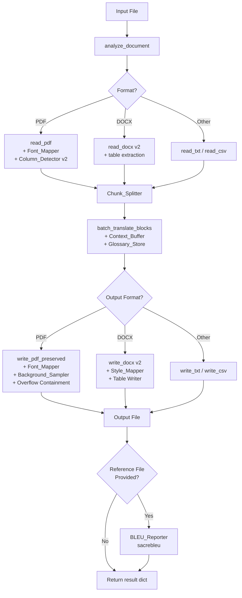

# Testing findings

Historical results below belong to their recorded revisions and scopes. The cleanup itself performs static preservation checks; it does not rerun provider, database, browser-upload or human language acceptance.

## Approach and historical results

The repository contains Laravel Unit/Feature tests, Python deterministic/property/golden/format/OCR checks and browser tests. Isolated fixtures and mocks establish engineering behavior; actual provider calls and human judgments must be identified separately.

| Recorded stage | Python | PHP | Browser | Interpretation |
|---|---|---|---|---|
| 2026-09-28 post-audit | 352 passed, 35 deselected | 407 passed, 1,644 assertions | Narrow isolated flows | Live/human release gates remained open |
| 2026-09-29 continuation | 371 passed, 35 deselected | 471 passed, 1,787 assertions | Separate coverage | Production storage/PostgreSQL/provider acceptance remained unverified |
| 2026-10-26 OCR corrections | 280 passed | 52 passed, 255 assertions | 4 passed | Recognition/planning did not certify word accuracy |
| 2026-10-26 acceptance workflow | 291 passed | 52 passed, 255 assertions | 4 passed | No genuine passing acceptance report issued |
| 2026-10-26 advisory coordinator | 337 passed | 52 passed, 255 assertions | 4 passed | Mocked tests separate from one logged live provider request |
| 2026-10-27 hybrid preview | 360 passed | 80 passed, 370 assertions | 6 passed | Partial/unverified output; semantic review still required |

These counts are not additive and are not newly reproduced results. Full reports, exact invocations, failures, fixes, limitations and evidence locations are retained in the appendices.

## Bugs and regressions recorded

Historical fixes include completed-download resolver wiring, missing-file reuse, queue reservation/reconciliation races, structured storage-presence errors, token loading boundaries, unavailable AI-review scoring, partial-history/polling recovery, and review/publication integrity.

OCR work corrected native-text alignment estimates, baseline geometry, bounded retries, letter-stem/rule false positives, signed-plan compatibility, render-plan authentication and saved-output checks. The preview revision adjusted image/drawing paint-order safety, propagated strict/preview identity and preserved unverified labels. Order-dependent provider test fixtures were pinned to their intended response envelope without changing the production model merely to pass tests.

## Cleanup verification boundary

No application code is reorganized or edited by consolidation. Verification compares the final tree against the pre-cleanup snapshot, checks exact byte preservation for each archive move, verifies every canonical relative link and checks full-text/excerpt traceability. Python compilation writes bytecode outside the repository and does not execute module imports.

Live FastAPI import is skipped: server.py loads the real environment at module scope and immediately warms a SQLite cache and providers. Laravel route:list is skipped because normal bootstrap can read real environments/cached configuration. The PHPUnit config declares SQLite in-memory, but that still requires database access/mutations and Laravel bootstrap; the hard no-database/no-secret-read constraint controls. Python conftest includes permanent cache deletion and not every test is explicitly mocked, so the suite is skipped under the no-deletion/no-provider constraints. No server, worker, migration or external API is started.

The oversized, already-tracked translated_input.pdf remains a pre-existing excluded local modification. It is backed up and was not changed by cleanup. Consequently final status must report that exception rather than claim a clean tree. Existing tracked real environments and historical large artifacts are reported separately; a zero-env/zero-large tracked-file claim would be false.

## Remaining risks

Human bilingual meaning review, genuinely independent OCR acceptance, representative scan/photo/screenshot coverage, complete format-direction acceptance, live deployment/storage/queue concurrency, mobile/accessibility and production credential rotation remain owner/reviewer work. Historical success on a tuned sample cannot establish those broader claims. Static cleanup checks establish preservation, not production readiness.

## Other preserved material

Full extracted historical text follows. Original binary documents preserve images, tables and formatting beyond this text representation. Older commands/settings and contradicted claims are historical evidence. Sensitive-looking values are redacted only in the canonical copy; original files remain unchanged and private backup precautions still apply.

- [chatgpt/Part2 test/Part2 Iteration 1 NLLB Evaluation.md](#source-e28caa3f92bde09d) — [chatgpt/Part2 test/Part2 Iteration 1 NLLB Evaluation.md](chatgpt/Part2%20test/Part2%20Iteration%201%20NLLB%20Evaluation.md)
- [chatgpt/Part2 test/Part2 Iteration Comparison and Current State Logging Audit.md](#source-419935bec5371902) — [chatgpt/Part2 test/Part2 Iteration Comparison and Current State Logging Audit.md](chatgpt/Part2%20test/Part2%20Iteration%20Comparison%20and%20Current%20State%20Logging%20Audit.md)
- [chatgpt/Part2 test/Part2 Translation Quality Layout and Speed Improvement Report.docx](#source-357ef3ba0710f3e0) — [chatgpt/Part2 test/Part2 Translation Quality Layout and Speed Improvement Report.docx](chatgpt/Part2%20test/Part2%20Translation%20Quality%20Layout%20and%20Speed%20Improvement%20Report.docx)
- [chatgpt/Part2 test/Part2 Translation Quality Layout and Speed Improvement Report.md](#source-72a5b5f15d9fa3f4) — [chatgpt/Part2 test/Part2 Translation Quality Layout and Speed Improvement Report.md](chatgpt/Part2%20test/Part2%20Translation%20Quality%20Layout%20and%20Speed%20Improvement%20Report.md)
- [chatgpt/Part2 test/phase-6-unit-pipeline-gptoss/ACCEPTANCE.md](#source-62135e407041f315) — [chatgpt/Part2 test/phase-6-unit-pipeline-gptoss/ACCEPTANCE.md](chatgpt/Part2%20test/phase-6-unit-pipeline-gptoss/ACCEPTANCE.md)
- [chatgpt/Part2 test/TriLingua Provider Neutral Pipeline Improvement Report.docx](#source-eff5b5f357f6ed3f) — [chatgpt/Part2 test/TriLingua Provider Neutral Pipeline Improvement Report.docx](chatgpt/Part2%20test/TriLingua%20Provider%20Neutral%20Pipeline%20Improvement%20Report.docx)
- [chatgpt/Part2 test/TriLingua Provider Neutral Pipeline Improvement Report.md](#source-f028764e10052022) — [chatgpt/Part2 test/TriLingua Provider Neutral Pipeline Improvement Report.md](chatgpt/Part2%20test/TriLingua%20Provider%20Neutral%20Pipeline%20Improvement%20Report.md)
- [chatgpt/Part2 test/TriLingua Third Iteration Provider Neutral Unit Pipeline Report.docx](#source-c73e5e3c341416f2) — [chatgpt/Part2 test/TriLingua Third Iteration Provider Neutral Unit Pipeline Report.docx](chatgpt/Part2%20test/TriLingua%20Third%20Iteration%20Provider%20Neutral%20Unit%20Pipeline%20Report.docx)
- [chatgpt/test/comparison/Trilingua-Current-Evaluation-Report.md](#source-201fb117be318e1e) — [chatgpt/test/comparison/Trilingua-Current-Evaluation-Report.md](chatgpt/test/comparison/Trilingua-Current-Evaluation-Report.md)
- [chatgpt/test/comparison/Trilingua-Iteration-1-and-2-Findings.md](#source-4d233d1c4c6c2ecd) — [chatgpt/test/comparison/Trilingua-Iteration-1-and-2-Findings.md](chatgpt/test/comparison/Trilingua-Iteration-1-and-2-Findings.md)
- [chatgpt/test/DFS Website Foundation Agreement Cebuano Translation Report.docx](#source-2e63cb77d4341681) — [chatgpt/test/DFS Website Foundation Agreement Cebuano Translation Report.docx](chatgpt/test/DFS%20Website%20Foundation%20Agreement%20Cebuano%20Translation%20Report.docx)
- [chatgpt/test/iteration-1-nllb-200-600m/findings.md](#source-e667a439b98ccad7) — [chatgpt/test/iteration-1-nllb-200-600m/findings.md](chatgpt/test/iteration-1-nllb-200-600m/findings.md)
- [chatgpt/test/iteration-2-gptoss/findings.md](#source-b35d984a3d39490e) — [chatgpt/test/iteration-2-gptoss/findings.md](chatgpt/test/iteration-2-gptoss/findings.md)
- [chatgpt/test/Trilingua Current Evaluation Report.docx](#source-e0315c61acc71980) — [chatgpt/test/Trilingua Current Evaluation Report.docx](chatgpt/test/Trilingua%20Current%20Evaluation%20Report.docx)
- [chatgpt/test3/improvements/report-preview/Test3 Content and Layout Implementation Report.pdf](#source-5cfe0ce5c3f3a296) — [chatgpt/test3/improvements/report-preview/Test3 Content and Layout Implementation Report.pdf](archive_candidates/chatgpt/test3/improvements/report-preview/Test3%20Content%20and%20Layout%20Implementation%20Report.pdf)
- [chatgpt/test3/improvements/Test3 Content and Layout Implementation Report.docx](#source-ad373fa33c9d150f) — [chatgpt/test3/improvements/Test3 Content and Layout Implementation Report.docx](chatgpt/test3/improvements/Test3%20Content%20and%20Layout%20Implementation%20Report.docx)
- [chatgpt/test3/improvements/Test3 Content and Layout Implementation Report.md](#source-a383e3c1f95390fc) — [chatgpt/test3/improvements/Test3 Content and Layout Implementation Report.md](chatgpt/test3/improvements/Test3%20Content%20and%20Layout%20Implementation%20Report.md)
- [chatgpt/test3/Test3 Current Pipeline Evaluation Report.docx](#source-602d90852e32873f) — [chatgpt/test3/Test3 Current Pipeline Evaluation Report.docx](chatgpt/test3/Test3%20Current%20Pipeline%20Evaluation%20Report.docx)
- [chatgpt/test3/Test3 Current Pipeline Evaluation Report.md](#source-b97bafe82fd30abd) — [chatgpt/test3/Test3 Current Pipeline Evaluation Report.md](chatgpt/test3/Test3%20Current%20Pipeline%20Evaluation%20Report.md)
- [codex/HANDOFF_REMAINING_POST_AUDIT_2026-09-28.md](#source-c7efcd70636bcf2f) — [codex/HANDOFF_REMAINING_POST_AUDIT_2026-09-28.md](archive_candidates/codex/HANDOFF_REMAINING_POST_AUDIT_2026-09-28.md)
- [codex/IMPLEMENTATION_PLAN_POST_AUDIT_2026-09-28.md](#source-e9e10657099b7a3a) — [codex/IMPLEMENTATION_PLAN_POST_AUDIT_2026-09-28.md](archive_candidates/codex/IMPLEMENTATION_PLAN_POST_AUDIT_2026-09-28.md)
- [docs/CURRENT_SYSTEM_AUDIT_2026-09-28.md](#source-e2486f28e6f89d8f) — [docs/CURRENT_SYSTEM_AUDIT_2026-09-28.md](docs/CURRENT_SYSTEM_AUDIT_2026-09-28.md)
- [docs/CURRENT_SYSTEM_REEVALUATION_2026-09-29.md](#source-bde972ced33a44dd) — [docs/CURRENT_SYSTEM_REEVALUATION_2026-09-29.md](docs/CURRENT_SYSTEM_REEVALUATION_2026-09-29.md)
- [docs/FEATURE_EVIDENCE_AUDIT.md](#source-af743f96d35befa1) — [docs/FEATURE_EVIDENCE_AUDIT.md](docs/FEATURE_EVIDENCE_AUDIT.md)
- [Google Classroom Student Test Cases.docx](#source-d9c460bf87b098fa) — [Google Classroom Student Test Cases.docx](Google%20Classroom%20Student%20Test%20Cases.docx)
- [output/pdf/lion-mouse-pipeline-test-2026-10-26/RUN_REPORT.md](#source-0178fe843ff3d73b) — [output/pdf/lion-mouse-pipeline-test-2026-10-26/RUN_REPORT.md](archive_candidates/output/pdf/lion-mouse-pipeline-test-2026-10-26/RUN_REPORT.md)
- [output/pdf/lion-mouse-retest-2026-10-26-222800/RUN_REPORT.md](#source-fe0dd5ae2620c4e8) — [output/pdf/lion-mouse-retest-2026-10-26-222800/RUN_REPORT.md](archive_candidates/output/pdf/lion-mouse-retest-2026-10-26-222800/RUN_REPORT.md)
- [output/pdf/ocr-translation-test/Lion_and_Mouse_README.md](#source-147932aade6e2c5f) — [output/pdf/ocr-translation-test/Lion_and_Mouse_README.md](archive_candidates/output/pdf/ocr-translation-test/Lion_and_Mouse_README.md)
- [output/pdf/ocr-translation-test/README.md](#source-37b15f0065a2a5ad) — [output/pdf/ocr-translation-test/README.md](archive_candidates/output/pdf/ocr-translation-test/README.md)
- [output/research/translation-test-resources.md](#source-2b4616fee0213c11) — [output/research/translation-test-resources.md](output/research/translation-test-resources.md)
- [output/reviews/hybrid-pdf-implementation/baseline/finish-mutations/Model/benchmarks/README.md](#source-6864aaa1c9b0787f) — [output/reviews/hybrid-pdf-implementation/baseline/finish-mutations/Model/benchmarks/README.md](archive_candidates/output/reviews/hybrid-pdf-implementation/baseline/finish-mutations/Model/benchmarks/README.md)
- [output/reviews/hybrid-pdf-implementation/baseline/index-snapshot/trilingua-code/Model/benchmarks/README.md](#source-f99bef5f6fdc5347) — [output/reviews/hybrid-pdf-implementation/baseline/index-snapshot/trilingua-code/Model/benchmarks/README.md](archive_candidates/output/reviews/hybrid-pdf-implementation/baseline/index-snapshot/trilingua-code/Model/benchmarks/README.md)
- [output/reviews/hybrid-pdf-implementation/baseline/review-mutations-final/trilingua-code/Model/benchmarks/README.md](#source-36b1dfee3d969ffe) — [output/reviews/hybrid-pdf-implementation/baseline/review-mutations-final/trilingua-code/Model/benchmarks/README.md](archive_candidates/output/reviews/hybrid-pdf-implementation/baseline/review-mutations-final/trilingua-code/Model/benchmarks/README.md)
- [output/reviews/hybrid-pdf-implementation/baseline/review-mutations/trilingua-code/Model/benchmarks/README.md](#source-209712cbcd0bdb14) — [output/reviews/hybrid-pdf-implementation/baseline/review-mutations/trilingua-code/Model/benchmarks/README.md](archive_candidates/output/reviews/hybrid-pdf-implementation/baseline/review-mutations/trilingua-code/Model/benchmarks/README.md)
- [output/reviews/hybrid-pdf-implementation/baseline/source/trilingua-code/.kiro/specs/auth-css-rendering-fix/bugfix.md](#source-3575e6c7045c7d45) — [output/reviews/hybrid-pdf-implementation/baseline/source/trilingua-code/.kiro/specs/auth-css-rendering-fix/bugfix.md](archive_candidates/output/reviews/hybrid-pdf-implementation/baseline/source/trilingua-code/.kiro/specs/auth-css-rendering-fix/bugfix.md)
- [output/reviews/hybrid-pdf-implementation/baseline/source/trilingua-code/.kiro/specs/dashboard-ui-fix/bugfix.md](#source-9c422e8021a9ab89) — [output/reviews/hybrid-pdf-implementation/baseline/source/trilingua-code/.kiro/specs/dashboard-ui-fix/bugfix.md](archive_candidates/output/reviews/hybrid-pdf-implementation/baseline/source/trilingua-code/.kiro/specs/dashboard-ui-fix/bugfix.md)
- [output/reviews/hybrid-pdf-implementation/baseline/source/trilingua-code/.kiro/specs/translation-layout-quality/design.md](#source-3b8b3e91d0842b34) — [output/reviews/hybrid-pdf-implementation/baseline/source/trilingua-code/.kiro/specs/translation-layout-quality/design.md](archive_candidates/output/reviews/hybrid-pdf-implementation/baseline/source/trilingua-code/.kiro/specs/translation-layout-quality/design.md)
- [output/reviews/hybrid-pdf-implementation/baseline/source/trilingua-code/.kiro/specs/translation-layout-quality/tasks.md](#source-cc50bcbb8d9b9525) — [output/reviews/hybrid-pdf-implementation/baseline/source/trilingua-code/.kiro/specs/translation-layout-quality/tasks.md](archive_candidates/output/reviews/hybrid-pdf-implementation/baseline/source/trilingua-code/.kiro/specs/translation-layout-quality/tasks.md)
- [output/reviews/hybrid-pdf-implementation/baseline/source/trilingua-code/.kiro/specs/user-id-history-fix/bugfix.md](#source-cda4a90ebc7a4c28) — [output/reviews/hybrid-pdf-implementation/baseline/source/trilingua-code/.kiro/specs/user-id-history-fix/bugfix.md](archive_candidates/output/reviews/hybrid-pdf-implementation/baseline/source/trilingua-code/.kiro/specs/user-id-history-fix/bugfix.md)
- [output/reviews/hybrid-pdf-implementation/baseline/source/trilingua-code/AUTHENTICATION_TESTING.md](#source-d0e39953fb8c3b39) — [output/reviews/hybrid-pdf-implementation/baseline/source/trilingua-code/AUTHENTICATION_TESTING.md](output/reviews/hybrid-pdf-implementation/baseline/source/trilingua-code/AUTHENTICATION_TESTING.md)
- [output/reviews/hybrid-pdf-implementation/baseline/source/trilingua-code/Model/benchmarks/README.md](#source-075e2a87c1808bca) — [output/reviews/hybrid-pdf-implementation/baseline/source/trilingua-code/Model/benchmarks/README.md](archive_candidates/output/reviews/hybrid-pdf-implementation/baseline/source/trilingua-code/Model/benchmarks/README.md)
- [output/reviews/hybrid-pdf-implementation/baseline/source/trilingua-code/security/evidence-runbook.md](#source-1279e4574ff04f70) — [output/reviews/hybrid-pdf-implementation/baseline/source/trilingua-code/security/evidence-runbook.md](output/reviews/hybrid-pdf-implementation/baseline/source/trilingua-code/security/evidence-runbook.md)
- [output/reviews/layout-preserving-ocr-investigation-2026-10-25/FINDINGS_AND_DESIGN.md](#source-b5151f0cbcf93934) — [output/reviews/layout-preserving-ocr-investigation-2026-10-25/FINDINGS_AND_DESIGN.md](archive_candidates/output/reviews/layout-preserving-ocr-investigation-2026-10-25/FINDINGS_AND_DESIGN.md)
- [output/reviews/ocr-2026-10-25/local-image-test/live-cebuano/REVIEW.md](#source-dddc4ddf3c57976a) — [output/reviews/ocr-2026-10-25/local-image-test/live-cebuano/REVIEW.md](archive_candidates/output/reviews/ocr-2026-10-25/local-image-test/live-cebuano/REVIEW.md)
- [output/test-cases-2026-10-12/qa/artifact.md](#source-8bd65230739cdf8a) — [output/test-cases-2026-10-12/qa/artifact.md](output/test-cases-2026-10-12/qa/artifact.md)
- [output/test-cases-2026-10-12/qa/reference.docx](#source-16999b0547b52c68) — [output/test-cases-2026-10-12/qa/reference.docx](output/test-cases-2026-10-12/qa/reference.docx)
- [output/test-cases-2026-10-12/TriLingua_Test_Cases_Template.docx](#source-50801e43277e7b80) — [output/test-cases-2026-10-12/TriLingua_Test_Cases_Template.docx](output/test-cases-2026-10-12/TriLingua_Test_Cases_Template.docx)
- [trilingua-code/.kiro/specs/auth-css-rendering-fix/bugfix.md](#source-4f96b0777024fa23) — [trilingua-code/.kiro/specs/auth-css-rendering-fix/bugfix.md](trilingua-code/.kiro/specs/auth-css-rendering-fix/bugfix.md)
- [trilingua-code/.kiro/specs/dashboard-ui-fix/bugfix.md](#source-5f52441ea653460d) — [trilingua-code/.kiro/specs/dashboard-ui-fix/bugfix.md](trilingua-code/.kiro/specs/dashboard-ui-fix/bugfix.md)
- [trilingua-code/.kiro/specs/translation-layout-quality/design.md](#source-80d125a64f0b69c5) — [trilingua-code/.kiro/specs/translation-layout-quality/design.md](trilingua-code/.kiro/specs/translation-layout-quality/design.md)
- [trilingua-code/.kiro/specs/translation-layout-quality/tasks.md](#source-8b3bc6bd6fe265ce) — [trilingua-code/.kiro/specs/translation-layout-quality/tasks.md](trilingua-code/.kiro/specs/translation-layout-quality/tasks.md)
- [trilingua-code/.kiro/specs/user-id-history-fix/bugfix.md](#source-b9661a0e05d92aae) — [trilingua-code/.kiro/specs/user-id-history-fix/bugfix.md](trilingua-code/.kiro/specs/user-id-history-fix/bugfix.md)
- [trilingua-code/AUTHENTICATION_TESTING.md](#source-52c768bb89c4e2fa) — [trilingua-code/AUTHENTICATION_TESTING.md](trilingua-code/AUTHENTICATION_TESTING.md)
- [trilingua-code/docs/implementation-records/phase-07-release-evidence.md](#source-2d21328bc7e21e4c) — [trilingua-code/docs/implementation-records/phase-07-release-evidence.md](trilingua-code/docs/implementation-records/phase-07-release-evidence.md)
- [trilingua-code/docs/implementation-records/post-audit-package-A.md](#source-d062648fd8195b27) — [trilingua-code/docs/implementation-records/post-audit-package-A.md](trilingua-code/docs/implementation-records/post-audit-package-A.md)
- [trilingua-code/docs/implementation-records/post-audit-package-B.md](#source-e2bf2e4eb67297a9) — [trilingua-code/docs/implementation-records/post-audit-package-B.md](trilingua-code/docs/implementation-records/post-audit-package-B.md)
- [trilingua-code/docs/implementation-records/post-audit-package-C.md](#source-106ffa9793a709a4) — [trilingua-code/docs/implementation-records/post-audit-package-C.md](trilingua-code/docs/implementation-records/post-audit-package-C.md)
- [trilingua-code/docs/implementation-records/post-audit-package-D.md](#source-37eb3b411a878d28) — [trilingua-code/docs/implementation-records/post-audit-package-D.md](trilingua-code/docs/implementation-records/post-audit-package-D.md)
- [trilingua-code/docs/implementation-records/post-audit-package-E.md](#source-721d147429d62e22) — [trilingua-code/docs/implementation-records/post-audit-package-E.md](trilingua-code/docs/implementation-records/post-audit-package-E.md)
- [trilingua-code/docs/implementation-records/post-audit-package-F.md](#source-ae7632eac6ecc81f) — [trilingua-code/docs/implementation-records/post-audit-package-F.md](trilingua-code/docs/implementation-records/post-audit-package-F.md)
- [trilingua-code/docs/implementation-records/post-audit-package-G.md](#source-4c14bdf95b591651) — [trilingua-code/docs/implementation-records/post-audit-package-G.md](trilingua-code/docs/implementation-records/post-audit-package-G.md)
- [trilingua-code/docs/implementation-records/post-audit-release-report.md](#source-3b60bc8fa960137d) — [trilingua-code/docs/implementation-records/post-audit-release-report.md](trilingua-code/docs/implementation-records/post-audit-release-report.md)
- [trilingua-code/Model/benchmarks/README.md](#source-c71fa52ed4df9b36) — [trilingua-code/Model/benchmarks/README.md](trilingua-code/Model/benchmarks/README.md)
- [trilingua-code/security/evidence-runbook.md](#source-c127f38407def380) — [trilingua-code/security/evidence-runbook.md](trilingua-code/security/evidence-runbook.md)

<a id="source-e28caa3f92bde09d"></a>

### Preserved source: chatgpt/Part2 test/Part2 Iteration 1 NLLB Evaluation.md

Original: [chatgpt/Part2 test/Part2 Iteration 1 NLLB Evaluation.md](chatgpt/Part2%20test/Part2%20Iteration%201%20NLLB%20Evaluation.md). SHA-256: `226004d6e90bcacb9e5dfaa92aa7c1ac9b846d73cc848afb5554a00de99a826d`.

````text
# Part2 Iteration 1 NLLB Evaluation

## Outcome

The Part2 NLLB evaluation completed the English-to-Cebuano and Cebuano-to-English translations using the supplied 25-page parallel story-book editions. The accompanying JSON artifacts preserve source/reference hashes, engine evidence, output hashes, structural checks, quality scores, and repeat-run results.

## Configuration

- Provider: `nllb`
- Model: `facebook/nllb-200-distilled-600M@f8d333a098d19b4fd9a8b18f94170487ad3f821d`
- Processing: `fast` mode, automatic PDF column detection
- Fallback: disabled
- Translation cache: disabled
- Quality method: corpus BLEU and chrF using all extracted PDF pages with whitespace normalization only

## Full Document Results

| Direction | Status | Elapsed | BLEU | chrF | Structural check |
|---|---|---:|---:|---:|---|
| English to Cebuano | Completed | 3.27 min | 26.67 | 58.44 | Pass |
| Cebuano to English | Completed | 2.45 min | 31.03 | 57.0 | Pass |

## Stability Results

| Direction | Successful runs | Median latency | Output hashes | Stable output |
|---|---:|---:|---:|---|
| en-to-ceb | 3/3 | 0.25 min | 1 | True |
| ceb-to-en | 3/3 | 0.17 min | 1 | True |

## Method and Limits

The English original was scored against the supplied Cebuano edition, and the Cebuano edition was scored against the supplied English original. BLEU and chrF measure overlap with those particular editions; they do not replace bilingual review for naturalness, theology, age appropriateness, or page-level visual quality. Structural validation verifies page count and extractable text, while the rendered-output review checks for visible layout defects.

## Traceability

The report is reconciled with `iteration-1-nllb-200-600m/benchmark-manifest.json`, `findings.json`, and `run-metadata.json`. The source and reference PDFs are not modified.

````

<a id="source-419935bec5371902"></a>

### Preserved source: chatgpt/Part2 test/Part2 Iteration Comparison and Current State Logging Audit.md

Original: [chatgpt/Part2 test/Part2 Iteration Comparison and Current State Logging Audit.md](chatgpt/Part2%20test/Part2%20Iteration%20Comparison%20and%20Current%20State%20Logging%20Audit.md). SHA-256: `80f69348ba75b4dc5ec7e557a28171862d3291a5ed6ea9f4402622d401ae13a5`.

````text
# Part2 Iteration Comparison and Current State Logging Audit

## Outcome

This report compares the newly measured NLLB Part2 outputs with the existing GPT-OSS PDFs and audits current TriLingua logging and metric capture. GPT-OSS PDFs are scored as supplied artifacts; no GPT-OSS translation is rerun and no runtime-performance claim is made for that iteration.

## Quality and Structure Comparison

| Direction | Iteration | BLEU | chrF | Structural check | Runtime |
|---|---|---:|---:|---|---|
| English to Cebuano | NLLB | 26.67 | 58.44 | Pass | 3.27 min |
| English to Cebuano | GPT OSS | 29.68 | 61.86 | Pass | Not supplied |
| Cebuano to English | NLLB | 31.03 | 57.0 | Pass | 2.45 min |
| Cebuano to English | GPT OSS | 52.52 | 74.33 | Pass | Not supplied |

The score method uses all-page extracted text after whitespace normalization. Both GPT-OSS PDFs have 25 pages and non-empty extracted text. Their file hashes are preserved in the comparison metadata. GPT-OSS model, provider settings, cache/fallback state, and elapsed time are not available from the supplied files.

## Current Logging and Metrics

- Laravel defaults to a stack containing the `single` file channel; a 14-day `daily` channel is defined but is not the default stack member.
- The document job logs failures and non-fatal persistence/notification issues, including job IDs, user IDs, filenames, exception messages, and a full trace on terminal translation failures.
- The Python service writes diagnostic messages to process output, including filename, language pair, size, provider/model, elapsed time, and exception text.
- `translation_history`, `translation_jobs`, `translation_blocks`, `translation_edit_logs`, and `translation_metrics` preserve operational and review evidence in the application database.
- `translation_metrics` stores provider/model, mode, durations, calls, block counts, cache counts, retranslation counts, and token counts when supplied.

## Audit Findings

- Filenames, user identifiers, exception messages, and stack traces can expose sensitive operational information in logs.
- Python diagnostic output can include language/source context; log calls should be audited before assuming document content never reaches a log sink.
- Laravel and Python do not currently emit a clearly shared correlation identifier that traces one request across the web app, queue worker, Python service, storage, and review records.
- The default single-file channel has no configured rotation, while the defined daily channel has a 14-day retention setting; retention is therefore not consistently enforced.
- Metrics, database audit records, and operational logs have different retention/security behavior and should not be treated as one equivalent log source.

## Recommended Next Steps

Adopt structured, correlation-aware operational events; minimize or hash file identifiers; remove full traces from routine production logs; define retention and access controls per data class; and test that source/translated text is never emitted to production logs. These are recommendations only and are not implemented by this report.

````

<a id="source-357ef3ba0710f3e0"></a>

### Preserved source: chatgpt/Part2 test/Part2 Translation Quality Layout and Speed Improvement Report.docx

Original: [chatgpt/Part2 test/Part2 Translation Quality Layout and Speed Improvement Report.docx](chatgpt/Part2%20test/Part2%20Translation%20Quality%20Layout%20and%20Speed%20Improvement%20Report.docx). SHA-256: `79be560fd05f87acee7bd570bf5a8dc7ae6af936186a28198c7ada35c246b592`.

````text
Part2 Translation Quality Layout and Speed Improvement Report
Evidence-based actions for grammar tone coherence layout integrity and NLLB performance
NLLB completed both Part2 translations with 25-page outputs and deterministic repeat results, but the supplied GPT OSS artifacts score higher in both directions. The recommended path is to improve translation quality and layout verification first, then optimize NLLB inference without relaxing the quality gate.
Evidence
Direction
NLLB BLEU
NLLB chrF
NLLB time
Calls
Model calls
GPT BLEU
GPT chrF
English to Cebuano
26.67
58.44
3.27 min
49
79.3%
29.68
61.86
Cebuano to English
31.03
57.0
2.45 min
48
90.6%
52.52
74.33

Both NLLB outputs have 25 pages and non-empty text. First, middle, and final rendered pages were visually clean in this story-book corpus. The corpus has no complex tables, so it does not prove table-layout quality.
Improve Translation Quality
Priority
Change
Expected effect
Validation
P0
Evaluate balanced mode as the normal NLLB path
Adds document analysis, memory, semantic chunking, prompts, review, cache, and prepass
Compare with fast baseline using bilingual rubric
P0
Create bilingual grammar, tone, coherence, and terminology review set
Makes acceptance reflect natural educational language
No critical reviewer defect
P1
Use glossary and document memory for recurring terms
Improves terminology and cross-page consistency
Term consistency by language pair
P1
Use quality review and coherence polish after validation
Targets awkward phrasing and cohesion defects
Review after every repair
P1
Protect non-translatable spans
Avoids title/header false failures and source echoes
Span-level regression tests

Improve Layout Quality
The current PDF writer first expands a text rectangle, then reduces font size down to 6 pt, then attempts a continuation box. Add a preflight fit measurement, log every intervention, and fail layout QA on clipping or collision. Build fixtures with tables, long cells, captions, multicolumn layouts, headers/footers, and mixed fonts because this story-book corpus cannot validate them.
Improve Speed
Engine-recorded model-call time consumed 79.3 percent of English-to-Cebuano runtime and 90.6 percent of Cebuano-to-English runtime. NLLB translates one block at a time, serializes generation, and uses four beams. Prioritize batched generation, a measured Torch-thread sweep, and a beam-count ablation. Keep exact-block cache for privacy-reviewed production use, not controlled first-pass evaluation.
Release Gate
Release only when every page renders cleanly, no table or text box clips or overlaps, no protected span triggers a false failure, bilingual review finds no critical meaning, grammar, tone, or cohesion defect, automatic scores remain within the approved tolerance, and median latency is acceptable for the selected quality mode.
Recommended Order
Establish bilingual and layout fixtures first. Then test NLLB balanced mode with glossary, memory, review, and coherence polish against fast mode. Next benchmark batching, threads, and beams. Finally run GPT OSS and NLLB with the same timed protocol before selecting a provider.
````

<a id="source-72a5b5f15d9fa3f4"></a>

### Preserved source: chatgpt/Part2 test/Part2 Translation Quality Layout and Speed Improvement Report.md

Original: [chatgpt/Part2 test/Part2 Translation Quality Layout and Speed Improvement Report.md](chatgpt/Part2%20test/Part2%20Translation%20Quality%20Layout%20and%20Speed%20Improvement%20Report.md). SHA-256: `bf66a5d73fc754cd15ebf8c5328899c7da7451aa4b6c88ff5cb8c465aedf358d`.

````text
# Part2 Translation Quality Layout and Speed Improvement Report

## Executive Finding

NLLB completed both 25-page Part2 translations with intact page counts and deterministic short-sample outputs. However, the supplied GPT-OSS artifacts have higher automatic quality scores in both directions. Engine-recorded model-call time accounts for most NLLB runtime, so the next improvement should use a quality-first mode and review workflow for user-facing documents, while optimizing the NLLB inference path separately and only retaining speed changes that pass the same quality gate.

## Evidence

| Direction | NLLB BLEU | NLLB chrF | NLLB time | NLLB calls | Model-call share | GPT-OSS BLEU | GPT-OSS chrF |
|---|---:|---:|---:|---:|---:|---:|---:|
| English to Cebuano | 26.67 | 58.44 | 3.27 min | 49 | 79.3% | 29.68 | 61.86 |
| Cebuano to English | 31.03 | 57.0 | 2.45 min | 48 | 90.6% | 52.52 | 74.33 |

Both NLLB outputs contain 25 pages and extractable text. Three repeated short samples per direction produced one output hash each. Visual checks of first, middle, and last output pages found no clipping, overlap, or page-count regression in this story-book corpus. This corpus contains no complex tables, so it does not establish table-layout quality.

## Quality Improvements

1. Keep the completed `fast` run as the speed baseline, but evaluate `balanced` as the normal user-facing NLLB path. Fast disables document analysis, document memory, semantic chunking, specialized prompts, AI quality review, cache, prepass, and layout planning. Balanced enables the first six quality features and the prepass.
2. Add a bilingual review set and score grammar, naturalness, tone, coherence across pages, terminology consistency, and meaning preservation. Use the reviewer for final acceptance, not BLEU or chrF alone.
3. Enable document memory and a glossary for recurrent names, theological terms, labels, headers, and book terminology. Save approved terminology by language pair and expose it to the review/retranslation workflow.
4. Enable AI quality review and the opt-in coherence-polish pass for Cebuano and Filipino only after it has passed the bilingual gate. Re-translate only flagged blocks, then rerun the review so a repair cannot silently worsen tone or meaning.
5. Treat titles, headers, brand names, URLs, page numbers, and source-language labels as protected or explicitly allowed passthrough spans. This prevents quality checks from either forcing awkward translations or accepting genuine untranslated body text.

## Layout Improvements

The current PDF reconstructor preserves source coordinates and tries, in order, a larger text rectangle, smaller font, and a continuation box. It can reduce text to 6 pt and a continuation box can reach the page boundary. That is a safety mechanism, not a layout-quality guarantee.

1. Add a preflight fit check before painting text: measure translated text in its original rectangle, evaluate a limited set of font and line-spacing adjustments, and choose the best fit before writing to the page.
2. Record an overflow event for every block that needs expansion, font reduction, continuation, or clipping. Fail layout QA when a continuation is clipped or a text box overlaps another content box.
3. Create a separate layout fixture set with tables, long table cells, captions, multicolumn pages, headers/footers, mixed fonts, and image-adjacent labels. The current story-book evidence cannot validate these structures.
4. Preserve the source font family and style when supported; apply a target-language fallback font only when the original cannot render the required glyphs. Use a document-specific minimum readable font rule approved by the reviewer rather than relying on the hard 6 pt fallback.
5. Add rendered-image comparison checks for page count, text-box collisions, text outside the media/crop area, and unreadable/blank text. Review all changed pages when a layout intervention occurs.

## Speed Improvements

Do not optimize extraction or reconstruction first: engine-recorded model-call time consumed 79.3% of the English-to-Cebuano runtime and 90.6% of the Cebuano-to-English runtime. NLLB currently processes one item at a time, serializes generation with a lock, and uses four beams by default.

1. Add a batched NLLB translation path that tokenizes compatible blocks together, generates in an ordered batch, and keeps per-block retry/error handling. Benchmark batch sizes 2, 4, and 8 under the same corpus and memory limit.
2. Sweep `NLLB_TORCH_THREADS` using the actual host core count, recording latency, CPU utilization, and output hashes. Keep the fastest stable setting that does not change the approved quality result.
3. Compare beam counts 4, 2, and 1 against the bilingual quality gate. A lower beam count is accepted only if it does not introduce a critical meaning/grammar/tone regression and stays within the agreed automatic-score tolerance.
4. Keep the model warm and enable the privacy-reviewed exact-block cache for production only. The controlled evaluation correctly kept cache disabled; caching improves repeated content, not first-pass translation quality.
5. Run GPT-OSS and NLLB under one identical timed protocol before choosing a production provider. GPT-OSS scored higher in the supplied artifacts, but no elapsed-time, configuration, or provider metadata was supplied, so it cannot yet be called faster or promoted on this evidence alone.

## Acceptance Gate

For each language direction and document type, release a change only when: every output page renders cleanly; no table/text box is clipped or overlaps; no protected span becomes a false translation failure; the bilingual reviewer finds no critical meaning, grammar, tone, or cohesion defect; automatic scores do not regress beyond the agreed threshold; and median latency improves or remains acceptable for the selected quality mode.

## Recommended Order

First, establish bilingual and layout fixture acceptance tests. Second, evaluate NLLB balanced mode plus glossary, memory, review, and coherence polish against the fast baseline. Third, implement and benchmark batched inference, thread tuning, and beam-count variants. Finally, run an identical GPT-OSS benchmark before any provider decision.

````

<a id="source-62135e407041f315"></a>

### Preserved source: chatgpt/Part2 test/phase-6-unit-pipeline-gptoss/ACCEPTANCE.md

Original: [chatgpt/Part2 test/phase-6-unit-pipeline-gptoss/ACCEPTANCE.md](chatgpt/Part2%20test/phase-6-unit-pipeline-gptoss/ACCEPTANCE.md). SHA-256: `44303eb1dcf4d2db33ee1edbb5ab0bff75b01161052c4d7aa7d841db8e2e315b`.

````text
# Phase 6 — GPT-OSS-Only DTO Unit Pipeline Acceptance Report

Generated 2026-09-22 · Provider `gptoss` (`gpt-oss:20b-cloud`) · 6 live runs (2 directions × 3) · balanced mode · unit-pipeline flag ON · translation cache OFF · fallback provider disabled · no NLLB/Gemini.

## Verdict

**CONDITIONAL PASS.** All hard correctness, structural and layout criteria are met on all 6 runs, including fail-fast systemic-failure behavior and full block-survival. Two software findings need follow-up: (1) one verse numeral (`22`) lost in a scripture citation on all ceb→en runs; (2) one block passed through untranslated on ceb→en (short block, by-design pre-filter). Quality is below the previously supplied GPT-OSS artifacts, most on ceb→en BLEU (Median 44.55 vs 52.52); because `runtime_metadata` was not supplied with the baseline and our harness cannot reproduce its method, a matched legacy-mode run is recommended before making the unit pipeline the production default.

## Acceptance Matrix

| Criterion | Result | Verdict |
|---|---|---|
| Layout fidelity (25 pages, layout validation) | `pass` on all 6 runs | PASS |
| Block survival & ordering (49 blocks expected; one result per unit, in order) | 49/49 present every run, `blocks_batched` = translated set | PASS |
| Unit-pipeline verification (provider metrics + layout preflight present) | `True` on all 6 runs | PASS |
| Systemic fail-fast (rate-limit/timeout/5xx must abort, never false-success) | verified — batch timeout aborts with explicit RuntimeError gate | PASS |
| Protected spans — emails (1) / URLs (1) / placeholders (0) | 0 missing on all runs | PASS |
| Protected spans — numbers | en→ceb 11/11; ceb→en 11/12 (verse numeral `22` lost) | CONDITIONAL |
| Quality vs supplied GPT-OSS baseline | en→ceb BLEU 28.27 vs 29.68; ceb→en BLEU 44.55 vs 52.52 | OBSERVED VARIANCE |
| Latency (first known baseline; baseline had no runtime metadata) | median 832 s en→ceb / 839 s ceb→en | NEW BASELINE |
| Reproducibility | structure stable; distinct output SHA-256 per run (generative variance, documented) | PASS |

## en-to-ceb

- Supplied baseline: BLEU **29.68** / chrF **61.86** · 25 pages · SHA-256 `298f3885985b6a7a408ad1fd507c0fb3132545b1b2da4185c13aa269dca5354f`. Latency comparison is not possible — the artifact carried no `runtime_metadata`.

| Run | Wall (s) | BLEU | chrF | Pages | Layout | Blocks | Translated | Batched | Sched. batches | Slots | Retries | Failures | Echo retries | Repolish | SHA-256 |
|---|---|---|---|---|---|---|---|---|---|---|---|---|---|---|---|
| 1 | 772.8 | 29.38 | 60.77 | 25 | pass | 49 | 49 | 49 | 3 | 1 | 0 | {} | 1 | 6 | 0dbbafd05ea3… |
| 2 | 831.8 | 27.84 | 60.91 | 25 | pass | 49 | 49 | 49 | 3 | 1 | 0 | {} | 0 | 9 | a92aaed56fea… |
| 3 | 990.4 | 28.27 | 60.02 | 25 | pass | 49 | 49 | 49 | 3 | 1 | 0 | {} | 1 | 8 | a858152806c3… |

- Median BLEU **28.27** / chrF **60.77** · median wall **831.8 s**.
- Span checks: emails (0 missing) · URLs (0 missing) · numbers (0 missing) · placeholders (0 missing).
- `blocks_passthrough = 0` on every run (all 49 blocks translated).

## ceb-to-en

- Supplied baseline: BLEU **52.52** / chrF **74.33** · 25 pages · SHA-256 `e02ffa624bd9cbd883d5a0550095b513f15c53201069cddb65367bac8ea1b335`. Latency comparison is not possible — the artifact carried no `runtime_metadata`.

| Run | Wall (s) | BLEU | chrF | Pages | Layout | Blocks | Translated | Batched | Sched. batches | Slots | Retries | Failures | Echo retries | Repolish | SHA-256 |
|---|---|---|---|---|---|---|---|---|---|---|---|---|---|---|---|
| 1 | 620.5 | 44.76 | 70.80 | 25 | pass | 49 | 48 | 48 | 3 | 1 | 0 | {} | 6 | 16 | ce3b7fc59ef6… |
| 2 | 838.7 | 44.55 | 70.71 | 25 | pass | 49 | 48 | 48 | 3 | 1 | 0 | {} | 6 | 14 | 8ac058460289… |
| 3 | 870.3 | 43.83 | 70.19 | 25 | pass | 49 | 48 | 48 | 3 | 1 | 0 | {} | 6 | 15 | f86f200dbd8f… |

- Median BLEU **44.55** / chrF **70.71** · median wall **838.7 s**.
- Span checks: emails (0 missing) · URLs (0 missing) · numbers (1 missing = verse numeral `22`) · placeholders (0 missing).
- `blocks_passthrough = 1` on every run — one short block kept verbatim via the pass-through pre-filter (designed behavior).

## Latency decomposition (why runs take 10–16 min)

1. **Remote model latency dominates.** 49 blocks pack into 3 `translate_many` batch posts; with the server's `GPTOSS_TRANSLATION_SLOTS=1` and `TRANSLATION_MAX_CONCURRENT=1` (from `.env`), the 3 posts run strictly serially. Provider HTTP time (`provider_request_ms`) was 170–436 s per run; batch queue wait (`scheduler_wait_ms`) reached 638 s because batches wait for the single slot while gpt-oss generates.
2. **Balanced-mode overhead.** Per-block AI quality review (49 calls) + coherence repolish of 6–16 chunks + document analysis ≈ 57–71 LLM calls per run even though only 48–49 blocks translate.
3. **Echo guard re-translations.** ceb→en triggered 6 echo retries per run (the model echoed Cebuano input) — the guard works, at a latency cost of 6 extra requests per run.
4. **First known baseline.** The supplied artifacts have no runtime metadata, so these figures define the new baseline rather than proving a regression.

## Findings requiring follow-up

1. **CYAN (minor, deterministic):** ceb→en drops verse numeral `22` in `… Pinadayag 4, 21, 22` → `… Revelation 4, 21, …` on all 3 runs. Numeric-token restoration should cover multi-number scripture citation lists.
2. **YELLOW (by design):** ceb→en passes 1 short block through untranslated per run (`blocks_passthrough=1`); the source line is preserved verbatim, so nothing is silently lost.
3. **GREEN (quality variance):** ceb→en BLEU sits ~8 pts under the supplied baseline. Recommend a matched legacy-mode benchmark (flag OFF, same harness/env) to isolate pipeline effect from provider drift before promoting the unit pipeline.

## Artifacts

- `findings.json` — full per-run record (metrics, spans, structure, quality).
- `benchmark-manifest.json`, `run-metadata.json` — run configuration and lineage.
- `en-to-ceb_run{N}.pdf`, `ceb-to-en_run{N}.pdf` — 6 translated PDFs (structure pass, 25 pages each).
- `layout-samples/` — page 1/2/14 PNG renders per run (72 dpi).
- `server.log` — engine trace.
````

<a id="source-eff5b5f357f6ed3f"></a>

### Preserved source: chatgpt/Part2 test/TriLingua Provider Neutral Pipeline Improvement Report.docx

Original: [chatgpt/Part2 test/TriLingua Provider Neutral Pipeline Improvement Report.docx](chatgpt/Part2%20test/TriLingua%20Provider%20Neutral%20Pipeline%20Improvement%20Report.docx). SHA-256: `714d881c26af1202c308bde45e18b3aa6f28fc91c569e407d71515e4aecc47c0`.

````text
TriLingua Provider Neutral Pipeline Improvement Report
A quality layout and speed roadmap independent of the selected translation model
Improve the pipeline independently of NLLB or GPT OSS. NLLB is a reproducible Part2 benchmark, not the architecture reference. GPT OSS is a quality candidate, not a permanent default. Every provider must receive the same context, terminology controls, review gate, layout protection, scheduler, and evidence requirements.
Evidence
Direction
NLLB BLEU chrF
NLLB time
GPT OSS BLEU chrF
Structure
English to Cebuano
26.67 / 58.44
3.27 min
29.68 / 61.86
25 pages; non-empty text for both
Cebuano to English
31.03 / 57.0
2.45 min
52.52 / 74.33
25 pages; non-empty text for both

NLLB produced deterministic short samples and 25-page outputs. Supplied GPT OSS PDFs scored higher in both directions, but lack reproducible timing and configuration evidence. This supports a controlled provider comparison rather than an unconditional provider decision.
Target Pipeline
Extract PDF structure, build a document map and reading order, identify protected spans and glossary terms, group semantic translation units with local context, schedule provider-neutral translation tasks, review and selectively repair, preflight layout fit, reconstruct, render, validate, and persist privacy-safe evidence.
Provider Neutral Interfaces
Interface
Required responsibility
TranslationUnit
Carries unit ID, page, reading order, box, role, section, local context, table headers, source text, and protected spans.
ProviderCapabilities
Declares batch, concurrency, context, language, and latency capabilities for the scheduler.
translate_many
Returns ordered per-unit status/error results without losing unit identity on retries.
QualityResult
Records review score, issue, repair eligibility, snippets, and reviewer provenance.
LayoutResult
Records fit actions, final geometry/font, collision state, and clipping state.

Quality and Cohesion
Replace isolated PDF boxes with semantic units. Paragraphs retain their heading and neighboring context; table cells retain their row/column headers; recurring headers and footers are treated as document furniture. Build a document summary and terminology memory once, protect non-translatable spans, and judge grammar, tone, coherence, terminology, and meaning with a bilingual rubric. Review and selectively retry only flagged units with their context.
Layout Integrity
Preflight translated text inside its rectangle before painting it. Preserve source styles where target glyphs support them, record every expansion/reduction/continuation, and fail on clipping, overlap, or text outside the page box. Add fixtures for tables, long cells, columns, captions, headers/footers, images, and mixed fonts; the current story-book corpus cannot validate those structures.
Speed
Use capability-based batching and bounded concurrency, with per-unit retries and ordered output. Benchmark local batch size, Torch threads, and beam count against the same quality gate. For remote providers, measure queue wait separately, limit inflight work, and retry only affected units. Cache only privacy-safe, approved exact results in a namespace that includes provider/model, glossary version, and quality profile.
Provider Policy
Keep GPT OSS as the leading final-quality candidate because the supplied Part2 artifacts scored higher, but do not make it mandatory until it passes a reproducible same-pipeline latency and reliability benchmark. Keep NLLB as a local baseline and possible draft/offline provider. Select each provider through the same quality, layout, reliability, and latency gate.
Implementation Order
Phase
Deliverable
1
Document map, protected spans, and provider-capability interfaces with tests.
2
Semantic grouping, section context, and glossary memory.
3
Provider-neutral review/repair and bilingual acceptance fixtures.
4
Layout preflight, overflow events, table fixtures, and rendered regression checks.
5
Capability-based scheduling, cache namespaces, and stage timing.
6
Identical NLLB and GPT OSS benchmark and provider selection per quality profile.

````

<a id="source-f028764e10052022"></a>

### Preserved source: chatgpt/Part2 test/TriLingua Provider Neutral Pipeline Improvement Report.md

Original: [chatgpt/Part2 test/TriLingua Provider Neutral Pipeline Improvement Report.md](chatgpt/Part2%20test/TriLingua%20Provider%20Neutral%20Pipeline%20Improvement%20Report.md). SHA-256: `b5b58338a942acd43a65943b1d45205f43421b4f4130c2981dfd91760da4d650`.

````text
# TriLingua Provider Neutral Pipeline Improvement Report

## Decision

Improve the document-translation pipeline independently of NLLB or GPT-OSS. NLLB is not the architecture reference; it is only the reproducible local benchmark from the requested Part2 run. GPT-OSS is not a permanent default either. The pipeline must supply the same document context, terminology controls, quality gate, layout protection, scheduling, and observability to every provider. A provider is selected only after it passes the same quality, reliability, and measured-latency gate.

## Evidence

| Direction | NLLB BLEU / chrF | NLLB elapsed | Supplied GPT-OSS BLEU / chrF | Structure |
|---|---:|---:|---:|---|
| English to Cebuano | 26.67 / 58.44 | 3.27 min | 29.68 / 61.86 | 25 pages; non-empty text for both |
| Cebuano to English | 31.03 / 57.0 | 2.45 min | 52.52 / 74.33 | 25 pages; non-empty text for both |

Both NLLB outputs were 25-page, non-empty PDFs and had deterministic three-run short samples. The supplied GPT-OSS artifacts scored higher automatically in both directions, but they include no reproducible elapsed time, configuration, cache/fallback state, or provider metadata. Therefore the evidence supports GPT-OSS as a quality candidate, not an unconditional production choice.

## Target Pipeline

```text
extract PDF structure
→ build document map and reading order
→ identify protected spans and glossary terms
→ group semantic translation units with local context
→ schedule provider-neutral translation tasks
→ apply quality review and selective repair
→ preflight layout fit and reconstruct
→ render and validate
→ persist privacy-safe metrics and audit evidence
```

## Provider Neutral Interfaces

1. `TranslationUnit`: stable unit ID, page, reading order, bounding box, element role, parent section, prior/next context, table row/column headers, source text, and protected spans.
2. `ProviderCapabilities`: supported language pairs, maximum batch size, concurrency limit, context limit, streaming support, and cost/latency metadata. The scheduler reads capabilities rather than branching on provider name.
3. `translate_many(units, context, glossary)`: ordered batch result with one status/error per unit. It must preserve the unit ID even when one item fails or retries.
4. `QualityResult`: quality score, issue category, source/target snippets, repair eligibility, and reviewer provenance. It is independent from the translation provider.
5. `LayoutResult`: original/final rectangle, original/final font, expansion/reduction/continuation actions, collision status, and clipping status.

## Quality Improvements

### Context and Cohesion

- Replace isolated PDF blocks with semantic units. A paragraph keeps its heading and adjacent paragraphs; a table cell keeps its row/column header; repeated headers/footers are identified as document furniture.
- Build one document summary and terminology memory once per document. Pass only the relevant section summary, adjacent context, and glossary terms to each unit rather than repeatedly sending the entire file.
- Mark URLs, numbers, product names, page labels, brand names, and approved proper nouns as protected spans. They should survive unchanged without being mistaken for untranslated body text.
- Use a bilingual human rubric for grammar, naturalness, tone, coherence, cohesion, terminology, and meaning preservation. BLEU and chrF remain regression signals, not acceptance criteria.

### Review and Repair

- Run a provider-independent quality reviewer after initial translation. It flags missing content, source-language echoes, grammar/tone defects, inconsistent terms, and broken cross-reference context.
- Retry only the failed unit with its document context and the reviewer issue. Re-review the repaired unit and retain the original if the repair is worse.
- Offer a reviewer-approved glossary per language pair so the same educational or subject-specific term is never independently guessed on every page.

## Layout Improvements

- Preserve each source block's reading order, bounding box, alignment, font family, weight, color, and paragraph spacing where the target glyphs can render.
- Preflight every translated unit against its target rectangle before painting it. Choose an approved font/line-spacing adjustment before reconstruction instead of relying on a last-resort 6 pt minimum font or a continuation that can reach the page boundary.
- Emit a layout event whenever text expands, shrinks, continues, collides, or clips. A clipped continuation, overlap, or text outside the page box is a release failure.
- Add fixtures for tables, long table cells, columns, headings, captions, headers/footers, images, and mixed fonts. The current story-book corpus has no complex tables, so it cannot prove table quality.
- Render all changed pages and run visual regression checks for clipping, bleed/out-of-page text, collisions, blank text, and unexpected font substitution.

## Speed Improvements

- Use a capability-based scheduler: batch compatible units, obey the active provider's bounded concurrency, preserve output order, and isolate per-unit retries.
- For local sequence-to-sequence models, benchmark padded batched generation, host-specific Torch thread counts, and beam counts. Keep only variants that pass the same bilingual and layout gate.
- For remote models, limit inflight requests, combine only compatible short units, apply retry/backoff per unit, and record queue wait separately from provider latency.
- Cache only approved exact translations keyed by a privacy-safe hash of source, target, provider/model revision, glossary version, and quality profile. Do not use cache results across models or quality profiles.
- Keep model startup warm and run document analysis once per file. Do not spend effort optimizing PDF extraction/reconstruction before provider latency, because NLLB model calls dominate the measured Part2 run.

## Provider Selection Policy

Use a registry rather than a hard-coded NLLB or GPT-OSS path. Every provider must run the same corpus, quality rubric, layout fixtures, and timed protocol. Promote a provider for a quality profile only when it has no critical bilingual-review defects, passes every layout check, has reproducible configuration and metadata, meets the agreed latency target, and has an acceptable failure/retry rate.

Current recommendation: retain GPT-OSS as the leading final-quality candidate because the supplied Part2 artifacts scored higher, but do not make it mandatory or remove NLLB until GPT-OSS completes the controlled reproducibility, latency, and reliability gate. Retain NLLB as a local baseline and possible draft/offline provider, not as the pipeline design authority.

## Implementation Order

1. Introduce document-map, protected-span, and provider-capability interfaces with tests.
2. Add semantic unit grouping, section context, and glossary memory.
3. Add provider-neutral review/repair and bilingual acceptance fixtures.
4. Add layout preflight, layout events, table/column fixtures, and rendered regression checks.
5. Add capability-based batching/scheduling, cache namespace controls, and stage timing.
6. Run NLLB and GPT-OSS through the identical benchmark and select the provider per quality profile.

````

<a id="source-c73e5e3c341416f2"></a>

### Preserved source: chatgpt/Part2 test/TriLingua Third Iteration Provider Neutral Unit Pipeline Report.docx

Original: [chatgpt/Part2 test/TriLingua Third Iteration Provider Neutral Unit Pipeline Report.docx](chatgpt/Part2%20test/TriLingua%20Third%20Iteration%20Provider%20Neutral%20Unit%20Pipeline%20Report.docx). SHA-256: `354f0591366fc18d9449c2dc09f088172f9828ee536c1bb321dcfd8e8c00d100`.

````text
TriLingua Third IterationProvider Neutral Unit Pipeline Report
Phase 1 through Phase 6 implementation, verification and acceptance evidence
Test basis: Part2 bilingual story-book corpus and second test plan
Prepared 22 September 2026
This report records the third iteration of the document-translation improvement work. It connects the provider-neutral design, the Phase 1 to 5 implementation changes, and the Phase 6 controlled live acceptance benchmark into one auditable account. The report is intended for project review and production-readiness decisions.

Executive summary
The third iteration delivered a provider-neutral, DTO-based translation-unit pipeline and exercised it with GPT-OSS under a controlled Phase 6 benchmark. The implementation preserves legacy behavior behind a restart-gated feature flag, adds semantic batching, protected-span handling, layout preflight, provider capability scheduling, systemic fail-fast semantics, and detailed timing metrics.
The Phase 6 acceptance verdict is CONDITIONAL PASS. All six live runs preserved the 25-page story-book structure, kept all 49 source blocks present and ordered, passed layout validation, and recorded zero provider retries or failures. The report does not claim that the new pipeline is superior to the supplied GPT-OSS artifacts: its observed median automatic scores were lower, and that older baseline lacks runtime and configuration metadata needed for a controlled causal comparison.
Decision area
Current conclusion
Evidence
Architecture
Ready for controlled use
Provider-neutral interfaces and unit-pipeline checks passed on every live run.
Structural and layout integrity
Pass
25 pages, 49/49 blocks, ordered results, and layout validation passed in all 6 runs.
Reliability
Pass under test
No provider retries or provider failures; timeout path verified to fail fast.
Quality promotion
Not yet approved
Scores differ from supplied GPT-OSS artifacts; a matched legacy-mode benchmark is required.
Known defects
Follow up before default-on
A verse numeral is lost in Cebuano to English; one short block is intentionally passed through.

Scope and test basis
The governing test case for this report is the second Part2 test plan, the bilingual story-book corpus. It contains two parallel 25-page editions: English to Cebuano and Cebuano to English. It is appropriate for testing document context, page reconstruction, protected spans, structural survival, and end-to-end latency. It is not a complete layout fixture suite because it contains no complex tables; conclusions about table layout therefore remain intentionally limited.
Corpus property
English source
Cebuano source
Document
60 Heaven God s Beautiful Home
60 Langit Ang Nindot nga Puluy anan sa Dios
Pages
25
25
Extracted source text
5,763 characters
7,114 characters
Direction
English to Cebuano
Cebuano to English
Reference
Parallel Cebuano edition
Parallel English edition

Background and decision context
The initiative is a pipeline improvement, not a provider replacement project. GPT-OSS was treated as a quality candidate rather than the architectural reference. NLLB remains the reproducible local Part2 baseline, not the prescribed design. Every provider should receive the same document context, protected-span controls, quality review and repair, layout safeguards, scheduling rules, and observability before a production selection is made.
Iteration
Purpose
What the evidence supports
Iteration 1
NLLB Part2 evaluation
A reproducible local fast-mode baseline with stable short samples and intact 25-page output.
Iteration 2
Supplied GPT-OSS artifacts
Higher automatic scores on the story-book corpus, but no captured runtime, cache, fallback, or model-configuration metadata.
Iteration 3
Phases 1 to 6 unit-pipeline work
A controlled GPT-OSS-only acceptance run with full pipeline evidence; conditional, not final, production promotion.

Automatic metrics are regression signals, not a substitute for bilingual acceptance. BLEU and chrF measure similarity to these particular published editions after whitespace-only normalization; they do not independently establish naturalness, theological accuracy, age appropriateness, terminology consistency, or page-level visual quality.

Implementation report
The following phases show what changed in the third iteration, why the change was made, and how it was verified. The implementation deliberately preserves a narrow compatibility boundary: legacy dictionaries are adapted to typed units once, and legacy output shapes remain available to the surrounding application.
Phase 1 Typed translation units and document map
Scope: Introduced allocation-light DTOs in dto pipeline.py: TranslationUnit, TranslationUnitResult, ProtectedSpan and ProviderCapabilities. Added document map.py and protected spans.py, with unit adapters as the single dictionary-to-DTO and DTO-to-dictionary boundary.
Why it matters: A typed core makes unit identity, reading order, geometry, source text, contextual metadata and protected spans explicit without inserting Pydantic validation or JSON serialization in the hot path. Legacy dictionary shapes remain supported at the boundary.
Phase 2 Context parity and safe routing
Scope: Added unit adapters build_provider_hint and the TRANSLATION_UNIT_PIPELINE feature-flag branch that routes document pipeline work to batch_translate_units when enabled.
Why it matters: The provider receives the same relevant document context as the legacy path. The default is off and the setting is read once at import, so switching modes is restart-gated and supports non-breaking A/B comparison.
Phase 3 Semantic boundaries and layout preflight
Scope: Added semantic-boundary batching and document layout_preflight.py. Semantic chunks provide context and batch boundaries only; they never merge translation units. Preflight persists advisory fit information as a sidecar.
Why it matters: Semantic grouping improves consistency while preserving each unit's independent source identity. Layout preflight improves reconstruction decisions without mutating source geometry or silently changing document structure.
Phase 4 Capability batching and fair scheduling
Scope: Added capability-aware batching and the process-wide FairDocumentBatchScheduler for GPT-OSS. It uses str(id(ctx)) to identify document work and no thread pool. Full DTO execution now covers echo guard, quality review and repair, cache storage and protected-span restoration.
Why it matters: The scheduler obeys provider limits and records queue behavior. Systemic failures use a RuntimeError gate and abort instead of returning source text as a false success. Per-unit paths retain their own identity and error evidence.
Phase 4 1 Completion of the DTO execution path
Scope: Completed the application of DTOs through provider dispatch, quality handling, restoration and result collection, while exposing scheduler metrics to the engine metrics surface.
Why it matters: This removes the gap between defining typed units and using them for the real document path. The acceptance suite can now verify both actual provider metrics and layout-preflight presence.
Phase 5 GPT OSS batched provider behavior
Scope: Implemented GPTOSSProvider translate_many with capability packing, ID-keyed U uid batch prompts, junk-tolerant response parsing, systemic-error markers and GPTOSSProviderError. Added isolated failure retention and provider request, retry and failure metrics surfaced through engine metrics.
Why it matters: ID-keyed results prevent an unrelated malformed response from corrupting positional mapping. Explicit systemic markers prevent rate-limit, timeout and server-failure responses from being misrepresented as translated source text.
Phase 6 Controlled live acceptance
Scope: Ran GPT-OSS only against both story-book directions, three times each, with balanced mode, unit-pipeline flag on, cache off and fallback disabled. Captured structure, spans, automatic metrics, per-stage times and output hashes.
Why it matters: The evidence tests the full new path under known conditions. It creates a reproducible current baseline and exposes both correctness and performance limits before default-on deployment.

Architecture map
The implementation separates document interpretation, provider-independent orchestration, provider-specific transport, and reconstruction. The unit boundary is the key control point: a unit carries enough context to translate safely while retaining a stable identity for scheduling, retry, restoration and audit.
Layer
Key files
Responsibility
Typed core
dto pipeline.py
Defines translation units, results, protected spans and provider capabilities using slots-based DTOs.
Document understanding
document map.py; protected spans.py; semantic chunker.py
Preserves reading order and structure; identifies spans that must survive unchanged; creates semantic context boundaries.
Unit adaptation
pipeline unit adapters.py
Performs the single legacy dictionary and typed-unit conversion and builds provider context hints.
Orchestration
pipeline document pipeline.py; translation pipeline.py
Routes through the restart-gated unit pipeline and manages review, repair, cache and restoration.
Scheduling
pipeline fair scheduler.py
Batches work within provider capabilities, controls document fairness and records queue metrics.
Provider
providers gptoss.py; providers base.py
Performs ID-keyed batch translation, isolates unit errors and classifies systemic failures.
Layout
document layout preflight.py; reconstructor.py
Creates non-mutating fit advice, reconstructs the PDF and validates layout.
Configuration and metrics
config runtime.py; engine metrics surface
Reads the pipeline flag at startup and exposes provider, scheduler and stage timing evidence.

Execution flow
Step
Data or decision
Safety property
1 Extract
PDF structure, geometry and reading order become a document map.
Source layout is observed before translation.
2 Prepare
Protected spans and semantic context are attached to each unit.
URLs, emails, numbers and designated literals can be restored.
3 Schedule
Compatible units are packed according to provider capabilities.
Unit identities are not merged; scheduler limits are explicit.
4 Translate
Provider returns ID-keyed results for U uid records.
Malformed or isolated failures stay attached to the affected unit.
5 Review
Echo guard, quality review and selective repair run on typed results.
Source echo does not silently pass as a translation.
6 Rebuild
Layout preflight advises fit; reconstruction paints and validates output.
Preflight does not mutate source geometry.
7 Evidence
Metrics, span checks, structure checks and hashes are persisted.
A result can be evaluated without treating source text as success on systemic failure.


Testing and verification evidence
Verification combined focused unit-pipeline coverage, targeted regression, the broader non-live suite, isolated analysis-resilience tests, code inspection and the controlled Phase 6 live benchmark. The tests are complementary: unit tests establish expected local behavior; end-to-end acceptance demonstrates that the exercised pipeline keeps structure, spans and failure semantics under a real provider.
Evidence set
Result
Interpretation
Unit-pipeline tests
73 tests
Covers DTO conversion, batching, scheduling, provider batch parsing, protected spans and pipeline behavior.
Targeted regression
265 passed; 2 skipped
Confirms relevant regression suite behavior after the pipeline work.
Full non-live suite
363 passed; 1 pre-existing issue
The existing hypothesis 0 0 issue is recorded as pre-existing rather than attributed to this iteration.
Analysis-resilience tests
28 isolated
Exercises document-analysis resilience separately from the live provider acceptance.
Phase 6 live acceptance
6 completed runs
Tests both Part2 story-book directions three times each under stated controlled settings.

Phase 6 method
Provider and model: gptoss, gpt-oss:20b-cloud. No NLLB or Gemini provider participated in these runs.
Mode: balanced. Unit-pipeline feature flag enabled. Translation cache disabled. Translation fallback disabled.
Repetitions: three per direction, for six live runs in total. Quality scoring: corpus BLEU and chrF over all PDF pages after whitespace normalization only.
Hard checks: 25-page structure, non-empty extracted text, ordered 49-block survival, layout validation, protected spans, runtime verification data and systemic fail-fast behavior.
Reproducibility: source and reference hashes, output hashes, run metadata, benchmark manifest and detailed findings were retained. Different output hashes across runs are expected generative variance, not a structural failure.
Acceptance criteria and outcome
Criterion
Observed outcome
Status
Layout fidelity
25 pages and layout validation pass in all 6 runs.
PASS
Block survival and order
49 of 49 blocks present and ordered in every run.
PASS
Unit-pipeline verification
Provider metrics and layout-preflight evidence present in every run.
PASS
Systemic fail-fast
Batch timeout aborts through the RuntimeError gate; no false source-as-success result.
PASS
Emails, URLs, placeholders
No missing protected email, URL or placeholder span in any run.
PASS
Numbers
11 of 11 preserved en to ceb; 11 of 12 preserved ceb to en due to numeral 22.
CONDITIONAL
Quality versus supplied GPT-OSS
Lower medians in both directions; historical comparison is not method-matched.
OBSERVED VARIANCE
Provider retries and failures
0 retries and 0 recorded failures in all six runs.
PASS


Phase 6 acceptance results
All latency figures are median wall time from the three live runs. The supplied GPT-OSS numbers are retained as historical quality comparison only. They do not have runtime metadata, configuration, cache state or fallback state, so no performance comparison or causal pipeline-regression claim can be made from them.
Direction
Live median BLEU
Supplied BLEU
Live median chrF
Supplied chrF
Median wall
Result
English to Cebuano
28.27
29.68
60.77
61.86
831.8 s
Conditional
Cebuano to English
44.55
52.52
70.71
74.33
838.7 s
Conditional

English to Cebuano run detail
Run
Wall s
BLEU
chrF
Blocks
Batches
Echo retries
Repolish
Output hash
1
772.8
29.38
60.77
49/49
3
1
6
0dbbafd05ea3
2
831.8
27.84
60.91
49/49
3
0
9
a92aaed56fea
3
990.4
28.27
60.02
49/49
3
1
8
a858152806c3

Median result: BLEU 28.27, chrF 60.77 and 831.8 seconds. All 49 blocks were translated and batched. No protected email, URL, number or placeholder was missing. No provider retries or failures were recorded.
Cebuano to English run detail
Run
Wall s
BLEU
chrF
Blocks
Batches
Echo retries
Repolish
Output hash
1
620.5
44.76
70.80
49/49
3
6
16
ce3b7fc59ef6
2
838.7
44.55
70.71
49/49
3
6
14
8ac058460289
3
870.3
43.83
70.19
49/49
3
6
15
f86f200dbd8f

Median result: BLEU 44.55, chrF 70.71 and 838.7 seconds. Forty-eight units were translated and batched; one short unit was intentionally retained by the pass-through pre-filter. The block remains present, so this is visible behavior rather than content loss. One verse numeral, 22, was missing in all three runs.
Latency decomposition
The 10 to 16 minute end-to-end duration is not evidence of a general pipeline slowdown. Remote model and balanced-mode LLM work dominate. Each document's 48 to 49 translated units packed into three translate_many posts, and the environment set GPTOSS_TRANSLATION_SLOTS and TRANSLATION_MAX_CONCURRENT to one. The posts therefore ran serially, and scheduler queue time accumulated while GPT-OSS generated.
Measured driver
Observed range or condition
Effect
Provider HTTP time
170 to 436 seconds per run
A material portion of the translation stage is waiting for remote model generation.
Scheduler queue wait
Up to 638 seconds
Three provider batches serialize with one available slot.
Balanced-mode work
About 57 to 71 LLM calls per run
Per-block review, document analysis and 6 to 16 coherence-repolish chunks add quality work.
Echo guard
6 re-translations on every ceb to en run
Protects against source-language echoes but adds provider calls and latency.


Findings, risks and tradeoffs
Findings from the current acceptance run
Finding
Evidence
Impact and interpretation
Verse numeral loss
The numeral 22 is omitted from the multi-number scripture citation in all three Cebuano to English outputs.
Minor but deterministic protected-number defect. It prevents an unconditional release verdict for this direction.
Pass-through block
One short Cebuano to English block is deliberately kept verbatim in each run.
No block is lost and the result is traceable, but the behavior needs product review before default-on use.
Quality variance
Live medians are 28.27 / 60.77 and 44.55 / 70.71 versus supplied 29.68 / 61.86 and 52.52 / 74.33.
Cannot be assigned to the pipeline without recreating the legacy-mode comparison in the same environment.
Serialization lever
One scheduler slot means the three provider batches are serial.
Increasing concurrency may lower latency, but must be reviewed against provider limits, error behavior and output quality.
Story-book coverage limit
The corpus has no complex tables.
Passing layout checks does not demonstrate robust table, multi-column or complex caption behavior.

Decisions already embodied in the design
No Pydantic or JSON serialization is introduced in the translation hot path. The slots-based DTOs keep the typed core light while keeping the conversion boundary explicit.
Systemic provider failure is fail-fast. Rate limit, timeout and server-side failure indicators should abort visibly rather than returning the source as a successful translation.
The pipeline flag is restart-gated. This makes behavior deterministic during a running process and supports deliberate A/B benchmarks, at the cost of not allowing an instant runtime toggle.
Preflight is advisory. It may record fit guidance but does not mutate source geometry, avoiding untracked layout drift before reconstruction.
A provider is selected by a shared quality, reliability and measured-latency gate. GPT-OSS is a candidate, not an architectural dependency or automatic default.
Risk register
Risk
Current control
Remaining action
Automatic-score comparison may overstate a pipeline effect
Historical values are labelled as supplied and not runtime-comparable.
Run legacy mode with the same corpus, harness and environment.
Protected numeric data can be lost in composite citations
Protected-span checks identify the loss.
Extend numeric-token restoration to multi-number lists and add a regression fixture.
Slow live runs may be unacceptable in production
Scheduler/provider/stage metrics isolate waits and provider time.
Benchmark safe slot and concurrency settings under the same acceptance gate.
Layout confidence is corpus-bound
All changed pages passed validation on this corpus.
Add table, long-cell, column, header/footer and mixed-font fixtures with rendered review.
Intentional pass-through may surprise users
Metric blocks_passthrough makes it observable.
Define product policy and reviewer handling for short untranslated candidates.


Recommendations and release path
Do not switch the unit pipeline on by default for all production work yet. The architecture and hard correctness checks are strong enough for controlled use, but the deterministic numeral defect and unmatched historical-quality comparison warrant a short, evidence-driven follow-up cycle.
Priority
Recommendation
Completion evidence
1
Fix and test numeric-token restoration for multi-number scripture citations, including 22.
New unit and end-to-end fixture passes with every expected numeric span preserved.
2
Run a matched legacy-mode benchmark: feature flag off, same two PDFs, same three repetitions, provider, model, balanced mode, cache and fallback settings.
Side-by-side manifest and metrics isolate pipeline effect from provider drift or harness differences.
3
Review safe production concurrency. Test more than one provider slot only within GPT-OSS service limits and repeat the full acceptance gate.
Median latency, provider failures, retries, structure, spans and bilingual quality remain acceptable.
4
Define the policy for short pass-through units and reviewer escalation.
Product decision is encoded in acceptance checks and user-visible result handling.
5
Extend layout fixtures beyond the story-book corpus.
Rendered checks cover tables, long cells, columns, captions, headers/footers, image-adjacent labels and mixed fonts.
6
Perform bilingual human review before a provider default decision.
Review captures grammar, naturalness, tone, cohesion, terminology and meaning preservation, not automatic scores alone.

Release recommendation
Approve the third-iteration pipeline for continued controlled evaluation with GPT-OSS. Keep the feature flag off by default until the numeral restoration fix and a matched legacy-mode benchmark are complete. When those results are available, use the same provider-neutral acceptance gate to decide whether the unit pipeline becomes the default for a defined quality profile.
Evidence inventory and traceability
The following artifacts form the basis for this report. They should be retained with the release decision so that the story-book corpus, measured results and configuration remain distinguishable from earlier supplied artifacts.
Artifact
Role in this report
TriLingua Provider Neutral Pipeline Improvement Report
Architecture rationale, provider-neutral interfaces and original improvement order.
Part2 Translation Quality Layout and Speed Improvement Report
NLLB baseline, prior quality/layout/speed observations and corpus limitations.
Part2 Iteration 1 NLLB Evaluation
Reproducible NLLB fast-mode baseline and stability evidence.
Part2 Iteration Comparison and Current State Logging Audit
Historical GPT-OSS comparison limitations and operational evidence context.
Phase 6 ACCEPTANCE.md
Current verdict, acceptance matrix, per-run results, latency decomposition and findings.
Phase 6 findings.json and benchmark-manifest.json
Machine-readable settings, source/reference hashes, output hashes, timings, spans, metrics and per-run observations.
Model DTO, document, pipeline and provider source files
Implementation inventory for the Phase 1 through Phase 5 description.

Report conclusion: the third iteration establishes a sound, auditable provider-neutral pipeline path and a first controlled GPT-OSS baseline. It has passed structural, layout and reliability checks on the defined story-book corpus, with targeted follow-up required before broad default-on deployment.
TriLingua third iteration report  |  22 September 2026  |  Page 
````

<a id="source-201fb117be318e1e"></a>

### Preserved source: chatgpt/test/comparison/Trilingua-Current-Evaluation-Report.md

Original: [chatgpt/test/comparison/Trilingua-Current-Evaluation-Report.md](chatgpt/test/comparison/Trilingua-Current-Evaluation-Report.md). SHA-256: `26c6b4de4bad8ed9fdece81d92c00af376a6b197075a5de8a4838f61d1c6eb94`.

````text
# TriLingua Current Translation Evaluation Report

## Decision

Keep Iteration 3 paused. NLLB is the only provider that completed full SONA translations in both target languages. GPT OSS has no valid SONA quality comparison because its unchanged-source safeguard rejects title and header blocks, and its full Filipino SONA run took 89.84 minutes before rejection.

## Full SONA Results

| Provider | Target | Result | Time | BLEU | chrF | Structure |
|---|---|---|---:|---:|---:|---|
| NLLB 200 600M | Filipino | Completed | 25.49 min | 29.42 | 69.47 | Pass |
| NLLB 200 600M | Cebuano | Completed | 29.39 min | 19.08 | 65.06 | Pass |
| GPT OSS 20B cloud | Filipino | Rejected | 89.84 min | N/A | N/A | No PDF |
| GPT OSS 20B cloud | Cebuano | Not run | N/A | N/A | N/A | N/A |

## Reduced Four Page SONA Test

The representative sample is physical PDF pages 3 to 6, the first four speech-content pages. It excludes cover/front matter that contain legitimate unchanged titles and branding.

- Filipino: failed in 11.15 min; no output PDF when the unchanged-source safety check rejects a block.
- Cebuano: failed in 11.29 min; no output PDF when the unchanged-source safety check rejects a block.

## Recommendation

Do not promote GPT OSS or begin Iteration 3. First revise the unchanged-source validation to permit documented non-translatable titles, proper names, and repeating headers without accepting genuine untranslated body text. Then rerun the four-page content sample in both languages and score it against matching official reference pages before considering a full SONA rerun.

## Limitations

Scope is English to Filipino and English to Cebuano only. BLEU and chrF use normalized extracted PDF text and do not replace bilingual human review. PSF and DFS lack verified aligned references and therefore have no quality score.

````

<a id="source-4d233d1c4c6c2ecd"></a>

### Preserved source: chatgpt/test/comparison/Trilingua-Iteration-1-and-2-Findings.md

Original: [chatgpt/test/comparison/Trilingua-Iteration-1-and-2-Findings.md](chatgpt/test/comparison/Trilingua-Iteration-1-and-2-Findings.md). SHA-256: `1a20f082b1ddf8993383ad242b9b3f267d9d1787f25e42a024e4826a6a2a33f9`.

````text
# TriLingua Iteration 1 and 2 Findings

Generated: 2026-09-21T14:24:07.437225+00:00

## Scope

This controlled evaluation covers English-to-Filipino and English-to-Cebuano only. Reverse translation directions were not tested.

## Current Evaluation Status

The NLLB iteration completed. The GPT-OSS iteration was stopped by user request after its Filipino SONA run failed and before its Cebuano SONA run and stability repetitions began.

## SONA 2019 Results

| Provider | Target | Status | BLEU | chrF | Time (ms) | Structural layout |
|---|---|---|---:|---:|---:|---|
| gptoss | Filipino | failed | None | None | 5390690.19 | None |
| nllb | Filipino | completed | 29.42 | 69.47 | 1529123.51 | pass |
| gptoss | Cebuano | None | None | None | None | None |
| nllb | Cebuano | completed | 19.08 | 65.06 | 1763559.85 | pass |

## Rating Method

SONA scores use automatically normalized PDF text and official Filipino/Cebuano editions as references. BLEU and chrF measure lexical overlap; they do not replace bilingual human evaluation. The PSF Brochure has no verified reference translation, so its output is reported only for completion and structural layout.

## Operational Findings

- NLLB completed both SONA translations with passing automated structural checks. Its two-page excerpt was stable across all three runs for both targets.
- NLLB rejected the Cebuano brochure after three blocks remained unchanged; no false-success PDF was produced.
- GPT-OSS rejected the Filipino brochure after one unchanged block and rejected Filipino SONA after two unchanged blocks.
- GPT-OSS completed the Cebuano brochure with a passing automated structural check, but its planned Cebuano SONA and all stability measurements were not run after the user-requested stop.

## Full Artifact Inventory and Failures

| Provider | Source | Target | Status | Time | Output file | Failure/validation note |
|---|---|---|---|---:|---|---|
| nllb | English PSF Brochure.pdf | Filipino | completed | 4.69 min | English PSF Brochure__en-to-fil.pdf | pass |
| nllb | English PSF Brochure.pdf | Cebuano | failed | 4.92 min | — | {"detail":"Translation error: Translation failed for 3 block(s). block 57: Translation failed: providers returned the source text unchanged for target language Cebuano.; block 71: Translation failed: providers returned the source text unchanged for target lang… |
| nllb | SONA_2019_English.pdf | Filipino | completed | 25.49 min | SONA_2019_English__en-to-fil.pdf | pass |
| nllb | SONA_2019_English.pdf | Cebuano | completed | 29.39 min | SONA_2019_English__en-to-ceb.pdf | pass |
| gptoss | English PSF Brochure.pdf | Filipino | failed | 11.47 min | — | {"detail":"Translation error: Translation failed for 1 block(s). block 56: Translation failed: providers returned the source text unchanged for target language Filipino.. The source document was not returned as a false successful translation."} |
| gptoss | English PSF Brochure.pdf | Cebuano | completed | 21.76 min | English PSF Brochure__en-to-ceb.pdf | pass |
| gptoss | SONA_2019_English.pdf | Filipino | failed | 89.84 min | — | {"detail":"Translation error: Translation failed for 2 block(s). block 3: Translation failed: providers returned the source text unchanged for target language Filipino.; block 187: Translation failed: providers returned the source text unchanged for target lan… |

## NLLB Stability Detail

| Target | Runs | Median latency | Distinct output hashes | Result |
|---|---:|---:|---:|---|
| Filipino | 3/3 | 1.61 min | 1 | stable |
| Cebuano | 3/3 | 1.52 min | 1 | stable |

The two-page excerpt source is pages 3–4 of the English SONA PDF (5,131 extracted characters). GPT-OSS stability samples were not run because the user stopped the remaining evaluation.

## Reproducibility

- Inputs are recorded with SHA-256 hashes in `benchmark-manifest.json`; the original source PDFs were not modified.
- NLLB model: `facebook/nllb-200-distilled-600M` at revision `f8d333a098d19b4fd9a8b18f94170487ad3f821d`, local-only CPU execution.
- GPT-OSS model: `gpt-oss:20b-cloud` through the current configured service.
- Both providers ran with fallback disabled, translation cache disabled, and `fast` mode.

## Decision Gate

GPT-OSS qualifies for a future Iteration 3 only when it meets or exceeds NLLB on both BLEU and chrF for both tested targets, without a structural regression.

**Result:** No provider promotion is recommended from this run.

## Pause

No GPT-OSS translation-logic change was made. Iteration 3 remains paused pending review of these artifacts.

````

<a id="source-2e63cb77d4341681"></a>

### Preserved source: chatgpt/test/DFS Website Foundation Agreement Cebuano Translation Report.docx

Original: [chatgpt/test/DFS Website Foundation Agreement Cebuano Translation Report.docx](chatgpt/test/DFS%20Website%20Foundation%20Agreement%20Cebuano%20Translation%20Report.docx). SHA-256: `0984d7fe4bdcc63865c0ed01362211b4bc13a6beb7c3130e26eb01dac5fb49e1`.

````text
DFS Website Foundation Agreement Cebuano Translation Report
Outcome and verification for the English to Cebuano document translation
Outcome
The English DFS Website Foundation Agreement was translated to Cebuano successfully. The generated PDF preserves the four-page source structure, contains extractable translated text, and passed the automated layout validation. The translation should receive bilingual review before it is used as a legal or contractual instrument.
Translation Record
Item
Recorded result
Source document
DFS Website Foundation Agreement PDF
Target language
Cebuano
Provider and model
GPT OSS gpt oss 20b cloud
Processing mode
Fast mode with GPT OSS only
Fallback and cache
Fallback disabled and translation cache disabled
Elapsed time
19.72 minutes
Translation activity
80 blocks translated with no cache hits or fallback use

Verification Results
Item
Recorded result
Source file hash
bfabde7b0effb68878affd1c9edb5efde19907ba8dba1f1d6a0fecbeed012e48
Output file hash
210a5846b5a35d9c4bcb5d627a49750e63e60815e1e2f1a1ca3c82c27a66d3f3
Source and output pages
4 source pages and 4 output pages
Extracted output text
6,572 characters and non empty text extraction
Layout validation
Pass - output page count matches the source and readable text is present
Output PDF size
3,636,803 bytes

Interpretation and Limitations
This result confirms that the current GPT OSS workflow can produce a structurally valid Cebuano version of this four-page agreement under the recorded settings. No verified Cebuano reference translation exists for this agreement, so BLEU and chrF quality scores were not calculated. Automated structural validation does not assess legal accuracy, terminology consistency, or cultural appropriateness.
Before publication, signing, or operational use, a qualified Cebuano reviewer should check names, prices, dates, scope terms, ownership language, payment conditions, and any wording that could change contractual meaning. The translated PDF is stored with the accompanying metadata in the test folder for traceability.
Artifact Locations
Item
Recorded result
Translated PDF
ad-hoc-gptoss-dfs\DFS Website Foundation Agreement en to ceb PDF
Run metadata
ad-hoc-gptoss-dfs\translation metadata JSON
Report
DFS Website Foundation Agreement Cebuano Translation Report DOCX

````

<a id="source-e667a439b98ccad7"></a>

### Preserved source: chatgpt/test/iteration-1-nllb-200-600m/findings.md

Original: [chatgpt/test/iteration-1-nllb-200-600m/findings.md](chatgpt/test/iteration-1-nllb-200-600m/findings.md). SHA-256: `154c775c0515fe0df5bf0fddc162612df5e173d7897ef605108555eaa3591b02`.

````text
# Iteration 1 — Local NLLB-200 600M Findings

Generated: 2026-09-21T10:57:50.378475+00:00

## Run Status

Completed.

## Configuration

- Provider: `nllb`
- Model: `facebook/nllb-200-distilled-600M@f8d333a098d19b4fd9a8b18f94170487ad3f821d`
- Translation fallback: disabled.
- Translation cache: disabled.
- Processing mode: `fast` (translation provider isolated from AI review).

## Full PDF Runs

| Source | Target | Status | Elapsed | BLEU | chrF | Structural layout |
|---|---|---|---:|---:|---:|---|
| English PSF Brochure.pdf | Filipino | completed | 4.69 min | N/A | N/A | pass |
| English PSF Brochure.pdf | Cebuano | failed | 4.92 min | None | None | N/A |
| SONA_2019_English.pdf | Filipino | completed | 25.49 min | 29.42 | 69.47 | pass |
| SONA_2019_English.pdf | Cebuano | completed | 29.39 min | 19.08 | 65.06 | pass |

The PSF Brochure has no verified Filipino or Cebuano reference translation; its BLEU and chrF values are intentionally N/A.

## Two-Page SONA Stability

| Target | Successful runs | Median latency | Stable output |
|---|---:|---:|---|
| Filipino | 3/3 | 1.61 min | True |
| Cebuano | 3/3 | 1.52 min | True |

## Scope and Limitations

- Scope is English-to-Filipino and English-to-Cebuano only; reverse directions are out of scope.
- SONA BLEU/chrF uses normalized extracted PDF text against official reference editions and is not a substitute for human bilingual review.
- Structural layout is an automated page-count and non-empty-text check, not a visual review.

````

<a id="source-b35d984a3d39490e"></a>

### Preserved source: chatgpt/test/iteration-2-gptoss/findings.md

Original: [chatgpt/test/iteration-2-gptoss/findings.md](chatgpt/test/iteration-2-gptoss/findings.md). SHA-256: `1ebfc68e8f7d1634a77b319237f97e2d19581eaa14229a761cff3954d61fc099`.

````text
# Iteration 2 — Current GPT-OSS Findings

Generated: 2026-09-21T11:11:12.707232+00:00

## Run Status

Stopped by user request before all planned measurements completed.

## Configuration

- Provider: `gptoss`
- Model: `gpt-oss:20b-cloud`
- Translation fallback: disabled.
- Translation cache: disabled.
- Processing mode: `fast` (translation provider isolated from AI review).

## Full PDF Runs

| Source | Target | Status | Elapsed | BLEU | chrF | Structural layout |
|---|---|---|---:|---:|---:|---|
| English PSF Brochure.pdf | Filipino | failed | 11.47 min | None | None | N/A |
| English PSF Brochure.pdf | Cebuano | completed | 21.76 min | N/A | N/A | pass |
| SONA_2019_English.pdf | Filipino | failed | 89.84 min | None | None | N/A |

The PSF Brochure has no verified Filipino or Cebuano reference translation; its BLEU and chrF values are intentionally N/A.

## Two-Page SONA Stability

Not run.

## Scope and Limitations

- Scope is English-to-Filipino and English-to-Cebuano only; reverse directions are out of scope.
- SONA BLEU/chrF uses normalized extracted PDF text against official reference editions and is not a substitute for human bilingual review.
- Structural layout is an automated page-count and non-empty-text check, not a visual review.
- The user stopped the remaining GPT-OSS SONA Cebuano and stability measurements to shorten evaluation time.

````

<a id="source-e0315c61acc71980"></a>

### Preserved source: chatgpt/test/Trilingua Current Evaluation Report.docx

Original: [chatgpt/test/Trilingua Current Evaluation Report.docx](chatgpt/test/Trilingua%20Current%20Evaluation%20Report.docx). SHA-256: `9ce75ac1f6dec0d95cde4e82b1ad2fa04459d69398df58027fe350fdccb05f61`.

````text
TriLingua Current Translation Evaluation Report
Iteration 1 NLLB baseline, Iteration 2 GPT OSS, DFS document check, and reduced SONA feasibility test
Decision: keep Iteration 3 paused. NLLB is the only provider that completed the full SONA test in both target languages. GPT OSS has not produced a valid SONA output for comparison because its unchanged-source safety guard rejects title and header blocks, and its full-document run is substantially slower.
Scope and Evaluation Method
The evaluation covers English to Filipino and English to Cebuano only. Reverse translation directions are not part of this run. Each provider was selected directly with translation fallback and cache disabled. SONA quality scores compare normalized extracted text against the supplied official Filipino and Cebuano editions. Structural validation checks page count and non-empty extracted text; it is not a human linguistic or visual review.
The time-boxed SONA test uses physical PDF pages 3 through 6: the first four speech-content pages. Cover and front-matter pages were excluded because titles, proper names, and branding can legitimately remain unchanged and therefore distort the unchanged-source safety check.
Full Iteration Results
Provider
SONA target
Result
Time
BLEU
chrF
Structure
NLLB 200 600M
Filipino
Completed
25.49 min
29.42
69.47
Pass
NLLB 200 600M
Cebuano
Completed
29.39 min
19.08
65.06
Pass
GPT OSS 20B cloud
Filipino
Rejected
89.84 min
Not available
Not available
No PDF
GPT OSS 20B cloud
Cebuano
Not run
Not run
Not available
Not available
Not run

NLLB used facebook/nllb-200-distilled-600M at revision f8d333a098d19b4fd9a8b18f94170487ad3f821d, running locally on CPU. GPT OSS used gpt-oss:20b-cloud through the current service. GPT OSS Filipino SONA was rejected after two blocks remained unchanged, after 89.84 minutes; no false-success document was created.
Reduced Four Page SONA Feasibility Test
Target
Result
Elapsed
Safety-check outcome
Output
Filipino
Failed
11.15 min
unchanged block
No PDF
Cebuano
Failed
11.29 min
unchanged block
No PDF

A preliminary physical-pages-1-to-4 probe was excluded from comparison because the cover and front matter contained expected unchanged title and branding text. It was safely rejected in 6.63 minutes for Filipino and 8.94 minutes for Cebuano. The representative speech-content sample replaces that probe for the feasibility finding.
The four-page sample cannot receive BLEU or chrF in its current state because the current logic returns no translated PDF when a title/header block remains unchanged. This is a functional limitation in the validation policy, not a claim that the model translated the body incorrectly.
Other Completed Evidence
Source
Provider
Target
Result
Time
Structural check
PSF Brochure
NLLB 200 600M
Filipino
Completed
4.69 min
Pass
PSF Brochure
NLLB 200 600M
Cebuano
Rejected
4.92 min
No PDF
PSF Brochure
GPT OSS 20B cloud
Filipino
Rejected
11.47 min
No PDF
PSF Brochure
GPT OSS 20B cloud
Cebuano
Completed
21.76 min
Pass
DFS Website Foundation Agreement
GPT OSS 20B cloud
Cebuano
Completed
19.72 min
Pass; 4 pages; non-empty text

The PSF Brochure has no verified Filipino or Cebuano reference translation, so quality scores are intentionally not assigned. The DFS result confirms that GPT OSS can complete a four-page document under the isolated setup, but it does not establish SONA quality because there is no aligned reference translation for that agreement.
Findings and Recommendation
NLLB is currently the operationally demonstrated baseline for full SONA translation. It completed both target languages, passed structural checks, and showed stable output across three two-page repeats per language. Its median two-page latency was 1.61 minutes for Filipino and 1.52 minutes for Cebuano.
GPT OSS is not eligible for a future translation-logic update based on the current evidence. It has no valid full SONA quality score, took 89.84 minutes before the failed Filipino full run ended, and the reduced SONA sample exposed a blocker in the unchanged-source policy. Its successful DFS and PSF Cebuano outputs demonstrate that the provider can translate some PDFs, but not that it is reliable for this SONA benchmark.
Before any further GPT OSS quality test, improve the unchanged-source validation so approved non-translatable spans such as document titles, named entities, and headers can pass while genuine body-text echoes still fail. Re-run the four speech-content SONA pages in both targets after that change. Only then calculate excerpt BLEU and chrF against the matching official reference pages and decide whether a full SONA rerun is justified.
Artifact Locations
Original files remain unchanged under Original Files. Existing iteration artifacts are stored in iteration-1-nllb-200-600m and iteration-2-gptoss. The reduced SONA inputs and metadata are in sona-four-page-excerpt. The standalone GPT OSS DFS Cebuano output and its report are in ad-hoc-gptoss-dfs and the test root.
````

<a id="source-5cfe0ce5c3f3a296"></a>

### Preserved source: chatgpt/test3/improvements/report-preview/Test3 Content and Layout Implementation Report.pdf

Original: [chatgpt/test3/improvements/report-preview/Test3 Content and Layout Implementation Report.pdf](archive_candidates/chatgpt/test3/improvements/report-preview/Test3%20Content%20and%20Layout%20Implementation%20Report.pdf). SHA-256: `f29f747b9de62e07bb412262a0fdcddcb6031969296634d1399167ec3aee4102`.

````text
TriLingua | Content and layout implementation | Test3
Page 1
Content and Layout Improvements
Date: 5 October 2026. Approved overflow policy: controlled reflow and extra pages.
Implementation completed locally. 176 focused tests passed. All eight saved-translation PDF replays passed 
complete-block placement, saved-text coverage and text geometry checks. This is a rendering and guard 
verification result; linguistic accuracy and full end-to-end operation remain unverified.
Implemented behavior
Change
Resulting behavior
Complete text and overflow
Measure complete blocks; use a minimum 8-point translated 
font and bounded shrinking. Move overflow to readable 
continuation pages immediately after the source page. No 
silent word truncation in the preserved PDF route.
Rotation and geometry
Normalize displayed coordinates for extraction and 
reconstruction. Transform legacy sidecars once; preserve 
normalized coordinates in new sidecars. Native tests cover 
90, 180 and 270 degrees.
Roles, styles and artwork
Separate heading-size changes and bullet starts. Retain 
mixed bold/italic runs. Avoid text, images, vector illustrations, 
table rules and panel edges. Protect passthrough glyphs 
from redaction padding. Darken pale text on white 
continuation pages and contrast navigation against its 
background.
Shared content acceptance
Reject recognized conversational replies, empty translations 
and missing literal URLs/numbers/placeholders. Apply 
checks to primary, batch, fallback, repair, cache reuse, 
glossary processing and final document blocks. Keep valid 
initial text when a repair is invalid. Preserve language-name 
labels.
Saved-output gate
Reopen the actual PDF, verify complete block placement and 
each saved fragment, then check bounds, orientation and 
text overlap. Failed checks raise a structured HTTP 422 on 
translation or regeneration. Successful document responses 
and sidecars carry validation and rendered fragment 
metadata.
The existing provider routes, default legacy pipeline selection and startup workflow were retained. No new 
dependency was installed. The PyMuPDF minimum was raised to 1.26.4 for the native PDF operations; verification 
used installed version 1.27.2.3. Obsolete truncation-era reconstruction helpers were removed.

TriLingua | Content and layout implementation | Test3
Page 2
Verification and document results
The replay reused each original file's existing translation and language direction. It called no translation providers 
and did not change originals, historical translated PDFs or the original evaluation report. Extra pages apply to 
outputs; the original 2–10-page input restriction remains satisfied.
Document
Direction
Pages: source / output
Saved-PDF gate
01 CFPB Spending Tracker
EN to CEB
4 / 8
PASSED
02 OSHA Working in the 
Heat
EN to CEB
4 / 8
PASSED
03 CDC Inactive 
Tuberculosis
EN to FIL
2 / 4
PASSED
04 FTC Avoiding Scams
FIL to CEB
2 / 4
PASSED
05 FTC Immigration Scams
FIL to EN
5 / 10
PASSED
06 FTC Tech Support Scams
FIL to CEB
2 / 4
PASSED
07 CDC Hindi Aktibong 
Tuberculosis
FIL to EN
2 / 5
PASSED
08 Ang Wikipedya
CEB to EN
2 / 4
PASSED
Total: 23 source pages and 47 output pages. Output PDFs total 6.86 MB, compared with 39.52 MB for the historical 
outputs. This matched comparison isolates reconstruction; it does not measure fresh provider translation quality or 
latency.
Focused checks cover rotation, complete overflow text, numeric and URL literals, saved-PDF corruption detection, 
lost-block detection, redaction neighbors, vector obstacles, white panel text, bad batch responses, invalid 
quality/coherence repairs, glossary loss, regeneration isolation, response/sidecar metadata and structured endpoint 
failures. The endpoint tests use mocks; they do not exercise Laravel or live HTTP.
Broader run: 227 passed and 7 failed across 234 tests. The chunk-boundary failure was a Hypothesis input-
generation speed check and passed in an isolated recheck. Six Gemini-analysis tests still fail against old mock 
response/model expectations. Their source files and the analysis/chunking implementation hashes match the 
saved pre-change manifest. These failures were recorded without changing the unrelated implementation or tests.
All current output pages were rendered and inspected in contact sheets, with full-page/crop checks of identified 
problems. The main CFPB icon loss was corrected. Of 24 icon regions, 20 were pixel-identical at 2x; two further 
regions were identical at 4x. Two regions differ at 4x, including clipped edge artwork and an adjacent rule. Exact 
artwork fidelity is not certified.

TriLingua | Content and layout implementation | Test3
Page 3
Limits and remaining verification
An automated PASS means the supplied target text was placed and recovered with acceptable text geometry. It 
does not mean the translation is correct, all source material was extracted, tables retain every semantic 
relationship, or the design is visually identical.
Six historical blocks are flagged by the new content guard: one input-request reply in file 04, four in file 05, and a 
missing numeric literal in file 08. These bad historical targets were deliberately retained in reconstruction stress 
outputs. Fresh pipeline processing rejects or retries recognized invalid content; rendering an old sidecar does not 
retroactively translate it. The earlier file 08 lexical mistranslation remains in its replay and is outside the literal 
guard's capabilities.
The conservative reflow produces fragmented layouts and blank original slots, especially in the spending forms and 
old sidecars with sentence fragments. Overflow text appears on following pages, and navigation is added only 
where it fits. Old source extraction and block boundaries are retained for regeneration compatibility. The saved-text 
gate does not certify contrast on every arbitrary background, source clipping masks, reading-order semantics, table 
association, PDF accessibility tags or general wrong-language detection.
MuPDF emits a structure-tree diagnostic for file 02 during native operations. Its output opens, renders and passes 
the text/geometry gate, but PDF tag/accessibility integrity remains unverified. Pre-existing clipped source artifacts 
are explicitly listed in validation metadata rather than treated as newly omitted translated text.
Remaining: a fresh live provider and Laravel upload/queue/download run; bilingual review; confirmation that the 
conservative continuation layout is acceptable for the forms; the six unrelated Gemini mock failures; and PDF 
structure/accessibility verification for file 02. No service restart, deployment, commit or production promotion was 
performed.
Evidence and reproduction
Evidence is under chatgpt/test3/improvements: replay-results.json, verification.json, focused-tests.log/XML, local-
tests.log/XML, chunk-recheck.log/XML, replay.log, eight reconstructed PDFs, rendered page PNGs, contact sheets 
and icon-differences.png. Historical evidence remains under chatgpt/test3/evidence.
Offline replay: run chatgpt/test3/verify_improvements.py with the installed Python 3.11 runtime. It overwrites only 
the new improvements artifacts. Do not rerun run_test3.py over historical evidence. Focused test modules: 
test_pdf_content_layout, test_translation_fallback, test_cache_namespace, test_block_quality, test_unit_pipeline, 
test_regeneration and test_regression. Run with TRANSLATION_CACHE_ENABLED=false.
Native rotation behavior reference: https://pymupdf.readthedocs.io/en/latest/page.html#Page.remove_rotation. The 
source hashes, precise assertions and replay details are the authorities for the local results above.

````

<a id="source-ad373fa33c9d150f"></a>

### Preserved source: chatgpt/test3/improvements/Test3 Content and Layout Implementation Report.docx

Original: [chatgpt/test3/improvements/Test3 Content and Layout Implementation Report.docx](chatgpt/test3/improvements/Test3%20Content%20and%20Layout%20Implementation%20Report.docx). SHA-256: `ebb4ab18da2fde787da1ec46c2d844a8802705335a8fde9b0a8e930ebd6c373e`.

````text
Content and Layout Improvements
Date: 5 October 2026. Approved overflow policy: controlled reflow and extra pages.
Implementation completed locally. 176 focused tests passed. All eight saved-translation PDF replays passed complete-block placement, saved-text coverage and text geometry checks. This is a rendering and guard verification result; linguistic accuracy and full end-to-end operation remain unverified.
Implemented behavior
Change
Resulting behavior
Complete text and overflow
Measure complete blocks; use a minimum 8-point translated font and bounded shrinking. Move overflow to readable continuation pages immediately after the source page. No silent word truncation in the preserved PDF route.
Rotation and geometry
Normalize displayed coordinates for extraction and reconstruction. Transform legacy sidecars once; preserve normalized coordinates in new sidecars. Native tests cover 90, 180 and 270 degrees.
Roles, styles and artwork
Separate heading-size changes and bullet starts. Retain mixed bold/italic runs. Avoid text, images, vector illustrations, table rules and panel edges. Protect passthrough glyphs from redaction padding. Darken pale text on white continuation pages and contrast navigation against its background.
Shared content acceptance
Reject recognized conversational replies, empty translations and missing literal URLs/numbers/placeholders. Apply checks to primary, batch, fallback, repair, cache reuse, glossary processing and final document blocks. Keep valid initial text when a repair is invalid. Preserve language-name labels.
Saved-output gate
Reopen the actual PDF, verify complete block placement and each saved fragment, then check bounds, orientation and text overlap. Failed checks raise a structured HTTP 422 on translation or regeneration. Successful document responses and sidecars carry validation and rendered fragment metadata.
The existing provider routes, default legacy pipeline selection and startup workflow were retained. No new dependency was installed. The PyMuPDF minimum was raised to 1.26.4 for the native PDF operations; verification used installed version 1.27.2.3. Obsolete truncation-era reconstruction helpers were removed.
Verification and document results
The replay reused each original file's existing translation and language direction. It called no translation providers and did not change originals, historical translated PDFs or the original evaluation report. Extra pages apply to outputs; the original 2–10-page input restriction remains satisfied.
Document
Direction
Pages: source / output
Saved-PDF gate
01 CFPB Spending Tracker
EN to CEB
4 / 8
PASSED
02 OSHA Working in the Heat
EN to CEB
4 / 8
PASSED
03 CDC Inactive Tuberculosis
EN to FIL
2 / 4
PASSED
04 FTC Avoiding Scams
FIL to CEB
2 / 4
PASSED
05 FTC Immigration Scams
FIL to EN
5 / 10
PASSED
06 FTC Tech Support Scams
FIL to CEB
2 / 4
PASSED
07 CDC Hindi Aktibong Tuberculosis
FIL to EN
2 / 5
PASSED
08 Ang Wikipedya
CEB to EN
2 / 4
PASSED
Total: 23 source pages and 47 output pages. Output PDFs total 6.86 MB, compared with 39.52 MB for the historical outputs. This matched comparison isolates reconstruction; it does not measure fresh provider translation quality or latency.
Focused checks cover rotation, complete overflow text, numeric and URL literals, saved-PDF corruption detection, lost-block detection, redaction neighbors, vector obstacles, white panel text, bad batch responses, invalid quality/coherence repairs, glossary loss, regeneration isolation, response/sidecar metadata and structured endpoint failures. The endpoint tests use mocks; they do not exercise Laravel or live HTTP.
Broader run: 227 passed and 7 failed across 234 tests. The chunk-boundary failure was a Hypothesis input-generation speed check and passed in an isolated recheck. Six Gemini-analysis tests still fail against old mock response/model expectations. Their source files and the analysis/chunking implementation hashes match the saved pre-change manifest. These failures were recorded without changing the unrelated implementation or tests.
All current output pages were rendered and inspected in contact sheets, with full-page/crop checks of identified problems. The main CFPB icon loss was corrected. Of 24 icon regions, 20 were pixel-identical at 2x; two further regions were identical at 4x. Two regions differ at 4x, including clipped edge artwork and an adjacent rule. Exact artwork fidelity is not certified.
Limits and remaining verification
An automated PASS means the supplied target text was placed and recovered with acceptable text geometry. It does not mean the translation is correct, all source material was extracted, tables retain every semantic relationship, or the design is visually identical.
Six historical blocks are flagged by the new content guard: one input-request reply in file 04, four in file 05, and a missing numeric literal in file 08. These bad historical targets were deliberately retained in reconstruction stress outputs. Fresh pipeline processing rejects or retries recognized invalid content; rendering an old sidecar does not retroactively translate it. The earlier file 08 lexical mistranslation remains in its replay and is outside the literal guard's capabilities.
The conservative reflow produces fragmented layouts and blank original slots, especially in the spending forms and old sidecars with sentence fragments. Overflow text appears on following pages, and navigation is added only where it fits. Old source extraction and block boundaries are retained for regeneration compatibility. The saved-text gate does not certify contrast on every arbitrary background, source clipping masks, reading-order semantics, table association, PDF accessibility tags or general wrong-language detection.
MuPDF emits a structure-tree diagnostic for file 02 during native operations. Its output opens, renders and passes the text/geometry gate, but PDF tag/accessibility integrity remains unverified. Pre-existing clipped source artifacts are explicitly listed in validation metadata rather than treated as newly omitted translated text.
Remaining: a fresh live provider and Laravel upload/queue/download run; bilingual review; confirmation that the conservative continuation layout is acceptable for the forms; the six unrelated Gemini mock failures; and PDF structure/accessibility verification for file 02. No service restart, deployment, commit or production promotion was performed.
Evidence and reproduction
Evidence is under chatgpt/test3/improvements: replay-results.json, verification.json, focused-tests.log/XML, local-tests.log/XML, chunk-recheck.log/XML, replay.log, eight reconstructed PDFs, rendered page PNGs, contact sheets and icon-differences.png. Historical evidence remains under chatgpt/test3/evidence.
Offline replay: run chatgpt/test3/verify_improvements.py with the installed Python 3.11 runtime. It overwrites only the new improvements artifacts. Do not rerun run_test3.py over historical evidence. Focused test modules: test_pdf_content_layout, test_translation_fallback, test_cache_namespace, test_block_quality, test_unit_pipeline, test_regeneration and test_regression. Run with TRANSLATION_CACHE_ENABLED=false.
Native rotation behavior reference: https://pymupdf.readthedocs.io/en/latest/page.html#Page.remove_rotation. The source hashes, precise assertions and replay details are the authorities for the local results above.
TriLingua | Content and layout implementation | Test3
Page 
````

<a id="source-a383e3c1f95390fc"></a>

### Preserved source: chatgpt/test3/improvements/Test3 Content and Layout Implementation Report.md

Original: [chatgpt/test3/improvements/Test3 Content and Layout Implementation Report.md](chatgpt/test3/improvements/Test3%20Content%20and%20Layout%20Implementation%20Report.md). SHA-256: `1a0b01adfc5f646f354d9b1b7c424402bed619dbff3d46ecfed0aad7f92575cc`.

````text
# TriLingua Content and Layout Implementation Report

Date: 5 October 2026. Approved overflow policy: controlled reflow and extra pages.

Implementation completed locally. 176 focused tests passed. All eight saved-translation PDF replays passed complete-block placement, saved-text coverage and text geometry checks. This is a rendering and guard verification result; linguistic accuracy and full end-to-end operation remain unverified.

## Implemented behavior

| Change | Resulting behavior |
| --- | --- |
| Complete text and overflow | Measure complete blocks; use a minimum 8-point translated font and bounded shrinking. Move overflow to readable continuation pages immediately after the source page. No silent word truncation in the preserved PDF route. |
| Rotation and geometry | Normalize displayed coordinates for extraction and reconstruction. Transform legacy sidecars once; preserve normalized coordinates in new sidecars. Native tests cover 90, 180 and 270 degrees. |
| Roles, styles and artwork | Separate heading-size changes and bullet starts. Retain mixed bold/italic runs. Avoid text, images, vector illustrations, table rules and panel edges. Protect passthrough glyphs from redaction padding. Darken pale text on white continuation pages and contrast navigation against its background. |
| Shared content acceptance | Reject recognized conversational replies, empty translations and missing literal URLs/numbers/placeholders. Apply checks to primary, batch, fallback, repair, cache reuse, glossary processing and final document blocks. Keep valid initial text when a repair is invalid. Preserve language-name labels. |
| Saved-output gate | Reopen the actual PDF, verify complete block placement and each saved fragment, then check bounds, orientation and text overlap. Failed checks raise a structured HTTP 422 on translation or regeneration. Successful document responses and sidecars carry validation and rendered fragment metadata. |

The existing provider routes, default legacy pipeline selection and startup workflow were retained. No new dependency was installed. The PyMuPDF minimum was raised to 1.26.4 for the native PDF operations; verification used installed version 1.27.2.3. Obsolete truncation-era reconstruction helpers were removed.

## Verification and document results

The replay reused each original file's existing translation and language direction. It called no translation providers and did not change originals, historical translated PDFs or the original evaluation report. Extra pages apply to outputs; the original 2–10-page input restriction remains satisfied.

| Document | Direction | Pages: source / output | Saved-PDF gate |
| --- | --- | --- | --- |
| 01 CFPB Spending Tracker | EN to CEB | 4 / 8 | PASSED |
| 02 OSHA Working in the Heat | EN to CEB | 4 / 8 | PASSED |
| 03 CDC Inactive Tuberculosis | EN to FIL | 2 / 4 | PASSED |
| 04 FTC Avoiding Scams | FIL to CEB | 2 / 4 | PASSED |
| 05 FTC Immigration Scams | FIL to EN | 5 / 10 | PASSED |
| 06 FTC Tech Support Scams | FIL to CEB | 2 / 4 | PASSED |
| 07 CDC Hindi Aktibong Tuberculosis | FIL to EN | 2 / 5 | PASSED |
| 08 Ang Wikipedya | CEB to EN | 2 / 4 | PASSED |

Total: 23 source pages and 47 output pages. Output PDFs total 6.86 MB, compared with 39.52 MB for the historical outputs. This matched comparison isolates reconstruction; it does not measure fresh provider translation quality or latency.

Focused checks cover rotation, complete overflow text, numeric and URL literals, saved-PDF corruption detection, lost-block detection, redaction neighbors, vector obstacles, white panel text, bad batch responses, invalid quality/coherence repairs, glossary loss, regeneration isolation, response/sidecar metadata and structured endpoint failures. The endpoint tests use mocks; they do not exercise Laravel or live HTTP.

Broader run: 227 passed and 7 failed across 234 tests. The chunk-boundary failure was a Hypothesis input-generation speed check and passed in an isolated recheck. Six Gemini-analysis tests still fail against old mock response/model expectations. Their source files and the analysis/chunking implementation hashes match the saved pre-change manifest. These failures were recorded without changing the unrelated implementation or tests.

All current output pages were rendered and inspected in contact sheets, with full-page/crop checks of identified problems. The main CFPB icon loss was corrected. Of 24 icon regions, 20 were pixel-identical at 2x; two further regions were identical at 4x. Two regions differ at 4x, including clipped edge artwork and an adjacent rule. Exact artwork fidelity is not certified.

## Limits and remaining verification

An automated PASS means the supplied target text was placed and recovered with acceptable text geometry. It does not mean the translation is correct, all source material was extracted, tables retain every semantic relationship, or the design is visually identical.

Six historical blocks are flagged by the new content guard: one input-request reply in file 04, four in file 05, and a missing numeric literal in file 08. These bad historical targets were deliberately retained in reconstruction stress outputs. Fresh pipeline processing rejects or retries recognized invalid content; rendering an old sidecar does not retroactively translate it. The earlier file 08 lexical mistranslation remains in its replay and is outside the literal guard's capabilities.

The conservative reflow produces fragmented layouts and blank original slots, especially in the spending forms and old sidecars with sentence fragments. Overflow text appears on following pages, and navigation is added only where it fits. Old source extraction and block boundaries are retained for regeneration compatibility. The saved-text gate does not certify contrast on every arbitrary background, source clipping masks, reading-order semantics, table association, PDF accessibility tags or general wrong-language detection.

MuPDF emits a structure-tree diagnostic for file 02 during native operations. Its output opens, renders and passes the text/geometry gate, but PDF tag/accessibility integrity remains unverified. Pre-existing clipped source artifacts are explicitly listed in validation metadata rather than treated as newly omitted translated text.

Remaining: a fresh live provider and Laravel upload/queue/download run; bilingual review; confirmation that the conservative continuation layout is acceptable for the forms; the six unrelated Gemini mock failures; and PDF structure/accessibility verification for file 02. No service restart, deployment, commit or production promotion was performed.

### Evidence and reproduction

Evidence is under chatgpt/test3/improvements: replay-results.json, verification.json, focused-tests.log/XML, local-tests.log/XML, chunk-recheck.log/XML, replay.log, eight reconstructed PDFs, rendered page PNGs, contact sheets and icon-differences.png. Historical evidence remains under chatgpt/test3/evidence.

Offline replay: run chatgpt/test3/verify_improvements.py with the installed Python 3.11 runtime. It overwrites only the new improvements artifacts. Do not rerun run_test3.py over historical evidence. Focused test modules: test_pdf_content_layout, test_translation_fallback, test_cache_namespace, test_block_quality, test_unit_pipeline, test_regeneration and test_regression. Run with TRANSLATION_CACHE_ENABLED=false.

Native rotation behavior reference: https://pymupdf.readthedocs.io/en/latest/page.html#Page.remove_rotation. The source hashes, precise assertions and replay details are the authorities for the local results above.

````

<a id="source-602d90852e32873f"></a>

### Preserved source: chatgpt/test3/Test3 Current Pipeline Evaluation Report.docx

Original: [chatgpt/test3/Test3 Current Pipeline Evaluation Report.docx](chatgpt/test3/Test3%20Current%20Pipeline%20Evaluation%20Report.docx). SHA-256: `0610dbdc47ac127008281474cc6e9874bdb39d062996adbd074c3263ba68cca3`.

````text
Test3 Current Pipeline Evaluation
Run date: 5 October 2026. Eight public source PDFs; one target language per original; 23 source pages.
Execution passed: all eight requests returned HTTP 200, created valid PDF files, and retained all 23 pages. Saved-output acceptance failed: none of the eight met the combined content-preservation and layout checks. The dominant failures are truncation/collisions and rotated-page reconstruction; separate block-level conversational replies and one confirmed mistranslation also occur. Total document request time was 37.86 minutes. This is not a production-readiness or linguistic-accuracy pass.
Acceptance checks: valid output and unchanged page count; readable upright text; no visible clipping or content loss; no disruptive overlap; no conversational reply substituted for document content. FAIL below refers to these saved-output checks, not the HTTP request. Linguistic accuracy is unverified except for stated spot checks.
ID / document
Direction
Time
Output / QA
01 CFPB Spending Tracker
English → Cebuano
12.12 min
FAIL: layout
02 OSHA Working in the Heat
English → Cebuano
5.99 min
FAIL: layout / loss
03 CDC Inactive Tuberculosis
English → Filipino
2.98 min
FAIL: rendered loss
04 FTC Avoiding Scams
Filipino → Cebuano
3.95 min
FAIL: loss / label
05 FTC Immigration Scams
Filipino → English
4.53 min
FAIL: content / layout
06 FTC Tech Support Scams
Filipino → Cebuano
3.81 min
FAIL: rendered loss
07 CDC Hindi Aktibong Tuberculosis
Filipino → English
1.94 min
FAIL: local overlap
08 Ang Wikipedya
Cebuano → English
2.54 min
FAIL: rotation / content
Coverage: five of six directed language pairs. Cebuano → Filipino was not run because the collection contains only one Cebuano original. Repeating it would violate the one-translation-per-file instruction.
Scope and configuration
Direct POST /translate/document on an isolated loopback FastAPI process. Balanced mode; automatic PDF column handling; current working tree; legacy block pipeline (unit flag default false). Translation: gpt-oss:20b-cloud with gemini-3.5-flash-lite fallback. Analysis/review: Gemini with Ollama fallback. Saved cache disabled for fresh processing; reload disabled; no production configuration or application source was edited.
This run does not verify Laravel upload, authentication, database persistence, queue recovery, download UI, or other file formats. One startup warmup call was separate from the eight document requests. Internal batch retries and repairs were allowed as part of the current pipeline.
Observed findings
Critical: translated text is truncated or overlaps during PDF reconstruction
CFPB has severe paragraph/table collisions and logged truncation. OSHA loses a website during rendering although its translation block contains the correct literal URL. Page count and nonempty extracted text therefore cannot establish layout or content preservation. The reused benchmark helper's field called layout_validation is only that structural proxy, not a visual pass. CFPB had 37 blocks scored 95 by the automated text reviewer despite the rendered damage: those scores precede reconstruction and do not validate layout.
Evidence: 01_response.json; 02_response.json block 1; server.log [Layout] Overflow lines; visual-qa/01_pages_1-2.png, 01_pages_3-4.png, 02_pages_1-2.png; qa.json ID 1
Critical: rotated PDF page handling fails
OSHA source page 2 renders upright with 180-degree page rotation metadata. Its translated text is upside down, unlike the retained illustrations. Both Cebuano brochure pages use 90-degree rotation metadata: English text runs vertically and original Cebuano prose remains visible. These are reconstruction orientation/overlay defects visible in direct source/output comparisons.
Evidence: 02 source/output page 2; 08 source/output pages 1-2; visual-qa/02_pages_1-2.png and 08_pages_1-2.png
Content error: a conversational response was accepted for a short label
FTC Avoiding Scams source block 3 contains only Tagalog. Its final translation instead asks the user to supply a whole paragraph in Filipino, beginning Paumanhin. The English immigration output repeats this on blocks 0, 7, 24 and 35, replacing Tagalog headers with conversational requests. This proves recurring content contamination at the block stage; whether initial translation or a later quality repair introduced it is unverified. Short labels and proper language names need a content guard that rejects conversational replies.
Evidence: 04_response.json block 3; 05_response.json blocks 0, 7, 24, 35; visual-qa/04_pages_1-2.png and 05_pages_*.png
Confirmed lexical spot-check: Spanish became Chinese
The Cebuano brochure's multilingual list includes Kinatsila. Final translated block 10 lists Chinese in that position. The Cebuano dictionary entry defines Kinatsila as Spanish, confirming a specific meaning error that already exists before rendering. This single verified error does not measure overall translation accuracy. Dictionary: https://en.wiktionary.org/wiki/Kinatsila (checked 5 October 2026).
Evidence: 08_response.json block 10; source PDF page 2; Wiktionary Kinatsila entry
Recurring: malformed Gemini review responses trigger slow fallback
Both of the first two batched quality reviews received non-JSON Gemini responses after three attempts and fell back to Ollama. The first review then timed out twice before eventually producing scores. The full first file took 727.22 seconds and the second 359.40 seconds. The observed fallback behavior is included, not bypassed.
Evidence: server.log GeminiAnalysis / OllamaAnalysis / Analysis lines; results.json IDs 1 and 2
Per-file content and layout checks
01. CFPB Spending Tracker (English → Cebuano)
All four pages saved, but page 1 bullet paragraphs and page 2 lower rows overlap severely. Page 3 labels are shortened, displaced, and some text falls outside the page. Reconstruction logs explicitly report truncated words. This is a successful request with an unusable layout, not a formatting pass. No blank or unchanged long non-passthrough blocks in the saved sidecar.
Output: 4 pages; 5,915 extracted characters; 89 blocks. Created: translated\01_EN_CFPB_Spending_Tracker_to_Cebuano.pdf. Evidence: evidence/01_response.json and visual-qa/01_pages_*.png.
02. OSHA Working in the Heat (English → Cebuano)
All four landscape pages saved. Source page 2 has rotation metadata 180 degrees but renders upright; the translated page's text renders upside down while illustrations remain upright. Other pages show collisions and truncated lines. www.osha.gov/workers exists in block 1 of the saved response but is missing from the output PDF; page 1's publication footer is also partly hidden. No blank or unchanged long non-passthrough blocks in the sidecar.
Output: 4 pages; 2,936 extracted characters; 39 blocks. Created: translated\02_EN_OSHA_Working_in_the_Heat_to_Cebuano.pdf. Evidence: evidence/02_response.json and visual-qa/02_pages_*.png.
03. CDC Inactive Tuberculosis (English → Filipino)
Two pages saved, but the page 1 title stops at Inaktibong, paragraphs and callout boxes lose trailing text, and page 2's footer loses www.cdc.gov/thinktesttreattb. The illustration layout remains recognizable. Whole-PDF reference similarity is BLEU 43.17 / chrF 68.93; these do not override the visible truncation. No blank or unchanged long non-passthrough sidecar blocks were found.
Output: 2 pages; 2,887 extracted characters; 22 blocks. Created: translated\03_EN_CDC_Inactive_Tuberculosis_to_Filipino.pdf. Evidence: evidence/03_response.json and visual-qa/03_pages_*.png.
04. FTC Avoiding Scams (Filipino → Cebuano)
Two pages saved and the overall design remains readable, but several page 1 headings/body paragraphs stop before the complete translated text. For the short label Tagalog, saved block 3 contains a long Filipino apology and request to provide a full paragraph; the PDF clips it to Paumanhin,. This is a conversational provider response accepted as document content, independent of reconstruction. Phone-number digit groups survive the heuristic check. No blank or unchanged long non-passthrough sidecar blocks were found.
Output: 2 pages; 3,832 extracted characters; 38 blocks. Created: translated\04_FIL_FTC_Kung_Paano_Makakaiwas_sa_Scam_to_Cebuano.pdf. Evidence: evidence/04_response.json and visual-qa/04_pages_*.png.
05. FTC Immigration Scams (Filipino → English)
Five pages saved; much English body text is readable and the checked domain strings and numeric groups survive. Repeated Tagalog headers turn into requests to provide a paragraph, printed down the right margin on pages 1, 2, 4 and 5. Headings/bullets are collapsed into nearby paragraphs, with small displaced text and some truncated endings. This is a content/formatting failure despite readable sections. No blank or unchanged long non-passthrough sidecar blocks were found.
Output: 5 pages; 7,981 extracted characters; 41 blocks. Created: translated\05_FIL_FTC_Mga_Scam_sa_Imigrasyon_to_English.pdf. Evidence: evidence/05_response.json and visual-qa/05_pages_*.png.
06. FTC Tech Support Scams (Filipino → Cebuano)
Two pages saved and most paragraphs are readable without major collisions. The subscription URL FTA.gov/subscribe, the additional-information callout, and the report-action row disappear from the rendered output. FTA.gov is already the spelling in the original; that source typo is not a translation-created defect. Checked phone-number groups survive. No blank or unchanged long non-passthrough sidecar blocks were found.
Output: 2 pages; 2,138 extracted characters; 23 blocks. Created: translated\06_FIL_FTC_Mga_Scam_ng_Tech_Support_to_Cebuano.pdf. Evidence: evidence/06_response.json and visual-qa/06_pages_*.png.
07. CDC Hindi Aktibong Tuberculosis (Filipino → English)
This is the most readable of the eight inspected outputs: two pages, recognizable design, and preserved visible footer URL. However, page 2's How are you tested for TB infection? heading overlaps its own second line; the treatment heading also absorbs If from the following paragraph. This prevents a clean layout pass despite readable body text. Whole-PDF reference similarity is BLEU 59.40 / chrF 79.34. No blank or unchanged long non-passthrough sidecar blocks were found.
Output: 2 pages; 2,652 extracted characters; 42 blocks. Created: translated\07_FIL_CDC_Hindi_Aktibong_Tuberculosis_to_English.pdf. Evidence: evidence/07_response.json and visual-qa/07_pages_*.png.
08. Ang Wikipedya (Cebuano → English)
Both source pages have 90-degree rotation metadata and render as landscape brochures. Output English text is vertical, columns are damaged, and original Cebuano prose remains visible. Numeric 250 is complete in translated block 10 but missing from the output PDF. Block 10 also changes Kinatsila (Spanish) to Chinese: a lexical spot-check confirms this mistranslation (Wiktionary: https://en.wiktionary.org/wiki/Kinatsila, checked 5 October 2026). No blank or unchanged long non-passthrough sidecar blocks were found; that does not detect untranslated source text left visible beneath a failed overlay.
Output: 2 pages; 3,319 extracted characters; 16 blocks. Created: translated\08_CEB_Ang_Wikipedya_to_English.pdf. Evidence: evidence/08_response.json and visual-qa/08_pages_*.png.
Execution metrics and verification limits
ID
LLM calls*
GPT-OSS / Gemini*
Batch fallback
Echo retry
Repair
1
25
22 / 2
2
0
14
2
13
11 / 1
1
0
6
3
6
5 / 0
0
0
2
4
9
8 / 0
0
0
4
5
13
11 / 1
1
0
4
6
11
10 / 0
0
0
8
7
17
13 / 3
1
2
5
8
7
6 / 0
0
0
3
* Engine telemetry, not billing records. Provider counts describe recorded translation responses; analysis/review calls may be counted differently. See full response metrics and server.log for provenance.
File 03: BLEU 43.17; chrF 68.93 against the publisher's counterpart (file 07). Whole-PDF text, whitespace collapsed, no content removed. These measure textual similarity; neither score is an accuracy percentage or a human evaluation.
File 07: BLEU 59.4; chrF 79.34 against the publisher's counterpart (file 03). Whole-PDF text, whitespace collapsed, no content removed. These measure textual similarity; neither score is an accuracy percentage or a human evaluation.
No human bilingual reviewer or medically qualified reviewer participated. Spot checks, structural checks, protected-span checks, and BLEU/chrF cannot certify translation accuracy. All inputs are PDFs; DOCX/XLSX/XML capabilities remain untested. Protected-span matching is a heuristic: the numeric helper checks digit groups of at least two digits, whole-document matches can hide local omissions, and legitimate formatting changes can cause false alarms. Publisher counterparts are not aligned sentence-level gold references; wording, ordering and document IDs can differ. One run per file does not establish stability or latency percentiles. This cohort and default legacy block path are different from the older storybook/unit-pipeline benchmark and cannot establish an iteration improvement or regression without a matched comparison.
Reproducibility and next action
Evidence folder contains the manifest (source/engine hashes, Git revision, safe configuration), per-request response JSON, extracted source/output text, results.json, qa.json, comparison PNGs, and server.log. Originals unchanged: True. The test process was stopped after the run; the existing Ollama service was retained.
All saved engine Python source hashes were unchanged at the end of the run. Output PDFs total 39,519,216 bytes (39.52 MB), versus 3.82 MB for the originals. Source selection, download links and legal basis are documented in output/research/translation-test-resources.md.
Prioritize PDF reconstruction: orientation transforms, safe fitting without silent truncation, and a post-render content-preservation gate. Reject conversational replies for short labels and preserve language names. Separately investigate structured Gemini review responses and retry latency. Obtain bilingual human review before claiming linguistic accuracy. Cebuano-to-Filipino needs another Cebuano original or separate authorization to reuse the existing one. No application fixes were made in this testing task.
Do not rerun run_test3.py over this evidence: it refuses an existing results.json to prevent duplicate translation requests. inspect_outputs.py and build_report.py only inspect/rebuild saved evidence.
TriLingua | Current pipeline evaluation | Test3
Page 
````

<a id="source-b97bafe82fd30abd"></a>

### Preserved source: chatgpt/test3/Test3 Current Pipeline Evaluation Report.md

Original: [chatgpt/test3/Test3 Current Pipeline Evaluation Report.md](chatgpt/test3/Test3%20Current%20Pipeline%20Evaluation%20Report.md). SHA-256: `e4cd96ec3ca26e4e08b71c56846f6b6bf371a8b12f8194337bd292ccd756ca47`.

````text
# Test3 Current Pipeline Evaluation

Run date: 5 October 2026. Eight public source PDFs; one target language per original; 23 source pages.

Execution passed: all eight requests returned HTTP 200, created valid PDF files, and retained all 23 pages. Saved-output acceptance failed: none of the eight met the combined content-preservation and layout checks. The dominant failures are truncation/collisions and rotated-page reconstruction; separate block-level conversational replies and one confirmed mistranslation also occur. Total document request time was 37.86 minutes. This is not a production-readiness or linguistic-accuracy pass.

Acceptance checks: valid output and unchanged page count; readable upright text; no visible clipping or content loss; no disruptive overlap; no conversational reply substituted for document content. FAIL below refers to these saved-output checks, not the HTTP request. Linguistic accuracy is unverified except for stated spot checks.

| ID / document | Direction | Time | Output / QA |
| --- | --- | --- | --- |
| 01 CFPB Spending Tracker | English → Cebuano | 12.12 min | FAIL: layout |
| 02 OSHA Working in the Heat | English → Cebuano | 5.99 min | FAIL: layout / loss |
| 03 CDC Inactive Tuberculosis | English → Filipino | 2.98 min | FAIL: rendered loss |
| 04 FTC Avoiding Scams | Filipino → Cebuano | 3.95 min | FAIL: loss / label |
| 05 FTC Immigration Scams | Filipino → English | 4.53 min | FAIL: content / layout |
| 06 FTC Tech Support Scams | Filipino → Cebuano | 3.81 min | FAIL: rendered loss |
| 07 CDC Hindi Aktibong Tuberculosis | Filipino → English | 1.94 min | FAIL: local overlap |
| 08 Ang Wikipedya | Cebuano → English | 2.54 min | FAIL: rotation / content |

Coverage: five of six directed language pairs. Cebuano → Filipino was not run because the collection contains only one Cebuano original. Repeating it would violate the one-translation-per-file instruction.

## Scope and configuration

Direct POST /translate/document on an isolated loopback FastAPI process. Balanced mode; automatic PDF column handling; current working tree; legacy block pipeline (unit flag default false). Translation: gpt-oss:20b-cloud with gemini-3.5-flash-lite fallback. Analysis/review: Gemini with Ollama fallback. Saved cache disabled for fresh processing; reload disabled; no production configuration or application source was edited.

This run does not verify Laravel upload, authentication, database persistence, queue recovery, download UI, or other file formats. One startup warmup call was separate from the eight document requests. Internal batch retries and repairs were allowed as part of the current pipeline.

## Observed findings

### Critical: translated text is truncated or overlaps during PDF reconstruction

CFPB has severe paragraph/table collisions and logged truncation. OSHA loses a website during rendering although its translation block contains the correct literal URL. Page count and nonempty extracted text therefore cannot establish layout or content preservation. The reused benchmark helper's field called layout_validation is only that structural proxy, not a visual pass. CFPB had 37 blocks scored 95 by the automated text reviewer despite the rendered damage: those scores precede reconstruction and do not validate layout.

Evidence: 01_response.json; 02_response.json block 1; server.log [Layout] Overflow lines; visual-qa/01_pages_1-2.png, 01_pages_3-4.png, 02_pages_1-2.png; qa.json ID 1

### Critical: rotated PDF page handling fails

OSHA source page 2 renders upright with 180-degree page rotation metadata. Its translated text is upside down, unlike the retained illustrations. Both Cebuano brochure pages use 90-degree rotation metadata: English text runs vertically and original Cebuano prose remains visible. These are reconstruction orientation/overlay defects visible in direct source/output comparisons.

Evidence: 02 source/output page 2; 08 source/output pages 1-2; visual-qa/02_pages_1-2.png and 08_pages_1-2.png

### Content error: a conversational response was accepted for a short label

FTC Avoiding Scams source block 3 contains only Tagalog. Its final translation instead asks the user to supply a whole paragraph in Filipino, beginning Paumanhin. The English immigration output repeats this on blocks 0, 7, 24 and 35, replacing Tagalog headers with conversational requests. This proves recurring content contamination at the block stage; whether initial translation or a later quality repair introduced it is unverified. Short labels and proper language names need a content guard that rejects conversational replies.

Evidence: 04_response.json block 3; 05_response.json blocks 0, 7, 24, 35; visual-qa/04_pages_1-2.png and 05_pages_*.png

### Confirmed lexical spot-check: Spanish became Chinese

The Cebuano brochure's multilingual list includes Kinatsila. Final translated block 10 lists Chinese in that position. The Cebuano dictionary entry defines Kinatsila as Spanish, confirming a specific meaning error that already exists before rendering. This single verified error does not measure overall translation accuracy. Dictionary: https://en.wiktionary.org/wiki/Kinatsila (checked 5 October 2026).

Evidence: 08_response.json block 10; source PDF page 2; Wiktionary Kinatsila entry

### Recurring: malformed Gemini review responses trigger slow fallback

Both of the first two batched quality reviews received non-JSON Gemini responses after three attempts and fell back to Ollama. The first review then timed out twice before eventually producing scores. The full first file took 727.22 seconds and the second 359.40 seconds. The observed fallback behavior is included, not bypassed.

Evidence: server.log GeminiAnalysis / OllamaAnalysis / Analysis lines; results.json IDs 1 and 2

## Per-file content and layout checks

### 01. CFPB Spending Tracker (English → Cebuano)

All four pages saved, but page 1 bullet paragraphs and page 2 lower rows overlap severely. Page 3 labels are shortened, displaced, and some text falls outside the page. Reconstruction logs explicitly report truncated words. This is a successful request with an unusable layout, not a formatting pass. No blank or unchanged long non-passthrough blocks in the saved sidecar.

Output: 4 pages; 5,915 extracted characters; 89 blocks. Created: translated\01_EN_CFPB_Spending_Tracker_to_Cebuano.pdf. Evidence: evidence/01_response.json and visual-qa/01_pages_*.png.

### 02. OSHA Working in the Heat (English → Cebuano)

All four landscape pages saved. Source page 2 has rotation metadata 180 degrees but renders upright; the translated page's text renders upside down while illustrations remain upright. Other pages show collisions and truncated lines. www.osha.gov/workers exists in block 1 of the saved response but is missing from the output PDF; page 1's publication footer is also partly hidden. No blank or unchanged long non-passthrough blocks in the sidecar.

Output: 4 pages; 2,936 extracted characters; 39 blocks. Created: translated\02_EN_OSHA_Working_in_the_Heat_to_Cebuano.pdf. Evidence: evidence/02_response.json and visual-qa/02_pages_*.png.

### 03. CDC Inactive Tuberculosis (English → Filipino)

Two pages saved, but the page 1 title stops at Inaktibong, paragraphs and callout boxes lose trailing text, and page 2's footer loses www.cdc.gov/thinktesttreattb. The illustration layout remains recognizable. Whole-PDF reference similarity is BLEU 43.17 / chrF 68.93; these do not override the visible truncation. No blank or unchanged long non-passthrough sidecar blocks were found.

Output: 2 pages; 2,887 extracted characters; 22 blocks. Created: translated\03_EN_CDC_Inactive_Tuberculosis_to_Filipino.pdf. Evidence: evidence/03_response.json and visual-qa/03_pages_*.png.

### 04. FTC Avoiding Scams (Filipino → Cebuano)

Two pages saved and the overall design remains readable, but several page 1 headings/body paragraphs stop before the complete translated text. For the short label Tagalog, saved block 3 contains a long Filipino apology and request to provide a full paragraph; the PDF clips it to Paumanhin,. This is a conversational provider response accepted as document content, independent of reconstruction. Phone-number digit groups survive the heuristic check. No blank or unchanged long non-passthrough sidecar blocks were found.

Output: 2 pages; 3,832 extracted characters; 38 blocks. Created: translated\04_FIL_FTC_Kung_Paano_Makakaiwas_sa_Scam_to_Cebuano.pdf. Evidence: evidence/04_response.json and visual-qa/04_pages_*.png.

### 05. FTC Immigration Scams (Filipino → English)

Five pages saved; much English body text is readable and the checked domain strings and numeric groups survive. Repeated Tagalog headers turn into requests to provide a paragraph, printed down the right margin on pages 1, 2, 4 and 5. Headings/bullets are collapsed into nearby paragraphs, with small displaced text and some truncated endings. This is a content/formatting failure despite readable sections. No blank or unchanged long non-passthrough sidecar blocks were found.

Output: 5 pages; 7,981 extracted characters; 41 blocks. Created: translated\05_FIL_FTC_Mga_Scam_sa_Imigrasyon_to_English.pdf. Evidence: evidence/05_response.json and visual-qa/05_pages_*.png.

### 06. FTC Tech Support Scams (Filipino → Cebuano)

Two pages saved and most paragraphs are readable without major collisions. The subscription URL FTA.gov/subscribe, the additional-information callout, and the report-action row disappear from the rendered output. FTA.gov is already the spelling in the original; that source typo is not a translation-created defect. Checked phone-number groups survive. No blank or unchanged long non-passthrough sidecar blocks were found.

Output: 2 pages; 2,138 extracted characters; 23 blocks. Created: translated\06_FIL_FTC_Mga_Scam_ng_Tech_Support_to_Cebuano.pdf. Evidence: evidence/06_response.json and visual-qa/06_pages_*.png.

### 07. CDC Hindi Aktibong Tuberculosis (Filipino → English)

This is the most readable of the eight inspected outputs: two pages, recognizable design, and preserved visible footer URL. However, page 2's How are you tested for TB infection? heading overlaps its own second line; the treatment heading also absorbs If from the following paragraph. This prevents a clean layout pass despite readable body text. Whole-PDF reference similarity is BLEU 59.40 / chrF 79.34. No blank or unchanged long non-passthrough sidecar blocks were found.

Output: 2 pages; 2,652 extracted characters; 42 blocks. Created: translated\07_FIL_CDC_Hindi_Aktibong_Tuberculosis_to_English.pdf. Evidence: evidence/07_response.json and visual-qa/07_pages_*.png.

### 08. Ang Wikipedya (Cebuano → English)

Both source pages have 90-degree rotation metadata and render as landscape brochures. Output English text is vertical, columns are damaged, and original Cebuano prose remains visible. Numeric 250 is complete in translated block 10 but missing from the output PDF. Block 10 also changes Kinatsila (Spanish) to Chinese: a lexical spot-check confirms this mistranslation (Wiktionary: https://en.wiktionary.org/wiki/Kinatsila, checked 5 October 2026). No blank or unchanged long non-passthrough sidecar blocks were found; that does not detect untranslated source text left visible beneath a failed overlay.

Output: 2 pages; 3,319 extracted characters; 16 blocks. Created: translated\08_CEB_Ang_Wikipedya_to_English.pdf. Evidence: evidence/08_response.json and visual-qa/08_pages_*.png.

## Execution metrics and verification limits

| ID | LLM calls* | GPT-OSS / Gemini* | Batch fallback | Echo retry | Repair |
| --- | --- | --- | --- | --- | --- |
| 1 | 25 | 22 / 2 | 2 | 0 | 14 |
| 2 | 13 | 11 / 1 | 1 | 0 | 6 |
| 3 | 6 | 5 / 0 | 0 | 0 | 2 |
| 4 | 9 | 8 / 0 | 0 | 0 | 4 |
| 5 | 13 | 11 / 1 | 1 | 0 | 4 |
| 6 | 11 | 10 / 0 | 0 | 0 | 8 |
| 7 | 17 | 13 / 3 | 1 | 2 | 5 |
| 8 | 7 | 6 / 0 | 0 | 0 | 3 |

* Engine telemetry, not billing records. Provider counts describe recorded translation responses; analysis/review calls may be counted differently. See full response metrics and server.log for provenance.

File 03: BLEU 43.17; chrF 68.93 against the publisher's counterpart (file 07). Whole-PDF text, whitespace collapsed, no content removed. These measure textual similarity; neither score is an accuracy percentage or a human evaluation.

File 07: BLEU 59.4; chrF 79.34 against the publisher's counterpart (file 03). Whole-PDF text, whitespace collapsed, no content removed. These measure textual similarity; neither score is an accuracy percentage or a human evaluation.

No human bilingual reviewer or medically qualified reviewer participated. Spot checks, structural checks, protected-span checks, and BLEU/chrF cannot certify translation accuracy. All inputs are PDFs; DOCX/XLSX/XML capabilities remain untested. Protected-span matching is a heuristic: the numeric helper checks digit groups of at least two digits, whole-document matches can hide local omissions, and legitimate formatting changes can cause false alarms. Publisher counterparts are not aligned sentence-level gold references; wording, ordering and document IDs can differ. One run per file does not establish stability or latency percentiles. This cohort and default legacy block path are different from the older storybook/unit-pipeline benchmark and cannot establish an iteration improvement or regression without a matched comparison.

### Reproducibility and next action

Evidence folder contains the manifest (source/engine hashes, Git revision, safe configuration), per-request response JSON, extracted source/output text, results.json, qa.json, comparison PNGs, and server.log. Originals unchanged: True. The test process was stopped after the run; the existing Ollama service was retained.

All saved engine Python source hashes were unchanged at the end of the run. Output PDFs total 39,519,216 bytes (39.52 MB), versus 3.82 MB for the originals. Source selection, download links and legal basis are documented in output/research/translation-test-resources.md.

Prioritize PDF reconstruction: orientation transforms, safe fitting without silent truncation, and a post-render content-preservation gate. Reject conversational replies for short labels and preserve language names. Separately investigate structured Gemini review responses and retry latency. Obtain bilingual human review before claiming linguistic accuracy. Cebuano-to-Filipino needs another Cebuano original or separate authorization to reuse the existing one. No application fixes were made in this testing task.

Do not rerun run_test3.py over this evidence: it refuses an existing results.json to prevent duplicate translation requests. inspect_outputs.py and build_report.py only inspect/rebuild saved evidence.

````

<a id="source-c7efcd70636bcf2f"></a>

### Preserved source: codex/HANDOFF_REMAINING_POST_AUDIT_2026-09-28.md

Original: [codex/HANDOFF_REMAINING_POST_AUDIT_2026-09-28.md](archive_candidates/codex/HANDOFF_REMAINING_POST_AUDIT_2026-09-28.md). SHA-256: `e7bebf1a73c97971a0a950677bf722e823b4ed6453c10746a4e3e5313b69d623`.

````text
# TriLingua post-audit: remaining work handoff

**Snapshot:** 2026-09-28, `C:\dev\Trilingua` working tree. This is a continuation of [IMPLEMENTATION_PLAN_POST_AUDIT_2026-09-28.md](IMPLEMENTATION_PLAN_POST_AUDIT_2026-09-28.md), not a new product scope. Preserve the extensive existing uncommitted changes. Do not reset, broad-stage, overwrite, or delete unrelated files. No new roles, formats, providers, or cosmetic redesign.

## Where the implementation stands

| Package | Current evidence | Status |
| --- | --- | --- |
| A — authoritative job outcome | `DispatchOutcome`, `DispatchOutcomeClassifier`, intake/worker/reconciler changes and 13 focused tests exist. Safe-environment guard passed. `php artisan test --filter=DispatchOutcomeClassificationTest` passed 13 tests/34 assertions. Full `php artisan test` passed **383**, skipped **1**, 1549 assertions on this snapshot. | **Code present; automated local gate passes.** Two-worker PostgreSQL/real-queue behavior remains a live gate, not proven by SQLite tests. The prior agent's “384/384 green” counts the skipped test as green; the accurate result is 383 passed, 1 skipped. |
| B — publication and audit | `ReviewService` still persists verify/flag and their audit separately; multi-block edits have no enclosing transaction; publish saves the pointer and then logs `publish`. No `published_text` column or migration exists. Owner block endpoint exposes `current_text`. | **Not complete. Start here.** |
| C — downloads and cleanup | Signed-URL failure still falls back to a completed owner route without read-back. Review deletion failures are only logged. Existing cleanup outbox is present for history deletion, but `processPending()` does not recheck live references before deleting an outbox path. | **Not complete.** |
| D — visible state/text history | Text translation catches history failure but returns the result without `saved:false`. Translation page polls every 2 seconds and has no fetch rejection branch before `.finally()`. | **Not complete.** |
| E-A — quality signal | AI reviewer provider exception still returns `score=100.0`. | **Not complete.** |
| E-B — spacing evidence | Prior phase-07 record chose normalized spacing and deterministic tests pass. Its assertion of no layout damage has no representative rendered-document evidence. | **Evidence/decision pending.** Do not silently change the contract. |
| F — measured performance/polish | Admin review still loads all `$documentBlocks` in addition to paginated blocks. No current load/memory measurements were found. | **Measurement pending.** |
| G — release evidence | Earlier phase-07 matrix records live provider, storage, browser, real-file openability and human quality/layout checks as pending. | **Pending after code gates.** |

These are **source observations**, not estimates of frequency. Passing automated tests does not close the listed failure paths. The earlier `phase-00`–`phase-07` records belong to the previous correction plan; they are not records of post-audit Packages B–G.

## Execution order and gates

Work **B → C → D → E-A → F → G in one sequence**, collecting E-B evidence as real document fixtures become available. Run focused tests at each gate, fix regressions, continue without a new planning/permission round. Stop only for a material product decision, unsafe operation on existing data, or unavailable external dependency. Do not run migrations or repairs against an existing database before an inventory, backup, and reversible runbook. Use the test-environment guard before Laravel tests. Keep secrets and user document content out of records.

### B — publication, published text, and audit (highest release risk)

1. Trace all review writers and readers: `ReviewService::{verify,flag,editText,verifyDocument,applyBlockEdits,flagDocument,saveAndRegenerate}`, their controllers, `TranslationBlock`, `TranslationEditLog`, owner/admin block endpoints, and both preview panes. Reproduce audit-insert failure, mid-batch edit failure, and two-admin stale publication.
2. Commit each review state change and its required audit rows in one **short database transaction**. Include block cascades, draft revision updates, pointer update, published revision, and publish audit as appropriate. Keep Python, storage upload/read, and network work outside that transaction. Use row locking or conditional revision/pointer update so a stale publisher receives a clear `409` and cannot erase newer work.
3. Add the minimal durable per-block published-text representation. Populate it on initial successful translation and successful publication. Keep `current_text` as draft and `ai_translated_text` immutable. Final/Saved and owner fallback previews must read published text; editor and explicitly labeled draft preview may read current text. Inventory legacy rows: backfill only where file/content/edit evidence proves equivalence; mark ambiguous rows for reconciliation without altering their downloadable file. Document forward/rollback migration procedure.
4. If candidate upload/read or commit fails, old pointer and audit remain authoritative. If candidate cleanup fails, record a durable cleanup intent. A successful publish requires readable candidate, pointer, revision, published text, and audit to agree. Add failure-injection and competing-admin HTTP tests; compare fallback preview with actual downloaded bytes for representative formats.

**Gate B:** No required audit failure leaves an unaudited state. No partial block batch survives failure. Stale publication returns `409`. Published preview and downloaded file represent the same revision; draft edits stay visibly separate. Legacy ambiguity is reported, not guessed.

### C — truthful completed downloads and durable object cleanup

1. Distinguish signer failure with a readable object, missing object, and storage outage in `TranslationController` status payloads and owner download routes. Preserve authorized fallback only after the object's readability is proven by the chosen backend rule. Do not assert `completed` plus a link known to fail. Cover Supabase and local behavior separately.
2. Reuse the existing outbox for superseded and uncommitted regenerated objects. Record cleanup intent durably, make retry idempotent, and protect paths referenced by surviving histories or recoverable jobs. **Recheck references at deletion time:** the current `StorageCleanupService::processPending()` deletes pending paths without such a check. Handle a reused/referenced path by retaining or cancelling its cleanup intent, never deleting live data. Define the candidate's behavior across crash between upload and database commit; a log-only cleanup attempt is insufficient.
3. Decide and document cleanup ownership for failed jobs with `translated_storage_path` recovery handles. Do not remove files required for an admin Retry or reconciler.

**Gate C:** Every tested completed response has an accessible owner download. Missing output is not labeled complete; outage is distinguishable where possible. Superseded/orphan objects stay discoverable until safe deletion, and shared/recoverable objects survive retry.

### D — honest UI and text partial success

1. Correct review publication messages to describe actual file retention and revision state. Check rendered behavior.
2. Make polling reject/network failures show **status unavailable** while retaining the job ID. Ensure stale responses cannot overwrite a newer submission. Use bounded backoff from 2 seconds toward 15 seconds, resume reliably, and never infer job failure from elapsed time.
3. On text-history insertion failure, return valid translation with explicit `saved:false` and show that it will not appear in Saved Translations or admin review. Return `saved:true` only after a history row exists. Keep notification/metrics failures distinguishable from history failure so a successfully saved item is not mislabeled unsaved. Test both paths and user copy.

**Gate D:** Polling/network loss preserves a recoverable job reference. User/admin copy matches persistence and actual bytes. Unsaved text result cannot look like ordinary saved success.

### E-A and E-B — quality state and spacing contract

1. Trace all Python/PHP score consumers before changing `QualityReview`. Provider failure must produce a typed **unavailable** review state, never `100` or a green/pass appearance, while retaining the translation result. Guard calculations, comparisons, serialization, sorting, metrics, and templates. Give uncalibrated scores neutral triage wording and visual treatment. Test text/document and admin/user surfaces.
2. E-B is an **evidence task**, not permission to rewrite spacing. Compare both splitters and current normalized contract with the earlier approved per-chunk-preservation intent using `0  0`, multi-chunk text, and at least one rendered, layout-sensitive file. If evidence supports the current contract, document it. If it shows a meaningful conflict, present the concrete alternatives and seek a product decision before changing semantics.

**Gate E:** Review outage is visibly unavailable and does not crash consumers. Spacing decision is backed by document evidence or remains explicitly open.

### F — measure, then targeted polish

Profile a representative large document and concurrent uploads on a deployment-shaped runtime: HTML size, page time, PHP/worker memory, download memory, queue wait, file size and block count. Inspect the admin review's full `$documentBlocks` load first; remove it if unused or measured as a bottleneck. Make other changes only at measured bottlenecks. Fix observed focus, clipped action, misleading preview, or narrow-layout failures without redesign.

**Gate F:** Record environment, inputs and measurements; prove stated size/concurrency limits or record a release blocker. No speculative performance layer.

### G — integrated and live acceptance

1. Run safe-environment guard, full Laravel suite, deterministic Python suite excluding import-time benchmark/live modules, Vite build, `view:cache`, and focused failure tests. Report passes, failures, skips, deselections and exact commands separately. The existing CSS test skip needs an asset-backed recheck.
2. In an isolated deployment-shaped PostgreSQL/database-queue environment, exercise two workers, slow job, crash, retry, reconciliation and dispatch/read-back ambiguity. Compare job, queue, history, quota, notification, status and file outcome. Use isolated storage objects for actual Supabase/local upload, signer outage, read, regeneration, delete and outbox retry. Never write to a configured existing database or user objects for these tests.
3. Walk guest/user/admin ownership and review routes in a served browser; test keyboard/screen reader, mobile, network interruption, and long documents. Open representative DOCX/PDF/PPTX/XLSX/ODT output in target applications. Human reviewers judge meaning/layout against thresholds agreed before scoring.

**Final gate:** No High finding remains, and all required operational, browser, storage/provider and human gates have evidence. If a gate cannot run, state **release blocked/unverified** rather than claiming production readiness.

## Handoff output required from the implementing agent

Write `post-audit-package-B.md` through `post-audit-package-G.md` under `trilingua-code/docs/implementation-records/` as work completes. Each record: reproduced problem, affected callers, changed files and behavior, migration/data-repair steps, exact tests/results, rollback concerns, unresolved limits. End with one release report separating automated, live, human-reviewed and unverified evidence. Do not stop between packages merely to ask whether to continue.

````

<a id="source-e9e10657099b7a3a"></a>

### Preserved source: codex/IMPLEMENTATION_PLAN_POST_AUDIT_2026-09-28.md

Original: [codex/IMPLEMENTATION_PLAN_POST_AUDIT_2026-09-28.md](archive_candidates/codex/IMPLEMENTATION_PLAN_POST_AUDIT_2026-09-28.md). SHA-256: `13aaf1ce91942ff2717f7367ba2d887d6b994ea27dc46aa31d9320c35b1d8a04`.

````text
# TriLingua post-implementation integrity plan

**Status:** Implementation handoff for review and execution. This is a follow-up to `codex/IMPLEMENTATION_PLAN_EXISTING_SYSTEM_2026-09-28.md`, not a replacement for its product scope or release definition.  
**Baseline:** Current working tree in `C:\dev\Trilingua` on 2026-09-28. It contains substantial uncommitted work. Preserve unrelated changes and inspect the current diff before editing.  
**Objective:** Close the remaining contradictions in the existing user and admin workflows: accepted work must have a truthful durable state; publication, audit, and downloaded bytes must agree; removed or superseded objects must remain traceable until cleanup; visible status must describe what the system actually knows.  
**Scope:** Existing authentication and two roles, text/document translation, job intake/retry/reconciliation, history/download, admin review, storage cleanup, and the UI needed to represent those flows accurately. No new roles, providers, formats, scheduling, offline mode, redesign, or speculative abstraction.  
**Release verdict at baseline:** Not production-ready. The deterministic suites pass, but the failure paths below remain open and live-service/human validation is pending.

**Previously approved agent handoff to preserve:** The user approved a more specific implementation sequence after the original plan. It required non-blocking text translation with an explicit `saved:false` result on history failure; signed-URL fallback only when the object is readable; a published-text/legacy reconciliation contract for document previews; optimistic protection against concurrent admin publication; a neutral unavailable quality-review state instead of score `100`; and polling backoff. The later phase records must be checked against those commitments. This document restates the relevant ones so an implementing agent need not rely on an old chat attachment.

## 1. Evidence and operating rules

- Independent safe-environment guard: `php tests/assert-safe-test-env.php` passed (`APP_ENV=testing`, SQLite `:memory:`, no cached config).
- Independent `php artisan test`: **366 passed, 1 skipped (1506 assertions)**. The skip is the compiled-CSS `AuthCssRenderingTest`; its reason should be rechecked after building the production asset, not silently treated as a pass.
- Independent deterministic Python command from `trilingua-code/Model`: `python -m pytest tests -q --ignore=tests/test_concurrency_benchmark.py --ignore=tests/test_reference_gemini_workflow.py -m "not slow and not golden and not font_regression" -p no:cacheprovider` → **350 passed, 35 deselected**.
- `node --check resources/js/review-document.js` passed. The implementing agent's records report a successful Vite build; this audit did not rerun the asset build or perform a served-browser walkthrough.
- Current `phase-00` through `phase-07` records live in `trilingua-code/docs/implementation-records/`. Those records show what was attempted and tested; they do not override the behavior of the current source.
- Treat code findings below as source-confirmed paths with unproven frequency. Reproduce each with an isolated failure-injection or controlled concurrency test before changing the code. Do not report a test-mocked storage path as a real Supabase result.
- Work in **one sequence**. Finish each gate with focused checks, then run integrated tests and polish once at the end. Stop only for a material product decision or unavailable external dependency. Record exact commands, outcomes, and unresolved limits.
- Keep file content, credentials, tokens, and personal translation text out of logs and handoff records. Before applying any migration or repair to an existing database, inventory affected rows and write a reversible runbook.

## 2. Findings ordered by release risk

| ID | Risk | Problem and source evidence | Consequence |
| --- | --- | --- | --- |
| F1 | High | `TranslateDocumentJob::handle` calls `TranslationJob::markCompleted(...)` but ignores its boolean result, then writes a completed cache result and sends completion notifications (`app/Jobs/TranslateDocumentJob.php`, around lines 265–275). The model deliberately refuses a completion transition after another actor has made the row terminal. | A late worker can create history and tell the user/admin that work completed while the authoritative job remains failed or cancelled. |
| F2 | High | `Admin/JobController::retry` calls `markQueued(recovered: true)` before `dispatch($job)`; its catch path reports retry failure without restoring or reconciling the row. Upload and retranslation also mark rows queued before dispatch (`TranslationController::handleDocument`, `DocumentsController::retranslate`). | A queue insertion failure can leave a job displayed as queued even though no worker can receive it. The intake response and quota accounting may then disagree with actual work. |
| F3 | High | `ReviewService::saveAndRegenerate` saves the new file pointer and `published_revision`, then appends the `publish` audit entry outside that write's failure boundary (`app/Services/Admin/ReviewService.php`, around lines 436–454). Verify, flag, text edit, and multi-block draft edit also persist state/audit in separate writes. | An audit failure can return an error after publication succeeded, or leave review state and its audit trail inconsistent. Partial multi-block edits are possible if a later write fails. |
| F4 | High | On signed-URL generation failure, `TranslationController::buildHistoryCompletedPayload` returns an authenticated `/history/{id}/file` URL without checking object readability (around lines 590–620). `HistoryController::showFile` returns 404 if that object is missing. | `status` can say `completed` and offer a URL that cannot deliver bytes, violating the central completion gate. A signer outage and a missing object require different handling. |
| F5 | Medium | Review publication deletes the superseded object best-effort and merely logs a failure; failed deletion of an uncommitted candidate is also only logged (`ReviewService`, around lines 454–467 and 534–543). The history-deletion outbox is not used for these paths. | Objects without a live history pointer can remain in storage without a durable retry record. |
| F6 | Medium | The publish success response says the previous file is still available until another action (`DocumentReviewController`, around line 161), while `ReviewService` immediately attempts to delete it. The translation-page poller has no rejection handler for a failed `fetch` (`resources/views/translation.blade.php`, around lines 450–516). | Reviewers receive false retention information; network loss produces an unhandled promise rejection rather than an honest status-unavailable state. |
| F7 | Medium | Text translation catches history/notification/metrics persistence failure and still returns the translation response (`TranslationController::translate`, around lines 128–159) with no saved/unsaved signal. The approved handoff explicitly chose non-blocking translation with `saved:false` and an unsaved-result warning on history failure. | The user can see a successful translation that never appears in Saved Translations or admin review; the agreed user contract was not implemented. |
| F8 | Measure before optimization | Admin review paginates the editor but also loads all blocks into `$documentBlocks` (`Admin/ReviewController::show`, around lines 145–187); file paths read whole bytes into PHP memory, and the Python response is base64 JSON (`TranslationManager::translateDocument`). | Large documents may strain page load time and PHP memory. This is a measurable risk, not a proven performance failure; do not add virtualization or streaming machinery without profiling. |
| F9 | High | Document blocks expose `current_text` through owner/admin fallback endpoints and whole-document preview (`HistoryController::blocks`, `Admin/ReviewController::blocks/show`), although `current_text` can be an unpublished draft. The current migration adds only `draft_revision`/`published_revision`; it does not persist the published text of each block or reconcile legacy edited records. | A preview labeled Final/Saved can show draft wording that is absent from the actual downloadable file. A revision number alone cannot reconstruct the old published text after a block is edited. This misses the approved draft/publication contract. |
| F10 | Medium | `AIQualityReviewer.review` returns `QualityReview(score=100.0, summary="AI review unavailable...")` on provider failure (`Model/validators/ai_quality_reviewer.py`, around lines 313–319). Low/medium/high red–amber–green dots remain in `resources/css/views/admin.css`. | Review failure can appear as a perfect score, and threshold colors imply a pass/fail judgment despite no human calibration. The approved handoff required an explicit unavailable state and neutral presentation. |
| F11 | Validate contract | Both chunk splitters now normalize interior whitespace on short paths, while the approved handoff specified preserving interior whitespace per chunk and normalizing only aggregation. The deterministic test is green, but layout-sensitive output has not been checked with real files. | Test success alone does not establish that spacing changes preserve document fidelity. This is a plan-alignment and live-evidence gap, not proof of visible damage. |

## 3. Implementation sequence and acceptance gates

### Package A — Restore one authoritative job outcome (F1, F2)

**Trace first:** `TranslationController::handleDocument`, `DocumentsController::retranslate`, `Admin/JobController::retry`, `TranslationJob` transition helpers, `TranslateDocumentJob::handle`, `ReconcileTranslations`, queue configuration, cache writes, history insertion, and completion/failure notifications. Check the actual database queue driver's behavior when `dispatch()` throws and whether the enqueue outcome can be ambiguous.

**Required correction:**

1. Reproduce (a) enqueue failure after a row becomes queued; (b) completion attempted after a reconciler or other actor made the row terminal. Include upload, retranslation, and admin retry callers. Use the smallest shared transition/dispatch correction compatible with the existing state machine. Avoid a new queue framework.
2. Do not publish a completed cache state or completion notification when `markCompleted` refuses the transition. Resolve the authoritative row and handle any newly written history/output so users do not see contradictory states or duplicate visible results. Preserve valid data; cleanup must be durable if it cannot finish immediately.
3. A failed dispatch must not leave an indefinitely queued, undeliverable job. Make the result and recoverability truthful, retain a durable original where retry is promised, and make quota handling match the agreed acceptance boundary. Do not delete scratch input that a possibly dispatched worker still needs without first resolving that ambiguity.
4. Cover repeat admin Retry and competing workers. A state transition must be conditional in the database, not just checked on a stale model instance.

**Gate A:** For success, enqueue failure, timeout/reconciliation, retry, and late-worker completion, `translation_jobs`, queue row, history, cache/status response, notifications, quota, and file availability describe the same outcome. A worker cannot announce success after a refused completion transition. No stranded `queued` row claims that undelivered work is running.

### Package B — Make published content, review state, and audit consistent (F3, F9)

**Trace first:** `ReviewService::{verify,flag,editText,verifyDocument,applyBlockEdits,flagDocument,saveAndRegenerate}`, `DocumentReviewController`, `TextReviewController`, `TranslationEditLog`, block revision columns, `HistoryController::blocks`, `Admin/ReviewController::{show,blocks}`, and `document-preview.js`. Keep network/storage/Python calls **outside** short database transactions.

**Required correction:**

1. Reproduce an audit insert failure after the publish pointer would otherwise move; prove the current response and stored pointer disagree. Also inject failure in the middle of a multi-block edit and in a verify/flag cascade.
2. Commit each logically indivisible database change with its required audit row(s). For publication, the candidate object must be uploaded and read back before the short database commit; on a failed commit, preserve the old published pointer and enqueue cleanup for the uncommitted candidate if immediate removal fails.
3. Prevent two admins from silently publishing a stale snapshot over a newer draft or pointer. Use the existing revision markers and a conditional write/conflict response if sufficient; do not build a general document-versioning feature. Define what the loser sees and what happens to its uploaded candidate.
4. Keep `ai_translated_text` immutable. Preserve the previous published file until the new pointer and audit are confirmed. Ensure `Verify` refers only to the published revision and never silently approves an unpublished draft.
5. Reproduce a Save Edit followed by owner/admin fallback preview and compare its displayed text with the **actual downloaded file**. Implement the approved published-content contract with the smallest durable representation that can answer both questions: current draft text and text in the published file. A revision counter alone is insufficient. Every endpoint or pane labeled Final/Saved must render published text; the editor and explicitly labeled page-draft pane may render drafts.
6. For legacy documents, do not infer published text from edited `current_text`. Inventory edit evidence and backfill only unambiguous rows; flag ambiguous rows for reconciliation while leaving their last downloadable file intact. Prepare a reversible migration/runbook before touching an existing database. Validate initial translation, Save Edit, publish, repeat publish, and legacy edited rows.

**Gate B:** A failed publish response leaves the old file authoritative; a successful response has a readable new file and required audit entry. A required audit failure cannot create unlogged verified/flagged/edited/published state. A competing admin receives an explicit conflict or sees the latest state; no edits disappear silently. Owner/admin Final previews, fallback block previews, review status, and downloaded bytes represent the same published version; drafts remain visibly separate.

### Package C — Make completed downloads and storage cleanup truthful (F4, F5)

**Trace first:** `TranslationController::{status,buildCompletedPayload,buildHistoryCompletedPayload}`, `HistoryController::{showFile,redownload}`, `StorageService`, `ReviewService` cleanup, `StorageCleanupService`, and the outbox migration. Confirm how Supabase reports missing objects versus signer/network failure; do not infer this from mocks alone.

**Required correction:**

1. Test a valid object with signer outage, a missing object, and a storage read outage. Keep owner-authorized routing, but return `completed` only when the file is known retrievable under the system's chosen evidence rule. Expose temporary unavailability distinctly from permanently missing output where the backend can establish that distinction.
2. Reuse the existing durable cleanup mechanism for superseded or uncommitted regenerated objects whose immediate deletion fails. Protect any path still referenced by a surviving history row. Make retry idempotent, and verify it after simulated process interruption.
3. Check orphan paths recorded on failed document jobs: `translated_storage_path` is a recovery handle, but a job that cannot complete must not leave it permanently unowned without an operator-visible cleanup decision.

**Gate C:** Every `completed` response has a working owner-authorized download in the tested backend; missing output does not masquerade as success. Every storage object intentionally removed from the published path remains discoverable until deletion succeeds. Shared originals remain intact.

### Package D — Correct visible state and implement the agreed text partial-success contract (F6, F7)

**Required correction:**

1. Change the publish success and failure messages to match actual retention and revision behavior. Check the rendered admin review page, not only response JSON.
2. Give the translation-page poller a rejection path for network failure, preserving the job ID and showing status unavailable. Ensure an old in-flight response cannot clear or overwrite a newer submitted job after navigation, visibility changes, or a new submission. Back off the polling interval from 2 seconds toward a bounded 15-second cap during long jobs, as the approved handoff specified; do not reintroduce elapsed-time-based failure. While no history row exists, retain a job-specific way to check progress rather than relying solely on a generic Saved Translations link.
3. Implement the **already approved** text-history contract: keep a valid translated result when history insertion fails, return an explicit `saved:false` marker, and state in the UI that it will not appear in Saved Translations or admin review. Do not mark it saved or notify an admin of a nonexistent record. Cover ordinary saved success and injected history failure with focused tests.

**Gate D:** Reviewer/user copy matches stored state and downloadable bytes. Network interruption never asserts failure or silently loses the recoverable job ID. A text translation whose history write fails cannot appear as an ordinary saved success.

### Package E — Resolve quality-signal and spacing contract gaps (F10, F11)

1. Reproduce AI-review provider failure. Replace the fabricated perfect score with a typed unavailable state while leaving a valid translation usable. Trace every score consumer before changing the type: `QualityReview.passed`, `needs_retranslation`, block quality recording, API serialization, pipeline comparisons, metrics, admin/user templates, and tests. Guard calculations and sorting so `None` cannot crash them.
2. Remove pass/fail-looking threshold colors from uncalibrated score surfaces or otherwise make their triage-only meaning unmistakable under the approved neutral presentation. Show unavailable as unavailable, not `100` or a green dot. Verify text and document routes plus admin/user displays.
3. Compare both current splitters with the approved spacing contract: preserve interior whitespace inside chunks; allow aggregation to normalize for semantic equality. Check callers and real layout-sensitive files before deciding whether to restore that behavior or document a justified deviation for product review. Add focused regressions for `'0  0'`, multi-chunk text, and at least one rendered document case.

**Gate E:** Review outage never creates a perfect or verified-looking score; translation remains available; every consumer handles unavailable review. Spacing behavior is documented, tested, and checked against document fidelity, with any departure from the approved contract explicitly reviewed.

### Package F — Measured performance and final polish (F8)

1. Profile the served app with a representative large document and concurrent uploads: admin review HTML size/render time/memory, file download memory, worker memory, and queue wait. Record file size, block count, environment, and measurements without logging content.
2. Only if a limit is actually breached, make the smallest change at the measured bottleneck. Candidates to evaluate are lazy-loading the admin whole-document blocks and reducing full-byte copies; neither is automatically required.
3. Keep the existing visual language. Fix any observed clipped action, lost focus, misleading preview, or unusable narrow layout. Do not spend this phase on cosmetic redesign.

**Gate F:** Stated size/concurrency limits work on the deployment-shaped runtime or the limitation is documented as a release blocker. No new unmeasured dependency or broad rewrite is introduced.

### Package G — Production evidence, after code gates

Run the integrated Laravel and deterministic Python suites, asset build, view compilation, and targeted failure-injection checks. Then use a served environment with deployment-shaped queue, PostgreSQL, storage, and Python provider configuration for:

- Guest, user, and admin route/ownership matrix; another user's job, file, notification, and review URL remain inaccessible.
- Real queue two-worker slow-job, crash, retry, reconciler, and dispatch-failure scenarios. Compare every authoritative state and user-visible result.
- Real Supabase and local-fallback upload, read, signed link, authenticated file route, regeneration, delete, and scheduled outbox retry.
- Keyboard-only and screen-reader review controls; mobile translation/history/review; network interruption; long document preview and download.
- Representative files for supported formats and language pairs. Open generated DOCX/PDF/PPTX/XLSX/ODT in target applications; have a human judge meaning and layout against **pre-agreed** thresholds. Do not equate an AI-review signal with translation accuracy.

The benchmark module `Model/tests/test_concurrency_benchmark.py` rewrites `Model/tests/concurrency_report.json` at import/collection time. Keep it excluded from normal deterministic CI; run it only in a controlled benchmark workspace with its artifact accounted for. Record every skip/deselection separately from passes.

**Final gate:** No High finding remains. Tests and live checks are reported with exact commands, environment, pass/fail/skip counts, and artifact/openability results. Production readiness may be claimed only after code integrity, operational, browser, storage/provider, and human quality/layout gates have passed. Missing live evidence remains an explicit release blocker, even with green mocked suites.

## 4. Handoff record format

For each package, write a short implementation record under `trilingua-code/docs/implementation-records/` containing: problem reproduced; root cause and all affected callers; files changed; behavior before/after; tests and exact results; rollback or data-repair notes if relevant; remaining uncertainty. At the end, provide one concise release report that separates **verified automated**, **verified live**, **human-reviewed**, and **unverified** claims. Do not call a static inspection a browser test or a mocked storage call a Supabase integration test.

````

<a id="source-e2486f28e6f89d8f"></a>

### Preserved source: docs/CURRENT_SYSTEM_AUDIT_2026-09-28.md

Original: [docs/CURRENT_SYSTEM_AUDIT_2026-09-28.md](docs/CURRENT_SYSTEM_AUDIT_2026-09-28.md). SHA-256: `67bab6110b015a34bd6e3e9379f33e9459bb871757e761713ec687764e4bc0ac`.

````text
# TriLingua current-system audit and implementation plan

**Scope:** Working tree on 28 September 2026. Code and automated-test review of existing web flows; no live deployment, provider-quality, cross-browser, or load validation. The checkout contains substantial pre-existing uncommitted work. **Verdict:** the regular-user and admin paths are broadly connected, but this state is **not production-ready**.

## Feature and role assessment

| Existing flow | Assessment |
| --- | --- |
| Registration, login, Google sign-in, account settings | Routes and role separation are coherent; auth tests pass. A migration-created admin with a public, fixed password is a release blocker. |
| Text translation and history | Request validation, Python call, history, notifications, and metrics are connected. History insertion is deliberately non-blocking, so a successful translation can be returned without a saved record or admin review item. |
| Document translation and re-translation | Upload, queue, storage, polling, and dedup are implemented. Queue lease timing and failed-job replay can break or duplicate long jobs. Completion can be recorded without a history row. |
| Saved translations, downloads, bookmarks, priority, notifications | Ownership checks and role-specific links are present and tested. Deletion removes database records before best-effort file deletion, so storage failures can leave orphaned objects. |
| Admin review and audit | Admin middleware protects routes; text and block edits log previous values. Document block changes persist before regeneration succeeds, and local-fallback documents are not handled consistently by preview/regeneration. |
| Translation quality and layout | The provider-neutral/unit pipeline has deterministic tests, but human-calibrated quality and full format/language-pair acceptance are unverified. Automatic quality scores must not be treated as proven accuracy. |

There are **two application roles** in code: regular user and admin (`users.is_admin`). Admins review and operate jobs; no independent reviewer or translator role exists. Authorization tests show the intended boundary at the HTTP layer, but they do not prove every role workflow works in a deployed system.

## Findings, ordered by release risk

1. **Critical — fixed admin credential.** `trilingua-code/database/migrations/2026_09_06_000003_seed_default_admin_user.php:17-27` creates `admin@example.com` with password `password` on a fresh install. Remove automatic creation, provision an admin through a controlled one-time process, and rotate/remove any account created by this migration before exposure.
2. **High — duplicate execution window for document jobs.** `config/queue.php:43` sets database `retry_after=900`, while `TranslateDocumentJob.php:42` allows 1300 seconds and `start-all.bat:18` / `start-demo.ps1:174` run workers at 1500 seconds. The queue can release a still-running job to another worker. Set `retry_after` above the worker timeout with margin, then test two-worker long-job behavior.
3. **High — failed-job replay cannot reliably work.** `TranslateDocumentJob.php:233-254` deletes the persisted upload on terminal failure, while `Admin/JobController.php:57-87` calls `queue:retry` on that same serialized job. The replay then reaches the missing-file check in `TranslateDocumentJob.php:105-107`. Restore input from durable original storage for retry, or stop offering replay when recovery is impossible; test both cases.
4. **High — a completed document can lack a usable history record.** `TranslateDocumentJob.php:166-205` catches history/block persistence errors and still marks the job completed. For local fallback, the download URL requires a history ID (`:274-282`), so the user can receive a completed job with no link. Make history/block persistence part of the success condition, with a recoverable failure state and cleanup/reconciliation of stored output.
5. **High — admin document edits and files can diverge.** `Admin/DocumentReviewController.php:120-154` saves edits before regeneration; `Services/Admin/ReviewService.php:395-450` writes review state before download, reconstruction, and upload succeed. A failure leaves `current_text`/audit/status ahead of the downloadable file. Save a new file and review changes as one controlled commit, or explicitly expose a pending-regeneration state; test a failed upload. Separately, `ReviewService.php:414,435` and `DocumentReviewController.php:185-200` use Supabase-only methods even when `storage_backend` is `local`. Use backend-aware `read` and `uploadWithFallback`, plus a local route for downloads.
6. **Medium — quota does not cover queued submissions.** `TranslationController.php:574-598` counts completed history rows, so several concurrent uploads can each pass the daily cap before any history is written. Count accepted active jobs and completed records under a per-user atomic reservation or transaction; include re-translation if it is meant to consume the same quota.
7. **Medium — test contract is red.** `Model/tests/test_properties.py:225-269` fails for `0  0`: the chunker preserves internal spaces while the test expects normalized spaces. Decide whether exact spacing or normalized text is the contract, then align implementation and property test. This is a confirmed test failure, not yet a confirmed user-facing translation defect.
8. **Medium — cleanup and maintainability.** `HistoryService.php:175+` deletes rows before `HistoryController.php:559-568` deletes objects, and `Admin/ReviewController.php:138-204` loads all document blocks in addition to a paginated block query. Add retryable orphan cleanup and measure large-document review pages before changing query shape. Remove stale architecture claims and unused provider stubs only after the functional fixes.

## Implementation sequence and acceptance gates

1. **Secure provisioning:** remove the fixed-credential migration behavior, audit existing environments for that account, and prove fresh migrations create no known admin login. Keep the existing user/admin model.
2. **Make document jobs durable:** fix queue lease/timeout ordering; recover failed inputs from durable storage; make completion depend on persisted history and blocks. Verify duplicate-worker, terminal-failure, retry, polling, and storage-failure cases.
3. **Make review state match downloadable output:** make regeneration backend-aware and failure-safe; verify text review, document block edit, flag, verify, regenerate, and local-fallback download across both roles.
4. **Close lifecycle gaps:** enforce upload quota at acceptance, handle file-delete failures with observable retry, and check status/notification links after deletion and re-translation.
5. **Validate existing product claims:** fix the Python spacing test contract; run the Laravel and deterministic Python suites; run a format × language-pair smoke matrix with real configured services and human review of representative outputs. Set quality and layout acceptance thresholds from those results before calling the system production-ready.

**Checks performed:** `php tests/assert-safe-test-env.php` passed; `php artisan test` reported 294 passed and 1 skipped; focused Python pipeline/review/regeneration tests reported 123 passed; broad Python run stopped at a failing property test (58 passed before failure). Live provider, deployment, concurrency, and visual output checks were not run. No application feature code was changed for this audit.

````

<a id="source-bde972ced33a44dd"></a>

### Preserved source: docs/CURRENT_SYSTEM_REEVALUATION_2026-09-29.md

Original: [docs/CURRENT_SYSTEM_REEVALUATION_2026-09-29.md](docs/CURRENT_SYSTEM_REEVALUATION_2026-09-29.md). SHA-256: `8786f1bac47e9a73fd0f4023fc64acb76e9d7f37abc21afa73a17ac6c7c65da5`.

````text
# TriLingua web system: current evaluation and implementation plan

**Snapshot:** 29 September 2026, current working tree. This is a code and local-test review, not a served-browser, live-provider, PostgreSQL, Supabase, load, or human translation-quality acceptance. The checkout has extensive pre-existing uncommitted work; preserve it. **Verdict: not production-ready.** The two roles and main workflows are structurally coherent, but a storage lifecycle defect, a service-auth configuration gap, misleading capped totals, and missing live acceptance remain.

## Existing features and role logic

| Flow | Current assessment |
| --- | --- |
| Guest registration, password/Google sign-in, reset, settings | Guest and authenticated routes are separated; admin routes use admin middleware. The fixed-password admin migration is now a no-op, with explicit admin provisioning. Local tests cover these paths; live Google/reset delivery and existing-account remediation were not checked. |
| Regular-user text translation | Input validation, Python request, saved history, notification, metrics, and explicit `saved:false` on history failure are wired. A returned translation is not a promise that it was saved. Live provider quality remains unverified. |
| Document upload and re-translation | Format/signature checks, atomic intake quota, deduplication, durable job states, retry, reconciliation, and polling are present. Local tests cover failure paths. Real two-worker/database-queue behavior and storage failure behavior remain unverified. |
| History, files, bookmarks, priority, notifications | Owner checks are present on history/file routes and notifications use the authenticated user's relation. History is paginated. The Documents page and dashboard still read a capped subset (finding F3). |
| Admin queue, review, jobs, users, audit | Admin routing, text/document review writes, draft/published text separation, publication conflict checks, and audit transactions are present. The reviewer is the admin role; there is no separate reviewer role. Served-browser behavior and actual regenerated-file openability remain unverified. |
| Translation quality and formats | Python deterministic checks pass. The prior six-run GPT-OSS story-book benchmark was only a conditional structural pass: one citation numeral was lost on all Cebuano-to-English runs and one short block passed through untranslated. That benchmark does not validate all advertised formats/language pairs or human meaning. |

**Role conclusion:** The code supports two roles, regular user and admin, with coherent intended route boundaries. Automated HTTP tests support that conclusion locally; no deployed guest/user/admin walkthrough has established that every role task works end to end.

## Findings, ordered by impact

1. **High — cleanup can remove a job's recoverable original (F1).** `StorageCleanupService::hasLiveReference()` checks `translation_history` only, although active/failed-recoverable `translation_jobs` also store original paths. Deleting a source history during a queued re-translation can enqueue and immediately delete the original that the job needs after a worker restart or admin retry. Include relevant job references in the shared protection check and test deletion during active and recoverable jobs. [StorageCleanupService](../trilingua-code/app/Services/StorageCleanupService.php), [HistoryService](../trilingua-code/app/Services/HistoryService.php), [TranslationJob](../trilingua-code/app/Models/TranslationJob.php).
2. **High if service access extends beyond trusted loopback — service-token configuration does not match (F2).** Laravel reads `PYTHON_SERVICE_TOKEN`, while Python enforces `MODEL_SERVICE_TOKEN`; its shared `.env` loader excludes `MODEL_` keys. Following `.env.example` and setting only the documented token sends a header from Laravel but leaves Python enforcement off. Make both sides use one documented variable and verify a tokenless direct request is rejected. Keep the service bound to loopback/private network. [Laravel config](../trilingua-code/config/translation.php), [Python auth](../trilingua-code/Model/server.py), [environment loader](../trilingua-code/Model/config/environment.py), [example config](../trilingua-code/.env.example).
3. **Medium — dashboard totals and Documents list become misleading (F3).** `getHistory()` returns at most 200 rows. The dashboard labels counts derived from that slice as totals, and Documents filters the same slice; older documents stop appearing there. Original-document groups also cap at 200. Use database aggregates for all-time totals and paginate the Documents listing; keep bounded recent data only for recent/trend displays. [HistoryService](../trilingua-code/app/Services/HistoryService.php), [DashboardController](../trilingua-code/app/Http/Controllers/DashboardController.php), [DocumentsController](../trilingua-code/app/Http/Controllers/DocumentsController.php).
4. **Medium — completed reuse may advertise a stale download (F4).** `DocumentsController::historyDownloadUrl()` returns an authenticated file route when signing fails without checking object presence, while its completed dedup branch returns that URL directly. The main status endpoint has a stronger existence check. Route reuse through that same availability contract; test signer failure, missing file, and storage outage. [DocumentsController](../trilingua-code/app/Http/Controllers/DocumentsController.php), [TranslationController](../trilingua-code/app/Http/Controllers/TranslationController.php).
5. **Measure before changing — memory and latency ceiling (F5).** Document upload/output crosses PHP/Python as whole bytes plus base64 JSON, and owner downloads read whole files before streaming. This is a plausible memory bottleneck under concurrent 50 MB uploads, not a measured failure. Profile peak memory, queue wait, and response size at the configured limit before changing transport. [TranslationManager](../trilingua-code/app/Services/Translation/TranslationManager.php), [Python server](../trilingua-code/Model/server.py), [HistoryController](../trilingua-code/app/Http/Controllers/HistoryController.php).
6. **Release evidence gap (F6).** Local tests and the earlier conditional benchmark do not establish real storage/provider availability, rendered Office/PDF fidelity, all format × language-pair behavior, accessibility, or acceptable human translation quality. Do not represent quality scores as validated accuracy or enable the experimental unit-pipeline flag based on that benchmark alone.

**Cleanliness:** The current state machines and review transactions have a real purpose and should not be replaced with new layers. The unused future-provider stubs and legacy service are minor cleanup candidates after correctness work; removing them now would not reduce release risk. No new product feature or role is needed for this plan.

## Implementation sequence and acceptance

1. **Protect storage references (F1):** reproduce source deletion with a queued/recoverable re-translation, then make the existing cleanup reference check include jobs that may still read the object. Verify immediate and scheduled cleanup preserve live inputs and eventually remove genuine orphans.
2. **Align service authentication (F2):** choose one environment key across Laravel, Python, examples, and launch scripts. Add one integration check: documented config accepts the Laravel request and rejects a direct tokenless request. Verify binding and secrets on the actual deployment.
3. **Correct user-visible data (F3–F4):** replace capped dashboard totals with scoped database aggregates; paginate Documents so old records remain reachable. Reuse the status/download availability rule for completed dedup. Test beyond 200 records and storage signer/missing-object cases.
4. **Run integrated release checks (F5–F6):** safe-environment guard, Laravel/Python suites and asset build; isolated PostgreSQL with two queue workers, retry/reconcile/crash; real primary/fallback storage; served guest/user/admin and mobile/keyboard flows. Measure 50 MB/concurrent memory and queue times. Open representative output files for each advertised format and language pair and obtain human meaning/layout review against agreed thresholds. Fix only demonstrated defects, then issue a new release verdict.

**Current checks:** `php tests/assert-safe-test-env.php` passed; `php artisan test --compact` **407 passed (1644 assertions)**, with PHPUnit 12 doc-comment deprecation warnings; deterministic Python command (`pytest`, excluding the benchmark/live modules and slow/golden/font markers) **352 passed, 35 deselected**; `node --check` passed for both document-preview scripts. No live service, browser, load, full format matrix, or human review was run. These results verify local code paths, not production readiness.

````

<a id="source-af743f96d35befa1"></a>

### Preserved source: docs/FEATURE_EVIDENCE_AUDIT.md

Original: [docs/FEATURE_EVIDENCE_AUDIT.md](docs/FEATURE_EVIDENCE_AUDIT.md). SHA-256: `3e44fc4b4e085f39eddec62a2b13f78890d2fea84c334eab1e9fc3761c7c80e5`.

````text
# TriLingua feature-evidence audit

**Audit date:** 2026-09-19  
**Scope:** the implemented product, not the marketing copy alone.  Code was
inspected in `trilingua-code/config/translation.php`, the Laravel routes and
controllers, the Blade views, and the Python translation pipeline.

## Bottom line

TriLingua has real, implemented features, but it does **not** yet have the
research required to claim that its translations are accurate, that one mode is
better than another, or that its quality score represents actual translation
quality. No interview results, completed usability study, or completed
human-reviewed English--Cebuano--Filipino benchmark were found.

The repository's own benchmark README confirms this: all 12 current benchmark
records are marked `pending_human_review`. The root README also says NLLB-200
powers the app, but the current `Model/document_translator_v3.py` identifies
Gemini as the sole translation engine. That public claim must be corrected
before a presentation or deployment.

Literature can establish that a feature is *plausible* or follows a recognized
standard. It cannot verify that **this** product works for Philippine users or
these three language pairs. The last column below makes that boundary explicit.

## Evidence status

| Label | Meaning |
| --- | --- |
| **Supported principle** | A credible study or standard supports the general design principle, not TriLingua's result. |
| **Needs product validation** | Useful functionality, but no study found that demonstrates the claimed benefit for TriLingua. Test it with the intended users. |
| **Do not claim yet** | The application displays or promises a result that must be calibrated against human evidence first. |
| **Correct marketing** | The feature exists, but the present description is technically inaccurate. |

## Feature-by-feature evidence matrix

| Implemented feature | What the cited study/standard actually supports | Study / standard | Status and required action |
| --- | --- | --- | --- |
| English, Cebuano, and Filipino text translation in all directions | NLLB demonstrated large-scale multilingual MT and evaluated 40,000+ directions with a human-translated benchmark; it does **not** validate TriLingua's Gemini output. | [NLLB Team et al., 2022](https://arxiv.org/abs/2207.04672) | **Needs product validation.** Evaluate all six directions with qualified bilingual reviewers and locally relevant content. |
| “Accurate translation” claim | High-quality MT needs human, context-aware error evaluation; system rankings can change with inadequate evaluation. | [Freitag et al., 2021](https://aclanthology.org/2021.tacl-1.87/) | **Do not claim yet.** Replace “accurate” with “AI-assisted translation; review important content” until the benchmark is complete. |
| Direct Cebuano ↔ Filipino translation | Multilingual translation research makes non-English-centric directions feasible, but capability varies materially by language and direction. | [NLLB Team et al., 2022](https://arxiv.org/abs/2207.04672) | **Needs product validation.** Report each direction separately; do not infer Cebuano ↔ Filipino quality from English-centred results. |
| Quick text translation, 8,000-character limit, language swap, clear input | These are interaction conveniences, not an accuracy method. No product-specific evidence or rationale for the 8,000-character limit was found. | [WCAG 2.2 — input, names, roles and status](https://www.w3.org/TR/WCAG22/) | **Needs product validation.** Test task completion and whether the limit is clear and appropriate. Keep labels, keyboard access, errors and live status accessible. |
| Translation modes: fast, balanced, thorough, and auto | A latency–quality trade-off is a reasonable hypothesis, but no experiment in the repository shows these modes differ as advertised. | [Scarton et al., 2019](https://aclanthology.org/2019.iwslt-1.23/) | **Do not claim yet.** Benchmark the same corpus in every mode; publish median/p90 time and human quality, not names such as “thorough” as a quality guarantee. |
| Document translation (DOCX, PDF, TXT, MD, RTF, ODT, CSV, PPTX, XLSX) | Document-level context can improve document MT over sentence-only MT in evaluated settings; this does not prove support or fidelity for every file type. | [Sun et al., 2022](https://aclanthology.org/2022.findings-acl.279/) | **Needs product validation.** Build a per-format preservation suite with tables, slides, formulas, headers/footers and long documents, then report pass rates. |
| Document context, terminology/style analysis, chunking and reconstruction | Context-aware document MT is a researched direction; it still requires a document-level human evaluation, especially for reference, terminology and layout errors. | [Wang et al., 2023](https://aclanthology.org/2023.emnlp-main.1036/) | **Needs product validation.** Blindly compare context-enabled output against a no-context baseline and annotate discourse/terminology errors. |
| PDF column selector (auto / single / left / right) | It is an engineering control for extraction ambiguity. No study or in-repository evaluation establishes its accuracy. | [Sun et al., 2022](https://aclanthology.org/2022.findings-acl.279/) | **Needs product validation.** Test multi-column, bilingual and scanned PDFs; expose a clear “check reading order” warning. |
| OCR fallback for scanned PDFs | OCR enables text extraction from images, but OCR mistakes propagate into translation; the current setup's language packs and accuracy were not evaluated. | [ICDAR Robust Reading Competition framework](https://rrc.cvc.uab.es/) | **Needs product validation.** Measure character/word error rate separately for English, Filipino and Cebuano scans; require user review for low-confidence OCR. |
| Download translated document / re-download original | A necessary task-completion and traceability facility, not evidence of translation quality or layout fidelity. | [W3C WCAG 2.2](https://www.w3.org/TR/WCAG22/) | **Needs product validation.** In usability testing, measure whether participants can obtain and identify the correct file; add a visual-diff/preservation test before claiming format preservation. |
| Copy output and save text as `.txt` | Reduces retyping and is consistent with accessible interaction, but no result shows it is needed by TriLingua users. | [W3C WCAG 2.2 — accessible authentication examples include copy/paste](https://www.w3.org/WAI/WCAG22/Understanding/accessible-authentication-minimum.html) | **Needs product validation.** Keep it as a low-risk convenience; verify discoverability in task testing. |
| Read source and translation aloud | Can support an alternative output/input modality, but browser speech quality and voice availability for Filipino and Cebuano are device-dependent. | [W3C Web Speech API](https://webaudio.github.io/web-speech-api/) | **Needs product validation.** Test actual browser/OS voices with target users; never claim Cebuano voice coverage without a device matrix. |
| Progress indicator and asynchronous document jobs | Communicating status is an accessibility requirement; it is not evidence that the queue is understandable or timely for users. | [WCAG 2.2, Success Criterion 4.1.3](https://www.w3.org/TR/WCAG22/#status-messages) | **Supported principle.** Retain ARIA status; test wait-time comprehension and cancellation/retry needs. |
| Saved translation history, details, rename, delete and re-download | Supports recall and record management, but no evidence says which records users need to retain or for how long. | [Nielsen's heuristic: recognition rather than recall](https://www.nngroup.com/articles/recognition-and-recall/) | **Needs product validation.** Interview users about retention, privacy and retrieval tasks before treating history as a core value proposition. |
| Search, sort, language-pair/status filter and grouping | These are information-retrieval controls; no evidence establishes the chosen filters, grouping, or order for the target population. | [ISO 9241-11 usability framework](https://www.iso.org/standard/63500.html) | **Needs product validation.** Measure success/time for “find a prior translation” tasks and collect search logs. |
| Bookmarks and priority-review request | These express user intent, but no research is present on whether they match users' real workflow or whether priority changes service outcomes fairly. | [ISO 9241-11 usability framework](https://www.iso.org/standard/63500.html) | **Needs product validation.** Ask interview participants how they revisit and escalate translations; instrument usage before expanding it. |
| Retranslate a stored document to another target language | A plausible reuse feature. It does not establish semantic equivalence or safety across a second translation. | [Freitag et al., 2021](https://aclanthology.org/2021.tacl-1.87/) | **Needs product validation.** Treat it as a new translation and re-evaluate it with human review. |
| User dashboard: counts, language mix, activity, recent work | Activity dashboards may inform a user's work, but none of the shown metrics establishes translation quality or user value. | [ISO 9241-11 usability framework](https://www.iso.org/standard/63500.html) | **Needs product validation.** Interview users about decisions they make from each card. Remove unused or misleading metrics. |
| “Average Quality Score” and quality-by-language-pair dashboard | An AI score is not a validated quality measure merely because the app calculates it. Quality estimates need calibration against expert human assessments. | [Freitag et al., 2021](https://aclanthology.org/2021.tacl-1.87/) | **Do not claim yet.** Hide the score or label it “automated risk signal — not human-verified” until correlation/calibration is measured for each direction. |
| Notifications for completed/failed translations | Notifications can help users resume a job, but their timing, content and interruption cost have not been studied here. | [WCAG 2.2 status messages](https://www.w3.org/TR/WCAG22/#status-messages) | **Needs product validation.** Test whether users want notifications, what they should say, and whether they should be optional. |
| Light/dark theme preference | Theme choice is a user preference/accessibility accommodation; no universal productivity or readability claim follows from its presence. | [WCAG 2.2 contrast guidance](https://www.w3.org/WAI/WCAG22/Understanding/contrast-minimum.html) | **Supported principle.** Check contrast in both themes and ask users which they prefer; do not claim that dark mode improves performance. |
| Responsive UI, labelled controls, ARIA live regions and error messages | WCAG provides testable criteria for names/roles/values, contrast, resize and status messages. It is a standard, not proof that this UI passes. | [WCAG 2.2](https://www.w3.org/TR/WCAG22/) | **Needs conformance test.** Run automated and manual keyboard/screen-reader testing, then publish the conformance level only if it passes. |
| Registration, login, password reset, Google sign-in and account settings | Authentication and account recovery are expected security/accessibility functions. Their security cannot be inferred from the feature list. | [NIST SP 800-63B-4](https://pages.nist.gov/800-63-4/sp800-63b.html) | **Needs security review.** Threat-model account recovery, test rate limits and session handling, and document data retention. |
| File-upload validation, quotas and server-side processing | File uploads are an attack surface; extension checks alone are not sufficient. | [OWASP File Upload Cheat Sheet](https://cheatsheetseries.owasp.org/cheatsheets/File_Upload_Cheat_Sheet.html) | **Supported principle; needs security test.** Run malware/content-type/path-traversal tests and verify storage access controls. |
| Admin review queue, edit/verify/flag actions and audit log | Human-in-the-loop review is appropriate for assessing MT, and expert document-context evaluation is materially stronger than unstructured crowd ratings. | [Freitag et al., 2021](https://aclanthology.org/2021.tacl-1.87/) | **Supported principle.** Define reviewer qualifications, a shared error rubric and a disagreement process; audit log does not itself guarantee quality. |
| AI post-edit / regeneration after admin edits | Automatic post-editing can improve outputs in evaluated settings, but benefits are language-pair and baseline dependent. | [Chatterjee et al., 2020](https://aclanthology.org/2020.wmt-1.75/) | **Needs product validation.** Compare regenerated files against the human-approved version; prevent an automatic step from overwriting verified edits. |
| Admin quality, turnaround and system-health analytics / CSV exports | Operational monitoring is useful, but quality metrics need defined provenance and validation before they drive decisions. | [Freitag et al., 2021](https://aclanthology.org/2021.tacl-1.87/) | **Do not claim quality insights yet.** Define each metric, data source, missing-data treatment and decision it informs; validate score thresholds. |

## Claims that must change now

These edits do not require waiting for a study:

1. Remove “powered by NLLB-200” from the root README and any demo material,
   unless the deployed engine is changed back and evidenced. The current Python
   implementation names Gemini as the sole translator.
2. Replace “fast, accurate translation” with “AI-assisted translation” and show
   a prominent review warning for legal, medical, government, academic and
   safety-critical content.
3. Do not describe `fast`, `balanced`, or `thorough` as measured quality tiers.
   Use neutral names such as “processing option” until their trade-off is
   benchmarked.
4. Do not present a 0–100 quality score as translation quality. It is an
   uncalibrated automated signal until compared with expert MQM annotations.
5. Do not claim document-format or layout preservation for every listed format
   until each is tested with a representative preservation suite.

## Minimum research needed to verify TriLingua

### 1. Discovery interviews — establish the right features

Recruit intended users before changing the roadmap: students, teachers,
government/community staff and professional translators who use English,
Filipino and/or Cebuano. Include native/primary users of Cebuano and Filipino;
do not use English-only participants as a proxy.

Use semi-structured interviews to learn:

- the last real document they needed translated, its format, destination and
  consequences of an error;
- whether they need text, document, OCR, history, retranslation, bookmarking,
  priority review, read-aloud and dashboards;
- terminology, code-switching, formality and regional-language expectations;
- data sensitivity, retention and consent expectations; and
- which quality and failure information lets them decide whether to trust,
  edit, download or escalate a result.

Do not ask “Would you use this feature?” alone. Have each participant perform a
realistic task with a prototype, then ask about observed friction. Obtain
informed consent, avoid collecting sensitive source documents unless approved,
and anonymize interview data.

### 2. Translation-quality study — establish the core product claim

Build a held-out corpus for **each of the six directions**: English ↔ Cebuano,
English ↔ Filipino and Cebuano ↔ Filipino. It must contain the document types
and domains users named in interviews, not only convenient sentences. Keep a
separate test set that was never used in prompting, tuning or reviewer
training.

For each direction and domain:

1. Have two qualified bilingual reviewers independently annotate blinded model
   output with an MQM-style rubric (accuracy, terminology, fluency, style,
   locale, safety and document-context errors).
2. Reconcile disagreements with a third reviewer and record agreement rather
   than silently averaging it away.
3. Report major-error rate, error categories, human adequacy/fluency ratings,
   and confidence intervals by language direction and domain. Automated BLEU
   and chrF may be supplementary, never the sole evidence.
4. For document translation, review the full document and separately score
   reading order, tables, headers/footers, slides, spreadsheets and formatting.
5. Publish the model/provider/version, prompt policy, date, corpus composition,
   reviewer qualifications and known limitations with the result.

NLLB's work is a useful model here: it combined a human-translated multilingual
benchmark with human evaluation rather than relying on a model name alone.

### 3. Mode and score validation — establish the current UI claims

Run the exact held-out corpus through fast, balanced, thorough and auto modes.
For each mode report median and p90 latency, failure rate, cost (if relevant),
and the same human-quality outcomes. A mode may be labelled “faster” or
“higher-quality” only when its results justify it.

For the displayed quality score, freeze a scored sample and compare its output
against human MQM results per language direction. Report correlation, false
reassurance (high automated score but major human error) and the rationale for
any threshold. If the score cannot reliably triage review, remove it from user
and admin decision screens.

### 4. Usability and accessibility study — establish supporting features

Run moderated task tests with the same intended-user groups. Tasks should cover
text translation, document upload, PDF-column choice, reading/downloading the
result, finding a saved translation, bookmarking/priority review, responding to
a notification, and using account recovery. Capture completion rate, time,
critical errors, observed confusion and post-task confidence; administer the
[System Usability Scale](https://digital.ahrq.gov/health-it-tools-and-resources/evaluation-resources/workflow-assessment-health-it-toolkit/all-workflow-tools/system-usability-scale-sus)
only as a usability measure, not proof of translation accuracy.

Also perform a WCAG 2.2 AA audit across keyboard-only navigation, screen reader
announcements, both themes, zoom/reflow, form errors and the translated text's
language metadata. Browser-based text-to-speech needs its own device/voice
coverage matrix.

## Evidence sources used

1. NLLB Team et al. (2022), *No Language Left Behind: Scaling Human-Centered
   Machine Translation* — [paper](https://arxiv.org/abs/2207.04672).
2. Freitag et al. (2021), *Experts, Errors, and Context: A Large-Scale Study of
   Human Evaluation for Machine Translation* — [paper](https://aclanthology.org/2021.tacl-1.87/).
3. Sun et al. (2022), *Rethinking Document-level Neural Machine Translation* —
   [paper](https://aclanthology.org/2022.findings-acl.279/).
4. Wang et al. (2023), *Document-Level Machine Translation with Large Language
   Models* — [paper](https://aclanthology.org/2023.emnlp-main.1036/).
5. Scarton et al. (2019), *Estimating post-editing effort* —
   [paper](https://aclanthology.org/2019.iwslt-1.23/).
6. Chatterjee et al. (2020), *Findings of the WMT 2020 Shared Task on Automatic
   Post-Editing* — [paper](https://aclanthology.org/2020.wmt-1.75/).
7. World Wide Web Consortium, *Web Content Accessibility Guidelines 2.2* —
   [standard](https://www.w3.org/TR/WCAG22/).
8. National Institute of Standards and Technology, *SP 800-63B-4: Digital
   Identity Guidelines* — [standard](https://pages.nist.gov/800-63-4/sp800-63b.html).
9. OWASP, *File Upload Cheat Sheet* —
   [guidance](https://cheatsheetseries.owasp.org/cheatsheets/File_Upload_Cheat_Sheet.html).

## What this audit does and does not verify

It verifies the feature inventory against the checked-out code and links each
feature to the strongest applicable research or standard found. It does **not**
pretend that literature or code inspection is an actual interview, human
translation evaluation, accessibility conformance review or security audit.
Those are the studies still required to make product claims responsibly.

````

<a id="source-d9c460bf87b098fa"></a>

### Preserved source: Google Classroom Student Test Cases.docx

Original: [Google Classroom Student Test Cases.docx](Google%20Classroom%20Student%20Test%20Cases.docx). SHA-256: `1b3740b7adb2bbb0fc1482fdd85ac8e9230ce73c63a25f9c7072d58f87b61dc6`.

````text


PROJECT NAME:
Google Classroom Student Test Cases
MODULE NAME:
Stream - Announcements
ENVIRONMENT:
Web app - supported browser - school student account
CREATED BY:
Student Testing Team
DATE OF CREATION:
10 September 2026
DATE OF REVIEW:
To be completed


TEST CASE ID:
TC_STR_001
TEST SCENARIO:
Verify that students can view teacher announcements in the Stream.


TEST CASE
PRE-CONDITION(S)
PROCEDURE(S)
TEST DATA
EXPECTED RESULT
ACTUAL RESULT
STATUS
View the newest announcement.
Student is enrolled; teacher posted two announcements.
1. Open the class.2. Select Stream.3. Locate the newest announcement.
Two dated announcements with distinct text.
Both announcements appear, with the newest item shown first unless the teacher moved a post.

Not Tested
Open announcement details.
An announcement contains text and an attachment.
1. Open Stream.2. Select the announcement.3. Review the text and attachment.
Announcement with a PDF or image.
The full announcement text, teacher name, posting time, and attachment are visible.

Not Tested
Open an announcement attachment.
The student has access to the attached resource.
1. Open the announcement.2. Select the attachment.3. Return to Classroom.
Accessible Drive file or web link.
The resource opens successfully and the student can return to the same Stream position.

Not Tested
Retain announcements after refresh.
The class Stream is loaded.
1. Note the visible announcements.2. Refresh the browser.3. Compare the Stream.
Existing Stream posts.
The same authorized announcements remain visible without duplication or data loss.

Not Tested
Hide a scheduled announcement before release.
Teacher scheduled an announcement for a later time.
1. Open Stream before release.2. Search the visible posts.3. Recheck after release time.
Scheduled announcement and release time.
The post is hidden before release and appears after the scheduled time.

Not Tested


PROJECT NAME:
Google Classroom Student Test Cases
MODULE NAME:
Stream - Comments
ENVIRONMENT:
Web app - supported browser - school student account
CREATED BY:
Student Testing Team
DATE OF CREATION:
10 September 2026
DATE OF REVIEW:
To be completed


TEST CASE ID:
TC_STR_002
TEST SCENARIO:
Verify student class comments, replies, deletion, and permission handling.


TEST CASE
PRE-CONDITION(S)
PROCEDURE(S)
TEST DATA
EXPECTED RESULT
ACTUAL RESULT
STATUS
Post a class comment.
Teacher allows students to comment on the selected post.
1. Select Add class comment.2. Enter the test comment.3. Select Post.
Comment: Thank you for the reminder.
The comment appears once with the student's name and posting time.

Not Tested
Reply to an existing comment.
A classmate comment is visible and replies are allowed.
1. Select Reply on the comment.2. Enter a response.3. Select Post.
Reply: I found the file.
The reply appears under the thread and identifies or mentions the original commenter.

Not Tested
Delete the student's own comment.
The student has posted a test comment.
1. Open the comment menu.2. Select Delete.3. Confirm deletion.
Student-owned test comment.
The comment is removed from the student's view after confirmation.

Not Tested
Prevent deletion of another user's comment.
A teacher or classmate comment is visible.
1. Open the other user's comment menu.2. Review available actions.
Comment owned by another class member.
No student option is available to delete or edit the other user's comment.

Not Tested
Honor disabled commenting.
Teacher disabled comments or muted the test student.
1. Open Stream.2. Open a post with comments.3. Check for comment controls.
Class with restricted student commenting.
Posting controls are absent or disabled and the existing Stream remains viewable.

Not Tested


PROJECT NAME:
Google Classroom Student Test Cases
MODULE NAME:
Stream - Materials
ENVIRONMENT:
Web app - supported browser - school student account
CREATED BY:
Student Testing Team
DATE OF CREATION:
10 September 2026
DATE OF REVIEW:
To be completed


TEST CASE ID:
TC_STR_003
TEST SCENARIO:
Verify that students can find and open materials shared through the Stream.


TEST CASE
PRE-CONDITION(S)
PROCEDURE(S)
TEST DATA
EXPECTED RESULT
ACTUAL RESULT
STATUS
View a newly posted material.
Teacher published class material to the class.
1. Open Stream.2. Locate the material post.3. Review its title and description.
Material title, description, and posting date.
The material post displays the correct title, description, teacher, and date.

Not Tested
Open a Drive material.
A viewable Drive file is attached to the material.
1. Select the material post.2. Open the Drive attachment.3. Check access mode.
View-only Google Doc, Sheet, or Slide.
The correct file opens and the student's access matches the teacher's sharing setting.

Not Tested
Open an external material link.
The material contains a valid HTTPS link.
1. Open the material.2. Select the link.3. Verify the destination.
Teacher-approved website URL.
The expected website opens without changing or corrupting the Classroom post.

Not Tested
Handle an unavailable attachment.
The linked file was removed or access was revoked.
1. Open the material post.2. Select the unavailable attachment.
Restricted or deleted test file.
A clear access or availability message appears; Classroom remains responsive.

Not Tested
Match Stream and Classwork material.
The same published material is listed in Classwork.
1. Note the Stream material.2. Open Classwork.3. Find the same material.
Published material assigned to one topic.
Title, description, attachments, and access are consistent in both locations.

Not Tested


PROJECT NAME:
Google Classroom Student Test Cases
MODULE NAME:
Classwork - Viewing
ENVIRONMENT:
Web app - supported browser - school student account
CREATED BY:
Student Testing Team
DATE OF CREATION:
10 September 2026
DATE OF REVIEW:
To be completed


TEST CASE ID:
TC_CWK_001
TEST SCENARIO:
Verify that students can view assigned classwork and supporting details.


TEST CASE
PRE-CONDITION(S)
PROCEDURE(S)
TEST DATA
EXPECTED RESULT
ACTUAL RESULT
STATUS
View classwork grouped by topic.
Teacher published items under multiple topics.
1. Open Classwork.2. Review topic sections.3. Select one topic.
Two topics with assignments and materials.
Published items appear under the correct topics and topic filtering shows only matching items.

Not Tested
Open assignment instructions.
A published assignment is assigned to the student.
1. Select the assignment.2. Select View instructions or View assignment.3. Review details.
Assignment with title and instructions.
The correct title, instructions, teacher, and assigned status are displayed.

Not Tested
View due date and points.
The assignment has a due date and point value.
1. Open the assignment.2. Locate due date and points.3. Compare with teacher setup.
Known date, time, and point value.
The student sees the correct due date, due time, time zone behavior, and points.

Not Tested
View attachments and rubric.
The assignment includes resources and a rubric.
1. Open the assignment.2. Open each resource.3. Expand the rubric.
Drive file, link, and rubric criteria.
All authorized resources open and the complete rubric criteria and points are readable.

Not Tested
Hide unassigned or draft work.
Teacher has a draft or work assigned to other students only.
1. Open Classwork as the test student.2. Search topics and the work list.
Draft or individually assigned test item.
The student cannot see classwork that was not published or assigned to that account.

Not Tested


PROJECT NAME:
Google Classroom Student Test Cases
MODULE NAME:
Classwork - Submitting
ENVIRONMENT:
Web app - supported browser - school student account
CREATED BY:
Student Testing Team
DATE OF CREATION:
10 September 2026
DATE OF REVIEW:
To be completed


TEST CASE ID:
TC_CWK_002
TEST SCENARIO:
Verify assignment submission with files, links, and confirmation controls.


TEST CASE
PRE-CONDITION(S)
PROCEDURE(S)
TEST DATA
EXPECTED RESULT
ACTUAL RESULT
STATUS
Submit an uploaded file.
Assignment accepts work; test file is available locally.
1. Open the assignment.2. Add or create a file.3. Select Turn in and confirm.
PDF or DOCX under the allowed size.
The attachment is listed and the assignment status changes to Turned in once.

Not Tested
Submit a Drive file.
Student owns an accessible Drive file.
1. Open Your work.2. Add the Drive file.3. Turn in and confirm.
Student-owned Google Doc.
The selected file is attached and the teacher can receive the submitted version.

Not Tested
Mark work as done without a file.
Teacher created an assignment that requires no attachment.
1. Open the assignment.2. Select Mark as done.3. Confirm.
No-attachment assignment.
The status changes to Turned in and no unexpected attachment is created.

Not Tested
Cancel submission confirmation.
Work is attached but not yet submitted.
1. Select Turn in.2. Cancel in the confirmation dialog.3. Review the status.
One attached test file.
The assignment remains unsubmitted and the attachment stays available for review.

Not Tested
Handle a deadline submission.
Teacher provides a controlled assignment at or after its due time.
1. Open the assignment near the deadline.2. Attempt to submit.3. Review status or message.
Known due date and synchronized clock.
Classroom follows the configured deadline behavior and clearly shows Late or a submission restriction.

Not Tested


PROJECT NAME:
Google Classroom Student Test Cases
MODULE NAME:
Classwork - Resubmitting and Comments
ENVIRONMENT:
Web app - supported browser - school student account
CREATED BY:
Student Testing Team
DATE OF CREATION:
10 September 2026
DATE OF REVIEW:
To be completed


TEST CASE ID:
TC_CWK_003
TEST SCENARIO:
Verify unsubmission, resubmission, and private assignment comments.


TEST CASE
PRE-CONDITION(S)
PROCEDURE(S)
TEST DATA
EXPECTED RESULT
ACTUAL RESULT
STATUS
Unsubmit work before the due date.
Assignment is Turned in and the due date has not passed.
1. Open the assignment.2. Select Unsubmit.3. Confirm.
Previously submitted assignment.
The assignment becomes editable and its status changes from Turned in to Assigned.

Not Tested
Replace work and resubmit.
The student successfully unsubmitted the assignment.
1. Remove the old attachment.2. Add the revised file.3. Turn in and confirm.
Original file and revised file.
Only the intended revised work is submitted and the status returns to Turned in.

Not Tested
Preserve resubmission status after refresh.
Revised work was turned in successfully.
1. Refresh the browser.2. Reopen the assignment.3. Check Your work.
Resubmitted assignment.
The Turned in state and revised attachment remain visible without duplicate files.

Not Tested
Post a private comment.
The student can open the assignment details.
1. Enter a private comment.2. Select Post.3. Refresh the assignment.
Comment: Please confirm that my revision opens.
The comment appears once in the private thread and is visible only to the student and teacher.

Not Tested
View a teacher reply to a private comment.
Teacher replied to the student's private comment.
1. Open the assignment.2. Review the private comment thread.3. Open any notification.
Teacher reply in the test thread.
The reply is readable, attributed to the teacher, and linked to the correct assignment.

Not Tested


PROJECT NAME:
Google Classroom Student Test Cases
MODULE NAME:
People - Viewing and Email
ENVIRONMENT:
Web app - supported browser - school student account
CREATED BY:
Student Testing Team
DATE OF CREATION:
10 September 2026
DATE OF REVIEW:
To be completed


TEST CASE ID:
TC_PPL_001
TEST SCENARIO:
Verify the class roster and student email actions on the People page.


TEST CASE
PRE-CONDITION(S)
PROCEDURE(S)
TEST DATA
EXPECTED RESULT
ACTUAL RESULT
STATUS
View teachers and classmates.
Student is enrolled in a class with teachers and classmates.
1. Open the class.2. Select People.3. Review both roster sections.
Known teacher and student roster.
Teachers and Students sections show the expected authorized class members.

Not Tested
Protect roster information.
The People page is open with a student account.
1. Review visible profile details.2. Compare with account permissions.
Class member names, photos, and permitted email links.
Only information allowed for the student's role and school settings is displayed.

Not Tested
Send an email to a teacher.
School Gmail and Directory services allow student email.
1. Select Email beside the teacher.2. Enter subject and message.3. Send the test email.
Subject: Classroom test; approved test message.
A compose window opens with the teacher addressed and the sent message appears in Sent mail.

Not Tested
Send an email to a classmate.
Student-to-student email is enabled for the school account.
1. Select Email beside a classmate.2. Enter subject and message.3. Send the test email.
Approved recipient and harmless test message.
The compose window addresses the selected classmate and the email sends once.

Not Tested
Handle email when disabled.
Administrator disabled Gmail or Directory access for students.
1. Open People.2. Review teacher and classmate actions.
Student account with email disabled.
Email links are absent or unavailable; the roster remains visible according to policy.

Not Tested


PROJECT NAME:
Google Classroom Student Test Cases
MODULE NAME:
Additional Student Scenarios
ENVIRONMENT:
Web app - supported browser - school student account
CREATED BY:
Student Testing Team
DATE OF CREATION:
10 September 2026
DATE OF REVIEW:
To be completed


TEST CASE ID:
TC_EXT_001
TEST SCENARIO:
Verify navigation, isolation, refresh behavior, and keyboard access.


TEST CASE
PRE-CONDITION(S)
PROCEDURE(S)
TEST DATA
EXPECTED RESULT
ACTUAL RESULT
STATUS
Navigate between class tabs.
The student is viewing an enrolled class.
1. Open Stream.2. Open Classwork.3. Open People.4. Return to Stream.
One active class.
Each tab loads the correct module without signing out or mixing content.

Not Tested
Keep classes isolated.
The student belongs to two classes with distinct test content.
1. Open Class A and note content.2. Switch to Class B.3. Compare items and roster.
Two classes with unique posts and members.
Only the selected class's posts, work, people, and private comments are shown.

Not Tested
Reject an unauthorized class URL.
Student is not enrolled in the target class.
1. Open the supplied direct class URL.2. Observe the response.
URL for a class outside the student's access.
Classroom denies access or requests a valid invitation without exposing class data.

Not Tested
Recover after browser refresh.
Student is signed in and viewing an assignment.
1. Refresh the page.2. Use browser Back and Forward.3. Reopen the item.
Valid signed-in session.
The session remains valid and navigation returns to the correct authorized content.

Not Tested
Use keyboard navigation.
Supported browser and keyboard-only input are available.
1. Press Tab through controls.2. Activate tabs and an item with Enter.3. Return with keyboard.
Stream post, assignment, and People entry.
Focus is visible, controls have meaningful names, and core student tasks work without a mouse.

Not Tested
````

<a id="source-0178fe843ff3d73b"></a>

### Preserved source: output/pdf/lion-mouse-pipeline-test-2026-10-26/RUN_REPORT.md

Original: [output/pdf/lion-mouse-pipeline-test-2026-10-26/RUN_REPORT.md](archive_candidates/output/pdf/lion-mouse-pipeline-test-2026-10-26/RUN_REPORT.md). SHA-256: `44fd14804c3fac5a65b4a19b76566d9a7da090498b29aa9ceab3e8fb706312b4`.

````text
# Lion and Mouse: actual pipeline test

Result: **partial English-to-Cebuano output**, not a seamless fully translated document.

## Run and provenance
- Input: C:/Users/walbe/Downloads/Lion_and_Mouse_2_pages_10_blocks_2_image_text.pdf
- Source SHA256: df09eaad8e681a4c5792081db117b38d238f06a9bdadf7c8241b7b0c0b76e34f; original bytes unchanged after execution.
- Output: Lion_and_Mouse_Cebuano_pipeline_partial.pdf
- Existing FastAPI `/translate/document` route executed through an in-process ASGI TestClient, with real DocumentPipeline and configured providers. No externally listening service was started; browser/Laravel upload and database persistence were not exercised.
- Existing `fast` mode, English -> Cebuano. Fast mode disables extra AI analysis/quality review; this run does not test those modes.
- Primary/model: GPT-OSS / gpt-oss:20b-cloud. One observed HTTP POST to the configured localhost `/api/chat` endpoint returned 200 in 78.188 s. No Gemini fallback request was observed. Upstream execution/billing inside the local Ollama endpoint was not independently inspected.
- Service HTTP 200; elapsed 80.718 s. Pipeline validation says geometry/content coverage passed and linguistic accuracy unverified.
- A private operational render-plan key outside the repository was supplied only to the test process because no plan key was configured. The saved plan signature/source binding verifies. No OCR acceptance key/report/manifest was generated, installed or substituted. Application settings and all tracked source hashes match the pre-run snapshot.
- Unrelated import-time provider warmup connections were blocked. Translation and its result were not mocked, manually translated or patched.

## What the pipeline did
| Item | Observed behavior |
|---|---|
| Pages |2 original pages retained, original 612x792 pt dimensions retained, no continuation pages|
| Native content |8 extractable blocks including 2 page numbers; 6 candidate native regions processed|
| Reported content status |6 translated, 4 held, 0 passthrough; source coverage unknown|
| Actual text difference |5 of 6 returned native blocks changed; the credit line stayed identical while still marked translated|
| Image placements |4 placements: the same illustration appears twice, plus 2 dialogue text images|
| Image-text translation |0 image regions translated; both dialogue panels remain English|
| Image preservation |All 4 placements have identical decoded pixels AND identical encoded image streams at the same coordinates|
| Why image OCR stopped |Each image region records `ocr_acceptance_hold`: no genuine signed 95% report is configured. The repeated illustration additionally records shared-resource safety exclusion|

Four held regions are **image placements**, not four confirmed text blocks. Two contain dialogue; the other two are the shared illustration. No recognition/replacement was enabled merely because this sample was supplied.

## Findings from the rendered output
1. **The image gate behaves as designed**, retaining the two English dialogue images. This run provides no evidence that OCR recognition/translation/replacement works on accepted real material, and is not an acceptance corpus or 95% accuracy measurement.
2. **Native alignment is not preserved.** The source paragraphs are left-aligned; rebuilt paragraphs are centred. Longer text expanded from 4 to 6 lines on page 1 and from 5 to 7 on page 2. The moral and credit line also wrap to 2 lines. No clipped or overlapping text was visible in the two rendered pages, but the result differs materially from the original typesetting.
3. **Translation quality is weak in a manual spot-check.** The title is `Ang Leong ug ang Mouse`, leaving Mouse in English. The source moral `A kindness is never wasted.` becomes `Ang kabinantayon dili gayud malugaw.`; this wording appears semantically wrong and needs a bilingual reviewer. No BLEU, human accuracy score or linguistic acceptance is claimed.
4. **The translated-region count is not a changed-text count.** The credit string remains `Aesop | Illustration: Milo Winter (1919) | Source: Project Gutenberg #19994`, yet its region status is translated. This may reflect protection/provider behavior, but must not be presented as six visibly changed translations.

Source and output pages were rendered with Poppler at 110 DPI and visually inspected. Poppler logged the same Symbol/ArialUnicode display-font warnings for source and output; the reviewed pages rendered legibly. Native text remains extractable/searchable; image dialogue remains baked into unchanged pixels.

## Evidence
- source-inspection.json: initial native/image geometry and configuration-presence checks
- pipeline-run.log: actual pipeline progress
- observed-provider-requests.json: actual request statuses/timings, no credentials/payloads
- pipeline-response.json: returned blocks, content status, signed sidecar and validation
- run-result.json: entrypoint/model/status/timing and private-key location only (no key contents)
- verification.json: image-stream/pixel equality, text/geometry and source/config preservation
- original-poppler-1.png, original-poppler-2.png; output-poppler-1.png, output-poppler-2.png

Next engineering work indicated by this sample: correct native alignment inference/reconstruction and improve/validate the translation route's semantic quality. Image-text replacement still requires genuine checked signed acceptance evidence; this sample does not bypass that requirement. No application code was changed during this test.

Result: real configured-provider pipeline produced a partial PDF.
Checked: service route, provider request, both page renders, image bytes/pixels, saved plan and source/settings integrity.
Remaining: image acceptance HOLD, native alignment fidelity, translation meaning review; Laravel/browser flow not tested.

````

<a id="source-fe0dd5ae2620c4e8"></a>

### Preserved source: output/pdf/lion-mouse-retest-2026-10-26-222800/RUN_REPORT.md

Original: [output/pdf/lion-mouse-retest-2026-10-26-222800/RUN_REPORT.md](archive_candidates/output/pdf/lion-mouse-retest-2026-10-26-222800/RUN_REPORT.md). SHA-256: `2495bab4ecb0b9ba3b6042f55724deffcd662bc2768c641d45539538c83d0563`.

````text
# Same-file Cebuano pipeline retest

Result: PARTIAL. Required image-text translation did not run because the OCR acceptance gate remains closed. This is a test output, not a publishable translation.

- Input: the supplied Downloads Lion_and_Mouse_2_pages_10_blocks_2_image_text.pdf, unchanged SHA256 `df09eaad8e681a4c5792081db117b38d238f06a9bdadf7c8241b7b0c0b76e34f`.
- Current checkout: `6af226dd3d780492ed5308ed271af6decc016aba`. Original retained prompts; no application or live .env changes.
- Existing FastAPI `/translate/document` service route through in-process TestClient; no external server started. English to Cebuano, fast mode, translation cache disabled for this process.
- HTTP200; elapsed 35.234 seconds. One actual configured GPTOSS request to localhost `/api/chat`, HTTP200,31.453 seconds. No fallback request observed.
- Five native blocks changed; one credit block stayed unchanged. Four raster placements held with `ocr_acceptance_hold`: two illustration placements and two image-text dialogue panels. No raster-text replacement was performed.
- All decoded image pixels, raw image streams, image placement boxes and page geometry match the original. Native paragraphs remain left aligned. Both current output pages were rendered and visually inspected.
- Semantic failure remains: title `Ang Leona ug ang Suso`; moral `Ang kalooy dili gayud malubha.` for `A kindness is never wasted.` These observations do not constitute independent bilingual acceptance.
- Saved render-plan signature and original-file identity verified. Output SHA256 `16792f4527c39c26b2c641f8c431f29254b92688b29b73db2fa6c40c4e48c0f5`.
- A verification helper initially read the previous run folder. Its path was corrected; verification.json and final-checks.json now refer to this actual new output. The live run itself was unaffected.

Evidence in this folder: run-result.json, observed-provider-requests.json, pipeline-response.json, pipeline-run.log, starting-hashes.json, verification.json, final-checks.json, page-1.png and page-2.png.

Remaining: genuine reviewed source-language OCR acceptance evidence, configured translation quality, and an ordinary accepted end-to-end run that actually replaces the image dialogue text. The gate was not disabled, weakened or bypassed.

````

<a id="source-147932aade6e2c5f"></a>

### Preserved source: output/pdf/ocr-translation-test/Lion_and_Mouse_README.md

Original: [output/pdf/ocr-translation-test/Lion_and_Mouse_README.md](archive_candidates/output/pdf/ocr-translation-test/Lion_and_Mouse_README.md). SHA-256: `0e79cdcb96962c073b7657b306559afa23e85a4e920eca7b10ecfca2d19d7711`.

````text
# The Lion and the Mouse: mixed-text OCR fixture

Two-page adaptation of Aesop's story in The Aesop for Children (1919), illustrated by Milo Winter. Story wording preserved; layout changed, both dialogue paragraphs rasterized at 216 dpi.

Source: https://www.gutenberg.org/files/19994/19994-h/19994-h.htm
Illustration: https://www.gutenberg.org/files/19994/19994-h/images/i014_th.jpg
Source catalog and rights statement (public domain in the USA): https://www.gutenberg.org/ebooks/19994

10 text blocks total: title, six story/moral paragraphs, attribution, two page numbers. Eight selectable blocks and two image-only dialogue blocks. Two illustration placements are additional images, not text blocks. No hidden OCR overlay is attached to either dialogue image. No alt text stores dialogue in the PDF.

Page 1 image-only dialogue begins: "Spare me!"
Page 2 image-only dialogue begins: "You laughed when I said I would repay you,"

The JSON manifest contains exact expected text, page numbers, bounding boxes and block types for comparison. Block count is the authored paragraph/region count; another layout detector may segment differently. PyMuPDF extraction was also checked to remain below 20 text regions including both raster dialogue blocks.

Verified page count, native text presence, dialogue absence from native extraction and visual page rendering. TriLingua OCR and translation have not been run.

````

<a id="source-37b15f0065a2a5ad"></a>

### Preserved source: output/pdf/ocr-translation-test/README.md

Original: [output/pdf/ocr-translation-test/README.md](archive_candidates/output/pdf/ocr-translation-test/README.md). SHA-256: `34f501a16b1665ade92b10dd10d5799ccc1c71c30aff2deae74c35d8a0f15eb1`.

````text
# OCR and translation test material

Source: NASA / Jet Propulsion Laboratory, Mariner to Mercury, Venus and Mars.
Original PDF: https://mars.nasa.gov/files/mep/Mars-Mission-Mariner-Fact-Sheet.pdf
Usage: https://www.nasa.gov/nasa-brand-center/images-and-media/
NASA permits educational/informational reuse under its media guidelines. Acknowledge NASA/JPL; NASA marks are protected. This is reusable educational material, not an open-source software license.

Both PDFs have three pages. The original is unchanged. The mixed-text test PDF is an adapted fixture, not a naturally mixed original.

Page 1: the left-column second paragraph, beginning "The Mariners were all relatively small robotic explorers" and ending "send useful scientific data for three years.", is a 216-dpi raster image with no text overlay. Surrounding paragraphs remain selectable. Pages 2 and 3 remain selectable text.

Expected image-only text (manual transcription from the visible source):
The Mariners were all relatively small robotic explorers, each launched on an Atlas rocket with either an Agena or Centaur upper-stage booster, and weighing less than half a ton (without onboard rocket propellant). Each of their missions was completed within a few months to a year or two, though one of them outlived its original mission and continued to send useful scientific data for three years.

Checks: three pages; one image on page 1; image paragraph absent from native extraction; surrounding opening paragraph present. extractable-text.txt records extraction without OCR.

A successful test should recover and translate the image paragraph as well as the native text, without duplicating either. OCR/translation through TriLingua has not been run. The original uses legacy font encoding, which produces some replacement characters in text extraction.

````

<a id="source-2b4616fee0213c11"></a>

### Preserved source: output/research/translation-test-resources.md

Original: [output/research/translation-test-resources.md](output/research/translation-test-resources.md). SHA-256: `b101c87eb4eb640f419b606cef273e456eb63df191710bebcefe20b21a2fec46`.

````text
# Eight short documents for translation testing

Verified on 5 October 2026. No source PDFs were saved locally and no translation tests were run. Page counts are PDF pages, including covers, rather than printed panel numbering. Publisher language labels are retained: the Filipino candidates are labelled Tagalog by their publishers.

| # | Document and direct PDF | Language | PDF pages | Size | Why include it |
|---|---|---|---:|---|---|
| 1 | [CFPB Spending tracker](https://files.consumerfinance.gov/f/documents/cfpb_your-money-your-goals_spending_tracker_2018-11_ADA.pdf) | English | 4 | Unverified | Instructions, financial vocabulary, category descriptions, and a weekly spending table. Tests table labels, row/column associations, blank cells, and layout. |
| 2 | [OSHA Working in the Heat: Know the Hazards](https://www.osha.gov/sites/default/files/publications/OSHA4401.pdf) | English | 4 | About 545 KiB | Short warnings, symptom lists, prevention instructions, and multi-panel booklet content. Extracted text is scrambled in some sections, making it an extraction/reading-order stress test. It has four PDF pages even though panel numbering reaches eight. |
| 3 | [CDC Why should I be tested for Inactive Tuberculosis (TB)?](https://www.cdc.gov/think-test-treat-tb/media/pdfs/2024/08/Why_Should_I_Be_Tested_Fact_Sheet.pdf) | English | 2 | Publisher lists 646 KB | Medical terms, conditional statements, numbered sections, and preservation of the 2-3 day interval. Pair with file 7 for comparison against an existing publisher translation. |
| 4 | [FTC Kung Paano Makakaiwas sa Scam](https://consumer.ftc.gov/system/files/consumer_ftc_gov/pdf/How-to-avoid-a-scam_Tagalog_August2023.pdf) | Filipino/Tagalog | 2 | About 253 KiB | Everyday advisory prose, emphatic headings, four numbered signs, negation, and English loanwords. Suitable as an initial Filipino source-document test. |
| 5 | [FTC Paano Iiwasan ang mga Scam sa Imigrasyon at Kumuha ng Tunay na Tulong](https://consumer.ftc.gov/system/files/consumer_ftc_gov/pdf/AvoidImmigrationScamsGetHelp_Tagalog-508.pdf) | Filipino/Tagalog | 5 | About 293 KiB | Denser paragraphs, nested bullets, legal/administrative terminology, agency names, acronyms, and URLs. Tests consistency across multiple pages. |
| 6 | [FTC Mga Scam ng Tech Support](https://www.consumer.ftc.gov/sites/www.consumer.ftc.gov/files/articles/design-files/tech_support_scams_tl-508.pdf) | Filipino/Tagalog | 2 | About 125 KiB | Computer/security terminology, numbered actions, strong prohibitions, reporting details, and English loanwords. Source text has apparent typos, so do not treat it as a perfect reference. |
| 7 | [CDC Bakit ako dapat magpasuri para sa Hindi Aktibong Tuberculosis (TB)?](https://www.cdc.gov/think-test-treat-tb/Why_Should_I_Be_Tested_Fact_Sheet_Tagalog.pdf) | Filipino/Tagalog | 2 | Unverified | Longer Filipino medical phrases and narrow text blocks. Compare with file 3 to inspect preservation of meaning and text expansion; the publisher version is a comparison aid, not a certified system-quality benchmark. |
| 8 | [Ang Wikipedya](https://upload.wikimedia.org/wikipedia/commons/6/6e/Ang_Wikipedya.pdf?utm_campaign=index&utm_content=original&utm_source=commons.wikimedia.org) | Cebuano | 2 | About 847 KiB | Cebuano explanatory prose, quotations, headings, names, URLs, and compound words. The old draft has typos and text-layer artifacts: use for robustness testing rather than a clean linguistic benchmark. Contains the isolated German language name Deutsch, with no German prose. |

## Permission evidence

- Files 1: [CFPB legal notices](https://www.consumerfinance.gov/privacy/website-privacy-policy/) explicitly allow use, reproduction, and publication of CFPB-created information as public-domain content. The [official toolkit](https://www.consumerfinance.gov/consumer-tools/educator-tools/your-money-your-goals/toolkit/) links the individual PDF for download.
- File 2: [OSHA publication listing](https://www.osha.gov/publications/publication-products?publication_title=4) provides the English OSHA 4401 PDF. [DOL policy](https://www.dol.gov/general/aboutdol/copyright) permits use/reproduction/distribution of government-created public-domain content; third-party material and seals/logos have separate restrictions. No third-party restriction was found in extracted text, but graphics were not independently inspected.
- Files 3 and 7: [CDC's official fact-sheet page](https://www.cdc.gov/think-test-treat-tb/communication-resources/inactive-tb-fact-sheet.html) offers separate English and Tagalog downloads. [CDC use policy](https://www.cdc.gov/other/agencymaterials.html) permits use of public-domain agency information, requires attribution and an appropriate non-endorsement disclaimer, and distinguishes third-party content. The official download offer establishes authorized access; it is not a claim that every graphic is unrestricted worldwide.
- Files 4-6: [FTC website policy](https://search.ftc.gov/policy-notices/website-policy) identifies agency-created material as public domain and requests attribution where feasible; third-party content and seals have separate restrictions. The official [Tagalog resources](https://consumer.ftc.gov/resources-tagalog) and [Tagalog consumer education page](https://consumer.ftc.gov/features/consumer-education-multiple-languages-tagalog) provide/download the publications.
- File 8: [Wikimedia Commons file record](https://commons.wikimedia.org/wiki/File:Ang_Wikipedya.pdf) explicitly licenses the document under CC BY-SA 3.0 and GFDL. Under CC BY-SA, credit the author, link the license, identify changes, and apply the same/compatible license if distributing an adaptation.

## Verification limits and test use

All eight PDF page counts and substantive languages were inspected through web PDF extraction. Five exact byte sizes were confirmed by HTTP headers: 558006 (OSHA), 259470 (FTC scam prevention), 299857 (FTC immigration), 127738 (FTC tech support), and 867410 (Wikipedya). The English CDC size is publisher-reported. CFPB and both CDC PDFs opened in web research but direct local automated HEAD/GET requests returned HTTP 403; later browser downloads remain to be checked. Exact sizes for CFPB and the Tagalog CDC PDF remain unverified.

Descriptions of layout derive from extracted text, not independent rendered visual inspection. PDF screenshot requests did not expose viewable images through the current tool response.

The shortlist deliberately contains only PDFs, allowing definite page-count checks. It does not cover DOCX/XLSX parsing, translation quality in the system, or human bilingual validation. Begin with files 4, 1, and 8, then use the remaining files for terminology, multi-page consistency, and extraction stress. All source PDFs remain to be downloaded for the actual test.

Excluded: FTC small-business Tagalog booklet (12 PDF pages), CDC TB poster (1 page), and Hawaiʻi DOE Cebuano anti-bullying brochure (commercial-use restrictions in publisher terms).

````

<a id="source-6864aaa1c9b0787f"></a>

### Preserved source: output/reviews/hybrid-pdf-implementation/baseline/finish-mutations/Model/benchmarks/README.md

Original: [output/reviews/hybrid-pdf-implementation/baseline/finish-mutations/Model/benchmarks/README.md](archive_candidates/output/reviews/hybrid-pdf-implementation/baseline/finish-mutations/Model/benchmarks/README.md). SHA-256: `d8246ea5ddc9e7faf5870a7bcacb33b626c24f262be0c20ac2a21a3225e43269`.

````text
# Translation quality benchmark v1

This corpus exercises all six English, Cebuano, and Filipino directions across
conversation, academic, government, business, health, instruction, and compact
document-layout text. References are **candidates**, not a claim of professional
review: each record remains `pending_human_review` until two qualified native
reviewers approve it.

Run the configured provider against the corpus:

```powershell
python benchmarks/run_benchmark.py --server-url http://127.0.0.1:5000
```

Run it once per provider/model configuration and compare the JSON reports. The
command records request latency and sacreBLEU/chrF when `sacrebleu` is installed.
Only approved records are included by default; use `--include-pending` while
building the reviewed corpus.

````

<a id="source-f99bef5f6fdc5347"></a>

### Preserved source: output/reviews/hybrid-pdf-implementation/baseline/index-snapshot/trilingua-code/Model/benchmarks/README.md

Original: [output/reviews/hybrid-pdf-implementation/baseline/index-snapshot/trilingua-code/Model/benchmarks/README.md](archive_candidates/output/reviews/hybrid-pdf-implementation/baseline/index-snapshot/trilingua-code/Model/benchmarks/README.md). SHA-256: `d8246ea5ddc9e7faf5870a7bcacb33b626c24f262be0c20ac2a21a3225e43269`.

````text
# Translation quality benchmark v1

This corpus exercises all six English, Cebuano, and Filipino directions across
conversation, academic, government, business, health, instruction, and compact
document-layout text. References are **candidates**, not a claim of professional
review: each record remains `pending_human_review` until two qualified native
reviewers approve it.

Run the configured provider against the corpus:

```powershell
python benchmarks/run_benchmark.py --server-url http://127.0.0.1:5000
```

Run it once per provider/model configuration and compare the JSON reports. The
command records request latency and sacreBLEU/chrF when `sacrebleu` is installed.
Only approved records are included by default; use `--include-pending` while
building the reviewed corpus.

````

<a id="source-36b1dfee3d969ffe"></a>

### Preserved source: output/reviews/hybrid-pdf-implementation/baseline/review-mutations-final/trilingua-code/Model/benchmarks/README.md

Original: [output/reviews/hybrid-pdf-implementation/baseline/review-mutations-final/trilingua-code/Model/benchmarks/README.md](archive_candidates/output/reviews/hybrid-pdf-implementation/baseline/review-mutations-final/trilingua-code/Model/benchmarks/README.md). SHA-256: `d8246ea5ddc9e7faf5870a7bcacb33b626c24f262be0c20ac2a21a3225e43269`.

````text
# Translation quality benchmark v1

This corpus exercises all six English, Cebuano, and Filipino directions across
conversation, academic, government, business, health, instruction, and compact
document-layout text. References are **candidates**, not a claim of professional
review: each record remains `pending_human_review` until two qualified native
reviewers approve it.

Run the configured provider against the corpus:

```powershell
python benchmarks/run_benchmark.py --server-url http://127.0.0.1:5000
```

Run it once per provider/model configuration and compare the JSON reports. The
command records request latency and sacreBLEU/chrF when `sacrebleu` is installed.
Only approved records are included by default; use `--include-pending` while
building the reviewed corpus.

````

<a id="source-209712cbcd0bdb14"></a>

### Preserved source: output/reviews/hybrid-pdf-implementation/baseline/review-mutations/trilingua-code/Model/benchmarks/README.md

Original: [output/reviews/hybrid-pdf-implementation/baseline/review-mutations/trilingua-code/Model/benchmarks/README.md](archive_candidates/output/reviews/hybrid-pdf-implementation/baseline/review-mutations/trilingua-code/Model/benchmarks/README.md). SHA-256: `d8246ea5ddc9e7faf5870a7bcacb33b626c24f262be0c20ac2a21a3225e43269`.

````text
# Translation quality benchmark v1

This corpus exercises all six English, Cebuano, and Filipino directions across
conversation, academic, government, business, health, instruction, and compact
document-layout text. References are **candidates**, not a claim of professional
review: each record remains `pending_human_review` until two qualified native
reviewers approve it.

Run the configured provider against the corpus:

```powershell
python benchmarks/run_benchmark.py --server-url http://127.0.0.1:5000
```

Run it once per provider/model configuration and compare the JSON reports. The
command records request latency and sacreBLEU/chrF when `sacrebleu` is installed.
Only approved records are included by default; use `--include-pending` while
building the reviewed corpus.

````

<a id="source-3575e6c7045c7d45"></a>

### Preserved source: output/reviews/hybrid-pdf-implementation/baseline/source/trilingua-code/.kiro/specs/auth-css-rendering-fix/bugfix.md

Original: [output/reviews/hybrid-pdf-implementation/baseline/source/trilingua-code/.kiro/specs/auth-css-rendering-fix/bugfix.md](archive_candidates/output/reviews/hybrid-pdf-implementation/baseline/source/trilingua-code/.kiro/specs/auth-css-rendering-fix/bugfix.md). SHA-256: `5e2d6bd119613df6d34776e284624d46219984709f4fb2a9724941e1cafa9846`.

````text
# Bugfix Requirements Document

## Introduction

The authentication pages (login and register) in the Laravel application are not rendering any CSS styles, resulting in completely unstyled HTML pages. Additionally, the current architecture has all CSS consolidated in a single `app.css` file, which violates separation of concerns and makes maintenance difficult. This bugfix addresses both the rendering issue and restructures the CSS architecture to provide dedicated CSS files for each blade template.

## Bug Analysis

### Current Behavior (Defect)

1.1 WHEN the login page (login.blade.php) is accessed THEN the system displays completely unstyled HTML with no CSS rendering

1.2 WHEN the register page (register.blade.php) is accessed THEN the system displays completely unstyled HTML with no CSS rendering

1.3 WHEN any blade template is rendered THEN the system loads all CSS from a single app.css file regardless of which template is being used

1.4 WHEN the guest layout includes @vite(['resources/css/app.css', 'resources/js/app.js']) THEN the system fails to properly load and apply the CSS styles to the authentication pages

### Expected Behavior (Correct)

2.1 WHEN the login page (login.blade.php) is accessed THEN the system SHALL render the page with proper CSS styling from its dedicated login.css file

2.2 WHEN the register page (register.blade.php) is accessed THEN the system SHALL render the page with proper CSS styling from its dedicated register.css file

2.3 WHEN any blade template is rendered THEN the system SHALL load only the CSS file(s) specific to that template (e.g., login.blade.php loads login.css, register.blade.php loads register.css)

2.4 WHEN the guest layout includes Vite directives THEN the system SHALL properly compile, bundle, and serve the CSS files to the browser

2.5 WHEN CSS files are organized in the resources directory THEN the system SHALL maintain a clear structure where each blade template has a corresponding CSS file in an organized directory structure

### Unchanged Behavior (Regression Prevention)

3.1 WHEN the dashboard page or other authenticated pages are accessed THEN the system SHALL CONTINUE TO render with proper styling

3.2 WHEN JavaScript assets are loaded via Vite THEN the system SHALL CONTINUE TO load and execute JavaScript properly

3.3 WHEN the app layout (layouts/app.blade.php) is used THEN the system SHALL CONTINUE TO render with proper styling

3.4 WHEN Vite builds assets for production THEN the system SHALL CONTINUE TO properly compile and version all assets

3.5 WHEN existing blade templates that don't have authentication-specific styling are rendered THEN the system SHALL CONTINUE TO function without requiring dedicated CSS files

````

<a id="source-9c422e8021a9ab89"></a>

### Preserved source: output/reviews/hybrid-pdf-implementation/baseline/source/trilingua-code/.kiro/specs/dashboard-ui-fix/bugfix.md

Original: [output/reviews/hybrid-pdf-implementation/baseline/source/trilingua-code/.kiro/specs/dashboard-ui-fix/bugfix.md](archive_candidates/output/reviews/hybrid-pdf-implementation/baseline/source/trilingua-code/.kiro/specs/dashboard-ui-fix/bugfix.md). SHA-256: `1a7b66e3c1cca9a321dcb707f8ad26d6f84ebc1ade98ae6e669d967d4fe511b3`.

````text
# Bugfix Requirements Document

## Introduction

Four pages in the TriLingua application — Dashboard, New Translation, My Documents, and Saved Translations (History) — display hardcoded/mock data instead of real user data, and their layouts do not match the intended design mockups. The dashboard shows static numbers (24 documents, 12 translations, 45,280 words) and fake recent-translation rows regardless of what the authenticated user has actually done. The New Translation page is missing the character counter limit display (0/5000), speaker icons, and the correct two-panel visual structure. The My Documents page lacks search/filter controls, tab filters with real counts, and the translation progress bar. The Saved Translations (History) page lacks grouping by language pair, match percentage badges, and per-card action icons. All pages must be updated to pull real data from the authenticated user's records and to render the correct UI layout.

## Bug Analysis

### Current Behavior (Defect)

1.1 WHEN an authenticated user visits the Dashboard THEN the system displays a hardcoded "Welcome back" greeting without the user's real name in the stats area.

1.2 WHEN an authenticated user visits the Dashboard THEN the system displays hardcoded stat values (24 Total Documents, 12 Translations This Month, 45,280 Words Translated) instead of counts derived from the user's actual translation history.

1.3 WHEN an authenticated user visits the Dashboard THEN the system displays two hardcoded fake rows in the Recent Translations table ("Mother Tongue-Based" and "Comparative Study") instead of the user's real recent translations.

1.4 WHEN an authenticated user visits the Dashboard THEN the system does not show a Quick Actions panel (New Translation, Upload Document, Browse Corpus shortcuts).

1.5 WHEN an authenticated user visits the Dashboard THEN the storage indicator in the sidebar shows a hardcoded 25% fill with no real storage usage data.

1.6 WHEN an authenticated user visits the New Translation page THEN the system does not display a "0/5000" character counter matching the design (the current limit is 8000 and the counter label does not match the mockup).

1.7 WHEN an authenticated user visits the New Translation page THEN the system does not show speaker (text-to-speech) icon buttons on either the source or target panel.

1.8 WHEN an authenticated user visits the My Documents page THEN the system does not show a search bar, Language filter dropdown, Status filter dropdown, or grid/list view toggle.

1.9 WHEN an authenticated user visits the My Documents page THEN the system does not show tab filters (All, Recent, Shared, Archived) with real document counts.

1.10 WHEN an authenticated user visits the My Documents page THEN the document cards do not show a translation progress bar with a percentage.

1.11 WHEN an authenticated user visits the Saved Translations page THEN the system displays a flat table of all history records instead of grouping them by language pair.

1.12 WHEN an authenticated user visits the Saved Translations page THEN the system does not show a match percentage badge on each translation card.

1.13 WHEN an authenticated user visits the Saved Translations page THEN the system does not show per-card action icons (copy, download, share, bookmark).

1.14 WHEN an authenticated user visits the Saved Translations page THEN the system does not show a header with the total saved count badge, a search bar, a "Group by Language Pair" dropdown, or a Sort dropdown.

### Expected Behavior (Correct)

2.1 WHEN an authenticated user visits the Dashboard THEN the system SHALL display "Welcome back, [user's real name]" using the name stored in the authenticated user's record.

2.2 WHEN an authenticated user visits the Dashboard THEN the system SHALL display stat cards showing: the real count of the user's document-type translation records as "Total Documents", the real count of translation records created in the current calendar month as "Translations This Month", and the real total word count derived from the user's translation records as "Words Translated".

2.3 WHEN an authenticated user visits the Dashboard THEN the system SHALL display the user's most recent translation records (up to 5) in the Recent Translations table, showing Document name, Languages (source → target), Date, Status, and Confidence columns populated from real data.

2.4 WHEN an authenticated user visits the Dashboard THEN the system SHALL display a Quick Actions panel containing links/buttons for "New Translation", "Upload Document", and "Browse Corpus".

2.5 WHEN an authenticated user visits the Dashboard THEN the storage indicator SHALL reflect real storage usage derived from the user's uploaded document records.

2.6 WHEN an authenticated user visits the New Translation page THEN the system SHALL display a character counter showing "0/5000" (with a 5000-character limit) that updates as the user types.

2.7 WHEN an authenticated user visits the New Translation page THEN the system SHALL display speaker icon buttons on both the source panel and the target panel for text-to-speech functionality.

2.8 WHEN an authenticated user visits the My Documents page THEN the system SHALL display a search bar, a Language filter dropdown, a Status filter dropdown, and a grid/list view toggle above the document grid.

2.9 WHEN an authenticated user visits the My Documents page THEN the system SHALL display tab filters — All (with total count), Recent (with count), Shared (with count), and Archived (with count) — where all counts reflect the user's real document data.

2.10 WHEN an authenticated user visits the My Documents page THEN each document card SHALL display a translation progress bar with a percentage indicating translation completion status.

2.11 WHEN an authenticated user visits the Saved Translations page THEN the system SHALL group translation cards by language pair (e.g., "Cebuano → Tagalog 2") with a count badge per group.

2.12 WHEN an authenticated user visits the Saved Translations page THEN each translation card SHALL display a match percentage badge derived from the translation record data.

2.13 WHEN an authenticated user visits the Saved Translations page THEN each translation card SHALL display action icons for copy, download, share, and bookmark.

2.14 WHEN an authenticated user visits the Saved Translations page THEN the system SHALL display a page header with the total saved count badge, a search bar, a "Group by Language Pair" dropdown, and a Sort dropdown.

### Unchanged Behavior (Regression Prevention)

3.1 WHEN an authenticated user submits a text translation on the New Translation page THEN the system SHALL CONTINUE TO send the request to the backend, display the translated result in the target panel, and enable the Copy and Save buttons.

3.2 WHEN an authenticated user attaches a document file on the New Translation page THEN the system SHALL CONTINUE TO validate the file type and size, submit the document for translation, and return a download link for the translated file.

3.3 WHEN an authenticated user clicks the swap button on the New Translation page THEN the system SHALL CONTINUE TO swap the source and target language selections and clear the output panel.

3.4 WHEN an authenticated user visits the My Documents page and clicks "Open" on a document card THEN the system SHALL CONTINUE TO generate a signed download URL and redirect the user to download the file.

3.5 WHEN an authenticated user visits the Saved Translations page and clicks "Re-download" on a document record THEN the system SHALL CONTINUE TO generate a new signed URL and redirect the user to download the file.

3.6 WHEN an authenticated user visits the Saved Translations page and clicks "View" on a text translation record THEN the system SHALL CONTINUE TO open the modal showing the original and translated text.

3.7 WHEN an unauthenticated user attempts to access any protected page (Dashboard, New Translation, My Documents, Saved Translations) THEN the system SHALL CONTINUE TO redirect them to the login page.

3.8 WHEN an authenticated user logs out THEN the system SHALL CONTINUE TO invalidate the session and redirect to the login page.

3.9 WHEN the Dashboard route is accessed THEN the system SHALL CONTINUE TO render within the authenticated app layout (sidebar navigation, header with user name and logout button).

3.10 WHEN the My Documents page has no documents for the user THEN the system SHALL CONTINUE TO display the empty state message and a link to translate the first document.

````

<a id="source-3b8b3e91d0842b34"></a>

### Preserved source: output/reviews/hybrid-pdf-implementation/baseline/source/trilingua-code/.kiro/specs/translation-layout-quality/design.md

Original: [output/reviews/hybrid-pdf-implementation/baseline/source/trilingua-code/.kiro/specs/translation-layout-quality/design.md](archive_candidates/output/reviews/hybrid-pdf-implementation/baseline/source/trilingua-code/.kiro/specs/translation-layout-quality/design.md). SHA-256: `691e528ae96d475c1767ddcc534aeca45d3faff43953223427311a2a3d56cfdb`.

````text
# Design Document: Translation Layout Quality

## Overview

This feature improves the Trilingua document translation pipeline across two dimensions: **translation quality** and **document layout fidelity**. The system uses `facebook/nllb-200-distilled-600M` for English ↔ Cebuano ↔ Filipino translation and reconstructs translated documents as PDF or DOCX files.

The improvements are implemented as nine focused components added to or replacing logic in `Model/document_translator_v3.py`, with no changes to `server.py` or the Laravel application layer. All components are pure Python and integrate into the existing `run_pipeline()` function.

### Goals

- Eliminate mid-sentence chunk splits that produce grammatically broken output
- Improve cross-block coherence via a sliding context window
- Enforce domain-specific terminology consistency via a user-supplied glossary
- Match original PDF fonts instead of always falling back to Helvetica
- Erase text regions using the actual background color instead of white
- Contain translated text overflow without colliding with adjacent blocks
- Preserve DOCX paragraph styles, alignment, spacing, and run colors
- Translate and reconstruct DOCX tables with full structural fidelity
- Report corpus-level BLEU scores for quality monitoring
- Detect 1–3 column layouts and full-width blocks for correct reading order

---

## Architecture

The pipeline remains a linear read → translate → write flow. The new components slot into existing phases without changing the public API of `run_pipeline()`.



### Key Design Decisions

1. **In-place augmentation over rewrite**: All new components are added to `document_translator_v3.py` as new classes/functions. The existing `run_pipeline()` signature is preserved; new optional parameters (`glossary`, `reference_file`) are added with `None` defaults so existing callers are unaffected.

2. **Chunk_Splitter replaces `_split_long_text`**: The existing `_split_long_text` function splits on sentence boundaries but does not enforce the 5-token minimum, the 150-token hard cap, or the content-preservation guarantee. `Chunk_Splitter` replaces it entirely.

3. **Context_Buffer is session-scoped**: The buffer is created once per `run_pipeline()` call and passed into `batch_translate_blocks()`. It is not persisted between jobs.

4. **Font metadata stored in block style dict**: `read_pdf()` already populates `block["style"]["font"]` with `"helv"`. `Font_Mapper` replaces this with the actual font name extracted from span metadata, so no second PDF parse is needed at write time.

5. **Background_Sampler uses PyMuPDF pixmap**: PyMuPDF's `page.get_pixmap()` renders the page to a pixel buffer. Corner sampling is done by reading pixel values from this buffer — no external image library required.

6. **DOCX table blocks use a distinct type**: Table cells are stored as `{"type": "table_cell", ...}` blocks alongside paragraph blocks. `reconstruct_document()` groups them back into tables before writing.

---

## Components and Interfaces

### 1. Chunk_Splitter

Replaces `_split_long_text`. Splits a block's text into sentence-boundary-aligned chunks.

```python
class Chunk_Splitter:
    SENTENCE_END = re.compile(r'(?<=[.!?])(?=\s|$)')

    def split(self, text: str, max_tokens: int = 80, hard_cap: int = 150,
              min_tokens: int = 5) -> list[str]:
        """
        Split `text` into chunks where:
        - Each chunk ends at a sentence boundary (. ! ?)
        - Preferred max is `max_tokens` words
        - Hard cap is `hard_cap` words per chunk
        - Minimum chunk size is `min_tokens` words
        - If no sentence boundary exists anywhere, return [text]
        - Content is fully preserved across all chunks
        Returns list of chunk strings.
        """
```

**Integration point**: Called inside `_translate_single()` before encoding, replacing the existing `_split_long_text()` call.

---

### 2. Context_Buffer

Maintains a sliding window of the last N translated blocks for use as a context hint.

```python
class Context_Buffer:
    def __init__(self, window_size: int = 2):
        self._buffer: deque[str] = deque(maxlen=window_size)

    def push(self, translated_text: str) -> None:
        """Add a newly translated block to the buffer."""

    def get_hint(self) -> str:
        """Return buffer contents joined by ' ||| ', or '' if empty."""

    def clear(self) -> None:
        """Reset the buffer (called at the start of each document job)."""
```

**Integration point**: Instantiated once in `run_pipeline()`, passed to `batch_translate_blocks()`. Inside `_translate_single()`, the hint is prepended to the source text with `" ||| "` as delimiter. Token budget enforcement (400-token cap) is applied before encoding.

---

### 3. Glossary_Store

Holds source→target term pairs and applies post-translation substitution.

```python
class Glossary_Store:
    def __init__(self, pairs: list[tuple[str, str]] | None = None):
        """
        pairs: list of (source_term, target_term).
        Raises ValueError if duplicates exist (case-insensitive source key).
        Raises ValueError if len(pairs) > 1000.
        """

    def apply(self, text: str) -> str:
        """
        Replace whole-word occurrences of each source term in `text`
        with the corresponding target term, preserving capitalisation.
        Returns the substituted text.
        """

    @staticmethod
    def _match_case(original_token: str, target_term: str) -> str:
        """Apply capitalisation pattern of original_token to target_term."""
```

**Capitalisation rules**: all-caps → `target.upper()`, title-case → `target.title()`, lowercase → `target.lower()`, other → use stored target as-is.

**Integration point**: Instantiated in `run_pipeline()` from the optional `glossary` parameter. `apply()` is called on each translated block text after `_translate_single()` returns, inside `batch_translate_blocks()`.

---

### 4. Font_Mapper

Maps PDF font names to usable fonts for `insert_textbox()`.

```python
class Font_Mapper:
    SANS_SERIF_KEYWORDS = {"arial", "helvetica", "calibri", "verdana", "tahoma",
                           "gothic", "sans"}
    SERIF_KEYWORDS      = {"times", "georgia", "garamond", "palatino", "roman",
                           "serif", "minion"}
    MONO_KEYWORDS       = {"courier", "mono", "consolas", "menlo", "inconsolata"}

    def resolve(self, font_name: str, embedded_fonts: set[str]) -> str:
        """
        Returns the fontname string to pass to insert_textbox():
        1. If font_name (case-insensitive) is in embedded_fonts → return font_name
        2. Else classify by keyword → return 'helv', 'tiro', or 'cour'
        3. On any failure → return 'helv' and log a warning
        """
```

**Integration point**: `read_pdf()` is updated to store `block["style"]["font"]` with the actual dominant span font name (from `span["font"]`). `write_pdf_preserved()` calls `Font_Mapper.resolve()` per block, passing the set of font names embedded in the original PDF (obtained via `fitz.Document.get_page_fonts()`).

---

### 5. Background_Sampler

Samples the pixel color at the four corners of a block's bounding box.

```python
class Background_Sampler:
    def sample(self, page: fitz.Page, bbox: tuple[float,float,float,float]
               ) -> tuple[float,float,float] | None:
        """
        Render the page to a pixmap and sample the four corners of bbox.
        - Clamps coordinates to page bounds before sampling.
        - Returns (r, g, b) floats in [0,1] if all four corners match.
        - Returns None if corners differ (non-uniform background).
        - Returns None if bbox has zero width or height.
        - Returns None and logs a warning if an exception occurs.
        """
```

**Integration point**: Called in `write_pdf_preserved()` before drawing the erase rectangle. If `sample()` returns a color tuple, that color is used as the fill. If it returns `None`, the clip-and-redraw strategy is used.

---

### 6. PDF_Writer Overflow Containment

Replaces the existing overflow handling in `write_pdf_preserved()`.

**Algorithm** (per overflowing block):
1. Call `insert_textbox()` with original rect. If `remaining >= 0`, done.
2. Check if expanding downward by `abs(remaining) + font_size` would bring the bottom within 2pt of any other block on the page.
3. If no collision: expand rect and re-insert.
4. If collision: reduce `font_size` by 1pt and retry from step 1. Repeat until `font_size == 6`.
5. If still overflowing at 6pt: insert remaining text in a continuation box of the same width, placed 4pt below the last block on the page.
6. If continuation box extends beyond page bottom: clip to page boundary and log a warning.

**Key constraint**: Steps 2–6 only modify the current block's rect and font size. All other blocks on the page are read-only during this process.

---

### 7. Style_Mapper

Maps DOCX paragraph style names from source to output document.

```python
class Style_Mapper:
    def resolve(self, style_name: str | None,
                available_styles: set[str]) -> str:
        """
        Returns the style name to apply to the output paragraph:
        - If style_name is in available_styles → return style_name
        - If style_name is None, empty, or not in available_styles → return 'Normal'
        """
```

**Integration point**: Used inside the updated `write_docx()`. The set of available styles is obtained from `output_doc.styles` at the start of the write phase.

---

### 8. Updated read_docx / write_docx (DOCX_Writer v2)

**read_docx v2** extracts:
- Paragraph style name (`para.style.name`)
- Alignment (`para.alignment`)
- Spacing (`para.paragraph_format.space_before`, `space_after`)
- Run-level font color (`run.font.color.rgb` if set)
- All tables: row/column structure, merge spans, cell text, run bold/font_size

Table cells are stored as:
```python
{
    "type": "table_cell",
    "text": str,
    "table_index": int,   # position of table in document body
    "row": int,
    "col": int,
    "row_span": int,
    "col_span": int,
    "style": {"bold": bool | None, "font_size": Pt | None}
}
```

**write_docx v2** reconstructs:
- Paragraphs with style, alignment, spacing, and run color applied
- Tables at the correct body position index, with merged cells and run formatting

---

### 9. BLEU_Reporter

Computes corpus-level BLEU after translation completes.

```python
class BLEU_Reporter:
    def compute(self, translated_blocks: list[dict],
                reference_file: str) -> float | None:
        """
        Reads reference_file (one block per non-empty line).
        Aligns by index up to min(len(translated_blocks), len(ref_lines)).
        Logs a warning if counts differ.
        Returns sacrebleu corpus BLEU score (0.0–100.0), or None on error.
        """
```

**Integration point**: Called at the end of `run_pipeline()` if `reference_file` is not `None`. The return value of `run_pipeline()` is changed from `(output_file, translated_blocks)` to a dict: `{"output_file": ..., "translated_blocks": ..., "bleu_score": float | None}`.

---

### 10. Column_Detector v2

Replaces `_detect_columns()` with gap-analysis-based multi-column detection.

```python
def detect_columns(blocks: list[dict], page_width: float
                   ) -> list[list[dict]]:
    """
    Returns a list of column groups (each group is a list of blocks),
    ordered left-to-right.
    - Uses x-coordinate gap analysis: gap >= 10% of page_width → column boundary
    - Supports 1, 2, or 3 columns
    - Full-width blocks (width >= 90% of page_width) are extracted first and
      interleaved with columnar blocks by y-coordinate
    - Falls back to single-column (all blocks sorted by y) if < 2 blocks per
      candidate column
    """
```

**Integration point**: Replaces the `_detect_columns()` call in `read_pdf()`. The final block list is assembled by merging column groups in left-to-right order, with full-width blocks inserted at their correct y-position.

---

## Data Models

### Block (existing, extended)

```python
{
    "type":     "paragraph" | "table_cell",
    "text":     str,                        # source or translated text
    "position": [x0, y0, x1, y1],          # PDF only
    "page":     int,                        # PDF only
    "style": {
        "font_size": float,                 # points
        "font":      str,                   # actual font name (PDF) or None (DOCX)
        "color":     int,                   # PDF: packed RGB int
        "bold":      bool | None,
        "alignment": WD_ALIGN_PARAGRAPH | None,  # DOCX only
        "space_before": Pt | None,          # DOCX only
        "space_after":  Pt | None,          # DOCX only
        "font_color":   RGBColor | None,    # DOCX run-level color
        "style_name":   str | None,         # DOCX paragraph style
    },
    # Table cell fields (type == "table_cell" only):
    "table_index": int,
    "row":         int,
    "col":         int,
    "row_span":    int,
    "col_span":    int,
}
```

### Glossary Entry

```python
{
    "source": str,   # normalized to lowercase for lookup
    "target": str,   # stored as-is; capitalisation applied at substitution time
}
```

### Pipeline Result (updated)

```python
{
    "output_file":       str,
    "translated_blocks": list[dict],
    "bleu_score":        float | None,   # None if no reference file or on error
}
```

### Context_Buffer State

```python
deque[str]  # maxlen=2; each entry is the translated text of one block
```

---

## Correctness Properties

*A property is a characteristic or behavior that should hold true across all valid executions of a system — essentially, a formal statement about what the system should do. Properties serve as the bridge between human-readable specifications and machine-verifiable correctness guarantees.*

### Property 1: Chunk boundaries fall at sentence endings

*For any* block of text with more than 80 tokens, every chunk produced by `Chunk_Splitter.split()` shall end with a sentence-ending punctuation character (`.`, `!`, or `?`), except possibly the final chunk if the block itself does not end with sentence-ending punctuation.

**Validates: Requirements 1.1**

---

### Property 2: Chunk content round-trip

*For any* block of text, joining all chunks produced by `Chunk_Splitter.split()` with a single space shall reproduce the original block text (after normalizing runs of whitespace to a single space).

**Validates: Requirements 1.6**

---

### Property 3: Chunk minimum size

*For any* block of text with at least 5 tokens, every chunk produced by `Chunk_Splitter.split()` shall contain at least 5 whitespace-delimited tokens.

**Validates: Requirements 1.4**

---

### Property 4: Context hint token budget

*For any* context hint string and source block string, the combined token count of the encoded input passed to the NLLB model shall not exceed 400 tokens.

**Validates: Requirements 2.3**

---

### Property 5: Glossary whole-word substitution

*For any* translated text string and glossary containing a source term, every whole-word occurrence of the source term (case-insensitive) in the text shall be replaced with the target term, and no partial-word occurrences shall be replaced.

**Validates: Requirements 3.2**

---

### Property 6: Glossary capitalisation preservation

*For any* matched token in the translated text, the capitalisation pattern of the matched token (all-caps, title-case, lowercase) shall be applied to the substituted target term.

**Validates: Requirements 3.3**

---

### Property 7: Overflow resolution does not move other blocks

*For any* PDF page with multiple blocks where one block overflows, the position and dimensions of all non-overflowing blocks shall remain unchanged after overflow resolution.

**Validates: Requirements 6.5**

---

### Property 8: DOCX paragraph style round-trip

*For any* DOCX document with paragraphs having named styles, the output paragraph style name shall equal the source paragraph style name for every paragraph whose style exists in the output document's style table.

**Validates: Requirements 7.2**

---

### Property 9: DOCX paragraph formatting preservation

*For any* DOCX paragraph, the output paragraph's alignment, `space_before`, and `space_after` values shall equal the corresponding source values when those values are explicitly set in the source.

**Validates: Requirements 7.4, 7.5**

---

### Property 10: DOCX run font color preservation

*For any* DOCX run with an explicitly set font color, the output run's `font.color.rgb` shall equal the source run's `font.color.rgb`.

**Validates: Requirements 7.6**

---

### Property 11: Table cell translation completeness

*For any* DOCX table, every cell whose text content (after stripping whitespace) is non-empty shall have its text translated in the output document, and every empty cell shall remain empty.

**Validates: Requirements 8.2**

---

### Property 12: Table structural preservation

*For any* DOCX table, the output table shall have the same number of rows, the same number of columns, and the same merged-cell spanning attributes as the source table.

**Validates: Requirements 8.3**

---

### Property 13: Table run formatting preservation

*For any* DOCX table cell run with explicitly set bold or font size, the output run shall have the same bold and font size values.

**Validates: Requirements 8.4**

---

### Property 14: Column gap threshold

*For any* PDF page, `Column_Detector` shall identify a column boundary between two groups of blocks only when the horizontal gap between the rightmost edge of the left group and the leftmost edge of the right group is at least 10% of the page width.

**Validates: Requirements 10.1**

---

### Property 15: Column reading order

*For any* multi-column PDF page, blocks within each detected column shall appear in the final reading-order list sorted by their top y-coordinate, and all blocks from the left column shall appear before all blocks from the center column (if present), which shall appear before all blocks from the right column.

**Validates: Requirements 10.3**

---

### Property 16: Full-width block ordering

*For any* PDF page containing full-width blocks (width ≥ 90% of page width), each full-width block shall appear in the final reading-order list before any columnar block whose top y-coordinate is greater than the full-width block's top y-coordinate.

**Validates: Requirements 10.4**

---

## Error Handling

| Component | Error Condition | Behavior |
|---|---|---|
| Chunk_Splitter | No sentence boundary in block | Return entire block as single chunk |
| Context_Buffer | Combined hint + source > 400 tokens | Truncate hint from front until within budget |
| Glossary_Store | Duplicate source terms | Raise `ValueError` before translation starts, identify duplicate |
| Glossary_Store | > 1000 term pairs | Raise `ValueError` before translation starts |
| Font_Mapper | Font lookup exception | Fall back to `"helv"`, log warning with page/bbox |
| Background_Sampler | Sampling exception | Fall back to white fill, log warning with page/bbox |
| Background_Sampler | Zero-width or zero-height bbox | Skip sampling, proceed to text insertion |
| PDF_Writer overflow | Font reduced to 6pt, still overflowing | Insert continuation box below last block |
| PDF_Writer overflow | Continuation box exceeds page bottom | Clip to page boundary, log warning |
| Style_Mapper | Style name not in output style table | Apply `"Normal"` style |
| BLEU_Reporter | Reference file unreadable or malformed | Set `bleu_score = None`, log warning with path and error |
| BLEU_Reporter | Block count mismatch | Compute over aligned pairs, log warning with counts |
| Column_Detector | < 2 blocks per candidate column | Fall back to single-column, sort by y |

All warnings are printed to stdout using the existing `print("  ⚠️  ...")` convention in the codebase. No exceptions are raised for recoverable conditions; only `Glossary_Store` validation raises before the job starts.

---

## Testing Strategy

### Unit Tests

Unit tests cover specific examples, edge cases, and error conditions for each component. They are written using `pytest` and live in `Model/tests/`.

**Chunk_Splitter**
- Block with exactly 80 tokens: no split
- Block with 81 tokens, sentence boundary at token 75: split at 75
- Block with no sentence-ending punctuation: single chunk returned
- Block with 5 tokens: single chunk, no minimum violation
- Block with 4 tokens: single chunk (below minimum threshold, allowed)

**Context_Buffer**
- Empty buffer returns empty hint
- After 1 push, hint contains 1 entry
- After 3 pushes (window=2), hint contains only last 2 entries
- `clear()` resets buffer

**Glossary_Store**
- Duplicate source terms raise `ValueError` identifying the duplicate
- 1001 pairs raise `ValueError`
- Empty glossary: `apply()` returns text unchanged
- Whole-word match: `"cat"` in `"the cat sat"` → replaced; `"cat"` in `"concatenate"` → not replaced
- Capitalisation: `"CAT"` → all-caps target; `"Cat"` → title-case target; `"cat"` → lowercase target

**Font_Mapper**
- `"ArialMT"` not in embedded fonts → `"helv"`
- `"TimesNewRomanPS"` not in embedded fonts → `"tiro"`
- `"CourierNew"` not in embedded fonts → `"cour"`
- Font name in embedded fonts → returns that font name
- Unknown font name → `"helv"` with warning

**Background_Sampler**
- Zero-width bbox → returns `None`, no exception
- Zero-height bbox → returns `None`, no exception
- Uniform color corners → returns that color tuple
- Mixed color corners → returns `None`

**PDF_Writer overflow**
- No overflow: no font size change, no continuation box
- Overflow with space below: rect expanded, no font reduction
- Overflow with adjacent block: font reduced until fits
- Font reaches 6pt: continuation box created
- Continuation box beyond page: clipped, warning logged

**Style_Mapper**
- Known style name → returned as-is
- `None` → `"Normal"`
- Empty string → `"Normal"`
- Unknown style name → `"Normal"`

**DOCX_Writer v2**
- Paragraph style name extracted correctly
- Alignment copied to output
- `space_before` / `space_after` copied when set
- Run font color copied when set
- Table row/column count preserved
- Merged cell spans preserved
- Empty cells not translated
- Table position index preserved

**BLEU_Reporter**
- No reference file: `bleu_score` is `None`, no error
- Matching counts: BLEU score is a float in [0, 100]
- Mismatched counts: BLEU computed over aligned pairs, warning printed
- Unreadable file: `bleu_score` is `None`, warning printed

**Column_Detector v2**
- Single-column page: all blocks returned sorted by y
- Two-column page with 15% gap: two columns detected
- Two-column page with 8% gap: treated as single column
- Three-column page: three columns detected
- Full-width block above columnar blocks: appears first in output
- Fewer than 2 blocks per candidate column: single-column fallback

### Property-Based Tests

Property-based tests use **Hypothesis** (Python) and are configured to run a minimum of 100 examples per property. They live in `Model/tests/test_properties.py`.

Each test is tagged with a comment referencing the design property:
```python
# Feature: translation-layout-quality, Property N: <property_text>
```

**Property 1 — Chunk boundaries fall at sentence endings**
Generate: random text with 81–300 tokens, random sentence-ending punctuation placement.
Assert: every chunk (except possibly the last) ends with `.`, `!`, or `?`.

**Property 2 — Chunk content round-trip**
Generate: random text strings of any length.
Assert: `" ".join(splitter.split(text))` equals `" ".join(text.split())` (normalized whitespace).

**Property 3 — Chunk minimum size**
Generate: random text strings with ≥ 5 tokens.
Assert: every chunk has ≥ 5 tokens.

**Property 4 — Context hint token budget**
Generate: random context hint strings and source block strings of varying lengths.
Assert: `len(tokenizer(hint + " ||| " + source)["input_ids"][0]) <= 400`.

**Property 5 — Glossary whole-word substitution**
Generate: random text strings, random glossary term pairs.
Assert: after `apply()`, no whole-word occurrence of any source term remains; no partial-word match was replaced.

**Property 6 — Glossary capitalisation preservation**
Generate: random glossary target terms, random capitalisation patterns (all-caps, title-case, lowercase).
Assert: `_match_case(token, target)` produces the correct capitalisation for each pattern.

**Property 7 — Overflow resolution does not move other blocks**
Generate: random page layouts with multiple blocks, one designated as overflowing.
Assert: after overflow resolution, all non-overflowing blocks have unchanged `position` values.

**Property 8 — DOCX paragraph style round-trip**
Generate: random lists of paragraph style names from the set of standard DOCX styles.
Assert: output paragraph style name equals source style name for every paragraph.

**Property 9 — DOCX paragraph formatting preservation**
Generate: random alignment values and spacing values (Pt objects).
Assert: output alignment and spacing match source values.

**Property 10 — DOCX run font color preservation**
Generate: random `RGBColor` values.
Assert: output run `font.color.rgb` equals source run `font.color.rgb`.

**Property 11 — Table cell translation completeness**
Generate: random tables with a mix of empty and non-empty cells.
Assert: non-empty cells are translated (text changed), empty cells remain empty.

**Property 12 — Table structural preservation**
Generate: random table dimensions (rows 1–10, cols 1–10) with random merge spans.
Assert: output table has same row count, column count, and merge spans.

**Property 13 — Table run formatting preservation**
Generate: random bold (True/False/None) and font size (None or 6–72pt) values per run.
Assert: output run bold and font size match source when explicitly set.

**Property 14 — Column gap threshold**
Generate: random page widths and block x-positions with gaps of varying sizes.
Assert: column boundary detected iff gap ≥ 10% of page width.

**Property 15 — Column reading order**
Generate: random multi-column block layouts with shuffled y-coordinates.
Assert: within each column group, blocks are sorted by top y-coordinate; column groups appear left-to-right.

**Property 16 — Full-width block ordering**
Generate: random pages with full-width blocks and columnar blocks at various y-positions.
Assert: each full-width block precedes all columnar blocks with greater top y-coordinate.

````

<a id="source-cc50bcbb8d9b9525"></a>

### Preserved source: output/reviews/hybrid-pdf-implementation/baseline/source/trilingua-code/.kiro/specs/translation-layout-quality/tasks.md

Original: [output/reviews/hybrid-pdf-implementation/baseline/source/trilingua-code/.kiro/specs/translation-layout-quality/tasks.md](archive_candidates/output/reviews/hybrid-pdf-implementation/baseline/source/trilingua-code/.kiro/specs/translation-layout-quality/tasks.md). SHA-256: `465e846e55b67f5b0a5dd620ecf3544c5f216c4f43924a326dbb849a113ec9fd`.

````text
# Implementation Plan: Translation Layout Quality

## Overview

Implement ten focused components inside `Model/document_translator_v3.py` that improve translation quality (Chunk_Splitter, Context_Buffer, Glossary_Store, BLEU_Reporter) and document layout fidelity (Font_Mapper, Background_Sampler, PDF overflow containment, Style_Mapper, DOCX_Writer v2, Column_Detector v2). All property-based tests live in `Model/tests/test_properties.py` and unit tests in `Model/tests/test_units.py`, using pytest + Hypothesis. No changes are made to `server.py` or the Laravel layer.

---

## Tasks

- [x] 1. Set up test infrastructure and shared fixtures
  - Create `Model/tests/` directory with `__init__.py` and `conftest.py`
  - Add `conftest.py` fixtures: a minimal `fitz.Page` mock, a sample DOCX `Document` factory, and a small block-list factory
  - Verify `pytest`, `hypothesis`, and `sacrebleu` are importable; add them to a `requirements-dev.txt` if absent
  - _Requirements: 1.1–1.6, 2.1–2.5, 3.1–3.7, 4.1–4.5, 5.1–5.6, 6.1–6.6, 7.1–7.6, 8.1–8.6, 9.1–9.6, 10.1–10.5_

- [x] 2. Implement `Chunk_Splitter`
  - [x] 2.1 Write the `Chunk_Splitter` class in `document_translator_v3.py`
    - Implement `split(text, max_tokens=80, hard_cap=150, min_tokens=5) -> list[str]`
    - Split only at sentence-ending punctuation (`. ! ?`) followed by whitespace or end-of-string
    - Extend to next boundary (up to `hard_cap`) when no boundary exists within `max_tokens`
    - Return `[text]` when no sentence-ending punctuation exists anywhere
    - Enforce minimum chunk size of `min_tokens` (merge forward if needed)
    - Replace the existing `_split_long_text()` call inside `_translate_single()`
    - _Requirements: 1.1, 1.2, 1.3, 1.4, 1.5, 1.6_

  - [x] 2.2 Write unit tests for `Chunk_Splitter`
    - Block with exactly 80 tokens → no split
    - Block with 81 tokens, boundary at token 75 → split at 75
    - Block with no sentence-ending punctuation → single chunk
    - Block with 5 tokens → single chunk, no minimum violation
    - Block with 4 tokens → single chunk (below threshold, allowed)
    - _Requirements: 1.1, 1.2, 1.3, 1.4_

  - [x] 2.3 Write property test for `Chunk_Splitter` — Property 1: Chunk boundaries fall at sentence endings
    - **Property 1: Chunk boundaries fall at sentence endings**
    - Generate random text with 81–300 tokens and random sentence-ending punctuation placement
    - Assert every chunk except possibly the last ends with `.`, `!`, or `?`
    - **Validates: Requirements 1.1**

  - [x] 2.4 Write property test for `Chunk_Splitter` — Property 2: Chunk content round-trip
    - **Property 2: Chunk content round-trip**
    - Generate random text strings of any length
    - Assert `" ".join(splitter.split(text))` equals `" ".join(text.split())` (normalized whitespace)
    - **Validates: Requirements 1.6**

  - [x] 2.5 Write property test for `Chunk_Splitter` — Property 3: Chunk minimum size
    - **Property 3: Chunk minimum size**
    - Generate random text strings with ≥ 5 tokens
    - Assert every chunk contains at least 5 whitespace-delimited tokens
    - **Validates: Requirements 1.4**

- [x] 3. Implement `Context_Buffer`
  - [x] 3.1 Write the `Context_Buffer` class in `document_translator_v3.py`
    - Implement `__init__(window_size=2)`, `push(translated_text)`, `get_hint() -> str`, `clear()`
    - Use `collections.deque(maxlen=window_size)` as the backing store
    - `get_hint()` returns buffer entries joined by `" ||| "`, or `""` if empty
    - Instantiate once in `run_pipeline()` and pass into `batch_translate_blocks()`
    - Inside `_translate_single()`, prepend hint with `" ||| "` delimiter; truncate hint from front when combined token count exceeds 400
    - _Requirements: 2.1, 2.2, 2.3, 2.4, 2.5_

  - [x] 3.2 Write unit tests for `Context_Buffer`
    - Empty buffer returns `""`
    - After 1 push, hint contains 1 entry
    - After 3 pushes (window=2), hint contains only last 2 entries
    - `clear()` resets buffer to empty
    - _Requirements: 2.1, 2.2, 2.5_

  - [x] 3.3 Write property test for `Context_Buffer` — Property 4: Context hint token budget
    - **Property 4: Context hint token budget**
    - Generate random context hint strings and source block strings of varying lengths
    - Assert `len(tokenizer(hint + " ||| " + source)["input_ids"][0]) <= 400` after truncation logic
    - **Validates: Requirements 2.3**

- [x] 4. Implement `Glossary_Store`
  - [x] 4.1 Write the `Glossary_Store` class in `document_translator_v3.py`
    - Implement `__init__(pairs)`, `apply(text) -> str`, and `_match_case(original_token, target_term) -> str`
    - Raise `ValueError` on duplicate source terms (case-insensitive) identifying the duplicate
    - Raise `ValueError` when `len(pairs) > 1000`
    - `apply()` uses `re.sub` with `\b` word boundaries for whole-word, case-insensitive matching
    - `_match_case()` applies all-caps / title-case / lowercase pattern from matched token to target term
    - Call `glossary_store.apply()` on each translated block text inside `batch_translate_blocks()` after `_translate_single()` returns
    - Accept `glossary` as an optional parameter in `run_pipeline()` (default `None`)
    - _Requirements: 3.1, 3.2, 3.3, 3.4, 3.5, 3.6, 3.7_

  - [x] 4.2 Write unit tests for `Glossary_Store`
    - Duplicate source terms raise `ValueError` identifying the duplicate
    - 1001 pairs raise `ValueError`
    - Empty glossary: `apply()` returns text unchanged
    - Whole-word match: `"cat"` in `"the cat sat"` → replaced; `"cat"` in `"concatenate"` → not replaced
    - Capitalisation: `"CAT"` → all-caps target; `"Cat"` → title-case target; `"cat"` → lowercase target
    - _Requirements: 3.2, 3.3, 3.5, 3.7_

  - [x] 4.3 Write property test for `Glossary_Store` — Property 5: Glossary whole-word substitution
    - **Property 5: Glossary whole-word substitution**
    - Generate random text strings and random glossary term pairs
    - Assert after `apply()`, no whole-word occurrence of any source term remains; no partial-word match was replaced
    - **Validates: Requirements 3.2**

  - [x] 4.4 Write property test for `Glossary_Store` — Property 6: Glossary capitalisation preservation
    - **Property 6: Glossary capitalisation preservation**
    - Generate random glossary target terms and random capitalisation patterns (all-caps, title-case, lowercase)
    - Assert `_match_case(token, target)` produces the correct capitalisation for each pattern
    - **Validates: Requirements 3.3**

- [x] 5. Checkpoint — core translation components
  - Ensure all tests pass, ask the user if questions arise.

- [x] 6. Implement `Font_Mapper`
  - [x] 6.1 Write the `Font_Mapper` class in `document_translator_v3.py`
    - Implement `resolve(font_name, embedded_fonts) -> str`
    - Case-insensitive exact match against `embedded_fonts` → return `font_name`
    - Classify by `SANS_SERIF_KEYWORDS`, `SERIF_KEYWORDS`, `MONO_KEYWORDS` → return `"helv"`, `"tiro"`, or `"cour"`
    - Unknown or exception → return `"helv"` and log a warning with page/bbox
    - Update `read_pdf()` to store `block["style"]["font"]` from the dominant span's `span["font"]` field
    - Update `write_pdf_preserved()` to call `Font_Mapper.resolve()` per block, passing `set` of font names from `fitz.Document.get_page_fonts()`
    - _Requirements: 4.1, 4.2, 4.3, 4.4, 4.5_

  - [x] 6.2 Write unit tests for `Font_Mapper`
    - `"ArialMT"` not in embedded fonts → `"helv"`
    - `"TimesNewRomanPS"` not in embedded fonts → `"tiro"`
    - `"CourierNew"` not in embedded fonts → `"cour"`
    - Font name in embedded fonts → returns that font name unchanged
    - Unknown font name → `"helv"` with warning
    - _Requirements: 4.2, 4.3, 4.4_

- [x] 7. Implement `Background_Sampler`
  - [x] 7.1 Write the `Background_Sampler` class in `document_translator_v3.py`
    - Implement `sample(page, bbox) -> tuple[float,float,float] | None`
    - Render page to pixmap via `page.get_pixmap()`; clamp corner coordinates to page bounds before sampling
    - Return `(r, g, b)` floats in `[0,1]` if all four corners match exactly; return `None` if corners differ
    - Return `None` (no exception) for zero-width or zero-height bbox
    - Return `None` and log a warning on any exception
    - Update `write_pdf_preserved()`: call `Background_Sampler.sample()` before drawing the erase rect; use returned color as fill, or use clip-and-redraw strategy when `None`
    - _Requirements: 5.1, 5.2, 5.3, 5.4, 5.5, 5.6_

  - [x] 7.2 Write unit tests for `Background_Sampler`
    - Zero-width bbox → returns `None`, no exception
    - Zero-height bbox → returns `None`, no exception
    - Uniform color corners → returns that color tuple
    - Mixed color corners → returns `None`
    - _Requirements: 5.1, 5.2, 5.5_

- [x] 8. Implement PDF overflow containment
  - [x] 8.1 Replace the overflow handling block inside `write_pdf_preserved()` in `document_translator_v3.py`
    - Step 1: `insert_textbox()` with original rect; if `remaining >= 0`, done
    - Step 2: check if expanding downward by `abs(remaining) + font_size` would bring bottom within 2pt of any other block on the page
    - Step 3: if no collision, expand rect and re-insert
    - Step 4: if collision, reduce `font_size` by 1pt and retry from step 1; repeat until `font_size == 6`
    - Step 5: if still overflowing at 6pt, insert remaining text in a continuation box of same width placed 4pt below the last block on the page
    - Step 6: if continuation box extends beyond page bottom, clip to page boundary and log a warning
    - All other blocks on the page are read-only during this process
    - _Requirements: 6.1, 6.2, 6.3, 6.4, 6.5, 6.6_

  - [x] 8.2 Write unit tests for PDF overflow containment
    - No overflow: no font size change, no continuation box
    - Overflow with space below: rect expanded, no font reduction
    - Overflow with adjacent block collision: font reduced until fits
    - Font reaches 6pt: continuation box created
    - Continuation box beyond page bottom: clipped, warning logged
    - _Requirements: 6.2, 6.3, 6.4, 6.6_

  - [x] 8.3 Write property test for overflow containment — Property 7: Overflow resolution does not move other blocks
    - **Property 7: Overflow resolution does not move other blocks**
    - Generate random page layouts with multiple blocks, one designated as overflowing
    - Assert after overflow resolution, all non-overflowing blocks have unchanged `position` values
    - **Validates: Requirements 6.5**

- [x] 9. Checkpoint — PDF writer components
  - Ensure all tests pass, ask the user if questions arise.

- [x] 10. Implement `Style_Mapper`
  - [x] 10.1 Write the `Style_Mapper` class in `document_translator_v3.py`
    - Implement `resolve(style_name, available_styles) -> str`
    - Return `style_name` if it is in `available_styles`; return `"Normal"` for `None`, empty string, or unknown name
    - _Requirements: 7.1, 7.2, 7.3_

  - [x] 10.2 Write unit tests for `Style_Mapper`
    - Known style name in available styles → returned as-is
    - `None` → `"Normal"`
    - Empty string → `"Normal"`
    - Unknown style name → `"Normal"`
    - _Requirements: 7.2, 7.3_

- [x] 11. Implement `read_docx` v2 and `write_docx` v2 (DOCX_Writer v2)
  - [x] 11.1 Update `read_docx()` in `document_translator_v3.py` to extract full style and table metadata
    - Extract `para.style.name`, `para.alignment`, `para.paragraph_format.space_before`, `para.paragraph_format.space_after`, and `run.font.color.rgb` per run
    - Store all extracted fields in `block["style"]` under keys `style_name`, `alignment`, `space_before`, `space_after`, `font_color`
    - Extract all tables: iterate `doc.tables`, store each cell as `{"type": "table_cell", "text": ..., "table_index": int, "row": int, "col": int, "row_span": int, "col_span": int, "style": {"bold": ..., "font_size": ...}}`
    - Append table cell blocks to the returned block list after paragraph blocks
    - _Requirements: 7.1, 7.4, 7.5, 7.6, 8.1_

  - [x] 11.2 Update `write_docx()` in `document_translator_v3.py` to reconstruct styles, formatting, and tables
    - Use `Style_Mapper.resolve()` to apply paragraph style; copy `alignment`, `space_before`, `space_after` when set
    - Copy `run.font.color.rgb` when `font_color` is set in block style
    - Group `table_cell` blocks by `table_index`; reconstruct each table at the correct body position index using `doc.add_table()`; apply merged cell spans; set run bold and font size when explicitly set in source
    - _Requirements: 7.2, 7.3, 7.4, 7.5, 7.6, 8.2, 8.3, 8.4, 8.5, 8.6_

  - [x] 11.3 Write unit tests for DOCX_Writer v2
    - Paragraph style name extracted and applied correctly
    - Alignment copied to output paragraph
    - `space_before` / `space_after` copied when set; not set when source is `None`
    - Run font color copied when set
    - Table row/column count preserved
    - Merged cell spans preserved
    - Empty cells not translated
    - Table position index preserved in document body
    - _Requirements: 7.2, 7.4, 7.5, 7.6, 8.2, 8.3, 8.5, 8.6_

  - [x] 11.4 Write property test for DOCX_Writer v2 — Property 8: DOCX paragraph style round-trip
    - **Property 8: DOCX paragraph style round-trip**
    - Generate random lists of paragraph style names from the set of standard DOCX styles
    - Assert output paragraph style name equals source style name for every paragraph whose style exists in the output document
    - **Validates: Requirements 7.2**

  - [x] 11.5 Write property test for DOCX_Writer v2 — Property 9: DOCX paragraph formatting preservation
    - **Property 9: DOCX paragraph formatting preservation**
    - Generate random alignment values and spacing values (Pt objects)
    - Assert output alignment and spacing match source values when explicitly set
    - **Validates: Requirements 7.4, 7.5**

  - [x] 11.6 Write property test for DOCX_Writer v2 — Property 10: DOCX run font color preservation
    - **Property 10: DOCX run font color preservation**
    - Generate random `RGBColor` values
    - Assert output run `font.color.rgb` equals source run `font.color.rgb`
    - **Validates: Requirements 7.6**

  - [x] 11.7 Write property test for DOCX_Writer v2 — Property 11: Table cell translation completeness
    - **Property 11: Table cell translation completeness**
    - Generate random tables with a mix of empty and non-empty cells
    - Assert non-empty cells are translated (text changed or at minimum processed), empty cells remain empty
    - **Validates: Requirements 8.2**

  - [x] 11.8 Write property test for DOCX_Writer v2 — Property 12: Table structural preservation
    - **Property 12: Table structural preservation**
    - Generate random table dimensions (rows 1–10, cols 1–10) with random merge spans
    - Assert output table has same row count, column count, and merge spans as source
    - **Validates: Requirements 8.3**

  - [x] 11.9 Write property test for DOCX_Writer v2 — Property 13: Table run formatting preservation
    - **Property 13: Table run formatting preservation**
    - Generate random bold (True/False/None) and font size (None or 6–72pt) values per run
    - Assert output run bold and font size match source when explicitly set; unset when source is unset
    - **Validates: Requirements 8.4**

- [x] 12. Checkpoint — DOCX writer components
  - Ensure all tests pass, ask the user if questions arise.

- [x] 13. Implement `BLEU_Reporter`
  - [x] 13.1 Write the `BLEU_Reporter` class in `document_translator_v3.py`
    - Implement `compute(translated_blocks, reference_file) -> float | None`
    - Read `reference_file` (one block per non-empty line); align by index up to `min(len(translated_blocks), len(ref_lines))`
    - Log a warning if counts differ
    - Return `sacrebleu` corpus BLEU score (0.0–100.0), or `None` on any read/parse error (log warning with path and error)
    - Update `run_pipeline()` to accept optional `reference_file=None` parameter; call `BLEU_Reporter.compute()` at the end of the pipeline
    - Change `run_pipeline()` return value from `(output_file, translated_blocks)` to `{"output_file": ..., "translated_blocks": ..., "bleu_score": float | None}`
    - _Requirements: 9.1, 9.2, 9.3, 9.4, 9.5, 9.6_

  - [x] 13.2 Write unit tests for `BLEU_Reporter`
    - No reference file: `bleu_score` is `None`, no error raised
    - Matching counts: BLEU score is a float in `[0, 100]`
    - Mismatched counts: BLEU computed over aligned pairs, warning printed
    - Unreadable file: `bleu_score` is `None`, warning printed
    - _Requirements: 9.2, 9.3, 9.4, 9.6_

- [x] 14. Implement `Column_Detector` v2
  - [x] 14.1 Write the `detect_columns(blocks, page_width)` function in `document_translator_v3.py`
    - Use x-coordinate gap analysis: gap ≥ 10% of `page_width` between rightmost edge of one group and leftmost edge of next group → column boundary
    - Support 1, 2, or 3 columns per page
    - Extract full-width blocks (width ≥ 90% of `page_width`) first; interleave with columnar blocks by y-coordinate
    - Sort blocks within each column by top y-coordinate; merge columns left-to-right
    - Fall back to single-column (all blocks sorted by y) if < 2 blocks per candidate column
    - Replace the `_detect_columns()` call in `read_pdf()` with `detect_columns()`
    - _Requirements: 10.1, 10.2, 10.3, 10.4, 10.5_

  - [x] 14.2 Write unit tests for `Column_Detector` v2
    - Single-column page: all blocks returned sorted by y
    - Two-column page with 15% gap: two columns detected
    - Two-column page with 8% gap: treated as single column
    - Three-column page: three columns detected
    - Full-width block above columnar blocks: appears first in output
    - Fewer than 2 blocks per candidate column: single-column fallback
    - _Requirements: 10.1, 10.2, 10.3, 10.4, 10.5_

  - [x] 14.3 Write property test for `Column_Detector` v2 — Property 14: Column gap threshold
    - **Property 14: Column gap threshold**
    - Generate random page widths and block x-positions with gaps of varying sizes
    - Assert column boundary detected if and only if gap ≥ 10% of page width
    - **Validates: Requirements 10.1**

  - [x] 14.4 Write property test for `Column_Detector` v2 — Property 15: Column reading order
    - **Property 15: Column reading order**
    - Generate random multi-column block layouts with shuffled y-coordinates
    - Assert within each column group blocks are sorted by top y-coordinate; column groups appear left-to-right
    - **Validates: Requirements 10.3**

  - [x] 14.5 Write property test for `Column_Detector` v2 — Property 16: Full-width block ordering
    - **Property 16: Full-width block ordering**
    - Generate random pages with full-width blocks and columnar blocks at various y-positions
    - Assert each full-width block precedes all columnar blocks whose top y-coordinate is greater than the full-width block's top y-coordinate
    - **Validates: Requirements 10.4**

- [x] 15. Wire all components into `run_pipeline()` and integration pass
  - [x] 15.1 Audit `run_pipeline()` and all call sites in `document_translator_v3.py`
    - Confirm `Chunk_Splitter` replaces `_split_long_text` everywhere
    - Confirm `Context_Buffer` is instantiated once per call and `clear()` is called at start
    - Confirm `Glossary_Store` is instantiated from the `glossary` parameter (or skipped when `None`)
    - Confirm `BLEU_Reporter` is called at the end when `reference_file` is not `None`
    - Confirm return value is the new result dict `{"output_file", "translated_blocks", "bleu_score"}`
    - Confirm `detect_columns` replaces `_detect_columns` in `read_pdf()`
    - _Requirements: 1.5, 2.1, 3.1, 9.3, 10.1_

  - [x] 15.2 Write integration smoke tests
    - Translate a minimal synthetic DOCX (2 paragraphs + 1 table) end-to-end; assert output file exists and result dict has all three keys
    - Translate a minimal synthetic PDF (2 blocks, 2 columns) end-to-end; assert output file exists
    - _Requirements: 1.5, 2.1, 3.1, 7.1, 8.1, 9.3, 10.1_

- [x] 16. Final checkpoint — full test suite
  - Ensure all tests pass, ask the user if questions arise.

---

## Notes

- Tasks marked with `*` are optional and can be skipped for faster MVP delivery
- Each task references specific requirements for traceability
- Checkpoints at tasks 5, 9, 12, and 16 ensure incremental validation
- Property tests validate universal correctness properties across all valid inputs
- Unit tests validate specific examples and edge cases
- `server.py` and the Laravel layer are out of scope — do not modify them
- The `run_pipeline()` public signature is preserved; new parameters (`glossary`, `reference_file`) use `None` defaults so existing callers are unaffected

---

## Task Dependency Graph

```json
{
  "waves": [
    { "id": 0, "tasks": ["1.1"] },
    { "id": 1, "tasks": ["2.1", "3.1", "4.1"] },
    { "id": 2, "tasks": ["2.2", "2.3", "2.4", "2.5", "3.2", "3.3", "4.2", "4.3", "4.4"] },
    { "id": 3, "tasks": ["6.1", "7.1", "8.1", "10.1", "11.1"] },
    { "id": 4, "tasks": ["6.2", "7.2", "8.2", "8.3", "10.2", "11.2", "14.1"] },
    { "id": 5, "tasks": ["11.3", "11.4", "11.5", "11.6", "11.7", "11.8", "11.9", "14.2", "14.3", "14.4", "14.5"] },
    { "id": 6, "tasks": ["13.1"] },
    { "id": 7, "tasks": ["13.2", "15.1"] },
    { "id": 8, "tasks": ["15.2"] }
  ]
}
```

````

<a id="source-cda4a90ebc7a4c28"></a>

### Preserved source: output/reviews/hybrid-pdf-implementation/baseline/source/trilingua-code/.kiro/specs/user-id-history-fix/bugfix.md

Original: [output/reviews/hybrid-pdf-implementation/baseline/source/trilingua-code/.kiro/specs/user-id-history-fix/bugfix.md](archive_candidates/output/reviews/hybrid-pdf-implementation/baseline/source/trilingua-code/.kiro/specs/user-id-history-fix/bugfix.md). SHA-256: `04684d620431984ed45b9bdcc54f37f9fae6172629a051b98be9cb56b42247be`.

````text
# Bugfix Requirements Document

## Introduction

Translation history records and translated documents are tied to a session ID rather than the authenticated user's ID. Because a new session is created on every login, users lose access to all their previous translations and documents after logging out and back in. The fix replaces `session_id` with `user_id` (a foreign key to the `users` table) as the ownership identifier throughout the `translation_history` table, `HistoryService`, `TranslationController`, `HistoryController`, and `DocumentsController`.

## Bug Analysis

### Current Behavior (Defect)

1.1 WHEN an authenticated user logs out and logs back in THEN the system assigns a new session ID, causing all previously saved translation history records to become invisible to that user.

1.2 WHEN an authenticated user logs out and logs back in THEN the system assigns a new session ID, causing all previously saved document records to become invisible to that user on the My Documents page.

1.3 WHEN a translation (text or document) is saved to `translation_history` THEN the system stores `session_id` as the ownership identifier instead of the authenticated user's `user_id`.

1.4 WHEN `HistoryController::redownload` validates ownership of a record THEN the system compares `record['session_id']` against the current session ID, which fails for any session other than the one that created the record.

1.5 WHEN `HistoryService::getHistory` queries `translation_history` THEN the system filters by `session_id`, returning an empty result set for any new session belonging to the same user.

### Expected Behavior (Correct)

2.1 WHEN an authenticated user logs out and logs back in THEN the system SHALL display all translation history records previously created by that user, regardless of session changes.

2.2 WHEN an authenticated user logs out and logs back in THEN the system SHALL display all document records previously created by that user on the My Documents page, regardless of session changes.

2.3 WHEN a translation (text or document) is saved to `translation_history` THEN the system SHALL store the authenticated user's `user_id` as the ownership identifier.

2.4 WHEN `HistoryController::redownload` validates ownership of a record THEN the system SHALL compare `record['user_id']` against the authenticated user's ID (`Auth::id()`), granting access when they match.

2.5 WHEN `HistoryService::getHistory` queries `translation_history` THEN the system SHALL filter by `user_id`, returning all records belonging to that user across all sessions.

### Unchanged Behavior (Regression Prevention)

3.1 WHEN a user requests a redownload of a document that belongs to a different user THEN the system SHALL CONTINUE TO return a 403 Forbidden response.

3.2 WHEN a user requests a redownload of a record that does not exist THEN the system SHALL CONTINUE TO return a 404 Not Found response.

3.3 WHEN a translation is saved and the database insert fails THEN the system SHALL CONTINUE TO log the error without blocking the translation response returned to the user.

3.4 WHEN `HistoryService::getHistory` is called THEN the system SHALL CONTINUE TO return records ordered by `created_at` descending, capped at 200 results.

3.5 WHEN `HistoryService::updateExpiry` is called THEN the system SHALL CONTINUE TO update the `signed_url_expires_at` column for the specified record ID.

3.6 WHEN a document translation is performed THEN the system SHALL CONTINUE TO upload the translated file to Supabase Storage and return a signed download URL to the user.

3.7 WHEN a text translation is performed THEN the system SHALL CONTINUE TO return the translated text to the user.

````

<a id="source-d0e39953fb8c3b39"></a>

### Preserved source: output/reviews/hybrid-pdf-implementation/baseline/source/trilingua-code/AUTHENTICATION_TESTING.md

Original: [output/reviews/hybrid-pdf-implementation/baseline/source/trilingua-code/AUTHENTICATION_TESTING.md](output/reviews/hybrid-pdf-implementation/baseline/source/trilingua-code/AUTHENTICATION_TESTING.md). SHA-256: `c09a1dd98b780820ea7cae8602a5f65eb3c50ec55be0dc228408847ee37f4dd6`.

````text
# Authentication Testing Guide

## Quick Start

Your authentication system is now fully secured and ready to use! Here's how to test it:

### 1. Start the Development Server

```bash
php artisan serve
```

The application will be available at `http://localhost:8000`

### 2. Test Registration

1. Navigate to `http://localhost:8000/register`
2. Fill in the form:
   - **Name**: Your full name (letters and spaces only)
   - **Email**: Valid email address
   - **Password**: Must meet requirements:
     - At least 8 characters
     - Contains uppercase letters
     - Contains lowercase letters
     - Contains numbers
     - Contains symbols (e.g., !@#$%^&*)
   - **Confirm Password**: Must match password
3. Click "Sign up"
4. You'll be automatically logged in and redirected to the dashboard

### 3. Test Login

1. Navigate to `http://localhost:8000/login`
2. Enter your email and password
3. Optionally check "Remember me"
4. Click "Sign in"
5. You'll be redirected to the dashboard

### 4. Test Security Features

#### Rate Limiting
Try logging in with wrong credentials 6 times:
- First 5 attempts: "The provided credentials do not match our records."
- 6th attempt: "Too many login attempts. Please try again in 15 minutes."

#### Session Security
1. Login successfully
2. Open browser DevTools → Application → Cookies
3. Verify cookies are:
   - `HttpOnly`: ✓ (prevents JavaScript access)
   - `Secure`: ✓ (HTTPS only in production)
   - `SameSite`: Lax (CSRF protection)

#### Password Validation
Try registering with weak passwords:
- "password" → Error: Must contain uppercase, numbers, symbols
- "Pass123" → Error: Must contain symbols
- "Pass@123" → ✓ Accepted

### 5. Test Logout

1. While logged in, click "Logout"
2. Session is invalidated
3. You're redirected to login page
4. Try accessing `/dashboard` → Redirected to login

## API Testing with cURL

### Register a New User
```bash
curl -X POST http://localhost:8000/register \
  -H "Content-Type: application/x-www-form-urlencoded" \
  -d "name=John Doe" \
  -d "email=john@example.com" \
  -d "password=[REDACTED sensitive value]" \
  -d "password_confirmation=SecurePass123!" \
  -c cookies.txt
```

### Login
```bash
curl -X POST http://localhost:8000/login \
  -H "Content-Type: application/x-www-form-urlencoded" \
  -d "email=john@example.com" \
  -d "password=[REDACTED sensitive value]" \
  -c cookies.txt
```

### Access Protected Route
```bash
curl http://localhost:8000/dashboard \
  -b cookies.txt
```

### Logout
```bash
curl -X POST http://localhost:8000/logout \
  -b cookies.txt
```

## Database Verification

### Check if User was Created
```bash
php artisan tinker
```

Then in tinker:
```php
User::all(); // See all users
User::where('email', 'john@example.com')->first(); // Find specific user
```

### Check Sessions Table
```php
DB::table('sessions')->get(); // See active sessions
```

## Security Monitoring

### View Security Logs
```bash
# Windows
type storage\logs\laravel.log | findstr /i "login lockout session"

# Or open in text editor
notepad storage\logs\laravel.log
```

Look for:
- `Login lockout` - Brute force attempts
- `Session hijacking attempt detected` - Security violations
- `User IP address changed` - IP changes
- `New user registered` - New registrations

## Common Issues & Solutions

### Issue: "Migration table not found"
**Solution:**
```bash
php artisan migrate
```

### Issue: "CSRF token mismatch"
**Solution:**
- Clear browser cache
- Ensure cookies are enabled
- Check that forms include `@csrf` directive

### Issue: "Session not persisting"
**Solution:**
- Check `SESSION_DRIVER=database` in .env
- Run `php artisan migrate` to create sessions table
- Clear cache: `php artisan cache:clear`

### Issue: "Too many login attempts" (testing)
**Solution:**
Wait 15 minutes or clear rate limiter:
```bash
php artisan cache:clear
```

## Production Checklist

Before deploying to production:

1. **Environment Configuration**
   ```env
   APP_ENV=production
   APP_DEBUG=false
   SESSION_SECURE_COOKIE=true
   ```

2. **HTTPS Setup**
   - Configure SSL certificate
   - Force HTTPS in web server config
   - Update `APP_URL` to https://

3. **Database**
   - Run migrations: `php artisan migrate --force`
   - Set up automated backups
   - Enable connection pooling

4. **Security**
   - Review security logs regularly
   - Set up monitoring alerts
   - Configure firewall rules
   - Enable database encryption

5. **Performance**
   - Cache configuration: `php artisan config:cache`
   - Cache routes: `php artisan route:cache`
   - Optimize autoloader: `composer install --optimize-autoloader --no-dev`

## Success Indicators

✅ **Registration Works**: User created in database, automatically logged in
✅ **Login Works**: Session created, redirected to dashboard
✅ **Logout Works**: Session destroyed, redirected to login
✅ **Rate Limiting Works**: Locked out after 5 failed attempts
✅ **Password Validation Works**: Weak passwords rejected
✅ **Session Security Works**: User agent validation, IP logging
✅ **CSRF Protection Works**: Forms require valid CSRF token

## Next Steps

1. Customize the dashboard page
2. Add password reset functionality
3. Implement email verification
4. Add two-factor authentication (2FA)
5. Set up social login (Google, Twitter, Apple)
6. Configure email notifications
7. Add user profile management

Your authentication system is production-ready with enterprise-grade security! 🔒

````

<a id="source-075e2a87c1808bca"></a>

### Preserved source: output/reviews/hybrid-pdf-implementation/baseline/source/trilingua-code/Model/benchmarks/README.md

Original: [output/reviews/hybrid-pdf-implementation/baseline/source/trilingua-code/Model/benchmarks/README.md](archive_candidates/output/reviews/hybrid-pdf-implementation/baseline/source/trilingua-code/Model/benchmarks/README.md). SHA-256: `d8246ea5ddc9e7faf5870a7bcacb33b626c24f262be0c20ac2a21a3225e43269`.

````text
# Translation quality benchmark v1

This corpus exercises all six English, Cebuano, and Filipino directions across
conversation, academic, government, business, health, instruction, and compact
document-layout text. References are **candidates**, not a claim of professional
review: each record remains `pending_human_review` until two qualified native
reviewers approve it.

Run the configured provider against the corpus:

```powershell
python benchmarks/run_benchmark.py --server-url http://127.0.0.1:5000
```

Run it once per provider/model configuration and compare the JSON reports. The
command records request latency and sacreBLEU/chrF when `sacrebleu` is installed.
Only approved records are included by default; use `--include-pending` while
building the reviewed corpus.

````

<a id="source-1279e4574ff04f70"></a>

### Preserved source: output/reviews/hybrid-pdf-implementation/baseline/source/trilingua-code/security/evidence-runbook.md

Original: [output/reviews/hybrid-pdf-implementation/baseline/source/trilingua-code/security/evidence-runbook.md](output/reviews/hybrid-pdf-implementation/baseline/source/trilingua-code/security/evidence-runbook.md). SHA-256: `bc85cb8004c73132ca80d7865c2d68600774e41a115965d3a7f125b6020552c3`.

````text
# 0A — Evidence Preservation Runbook

**Purpose:** Capture a defensible baseline of Trilingua production data and logs BEFORE any
modification (disabling the admin, rotating keys, or fixing code). Verbatim output is evidence
in support of the 2026-09-07 possible-production-database-reset investigation.

**Guidance (redline):** Store ALL raw captured material in an **encrypted, external location
outside the git repository** (e.g., an encrypted local volume, VeraCrypt container, or a private
encrypted cloud vault). Never write raw logs or data dumps into the repository. Only the redacted
manifest in `security/evidence/manifest.md` (paths, SHA-256 checksums, descriptions) is committed.

**Windows hardening:** after each capture, compute `Get-FileHash -Algorithm SHA256`.

---

## 0. Verify environment

- Confirm you are connecting to the intended Supabase project (project ref in URL).
- Do NOT make any writes during this step. Every query below is read-only.

## 1. Database baseline (Supabase SQL Editor / psql with read-only role)

Run against the production database and save output to `db_baseline_YYYYMMDD_HHMMSS.sql`:

```sql
-- Incident investigation baseline: 2026-09-07
SELECT 'users'            AS tbl, count(*) FROM users
UNION ALL SELECT 'translation_history', count(*) FROM translation_history
UNION ALL SELECT 'translation_blocks', count(*) FROM translation_blocks
UNION ALL SELECT 'translation_edit_log', count(*) FROM translation_edit_log
UNION ALL SELECT 'translation_metrics', count(*) FROM translation_metrics
UNION ALL SELECT 'notifications', count(*) FROM notifications
UNION ALL SELECT 'user_activity_log', count(*) FROM user_activity_log
UNION ALL SELECT 'jobs', count(*) FROM jobs
UNION ALL SELECT 'failed_jobs', count(*) FROM failed_jobs
UNION ALL SELECT 'sessions', count(*) FROM sessions
ORDER BY tbl;

-- Default admin row (main investigate whether it was created/nuked)
SELECT id, email, is_admin, created_at, updated_at,
       (email_verified_at IS NOT NULL) AS verified
FROM users WHERE email = 'admin@example.com';

-- Max/most recent activity that would indicate a reset boundary
SELECT max(created_at) AS latest_history FROM translation_history;
SELECT max(created_at) AS latest_activity FROM user_activity_log;
SELECT max(id) AS max_user_id FROM users;
```

Run the pg_dump snapshot (read-only) and store it with the manifest entry:

```bash
pg_dump --no-owner --no-privileges -Fc -h <POOLER_HOST> -p 6543 -d postgres -U <USER> -f evidence/db_baseline_YYYYMMDD_HHMMSS.dump
```

## 2. Storage baseline (Supabase Storage)

List every object in the `trailingua` bucket (API or dashboard) so we know what must exist:

```bash
curl -s "https://<REF>.supabase.co/storage/v1/object/list/trailingua?limit=1000&offset=0" \
  -H "Authorization: Bearer $SUPABASE_SERVICE_ROLE_KEY"
```

Save JSON and note object names + sizes. Repeat with `offset` increments until empty array.

## 3. Logs to export (Supabase dashboard)

Export, save, and checksum each:

- **API logs** — window 2026-09-07 (matching the incident), plus 24h before/after.
- **Database logs** — look for `migrate`, `DROP`, `TRUNCATE`, `DELETE`, `REFRESH`, and
  connections from unexpected IPs.
- **Auth logs** — sign-in attempts, password resets, admin@example.com usage.
- **Storage logs** — object create/delete events on `trailingua`.

## 4. Local process evidence

Before stopping anything, snapshot:

```bash
# Running listeners / processes (Windows)
netstat -ano | findstr ":8000 :5000"
tasklist /fo csv

# Any cloudflared tunnel process + its URL log
get-process -Name *cloudflared* -ErrorAction SilentlyContinue | select Id, Path
Get-Content storage/demo/*.log -ErrorAction SilentlyContinue
```

Save the git state at the exact capture time:

```bash
git -C C:\dev\Trilingua log --all --oneline --decorate -50
git -C C:\dev\Trilingua status
git -C C:\dev\Trilingua rev-parse HEAD
```

## 5. Finalize the manifest

Copy/move everything to the external encrypted location, then compute checksums:

```powershell
$files = Get-ChildItem <external-evidence-dir> -Recurse -File
$files | ForEach-Object { Get-FileHash $_.FullName -Algorithm SHA256 } | Export-Csv manifest-rows.csv
```

Create/update `security/evidence/manifest.md` in the repo using `manifest.template.md` — only
paths, sizes, SHA-256, and a one-line description per artifact. No raw data in the repo.

## 6. Decision inputs

Use this baseline to decide:

- If `users` shows the admin or other rows that now exist, and history/blocks/metrics/logs are
  empty → data loss is confirmed and `translation_history` etc. need PITR restore.
- Diff against current live counts (re-run section 1 later) to scope the blast radius.
- Preserve this evidence at least until the incident is formally closed.
````

<a id="source-b5151f0cbcf93934"></a>

### Preserved source: output/reviews/layout-preserving-ocr-investigation-2026-10-25/FINDINGS_AND_DESIGN.md

Original: [output/reviews/layout-preserving-ocr-investigation-2026-10-25/FINDINGS_AND_DESIGN.md](archive_candidates/output/reviews/layout-preserving-ocr-investigation-2026-10-25/FINDINGS_AND_DESIGN.md). SHA-256: `e8ec097b026a74da004b64d6b5723c90b5e106041f8576cecba1b305ccffe4b6`.

````text
# Layout-preserving image-text translation: investigation and proposed design

25 October 2026. **Investigation only. No application code/configuration was changed, no dependencies were installed, and no fresh paid OCR/translation requests were made.** Diagnostic PDFs, logs and this report were created under this investigation directory. Existing working-tree changes were retained. Tracked code and `.env` hashes were checked before/after the diagnostic run.

## 1. Conclusion: the problem is real, but the current mechanism needs clarification

The current system has OCR and can pass OCR text through the existing translator. It does **not** implement replacement of source characters inside image pixels.

There are two different failures:

1. **On a page with any extracted native blocks, image text is not OCR-translated.** The page is classified as native and receives a warning if images are present. A native page number/caption is enough to take this branch. The original image survives native PDF reconstruction, including its untranslated words.
2. **On an OCR page, the output deliberately reflows text onto a new A4 page.** It does not use OCR bounding boxes to redraw over the original artwork. One OCR block causes the document to take this reflow branch, so even native pages in a mixed document can lose their layout.

The request is therefore aligned with the missing capability. However, “the result should look exactly like the original for any PDF” cannot be guaranteed: original font identity may no longer exist, background pixels hidden behind source letters are unavailable, and longer translations may not fit their source boxes. The design needs explicit unsupported/review outcomes, not a universal seamless-output promise.

## 2. What the current code actually does

All locations below were read in the current checkout; line references refer to its present working tree.

| Stage | Confirmed implementation and consequence | Owning source |
|---|---|---|
| PDF extraction | PyMuPDF reads native text dictionaries/blocks. The rich dictionary path processes type-0 text blocks, not OCR of image pixels. Images are not normally extracted as translation units. | [extractor.py:386–420](C:/dev/Trilingua/trilingua-code/Model/document/extractor.py:386), [extractor.py:590–608](C:/dev/Trilingua/trilingua-code/Model/document/extractor.py:590) |
| Native structure/style | Native blocks retain page, bbox, alignment, original font name, size, color, bold/italic, line runs and links. | [extractor.py:549–587](C:/dev/Trilingua/trilingua-code/Model/document/extractor.py:549) |
| Image detection / page classification | `complete_pdf()` calls `get_image_info()`. Any native blocks win over OCR; image regions receive a warning but no OCR. Zero-native graphical pages can run full-page OCR, subject to the acceptance gate. There is no visible-text coverage test or region-level mixed-page OCR. | [ocr_extractor.py:171–217](C:/dev/Trilingua/trilingua-code/Model/document/ocr_extractor.py:171) |
| Existing OCR | Installed Tesseract/pytesseract recognizes at 300 DPI, with English `eng`, Cebuano `ceb`, Filipino `fil`. It records line text, bbox, average confidence and uncertain words. Grouping includes `line_num`, so a block called `paragraph` is actually an OCR line. Source font/size/color are not recovered: Helvetica, 11 pt and black are assigned. Word geometry is retained only for uncertain words; there is no recorded text-angle field. | [ocr_extractor.py:11–15](C:/dev/Trilingua/trilingua-code/Model/document/ocr_extractor.py:11), [ocr_extractor.py:110–151](C:/dev/Trilingua/trilingua-code/Model/document/ocr_extractor.py:110) |
| Readiness versus acceptance | Runtime readiness and the quality gate are separate. A category requires a matching representative report at at least 95% word accuracy, with matching runtime/model/settings evidence. Runtime installation does not enable normal OCR. | [ocr_extractor.py:33–97](C:/dev/Trilingua/trilingua-code/Model/document/ocr_extractor.py:33) |
| Translation | The document orchestrator sends blocks to either the legacy or unit route. The legacy route replaces text while copying structural fields; the unit route already has source IDs, bbox, reading order, context and style references. A second independent translator is unnecessary. | [document_pipeline.py:475–502](C:/dev/Trilingua/trilingua-code/Model/pipeline/document_pipeline.py:475), [translation_pipeline.py:1271–1322](C:/dev/Trilingua/trilingua-code/Model/pipeline/translation_pipeline.py:1271), [unit_adapters.py:53–74](C:/dev/Trilingua/trilingua-code/Model/pipeline/unit_adapters.py:53) |
| Original images in native output | The writer opens the original PDF, preserves images, redacts native text, and inserts translated text. `extract_image()` inside `_image_snapshot()` obtains bytes for an image-preservation check; it is not an OCR/translation extraction stage. `apply_redactions(images=0, graphics=0, text=0)` explicitly leaves image pixels unchanged. Changing those pixels is currently treated as an invariant failure. | [reconstructor.py:898–909](C:/dev/Trilingua/trilingua-code/Model/document/reconstructor.py:898), [reconstructor.py:1129–1139](C:/dev/Trilingua/trilingua-code/Model/document/reconstructor.py:1129), [reconstructor.py:1593–1628](C:/dev/Trilingua/trilingua-code/Model/document/reconstructor.py:1593) |
| OCR output | Every OCR block carries `ocr_reflow=True`; dispatch then calls `write_ocr_pdf()`. This creates new A4 pages with HTML paragraphs and ignores original artwork, bbox, text color and rotation when placing text. Its coverage check verifies that generated text reached the file, not that translation or visual matching is correct. | [ocr_extractor.py:144–149](C:/dev/Trilingua/trilingua-code/Model/document/ocr_extractor.py:144), [reconstructor.py:1955–2006](C:/dev/Trilingua/trilingua-code/Model/document/reconstructor.py:1955) |
| Fit and overflow in native output | Existing native reconstruction measures fonts, wraps, tries bounded shrinking/free space, and moves whole blocks to continuation pages when necessary. That last fallback changes layout/page count and is not equivalent to a strict same-page result. | [reconstructor.py:1505–1554](C:/dev/Trilingua/trilingua-code/Model/document/reconstructor.py:1505) |
| Background recovery | Existing `BackgroundSampler` compares only four corner pixels for exact equality. This is not a glyph mask, robust background segmentation or inpainting. It cannot reconstruct a photo/gradient hidden under words. | [layout.py:182–226](C:/dev/Trilingua/trilingua-code/Model/document/layout.py:182) |
| Saved review/regeneration | JSON sidecars preserve selected geometry/style/OCR fields and can carry extra document metadata. Laravel already saves the sidecar. Regeneration calls reconstruction without OCR or translation, but no current sidecar contains a complete pixel-replacement plan/mask. | [regenerator.py:18–57](C:/dev/Trilingua/trilingua-code/Model/document/regenerator.py:18), [regenerator.py:89–104](C:/dev/Trilingua/trilingua-code/Model/document/regenerator.py:89), [regenerator.py:243–258](C:/dev/Trilingua/trilingua-code/Model/document/regenerator.py:243), [BlockService.php:89–93](C:/dev/Trilingua/trilingua-code/app/Services/BlockService.php:89) |

Text drawn as vector outlines is another non-extractable case. The current no-native-text branch can OCR a page containing drawings, but a mixed native/vector-outline page is not analyzed region by region. A hidden or poor OCR layer also needs quality checks: extractable text does not necessarily mean accurate visible native text.

## 3. Diagnostic results on image-based PDFs

The samples use the existing DFS poster already on this PC. These are diagnostic raster PDFs, not representative physical-scan acceptance evidence. The exact records are in [diagnostic-results.json](C:/dev/Trilingua/output/reviews/layout-preserving-ocr-investigation-2026-10-25/diagnostic-results.json).

### A. Image-only PDF, normal pipeline

[Input sample](C:/dev/Trilingua/output/reviews/layout-preserving-ocr-investigation-2026-10-25/sample-image-only.pdf): one 259.2 × 324 point page, one image, **zero extractable characters and zero native blocks**.

1. `DocumentPipeline.translate()` starts normally in fast mode.
2. `read_pdf()` extracts zero blocks.
3. `complete_pdf()` detects a graphical page requiring OCR.
4. `require_ready('English', 'scan')` rejects it because representative acceptance evidence is missing.
5. Translation and reconstruction are not reached; zero provider calls and no translated output are produced.

The exact error is `OCR English / scan is on hold: a representative, checked 95% acceptance report is required.` See [pipeline log](C:/dev/Trilingua/output/reviews/layout-preserving-ocr-investigation-2026-10-25/image_only-pipeline.log). No gate was changed or bypassed in this investigation.

### B. Same-page native caption plus image text

[Mixed sample](C:/dev/Trilingua/output/reviews/layout-preserving-ocr-investigation-2026-10-25/sample-native-plus-image.pdf): the same poster plus **35 native characters** in a caption.

- Native extraction returns one block.
- Classification is `native`, not mixed; the image receives a warning.
- OCR block count is **zero**.
- An isolated full-pipeline diagnostic using the existing mock translation provider processes only that native caption. The poster's image digest remains identical in the output: its baked words are untranslated.
- This diagnostic also exercised the existing continuation fallback: the expanded mock caption moved to a second page. This is software-path evidence, not a real translation-quality result.

The output and mock provenance are recorded in the JSON and [mixed pipeline log](C:/dev/Trilingua/output/reviews/layout-preserving-ocr-investigation-2026-10-25/same_page_mixed-pipeline.log).

### C. Existing OCR and reconstruction, independently of release acceptance

Direct local recognition of sample A took **2.375 seconds** in this run and returned **13 OCR lines**. Every line received 11 pt black styling; none had a text-rotation field. This is one local diagnostic measurement, not a multi-page throughput prediction or a 95% accuracy result.

To inspect the renderer without making another cloud request, the previously recorded **real GPT-OSS Cebuano translation** was replayed through `reconstruct_document()` against the scanned PDF. The result is **one A4 page (595 × 842 points), zero embedded images**, and all recorded translated text present. Visual inspection confirms the artwork is absent. [Recorded-translation replay](C:/dev/Trilingua/output/reviews/layout-preserving-ocr-investigation-2026-10-25/recorded-live-translation-reflow.pdf).

This replay is not a new complete translation run. It isolates the writer's behavior. The earlier live result already showed OCR errors propagating into translation and independent translation errors; changing the renderer will not fix those linguistic problems.

## 4. Libraries and OCR choice

**Recommendation:** keep **PyMuPDF + Pillow + Tesseract/pytesseract** for the first geometry-preserving proof. Add **OpenCV headless** in an isolated environment when implementing glyph masks, deskew and background cleanup. Do not replace the translator, or install a second OCR framework before a common-corpus comparison demonstrates a need.

Verified installed versions: PyMuPDF **1.27.2.3**, Pillow **12.2.0**, pytesseract **0.3.13**, Tesseract **5.4.0.20240606**. `eng`, `ceb`, `fil`, `osd` packs are present. OpenCV, PaddleOCR and EasyOCR are not installed in this Python environment. Latest online PyMuPDF documentation now includes newer 2.0 behavior; local method signatures were inspected rather than assuming those features exist here.

| OCR option | Supported-language evidence | Geometry and style | Local/speed/license implications |
|---|---|---|---|
| **Tesseract** | Explicit `eng`, `fil`, `ceb` data available and installed. | Words, rectangles, confidence, block/paragraph/line IDs; optional orientation detection. Exact source font/color/curved baselines are not recovered by the current TSV route. | Offline CPU baseline; already integrated. Apache-2.0 code/official fast data. Same-corpus accuracy needs measurement. |
| **PaddleOCR** | Current official language tables list English and Tagalog; no explicit Cebuano entry. Latin character recognition is not proof of Cebuano language accuracy. | Polygons, scores, orientation/rectification facilities; source typography still needs separate analysis. | Local CPU/GPU, larger inference/model footprint. Apache-2.0 project and selected official models, with exact artifact notices to verify. No local timing or fair accuracy comparison performed. |
| **EasyOCR** | English and Tagalog listed; no explicit Cebuano entry. | Four-point geometry, confidence, rotation trials/paragraph merging; not exact font/background recovery. | Local PyTorch CPU/GPU and model downloads; larger footprint. Apache-2.0 code; verify exact model-weight notices separately. No local comparative benchmark. |
| **Cloud OCR, e.g. Google Vision** | English/Filipino supported; Cebuano is listed as experimental/not regularly evaluated. | Detailed word/symbol hierarchy and geometry; no automatic target-language image reconstruction. | Network/account/paid API usage and document upload required. Not recommended for this local-first increment. |

These statements come from [Tesseract data documentation](https://tesseract-ocr.github.io/tessdoc/Data-Files-in-different-versions.html), [pytesseract](https://github.com/madmaze/pytesseract), [PaddleOCR's language/output tables](https://www.paddleocr.ai/latest/en/version3.x/pipeline_usage/OCR.html), [EasyOCR language list](https://www.jaided.ai/easyocr/), and [Google's language-status list](https://docs.cloud.google.com/vision/docs/languages). The [primary-source research note](C:/dev/Trilingua/output/reviews/layout-preserving-ocr-investigation-2026-10-25/ocr-options-primary-sources.md) contains the detailed comparison and license sources. **No engine is established as most accurate for our corpus.** The existing preliminary scores do not rank untested alternatives.

PyMuPDF already provides image occurrence transforms, page rasterization, pixel redaction, positioned text, rotation/morph, font embedding, Story/HTML wrapping and searchable visible text. Local signatures confirm these methods exist. `images=0` leaves raster pixels intact; image-pixel redaction is a different operation. [Official page/redaction/text API](https://pymupdf.readthedocs.io/en/latest/page.html). A blanket change to `images=2` would damage image content without supplying correct masks/background repair.

PyMuPDF/MuPDF have **AGPL/commercial licensing**; confirm the project's existing arrangement before production distribution/hosting changes. This is already a dependency constraint, not a new OCR-engine requirement. Bundled fallback fonts must also have suitable embedding/distribution rights. [Publisher licensing](https://pymupdf.io/licensing).

### Supported languages and typography

The application currently supports **English, Cebuano and Filipino**, all configured with Latin-script codes. There is no current Arabic/RTL, Indic or CJK target-language requirement ([requests.py:13–18](C:/dev/Trilingua/trilingua-code/Model/dto/requests.py:13)). Preserve ñ, accented vowels, combining marks and punctuation; OCR pack `fil` and translation code `tgl_Latn` belong to different systems and should not be interchanged blindly.

The native PDF writer already checks glyph availability and embeds fallback fonts, which is useful to reuse ([reconstructor.py:1037–1117](C:/dev/Trilingua/trilingua-code/Model/document/reconstructor.py:1037)). Its fallback file paths are Windows-specific, so matching output on Linux requires explicitly provisioned fonts rather than assuming `C:\Windows\Fonts` exists ([reconstructor.py:975–987](C:/dev/Trilingua/trilingua-code/Model/document/reconstructor.py:975)). Embedded PDF fonts may be subsetted; a raster image does not retain its original font program.

The code has expansion coefficients such as 1.25 for English→Cebuano and 1.35 for English→Filipino. These are implemented heuristics; this investigation did not establish their empirical accuracy. Fit must measure each actual translated paragraph with its selected font, rather than assume a fixed expansion ratio ([reconstructor.py:719–740](C:/dev/Trilingua/trilingua-code/Model/document/reconstructor.py:719)). Adding non-Latin targets later would require a separate font/shaping/bidirectional-text acceptance scope, not just another language name.

## 5. Recommended design

### 5.1 Classify visible regions, not just whole pages

Keep the original PDF immutable. Inventory native spans, displayed image occurrences/transforms, drawings, page rotation and cropbox. Distinguish usable visible native text from hidden/stale/gibberish OCR layers. Detect remaining text-bearing visual regions with a page/region raster analysis, then OCR those regions. A low native-text count is a trigger to inspect, not proof that a page is scanned.

Deduplicate OCR/native candidates using overlapping geometry and text agreement in the same region. Do not deduplicate globally by text, because repeated labels can be legitimate. Cover raster images and outlined/vector text; a PDF image is not automatically a text-bearing image.

Retain every pixel-to-page transform, including region crop, image occurrence, page rotation, scaling and any deskew/perspective transform. Axis-aligned boxes alone are insufficient after rotation/perspective correction.

### 5.2 Preserve recognition, layout and translation identities

Extend existing blocks/sidecars rather than creating a separate translation system. Each paragraph needs a stable source ID, page/region/occurrence ID, source kind, reading order, bbox and quad, raw OCR words/line/paragraph IDs, word confidence, source language/pack, transform chain, text mask, and estimated style with its own confidence/provenance.

Group lines into paragraphs or semantic labels before translation, while retaining their internal geometry. The multi-line poster headline should remain one contextual unit. Tables need cell boundaries/row-column relationships; columns need region-local order; repeated headers/footers need consistent grouping. Current column ordering and document-map/context helpers can be reused, but they do not discover these OCR relationships automatically.

Estimate font size from source pixel geometry and chosen font metrics; estimate foreground color from glyph pixels in the **original color image**, not the grayscale OCR input. Infer alignment and baseline angle; record font family/weight as estimates unless a native font/resource supplies reliable evidence. Exact font recovery from a raster cannot be promised.

### 5.3 Translate through the existing pipeline

Feed paragraph-level units to the existing batching/context/provider route and keep source IDs mapped to source geometry. Existing translation caches stay separate from OCR/geometry caches. Preserve brand names, numeric labels, units, links and protected content. A valid ID/geometry mapping does not imply a correct translation: OCR review and translation assessment remain separate gates.

### 5.4 Plan fit before removing anything

Measure the actual target text with a glyph-covering font. Try wrapping/alignment in the available region, then bounded shrinking and only verified free space. Do not truncate, silently paraphrase or reduce text to illegibility to manufacture a fit.

For strict same-layout output, a block that cannot fit must stop/require review. Continuation pages or a separate text export are optional fallbacks requiring a clear user choice; the current automatic continuation behavior is not strict layout preservation.

### 5.5 Remove source glyph pixels and reconstruct the background

Build word/glyph masks, not one large paragraph rectangle. Exclude table rules, borders, icons, photos and neighboring text. For verified flat backgrounds, fill masked glyph pixels from robust local background samples. For textured backgrounds, a separately evaluated OpenCV inpainting path is possible, but it invents plausible pixels rather than recovering the exact hidden original. [OpenCV inpainting](https://docs.opencv.org/4.x/df/d3d/tutorial_py_inpainting.html).

First prove clean printed text on simple backgrounds. Complex artwork, curved text, ambiguous masks or background damage should remain unchanged in the original and produce a review/unsupported outcome, not a “complete translation” claim. Leave no faint source glyph edges or old hidden OCR layer in an edited region.

Commit the planned edits on a copy only after translation, masks, fit and background checks succeed. Merely drawing a colored rectangle/text over the original image is not sufficient to claim source pixels were removed.

### 5.6 Draw searchable target text and preserve unaffected content

For a scanned page, retain the cleaned raster background at its original page geometry and add visible target-language PDF text at the mapped locations. One visible target text layer is already searchable; do not add a duplicate invisible target layer.

For a native/image mixed page, retain untouched native/vector content and links, and modify only approved image occurrences. **Do not blindly call `replace_image(xref)` when an image is reused:** replacement can affect every occurrence. First prove unique non-overlapping image-object replacement; repeated/shared, clipped, transparent and overlapping occurrences need a tested per-occurrence isolation method or an explicit hold outcome. Re-rasterizing an entire mixed page would sacrifice native/vector quality and is a separate tradeoff, not an automatic fallback.

Native and image edits must share one page assembly, not two independent writers that overwrite each other's results. Restrict the image-unchanged invariant to **unmodified** assets, and compare edited assets outside approved masks. Keep original page size, crop/rotation, annotations and page count in strict mode.

### 5.7 Persist a deterministic reconstruction plan

Save original-file hash, stable IDs, transforms, masks, selected font IDs/licenses, colors, fit decisions, rendering version and review findings. Do not reference temporary files: the server deletes its request directory after responding ([server.py:726–731](C:/dev/Trilingua/trilingua-code/Model/server.py:726)).

For the initial flat-background path, bounded compressed masks plus deterministic fill parameters can live in the existing JSON sidecar and regenerate from the durable original without another OCR/model call. If later inpainting creates large cleaned assets, persist them through existing storage/cleanup ownership rather than embedding unbounded bitmaps in JSON. Preserve old reflow sidecar behavior on regeneration; do not reinterpret historical records as if they contain a new image-rendering plan.

### 5.8 Validate output, not merely successful function returns

Reopen/render the PDF. Check target-text coverage, clipping, overlap, source-glyph removal, unchanged pixels outside approved edit areas, unchanged unedited native/vector content, correct page transforms, and search-text correctness without duplicate/old hidden text. Keep OCR accuracy, translation quality, visual fidelity and document completeness as distinct results. Existing saved-text coverage cannot approve image replacement by itself.

## 6. Confidence, difficult layouts, performance and failure behavior

- **Confidence:** retain the approved **95% corpus word-accuracy gate**. It is not a per-word Tesseract confidence threshold. Current words below 60 are merely marked uncertain; a high-confidence OCR word can still be wrong. Calibrate any proposed automatic/review/reject bands on representative source images before adopting numbers. No new threshold is silently selected here.
- **Low confidence or unsafe repair:** recommend strict review/hold before erasure. If a partial original-preserving download is offered, mark the untranslated regions and incompleteness explicitly; do not count them as translated. The owner needs to choose this policy.
- **Tables/forms:** identify ruled cells before grouping; never merge across cells or erase grid lines. Preserve cell/column alignment, headers, footers, footnotes and diagrams. Merged cells or unclear structure require review.
- **Rotation:** page quarter-turns, image transforms and line rotation are different. Support straight-line orientations with tested inverse transforms first; perspective and curved/stylized text require a measured extension. Curved writing is not solved by rotating a rectangle.
- **Cache:** key recognition/layout results by source bytes, page/region transform, OCR engine/packs/settings/preprocessing; cache translation separately by text/language/provider/context rules already used. Invalidate masks/layout after source or OCR corrections.
- **Parallelism:** start with bounded sequential page analysis, then benchmark a small process pool if necessary. Each PyMuPDF worker must open its own document; assemble output in a single owner process. Do not share one `Document/Page` across translation threads. [PyMuPDF multiprocessing guidance](https://pymupdf.readthedocs.io/en/latest/recipes-multiprocessing.html).
- **Resources:** retain pixel limits and OCR timeouts; also bound total rendered pixels, active OCR processes, pages, mask/sidecar sizes and output time. A4 at 300 DPI is roughly 8.7 million pixels, so full-document bitmap buffering is unnecessary.
- **Failure cases:** unreadable scans, encrypted/malformed PDFs, stale hidden OCR, incorrect reading order, poor language recognition, font substitution, translation expansion, shared images, overlapping transparency, damaged backgrounds and partial provider failures need explicit outcomes. Keep the original intact and avoid partial destructive commits.

## 7. Implementation order and files, pending approval

These are proposed edits, **not changes made during this investigation**. Exact splitting of new helper functions should follow the first prototype rather than introducing a general document framework.

| Order | Create/modify | Concrete completion condition |
|---|---|---|
| 1 | Extend `Model/tests/test_ocr_documents.py`; create `Model/tests/test_pdf_image_layout.py` and representative fixture/reference manifest. Extend `Model/benchmarks/ocr_feasibility.py` only for missing region/order metrics. | Reproduce zero-native, caption+scan, embedded screenshot and expected original-image survival. Known translations isolate rendering tests from model variability. |
| 2 | Modify `Model/document/extractor.py`, `ocr_extractor.py`; create focused `Model/document/pdf_regions.py`. | Produce native/visual region inventory, stable occurrences/transforms, usable-native coverage and deduplicated OCR candidates; preserve words/paragraphs/quads and estimates instead of fixed black 11 pt. |
| 3 | Modify `Model/pipeline/document_pipeline.py`, `document/map.py`, `pipeline/unit_adapters.py`; extend `dto/pipeline.py` only where existing fields cannot carry required identity. | Both legacy and unit routes preserve paragraph context and exact source-to-output mappings without changing the provider interface. |
| 4 | Create focused `Model/document/image_reconstructor.py`; extend `document/layout.py` for reusable fitting/font/mask helpers; add a tested OpenCV pin to `Model/requirements.txt` only after isolated proof. | Plan masks/background/fit, then prove same-position replacement for a clean flat-background scanned page and a unique image on a mixed page. No text-over-old-text artifact. |
| 5 | Modify `Model/document/reconstructor.py`. | Integrate native and image edits on one original-sized page. New complete render plans use image-preserving output; historical `ocr_reflow` sidecars retain their old explicit path. Unsafe cases do not silently reflow or appear complete. |
| 6 | Modify `Model/document/regenerator.py`, `validators/translation_validator.py` and focused tests. | Version and persist the complete render plan; regenerate edits without OCR/provider calls; validate source removal, target coverage and unchanged outside-mask content. |
| 7 | Modify `Model/server.py` response/validation metadata as needed and `resources/views/admin/review-document.blade.php` for region-level review. Existing `BlockService.php`/download-warning paths already persist sidecars/warnings; change them only if new completeness fields or durable render assets require it. | User/reviewer can identify uncertain/untranslated regions and layout failures. No hidden incomplete success. |
| 8 | Representative OCR/language/visual acceptance, then local authenticated upload/queue/review/regenerate/download pilot; update `.env.example`/setup docs and service launcher/deployment dependencies where actually needed. | All accepted categories pass the unchanged quality gate plus visual/completeness tests. Deployment remains separate. |

The current launcher invokes generic `python`, so an isolated prototype environment must be started explicitly; it is not automatically adopted by the application ([start-all.bat:24–25](C:/dev/Trilingua/trilingua-code/start-all.bat:24)).

## 8. Exact commands and their status

**Nothing below was installed/executed as an implementation change.** The first checks run against the current system. The isolated environment/install and new renderer tests are for **after plan approval**. There is currently no command that turns the existing reflow writer into seamless image replacement.

### Verify what is already installed on this PC

```powershell
Set-Location C:\dev\Trilingua\trilingua-code
& 'C:\Program Files\Tesseract-OCR\tesseract.exe' --version
& 'C:\Program Files\Tesseract-OCR\tesseract.exe' --list-langs --tessdata-dir 'C:\Users\walbe\AppData\Local\TriLingua\ocr\tessdata'
py -3.11 -c "import fitz,PIL,pytesseract; print(fitz.VersionBind,PIL.__version__,pytesseract.__version__)"
```

Tesseract and the three required language packs are already installed; this PC does not need another installer for the baseline.

### After approval: isolated local prototype dependencies

```powershell
Set-Location C:\dev\Trilingua\trilingua-code
py -3.11 -m venv .venv-ocr-layout
$ocrPython = 'C:\dev\Trilingua\trilingua-code\.venv-ocr-layout\Scripts\python.exe'
& $ocrPython -m pip install -r .\Model\requirements.txt 'PyMuPDF==1.27.2.3' 'pillow==12.2.0' 'pytesseract==0.3.13' 'numpy==2.4.6' 'opencv-python-headless==4.13.0.92'
& $ocrPython -m pip install -r .\requirements-dev.txt
& $ocrPython -m pip check
$env:OCR_TESSERACT_CMD = 'C:\Program Files\Tesseract-OCR\tesseract.exe'
$env:TESSDATA_PREFIX = 'C:\Users\walbe\AppData\Local\TriLingua\ocr\tessdata'
```

The first three library pins reproduce the inspected OCR/PDF stack. OpenCV 4.13.0.92 is a **proposed isolated prototype pin**, not a tested dependency here; its official [PyPI metadata](https://pypi.org/pypi/opencv-python-headless/4.13.0.92/json) confirms a Windows wheel and NumPy >=2 dependency for Python >=3.9. Do not install GUI/headless OpenCV variants together. A successful isolated prototype and dependency check are required before updating the application's normal environment.

### Existing tests and OCR evaluator

```powershell
Set-Location C:\dev\Trilingua\trilingua-code\Model
& $ocrPython -m pytest tests/test_ocr_documents.py tests/test_ocr_feasibility.py tests/test_regeneration.py tests/test_regression.py -q
& $ocrPython -m benchmarks.ocr_feasibility --manifest C:\dev\Trilingua\output\reviews\ocr-2026-10-25\manifest.json --minimum-accuracy 95 --output C:\dev\Trilingua\output\reviews\layout-preserving-ocr-investigation-2026-10-25\recheck-existing-diagnostics.json
```

The existing manifest is diagnostic and should remain HOLD. Replace it with a genuinely representative, checked acceptance manifest when available; do not relabel generated crops as real scans/photos. The proposed new rendering test command is `& $ocrPython -m pytest tests/test_pdf_image_layout.py -q`; that file **does not exist yet** and must be implemented in step 1.

### After implementation and accepted evidence: start and exercise the service

```powershell
Set-Location C:\dev\Trilingua\trilingua-code\Model
# Use only an actual accepted report, not the current HOLD diagnostic report.
$env:OCR_ACCEPTANCE_REPORT = 'C:\dev\Trilingua\output\reviews\ocr-layout-acceptance\report.json'
& $ocrPython -u -m uvicorn server:app --host 127.0.0.1 --port 5000 --log-level info
```

The acceptance-report path above is a **future artifact**, not an existing pass. Stop/restart only the intended service after confirming active jobs are finished; do not start a second server on the occupied port. This endpoint test uses configured translation providers and therefore may consume the existing cloud allowance/billing; record its budget before running.

In a second PowerShell terminal, the following posts one PDF using the existing service contract and saves its JSON/base64 response correctly:

```powershell
Set-Location C:\dev\Trilingua\trilingua-code\Model
$ocrPython = 'C:\dev\Trilingua\trilingua-code\.venv-ocr-layout\Scripts\python.exe'
@'
import base64, json, os
from pathlib import Path
import requests
from config.environment import load_engine_environment
load_engine_environment('../.env')
folder = Path('../../output/reviews/layout-preserving-ocr-investigation-2026-10-25')
token = os.environ.get('PYTHON_SERVICE_TOKEN', '')
headers = {'X-Service-Token': token} if token else {}
with (folder/'sample-image-only.pdf').open('rb') as source:
    response = requests.post('http://127.0.0.1:5000/translate/document',
        headers=headers, files={'file': ('sample.pdf', source, 'application/pdf')},
        data={'source_lang': 'English', 'target_lang': 'Cebuano', 'mode': 'fast'}, timeout=300)
response.raise_for_status()
payload = response.json()
(folder/'accepted-run-envelope.json').write_text(json.dumps(payload, ensure_ascii=False), encoding='utf-8')
(folder/'accepted-run.pdf').write_bytes(base64.b64decode(payload['file_base64'], validate=True))
print(folder/'accepted-run.pdf')
'@ | & $ocrPython -X utf8 -
```

This is the real Python endpoint, not Laravel authentication/queue testing. Until valid category evidence and the proposed renderer exist, it will still reject or use the current behavior; these commands do not bypass acceptance. The final Laravel pilot is separate and must verify the service launcher uses the approved Python environment. Do not publish the base64 envelope or any credentials.

## 9. Test plan and acceptance criteria

| Case | Required assertions |
|---|---|
| Fully scanned PDF, zero native text | OCR detects every text region; correct page/rotation mapping; source glyphs actually removed; readable target text in source positions; same strict-mode page dimensions/count; searchable target text. |
| Native page plus separate scanned page | Native page retains its layout/vector quality; scan gets replacement; no whole-document reflow triggered merely by one OCR block. |
| Native caption/page number plus screenshot on the same page | Both content types translated exactly once; caption cannot suppress image OCR; no duplicate hidden/native/OCR text. |
| Embedded image text on a page with otherwise substantial native text | Region OCR/masks affect only the correct displayed image occurrence; surrounding image/native/vector content stays unchanged. |
| Repeated/shared image XObject | Changing one selected occurrence does not change an unrelated occurrence/page. Until this is proved, strict hold is expected. |
| Columns, table rules, merged cells, headers/footers | Correct reading order and context; no cross-cell paragraph merging; no erased grid lines or shifted labels. |
| Rotations, cropboxes, skew and perspective | Bounding quads and masks round-trip through all transforms; unsupported curvature/perspective fails explicitly rather than painting in the wrong place. |
| White/color/gradient/photo backgrounds; small fonts and decorative headings | Outside-mask visual difference within defined tolerance; no halos/flat patches/remaining source letters; unsupported repair requires review. |
| English, Filipino and Cebuano output | Checked target translations and rendered ñ/diacritics/quotes/dashes; test all six directed language pairs where supported, with shorter and longer translations. OCR scoring is per source language/input category. |
| Low-confidence and incorrect high-confidence OCR | No blind destructive edit; raw/source-review findings visible; numeric labels, names and punctuation checked independently. |
| Translation failures / overflow | No partially erased final PDF; no truncation/illegible shrinking; strict mode does not silently add pages. |
| Review edits and regeneration | Same background/geometry/masks after edits; no OCR/provider calls; source hash mismatch and stale render-plan versions are rejected. |
| Regression/resource limits | Native-only DOCX/PDF and other formats remain intact; malformed/encrypted/oversized PDFs have explicit outcomes; measure cold/warm multi-page time and peak memory on this PC. |

Use fixed known translations for deterministic rendering tests, plus a bounded live-provider pilot to assess language quality. Do not let an AI-review score substitute for checked translations. Retain **95% minimum word accuracy per accepted source-language/input category**, and add explicit region recall, reading-order, visual fidelity, search and completeness checks. Visual thresholds and minimum readable font size need to be agreed/calibrated before release; no arbitrary exact scores are assigned here.

## 10. Decisions needed before implementation

1. **Initial visual scope:** start with clean printed scans/forms and uniform backgrounds, or include decorative posters/photos/gradients in the first release? The latter requires substantially more background reconstruction and visual review. Recommendation: prove the former first, while classifying and honestly holding unsupported regions in any input PDF.
2. **Strict layout versus readability:** if a correct translation cannot fit, should the document stop for review, or may it use continuation pages/a separate readable export? Recommendation for the stated goal: strict same-page output must stop rather than silently change layout.
3. **Low-confidence/unsupported regions:** stop the final translated download until reviewed, or allow an explicitly incomplete version retaining those originals? This changes risk and user-facing completion semantics.
4. **Typography tolerance:** is a licensed fallback with matching family/weight acceptable, or is exact brand-font reproduction required? Exact reproduction may require original design assets/fonts and permission to embed them.
5. **Distribution/licensing:** confirm the existing PyMuPDF/MuPDF arrangement and intended deployment before packaging the expanded renderer. No paid OCR API is recommended; cloud OCR or generative inpainting would need a separate cost/privacy decision.

No implementation starts until the plan is approved. The investigation does not select new risk tolerance, lower the quality gate, enable uploads, or replace the production OCR/translation engine.

````

<a id="source-dddc4ddf3c57976a"></a>

### Preserved source: output/reviews/ocr-2026-10-25/local-image-test/live-cebuano/REVIEW.md

Original: [output/reviews/ocr-2026-10-25/local-image-test/live-cebuano/REVIEW.md](archive_candidates/output/reviews/ocr-2026-10-25/local-image-test/live-cebuano/REVIEW.md). SHA-256: `ac1c21e1efff7d6b5916365af568630f367796aed8c934fe496485a8d7338a09`.

````text
# Existing poster: live translation and reconstruction test

**Result: the pipeline ran, but the output is not an acceptable translated poster.**

Input: the existing DFS five-second-test poster (`day-03-five-second-test-1080x1350.png`). Source: English. Target: Cebuano. One live request used the configured `gpt-oss:20b-cloud` provider. The run took about 34 seconds and produced a one-page PDF from 13 OCR blocks (10 translated, 3 numeric passthrough blocks).

## Observed failures

- OCR read “TEST” as “rest”; the translation consequently used “pahulay” (rest).
- “CAN PEOPLE TELL” became “MAKASUGOD BA ANG MGA TAO”, changing the meaning.
- “WHAT YOU DO” became “ANO ANG IMONG GINABUHAT”, with nonstandard/mixed wording for the requested Cebuano output.
- “WHO IT’S FOR” became the unclear “KINIYA KINSA”.
- The reconstructed PDF is a plain translated-text page. It does not retain the poster background, frames, typography or original placement. It contains zero embedded images.

## What passed

The provider returned a real translation response. The PDF opened, rendered, and passed saved-text coverage validation. All generated text was present. This checks file integrity/content placement, not translation accuracy or preservation of source artwork.

The rendered PDF was visually inspected against the original poster. Translation findings are a qualitative spot check, not a measured bilingual score. The original image was not edited. OCR errors were intentionally left uncorrected to test the actual path. No application quality gate or upload setting was changed; the gate was stubbed only in this isolated diagnostic process.

## Files

- `translated_DFS_5_second_poster.pdf`: actual generated output.
- `translated-page-1.png`: rendered output inspected during review.
- `source-and-translation.json`: block-by-block comparison.
- `provider-requests.json`: request count, elapsed time and provider-reported token usage.
- `result.json`: functional results and reviewed findings.

Actual replacement of words inside the original poster artwork remains unimplemented. This diagnostic does not approve normal image support or satisfy the 95% acceptance gate.

````

<a id="source-8bd65230739cdf8a"></a>

### Preserved source: output/test-cases-2026-10-12/qa/artifact.md

Original: [output/test-cases-2026-10-12/qa/artifact.md](output/test-cases-2026-10-12/qa/artifact.md). SHA-256: `0ab73f220835c5e39a735d0db0073aa000ec7412aa41fde2029336b4b60fc01c`.

````text
# Template contract
Reference: C:\dev\Trilingua\output\test-cases-2026-10-12\qa\reference.docx
SHA256: 1b1994ee2126818bd82e0ce50f6b46c3b5a05ca2b42c4d3fce5ccf741cba31cc
Reference PDF: qa/reference-google.pdf, 51 pages; selected role/module table pattern inspected on page 6.
Page system: legal landscape 14 by 8.5 inches, margins 0.5 inches, one final section.
Typography: Arial 12 pt table content; template white bold headers on blue fill; 22 pt black document title.
Tables: retain nested two-column metadata, six left metadata rows and two right rows; original eight test columns and widths.
Slots: project, module, test identifiers, scenario, preconditions, procedures, sample data and expected results rewritten for TriLingua. Environment, Created By and Date of Review blank. Actual Result and Status empty in every case. Creation date 12 October 2026.
Intentional adaptations: use User and Admin roles; remove unrelated PrimeraAI findings and results; clone pattern across current modules; normalize fractional twips and remove revision remnants only in cloned elements; auto row heights, repeated headers, no split data rows; add preparation and source pages. Source PDF dropdowns become blank cells in Word output.
Preservation: every OOXML package part except word/document.xml remains byte-identical. Original reference remains unchanged. New content uses cloned actual source tables rather than a new design.
Final checks: unique IDs, complete planned columns, blank actual/status cells, no foreign project data in tables, preserved page geometry and package parts; visual review of all final pages required.

````

<a id="source-16999b0547b52c68"></a>

### Preserved source: output/test-cases-2026-10-12/qa/reference.docx

Original: [output/test-cases-2026-10-12/qa/reference.docx](output/test-cases-2026-10-12/qa/reference.docx). SHA-256: `1b1994ee2126818bd82e0ce50f6b46c3b5a05ca2b42c4d3fce5ccf741cba31cc`.

````text
Identified Concerns

1. System Testing – Identified Concerns
User Role
Module / Function
Identified Concern
Teacher
Main Dashboard – My Classes 
When a class is deleted from the My Classes section in the main navigation, the deleted class still appears in the My Classes section at the bottom of the Teacher Dashboard. The dashboard does not immediately reflect the deleted class. 
Student
Quiz Review – AI Review 
The student can submit or request multiple quiz reviews repeatedly, resulting in multiple approval/checking messages being generated for the teacher under the AI Review navigation. There appears to be no restriction preventing the student from repeatedly submitting the same quiz for review. 
Parent 
Course Materials – Deleted Class 
When a class is deleted, the deleted class still appears in the Course Materials section on the Parent side. The deleted class is not properly removed or updated from the parent's view. 
Student 
Parent Link Request – Notification 
When a parent sends a link request to the student, the notification continues to display the Approve and Reject options even after the student clicks Approve. There is a delay or status-update issue, making it unclear whether the request has been successfully approved. 
2. Non-Functional Requirements (Performance & System Controls)
Performance & Latency Requirements
General Dashboard & Web Page Loading: Core interface features (such as user dashboards, class lists, student profiles, and school analytics) must load within 3 to 5 seconds, depending on network bandwidth and internet connection speed.

AI Tutor & Interactive Chat Latency: The AI Tutor and chat interfaces (e.g., AI Tutor Transcripts, AI Review, Analytics Assistant) are optimized for low-latency response times, requiring only a minimal amount of time (sub-second to brief processing delay) to submit, generate, and display responses.

Data State Refreshes: Action updates and manual page refreshes (e.g., refreshing analytics filters or user lists) must re-render without causing session interruptions or unwanted logouts.

Security, Auth & Data Handling Requirements
Session Management: Authenticated sessions across all user roles (Admin, Teacher, Student, Parent) must remain active upon browser refresh/reload.

Access Control: Logged-out users or unauthorized roles must be strictly prevented from accessing protected routes via direct URL entry or browser navigation buttons.

UI Empty-State Handling: Modules with dynamic data (e.g., Student Activity, Content Manager, AI Monitoring) must gracefully render clear empty-state notifications when no records exist, preventing page errors or unhandled system exceptions.


Suggestion 4: Unique Codes for Student and Parent Linking
For the User Directory, the unique code of each student and teacher should be displayed in their respective profiles. For students, the system should provide a unique student code that parents can use to link their child to their account. These generated codes should also be visible to the Admin for reference and management purposes.

Suggestion 3: AI Review Checklist and Unique User Codes
The AI Review feature for teachers can be improved by adding a checklist system. Teachers can simply check the questions they approve, while unchecked questions can remain under review, rejected, or flagged for editing. This would allow teachers to review and approve multiple questions at once instead of approving each question individually, making the process faster and less tedious.
For the User Directory, the unique code of each student and teacher should also be displayed in their respective profiles. For students, the system should provide a unique student code that parents can use to link their child to their account. These generated codes should also be visible to the Admin for reference and management purposes.


ADMIN


PROJECT NAME:
PrimeraAI 
MODULE NAME:
Admin Authentication 
ENVIRONMENT:
Production / Deployed Website 
CREATED BY:
John Lloyd Monterola
DATE OF CREATION:
10/1/2026
DATE OF REVIEW:


TEST CASE ID:

TEST SCENARIO:
Verify Admin Login and Logout Functionality 


TEST CASE ID
TEST CASE
PRE-CONDITION(S)
PROCEDURE(S)
SAMPLE TEST DATA
EXPECTED RESULT
ACTUAL RESULT
STATUS
ADM-LOGIN-001 
Admin Login – Valid Credentials 
User is on the PrimeraAI Login page. Admin account exists..
1. Enter the admin email.
2. Enter the valid admin password.
3. Click Sign in. 
Email: admin@gmail.com
Password: Valid admin password 
The Dashboard loads successfully. Statistics and summary information are displayed correctly without errors.


The system accepts the valid admin credentials and successfully redirects the admin to the School Admin Dashboard. 
Passed


ADM-LOGIN-002 
Admin Login – Invalid Password 
User is on the PrimeraAI Login page. Admin account exists.
1. Enter the admin email.
2. Enter an incorrect password.
3. Click Sign in. 
Email: admin@gmail.com
Password: [REDACTED sensitive value] password 
Login is rejected. The user remains on the Login page and an appropriate error message is displayed. Admin Dashboard is not accessible. 
The system rejects the login attempt and displays an appropriate invalid credentials/password error message. The admin is not granted access to the dashboard. 
Passed
ADM-LOGIN-003
Verify Form Validation When Submitting Empty Fields 
User is on the PrimeraAI Login page. 
1. Leave the Email field empty.
2. Leave the Password field empty.
3. Click Sign in. 
Email: Blank

Password: Blank 
The system should prevent login and display appropriate validation messages for the required fields. The Admin Dashboard should not be accessible. 
The password is initially hidden. Clicking the visibility icon displays the password, and clicking it again hides the password. 
Passed
ADM-LOGIN-004
Verify Password Visibility Toggle Feature 
User is on the PrimeraAI Login page. 
1. Enter a password in the Password field.
2. Observe the password field.
3. Click the eye/visibility icon.
4. Click the icon again. 
Password: Valid or test password 
Clicking the visibility icon should show the entered password. Clicking it again should hide the password. The entered value should remain unchanged. 
After successful login, refreshing the browser keeps the admin authenticated and the School Admin Dashboard remains accessible. 
Passed
ADM-LOGIN-005
Verify Admin Logout Functionality 
Admin is successfully logged in and is on an authenticated page. 
1. Locate the Logout option.
2. Click Logout.
3. Observe the resulting page.
Logged-in Admin session 
The Admin should be successfully logged out and automatically redirected to the Login page. The Admin Dashboard should no longer be accessible after logout. Using the browser Back button should not allow access to protected Admin content without logging in again. 
The admin is successfully logged out and automatically redirected to the Login page. Attempting to return to the protected dashboard does not provide access without logging in again. 
Passed


PROJECT NAME:
PrimeraAI 
MODULE NAME:
School Admin Dashboard 
ENVIRONMENT:
Production / Deployed Website 
CREATED BY:
John Lloyd Monterola
DATE OF CREATION:
10/1/2026
DATE OF REVIEW:


TEST CASE ID:

TEST SCENARIO:
Verify School Admin Dashboard Functionality 


TEST CASE ID
TEST CASE
PRE-CONDITION(S)
PROCEDURE(S)
SAMPLE TEST DATA
EXPECTED RESULT
ACTUAL RESULT
STATUS
ADM-DASH-001 
Verify School Admin Dashboard Navigation 
Admin is successfully logged in and Dashboard is displayed. 
1. Click Dashboard in the sidebar.
2. Observe the displayed page. 
Logged-in Admin account 
Dashboard page should load successfully and the Dashboard navigation item should be highlighted/selected. 

School Admin Dashboard opens successfully and displays the dashboard content.
Passed


ADM-DASH-002 
Verify School Admin Dashboard Navigation 
Admin is successfully logged in and the School Admin Dashboard is accessible. 
1. Open the Dashboard page.
2. Observe the page layout and displayed components.
3. Check the sidebar, welcome section, summary cards, Activity This Week, and Recent Activity sections. 
Logged-in Admin account 
The Dashboard page should load successfully. All visible sections and information should be displayed properly without missing, overlapping, or broken elements. 
Dashboard cards and recent activity information are displayed correctly.
Passed
ADM-DASH-003
Verify Dashboard Information Display 
Admin is successfully logged in and the School Admin Dashboard is displayed. 
1. Observe the Active Students, Teachers, Classes, and Students per Teacher cards.
2. Observe the Activity This Week section.
3. Observe the Recent Activity section.
4. Check the displayed activity records and timestamps. 
Current dashboard data 
All dashboard cards, activity sections, values, records, and timestamps should be displayed properly without missing or broken elements. 
The activity logs open successfully and display the available activity records. 
Passed
ADM-DASH-004
Verify Dashboard Activity Log Navigation 
Admin is logged in and on the School Admin Dashboard. 
1. Click View log under Activity This Week.
2. Return to the Dashboard.
3. Click View full activity log under Recent Activity.
4. Observe both pages. 
Logged-in Admin account 
Both buttons should navigate to their corresponding activity log pages successfully, and the activity records should be displayed correctly 
This Week and View full activity log under Recent Activity successfully navigates the Admin to their respective activity log pages, where all activity records are loaded and displayed
Passed


PROJECT NAME:
PrimeraAI 
MODULE NAME:
School Analytics
ENVIRONMENT:
Production / Deployed Website 
CREATED BY:
John Lloyd Monterola
DATE OF CREATION:
10/1/2026
DATE OF REVIEW:


TEST CASE ID:

TEST SCENARIO:


TEST CASE ID
TEST CASE
PRE-CONDITION(S)
PROCEDURE(S)
SAMPLE TEST DATA
EXPECTED RESULT
ACTUAL RESULT
STATUS
ADM-ANL-001 
Verify School Analytics Page and Filters 
Admin is logged in and on the School Admin Dashboard. 
1. Click School Analytics.
2. Observe the page.
3. Test the Subject, Grade Level, Teacher, and Window dropdowns. 
Logged-in Admin account
Available filter options 
School Analytics loads correctly and the filters can be selected successfully. 
The expected result was met.
Passed


ADM-ANL-002
 
Verify Analytics Metrics and Data Display 
Admin is on the School Analytics page. 
1. Observe the metric cards.
2. Check Progress Distribution.
3. Check Class Ranking, School Trend, and Metric Heatmap. 
Current school data 
All analytics sections display the appropriate values, charts, or proper empty-state messages. 
All analytics sections correctly display their values, charts, or appropriate empty-state messages.
Passed
ADM-ANL-003 
Verify Refresh Functionality 
Admin is on the School Analytics page. 
1. Change an available filter.
2. Click Refresh.
3. Observe the updated page. 
Selected filter options 
Analytics data refreshes successfully without errors and the Admin remains logged in. 
The expected result is the same as the actual result.
Passed
ADM-ANL-004 
Verify Analytics Assistant 
Admin is on the School Analytics page. 
1. Click a suggested prompt such as School summary.
2. Try another prompt such as At-risk classes.
3. Enter a custom question and click Send. 
Which class needs the most help? 
Most help? Analytics Assistant responds successfully using the available school analytics data. 
Currently verifying the Analytics Assistant using suggested prompts and custom questions, with output validation ongoing.
Passed


PROJECT NAME:
PrimeraAI 
MODULE NAME:
Program Evaluation
ENVIRONMENT:
Production / Deployed Website 
CREATED BY:
John Lloyd Monterola
DATE OF CREATION:
10/1/2026
DATE OF REVIEW:


TEST CASE ID:

TEST SCENARIO:
Verify Program Evaluation Functionality


TEST CASE ID
TEST CASE
PRE-CONDITION(S)
PROCEDURE(S)
SAMPLE TEST DATA
EXPECTED RESULT
ACTUAL RESULT
STATUS
ADM-EVAL-001 
Verify Navigate to Program Evaluation and Create New Study 
Admin is logged in and on the School Admin Dashboard. 
1. Click Program Evaluation from the sidebar.
2. Verify that the Program Evaluation page opens.
3. Enter the study name.
4. Enter the objective.
5. Click Create study. 
Study Name: Grade 5-A Pilot
Objective: Evaluate student learning outcomes using PrimeraAI. 
The Program Evaluation page should open successfully. The study should be created successfully and appear in the Studies list. 
Currently testing Program Evaluation and study creation. The page opens successfully, while study creation and list verification are ongoing 
Passed


PROJECT NAME:
PrimeraAI 
MODULE NAME:
Account Generation
ENVIRONMENT:
Production / Deployed Website 
CREATED BY:
John Lloyd Monterola
DATE OF CREATION:
10/1/2026
DATE OF REVIEW:


TEST CASE ID:

TEST SCENARIO:
Verify Account Generation Functionality


TEST CASE ID
TEST CASE
PRE-CONDITION(S)
PROCEDURE(S)
SAMPLE TEST DATA
EXPECTED RESULT
ACTUAL RESULT
STATUS
ADM-EVAL-001 
Verify Account Generation – Create Single Account 
Admin is logged in and on the School Admin Dashboard. 
1. Click Account Generation. 2. Click Create Single Account. 3. Enter the required account details. 4. Create an account with the Student role. 5. Repeat the process for Teacher, Parent, and Admin roles. . 
Student: Juan Dela Cruz / juan.student@example.com Teacher: Maria Santos / maria.teacher@example.com Parent: Pedro Santos / pedro.parent@example.com Admin: Ana Reyes / ana.admin@example.com Password: Valid 8+ character password 
The system successfully creates four separate accounts, one for each role: Student, Teacher, Parent, and Admin, and displays confirmation for each account created. 
The system successfully created separate Student, Teacher, Parent, and Admin accounts, with a success confirmation shown for each. 
Passed
ADM-ACC-002 
Verify Class Roster Template Download and Roster Upload 
Admin is logged in and on the Account Generation page. 
1. Click Download Template. 2. Open the downloaded template and verify it contains the required columns. 3. Fill in the roster data. 4. Upload the completed roster using Browse Roster File (CSV / Excel) or drag and drop. 
Required columns: Name, Email, Role. Roles: Student, Teacher, Parent, Admin. Formats: CSV, XLSX, XLS 
The roster template downloads successfully. The template contains Name, Email, and Role columns. The completed CSV/Excel file uploads successfully, and the system processes the roster and auto-generates passwords for the uploaded accounts. 
The class roster template downloaded successfully with the required Name, Email, and Role columns. Uploading the completed CSV/Excel file successfully processed the accounts and generated passwords automatically. 
Passed


PROJECT NAME:
PrimeraAI 
MODULE NAME:
User Directory
ENVIRONMENT:
Production / Deployed Website 
CREATED BY:
John Lloyd Monterola
DATE OF CREATION:
10/1/2026
DATE OF REVIEW:


TEST CASE ID:

TEST SCENARIO:
Verify User Directory Functionality


TEST CASE ID
TEST CASE
PRE-CONDITION(S)
PROCEDURE(S)
SAMPLE TEST DATA
EXPECTED RESULT
ACTUAL RESULT
STATUS
ADM-USER-001 
Verify Navigate to and Use User Directory 
Admin is logged in and on the School Admin Dashboard. 
1. Click User Directory from the sidebar. 2. Verify the User Directory page opens. 3. Verify the user list and role tabs (Students, Teachers, Parents, Admins). 4. Test search and role filtering. 5. Test Add User, Export Directory, Reset, and Delete actions. 
Search: Juan Dela Cruz / Role: Student 
User Directory opens successfully from the sidebar. User records display Name, Email, Role, Status, and Actions. Search/filter functions return the corresponding users. Add User, Export Directory, Reset, and Delete perform their respective functions successfully. 
User Directory displays all user records, with search, filters, Add User, Export, Reset, and Delete functions working properly.
Passed
ADM-USER-002
Verify Edit User Role Through Three-Dot Menu 
Admin is logged in and on the User Directory page. 
1. Locate an existing user. 2. Click the three-dot (⋯) menu under Actions. 3. Select Edit User Role. 4. Change the user's role to another available role. 5. Save the changes. 
User: Juan Dela Cruz; Current Role: Student; New Role: Teacher 
The three-dot menu opens successfully. Edit User Role is available. The selected user's role can be changed and saved successfully, and the updated role is displayed in the User Directory. 
User roles can be edited and saved successfully, with changes immediately reflected in the directory.
Passed
ADM-USER-003 
Verify Reset Password for a Specific User 
Verify Reset Password for a Specific User 
1. Locate the specific user account. 2. Click Reset under the user's Actions. 3. Enter a new password with at least 8 characters. 4. Confirm the password reset. 5. Verify that the password is changed only for the selected account. 
User: Juan Dela Cruz / Email: juan@example.com / New Password: Valid 8+ character password 
The password reset is applied only to the selected user's account. The system accepts passwords with at least 8 characters and displays a confirmation after successful reset. Other user accounts remain unchanged. 
User passwords can be reset successfully using a new 8+ character password without affecting other accounts. 
Passed
ADM-USER-004 
Verify Delete User Confirmation 
Admin is logged in and on the User Directory page. 
1. Locate the specific user account. 2. Click Delete under the user's Actions. 3. Verify the confirmation message. 4. Click Confirm/Delete to proceed. 
User: Juan Dela Cruz / Email: juan@example.com 
A confirmation message “Are you sure you want to delete this user?” is displayed. When confirmed, the selected user is deleted from the User Directory. 
Clicking Delete displayed a confirmation message. After confirmation, the selected user was successfully removed from the User Directory.
Passed


PROJECT NAME:
PrimeraAI 
MODULE NAME:
Class & Section Management
ENVIRONMENT:
Production / Deployed Website 
CREATED BY:
John Lloyd Monterola
DATE OF CREATION:
10/1/2026
DATE OF REVIEW:


TEST CASE ID:

TEST SCENARIO:
Class & Section Management Functionality


TEST CASE ID
TEST CASE
PRE-CONDITION(S)
PROCEDURE(S)
SAMPLE TEST DATA
EXPECTED RESULT
ACTUAL RESULT
STATUS
ADM-CLASS-001 
Verify Navigate to and Use User Directory 
Admin is logged in and on the School Admin Dashboard. 
1. Click Class Management from the sidebar. 2. Click Create New Class. 3. Enter the required class details. 4. Select an assigned teacher. 5. Click Create Class. 
Class Name: Rizal; Grade Level: Grade 7; Section: A; Subject: 1; Assigned Teacher: Available teacher 
Class Management opens successfully. The Create New Class form displays the fields Class Name, Grade Level, Section, Subject, and Assigned Teacher. The class is successfully created after clicking Create Class and appears in the class list. 
Class Management page opened successfully, Create New Class form fields displayed, and the new class was created and added to the class list as expected. 
Passed
ADM-CLASS-002 
Verify Creation of the First Class 
Admin is logged in and on the Class & Section Management page with no existing classes. 
1. Click Create First Class. 2. Enter the required class details. 3. Select an assigned teacher. 4. Click Create Class. 
Class Name: Rizal; Grade Level: Grade 7; Section: A; Subject: 1; Assigned Teacher: Available teacher 
The Create New Class form opens successfully. The system creates the first class and displays it in the class list. The class information is saved correctly, and the empty state is no longer displayed. 
Create New Class form opened successfully and the first class was created; details saved correctly and updated in the class list without errors. 
Passed

TEACHER


PROJECT NAME:
PrimeraAI 
MODULE NAME:
Teacher Authentication 
ENVIRONMENT:
Production / Deployed Website 
CREATED BY:
John Lloyd Monterola
DATE OF CREATION:
10/1/2026
DATE OF REVIEW:


TEST CASE ID:

TEST SCENARIO:
Verify Teacher Authentication Functionality 


TEST CASE ID
TEST CASE
PRE-CONDITION(S)
PROCEDURE(S)
SAMPLE TEST DATA
EXPECTED RESULT
ACTUAL RESULT
STATUS
TCH-AUTH-001 
Verify Teacher Login with Valid Credentials 
Verify Teacher Login with Valid Credentials 
Verify Teacher Login with Valid Credentials 
Email: teacher@example.com Password: Valid teacher password 
Teacher is successfully logged in and redirected to the Teacher Dashboard. 
The system accepts the valid teacher credentials and successfully redirects the teacher to the Teacher Dashboard. 
Passed


TCH-AUTH-002 
Verify Teacher Login with Invalid Password 
Teacher account exists and user is on the Login page. 
1. Enter the teacher email. 2. Enter an incorrect password. 3. Click Login. 
Email: teacher@example.com Password: [REDACTED sensitive value] password 
Login is rejected and an appropriate error message is displayed. 
The system rejects the login attempt and displays an appropriate invalid credentials/password error message. The teacher is not granted access to the dashboard. 
Passed
TCH-AUTH-003 
Verify Teacher Login with Empty Fields 
User is on the Login page. 
1. Leave the email and password fields empty. 2. Click Login. 
Email: Empty; Password: Empty 
The system prevents login and displays validation messages for the required fields. 
The system prevents login and displays required-field validation messages for the empty email and/or password fields. 
Passed
TCH-AUTH-004
Verify Teacher Password Visibility Toggle 
User is on the Teacher Login page. 
1. Enter a password. 2. Click the password visibility icon. 3. Click it again. 
Password: Valid teacher password 
The password changes between hidden and visible when the visibility icon is clicked. 
The password is initially hidden. Clicking the visibility icon displays the password, and clicking it again hides the password. 
Passed
TCH-AUTH-005
Verify Teacher Session After Login and Refresh 
Teacher has valid login credentials. 
1. Log in successfully. 2. Refresh the browser. 
Valid teacher credentials 
Teacher remains authenticated after refresh and the Teacher Dashboard remains accessible. 
After successful login, refreshing the browser keeps the teacher authenticated and the Teacher Dashboard remains accessible. 
Passed
TCH-AUTH-006
Verify Teacher Logout 
Teacher is logged in. 
1. Click the teacher profile/menu. 2. Click Logout. 
Logged-in Teacher account 
Teacher is logged out and automatically redirected to the Login page. 
The teacher is successfully logged out and automatically redirected to the Login page. Attempting to return to the protected Teacher Dashboard does not provide access without logging in again. 
Passed


PROJECT NAME:
PrimeraAI 
MODULE NAME:
Teacher Dashboard
ENVIRONMENT:
Production / Deployed Website 
CREATED BY:
John Lloyd Monterola
DATE OF CREATION:
10/1/2026
DATE OF REVIEW:


TEST CASE ID:

TEST SCENARIO:
Verify Teacher Dashboard Functionality 


TEST CASE ID
TEST CASE
PRE-CONDITION(S)
PROCEDURE(S)
SAMPLE TEST DATA
EXPECTED RESULT
ACTUAL RESULT
STATUS
TCH-DASH-001 
Verify Teacher Dashboard Navigation and Overview 
Teacher is logged in and on the Teacher Dashboard. 
Teacher is logged in and on the Teacher Dashboard.  
Logged-in Teacher account 
Teacher Dashboard opens successfully and displays the Teaching Overview, welcome message, Class Progress Estimate, and available class information. 
The Teacher Dashboard opened successfully, displaying the Teaching Overview, welcome message, Class Progress Estimate, and available class information as expected.
Passed


TCH-DASH-002
Verify Teacher Dashboard Summary Cards and Action Items 
Verify Teacher Dashboard Summary Cards and Action Items 
1. Observe the dashboard summary cards. 2. Observe the Action Items section. 
Current teacher dashboard data 
Total Students, Average Progress Estimate, Needs Attention, Lessons Tracked, and Action Items are displayed correctly. When no data exists, the appropriate empty-state message is displayed. 
Summary cards (Total Students, Average Progress Estimate, Needs Attention, Lessons Tracked) and Action Items display data correctly.
Passed
TCH-DASH-003
Verify Teacher Dashboard Progress and Lesson Sections 
Teacher is logged in and on the Teacher Dashboard. 
1. Observe Lowest Progress Estimates. 2. Observe Review These Estimates. 3. Observe Lesson Progress Estimates. 
Current student/lesson data 
The progress and lesson sections display the available data correctly. If no lesson data exists, an appropriate empty-state message such as “No lesson data yet” is displayed without errors. 
Lowest Progress Estimates, Review These Estimates, and Lesson Progress Estimates sections display data correctly. 
Passed


PROJECT NAME:
PrimeraAI 
MODULE NAME:
My Classes 
ENVIRONMENT:
Production / Deployed Website 
CREATED BY:
John Lloyd Monterola
DATE OF CREATION:
10/1/2026
DATE OF REVIEW:


TEST CASE ID:

TEST SCENARIO:
Verify My Classes Functionality 


TEST CASE ID
TEST CASE
PRE-CONDITION(S)
PROCEDURE(S)
SAMPLE TEST DATA
EXPECTED RESULT
ACTUAL RESULT
STATUS
TCH-CLASS-001 
Verify Navigate to My Classes and Create a Class 
Teacher is logged in and on the Teacher Dashboard. 
1. Click My Classes from the sidebar. 2. Verify the My Classes page opens. 3. Click Create Class. 4. Enter the required class information. 5. Click Create Class to submit. 
Class Name: Grade 7 – Rizal; Section: A; Subject: Mathematics 
My Classes opens successfully from the sidebar. The Create Class form is displayed, and the teacher can enter the required information. After submission, the class is successfully created and appears in the My Classes list. 
Navigated to My Classes from sidebar, opened Create Class form, and submitted class details successfully; created class displays correctly in the My Classes list. 
Passed


PROJECT NAME:
PrimeraAI 
MODULE NAME:
Student Profiles
ENVIRONMENT:
Production / Deployed Website 
CREATED BY:
John Lloyd Monterola
DATE OF CREATION:
10/1/2026
DATE OF REVIEW:


TEST CASE ID:

TEST SCENARIO:
Verify Student Profiles Functionality 


TEST CASE ID
TEST CASE
PRE-CONDITION(S)
PROCEDURE(S)
SAMPLE TEST DATA
EXPECTED RESULT
ACTUAL RESULT
STATUS
TCH-STU-001 
Verify Navigate to Student Profiles 
Teacher is logged in and on the Teacher Dashboard. 
1. Click Student Profiles from the sidebar. 2. Verify the Student Profiles page opens. 3. Observe the student summary cards, search field, and student list. . 
Logged-in Teacher account 
Student Profiles opens successfully. The page displays Total Students, Needs Intervention, Proficient, the Search students field, and the All Students section. If no students are enrolled, the appropriate “No Students Found” empty-state message is displayed. 
Navigated to Student Profiles from sidebar successfully. Summary cards (Total Students, Needs Intervention, Proficient), search field, and All Students section display data correctly. 
Passed


PROJECT NAME:
PrimeraAI 
MODULE NAME:
Messages
ENVIRONMENT:
Production / Deployed Website 
CREATED BY:
John Lloyd Monterola
DATE OF CREATION:
10/1/2026
DATE OF REVIEW:


TEST CASE ID:

TEST SCENARIO:
Verify Messages Functionality 


TEST CASE ID
TEST CASE
PRE-CONDITION(S)
PROCEDURE(S)
SAMPLE TEST DATA
EXPECTED RESULT
ACTUAL RESULT
STATUS
TCH-MSG-001 
Verify Browse Contacts and Contact Selection 
Teacher is logged in and on the Messages page. 
1. Click Messages from the sidebar. 2. Click Browse Contacts. 3. Observe the New Message dialog. 4. Check the All, Students, and Teachers tabs. 5. Select an available contact. 
Available Student/Teacher contact 
The New Message dialog opens successfully and displays All, Students, and Teachers categories. The teacher can browse the available contacts and select a student or teacher to start a conversation. If no contacts are available, “No contacts available” is displayed. 
Clicking Browse Contacts opened the New Message dialog with All, Students, and Teachers categories. Contact selection and empty-state messaging are currently being verified 
In Progress


PROJECT NAME:
PrimeraAI 
MODULE NAME:
Content Manager
ENVIRONMENT:
Production / Deployed Website 
CREATED BY:
John Lloyd Monterola
DATE OF CREATION:
10/1/2026
DATE OF REVIEW:


TEST CASE ID:

TEST SCENARIO:
Verify Content Manager Functionality 


TEST CASE ID
TEST CASE
PRE-CONDITION(S)
PROCEDURE(S)
SAMPLE TEST DATA
EXPECTED RESULT
ACTUAL RESULT
STATUS
CM-001 
Verify Content Manager page and its components 
User is logged in as Teacher. 
1. Open Content Manager. 2. Check tabs, dashboard cards, and filters.
N/A 
All components are displayed correctly. 
Content Manager opened successfully, displaying the primary tabs, dashboard cards, and filter options. Full testing is blocked by the class creation bug and remains in progress. 
Passed
CM-002
Verify file upload 
User is on Content Manager. 
1. Click Add Material. 2. Select File. 3. Upload a file. 4. Enter title and select lesson. 5. Click Add Material.
File: Sample.pdf Title: Programming Basics Lesson: Introduction to Python
Material is successfully added to the list. 
File uploaded successfully and displays correctly in the materials list. 
Passed
CM-003
Verify link upload 
User is on Content Manager. 
1. Click Add Material. 2. Select Link. 3. Enter URL and title. 4. Select lesson. 5. Click Add Material.
URL: Sample URL Title: Python Tutorial Lesson: Introduction to Python
Link material is successfully added to the list. 
Link material added successfully and displays correctly in the materials list. 
Passed


PROJECT NAME:
PrimeraAI 
MODULE NAME:
AI Monitoring
ENVIRONMENT:
Class & Section Management
CREATED BY:
John Lloyd Monterola
DATE OF CREATION:
10/1/2026
DATE OF REVIEW:


TEST CASE ID:

TEST SCENARIO:
Verify AI Monitoring Functionality


TEST CASE ID
TEST CASE
PRE-CONDITION(S)
PROCEDURE(S)
SAMPLE TEST DATA
EXPECTED RESULT
ACTUAL RESULT
STATUS
ADM-CLASS-001 
Verify AI Monitoring page 
User is logged in as Teacher. 
1. Navigate to AI Monitoring. 2. Verify dashboard cards, search bar, filters, date range, sorting, and Refresh button.
N/A 
All AI Monitoring components are displayed correctly, including the empty state when no AI conversations exist. 
AI Monitoring opened successfully with all dashboard components and the AI conversation empty state displayed. Full validation is ongoing.
In Progress


PROJECT NAME:
PrimeraAI 
MODULE NAME:
AI Review
ENVIRONMENT:
Class & Section Management
CREATED BY:
John Lloyd Monterola
DATE OF CREATION:
10/1/2026
DATE OF REVIEW:


TEST CASE ID:

TEST SCENARIO:
Verify AI Review Functionality


TEST CASE ID
TEST CASE
PRE-CONDITION(S)
PROCEDURE(S)
SAMPLE TEST DATA
EXPECTED RESULT
ACTUAL RESULT
STATUS
AIR-001 
Verify AI Review page 
User is logged in as Teacher. 
1. Navigate to AI Review. 2. Verify lesson selection, questions per lesson, Generate for Review button, and Pending, Approved, and Rejected tabs. Questions per lesson: 6 All AI Review components are displayed correctly and function as intended.
Questions per lesson: 1
All AI Review components are displayed correctly and function as intended. 
AI Review opened successfully with lesson selection, question controls, Generate for Review, and status tabs displayed. Full verification is ongoing.
In Progress


STUDENT


PROJECT NAME:
PrimeraAI 
MODULE NAME:
Student Authentication 
ENVIRONMENT:
Production / Deployed Website 
CREATED BY:
John Lloyd Monterola
DATE OF CREATION:
10/1/2026
DATE OF REVIEW:


TEST CASE ID:

TEST SCENARIO:
Verify Student Dashboard Functionality 


TEST CASE ID
TEST CASE
PRE-CONDITION(S)
PROCEDURE(S)
SAMPLE TEST DATA
EXPECTED RESULT
ACTUAL RESULT
STATUS
STU-AUTH-001 
Verify Student Login with Valid Credentials 
Student account exists and user is on the Login page. 
1. Enter the student email. 2. Enter the valid password. 3. Click Login.  
Email: student@example.com Password: Valid student password 
Student is successfully logged in and redirected to the Student Dashboard. 

Student is successfully logged in and redirected to the Student Dashboard. 
Passed


STU-AUTH-002 
Verify Student Login with Invalid Password 
Student account exists and user is on the Login page. 
1. Enter the student email. 2. Enter an incorrect password. 3. Click Login. 
Email: student@example.com Password: [REDACTED sensitive value] password 
Login is rejected and an appropriate error message is displayed. 
Login is rejected and an appropriate error message is displayed. 
Passed
STU-AUTH-003 
Verify Student Login with Empty Fields 
User is on the Login page. 
1. Leave the email and password fields empty. 2. Click Login. 
Email: Empty; Password: Empty 
The system prevents login and displays validation messages for the required fields. 
The system prevents login and displays required-field validation messages for the empty email and/or password fields. 
Passed
STU-AUTH-004
Verify Student Password Visibility Toggle 
User is on the Student Login page. 
1. Enter a password. 2. Click the password visibility icon. 3. Click it again. 
Password: Valid student password 
The password changes between hidden and visible when the visibility icon is clicked. 
The password is initially hidden. Clicking the visibility icon displays the password, and clicking it again hides the password. 
Passed
STU-AUTH-005
Verify Student Session After Login and Refresh 
Student has valid login credentials. 
1. Log in successfully. 2. Refresh the browser. 
Valid student credentials 
Student remains authenticated after refresh and the Student Dashboard remains accessible. 
After successful login, refreshing the browser keeps the student authenticated and the Student Dashboard remains accessible. 
Passed
ADM-LOGIN-006
Verify Student Logout 
Student is logged in. 
1. Click the student profile/menu. 2. Click Logout. 
Logged-in Student account 
Student is logged out and automatically redirected to the Login page. 
The student is successfully logged out and automatically redirected to the Login page. Attempting to return to the protected Student Dashboard does not provide access without logging in again. 
Passed


PROJECT NAME:
PrimeraAI 
MODULE NAME:
Student Dashboard
ENVIRONMENT:
Production / Deployed Website 
CREATED BY:
John Lloyd Monterola
DATE OF CREATION:
10/1/2026
DATE OF REVIEW:


TEST CASE ID:

TEST SCENARIO:


TEST CASE ID
TEST CASE
PRE-CONDITION(S)
PROCEDURE(S)
SAMPLE TEST DATA
EXPECTED RESULT
ACTUAL RESULT
STATUS
SD-001 
Verify Student Dashboard overview 
Student is logged in. 
1. Navigate to Dashboard. 2. Verify welcome message and learning-behavior setup button. 3. Check dashboard cards.
N/A 
Welcome message, setup button, and dashboard cards are displayed correctly. 
The Student Dashboard loaded successfully. The welcome message, learning-behavior setup button, and dashboard cards are displayed correctly as expected. 
Passed


SD-002 
Verify Student Dashboard progress and classes 
Student is logged in. 
1. Check recent quiz scores. 2. Check subject progress. 3. Check My Classes section. 4. Click View All and Full Progress.
N/A 
Progress sections and classes are displayed correctly, including appropriate empty states when no records are available. Navigation buttons work correctly. 
Recent quiz scores, subject progress, and the My Classes section are displayed correctly, including appropriate empty states when no records are available. The "View All" and "Full Progress" navigation buttons work properly. 
Passed


PROJECT NAME:
PrimeraAI 
MODULE NAME:
My Classes
ENVIRONMENT:
Production / Deployed Website 
CREATED BY:
John Lloyd Monterola
DATE OF CREATION:
10/1/2026
DATE OF REVIEW:


TEST CASE ID:

TEST SCENARIO:


TEST CASE ID
TEST CASE
PRE-CONDITION(S)
PROCEDURE(S)
SAMPLE TEST DATA
EXPECTED RESULT
ACTUAL RESULT
STATUS
MC-001 
Verify My Classes Functionality 
Student is logged in. 
1. Navigate to My Classes. 2. Check the page title and enrolled classes section.
N/A 
My Classes page is displayed correctly, showing enrolled classes or an appropriate empty state if no classes are available. 
Navigated to My Classes successfully. The page title and enrolled classes section are displayed correctly, showing the available enrolled classes as expected. 
Passed


PROJECT NAME:
PrimeraAI 
MODULE NAME:
Skill Tree
ENVIRONMENT:
Production / Deployed Website 
CREATED BY:
John Lloyd Monterola
DATE OF CREATION:
10/1/2026
DATE OF REVIEW:


TEST CASE ID:

TEST SCENARIO:


TEST CASE ID
TEST CASE
PRE-CONDITION(S)
PROCEDURE(S)
SAMPLE TEST DATA
EXPECTED RESULT
ACTUAL RESULT
STATUS
ST-001 
Verify Skill Tree page 
Student is logged in. 
1. Navigate to Skill Tree. 2. Check the page title and class selection area.
N/A 
Skill Tree page is displayed correctly, showing available classes or an appropriate empty state if the student is not enrolled in any class. 
Navigated to the Skill Tree page successfully. The page title and class selection area display correctly, showing the available classes as expected. 
Passed


PROJECT NAME:
PrimeraAI 
MODULE NAME:
Messages
ENVIRONMENT:
Production / Deployed Website 
CREATED BY:
John Lloyd Monterola
DATE OF CREATION:
10/1/2026
DATE OF REVIEW:


TEST CASE ID:

TEST SCENARIO:


TEST CASE ID
TEST CASE
PRE-CONDITION(S)
PROCEDURE(S)
SAMPLE TEST DATA
EXPECTED RESULT
ACTUAL RESULT
STATUS
TC_STP_001 
Verify Student Practice Page Functionality 
Student is logged in and has no enrolled classes. 
1. Navigate to Practice from the sidebar. 2. Check the Practice Arena page title and description. 3. Verify the Class, Content, Config, Practice, and Results steps. 4. Check the displayed class enrollment status. 
N/A
The Practice page loads successfully. All practice steps are displayed correctly, and the message “No Classes Enrolled” with the description “You need to be enrolled in classes to practice” appears when the student has no enrolled classes. 
Navigated to Practice page successfully. Practice Arena UI steps (Class, Content, Config, Practice, Results) and available enrolled classes display correctly. 
Passed


PROJECT NAME:
PrimeraAI 
MODULE NAME:
Messages
ENVIRONMENT:
Production / Deployed Website 
CREATED BY:
John Lloyd Monterola
DATE OF CREATION:
10/1/2026
DATE OF REVIEW:


TEST CASE ID:

TEST SCENARIO:


TEST CASE ID
TEST CASE
PRE-CONDITION(S)
PROCEDURE(S)
SAMPLE TEST DATA
EXPECTED RESULT
ACTUAL RESULT
STATUS
MSG-001 
Verify Messages Page Functionality 
Student is logged in. 
1. Navigate to Messages. 2. Check contacts and Pinned Messages. 3. Click Browse Contacts.
Contact: Ana Reyes 
Messages page displays contacts and pinned messages correctly. 
Messages opened successfully, displaying contacts and pinned messages. Browse Contacts worked as expected.
Passed
MSG-002 
Verify New Message Modal Functionality 
Student is on the Messages page. 
1. Open New Message modal. 2. Check All, Classmates, Guardians, and Teachers tabs. 3. Select a contact.
N/A 
Modal displays contact categories correctly and allows the student to select a contact. 
Message modal opened correctly, displaying contacts and category tabs. Contact selection worked as expected.
Passed


PROJECT NAME:
PrimeraAI 
MODULE NAME:
Ask Teacher
ENVIRONMENT:
Production / Deployed Website 
CREATED BY:
John Lloyd Monterola
DATE OF CREATION:
10/1/2026
DATE OF REVIEW:


TEST CASE ID:

TEST SCENARIO:
Verify Ask Teachers Functionality


TEST CASE ID
TEST CASE
PRE-CONDITION(S)
PROCEDURE(S)
SAMPLE TEST DATA
EXPECTED RESULT
ACTUAL RESULT
STATUS
AT-001 
Verify Ask Teacher Functionality 
Student is logged in. 
1. Navigate to Ask Teacher. 2. Select a teacher. 3. Enter a question. 4. Click Send. 5. Check Answered Questions section.
Question: How do I understand Python loops? 
Question is successfully submitted anonymously to the selected teacher and appears in the appropriate section once answered. 
Navigated to Ask Teacher page successfully. Selected teacher, submitted anonymous question ("How do I understand Python loops?"), and confirmed question appeared in Answered Questions section as expected. 
Passed


PROJECT NAME:
PrimeraAI 
MODULE NAME:
My Progress
ENVIRONMENT:
Production / Deployed Website 
CREATED BY:
John Lloyd Monterola
DATE OF CREATION:
10/1/2026
DATE OF REVIEW:


TEST CASE ID:

TEST SCENARIO:


TEST CASE ID
TEST CASE
PRE-CONDITION(S)
PROCEDURE(S)
SAMPLE TEST DATA
EXPECTED RESULT
ACTUAL RESULT
STATUS
MP-001 
Verify My Progress Functionality 
Student is logged in. 
1. Navigate to My Progress. 2. Check progress cards and learning evidence. 3. Verify Week, Month, and All Time filters. 4. Check learning behavior questions.
Filter: All Time 
My Progress page displays progress cards, learning evidence, time filters, and learning behavior questions correctly. 
Navigated to My Progress page successfully. Progress cards, learning evidence, time filters (Week, Month, All Time), and learning behavior questions are displayed and function correctly. 
Passed


PARENT


PROJECT NAME:
PrimeraAI 
MODULE NAME:
Parent Dashboard
ENVIRONMENT:
Production / Deployed Website 
CREATED BY:
John Lloyd Monterola
DATE OF CREATION:
10/1/2026
DATE OF REVIEW:


TEST CASE ID:

TEST SCENARIO:


TEST CASE ID
TEST CASE
PRE-CONDITION(S)
PROCEDURE(S)
SAMPLE TEST DATA
EXPECTED RESULT
ACTUAL RESULT
STATUS
TC_PD_001 
Verify Parent Dashboard Display and Student Learning Progress 
Parent account is registered, logged in, and has a linked student. 
1. Log in as parent. 2. Open the Dashboard. 3. Check the student profile and Family Overview. 4. Review Overall Mastery, Lessons Completed, Lessons Attempted, Average Quiz Score, Quiz Score Trend, Recent Activity, and Lesson Progress. 
Parent account; linked student; sample quiz scores of 80% and 90%; lesson records 
Dashboard loads successfully and displays the correct student information and learning progress. Empty-state messages appear when no activity or quiz records exist. 
Parent Dashboard loaded successfully; student profile, learning metrics (Overall Mastery, Lessons Completed/Attempted, Quiz Scores/Trend, Recent Activity), and Lesson Progress display correctly as expected. 
Passed


TC_PD_002 
Verify Dashboard Navigation and Weekly Study Suggestion 
Parent is logged in and has a linked student. 
1. Click Course Materials and Student Activity in the sidebar. 2. Return to Dashboard. 3. Locate What to try this week. 4. Click Mark as tried. 5. Click Link another student. 
Dashboard menu items; available study suggestion; Link another student button 
Dashboard menu items; available study suggestion; Link another student button 
Sidebar navigation (Course Materials, Student Activity) functioned successfully; "What to try this week" study suggestions and "Link another student" options display and interact correctly. 
Passed


PROJECT NAME:
PrimeraAI 
MODULE NAME:
Course Materials
ENVIRONMENT:
Production / Deployed Website 
CREATED BY:
John Lloyd Monterola
DATE OF CREATION:
10/1/2026
DATE OF REVIEW:


TEST CASE ID:

TEST SCENARIO:


TEST CASE ID
TEST CASE
PRE-CONDITION(S)
PROCEDURE(S)
SAMPLE TEST DATA
EXPECTED RESULT
ACTUAL RESULT
STATUS
TC_CM_001 
Verify Course Materials Page Display 
Parent account is registered, logged in, and has a linked student. 
1. Log in as parent. 2. Click Course Materials in the sidebar. 3. Check the page title, description, and course list. 
Linked student: John Lloyd Monterola; student not enrolled in any class 
The Course Materials page loads successfully. If the student is not enrolled in any class, the system displays “No Classes Found” and the message “This student is not enrolled in any classes yet.” 
Course Materials page loaded successfully; page details and course list for the linked student display correctly. 
Passed


TC_CM_002
Verify Course Materials Display for an Enrolled Student 
Parent is logged in and the linked student is enrolled in at least one class. 
1. Open Course Materials. 2. Review the available classes. 3. Select a class and check its topics and lessons, if available. 
Student enrolled in a class; sample class: Mathematics 
The enrolled class is displayed correctly. The parent can view the available topics and lessons associated with the class. 
Course Materials page loaded successfully; enrolled classes along with associated topics and lessons display correctly. 
Passed


PROJECT NAME:
PrimeraAI 
MODULE NAME:
Student Activity
ENVIRONMENT:
Production / Deployed Website 
CREATED BY:
John Lloyd Monterola
DATE OF CREATION:
10/1/2026
DATE OF REVIEW:


TEST CASE ID:

TEST SCENARIO:


TEST CASE ID
TEST CASE
PRE-CONDITION(S)
PROCEDURE(S)
SAMPLE TEST DATA
EXPECTED RESULT
ACTUAL RESULT
STATUS
TC_SA_001 
Verify Student Activity Dashboard and Learning Progress 
Parent account is registered, logged in, and has a linked student. 
1. Log in as parent. 2. Click Student Activity in the sidebar. 3. Check Learning Evidence, Average Quiz Score, Average Progress Estimate, and AI Interactions. 4. Review Overview, Quiz Results, and Progress Estimates tabs. 
Linked student: John Lloyd Monterola; no quiz records; no recent activity 
The Student Activity page loads successfully and displays the correct learning progress and activity information. If no records exist, appropriate empty-state messages are displayed. 
Student Activity page loaded successfully; learning summary cards (Learning Evidence, Average Quiz Score, Average Progress Estimate, AI Interactions) and overview tabs display data correctly.
Passed


TC_SA_002 
Verify AI Tutor and Chat Transcript Functionality 
Parent is logged in and has a linked student. 
1. Open Student Activity. 2. Click Talk with AI. 3. Check the AI Tutor Transcript page. 4. Click New chat. 5. Enter a question about the student's learning progress and submit it. 6. Review the AI response and pinned insights section. 
Sample question: “What has my child been working on recently?” 
The AI Tutor Transcript page opens successfully. The parent can start a new chat, submit a question, and view the AI response based on available student activity records. The pinned insights section is accessible. 
AI Tutor Transcript page opened successfully; parent can initiate a new chat, submit inquiries, view AI-generated responses, and access pinned insights. 
Passed


PROJECT NAME:
PrimeraAI 
MODULE NAME:
Messages
ENVIRONMENT:
Production / Deployed Website 
CREATED BY:
John Lloyd Monterola
DATE OF CREATION:
10/1/2026
DATE OF REVIEW:


TEST CASE ID:

TEST SCENARIO:


TEST CASE ID
TEST CASE
PRE-CONDITION(S)
PROCEDURE(S)
SAMPLE TEST DATA
EXPECTED RESULT
ACTUAL RESULT
STATUS
TC_MSG_001 
Verify Messages Page and Sending Message Functionality 
Parent is logged in and has a linked student. 
1. Navigate to Messages from the sidebar. 2. Check the Contacts list. 3. Select the linked student. 4. Enter a message in the message input field. 5. Click Send. 
N/A 
The Messages page displays the available contacts and selected conversation correctly. The parent can enter and send a message, and the sent message appears in the conversation. If no messages exist, the appropriate empty-state message is displayed. 
Messages page loaded successfully; contacts list, conversation window, and message input display correctly, and sending messages functions as expected. 
Passed

````

<a id="source-50801e43277e7b80"></a>

### Preserved source: output/test-cases-2026-10-12/TriLingua_Test_Cases_Template.docx

Original: [output/test-cases-2026-10-12/TriLingua_Test_Cases_Template.docx](output/test-cases-2026-10-12/TriLingua_Test_Cases_Template.docx). SHA-256: `8434d27d23bcfb164246bc53cd674053372ec308d961ced0e9c555bb0dbb257b`.

````text
TriLingua Test Cases Template
Test inputs and expected outcomes are prepared for TriLingua. Complete the environment and tester fields before execution. Leave Actual Result and Status blank until a test is run; enter observed evidence and Pass, Fail or Blocked afterward.
Scope and preparation
User and Admin workflows cover English, Filipino and Cebuano in all six directions. Accepted inputs are DOCX, PDF, TXT, MD, RTF, ODT, CSV, PPTX and XLSX. RTF and ODT produce DOCX; other configured formats retain their extension. Processing choices are fast, balanced, thorough and auto. PDF column choices are auto, single, left and right.
Default validation limits are 8000 text characters and 51200 KB per upload. Daily document quotas default to 25 files and 262144000 bytes per user. Record actual environment overrides before boundary tests. Provider, OCR, mail, Google OAuth, storage and queue tests require their corresponding services to be configured.
Use disposable users and documents for mutation, deletion, quota and failure tests. Sample addresses and passwords are test inputs, not existing accounts. Prepare each named fixture before execution; these fixtures are not included in this template. Record the build revision, provider, browser and service configuration in Environment. Agree performance and language-quality criteria before acceptance tests.
Coverage
User Registration and Authentication (8)   |   User Dashboard and Profile (2)   |   Text Translation Directions (6)
Text Controls and Validation (5)   |   Document Format Translation (9)   |   PDF Columns and Document Fidelity (3)
Upload Validation and Quotas (4)   |   Document Jobs and Recovery (5)   |   Translation History and Bookmarks (4)
My Documents and Re Translation (4)   |   Notifications and Account Settings (4)   |   Admin Access and Analytics (3)
Admin Review Queue and Text Review (4)   |   Admin Document Draft and Publication (6)   |   Admin Jobs User Directory and Audit (3)
Security Usability and Non Functional Checks (7)
Prepared 12 October 2026   |   77 test cases   |   No execution results recorded

User Registration and Authentication

PROJECT NAME:
TriLingua
MODULE NAME:
User Registration and Authentication
ENVIRONMENT:

CREATED BY:

DATE OF CREATION:
12 October 2026
DATE OF REVIEW:


TEST CASE ID:
U-A01 to U-A08
TEST SCENARIO:
Verify registration, login, session handling and logout


TEST CASE ID
TEST CASE
PRE-CONDITION(S)
PROCEDURE(S)
SAMPLE TEST DATA
EXPECTED RESULT
ACTUAL RESULT
STATUS
U-A01
Register valid user
Logged out; email is unused.
1. Open Register.2. Enter data and matching confirmation.3. Submit; open Dashboard.
Name: Test UserEmail: user.a@example.testPassword: [REDACTED sensitive value]
User account is created and authenticated; Dashboard opens. Use a disposable account.


U-A02
Reject invalid registration
Logged out.
1. Submit separately with invalid name, duplicate email and weak password.
Name: User123Existing emailPassword: abc
Each invalid field is rejected with a validation message; no account is created.


U-A03
User login
Disposable user exists.
1. Open Login.2. Enter valid credentials.3. Submit.
User A credentials
User becomes authenticated and can access Dashboard and Translate.


U-A04
Reject invalid or empty login
Logged out; test user exists.
1. Try wrong password.2. Try blank fields and invalid email.
Wrong password; blank values; invalid email
Login is rejected; protected pages remain unavailable; validation or credential error is shown.


U-A05
Limit failed login attempts
Isolated test IP and account.
1. Submit five wrong passwords.2. Submit a sixth attempt.
Same test email and IP
Further attempts are temporarily blocked according to the configured login limit; no protected access is granted.


U-A06
Session refresh and logout
User A is logged in.
1. Refresh Dashboard.2. Log out.3. Reopen a protected URL.
/dashboard; /history
Refresh retains the session. After logout, protected content requires login again.


U-A07
Password reset
Reset mail is configured; disposable account exists.
1. Request reset email.2. Use valid link and matching new password.3. Try the old password and reuse the link.
Test inbox; new strong password
Reset changes the password; old credentials and reused reset token are rejected. Mail delivery must be checked.


U-A08
Google sign in
Google OAuth is configured in the test environment.
1. Select Google sign in.2. Complete consent.3. Repeat and cancel a sign-in.
Authorized test Google account
Successful callback authenticates the intended user without duplicate accounts. Cancellation returns a usable login flow.


User Dashboard and Profile

PROJECT NAME:
TriLingua
MODULE NAME:
User Dashboard and Profile
ENVIRONMENT:

CREATED BY:

DATE OF CREATION:
12 October 2026
DATE OF REVIEW:


TEST CASE ID:
U-D01 to U-D02
TEST SCENARIO:
Verify user statistics, navigation and empty states


TEST CASE ID
TEST CASE
PRE-CONDITION(S)
PROCEDURE(S)
SAMPLE TEST DATA
EXPECTED RESULT
ACTUAL RESULT
STATUS
U-D01
Dashboard empty state
User has no translations.
1. Open Dashboard and Profile.2. Follow Translate and History links.
New test user
Pages render without errors; counts reflect zero records and navigation opens the intended pages.


U-D02
Dashboard totals
Known text and document records exist for User A.
1. Count all owned records.2. Open Dashboard and Profile.3. Compare totals and recent activity.
More than 200 records; known document and word totals
Aggregates match all applicable owned records, including older records; recent activity is limited and ordered correctly.


Text Translation Directions

PROJECT NAME:
TriLingua
MODULE NAME:
Text Translation Directions
ENVIRONMENT:

CREATED BY:

DATE OF CREATION:
12 October 2026
DATE OF REVIEW:


TEST CASE ID:
U-T01 to U-T06
TEST SCENARIO:
Verify all six supported language directions


TEST CASE ID
TEST CASE
PRE-CONDITION(S)
PROCEDURE(S)
SAMPLE TEST DATA
EXPECTED RESULT
ACTUAL RESULT
STATUS
U-T01
English to Filipino
User logged in; engine and selected provider available.
1. Open Translate.2. Choose the language pair; enter text.3. Translate; compare with a bilingual reference.
English -> FilipinoPlease submit the report tomorrow. The meeting starts at nine.
Output uses the target language and preserves the request, date and time meaning; history stores the pair and result. Human language review is required.


U-T02
English to Cebuano
User logged in; engine and selected provider available.
1. Open Translate.2. Choose the language pair; enter text.3. Translate; compare with a bilingual reference.
English -> CebuanoPlease submit the report tomorrow. The meeting starts at nine.
Output uses the target language and preserves the request, date and time meaning; history stores the pair and result. Human language review is required.


U-T03
Filipino to English
User logged in; engine and selected provider available.
1. Open Translate.2. Choose the language pair; enter text.3. Translate; compare with a bilingual reference.
Filipino -> EnglishPakisumite ang ulat bukas. Magsisimula ang pulong sa alas nuwebe.
Output uses the target language and preserves the request, date and time meaning; history stores the pair and result. Human language review is required.


U-T04
Filipino to Cebuano
User logged in; engine and selected provider available.
1. Open Translate.2. Choose the language pair; enter text.3. Translate; compare with a bilingual reference.
Filipino -> CebuanoPakisumite ang ulat bukas. Magsisimula ang pulong sa alas nuwebe.
Output uses the target language and preserves the request, date and time meaning; history stores the pair and result. Human language review is required.


U-T05
Cebuano to English
User logged in; engine and selected provider available.
1. Open Translate.2. Choose the language pair; enter text.3. Translate; compare with a bilingual reference.
Cebuano -> EnglishPalihog isumite ang taho ugma. Magsugod ang miting sa alas nuwebe.
Output uses the target language and preserves the request, date and time meaning; history stores the pair and result. Human language review is required.


U-T06
Cebuano to Filipino
User logged in; engine and selected provider available.
1. Open Translate.2. Choose the language pair; enter text.3. Translate; compare with a bilingual reference.
Cebuano -> FilipinoPalihog isumite ang taho ugma. Magsugod ang miting sa alas nuwebe.
Output uses the target language and preserves the request, date and time meaning; history stores the pair and result. Human language review is required.


Text Controls and Validation

PROJECT NAME:
TriLingua
MODULE NAME:
Text Controls and Validation
ENVIRONMENT:

CREATED BY:

DATE OF CREATION:
12 October 2026
DATE OF REVIEW:


TEST CASE ID:
U-V01 to U-V05
TEST SCENARIO:
Verify text actions, limits and processing modes


TEST CASE ID
TEST CASE
PRE-CONDITION(S)
PROCEDURE(S)
SAMPLE TEST DATA
EXPECTED RESULT
ACTUAL RESULT
STATUS
U-V01
Processing modes
Engine and required analysis services are available.
1. Translate the sample separately in each mode.2. Inspect output and returned mode information.
fast; balanced; thorough; autoEnglish -> FilipinoPlease submit the report tomorrow.
Configured modes return translated output; reported or resolved mode follows selection. Auto selects a supported mode; no exact wording equality is required.


U-V02
Reject invalid languages and modes
Authenticated test client.
1. Submit same source and target.2. Submit unsupported language and mode.
English -> English; Spanish; mode=invalid
Invalid pair or option is rejected; no translation is stored.


U-V03
Empty and boundary text
Record the environment text limit L. Default L is 8000 characters.
1. Submit no input.2. Submit L and L+1 characters separately.
No file or textL characters; L+1 characters
Empty input and L+1 are rejected. L passes length validation and is processed subject to service availability.


U-V04
Copy download and clear
Successful text result displayed; clipboard allowed.
1. Copy output and paste it.2. Download text.3. Clear the editor.
One completed text translation
Copied and downloaded text match the visible result; Clear resets the relevant text fields and errors.


U-V05
Refresh capability contract
User logged in.
1. Open Translate and its capability endpoint.2. Compare options and limits.
/translate/capabilities
Browser and server advertise matching languages, formats, modes and limits. Defaults are 8000 characters and 51200 KB per upload; environment overrides are respected.


Document Format Translation

PROJECT NAME:
TriLingua
MODULE NAME:
Document Format Translation
ENVIRONMENT:

CREATED BY:

DATE OF CREATION:
12 October 2026
DATE OF REVIEW:


TEST CASE ID:
U-F01 to U-F09
TEST SCENARIO:
Verify every accepted format and its output structure


TEST CASE ID
TEST CASE
PRE-CONDITION(S)
PROCEDURE(S)
SAMPLE TEST DATA
EXPECTED RESULT
ACTUAL RESULT
STATUS
U-F01
Translate DOCX
User logged in; valid fixture prepared; engine, worker and storage available.
1. Upload fixture.2. Select English -> Filipino and balanced mode.3. Wait for completion; download and reopen output.
sample.docx with heading, bold text, table, image, header and footer
DOCX opens; translation preserves content order and inspectable document structure. Images and non-text content remain usable.


U-F02
Translate PDF
User logged in; valid fixture prepared; engine, worker and storage available.
1. Upload fixture.2. Select English -> Filipino and balanced mode.3. Wait for completion; download and reopen output.
sample.pdf with selectable text, heading and table
PDF opens with translated readable text; check page order, overlap and clipping against the original.


U-F03
Translate TXT
User logged in; valid fixture prepared; engine, worker and storage available.
1. Upload fixture.2. Select English -> Filipino and balanced mode.3. Wait for completion; download and reopen output.
sample.txt with UTF-8 text and multiple lines
TXT opens with translated text; Unicode and line structure remain readable.


U-F04
Translate MD
User logged in; valid fixture prepared; engine, worker and storage available.
1. Upload fixture.2. Select English -> Filipino and balanced mode.3. Wait for completion; download and reopen output.
sample.md with heading, list, link and fenced code
MD remains usable; check translated prose and intact Markdown syntax, link destinations and code.


U-F05
Translate RTF
User logged in; valid fixture prepared; engine, worker and storage available.
1. Upload fixture.2. Select English -> Filipino and balanced mode.3. Wait for completion; download and reopen output.
sample.rtf with paragraphs and a table
Output is DOCX, opens correctly and contains the translated content; compare formatting and content order.


U-F06
Translate ODT
User logged in; valid fixture prepared; engine, worker and storage available.
1. Upload fixture.2. Select English -> Filipino and balanced mode.3. Wait for completion; download and reopen output.
sample.odt with heading and table
Output is DOCX, opens correctly and contains the translated content; compare structure and formatting.


U-F07
Translate CSV
User logged in; valid fixture prepared; engine, worker and storage available.
1. Upload fixture.2. Select English -> Filipino and balanced mode.3. Wait for completion; download and reopen output.
sample.csv with header, quoted commas and empty cells
CSV opens; row/column counts and quoting remain valid; text is translated without shifting cells.


U-F08
Translate PPTX
User logged in; valid fixture prepared; engine, worker and storage available.
1. Upload fixture.2. Select English -> Filipino and balanced mode.3. Wait for completion; download and reopen output.
sample.pptx with title, body text, table and image
PPTX opens; translated text is readable in the original slide structure; compare shapes, tables and images.


U-F09
Translate XLSX
User logged in; valid fixture prepared; engine, worker and storage available.
1. Upload fixture.2. Select English -> Filipino and balanced mode.3. Wait for completion; download and reopen output.
sample.xlsx with text, number, date, formula and merged cells
XLSX opens; prose is translated; numbers, formulas, dates and workbook structure remain intact. Recalculate and compare formulas.


PDF Columns and Document Fidelity

PROJECT NAME:
TriLingua
MODULE NAME:
PDF Columns and Document Fidelity
ENVIRONMENT:

CREATED BY:

DATE OF CREATION:
12 October 2026
DATE OF REVIEW:


TEST CASE ID:
U-P01 to U-P03
TEST SCENARIO:
Verify column choices and complex document content


TEST CASE ID
TEST CASE
PRE-CONDITION(S)
PROCEDURE(S)
SAMPLE TEST DATA
EXPECTED RESULT
ACTUAL RESULT
STATUS
U-P01
PDF column choices
Two-column PDF has distinct left and right text.
1. Translate separate copies with each column choice.2. Compare text order and selected content.
auto; single; left; rightDistinct column markers
Each supported choice is accepted; output follows the chosen extraction scope. Left and right select the intended column; auto detection must be checked against the fixture.


U-P02
Scanned PDF behavior
Scanned fixture prepared; record whether OCR dependencies are installed.
1. Upload image-only PDF.2. Inspect completion or error.3. Compare recognized text if output is produced.
Scanned readable English page
With working OCR, output contains translated recognized text. If OCR is unavailable or no text can be extracted, show an explicit failure; do not silently produce a blank successful file.


U-P03
Long document consistency
Long fixture and bilingual reference prepared.
1. Translate in balanced and thorough modes.2. Compare first, middle and last sections.3. Inspect repeated terminology and numbering.
Multi-page report; repeated names, dates and terms
No sections are silently omitted or duplicated; factual tokens and recurring terms remain consistent. A reviewer checks meaning, tables, page layout and overflow.


Upload Validation and Quotas

PROJECT NAME:
TriLingua
MODULE NAME:
Upload Validation and Quotas
ENVIRONMENT:

CREATED BY:

DATE OF CREATION:
12 October 2026
DATE OF REVIEW:


TEST CASE ID:
U-Q01 to U-Q04
TEST SCENARIO:
Verify file validation and per-user upload limits


TEST CASE ID
TEST CASE
PRE-CONDITION(S)
PROCEDURE(S)
SAMPLE TEST DATA
EXPECTED RESULT
ACTUAL RESULT
STATUS
U-Q01
Reject unsupported or disguised file
Disposable user; no running upload.
1. Upload unsupported file.2. Rename binary file to an accepted extension and upload.
sample.exe; binary renamed to sample.docx
Uploads are rejected by extension or content validation; no translation job or accepted history record is created.


U-Q02
Reject corrupt document
Damaged fixture prepared.
1. Upload corrupt DOCX or PDF.2. Observe job and error.
Truncated OOXML archive or damaged PDF
Invalid content is rejected or the job fails explicitly; no successful downloadable result is advertised.


U-Q03
Upload size boundary
Record configured upload limit L; valid fixtures prepared. Default is 51200 KB.
1. Upload a valid fixture at L.2. Upload a valid fixture above L.
L KB; L+1 KB
At-limit fixture passes size validation. Above-limit fixture is rejected before translation; hosting request limits must also be recorded.


U-Q04
Daily count and byte quotas
Isolated account; record configured quotas. Defaults: 25 files and 262144000 bytes per day.
1. Reach each quota independently.2. Try another upload and re-translation.
Count limit; cumulative byte limit
Requests exceeding either quota are rejected. Re-translation consumes quota; reused or rejected duplicate work is not charged twice.


Document Jobs and Recovery

PROJECT NAME:
TriLingua
MODULE NAME:
Document Jobs and Recovery
ENVIRONMENT:

CREATED BY:

DATE OF CREATION:
12 October 2026
DATE OF REVIEW:


TEST CASE ID:
U-J01 to U-J05
TEST SCENARIO:
Verify asynchronous progress, duplicates and failures


TEST CASE ID
TEST CASE
PRE-CONDITION(S)
PROCEDURE(S)
SAMPLE TEST DATA
EXPECTED RESULT
ACTUAL RESULT
STATUS
U-J01
Queued document completion
Worker and engine are running.
1. Upload a valid document.2. Observe progress.3. Download result; check History.
sample.docx; English -> Cebuano
Submission returns a job identifier; terminal completion exposes a usable result and one corresponding history record.


U-J02
Repeated document submission
A translation is queued or processing.
1. Submit the identical file and options twice rapidly.2. Inspect returned identifiers and job records.
Same user, bytes, pair, mode and PDF setting
The active duplicate reuses the existing job; one active job and one quota reservation represent the request.


U-J03
Refresh during processing
Document job is processing.
1. Refresh Translate.2. Wait for completion.3. Compare job identifier.
Existing job identifier
The page resumes status tracking for the same job; refresh does not submit a duplicate translation.


U-J04
Provider or engine failure
Disposable environment with controllable provider failure.
1. Cause timeout, provider stop or engine unavailability.2. Submit text and document jobs.3. Inspect errors and terminal states.
Timeout; quota/authentication failure; engine offline
Failure is visible and traceable; no false successful history or download is returned. Recoverable service outages do not destroy previous translations.


U-J05
Completion with unavailable storage
Completed record exists; storage availability can be controlled.
1. Temporarily make output unavailable.2. Poll status and request download.3. Restore storage; retry.
Missing file and temporary storage outage tested separately
Download unavailability is reported honestly; no broken ready link is shown. Temporary outage and missing data are distinguished; restored output becomes downloadable.


Translation History and Bookmarks

PROJECT NAME:
TriLingua
MODULE NAME:
Translation History and Bookmarks
ENVIRONMENT:

CREATED BY:

DATE OF CREATION:
12 October 2026
DATE OF REVIEW:


TEST CASE ID:
U-H01 to U-H04
TEST SCENARIO:
Verify owned history, actions and record navigation


TEST CASE ID
TEST CASE
PRE-CONDITION(S)
PROCEDURE(S)
SAMPLE TEST DATA
EXPECTED RESULT
ACTUAL RESULT
STATUS
U-H01
History and pagination
User has text and document history, including more than 50 records.
1. Open History.2. Navigate pages.3. Open text and document details.
Known record IDs and timestamps
Owned records are accessible through pagination; pair, type, status and result match each record; details open the selected record.


U-H02
Rename bookmark and priority
User owns a disposable record.
1. Rename it.2. Add and remove bookmark.3. Toggle priority review.4. Refresh related lists.
Name: Reviewed report
Changes persist for the selected owned record; Bookmarks reflects the toggle and priority state is visible to review workflows.


U-H03
Original and translated downloads
Completed owned document has original and output files.
1. Download original and translated file.2. Open previews and files.
Known source and result hashes
Correct files are returned with usable names and types; original content remains unchanged. Previews render safely.


U-H04
Delete history record
Disposable owned document; identify any linked translations.
1. Delete selected record.2. Refresh History, Documents and Bookmarks.3. Try its former download links.
Disposable record and related file references
Deleted record disappears from owned lists and cannot be accessed. Cleanup must preserve files still referenced by other records or active jobs.


My Documents and Re Translation

PROJECT NAME:
TriLingua
MODULE NAME:
My Documents and Re Translation
ENVIRONMENT:

CREATED BY:

DATE OF CREATION:
12 October 2026
DATE OF REVIEW:


TEST CASE ID:
U-M01 to U-M04
TEST SCENARIO:
Verify grouping, filters and stored-original translation


TEST CASE ID
TEST CASE
PRE-CONDITION(S)
PROCEDURE(S)
SAMPLE TEST DATA
EXPECTED RESULT
ACTUAL RESULT
STATUS
U-M01
Document grouping and filters
Multiple originals and translations span more than one page.
1. Open My Documents.2. Use name, pair, date and type filters.3. Navigate pages and clear filters.
Different names, language pairs, dates and types
Page shows owned originals with the correct translations; filters behave consistently within their displayed scope and older records remain reachable through pagination.


U-M02
Translate original to another language
Owned English original and Filipino result exist in storage.
1. Request Cebuano from the existing original.2. Wait for completion.3. Open its grouped result.
Original English document; target Cebuano
Stored original is reused; completed child is linked to the correct source document and is downloadable.


U-M03
Repeated re-translation
Owned original exists; same target is processing or completed.
1. Repeat the same re-translation request.2. Inspect job and returned result.
Same original and target
Active work is reused; a completed matching result is reused when available. No duplicate provider work or quota charge is created.


U-M04
Unavailable original
Control original-file storage in test environment.
1. Request re-translation with missing original.2. Repeat during temporary storage outage.
Missing original; unknown storage availability
Missing original prompts re-upload. Temporary availability uncertainty prompts retry; it is not reported as permanent loss.


Notifications and Account Settings

PROJECT NAME:
TriLingua
MODULE NAME:
Notifications and Account Settings
ENVIRONMENT:

CREATED BY:

DATE OF CREATION:
12 October 2026
DATE OF REVIEW:


TEST CASE ID:
U-S01 to U-S04
TEST SCENARIO:
Verify notification state, account changes and themes


TEST CASE ID
TEST CASE
PRE-CONDITION(S)
PROCEDURE(S)
SAMPLE TEST DATA
EXPECTED RESULT
ACTUAL RESULT
STATUS
U-S01
Notifications
User has read and unread test notifications.
1. Open Notifications and unread filter.2. Follow an owned translation link.3. Mark one then all as read.
Known owned notification IDs
Notifications link to the intended records; unread state and count update correctly and persist after refresh.


U-S02
Update account details
Disposable User A; User B has a different email.
1. Update name and unused email.2. Refresh Profile.3. Attempt duplicate email.
Test User Updated; unused email; User B email
Valid changes persist; duplicate or invalid email is rejected; another account is not modified.


U-S03
Change password
Disposable user knows current password.
1. Submit wrong current password.2. Submit valid current and matching new password.3. Log in with old then new password.
Test-only current and new passwords
Wrong current password is rejected. Valid change succeeds; old password fails and new password authenticates.


U-S04
Light and dark themes
User logged in.
1. Save light then dark theme.2. Open Translate, History and Settings.3. Refresh.
theme=light; theme=dark
Chosen theme persists and remains readable across pages; controls and messages maintain usable contrast.


Admin Access and Analytics

PROJECT NAME:
TriLingua
MODULE NAME:
Admin Access and Analytics
ENVIRONMENT:

CREATED BY:

DATE OF CREATION:
12 October 2026
DATE OF REVIEW:


TEST CASE ID:
A-D01 to A-D03
TEST SCENARIO:
Verify admin access, aggregates and CSV exports


TEST CASE ID
TEST CASE
PRE-CONDITION(S)
PROCEDURE(S)
SAMPLE TEST DATA
EXPECTED RESULT
ACTUAL RESULT
STATUS
A-D01
Admin login and access
Provisioned test admin exists.
1. Log in with admin credentials.2. Open /admin and each admin navigation item.
Test admin credentials
Admin pages open for the authorized role; navigation and data render without errors.


A-D02
Admin dashboard aggregates
Known pending, verified, edited and flagged records exist.
1. Open Admin Dashboard.2. Apply supported date controls.3. Compare totals and trends with fixture records.
Known review counts, dates and metrics
Dashboard summaries, trends and health information reflect their applicable records and filters; absent metrics are not presented as measured performance.


A-D03
CSV exports
Admin and known review/user/flag fixtures exist.
1. Export review trends, flags and users.2. Reopen CSV files.3. Compare rows with source records.
Three export endpoints; cells beginning with =, +, -, @
Exports open with correct headers and applicable data. Spreadsheet formula-like user input is escaped safely.


Admin Review Queue and Text Review

PROJECT NAME:
TriLingua
MODULE NAME:
Admin Review Queue and Text Review
ENVIRONMENT:

CREATED BY:

DATE OF CREATION:
12 October 2026
DATE OF REVIEW:


TEST CASE ID:
A-T01 to A-T04
TEST SCENARIO:
Verify review selection, text correction, flags and verification


TEST CASE ID
TEST CASE
PRE-CONDITION(S)
PROCEDURE(S)
SAMPLE TEST DATA
EXPECTED RESULT
ACTUAL RESULT
STATUS
A-T01
Review queue and filters
Admin; mixed translation types and review states.
1. Open Review queue.2. Apply visible search/status/type controls.3. Open selected item.
Text/document; pending/verified/edited/flagged; priority item
Filters show matching records; selected review opens the correct original, output and review metadata.


A-T02
Verify text translation
Admin; pending text item.
1. Compare original and translation.2. Verify.3. Refresh review and owner History.
Known pending text ID
Review status becomes verified and an audit entry identifies the actor and action; owner sees the updated status.


A-T03
Edit text translation
Admin; text item with known output.
1. Change translated text and add note.2. Save.3. Compare owner result and audit trail.
Corrected target text; review note
Corrected text persists, review status reflects editing, and the audit trail retains the change; owner receives the saved result.


A-T04
Flag text translation
Admin; text item.
1. Enter supported reason and note.2. Flag.3. Inspect queue and audit trail.
Meaning error; reviewer note
Flag reason, status and note persist and are auditable; invalid or missing required reason is rejected.


Admin Document Draft and Publication

PROJECT NAME:
TriLingua
MODULE NAME:
Admin Document Draft and Publication
ENVIRONMENT:

CREATED BY:

DATE OF CREATION:
12 October 2026
DATE OF REVIEW:


TEST CASE ID:
A-P01 to A-P06
TEST SCENARIO:
Verify safe edits, regeneration, verification and concurrent review


TEST CASE ID
TEST CASE
PRE-CONDITION(S)
PROCEDURE(S)
SAMPLE TEST DATA
EXPECTED RESULT
ACTUAL RESULT
STATUS
A-P01
Open document review
Admin; document with original, output, sidecar and blocks.
1. Open review.2. Inspect original, translated file and ordered blocks.
Known DOCX document and block IDs
Review displays the correct original and published translation; block order and text match the document.


A-P02
Save block as draft
Admin; editable document block; baseline output saved for comparison.
1. Edit a block and save draft.2. Reload editor.3. Download as owner.
Corrected text; current draft revision
Draft persists and revision advances; owner download remains the last published version until regeneration publishes the edit.


A-P03
Publish regenerated file
Admin; current draft and storage pointer.
1. Use Save and Regenerate.2. Reopen returned file and owner download.3. Compare draft and published revisions.
Current block draft; valid regeneration dependencies
A readable new file contains the edits; publication updates file pointer and published block text atomically; original remains available.


A-P04
Verify and flag document
Admin; first a document with unpublished edits, then a published document.
1. Try Verify before publication.2. Publish edits and Verify.3. Flag a separate document with reason.
Unpublished draft; published document; flag reason
Unpublished edits prevent verification. Published content can be verified; flag status/reason persist with audit entries.


A-P05
Concurrent admin edits
Two test admins open the same document revision.
1. Admin A saves an edit.2. Admin B saves stale revision.3. Repeat with competing publication.
Same block; stale draft revision or storage pointer
Stale writes return a conflict and prompt reload; newer draft and published content are not overwritten.


A-P06
Failed regeneration or storage
Admin; published file exists; controlled engine/storage failure.
1. Save a draft.2. Cause regeneration or readback failure.3. Attempt publication; download prior output.
Engine error; failed upload/readback
Publication fails explicitly; prior published file and pointer remain usable; draft is retained and orphan cleanup is tracked.


Admin Jobs User Directory and Audit

PROJECT NAME:
TriLingua
MODULE NAME:
Admin Jobs User Directory and Audit
ENVIRONMENT:

CREATED BY:

DATE OF CREATION:
12 October 2026
DATE OF REVIEW:


TEST CASE ID:
A-O01 to A-O03
TEST SCENARIO:
Verify operational monitoring and read-only directories


TEST CASE ID
TEST CASE
PRE-CONDITION(S)
PROCEDURE(S)
SAMPLE TEST DATA
EXPECTED RESULT
ACTUAL RESULT
STATUS
A-O01
Job monitoring and retry
Admin; recoverable failed document job with original payload.
1. Open Jobs; filter by status/search.2. Retry recoverable failure once.3. Inspect completion and repeated retry.
Known failed job; retained source file
Retry requeues eligible work without duplicate completion; missing payload or ineligible retry is refused clearly.


A-O02
User directory and totals
Admin; users with known translations, including more than 200.
1. Search and sort users.2. Open user overview and translations.3. Apply available filters and pagination.
Name/email; recent/name/translations sort
Directory remains read-only; correct user records and full aggregates appear; filters and pagination reach applicable translations.


A-O03
Audit trail
Login, account change, review edit, flag and publish fixtures exist.
1. Open Audit.2. Filter review/account type, action and date.3. Inspect actor, target and change details.
Known audit IDs and dates
Entries match recorded events and actors; filters return relevant actions without exposing passwords or service secrets.


Security Usability and Non Functional Checks

PROJECT NAME:
TriLingua
MODULE NAME:
Security Usability and Non Functional Checks
ENVIRONMENT:

CREATED BY:

DATE OF CREATION:
12 October 2026
DATE OF REVIEW:


TEST CASE ID:
N-X01 to N-X07
TEST SCENARIO:
Verify isolation, safe previews, accessibility and measured behavior


TEST CASE ID
TEST CASE
PRE-CONDITION(S)
PROCEDURE(S)
SAMPLE TEST DATA
EXPECTED RESULT
ACTUAL RESULT
STATUS
N-X01
Guest and role restrictions
Logged-out session and regular User A.
1. As guest, open protected URLs.2. As User A, request admin pages and write actions.
/dashboard; /history; /admin; admin review POST
Guests must authenticate; regular users cannot read admin data or perform admin mutations.


N-X02
Ownership isolation
Users A and B own different files, jobs and notifications.
1. As A, request B detail, file, status and actions.2. Attempt rename, bookmark, delete and re-translation for B.
User B record/job/notification IDs
Cross-user access is denied or treated as unavailable; B records, files and notification state are unchanged.


N-X03
Safe document previews
Fixtures contain HTML-like text and script payloads.
1. Preview original and translated documents.2. Open history details and review blocks.
Text: <script>alert(1)</script>HTML event handlers
Untrusted document text renders safely; scripts or event handlers do not execute in the application origin.


N-X04
CSRF and engine authorization
Authenticated client; configured engine service token.
1. Submit write request without CSRF token.2. Call protected engine endpoints without and with invalid service token.
Missing CSRF; missing/wrong X-Service-Token
Unauthorized writes and engine calls are rejected; no translation, review or account mutation occurs.


N-X05
Responsive keyboard and empty states
Desktop and mobile browsers; keyboard-only session.
1. Open main user and admin pages at 360 and 1280 px widths.2. Navigate forms/dialogs by keyboard.3. Inspect empty and error states.
360 px; 1280 px; Tab/Enter/Escape
Required actions remain reachable; focus and labels are usable; no clipped controls; empty/error states explain the next action.


N-X06
Performance and concurrent work
Record hardware, provider, fixture size and agreed acceptance limits before running.
1. Measure page loads and text/document completion.2. Submit concurrent work from two users.3. Inspect states, totals and outputs.
Small and long documents; two users; approved timing limits
Record measured timings against the approved limits. Work stays associated with its owner; no duplicate or lost completion. No timing threshold is assumed by this template.


N-X07
Human translation acceptance
Bilingual reviewers and agreed reference corpus/rubric prepared.
1. Review six directions and all relevant formats.2. Check meaning, terms, names, numbers and omissions.3. Record errors against the approved rubric.
Prepared bilingual references; approved quality criteria
Translations meet the agreed human quality criteria; automated scores alone do not establish acceptance.


Identified Concerns
Record findings only after executing tests. Link each finding to the relevant test case and attach evidence separately.
User Role
Module / Function
Identified Concern


Capability sources
TriLingua source review date 12 October 2026. Capability inputs were checked in the current working copy, including local changes. Test expectations are acceptance criteria and are not evidence of successful execution.
Reference format: PrimeraAI TestCases, Google document 1UTsKchbl8YzRzGTKWecYd1rxS1eQrXM3V0p6VxrlbtI. The role/module metadata, eight test columns, blue headers and legal landscape page format are retained for TriLingua.
U-A  routes/web.php; app/Http/Controllers/Auth
U-D  app/Http/Controllers/DashboardController.php; ProfileController.php; app/Services/TranslationStatsService.php
U-T  config/translation.php; app/Http/Controllers/TranslationController.php; Model/dto/requests.py
U-V  TranslationController.php; resources/views/translation.blade.php; config/translation.php
U-F  config/translation.php; Model/document/extractor.py; Model/document/reconstructor.py
U-P  config/translation.php; Model/document/document_analyzer.py; Model/document/reconstructor.py; Model/document_translator_v3.py
U-Q  config/translation.php; TranslationController.php; app/Services/QuotaService.php; DocumentsController.php
U-J  TranslationController.php; app/Jobs/TranslateDocumentJob.php; TranslationJob.php; resources/views/translation.blade.php
U-H  HistoryController.php; BookmarksController.php; app/Services/HistoryService.php
U-M  DocumentsController.php; resources/views/my-documents.blade.php; app/Services/HistoryService.php
U-S  NotificationController.php; SettingsController.php; ProfileController.php
A-D  routes/web.php; app/Http/Controllers/Admin/DashboardController.php; app/Http/Middleware/EnsureUserIsAdmin.php
A-T  Admin/ReviewController.php; Admin/TextReviewController.php; app/Services/Admin/ReviewService.php
A-P  Admin/DocumentReviewController.php; app/Services/Admin/ReviewService.php; Model/document/regenerator.py
A-O  Admin/JobController.php; Admin/UserController.php; Admin/AuditLogController.php
N-X  routes/web.php; HistoryController.php; NotificationController.php; Model/server.py; resources/views
````

<a id="source-4f96b0777024fa23"></a>

### Preserved source: trilingua-code/.kiro/specs/auth-css-rendering-fix/bugfix.md

Original: [trilingua-code/.kiro/specs/auth-css-rendering-fix/bugfix.md](trilingua-code/.kiro/specs/auth-css-rendering-fix/bugfix.md). SHA-256: `5e2d6bd119613df6d34776e284624d46219984709f4fb2a9724941e1cafa9846`.

````text
# Bugfix Requirements Document

## Introduction

The authentication pages (login and register) in the Laravel application are not rendering any CSS styles, resulting in completely unstyled HTML pages. Additionally, the current architecture has all CSS consolidated in a single `app.css` file, which violates separation of concerns and makes maintenance difficult. This bugfix addresses both the rendering issue and restructures the CSS architecture to provide dedicated CSS files for each blade template.

## Bug Analysis

### Current Behavior (Defect)

1.1 WHEN the login page (login.blade.php) is accessed THEN the system displays completely unstyled HTML with no CSS rendering

1.2 WHEN the register page (register.blade.php) is accessed THEN the system displays completely unstyled HTML with no CSS rendering

1.3 WHEN any blade template is rendered THEN the system loads all CSS from a single app.css file regardless of which template is being used

1.4 WHEN the guest layout includes @vite(['resources/css/app.css', 'resources/js/app.js']) THEN the system fails to properly load and apply the CSS styles to the authentication pages

### Expected Behavior (Correct)

2.1 WHEN the login page (login.blade.php) is accessed THEN the system SHALL render the page with proper CSS styling from its dedicated login.css file

2.2 WHEN the register page (register.blade.php) is accessed THEN the system SHALL render the page with proper CSS styling from its dedicated register.css file

2.3 WHEN any blade template is rendered THEN the system SHALL load only the CSS file(s) specific to that template (e.g., login.blade.php loads login.css, register.blade.php loads register.css)

2.4 WHEN the guest layout includes Vite directives THEN the system SHALL properly compile, bundle, and serve the CSS files to the browser

2.5 WHEN CSS files are organized in the resources directory THEN the system SHALL maintain a clear structure where each blade template has a corresponding CSS file in an organized directory structure

### Unchanged Behavior (Regression Prevention)

3.1 WHEN the dashboard page or other authenticated pages are accessed THEN the system SHALL CONTINUE TO render with proper styling

3.2 WHEN JavaScript assets are loaded via Vite THEN the system SHALL CONTINUE TO load and execute JavaScript properly

3.3 WHEN the app layout (layouts/app.blade.php) is used THEN the system SHALL CONTINUE TO render with proper styling

3.4 WHEN Vite builds assets for production THEN the system SHALL CONTINUE TO properly compile and version all assets

3.5 WHEN existing blade templates that don't have authentication-specific styling are rendered THEN the system SHALL CONTINUE TO function without requiring dedicated CSS files

````

<a id="source-5f52441ea653460d"></a>

### Preserved source: trilingua-code/.kiro/specs/dashboard-ui-fix/bugfix.md

Original: [trilingua-code/.kiro/specs/dashboard-ui-fix/bugfix.md](trilingua-code/.kiro/specs/dashboard-ui-fix/bugfix.md). SHA-256: `1a7b66e3c1cca9a321dcb707f8ad26d6f84ebc1ade98ae6e669d967d4fe511b3`.

````text
# Bugfix Requirements Document

## Introduction

Four pages in the TriLingua application — Dashboard, New Translation, My Documents, and Saved Translations (History) — display hardcoded/mock data instead of real user data, and their layouts do not match the intended design mockups. The dashboard shows static numbers (24 documents, 12 translations, 45,280 words) and fake recent-translation rows regardless of what the authenticated user has actually done. The New Translation page is missing the character counter limit display (0/5000), speaker icons, and the correct two-panel visual structure. The My Documents page lacks search/filter controls, tab filters with real counts, and the translation progress bar. The Saved Translations (History) page lacks grouping by language pair, match percentage badges, and per-card action icons. All pages must be updated to pull real data from the authenticated user's records and to render the correct UI layout.

## Bug Analysis

### Current Behavior (Defect)

1.1 WHEN an authenticated user visits the Dashboard THEN the system displays a hardcoded "Welcome back" greeting without the user's real name in the stats area.

1.2 WHEN an authenticated user visits the Dashboard THEN the system displays hardcoded stat values (24 Total Documents, 12 Translations This Month, 45,280 Words Translated) instead of counts derived from the user's actual translation history.

1.3 WHEN an authenticated user visits the Dashboard THEN the system displays two hardcoded fake rows in the Recent Translations table ("Mother Tongue-Based" and "Comparative Study") instead of the user's real recent translations.

1.4 WHEN an authenticated user visits the Dashboard THEN the system does not show a Quick Actions panel (New Translation, Upload Document, Browse Corpus shortcuts).

1.5 WHEN an authenticated user visits the Dashboard THEN the storage indicator in the sidebar shows a hardcoded 25% fill with no real storage usage data.

1.6 WHEN an authenticated user visits the New Translation page THEN the system does not display a "0/5000" character counter matching the design (the current limit is 8000 and the counter label does not match the mockup).

1.7 WHEN an authenticated user visits the New Translation page THEN the system does not show speaker (text-to-speech) icon buttons on either the source or target panel.

1.8 WHEN an authenticated user visits the My Documents page THEN the system does not show a search bar, Language filter dropdown, Status filter dropdown, or grid/list view toggle.

1.9 WHEN an authenticated user visits the My Documents page THEN the system does not show tab filters (All, Recent, Shared, Archived) with real document counts.

1.10 WHEN an authenticated user visits the My Documents page THEN the document cards do not show a translation progress bar with a percentage.

1.11 WHEN an authenticated user visits the Saved Translations page THEN the system displays a flat table of all history records instead of grouping them by language pair.

1.12 WHEN an authenticated user visits the Saved Translations page THEN the system does not show a match percentage badge on each translation card.

1.13 WHEN an authenticated user visits the Saved Translations page THEN the system does not show per-card action icons (copy, download, share, bookmark).

1.14 WHEN an authenticated user visits the Saved Translations page THEN the system does not show a header with the total saved count badge, a search bar, a "Group by Language Pair" dropdown, or a Sort dropdown.

### Expected Behavior (Correct)

2.1 WHEN an authenticated user visits the Dashboard THEN the system SHALL display "Welcome back, [user's real name]" using the name stored in the authenticated user's record.

2.2 WHEN an authenticated user visits the Dashboard THEN the system SHALL display stat cards showing: the real count of the user's document-type translation records as "Total Documents", the real count of translation records created in the current calendar month as "Translations This Month", and the real total word count derived from the user's translation records as "Words Translated".

2.3 WHEN an authenticated user visits the Dashboard THEN the system SHALL display the user's most recent translation records (up to 5) in the Recent Translations table, showing Document name, Languages (source → target), Date, Status, and Confidence columns populated from real data.

2.4 WHEN an authenticated user visits the Dashboard THEN the system SHALL display a Quick Actions panel containing links/buttons for "New Translation", "Upload Document", and "Browse Corpus".

2.5 WHEN an authenticated user visits the Dashboard THEN the storage indicator SHALL reflect real storage usage derived from the user's uploaded document records.

2.6 WHEN an authenticated user visits the New Translation page THEN the system SHALL display a character counter showing "0/5000" (with a 5000-character limit) that updates as the user types.

2.7 WHEN an authenticated user visits the New Translation page THEN the system SHALL display speaker icon buttons on both the source panel and the target panel for text-to-speech functionality.

2.8 WHEN an authenticated user visits the My Documents page THEN the system SHALL display a search bar, a Language filter dropdown, a Status filter dropdown, and a grid/list view toggle above the document grid.

2.9 WHEN an authenticated user visits the My Documents page THEN the system SHALL display tab filters — All (with total count), Recent (with count), Shared (with count), and Archived (with count) — where all counts reflect the user's real document data.

2.10 WHEN an authenticated user visits the My Documents page THEN each document card SHALL display a translation progress bar with a percentage indicating translation completion status.

2.11 WHEN an authenticated user visits the Saved Translations page THEN the system SHALL group translation cards by language pair (e.g., "Cebuano → Tagalog 2") with a count badge per group.

2.12 WHEN an authenticated user visits the Saved Translations page THEN each translation card SHALL display a match percentage badge derived from the translation record data.

2.13 WHEN an authenticated user visits the Saved Translations page THEN each translation card SHALL display action icons for copy, download, share, and bookmark.

2.14 WHEN an authenticated user visits the Saved Translations page THEN the system SHALL display a page header with the total saved count badge, a search bar, a "Group by Language Pair" dropdown, and a Sort dropdown.

### Unchanged Behavior (Regression Prevention)

3.1 WHEN an authenticated user submits a text translation on the New Translation page THEN the system SHALL CONTINUE TO send the request to the backend, display the translated result in the target panel, and enable the Copy and Save buttons.

3.2 WHEN an authenticated user attaches a document file on the New Translation page THEN the system SHALL CONTINUE TO validate the file type and size, submit the document for translation, and return a download link for the translated file.

3.3 WHEN an authenticated user clicks the swap button on the New Translation page THEN the system SHALL CONTINUE TO swap the source and target language selections and clear the output panel.

3.4 WHEN an authenticated user visits the My Documents page and clicks "Open" on a document card THEN the system SHALL CONTINUE TO generate a signed download URL and redirect the user to download the file.

3.5 WHEN an authenticated user visits the Saved Translations page and clicks "Re-download" on a document record THEN the system SHALL CONTINUE TO generate a new signed URL and redirect the user to download the file.

3.6 WHEN an authenticated user visits the Saved Translations page and clicks "View" on a text translation record THEN the system SHALL CONTINUE TO open the modal showing the original and translated text.

3.7 WHEN an unauthenticated user attempts to access any protected page (Dashboard, New Translation, My Documents, Saved Translations) THEN the system SHALL CONTINUE TO redirect them to the login page.

3.8 WHEN an authenticated user logs out THEN the system SHALL CONTINUE TO invalidate the session and redirect to the login page.

3.9 WHEN the Dashboard route is accessed THEN the system SHALL CONTINUE TO render within the authenticated app layout (sidebar navigation, header with user name and logout button).

3.10 WHEN the My Documents page has no documents for the user THEN the system SHALL CONTINUE TO display the empty state message and a link to translate the first document.

````

<a id="source-80d125a64f0b69c5"></a>

### Preserved source: trilingua-code/.kiro/specs/translation-layout-quality/design.md

Original: [trilingua-code/.kiro/specs/translation-layout-quality/design.md](trilingua-code/.kiro/specs/translation-layout-quality/design.md). SHA-256: `691e528ae96d475c1767ddcc534aeca45d3faff43953223427311a2a3d56cfdb`.

````text
# Design Document: Translation Layout Quality

## Overview

This feature improves the Trilingua document translation pipeline across two dimensions: **translation quality** and **document layout fidelity**. The system uses `facebook/nllb-200-distilled-600M` for English ↔ Cebuano ↔ Filipino translation and reconstructs translated documents as PDF or DOCX files.

The improvements are implemented as nine focused components added to or replacing logic in `Model/document_translator_v3.py`, with no changes to `server.py` or the Laravel application layer. All components are pure Python and integrate into the existing `run_pipeline()` function.

### Goals

- Eliminate mid-sentence chunk splits that produce grammatically broken output
- Improve cross-block coherence via a sliding context window
- Enforce domain-specific terminology consistency via a user-supplied glossary
- Match original PDF fonts instead of always falling back to Helvetica
- Erase text regions using the actual background color instead of white
- Contain translated text overflow without colliding with adjacent blocks
- Preserve DOCX paragraph styles, alignment, spacing, and run colors
- Translate and reconstruct DOCX tables with full structural fidelity
- Report corpus-level BLEU scores for quality monitoring
- Detect 1–3 column layouts and full-width blocks for correct reading order

---

## Architecture

The pipeline remains a linear read → translate → write flow. The new components slot into existing phases without changing the public API of `run_pipeline()`.


### Key Design Decisions

1. **In-place augmentation over rewrite**: All new components are added to `document_translator_v3.py` as new classes/functions. The existing `run_pipeline()` signature is preserved; new optional parameters (`glossary`, `reference_file`) are added with `None` defaults so existing callers are unaffected.

2. **Chunk_Splitter replaces `_split_long_text`**: The existing `_split_long_text` function splits on sentence boundaries but does not enforce the 5-token minimum, the 150-token hard cap, or the content-preservation guarantee. `Chunk_Splitter` replaces it entirely.

3. **Context_Buffer is session-scoped**: The buffer is created once per `run_pipeline()` call and passed into `batch_translate_blocks()`. It is not persisted between jobs.

4. **Font metadata stored in block style dict**: `read_pdf()` already populates `block["style"]["font"]` with `"helv"`. `Font_Mapper` replaces this with the actual font name extracted from span metadata, so no second PDF parse is needed at write time.

5. **Background_Sampler uses PyMuPDF pixmap**: PyMuPDF's `page.get_pixmap()` renders the page to a pixel buffer. Corner sampling is done by reading pixel values from this buffer — no external image library required.

6. **DOCX table blocks use a distinct type**: Table cells are stored as `{"type": "table_cell", ...}` blocks alongside paragraph blocks. `reconstruct_document()` groups them back into tables before writing.

---

## Components and Interfaces

### 1. Chunk_Splitter

Replaces `_split_long_text`. Splits a block's text into sentence-boundary-aligned chunks.

```python
class Chunk_Splitter:
    SENTENCE_END = re.compile(r'(?<=[.!?])(?=\s|$)')

    def split(self, text: str, max_tokens: int = 80, hard_cap: int = 150,
              min_tokens: int = 5) -> list[str]:
        """
        Split `text` into chunks where:
        - Each chunk ends at a sentence boundary (. ! ?)
        - Preferred max is `max_tokens` words
        - Hard cap is `hard_cap` words per chunk
        - Minimum chunk size is `min_tokens` words
        - If no sentence boundary exists anywhere, return [text]
        - Content is fully preserved across all chunks
        Returns list of chunk strings.
        """
```

**Integration point**: Called inside `_translate_single()` before encoding, replacing the existing `_split_long_text()` call.

---

### 2. Context_Buffer

Maintains a sliding window of the last N translated blocks for use as a context hint.

```python
class Context_Buffer:
    def __init__(self, window_size: int = 2):
        self._buffer: deque[str] = deque(maxlen=window_size)

    def push(self, translated_text: str) -> None:
        """Add a newly translated block to the buffer."""

    def get_hint(self) -> str:
        """Return buffer contents joined by ' ||| ', or '' if empty."""

    def clear(self) -> None:
        """Reset the buffer (called at the start of each document job)."""
```

**Integration point**: Instantiated once in `run_pipeline()`, passed to `batch_translate_blocks()`. Inside `_translate_single()`, the hint is prepended to the source text with `" ||| "` as delimiter. Token budget enforcement (400-token cap) is applied before encoding.

---

### 3. Glossary_Store

Holds source→target term pairs and applies post-translation substitution.

```python
class Glossary_Store:
    def __init__(self, pairs: list[tuple[str, str]] | None = None):
        """
        pairs: list of (source_term, target_term).
        Raises ValueError if duplicates exist (case-insensitive source key).
        Raises ValueError if len(pairs) > 1000.
        """

    def apply(self, text: str) -> str:
        """
        Replace whole-word occurrences of each source term in `text`
        with the corresponding target term, preserving capitalisation.
        Returns the substituted text.
        """

    @staticmethod
    def _match_case(original_token: str, target_term: str) -> str:
        """Apply capitalisation pattern of original_token to target_term."""
```

**Capitalisation rules**: all-caps → `target.upper()`, title-case → `target.title()`, lowercase → `target.lower()`, other → use stored target as-is.

**Integration point**: Instantiated in `run_pipeline()` from the optional `glossary` parameter. `apply()` is called on each translated block text after `_translate_single()` returns, inside `batch_translate_blocks()`.

---

### 4. Font_Mapper

Maps PDF font names to usable fonts for `insert_textbox()`.

```python
class Font_Mapper:
    SANS_SERIF_KEYWORDS = {"arial", "helvetica", "calibri", "verdana", "tahoma",
                           "gothic", "sans"}
    SERIF_KEYWORDS      = {"times", "georgia", "garamond", "palatino", "roman",
                           "serif", "minion"}
    MONO_KEYWORDS       = {"courier", "mono", "consolas", "menlo", "inconsolata"}

    def resolve(self, font_name: str, embedded_fonts: set[str]) -> str:
        """
        Returns the fontname string to pass to insert_textbox():
        1. If font_name (case-insensitive) is in embedded_fonts → return font_name
        2. Else classify by keyword → return 'helv', 'tiro', or 'cour'
        3. On any failure → return 'helv' and log a warning
        """
```

**Integration point**: `read_pdf()` is updated to store `block["style"]["font"]` with the actual dominant span font name (from `span["font"]`). `write_pdf_preserved()` calls `Font_Mapper.resolve()` per block, passing the set of font names embedded in the original PDF (obtained via `fitz.Document.get_page_fonts()`).

---

### 5. Background_Sampler

Samples the pixel color at the four corners of a block's bounding box.

```python
class Background_Sampler:
    def sample(self, page: fitz.Page, bbox: tuple[float,float,float,float]
               ) -> tuple[float,float,float] | None:
        """
        Render the page to a pixmap and sample the four corners of bbox.
        - Clamps coordinates to page bounds before sampling.
        - Returns (r, g, b) floats in [0,1] if all four corners match.
        - Returns None if corners differ (non-uniform background).
        - Returns None if bbox has zero width or height.
        - Returns None and logs a warning if an exception occurs.
        """
```

**Integration point**: Called in `write_pdf_preserved()` before drawing the erase rectangle. If `sample()` returns a color tuple, that color is used as the fill. If it returns `None`, the clip-and-redraw strategy is used.

---

### 6. PDF_Writer Overflow Containment

Replaces the existing overflow handling in `write_pdf_preserved()`.

**Algorithm** (per overflowing block):
1. Call `insert_textbox()` with original rect. If `remaining >= 0`, done.
2. Check if expanding downward by `abs(remaining) + font_size` would bring the bottom within 2pt of any other block on the page.
3. If no collision: expand rect and re-insert.
4. If collision: reduce `font_size` by 1pt and retry from step 1. Repeat until `font_size == 6`.
5. If still overflowing at 6pt: insert remaining text in a continuation box of the same width, placed 4pt below the last block on the page.
6. If continuation box extends beyond page bottom: clip to page boundary and log a warning.

**Key constraint**: Steps 2–6 only modify the current block's rect and font size. All other blocks on the page are read-only during this process.

---

### 7. Style_Mapper

Maps DOCX paragraph style names from source to output document.

```python
class Style_Mapper:
    def resolve(self, style_name: str | None,
                available_styles: set[str]) -> str:
        """
        Returns the style name to apply to the output paragraph:
        - If style_name is in available_styles → return style_name
        - If style_name is None, empty, or not in available_styles → return 'Normal'
        """
```

**Integration point**: Used inside the updated `write_docx()`. The set of available styles is obtained from `output_doc.styles` at the start of the write phase.

---

### 8. Updated read_docx / write_docx (DOCX_Writer v2)

**read_docx v2** extracts:
- Paragraph style name (`para.style.name`)
- Alignment (`para.alignment`)
- Spacing (`para.paragraph_format.space_before`, `space_after`)
- Run-level font color (`run.font.color.rgb` if set)
- All tables: row/column structure, merge spans, cell text, run bold/font_size

Table cells are stored as:
```python
{
    "type": "table_cell",
    "text": str,
    "table_index": int,   # position of table in document body
    "row": int,
    "col": int,
    "row_span": int,
    "col_span": int,
    "style": {"bold": bool | None, "font_size": Pt | None}
}
```

**write_docx v2** reconstructs:
- Paragraphs with style, alignment, spacing, and run color applied
- Tables at the correct body position index, with merged cells and run formatting

---

### 9. BLEU_Reporter

Computes corpus-level BLEU after translation completes.

```python
class BLEU_Reporter:
    def compute(self, translated_blocks: list[dict],
                reference_file: str) -> float | None:
        """
        Reads reference_file (one block per non-empty line).
        Aligns by index up to min(len(translated_blocks), len(ref_lines)).
        Logs a warning if counts differ.
        Returns sacrebleu corpus BLEU score (0.0–100.0), or None on error.
        """
```

**Integration point**: Called at the end of `run_pipeline()` if `reference_file` is not `None`. The return value of `run_pipeline()` is changed from `(output_file, translated_blocks)` to a dict: `{"output_file": ..., "translated_blocks": ..., "bleu_score": float | None}`.

---

### 10. Column_Detector v2

Replaces `_detect_columns()` with gap-analysis-based multi-column detection.

```python
def detect_columns(blocks: list[dict], page_width: float
                   ) -> list[list[dict]]:
    """
    Returns a list of column groups (each group is a list of blocks),
    ordered left-to-right.
    - Uses x-coordinate gap analysis: gap >= 10% of page_width → column boundary
    - Supports 1, 2, or 3 columns
    - Full-width blocks (width >= 90% of page_width) are extracted first and
      interleaved with columnar blocks by y-coordinate
    - Falls back to single-column (all blocks sorted by y) if < 2 blocks per
      candidate column
    """
```

**Integration point**: Replaces the `_detect_columns()` call in `read_pdf()`. The final block list is assembled by merging column groups in left-to-right order, with full-width blocks inserted at their correct y-position.

---

## Data Models

### Block (existing, extended)

```python
{
    "type":     "paragraph" | "table_cell",
    "text":     str,                        # source or translated text
    "position": [x0, y0, x1, y1],          # PDF only
    "page":     int,                        # PDF only
    "style": {
        "font_size": float,                 # points
        "font":      str,                   # actual font name (PDF) or None (DOCX)
        "color":     int,                   # PDF: packed RGB int
        "bold":      bool | None,
        "alignment": WD_ALIGN_PARAGRAPH | None,  # DOCX only
        "space_before": Pt | None,          # DOCX only
        "space_after":  Pt | None,          # DOCX only
        "font_color":   RGBColor | None,    # DOCX run-level color
        "style_name":   str | None,         # DOCX paragraph style
    },
    # Table cell fields (type == "table_cell" only):
    "table_index": int,
    "row":         int,
    "col":         int,
    "row_span":    int,
    "col_span":    int,
}
```

### Glossary Entry

```python
{
    "source": str,   # normalized to lowercase for lookup
    "target": str,   # stored as-is; capitalisation applied at substitution time
}
```

### Pipeline Result (updated)

```python
{
    "output_file":       str,
    "translated_blocks": list[dict],
    "bleu_score":        float | None,   # None if no reference file or on error
}
```

### Context_Buffer State

```python
deque[str]  # maxlen=2; each entry is the translated text of one block
```

---

## Correctness Properties

*A property is a characteristic or behavior that should hold true across all valid executions of a system — essentially, a formal statement about what the system should do. Properties serve as the bridge between human-readable specifications and machine-verifiable correctness guarantees.*

### Property 1: Chunk boundaries fall at sentence endings

*For any* block of text with more than 80 tokens, every chunk produced by `Chunk_Splitter.split()` shall end with a sentence-ending punctuation character (`.`, `!`, or `?`), except possibly the final chunk if the block itself does not end with sentence-ending punctuation.

**Validates: Requirements 1.1**

---

### Property 2: Chunk content round-trip

*For any* block of text, joining all chunks produced by `Chunk_Splitter.split()` with a single space shall reproduce the original block text (after normalizing runs of whitespace to a single space).

**Validates: Requirements 1.6**

---

### Property 3: Chunk minimum size

*For any* block of text with at least 5 tokens, every chunk produced by `Chunk_Splitter.split()` shall contain at least 5 whitespace-delimited tokens.

**Validates: Requirements 1.4**

---

### Property 4: Context hint token budget

*For any* context hint string and source block string, the combined token count of the encoded input passed to the NLLB model shall not exceed 400 tokens.

**Validates: Requirements 2.3**

---

### Property 5: Glossary whole-word substitution

*For any* translated text string and glossary containing a source term, every whole-word occurrence of the source term (case-insensitive) in the text shall be replaced with the target term, and no partial-word occurrences shall be replaced.

**Validates: Requirements 3.2**

---

### Property 6: Glossary capitalisation preservation

*For any* matched token in the translated text, the capitalisation pattern of the matched token (all-caps, title-case, lowercase) shall be applied to the substituted target term.

**Validates: Requirements 3.3**

---

### Property 7: Overflow resolution does not move other blocks

*For any* PDF page with multiple blocks where one block overflows, the position and dimensions of all non-overflowing blocks shall remain unchanged after overflow resolution.

**Validates: Requirements 6.5**

---

### Property 8: DOCX paragraph style round-trip

*For any* DOCX document with paragraphs having named styles, the output paragraph style name shall equal the source paragraph style name for every paragraph whose style exists in the output document's style table.

**Validates: Requirements 7.2**

---

### Property 9: DOCX paragraph formatting preservation

*For any* DOCX paragraph, the output paragraph's alignment, `space_before`, and `space_after` values shall equal the corresponding source values when those values are explicitly set in the source.

**Validates: Requirements 7.4, 7.5**

---

### Property 10: DOCX run font color preservation

*For any* DOCX run with an explicitly set font color, the output run's `font.color.rgb` shall equal the source run's `font.color.rgb`.

**Validates: Requirements 7.6**

---

### Property 11: Table cell translation completeness

*For any* DOCX table, every cell whose text content (after stripping whitespace) is non-empty shall have its text translated in the output document, and every empty cell shall remain empty.

**Validates: Requirements 8.2**

---

### Property 12: Table structural preservation

*For any* DOCX table, the output table shall have the same number of rows, the same number of columns, and the same merged-cell spanning attributes as the source table.

**Validates: Requirements 8.3**

---

### Property 13: Table run formatting preservation

*For any* DOCX table cell run with explicitly set bold or font size, the output run shall have the same bold and font size values.

**Validates: Requirements 8.4**

---

### Property 14: Column gap threshold

*For any* PDF page, `Column_Detector` shall identify a column boundary between two groups of blocks only when the horizontal gap between the rightmost edge of the left group and the leftmost edge of the right group is at least 10% of the page width.

**Validates: Requirements 10.1**

---

### Property 15: Column reading order

*For any* multi-column PDF page, blocks within each detected column shall appear in the final reading-order list sorted by their top y-coordinate, and all blocks from the left column shall appear before all blocks from the center column (if present), which shall appear before all blocks from the right column.

**Validates: Requirements 10.3**

---

### Property 16: Full-width block ordering

*For any* PDF page containing full-width blocks (width ≥ 90% of page width), each full-width block shall appear in the final reading-order list before any columnar block whose top y-coordinate is greater than the full-width block's top y-coordinate.

**Validates: Requirements 10.4**

---

## Error Handling

| Component | Error Condition | Behavior |
|---|---|---|
| Chunk_Splitter | No sentence boundary in block | Return entire block as single chunk |
| Context_Buffer | Combined hint + source > 400 tokens | Truncate hint from front until within budget |
| Glossary_Store | Duplicate source terms | Raise `ValueError` before translation starts, identify duplicate |
| Glossary_Store | > 1000 term pairs | Raise `ValueError` before translation starts |
| Font_Mapper | Font lookup exception | Fall back to `"helv"`, log warning with page/bbox |
| Background_Sampler | Sampling exception | Fall back to white fill, log warning with page/bbox |
| Background_Sampler | Zero-width or zero-height bbox | Skip sampling, proceed to text insertion |
| PDF_Writer overflow | Font reduced to 6pt, still overflowing | Insert continuation box below last block |
| PDF_Writer overflow | Continuation box exceeds page bottom | Clip to page boundary, log warning |
| Style_Mapper | Style name not in output style table | Apply `"Normal"` style |
| BLEU_Reporter | Reference file unreadable or malformed | Set `bleu_score = None`, log warning with path and error |
| BLEU_Reporter | Block count mismatch | Compute over aligned pairs, log warning with counts |
| Column_Detector | < 2 blocks per candidate column | Fall back to single-column, sort by y |

All warnings are printed to stdout using the existing `print("  ⚠️  ...")` convention in the codebase. No exceptions are raised for recoverable conditions; only `Glossary_Store` validation raises before the job starts.

---

## Testing Strategy

### Unit Tests

Unit tests cover specific examples, edge cases, and error conditions for each component. They are written using `pytest` and live in `Model/tests/`.

**Chunk_Splitter**
- Block with exactly 80 tokens: no split
- Block with 81 tokens, sentence boundary at token 75: split at 75
- Block with no sentence-ending punctuation: single chunk returned
- Block with 5 tokens: single chunk, no minimum violation
- Block with 4 tokens: single chunk (below minimum threshold, allowed)

**Context_Buffer**
- Empty buffer returns empty hint
- After 1 push, hint contains 1 entry
- After 3 pushes (window=2), hint contains only last 2 entries
- `clear()` resets buffer

**Glossary_Store**
- Duplicate source terms raise `ValueError` identifying the duplicate
- 1001 pairs raise `ValueError`
- Empty glossary: `apply()` returns text unchanged
- Whole-word match: `"cat"` in `"the cat sat"` → replaced; `"cat"` in `"concatenate"` → not replaced
- Capitalisation: `"CAT"` → all-caps target; `"Cat"` → title-case target; `"cat"` → lowercase target

**Font_Mapper**
- `"ArialMT"` not in embedded fonts → `"helv"`
- `"TimesNewRomanPS"` not in embedded fonts → `"tiro"`
- `"CourierNew"` not in embedded fonts → `"cour"`
- Font name in embedded fonts → returns that font name
- Unknown font name → `"helv"` with warning

**Background_Sampler**
- Zero-width bbox → returns `None`, no exception
- Zero-height bbox → returns `None`, no exception
- Uniform color corners → returns that color tuple
- Mixed color corners → returns `None`

**PDF_Writer overflow**
- No overflow: no font size change, no continuation box
- Overflow with space below: rect expanded, no font reduction
- Overflow with adjacent block: font reduced until fits
- Font reaches 6pt: continuation box created
- Continuation box beyond page: clipped, warning logged

**Style_Mapper**
- Known style name → returned as-is
- `None` → `"Normal"`
- Empty string → `"Normal"`
- Unknown style name → `"Normal"`

**DOCX_Writer v2**
- Paragraph style name extracted correctly
- Alignment copied to output
- `space_before` / `space_after` copied when set
- Run font color copied when set
- Table row/column count preserved
- Merged cell spans preserved
- Empty cells not translated
- Table position index preserved

**BLEU_Reporter**
- No reference file: `bleu_score` is `None`, no error
- Matching counts: BLEU score is a float in [0, 100]
- Mismatched counts: BLEU computed over aligned pairs, warning printed
- Unreadable file: `bleu_score` is `None`, warning printed

**Column_Detector v2**
- Single-column page: all blocks returned sorted by y
- Two-column page with 15% gap: two columns detected
- Two-column page with 8% gap: treated as single column
- Three-column page: three columns detected
- Full-width block above columnar blocks: appears first in output
- Fewer than 2 blocks per candidate column: single-column fallback

### Property-Based Tests

Property-based tests use **Hypothesis** (Python) and are configured to run a minimum of 100 examples per property. They live in `Model/tests/test_properties.py`.

Each test is tagged with a comment referencing the design property:
```python
# Feature: translation-layout-quality, Property N: <property_text>
```

**Property 1 — Chunk boundaries fall at sentence endings**
Generate: random text with 81–300 tokens, random sentence-ending punctuation placement.
Assert: every chunk (except possibly the last) ends with `.`, `!`, or `?`.

**Property 2 — Chunk content round-trip**
Generate: random text strings of any length.
Assert: `" ".join(splitter.split(text))` equals `" ".join(text.split())` (normalized whitespace).

**Property 3 — Chunk minimum size**
Generate: random text strings with ≥ 5 tokens.
Assert: every chunk has ≥ 5 tokens.

**Property 4 — Context hint token budget**
Generate: random context hint strings and source block strings of varying lengths.
Assert: `len(tokenizer(hint + " ||| " + source)["input_ids"][0]) <= 400`.

**Property 5 — Glossary whole-word substitution**
Generate: random text strings, random glossary term pairs.
Assert: after `apply()`, no whole-word occurrence of any source term remains; no partial-word match was replaced.

**Property 6 — Glossary capitalisation preservation**
Generate: random glossary target terms, random capitalisation patterns (all-caps, title-case, lowercase).
Assert: `_match_case(token, target)` produces the correct capitalisation for each pattern.

**Property 7 — Overflow resolution does not move other blocks**
Generate: random page layouts with multiple blocks, one designated as overflowing.
Assert: after overflow resolution, all non-overflowing blocks have unchanged `position` values.

**Property 8 — DOCX paragraph style round-trip**
Generate: random lists of paragraph style names from the set of standard DOCX styles.
Assert: output paragraph style name equals source style name for every paragraph.

**Property 9 — DOCX paragraph formatting preservation**
Generate: random alignment values and spacing values (Pt objects).
Assert: output alignment and spacing match source values.

**Property 10 — DOCX run font color preservation**
Generate: random `RGBColor` values.
Assert: output run `font.color.rgb` equals source run `font.color.rgb`.

**Property 11 — Table cell translation completeness**
Generate: random tables with a mix of empty and non-empty cells.
Assert: non-empty cells are translated (text changed), empty cells remain empty.

**Property 12 — Table structural preservation**
Generate: random table dimensions (rows 1–10, cols 1–10) with random merge spans.
Assert: output table has same row count, column count, and merge spans.

**Property 13 — Table run formatting preservation**
Generate: random bold (True/False/None) and font size (None or 6–72pt) values per run.
Assert: output run bold and font size match source when explicitly set.

**Property 14 — Column gap threshold**
Generate: random page widths and block x-positions with gaps of varying sizes.
Assert: column boundary detected iff gap ≥ 10% of page width.

**Property 15 — Column reading order**
Generate: random multi-column block layouts with shuffled y-coordinates.
Assert: within each column group, blocks are sorted by top y-coordinate; column groups appear left-to-right.

**Property 16 — Full-width block ordering**
Generate: random pages with full-width blocks and columnar blocks at various y-positions.
Assert: each full-width block precedes all columnar blocks with greater top y-coordinate.

````

<a id="source-8b3bc6bd6fe265ce"></a>

### Preserved source: trilingua-code/.kiro/specs/translation-layout-quality/tasks.md

Original: [trilingua-code/.kiro/specs/translation-layout-quality/tasks.md](trilingua-code/.kiro/specs/translation-layout-quality/tasks.md). SHA-256: `465e846e55b67f5b0a5dd620ecf3544c5f216c4f43924a326dbb849a113ec9fd`.

````text
# Implementation Plan: Translation Layout Quality

## Overview

Implement ten focused components inside `Model/document_translator_v3.py` that improve translation quality (Chunk_Splitter, Context_Buffer, Glossary_Store, BLEU_Reporter) and document layout fidelity (Font_Mapper, Background_Sampler, PDF overflow containment, Style_Mapper, DOCX_Writer v2, Column_Detector v2). All property-based tests live in `Model/tests/test_properties.py` and unit tests in `Model/tests/test_units.py`, using pytest + Hypothesis. No changes are made to `server.py` or the Laravel layer.

---

## Tasks

- [x] 1. Set up test infrastructure and shared fixtures
  - Create `Model/tests/` directory with `__init__.py` and `conftest.py`
  - Add `conftest.py` fixtures: a minimal `fitz.Page` mock, a sample DOCX `Document` factory, and a small block-list factory
  - Verify `pytest`, `hypothesis`, and `sacrebleu` are importable; add them to a `requirements-dev.txt` if absent
  - _Requirements: 1.1–1.6, 2.1–2.5, 3.1–3.7, 4.1–4.5, 5.1–5.6, 6.1–6.6, 7.1–7.6, 8.1–8.6, 9.1–9.6, 10.1–10.5_

- [x] 2. Implement `Chunk_Splitter`
  - [x] 2.1 Write the `Chunk_Splitter` class in `document_translator_v3.py`
    - Implement `split(text, max_tokens=80, hard_cap=150, min_tokens=5) -> list[str]`
    - Split only at sentence-ending punctuation (`. ! ?`) followed by whitespace or end-of-string
    - Extend to next boundary (up to `hard_cap`) when no boundary exists within `max_tokens`
    - Return `[text]` when no sentence-ending punctuation exists anywhere
    - Enforce minimum chunk size of `min_tokens` (merge forward if needed)
    - Replace the existing `_split_long_text()` call inside `_translate_single()`
    - _Requirements: 1.1, 1.2, 1.3, 1.4, 1.5, 1.6_

  - [x] 2.2 Write unit tests for `Chunk_Splitter`
    - Block with exactly 80 tokens → no split
    - Block with 81 tokens, boundary at token 75 → split at 75
    - Block with no sentence-ending punctuation → single chunk
    - Block with 5 tokens → single chunk, no minimum violation
    - Block with 4 tokens → single chunk (below threshold, allowed)
    - _Requirements: 1.1, 1.2, 1.3, 1.4_

  - [x] 2.3 Write property test for `Chunk_Splitter` — Property 1: Chunk boundaries fall at sentence endings
    - **Property 1: Chunk boundaries fall at sentence endings**
    - Generate random text with 81–300 tokens and random sentence-ending punctuation placement
    - Assert every chunk except possibly the last ends with `.`, `!`, or `?`
    - **Validates: Requirements 1.1**

  - [x] 2.4 Write property test for `Chunk_Splitter` — Property 2: Chunk content round-trip
    - **Property 2: Chunk content round-trip**
    - Generate random text strings of any length
    - Assert `" ".join(splitter.split(text))` equals `" ".join(text.split())` (normalized whitespace)
    - **Validates: Requirements 1.6**

  - [x] 2.5 Write property test for `Chunk_Splitter` — Property 3: Chunk minimum size
    - **Property 3: Chunk minimum size**
    - Generate random text strings with ≥ 5 tokens
    - Assert every chunk contains at least 5 whitespace-delimited tokens
    - **Validates: Requirements 1.4**

- [x] 3. Implement `Context_Buffer`
  - [x] 3.1 Write the `Context_Buffer` class in `document_translator_v3.py`
    - Implement `__init__(window_size=2)`, `push(translated_text)`, `get_hint() -> str`, `clear()`
    - Use `collections.deque(maxlen=window_size)` as the backing store
    - `get_hint()` returns buffer entries joined by `" ||| "`, or `""` if empty
    - Instantiate once in `run_pipeline()` and pass into `batch_translate_blocks()`
    - Inside `_translate_single()`, prepend hint with `" ||| "` delimiter; truncate hint from front when combined token count exceeds 400
    - _Requirements: 2.1, 2.2, 2.3, 2.4, 2.5_

  - [x] 3.2 Write unit tests for `Context_Buffer`
    - Empty buffer returns `""`
    - After 1 push, hint contains 1 entry
    - After 3 pushes (window=2), hint contains only last 2 entries
    - `clear()` resets buffer to empty
    - _Requirements: 2.1, 2.2, 2.5_

  - [x] 3.3 Write property test for `Context_Buffer` — Property 4: Context hint token budget
    - **Property 4: Context hint token budget**
    - Generate random context hint strings and source block strings of varying lengths
    - Assert `len(tokenizer(hint + " ||| " + source)["input_ids"][0]) <= 400` after truncation logic
    - **Validates: Requirements 2.3**

- [x] 4. Implement `Glossary_Store`
  - [x] 4.1 Write the `Glossary_Store` class in `document_translator_v3.py`
    - Implement `__init__(pairs)`, `apply(text) -> str`, and `_match_case(original_token, target_term) -> str`
    - Raise `ValueError` on duplicate source terms (case-insensitive) identifying the duplicate
    - Raise `ValueError` when `len(pairs) > 1000`
    - `apply()` uses `re.sub` with `\b` word boundaries for whole-word, case-insensitive matching
    - `_match_case()` applies all-caps / title-case / lowercase pattern from matched token to target term
    - Call `glossary_store.apply()` on each translated block text inside `batch_translate_blocks()` after `_translate_single()` returns
    - Accept `glossary` as an optional parameter in `run_pipeline()` (default `None`)
    - _Requirements: 3.1, 3.2, 3.3, 3.4, 3.5, 3.6, 3.7_

  - [x] 4.2 Write unit tests for `Glossary_Store`
    - Duplicate source terms raise `ValueError` identifying the duplicate
    - 1001 pairs raise `ValueError`
    - Empty glossary: `apply()` returns text unchanged
    - Whole-word match: `"cat"` in `"the cat sat"` → replaced; `"cat"` in `"concatenate"` → not replaced
    - Capitalisation: `"CAT"` → all-caps target; `"Cat"` → title-case target; `"cat"` → lowercase target
    - _Requirements: 3.2, 3.3, 3.5, 3.7_

  - [x] 4.3 Write property test for `Glossary_Store` — Property 5: Glossary whole-word substitution
    - **Property 5: Glossary whole-word substitution**
    - Generate random text strings and random glossary term pairs
    - Assert after `apply()`, no whole-word occurrence of any source term remains; no partial-word match was replaced
    - **Validates: Requirements 3.2**

  - [x] 4.4 Write property test for `Glossary_Store` — Property 6: Glossary capitalisation preservation
    - **Property 6: Glossary capitalisation preservation**
    - Generate random glossary target terms and random capitalisation patterns (all-caps, title-case, lowercase)
    - Assert `_match_case(token, target)` produces the correct capitalisation for each pattern
    - **Validates: Requirements 3.3**

- [x] 5. Checkpoint — core translation components
  - Ensure all tests pass, ask the user if questions arise.

- [x] 6. Implement `Font_Mapper`
  - [x] 6.1 Write the `Font_Mapper` class in `document_translator_v3.py`
    - Implement `resolve(font_name, embedded_fonts) -> str`
    - Case-insensitive exact match against `embedded_fonts` → return `font_name`
    - Classify by `SANS_SERIF_KEYWORDS`, `SERIF_KEYWORDS`, `MONO_KEYWORDS` → return `"helv"`, `"tiro"`, or `"cour"`
    - Unknown or exception → return `"helv"` and log a warning with page/bbox
    - Update `read_pdf()` to store `block["style"]["font"]` from the dominant span's `span["font"]` field
    - Update `write_pdf_preserved()` to call `Font_Mapper.resolve()` per block, passing `set` of font names from `fitz.Document.get_page_fonts()`
    - _Requirements: 4.1, 4.2, 4.3, 4.4, 4.5_

  - [x] 6.2 Write unit tests for `Font_Mapper`
    - `"ArialMT"` not in embedded fonts → `"helv"`
    - `"TimesNewRomanPS"` not in embedded fonts → `"tiro"`
    - `"CourierNew"` not in embedded fonts → `"cour"`
    - Font name in embedded fonts → returns that font name unchanged
    - Unknown font name → `"helv"` with warning
    - _Requirements: 4.2, 4.3, 4.4_

- [x] 7. Implement `Background_Sampler`
  - [x] 7.1 Write the `Background_Sampler` class in `document_translator_v3.py`
    - Implement `sample(page, bbox) -> tuple[float,float,float] | None`
    - Render page to pixmap via `page.get_pixmap()`; clamp corner coordinates to page bounds before sampling
    - Return `(r, g, b)` floats in `[0,1]` if all four corners match exactly; return `None` if corners differ
    - Return `None` (no exception) for zero-width or zero-height bbox
    - Return `None` and log a warning on any exception
    - Update `write_pdf_preserved()`: call `Background_Sampler.sample()` before drawing the erase rect; use returned color as fill, or use clip-and-redraw strategy when `None`
    - _Requirements: 5.1, 5.2, 5.3, 5.4, 5.5, 5.6_

  - [x] 7.2 Write unit tests for `Background_Sampler`
    - Zero-width bbox → returns `None`, no exception
    - Zero-height bbox → returns `None`, no exception
    - Uniform color corners → returns that color tuple
    - Mixed color corners → returns `None`
    - _Requirements: 5.1, 5.2, 5.5_

- [x] 8. Implement PDF overflow containment
  - [x] 8.1 Replace the overflow handling block inside `write_pdf_preserved()` in `document_translator_v3.py`
    - Step 1: `insert_textbox()` with original rect; if `remaining >= 0`, done
    - Step 2: check if expanding downward by `abs(remaining) + font_size` would bring bottom within 2pt of any other block on the page
    - Step 3: if no collision, expand rect and re-insert
    - Step 4: if collision, reduce `font_size` by 1pt and retry from step 1; repeat until `font_size == 6`
    - Step 5: if still overflowing at 6pt, insert remaining text in a continuation box of same width placed 4pt below the last block on the page
    - Step 6: if continuation box extends beyond page bottom, clip to page boundary and log a warning
    - All other blocks on the page are read-only during this process
    - _Requirements: 6.1, 6.2, 6.3, 6.4, 6.5, 6.6_

  - [x] 8.2 Write unit tests for PDF overflow containment
    - No overflow: no font size change, no continuation box
    - Overflow with space below: rect expanded, no font reduction
    - Overflow with adjacent block collision: font reduced until fits
    - Font reaches 6pt: continuation box created
    - Continuation box beyond page bottom: clipped, warning logged
    - _Requirements: 6.2, 6.3, 6.4, 6.6_

  - [x] 8.3 Write property test for overflow containment — Property 7: Overflow resolution does not move other blocks
    - **Property 7: Overflow resolution does not move other blocks**
    - Generate random page layouts with multiple blocks, one designated as overflowing
    - Assert after overflow resolution, all non-overflowing blocks have unchanged `position` values
    - **Validates: Requirements 6.5**

- [x] 9. Checkpoint — PDF writer components
  - Ensure all tests pass, ask the user if questions arise.

- [x] 10. Implement `Style_Mapper`
  - [x] 10.1 Write the `Style_Mapper` class in `document_translator_v3.py`
    - Implement `resolve(style_name, available_styles) -> str`
    - Return `style_name` if it is in `available_styles`; return `"Normal"` for `None`, empty string, or unknown name
    - _Requirements: 7.1, 7.2, 7.3_

  - [x] 10.2 Write unit tests for `Style_Mapper`
    - Known style name in available styles → returned as-is
    - `None` → `"Normal"`
    - Empty string → `"Normal"`
    - Unknown style name → `"Normal"`
    - _Requirements: 7.2, 7.3_

- [x] 11. Implement `read_docx` v2 and `write_docx` v2 (DOCX_Writer v2)
  - [x] 11.1 Update `read_docx()` in `document_translator_v3.py` to extract full style and table metadata
    - Extract `para.style.name`, `para.alignment`, `para.paragraph_format.space_before`, `para.paragraph_format.space_after`, and `run.font.color.rgb` per run
    - Store all extracted fields in `block["style"]` under keys `style_name`, `alignment`, `space_before`, `space_after`, `font_color`
    - Extract all tables: iterate `doc.tables`, store each cell as `{"type": "table_cell", "text": ..., "table_index": int, "row": int, "col": int, "row_span": int, "col_span": int, "style": {"bold": ..., "font_size": ...}}`
    - Append table cell blocks to the returned block list after paragraph blocks
    - _Requirements: 7.1, 7.4, 7.5, 7.6, 8.1_

  - [x] 11.2 Update `write_docx()` in `document_translator_v3.py` to reconstruct styles, formatting, and tables
    - Use `Style_Mapper.resolve()` to apply paragraph style; copy `alignment`, `space_before`, `space_after` when set
    - Copy `run.font.color.rgb` when `font_color` is set in block style
    - Group `table_cell` blocks by `table_index`; reconstruct each table at the correct body position index using `doc.add_table()`; apply merged cell spans; set run bold and font size when explicitly set in source
    - _Requirements: 7.2, 7.3, 7.4, 7.5, 7.6, 8.2, 8.3, 8.4, 8.5, 8.6_

  - [x] 11.3 Write unit tests for DOCX_Writer v2
    - Paragraph style name extracted and applied correctly
    - Alignment copied to output paragraph
    - `space_before` / `space_after` copied when set; not set when source is `None`
    - Run font color copied when set
    - Table row/column count preserved
    - Merged cell spans preserved
    - Empty cells not translated
    - Table position index preserved in document body
    - _Requirements: 7.2, 7.4, 7.5, 7.6, 8.2, 8.3, 8.5, 8.6_

  - [x] 11.4 Write property test for DOCX_Writer v2 — Property 8: DOCX paragraph style round-trip
    - **Property 8: DOCX paragraph style round-trip**
    - Generate random lists of paragraph style names from the set of standard DOCX styles
    - Assert output paragraph style name equals source style name for every paragraph whose style exists in the output document
    - **Validates: Requirements 7.2**

  - [x] 11.5 Write property test for DOCX_Writer v2 — Property 9: DOCX paragraph formatting preservation
    - **Property 9: DOCX paragraph formatting preservation**
    - Generate random alignment values and spacing values (Pt objects)
    - Assert output alignment and spacing match source values when explicitly set
    - **Validates: Requirements 7.4, 7.5**

  - [x] 11.6 Write property test for DOCX_Writer v2 — Property 10: DOCX run font color preservation
    - **Property 10: DOCX run font color preservation**
    - Generate random `RGBColor` values
    - Assert output run `font.color.rgb` equals source run `font.color.rgb`
    - **Validates: Requirements 7.6**

  - [x] 11.7 Write property test for DOCX_Writer v2 — Property 11: Table cell translation completeness
    - **Property 11: Table cell translation completeness**
    - Generate random tables with a mix of empty and non-empty cells
    - Assert non-empty cells are translated (text changed or at minimum processed), empty cells remain empty
    - **Validates: Requirements 8.2**

  - [x] 11.8 Write property test for DOCX_Writer v2 — Property 12: Table structural preservation
    - **Property 12: Table structural preservation**
    - Generate random table dimensions (rows 1–10, cols 1–10) with random merge spans
    - Assert output table has same row count, column count, and merge spans as source
    - **Validates: Requirements 8.3**

  - [x] 11.9 Write property test for DOCX_Writer v2 — Property 13: Table run formatting preservation
    - **Property 13: Table run formatting preservation**
    - Generate random bold (True/False/None) and font size (None or 6–72pt) values per run
    - Assert output run bold and font size match source when explicitly set; unset when source is unset
    - **Validates: Requirements 8.4**

- [x] 12. Checkpoint — DOCX writer components
  - Ensure all tests pass, ask the user if questions arise.

- [x] 13. Implement `BLEU_Reporter`
  - [x] 13.1 Write the `BLEU_Reporter` class in `document_translator_v3.py`
    - Implement `compute(translated_blocks, reference_file) -> float | None`
    - Read `reference_file` (one block per non-empty line); align by index up to `min(len(translated_blocks), len(ref_lines))`
    - Log a warning if counts differ
    - Return `sacrebleu` corpus BLEU score (0.0–100.0), or `None` on any read/parse error (log warning with path and error)
    - Update `run_pipeline()` to accept optional `reference_file=None` parameter; call `BLEU_Reporter.compute()` at the end of the pipeline
    - Change `run_pipeline()` return value from `(output_file, translated_blocks)` to `{"output_file": ..., "translated_blocks": ..., "bleu_score": float | None}`
    - _Requirements: 9.1, 9.2, 9.3, 9.4, 9.5, 9.6_

  - [x] 13.2 Write unit tests for `BLEU_Reporter`
    - No reference file: `bleu_score` is `None`, no error raised
    - Matching counts: BLEU score is a float in `[0, 100]`
    - Mismatched counts: BLEU computed over aligned pairs, warning printed
    - Unreadable file: `bleu_score` is `None`, warning printed
    - _Requirements: 9.2, 9.3, 9.4, 9.6_

- [x] 14. Implement `Column_Detector` v2
  - [x] 14.1 Write the `detect_columns(blocks, page_width)` function in `document_translator_v3.py`
    - Use x-coordinate gap analysis: gap ≥ 10% of `page_width` between rightmost edge of one group and leftmost edge of next group → column boundary
    - Support 1, 2, or 3 columns per page
    - Extract full-width blocks (width ≥ 90% of `page_width`) first; interleave with columnar blocks by y-coordinate
    - Sort blocks within each column by top y-coordinate; merge columns left-to-right
    - Fall back to single-column (all blocks sorted by y) if < 2 blocks per candidate column
    - Replace the `_detect_columns()` call in `read_pdf()` with `detect_columns()`
    - _Requirements: 10.1, 10.2, 10.3, 10.4, 10.5_

  - [x] 14.2 Write unit tests for `Column_Detector` v2
    - Single-column page: all blocks returned sorted by y
    - Two-column page with 15% gap: two columns detected
    - Two-column page with 8% gap: treated as single column
    - Three-column page: three columns detected
    - Full-width block above columnar blocks: appears first in output
    - Fewer than 2 blocks per candidate column: single-column fallback
    - _Requirements: 10.1, 10.2, 10.3, 10.4, 10.5_

  - [x] 14.3 Write property test for `Column_Detector` v2 — Property 14: Column gap threshold
    - **Property 14: Column gap threshold**
    - Generate random page widths and block x-positions with gaps of varying sizes
    - Assert column boundary detected if and only if gap ≥ 10% of page width
    - **Validates: Requirements 10.1**

  - [x] 14.4 Write property test for `Column_Detector` v2 — Property 15: Column reading order
    - **Property 15: Column reading order**
    - Generate random multi-column block layouts with shuffled y-coordinates
    - Assert within each column group blocks are sorted by top y-coordinate; column groups appear left-to-right
    - **Validates: Requirements 10.3**

  - [x] 14.5 Write property test for `Column_Detector` v2 — Property 16: Full-width block ordering
    - **Property 16: Full-width block ordering**
    - Generate random pages with full-width blocks and columnar blocks at various y-positions
    - Assert each full-width block precedes all columnar blocks whose top y-coordinate is greater than the full-width block's top y-coordinate
    - **Validates: Requirements 10.4**

- [x] 15. Wire all components into `run_pipeline()` and integration pass
  - [x] 15.1 Audit `run_pipeline()` and all call sites in `document_translator_v3.py`
    - Confirm `Chunk_Splitter` replaces `_split_long_text` everywhere
    - Confirm `Context_Buffer` is instantiated once per call and `clear()` is called at start
    - Confirm `Glossary_Store` is instantiated from the `glossary` parameter (or skipped when `None`)
    - Confirm `BLEU_Reporter` is called at the end when `reference_file` is not `None`
    - Confirm return value is the new result dict `{"output_file", "translated_blocks", "bleu_score"}`
    - Confirm `detect_columns` replaces `_detect_columns` in `read_pdf()`
    - _Requirements: 1.5, 2.1, 3.1, 9.3, 10.1_

  - [x] 15.2 Write integration smoke tests
    - Translate a minimal synthetic DOCX (2 paragraphs + 1 table) end-to-end; assert output file exists and result dict has all three keys
    - Translate a minimal synthetic PDF (2 blocks, 2 columns) end-to-end; assert output file exists
    - _Requirements: 1.5, 2.1, 3.1, 7.1, 8.1, 9.3, 10.1_

- [x] 16. Final checkpoint — full test suite
  - Ensure all tests pass, ask the user if questions arise.

---

## Notes

- Tasks marked with `*` are optional and can be skipped for faster MVP delivery
- Each task references specific requirements for traceability
- Checkpoints at tasks 5, 9, 12, and 16 ensure incremental validation
- Property tests validate universal correctness properties across all valid inputs
- Unit tests validate specific examples and edge cases
- `server.py` and the Laravel layer are out of scope — do not modify them
- The `run_pipeline()` public signature is preserved; new parameters (`glossary`, `reference_file`) use `None` defaults so existing callers are unaffected

---

## Task Dependency Graph

```json
{
  "waves": [
    { "id": 0, "tasks": ["1.1"] },
    { "id": 1, "tasks": ["2.1", "3.1", "4.1"] },
    { "id": 2, "tasks": ["2.2", "2.3", "2.4", "2.5", "3.2", "3.3", "4.2", "4.3", "4.4"] },
    { "id": 3, "tasks": ["6.1", "7.1", "8.1", "10.1", "11.1"] },
    { "id": 4, "tasks": ["6.2", "7.2", "8.2", "8.3", "10.2", "11.2", "14.1"] },
    { "id": 5, "tasks": ["11.3", "11.4", "11.5", "11.6", "11.7", "11.8", "11.9", "14.2", "14.3", "14.4", "14.5"] },
    { "id": 6, "tasks": ["13.1"] },
    { "id": 7, "tasks": ["13.2", "15.1"] },
    { "id": 8, "tasks": ["15.2"] }
  ]
}
```

````

<a id="source-b9661a0e05d92aae"></a>

### Preserved source: trilingua-code/.kiro/specs/user-id-history-fix/bugfix.md

Original: [trilingua-code/.kiro/specs/user-id-history-fix/bugfix.md](trilingua-code/.kiro/specs/user-id-history-fix/bugfix.md). SHA-256: `04684d620431984ed45b9bdcc54f37f9fae6172629a051b98be9cb56b42247be`.

````text
# Bugfix Requirements Document

## Introduction

Translation history records and translated documents are tied to a session ID rather than the authenticated user's ID. Because a new session is created on every login, users lose access to all their previous translations and documents after logging out and back in. The fix replaces `session_id` with `user_id` (a foreign key to the `users` table) as the ownership identifier throughout the `translation_history` table, `HistoryService`, `TranslationController`, `HistoryController`, and `DocumentsController`.

## Bug Analysis

### Current Behavior (Defect)

1.1 WHEN an authenticated user logs out and logs back in THEN the system assigns a new session ID, causing all previously saved translation history records to become invisible to that user.

1.2 WHEN an authenticated user logs out and logs back in THEN the system assigns a new session ID, causing all previously saved document records to become invisible to that user on the My Documents page.

1.3 WHEN a translation (text or document) is saved to `translation_history` THEN the system stores `session_id` as the ownership identifier instead of the authenticated user's `user_id`.

1.4 WHEN `HistoryController::redownload` validates ownership of a record THEN the system compares `record['session_id']` against the current session ID, which fails for any session other than the one that created the record.

1.5 WHEN `HistoryService::getHistory` queries `translation_history` THEN the system filters by `session_id`, returning an empty result set for any new session belonging to the same user.

### Expected Behavior (Correct)

2.1 WHEN an authenticated user logs out and logs back in THEN the system SHALL display all translation history records previously created by that user, regardless of session changes.

2.2 WHEN an authenticated user logs out and logs back in THEN the system SHALL display all document records previously created by that user on the My Documents page, regardless of session changes.

2.3 WHEN a translation (text or document) is saved to `translation_history` THEN the system SHALL store the authenticated user's `user_id` as the ownership identifier.

2.4 WHEN `HistoryController::redownload` validates ownership of a record THEN the system SHALL compare `record['user_id']` against the authenticated user's ID (`Auth::id()`), granting access when they match.

2.5 WHEN `HistoryService::getHistory` queries `translation_history` THEN the system SHALL filter by `user_id`, returning all records belonging to that user across all sessions.

### Unchanged Behavior (Regression Prevention)

3.1 WHEN a user requests a redownload of a document that belongs to a different user THEN the system SHALL CONTINUE TO return a 403 Forbidden response.

3.2 WHEN a user requests a redownload of a record that does not exist THEN the system SHALL CONTINUE TO return a 404 Not Found response.

3.3 WHEN a translation is saved and the database insert fails THEN the system SHALL CONTINUE TO log the error without blocking the translation response returned to the user.

3.4 WHEN `HistoryService::getHistory` is called THEN the system SHALL CONTINUE TO return records ordered by `created_at` descending, capped at 200 results.

3.5 WHEN `HistoryService::updateExpiry` is called THEN the system SHALL CONTINUE TO update the `signed_url_expires_at` column for the specified record ID.

3.6 WHEN a document translation is performed THEN the system SHALL CONTINUE TO upload the translated file to Supabase Storage and return a signed download URL to the user.

3.7 WHEN a text translation is performed THEN the system SHALL CONTINUE TO return the translated text to the user.

````

<a id="source-52c768bb89c4e2fa"></a>

### Preserved source: trilingua-code/AUTHENTICATION_TESTING.md

Original: [trilingua-code/AUTHENTICATION_TESTING.md](trilingua-code/AUTHENTICATION_TESTING.md). SHA-256: `c09a1dd98b780820ea7cae8602a5f65eb3c50ec55be0dc228408847ee37f4dd6`.

````text
# Authentication Testing Guide

## Quick Start

Your authentication system is now fully secured and ready to use! Here's how to test it:

### 1. Start the Development Server

```bash
php artisan serve
```

The application will be available at `http://localhost:8000`

### 2. Test Registration

1. Navigate to `http://localhost:8000/register`
2. Fill in the form:
   - **Name**: Your full name (letters and spaces only)
   - **Email**: Valid email address
   - **Password**: Must meet requirements:
     - At least 8 characters
     - Contains uppercase letters
     - Contains lowercase letters
     - Contains numbers
     - Contains symbols (e.g., !@#$%^&*)
   - **Confirm Password**: Must match password
3. Click "Sign up"
4. You'll be automatically logged in and redirected to the dashboard

### 3. Test Login

1. Navigate to `http://localhost:8000/login`
2. Enter your email and password
3. Optionally check "Remember me"
4. Click "Sign in"
5. You'll be redirected to the dashboard

### 4. Test Security Features

#### Rate Limiting
Try logging in with wrong credentials 6 times:
- First 5 attempts: "The provided credentials do not match our records."
- 6th attempt: "Too many login attempts. Please try again in 15 minutes."

#### Session Security
1. Login successfully
2. Open browser DevTools → Application → Cookies
3. Verify cookies are:
   - `HttpOnly`: ✓ (prevents JavaScript access)
   - `Secure`: ✓ (HTTPS only in production)
   - `SameSite`: Lax (CSRF protection)

#### Password Validation
Try registering with weak passwords:
- "password" → Error: Must contain uppercase, numbers, symbols
- "Pass123" → Error: Must contain symbols
- "Pass@123" → ✓ Accepted

### 5. Test Logout

1. While logged in, click "Logout"
2. Session is invalidated
3. You're redirected to login page
4. Try accessing `/dashboard` → Redirected to login

## API Testing with cURL

### Register a New User
```bash
curl -X POST http://localhost:8000/register \
  -H "Content-Type: application/x-www-form-urlencoded" \
  -d "name=John Doe" \
  -d "email=john@example.com" \
  -d "password=[REDACTED sensitive value]" \
  -d "password_confirmation=SecurePass123!" \
  -c cookies.txt
```

### Login
```bash
curl -X POST http://localhost:8000/login \
  -H "Content-Type: application/x-www-form-urlencoded" \
  -d "email=john@example.com" \
  -d "password=[REDACTED sensitive value]" \
  -c cookies.txt
```

### Access Protected Route
```bash
curl http://localhost:8000/dashboard \
  -b cookies.txt
```

### Logout
```bash
curl -X POST http://localhost:8000/logout \
  -b cookies.txt
```

## Database Verification

### Check if User was Created
```bash
php artisan tinker
```

Then in tinker:
```php
User::all(); // See all users
User::where('email', 'john@example.com')->first(); // Find specific user
```

### Check Sessions Table
```php
DB::table('sessions')->get(); // See active sessions
```

## Security Monitoring

### View Security Logs
```bash
# Windows
type storage\logs\laravel.log | findstr /i "login lockout session"

# Or open in text editor
notepad storage\logs\laravel.log
```

Look for:
- `Login lockout` - Brute force attempts
- `Session hijacking attempt detected` - Security violations
- `User IP address changed` - IP changes
- `New user registered` - New registrations

## Common Issues & Solutions

### Issue: "Migration table not found"
**Solution:**
```bash
php artisan migrate
```

### Issue: "CSRF token mismatch"
**Solution:**
- Clear browser cache
- Ensure cookies are enabled
- Check that forms include `@csrf` directive

### Issue: "Session not persisting"
**Solution:**
- Check `SESSION_DRIVER=database` in .env
- Run `php artisan migrate` to create sessions table
- Clear cache: `php artisan cache:clear`

### Issue: "Too many login attempts" (testing)
**Solution:**
Wait 15 minutes or clear rate limiter:
```bash
php artisan cache:clear
```

## Production Checklist

Before deploying to production:

1. **Environment Configuration**
   ```env
   APP_ENV=production
   APP_DEBUG=false
   SESSION_SECURE_COOKIE=true
   ```

2. **HTTPS Setup**
   - Configure SSL certificate
   - Force HTTPS in web server config
   - Update `APP_URL` to https://

3. **Database**
   - Run migrations: `php artisan migrate --force`
   - Set up automated backups
   - Enable connection pooling

4. **Security**
   - Review security logs regularly
   - Set up monitoring alerts
   - Configure firewall rules
   - Enable database encryption

5. **Performance**
   - Cache configuration: `php artisan config:cache`
   - Cache routes: `php artisan route:cache`
   - Optimize autoloader: `composer install --optimize-autoloader --no-dev`

## Success Indicators

✅ **Registration Works**: User created in database, automatically logged in
✅ **Login Works**: Session created, redirected to dashboard
✅ **Logout Works**: Session destroyed, redirected to login
✅ **Rate Limiting Works**: Locked out after 5 failed attempts
✅ **Password Validation Works**: Weak passwords rejected
✅ **Session Security Works**: User agent validation, IP logging
✅ **CSRF Protection Works**: Forms require valid CSRF token

## Next Steps

1. Customize the dashboard page
2. Add password reset functionality
3. Implement email verification
4. Add two-factor authentication (2FA)
5. Set up social login (Google, Twitter, Apple)
6. Configure email notifications
7. Add user profile management

Your authentication system is production-ready with enterprise-grade security! 🔒

````

<a id="source-2d21328bc7e21e4c"></a>

### Preserved source: trilingua-code/docs/implementation-records/phase-07-release-evidence.md

Original: [trilingua-code/docs/implementation-records/phase-07-release-evidence.md](trilingua-code/docs/implementation-records/phase-07-release-evidence.md). SHA-256: `aef042c7cd416a1e10734e0cf24d5a2f87c610d9fdd89ce7a730be596134faa1`.

````text
# Phase 7 — Release evidence (R8)

Date: 2026-09-28 · Branch: `walben` · Scope per plan package 7 (R8): spacing contract, deterministic Python suite, honest quality wording, acceptance matrix.

## Commands & results

| Command | Result |
| --- | --- |
| `python -m pytest tests/test_properties.py -q` | **23 passed** (was 17 passed / 2 failed at baseline — the 2 failures are now green) |
| `python -m pytest tests -q --ignore=tests/test_concurrency_benchmark.py --ignore=tests/test_reference_gemini_workflow.py -m "not slow and not golden and not font_regression" -p no:cacheprovider` | **350 passed, 35 deselected** — deterministic gate, no network calls |
| (same, without `-m` filter to expose live dependencies) | 383 passed, 2 skipped — the 2 skips are live Gemini attempts in `test_units.py:2616,2694` (`@pytest.mark.slow`) |
| `python -m pytest tests/test_properties.py -q -k round_trip` (baseline) | Before fix: `FAILED Round-trip failed. Input '0  0' Expected '0 0'` — genuine red |
| `php artisan test` (after wording edits) | **366 passed, 1 skipped** (1506 assertions) — skip is `AuthCssRenderingTest > compiled css file contains custom styles` (requires compiled asset) |

## R8 decisions and code changes

1. **Spacing contract: NORMALIZED.** A whitespace run inside a block is layout-neutral; every downstream consumer of chunk output is word-token based (`text.split()` budgets, NLLB word-truncation, layout planners, validators), and the split path already rejoined with single spaces — so the verbatim `return [text]` fast path was the only divergent branch. Both splitters now normalize: `Model/document/chunker.py::ChunkSplitter` and `Model/document_translator_v3.py::Chunk_Splitter` return `[" ".join(tokens)]` on every non-recursive path (fast path, no-candidate path, short-tail merge) and document the contract: `" ".join(chunks) == " ".join(text.split())`. Docstrings updated. No document-fidelity damage: block structure/order/types carry layout, and translated output is rebuilt from translated text, never from source spacing.
2. **Focused regression** added to `Model/tests/test_properties.py` for both splitters (Property 2b):
   - `test_chunk_repeated_spaces_are_normalized` — the R8 evidence case `'0  0'`. 
   - `test_chunk_repeated_spaces_real_document_like_case` — “Mrs.  Smith   arrived.   Thank you.”
   - `test_chunk_no_sentence_boundary_still_normalizes` — no-candidate path.
   - `test_chunk_multi_chunk_normalized_round_trip` — split path across repeated spaces.
3. **Deterministic vs live separation.** The benchmark module (`test_concurrency_benchmark.py`) runs a load test at import/collection time and rewrites `Model/tests/concurrency_report.json` (an untracked artifact). It is excluded from the deterministic command above, as is `test_reference_gemini_workflow.py` (live model). The two `@pytest.mark.slow` Gemini-dependent tests in `test_units.py` are deselected with the `-m` filter so normal CI never issues live API calls; recorded as intentionally skipped live dependencies.
4. **Honest quality wording.** `quality_score` is an automated AI-review signal, not calibrated accuracy. Display copy changed (no test asserted the old labels):
   - Labels “Quality Score” → “AI Review Signal” (admin review text/document meta, history detail) and “Avg quality”/“Avg Quality Score” → “Avg AI Review Signal” (profile, user/admin dashboards).
   - Every dot/badge surface now carries a clear title/`aria-label`: “Automated AI review signal — not human-verified accuracy.” (`history`, `bookmarks`, `admin/queue`, block scores in review-document, `components/quality-badge`).
   - Admin dashboard sub text: “Automated AI review signal, not human-verified”.
   - Threshold colors (low/medium/high dots) are retained only as review-triage ordering, with the non-verified caveat attached.

## Acceptance matrix (R8 item 4)

Evidence codes: **V-auto** = verified by automated Laravel/Python tests (mock providers); **V-static** = verified by static code + rendering/browser-independent checks; **P-live** = pending: needs a real service, real producer application openability, or human meaning/layout judgment.

| Format | Intake/queue/completion (V-auto) | Preview path (V-auto/V-static) | Fallback honesty (V-auto) | Openability in real Office/PDF viewer (P-live) |
| --- | --- | --- | --- | --- |
| docx | V-auto (controller + job tests) | mammoth via `document-preview.js`, converter host rendered (`DocumentPreviewTest`); `write_docx` formatting properties round-trip (Python) | n/a | P-live |
| pdf | V-auto | same-origin iframe route (`DocumentPreviewTest`) | reached on error | P-live |
| txt | V-auto | plain-text renderer | n/a | P-live |
| md | V-auto | plain-text renderer | n/a | P-live |
| rtf | V-auto | stripped-text renderer | reached on error | P-live |
| odt | V-auto | block fallback only | V-auto (labeled text preview with layout caveat) | P-live |
| csv | V-auto | table renderer | n/a | P-live |
| pptx | V-auto | pptx-preview (src wiring) | reached on error | P-live |
| xlsx | V-auto | SheetJS (src wiring) | n/a | P-live |

| Dimension | Verified | Pending |
| --- | --- | --- |
| Language pairs | en↔fil mocked pipeline, dedup, quota, job-state tests | Real-engine meaning review across pairs |
| Document variety | short/long (property tests), structured (tables, formatting properties), layout overflow (mocked fitz) | Real scanned-document OCR accuracy on representative corpus; layout-sensitive PDF/DOCX human check |
| Storage backends | Local backend (StorageService + ownership tests) | Supabase-backed run (no credentials in this environment; `.env.example` only) |
| Downloads | Owner-authorized download + retranslate reuse (Laravel feature tests) | Real file open in MS Office/LibreOffice/Adobe |

## Remaining release conditions (unverified P-live items)
- Representative human meaning/layout review across the format × language-pair cells and pass thresholds per plan section 8 are not established; quality/layout acceptance criteria remain open until a human-evaluated sample set is run.
- Real-service provider validation (Gemini/live fallbacks) and Supabase integration not executed here.
- Browser-level keyboard/mobile/long-document measurement meaningful only against a served app; currently covered statically.
````

<a id="source-d062648fd8195b27"></a>

### Preserved source: trilingua-code/docs/implementation-records/post-audit-package-A.md

Original: [trilingua-code/docs/implementation-records/post-audit-package-A.md](trilingua-code/docs/implementation-records/post-audit-package-A.md). SHA-256: `61a069b96333beec7f077b13b640ec281fc287cd1a508f59b149b3f1f43a4cfb`.

````text
# Post-audit Package A — authoritative job acceptance

This package was implemented before the B–G continuation. The original
failure was ambiguity after document dispatch: a failed queue call could mean
the work was definitely absent, or that the enqueue succeeded but its result
could not be read. Treating both as rejected could refund quota and delete an
input that a worker would still process; treating both as accepted could leave
an unreceivable job. `DispatchOutcome` and `DispatchOutcomeClassifier` express
accepted, rejected and unknown from authoritative row/queue/failed-job
read-back. Intake, admin Retry, worker compensation and reconciliation share
that boundary. An unknown outcome retains quota/input and returns a stable job
reference; a proven rejection can compensate the attempt. Admin Retry removes
the failed-job recovery handle only within the committed acceptance boundary.

The deployment validator checks the effective timeout ladder and the database
queue prerequisites: same DB connection as `translation_jobs` and
`after_commit=false`. `DispatchOutcomeClassificationTest` has 13 branch and
rollback tests (34 assertions in the earlier focused run). The current full
Laravel suite passed 407 tests/1,644 assertions, and the isolated testing
configuration passed `deployment:validate-timeouts`. A two-worker PostgreSQL
run with real queue read-back ambiguity and process interruption remains a
release gate. No existing production database was migrated during this
continuation. Rollback must keep the state/queue transaction and compensation
logic together; changing only one side can reintroduce data loss or duplicate
work.


````

<a id="source-e2bf2e4eb67297a9"></a>

### Preserved source: trilingua-code/docs/implementation-records/post-audit-package-B.md

Original: [trilingua-code/docs/implementation-records/post-audit-package-B.md](trilingua-code/docs/implementation-records/post-audit-package-B.md). SHA-256: `a00f98f3a23d397ac4366d4f8f76f76c082c240f01474e64cf1b1d13c1912cae`.

````text
# Post-audit Package B - Publication and audit integrity

Scope (approved): make review-status changes and their audit rows atomic; give
document blocks a durable `published_text` that reflects the downloadable file
(not the draft); protect draft editing and publication from stale submissions;
make the legacy backfill evidence-based; expose published content (never draft)
through the owner Final/Saved endpoint.

## Reproduced failures (before this package)

- `ReviewService::verify/flag/flagDocument/editText/updateBlock/applyBlockEdits`
  wrote the status change and its `translation_edit_log` row in two separate
  statements: a crash between them left a status change with no audit trail (or
  vice versa). A multi-block batch could also persist some blocks before failing.
- `saveAndRegenerate()` committed the storage pointer and `published_revision`,
  then wrote the `publish` audit row afterwards (was line 454). A crash between
  the two left a published file with no publish audit.
- Per-block published text was never persisted, so the owner/detail Final/Saved
  block fallback rendered `current_text`, which can be an UNPUBLISHED draft. A
  user could see draft wording presented as the saved/downloadable result.
- The owner `GET /history/{id}/blocks` endpoint returned `current_text`.
- No stale-submission protection: an admin acting on an old page could overwrite
  a newer admin draft text, or republish over a newer file.
- `ReviewController::show()` eager-loaded a whole-document `$documentBlocks`
  collection that the view never used.

## Changes

### New
- `database/migrations/2026_09_28_000006_add_published_text_to_translation_blocks_table.php`
  - adds nullable `translation_blocks.published_text`; runs the evidence-based
  backfill (see `LegacyPublishedTextBackfill`).
- `database/migrations/2026_09_28_000007_add_kind_to_storage_cleanup_outbox_table.php`
  - adds `storage_cleanup_outbox.kind` (`orphan` | `candidate`), backfilling
  existing rows to `orphan`.
- `app/Support/LegacyPublishedTextBackfill.php` - the exact backfill predicate,
  unit-testable and reused by the migration.
- `app/Exceptions/ReviewConflictException.php` - mapped to HTTP 409.

### Changed
- `app/Services/Admin/ReviewService.php`
  - Every status/editorial change and its audit row now commit in ONE short
    `DB::transaction`: `verify`, `flag`, `editText`, `verifyDocument`,
    `flagDocument`, `applyBlockEdits`. `applyBlockEdits` locks the history row
    (`lockForUpdate`) for the whole batch, so a mid-batch failure rolls back all
    blocks, the audit rows, and the draft-revision bump.
  - `saveAndRegenerate()` now:
    - accepts `expectedDraftRevision` / `expectedStoragePath` and refuses a stale
      submission (409) instead of overwriting newer state;
    - registers a durable publish CANDIDATE (`recordPublishCandidate`) BEFORE
      upload, so a crash between upload and commit cannot orphan the object;
    - commits the pointer, `published_revision`, the per-block `published_text`
      snapshot, the `publish` audit row, and the candidate clear in ONE
      transaction (after the Python/storage calls, never during);
    - records the superseded object as a durable cleanup intent (`recordPending`)
      instead of best-effort inline deletion.
  - No DB transaction is held open across a Python or storage call.
- `app/Services/StorageCleanupService.php`
  - `processPending()` only deletes `orphan` rows and re-checks live references
    immediately before deleting; a re-referenced path cancels its intent
    (marked done) rather than being deleted.
  - `recordPending()` re-arms a previously DONE row (firstOrCreate no longer
    silently leaves a reused path done).
  - New `recordPublishCandidate()`, `markCandidatesCommitted()`,
    `reclaimStalePublishCandidates()` (grace-period reclamation of candidates
    that were never committed).
- `app/Console/Commands/CleanupStorage.php` - also runs the stale-candidate pass
  (`--candidate-grace`, default 3600s).
- `app/Services/BlockService.php` - initial block persistence sets
  `published_text = ai_translated_text` (the file is generated from that text).
- `app/Models/TranslationBlock.php` - `published_text` is fillable.
- `app/Http/Controllers/Admin/DocumentReviewController.php`
  - `updateBlock` requires `expected_draft_revision`; `saveAndRegenerate`
    requires `expected_draft_revision` and accepts a nullable
    `expected_storage_path` (empty renders as null via ConvertEmptyStringsToNull
    for a record with no published pointer yet).
  - `ReviewConflictException` maps to HTTP 409; the publication message no longer
    claims the superseded file stays available.
- `app/Http/Controllers/HistoryController.php` - `blocks()` (owner Final/Saved)
  now returns `published_text` + `has_published` and NEVER `current_text`.
- `app/Http/Controllers/Admin/ReviewController.php` - `blocks()` returns draft
  `current_text` (labelled) plus `published_text`/`has_published`; the unused
  `$documentBlocks` eager load and its view key were removed.
- `resources/js/document-preview.js` - block fallback renders `published_text`
  in published mode and shows Published text preview unavailable when it is
  unknown; never substitutes a draft. `loadBlockFallback` reads `data-blocks-mode`.
- `resources/views/history-detail.blade.php` - translated host sets
  `data-blocks-mode=published` (original host unchanged).
- `resources/views/admin/review-document.blade.php` - converter host sets
  `data-blocks-mode=published`; the block-update form carries
  `expected_draft_revision`; the Save & Regenerate form carries
  `expected_draft_revision` and `expected_storage_path`.

## Legacy backfill (`published_text`)

A legacy row is populated ONLY when it is unambiguous: it is a document with a
downloadable `storage_path`, `draft_revision = published_revision = 0`, has NO
`edit`/`publish` row, and every block is still `pending`. In that case
`published_text = current_text` (the original AI output). Every other row stays
NULL (unknown); its downloadable file is preserved and the UI shows Published
text preview unavailable until reconciled. `review_status`,
`current_text == ai_translated_text`, and `published_revision >= draft_revision`
are deliberately NOT used as proof.

## Migration / rollback

- Apply: `php artisan migrate`. Up adds the column and runs the backfill.
- Rollback: `php artisan migrate:rollback` drops `published_text`; the file is
  untouched. Dropping the column DISCARDS the captured published snapshot, so
  re-applying re-runs the backfill (already-published rows will be left unknown
  and must be reconciled from the downloadable file).
- Before applying to an existing production database, inventory qualifying vs
  ambiguous document histories and take a backup; the backfill only fills
  unambiguous rows and never deletes a file.

## Tests

- `tests/Feature/Admin/ReviewPublishedTextTest.php` (new, 6 tests) - publish
  snapshot vs draft vs immutable AI text; owner endpoint published-only; initial
  translation sets published_text; legacy backfill populates only unambiguous
  rows; batch audit failure rolls back the whole edit; verify status rolls back
  with a failed audit.
- `tests/Feature/Admin/ReviewConcurrencyGuardTest.php` (new, 4 tests) - stale
  draft revision gives 409 with no overwrite; matching revision succeeds; stale
  pointer gives 409 keeps the previous file and cleans the candidate; stale
  revision fails before any storage call.
- Updated to the intended contract: `DocumentPreviewTest`, `AdminWriteHttpTest`,
  `ReviewDraftPublishHttpTest`, `ReviewDraftPublishIntegrityTest`.

Commands / results:

```
php artisan test tests/Feature/Admin            -> 100 passed (466 assertions)
php artisan test --filter=DocumentPreviewTest   -> passed
php -l (each changed PHP file)                  -> no syntax errors
node --check resources/js/document-preview.js   -> ok
```

## Remaining limits

- Live PostgreSQL / two-worker concurrency and real Supabase behaviour are NOT
  exercised here (see the release report); they remain release-blocking until a
  live environment runs them.
- Candidate reclamation relies on a grace period (default 3600s) that must be
  longer than a real regeneration; on fallback-local uploads the pre-upload
  candidate is keyed to the primary backend and a second candidate is added for
  the actual backend after upload (documented residual).
- Comparing the Final fallback text against the actual downloaded file requires a
  served-browser / human gate that has not been run.
````

<a id="source-106ffa9793a709a4"></a>

### Preserved source: trilingua-code/docs/implementation-records/post-audit-package-C.md

Original: [trilingua-code/docs/implementation-records/post-audit-package-C.md](trilingua-code/docs/implementation-records/post-audit-package-C.md). SHA-256: `866746c4d70715d24f074189ee0ef9f922abdd21a6413cdb141edcb9701a4468`.

````text
# Post-audit Package C - Downloads and cleanup

Scope (approved): every completed-status source must return a download link only
when backend evidence proves the object is readable; a storage outage must never
be reported as a confirmed failure; superseded and uncommitted regeneration
candidates must be cleaned up durably without ever deleting live data.

## Reproduced failures (before this package)

- `TranslationController::buildHistoryCompletedPayload()` fell back to the
owner-authorized streaming route whenever the Supabase signer threw, WITHOUT
proving the object could be read. A completed job could therefore advertise a
download link that 404s.
- There was no way to distinguish a confirmed-missing output (terminal) from a
temporary storage outage (uncertain): a status-time outage risked either a
broken link or (if naively handled) flipping a completed job to failed.
- `StorageCleanupService::processPending()` deleted outbox paths without
re-checking live references at run time.
- `recordPending()` used firstOrCreate, so a path that already had a DONE row
could never be cleaned again.
- Superseded regenerated objects were deleted best-effort inline (log-only on
failure); a crash between upload and commit could orphan an object with no
durable record.

## Changes

- `app/Services/StorageService.php`
  - New `exists(string $backend, string $storagePath): string` returning
    `PRESENCE_PRESENT` / `PRESENCE_MISSING` / `PRESENCE_UNKNOWN`.
    - local: present only when the file exists AND is readable; missing when the
      file does not exist; unknown when it exists but is not readable.
    - supabase: an authenticated HEAD returns present on 2xx, missing on 404, and
      unknown on any other status or a connection error. Unknown is deliberately
      never treated as a confirmed failure.
- `app/Http/Controllers/TranslationController.php`
  - `buildHistoryCompletedPayload()` now calls `readableOrUnavailable()`;
    - present  -> owner-authorized streaming route (proven readable);
    - missing  -> terminal `failed` with `recoverable = false` (the output is
      confirmed gone);
    - unknown  -> the record STAYS completed (`download_available = false`, no
      `download_url`, an honest retry-soon message). The durable job row is never
      flipped to failed by a status-time outage.
- `app/Services/StorageCleanupService.php`
  - `processPending()` only deletes `kind = orphan` rows and re-checks live
    references immediately before each delete; a re-referenced path has its
    intent cancelled (marked done) instead of being deleted.
  - `recordPending()` re-arms a DONE row (new intent, attempts reset).
  - New `recordPublishCandidate()` (durable pre-upload candidate),
    `markCandidatesCommitted()` (atomic candidate clear inside the publish
    transaction), and `reclaimStalePublishCandidates(graceSeconds, limit)`
    (reclaims only candidates older than the grace period that are not
    live-referenced; a surviving candidate is never a committed object because
    the publish transaction deletes it atomically with the pointer write).
- `app/Console/Commands/CleanupStorage.php` - runs the stale-candidate pass with a
  configurable `--candidate-grace` (default 3600s).
- `app/Services/Admin/ReviewService.php` - superseded regenerated objects are
  recorded durably via `recordPending()` instead of an inline best-effort delete,
  so a failed delete stays retryable and a shared/re-referenced path is protected
  by the run-time live-reference re-check.
- `database/migrations/2026_09_28_000007_add_kind_to_storage_cleanup_outbox_table.php`
  - adds and backfills `storage_cleanup_outbox.kind`.

## Crash-window and concurrency reasoning

- The publish candidate row is written BEFORE the upload (keyed to the intended
  primary backend; a fallback-local object gets a second candidate after the
  upload). The publish transaction clears the candidate in the SAME statement
  batch that sets the pointer, so any surviving candidate is unambiguously
  never-committed and safe to reclaim. A candidate that is still being published
  is younger than the grace period and is protected by the live-reference check.
- `processPending` and `reclaimStalePublishCandidates` are idempotent: a missing
  object resolves to done; a real failure bumps attempts and stays pending.

## Tests

- `tests/Feature/TranslationStatusDownloadIntegrityTest.php` (new, 5 tests) -
  signer failure with a readable object returns the owner route; confirmed-missing
  returns terminal failure; an outage keeps the job completed without a link and
  does not flip DB state; local present/missing behave correctly.
- `tests/Feature/StorageCleanupServiceTest.php` (new, 6 tests) - live-referenced
  path intent is cancelled not deleted; orphan is deleted; a DONE row is re-armed;
  stale unreferenced candidate reclaimed while a live one is kept; grace period
  respected; committed candidates cleared.
- Updated to the new contract: `TranslationStatusTerminalStatesTest` (fallback now
  requires proven readability).

Commands / results:

```
php artisan test tests/Feature/TranslationStatusDownloadIntegrityTest.php -> 5 passed
php artisan test tests/Feature/StorageCleanupServiceTest.php              -> 6 passed
php artisan test tests/Feature/... (root Feature chunk)                   -> 104 passed
php artisan test tests/Feature/Admin                                     -> 100 passed
php artisan test tests/Unit                                               -> 131 passed
```

## Remaining limits

- The Supabase HEAD path is implemented and unit-shaped but NOT exercised against
  a live Supabase here; the handoff explicitly warns that an untested HEAD does
  not prove a working download. Treat the Supabase readability proof as unverified
  until a live environment runs it.
- A process-interruption / failed-deletion / shared-reference test matrix beyond
  the unit cases above requires the two-worker live environment.
- Grace-period tuning for candidate reclamation must exceed the worst-case real
  regeneration duration in production.
````

<a id="source-37eb3b411a878d28"></a>

### Preserved source: trilingua-code/docs/implementation-records/post-audit-package-D.md

Original: [trilingua-code/docs/implementation-records/post-audit-package-D.md](trilingua-code/docs/implementation-records/post-audit-package-D.md). SHA-256: `6408db33aecc83b962610033eb815762c3cd998fd5f9dae34c9f36dd89e44506`.

````text
# Post-audit Package D — client and text-state truthfulness

## Problem and affected paths

The synchronous text branch in `TranslationController::translate()` returned a
normal translation response even when `HistoryService::insertRecord()` failed.
The translation page then showed the result without saying that it would be
absent from Saved Translations and the admin review queue. A later notification
or metrics exception could also be confused with a history failure. The
document poller used a fixed two-second interval, did not explain network
dropouts, and previously inferred failure from elapsed time. Package C also
introduced a truthful completed-without-download state that the client had to
recognize.

## Implementation

- `app/Http/Controllers/TranslationController.php`: history insertion decides
  `saved`; notification and metrics errors are isolated after the row exists.
  A valid text result returns `saved:false` if history insertion failed and
  `saved:true` if it succeeded, even if later metrics fail.
- `resources/views/translation.blade.php` and
  `resources/css/views/translation.css`: a persistent, accessible warning near
  the output explains an unsaved translation and asks the user to copy or save
  it. The warning survives a failed subsequent submit. The document poller
  keeps its job ID in session storage, rejects stale responses by generation,
  never overlaps requests, backs off from 2 to 15 seconds, pauses when hidden,
  and resumes on refocus/revisit. A transient status/network error leaves the
  reference intact. Only a server terminal failure or real not-found clears it.
  A completed response without a verified download stays in the retry loop and
  never creates a broken link. Legacy `created`/`queued` states remain active.
  The long-wait link labels its actual `/documents` destination “My Documents.”
- No schema migration or existing data rewrite.

## Checks

- `php artisan test tests/Feature/TextTranslationPersistenceIntegrityTest.php`:
  2 passed, 12 assertions. This injects a history exception and a separate
  metrics exception to prove the `saved` boundary.
- Inline JavaScript parsed with Node `vm.Script` after substituting the Blade
  JSON expression; `npm run build` and
  `php artisan view:cache` passed in the integrated run.
- Isolated browser run used a fresh SQLite database, file sessions, and a test
  account. Login reached the member dashboard and the translation page. Built
  CSS loaded; at 390px the translation input and action stayed within the
  document width. The warning is hidden before a result and its copy is present.

## Limits and rollback

No live translation service was connected to the browser run, so actual
`saved:false`, network interruption, and completed-without-download transitions
have automated/static coverage but no end-to-end browser proof. Reverting the
client alone would hide backend partial-success truth; rollback D as a unit.

````

<a id="source-721d147429d62e22"></a>

### Preserved source: trilingua-code/docs/implementation-records/post-audit-package-E.md

Original: [trilingua-code/docs/implementation-records/post-audit-package-E.md](trilingua-code/docs/implementation-records/post-audit-package-E.md). SHA-256: `f0846c2f3ee029fde0de849e755a7d50ba918fcf56e4c1ad44eae9c3adf73cee`.

````text
# Post-audit Package E — quality availability and spacing evidence

## E-A: quality signal

**Problem.** `AIQualityReviewer` treated an AI provider exception as score
`100`, which falsely looked like a strong quality result. Batch fallback could
issue one AI call per block after a provider outage. A missing or nonfinite
provider score could also appear valid.

**Implementation.** `QualityReview.score` is nullable and `available` records
whether a review score exists (including a decisive deterministic pre-check).
Exception, non-dict, missing-score and
nonfinite-score paths return an unavailable review, preserve deterministic
issues, and do not create a high score. Batch outage uses deterministic checks
without a per-block provider request storm. Critical deterministic issues
still trigger retry. `DocumentContext`, translation retry formatting, and
`Model/server.py` propagate nullable scores; the text API includes
`quality_review_available` and an availability warning. PHP's existing
nullable score DTO and database columns retain null. User and admin score
displays now say “Unavailable” for null and use neutral styling; zero remains a
real score. All numeric color categories are neutral triage signals because
they are automated and uncalibrated, not human-verified accuracy.

**Checks.** Focused Python analysis tests covered batch and single provider
failure and malformed scores. The deterministic suite is recorded in the
release report. Laravel's full suite and Blade compilation cover the changed
views. No schema migration or data repair is needed. Historical non-null 100
scores cannot be reclassified without original provider evidence; do not
silently rewrite them.

## E-B: spacing contract

Both `ChunkSplitter` and `Chunk_Splitter` normalize `0  0` to `0 0` and
collapse repeated interior spaces in a multi-chunk sentence sample. This
matches the documented normalized-spacing contract and the current regression
tests. It does **not** prove that normalization preserves layout in a
representative rendered DOCX. No LibreOffice/Office renderer was available in
this environment, so the earlier per-chunk-preservation intent versus current
normalization remains a product/evidence decision. No spacing semantics were
changed here.

## Rollback and remaining gate

The availability change is response-compatible for nullable score consumers,
but an older Python consumer that unconditionally formats a score would need a
guard. Revert the Python review/serialization and score UI together if needed.
Before release, render and compare a layout-sensitive file and have a human
judge whether normalized spaces alter meaning or layout. Choose a different
spacing contract only from that evidence.

````

<a id="source-ae7632eac6ecc81f"></a>

### Preserved source: trilingua-code/docs/implementation-records/post-audit-package-F.md

Original: [trilingua-code/docs/implementation-records/post-audit-package-F.md](trilingua-code/docs/implementation-records/post-audit-package-F.md). SHA-256: `10af91ea770b021897f2e58a2aba1500709339f4dfef086088989ddea7ca1db3`.

````text
# Post-audit Package F — targeted performance and UI inspection

The previously identified admin review double-load is already removed by
Package B: `ReviewController` paginates blocks (25 per page) and does not load
the unused full `$documentBlocks` collection. No additional query abstraction
or speculative caching was added.

The isolated browser run reached member login, dashboard, and translation
views with built assets. A 390px viewport had no document-width overflow;
the input and Translate action remained within the page width. This is a
limited smoke check, not a keyboard/screen-reader or full mobile matrix.

`npm run build` reports large preview dependencies: Mammoth ~499 kB, XLSX
~500 kB, PPTX preview ~1.35 MB before gzip. This is a build warning, not a
measured page-time bottleneck; changing bundles without a user-path profile
would be speculative. There was no deployment-shaped runtime or representative
large document available to measure HTML size, PHP/worker memory, queue wait,
download memory, or concurrent-upload behavior. Package F's performance gate
is therefore **open**, with those measurements required before claiming the
intended size/concurrency limits. No migration, data repair, or rollback step.


````

<a id="source-4c14bdf95b591651"></a>

### Preserved source: trilingua-code/docs/implementation-records/post-audit-package-G.md

Original: [trilingua-code/docs/implementation-records/post-audit-package-G.md](trilingua-code/docs/implementation-records/post-audit-package-G.md). SHA-256: `c85d651979b9a57026f82de4c28c1d31bf5c8027ee1460a62e2de88d6ce4e035`.

````text
# Post-audit Package G — integrated acceptance record

## Local automated gate

Environment: Windows, PHP 8.2.31, isolated Laravel test SQLite `:memory:`.
The safe-environment guard reported `APP_ENV=testing`, SQLite memory DB, and
no cached config. No configured production database was migrated or repaired.

| Check | Result |
| --- | --- |
| `php tests/assert-safe-test-env.php` | Pass |
| `php artisan test` | 407 passed, 1,644 assertions, no skips |
| `php artisan deployment:validate-timeouts` with isolated testing env/database queue | Pass; 1200 < 1300 < 1500 < 1800 < 2100 seconds, same DB connection, `after_commit=false` |
| `npm run build` | Pass, with preview-library chunk-size warnings |
| `php artisan view:cache` | Pass |
| Python deterministic command below | 352 passed, 35 deselected in 58.41s |

The earlier CSS test skip was stale: `AuthCssRenderingTest` asserted a manifest
entry for `resources/css/guest.css`, while the actual build uses
`resources/css/layouts/guest.css` and `resources/css/views/welcome.css`. The
test now checks the real asset entries and passed with the compiled manifest.
The Python run initially hit a Hypothesis `FlakyFailure`: the first DOCX
font-color property example took 1.48 seconds against a 200ms timing deadline,
then passed in 53ms. Similar timing-only failures occurred for paragraph and
table properties. The five DOCX file-round-trip properties verify output
correctness, not speed; their Hypothesis deadlines were removed without
reducing their 100 examples or assertions. The complete deterministic suite
then passed.

Python command:

```text
python -m pytest Model/tests -m "not slow and not golden and not font_regression" --ignore=Model/tests/test_concurrency_benchmark.py --ignore=Model/tests/test_reference_gemini_workflow.py -q
```

## Browser and operational evidence

An isolated browser server used a fresh disposable SQLite DB and test user.
Member sign-in, dashboard, translation page, CSS delivery, and 390px no-overflow
were observed. The first browser attempt used array sessions and returned 419;
file sessions corrected that test setup. This browser pass did not execute a
real translation, admin workflow, keyboard scan, screen reader, or network
interruption scenario.

PostgreSQL, Docker, a live Supabase storage backend, and Office/LibreOffice
renderers were unavailable locally. No two-worker queue race, real storage
signer/read/delete, process-crash recovery, real-provider translation, target
application openability, human meaning/layout review, or representative
large-document load/memory/concurrency measurements were run. Existing
untracked benchmark output was deliberately left untouched.

## Release decision and required next gates

**Release blocked / production readiness unverified.** To close it, run the
isolated PostgreSQL database-queue two-worker matrix from the handoff; validate
actual Supabase and local storage paths; walk guest/member/admin and mobile,
keyboard, screen-reader, network-dropout flows; open representative outputs in
target applications; measure large documents and concurrent uploads; and
human-score meaning/layout against thresholds agreed before judging. Do not
call automated green status proof of these conditions. Operational rollback
must preserve the Package B published-text schema and Package C cleanup
outbox until queued work and stored object references are reconciled.

````

<a id="source-3b60bc8fa960137d"></a>

### Preserved source: trilingua-code/docs/implementation-records/post-audit-release-report.md

Original: [trilingua-code/docs/implementation-records/post-audit-release-report.md](trilingua-code/docs/implementation-records/post-audit-release-report.md). SHA-256: `daa727ea3a90107740727923bda5c05de1c4b1158a9d26ebe1865734e6362b30`.

````text
# TriLingua post-audit release report — 2026-09-28

## Implemented

Packages A–C cover authoritative enqueue outcomes, review/publication
integrity, verified downloads, and durable cleanup (see their separate
records). Package D now reports text-history partial success and makes
document polling recoverable under transient failures. Package E makes an AI
review outage unscored and visibly unavailable. Package F removed no further
code because the identified duplicate load was already fixed and no measured
new bottleneck justified a rewrite. Package G collected the local gate.

## Evidence and verdict

- **Automated:** Laravel 407 passed/1,644 assertions/no skips; Python
  deterministic 352 passed/35 deselected; Vite build, Blade cache, and the
  isolated timeout/queue-atomicity guard passed. New tests
  exercise text-history failure versus metrics failure, and unavailable AI
  reviews including malformed scores.
- **Browser:** isolated member sign-in, dashboard, translation page, built CSS,
  and a narrow-width no-overflow check passed. No real translation was driven.
- **Open:** two-worker PostgreSQL/queue, live provider/Supabase, document
  openability and rendered spacing, full accessibility/mobile/network matrix,
  large-document measurements, and human translation/layout thresholds and
  judgments. These are release gates, not optional polish.

**Decision:** code work in the approved local scope is complete; release is
blocked until the open live and human gates are verified. No production-ready
claim is supported by this local evidence.

````

<a id="source-c71fa52ed4df9b36"></a>

### Preserved source: trilingua-code/Model/benchmarks/README.md

Original: [trilingua-code/Model/benchmarks/README.md](trilingua-code/Model/benchmarks/README.md). SHA-256: `d8246ea5ddc9e7faf5870a7bcacb33b626c24f262be0c20ac2a21a3225e43269`.

````text
# Translation quality benchmark v1

This corpus exercises all six English, Cebuano, and Filipino directions across
conversation, academic, government, business, health, instruction, and compact
document-layout text. References are **candidates**, not a claim of professional
review: each record remains `pending_human_review` until two qualified native
reviewers approve it.

Run the configured provider against the corpus:

```powershell
python benchmarks/run_benchmark.py --server-url http://127.0.0.1:5000
```

Run it once per provider/model configuration and compare the JSON reports. The
command records request latency and sacreBLEU/chrF when `sacrebleu` is installed.
Only approved records are included by default; use `--include-pending` while
building the reviewed corpus.

````

<a id="source-c127f38407def380"></a>

### Preserved source: trilingua-code/security/evidence-runbook.md

Original: [trilingua-code/security/evidence-runbook.md](trilingua-code/security/evidence-runbook.md). SHA-256: `bc85cb8004c73132ca80d7865c2d68600774e41a115965d3a7f125b6020552c3`.

````text
# 0A — Evidence Preservation Runbook

**Purpose:** Capture a defensible baseline of Trilingua production data and logs BEFORE any
modification (disabling the admin, rotating keys, or fixing code). Verbatim output is evidence
in support of the 2026-09-07 possible-production-database-reset investigation.

**Guidance (redline):** Store ALL raw captured material in an **encrypted, external location
outside the git repository** (e.g., an encrypted local volume, VeraCrypt container, or a private
encrypted cloud vault). Never write raw logs or data dumps into the repository. Only the redacted
manifest in `security/evidence/manifest.md` (paths, SHA-256 checksums, descriptions) is committed.

**Windows hardening:** after each capture, compute `Get-FileHash -Algorithm SHA256`.

---

## 0. Verify environment

- Confirm you are connecting to the intended Supabase project (project ref in URL).
- Do NOT make any writes during this step. Every query below is read-only.

## 1. Database baseline (Supabase SQL Editor / psql with read-only role)

Run against the production database and save output to `db_baseline_YYYYMMDD_HHMMSS.sql`:

```sql
-- Incident investigation baseline: 2026-09-07
SELECT 'users'            AS tbl, count(*) FROM users
UNION ALL SELECT 'translation_history', count(*) FROM translation_history
UNION ALL SELECT 'translation_blocks', count(*) FROM translation_blocks
UNION ALL SELECT 'translation_edit_log', count(*) FROM translation_edit_log
UNION ALL SELECT 'translation_metrics', count(*) FROM translation_metrics
UNION ALL SELECT 'notifications', count(*) FROM notifications
UNION ALL SELECT 'user_activity_log', count(*) FROM user_activity_log
UNION ALL SELECT 'jobs', count(*) FROM jobs
UNION ALL SELECT 'failed_jobs', count(*) FROM failed_jobs
UNION ALL SELECT 'sessions', count(*) FROM sessions
ORDER BY tbl;

-- Default admin row (main investigate whether it was created/nuked)
SELECT id, email, is_admin, created_at, updated_at,
       (email_verified_at IS NOT NULL) AS verified
FROM users WHERE email = 'admin@example.com';

-- Max/most recent activity that would indicate a reset boundary
SELECT max(created_at) AS latest_history FROM translation_history;
SELECT max(created_at) AS latest_activity FROM user_activity_log;
SELECT max(id) AS max_user_id FROM users;
```

Run the pg_dump snapshot (read-only) and store it with the manifest entry:

```bash
pg_dump --no-owner --no-privileges -Fc -h <POOLER_HOST> -p 6543 -d postgres -U <USER> -f evidence/db_baseline_YYYYMMDD_HHMMSS.dump
```

## 2. Storage baseline (Supabase Storage)

List every object in the `trailingua` bucket (API or dashboard) so we know what must exist:

```bash
curl -s "https://<REF>.supabase.co/storage/v1/object/list/trailingua?limit=1000&offset=0" \
  -H "Authorization: Bearer $SUPABASE_SERVICE_ROLE_KEY"
```

Save JSON and note object names + sizes. Repeat with `offset` increments until empty array.

## 3. Logs to export (Supabase dashboard)

Export, save, and checksum each:

- **API logs** — window 2026-09-07 (matching the incident), plus 24h before/after.
- **Database logs** — look for `migrate`, `DROP`, `TRUNCATE`, `DELETE`, `REFRESH`, and
  connections from unexpected IPs.
- **Auth logs** — sign-in attempts, password resets, admin@example.com usage.
- **Storage logs** — object create/delete events on `trailingua`.

## 4. Local process evidence

Before stopping anything, snapshot:

```bash
# Running listeners / processes (Windows)
netstat -ano | findstr ":8000 :5000"
tasklist /fo csv

# Any cloudflared tunnel process + its URL log
get-process -Name *cloudflared* -ErrorAction SilentlyContinue | select Id, Path
Get-Content storage/demo/*.log -ErrorAction SilentlyContinue
```

Save the git state at the exact capture time:

```bash
git -C C:\dev\Trilingua log --all --oneline --decorate -50
git -C C:\dev\Trilingua status
git -C C:\dev\Trilingua rev-parse HEAD
```

## 5. Finalize the manifest

Copy/move everything to the external encrypted location, then compute checksums:

```powershell
$files = Get-ChildItem <external-evidence-dir> -Recurse -File
$files | ForEach-Object { Get-FileHash $_.FullName -Algorithm SHA256 } | Export-Csv manifest-rows.csv
```

Create/update `security/evidence/manifest.md` in the repo using `manifest.template.md` — only
paths, sizes, SHA-256, and a one-line description per artifact. No raw data in the repo.

## 6. Decision inputs

Use this baseline to decide:

- If `users` shows the admin or other rows that now exist, and history/blocks/metrics/logs are
  empty → data loss is confirmed and `translation_history` etc. need PITR restore.
- Diff against current live counts (re-run section 1 later) to scope the blast radius.
- Preserve this evidence at least until the incident is formally closed.
````
