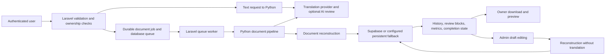

What this repo does: TriLingua translates text and documents between English, Cebuano, and Filipino. Laravel handles accounts, uploads, queues, storage, history, and administrative review; a Python FastAPI service handles document extraction, AI translation, validation, and reconstruction. This review assumes a small shared service with several users submitting work, rather than a single trusted person running a script.

# TriLingua — current code and production state

**Review date:** 9 October 2026, Asia/Manila.  
**Reviewed directory:** `C:/dev/Trilingua`, application in `C:/dev/Trilingua/trilingua-code`.  
**Verdict:** **Production release is blocked.** The current working code has substantial functionality and passing local regression tests, but also reproduced security, data-loss, translation-integrity, and provider-control defects. A deployed production environment was not inspected.

## 1. Executive assessment

The application is beyond a basic translation prototype. It has owner-scoped history and downloads, a durable job state machine, upload quotas, recovery paths, administrative review with separate draft and published text, and storage cleanup records that survive failures. Those are useful foundations, and the regression tests passed in an isolated copy.

The main weakness is the boundary between “a request returned a response” and “the user received a valid, safe, complete translation.” That boundary still accepts malformed success responses, can preserve untranslated body text as a successful result, and loses spreadsheet formulas. The document preview also exposes an unsafe HTML insertion path. Passing tests do not invalidate these findings: additional offline probes reproduced them against the current source.

| Area | Current standing | Basis |
|---|---|---|
| Core application features | Implemented, locally tested | Routes, controllers, services, jobs, and regression suites |
| User/admin separation | Implemented with local test evidence | Authenticated routes, admin middleware, owner checks, review tests |
| Document lifecycle | Substantial safeguards implemented | Durable job state, storage references, completion guards, cleanup outbox |
| Translation correctness | Blocked by concrete defects; linguistic quality unverified | Echo success, case collisions, short-text handling, identity-review behavior |
| Spreadsheet integrity | Blocked | Formula deletion reproduced |
| Browser preview security | Blocked | Unsafe URI survives conversion and reaches unsanitized HTML insertion |
| Provider safety and usage accounting | Blocked in this checkout | Startup inference, terminal-error retries, fallback, incomplete usage records |
| Dependency security | Release checks fail | Fresh Composer and npm audits |
| Production operation | Not verified | No deployed host, production database, queue, storage, or provider checks |
| Human translation/layout acceptance | Not verified this review | No fresh bilingual review or rendered multilingual output evaluation |

**Release recommendation:** fix the confirmed defects, establish a reproducible release commit, then test that exact release in staging. Do not publish a production-readiness or translation-accuracy claim from the current local test results.

## 2. Exact snapshot and review method

### Source identity

| Item | Observed value |
|---|---|
| Branch | `walben` |
| HEAD | `cbbfc901c25daa43d65ee9d2c2c4f97dc39bc5ca` |
| HEAD description | `fix(auth): restrict auth routes and reconcile stale jobs` |
| HEAD date | 7 September 2026 |
| Changed tracked paths | 109 |
| Untracked application code/config/test paths in the captured inventory | 82 |
| Application routes enumerated | 66 |
| Database migrations found | 33 |
| Original application files hashed for preservation | 401 |
| Original hashed files changed during this review | 0 |

The audit target is the **working tree**, including its uncommitted and untracked application changes. HEAD alone does not reproduce it. The repository also contains many untracked evaluation outputs; their count is not a measure of code size or product completeness.

Recent provider fixes exist on `codex/trilingua-remediation-2026-10-05`: `d4cf59b` addresses startup/provider safety and `9d451fa` addresses usage accounting. The branch and commits were verified locally. Their behavior is **absent from this working checkout**: it still contains the import-time warm-up, repeated terminal HTTP attempts, and word-count token estimates. The fixed branch was not retested here, and no merge was performed.

### Safety and evidence boundaries

Tests ran in a disposable copy at `C:/Users/walbe/AppData/Local/Temp/trilingua-production-audit-20261009/snapshot/trilingua-code`. Existing Composer dependencies were copied; installed Node dependencies were read through a directory junction. Builds, caches, generated test files, and test storage stayed in that copy.

The real `.env`, runtime storage, database files, and credential files were excluded from the copy. Tests used SQLite `:memory:`, fake Supabase settings, and dummy provider endpoints. A Python network guard blocked outbound connections while allowing the standard Windows socket-pair mechanism needed by the test runner. No live AI inference was executed by this review.

Only the report and audit evidence were added to the requested directory. No application fix, dependency update, migration, deployment, secret rotation, or existing-data change was performed.

Evidence is saved in [production-state-2026-10-09](C:/dev/Trilingua/docs/production-state-2026-10-09). Important files include:

- [Snapshot metadata](C:/dev/Trilingua/docs/production-state-2026-10-09/snapshot-metadata.json) and [source preservation result](C:/dev/Trilingua/docs/production-state-2026-10-09/source-preservation.json).
- [Final Laravel test output](C:/dev/Trilingua/docs/production-state-2026-10-09/laravel-tests-final.txt) and [final Python test output](C:/dev/Trilingua/docs/production-state-2026-10-09/python-tests-final.txt).
- [Python defect probes](C:/dev/Trilingua/docs/production-state-2026-10-09/python-probes.json), [Laravel defect probes](C:/dev/Trilingua/docs/production-state-2026-10-09/laravel-probes.txt), and [preview conversion probe](C:/dev/Trilingua/docs/production-state-2026-10-09/preview-probe.json).
- [Composer audit](C:/dev/Trilingua/docs/production-state-2026-10-09/composer-audit.json), [npm audit](C:/dev/Trilingua/docs/production-state-2026-10-09/npm-audit.json), and [redacted local configuration](C:/dev/Trilingua/docs/production-state-2026-10-09/local-config-redacted.json).

The audit probe assertions deliberately check the defective behavior. A passing probe means the defect was reproduced; it is not an acceptance test proving that the feature is correct.

## 3. Architecture and current feature behavior

### User and administrative flows

**Accounts:** registration, password login, logout, password reset, and Google OAuth routes exist. Login/OAuth/reset routes are guest-only and rate limited. Authenticated application routes are rate limited separately. Google configuration being present does not prove that a real OAuth redirect/callback works; the local mail driver writes messages to logs rather than proving delivery.

**Text translation:** Laravel validates language, mode, and text length, then calls Python through `TranslationManager`. Python translates, optionally reviews/repairs the result, and returns normalized output. Laravel attempts to save a completed history row, records metrics, and emits notifications. A history failure is reported through `saved=false`; later notification or metrics failures do not erase successful translation output. However, the success-response validation defect in finding 5 breaks the correctness of this flow.

**Document translation:** Laravel validates an upload, persists scratch input, checks its apparent format, computes a payload hash, checks for reusable/active work, reserves upload quota, stores the original when possible, and creates a durable job. Queue insertion and queued-state changes use a transaction where supported. The worker translates, stores output, persists history and review blocks, then conditionally completes the authoritative job row. Metrics are best effort. Failures can be retried or marked terminal with recovery information.

**History and download:** history, file, original-file, block, and status paths include ownership checks. Completed downloads use a shared resolver. Confirmed missing output produces a failure payload; uncertain storage availability leaves the record completed while withholding an unverified download link. User block previews expose published text rather than unpublished admin drafts.

**Admin review:** `/admin` routes require `is_admin`. Text and document review operations can edit, flag, verify, and audit changes. Document edits increment draft revisions. Publishing regenerates a new file from the original and captured structural metadata; it does not translate again. The service checks revision and block snapshots before committing the file pointer and published text. A failed publication keeps the earlier file available and records cleanup work for abandoned candidates.

**Operations:** commands exist for admin provisioning, deployment timeout validation, stale queue checks, translation reconciliation, and storage cleanup. Scheduled reconciliation and cleanup are registered in Laravel. The default launch scripts do not start a scheduler; finding 15 explains the operational consequence.

Key inspected sources: [routes](C:/dev/Trilingua/trilingua-code/routes/web.php), [TranslationController](C:/dev/Trilingua/trilingua-code/app/Http/Controllers/TranslationController.php), [TranslateDocumentJob](C:/dev/Trilingua/trilingua-code/app/Jobs/TranslateDocumentJob.php), [ReviewService](C:/dev/Trilingua/trilingua-code/app/Services/Admin/ReviewService.php), [CompletedDownloadResolver](C:/dev/Trilingua/trilingua-code/app/Services/Translation/CompletedDownloadResolver.php), and [StorageCleanupService](C:/dev/Trilingua/trilingua-code/app/Services/StorageCleanupService.php).

### Language, format, and mode contract

The configured language contract contains English, Cebuano, and Filipino, with six distinct translation directions. This confirms routing support, not equal quality in every direction.

| Input | Output | Implementation standing and limitation |
|---|---|---|
| DOCX | DOCX | In-place collect/translate/replay path; local structural tests exist. Complete Word feature and page-layout fidelity is not established. |
| PDF | PDF | Extraction, layout reconstruction, and output validation exist. Complex layout, scanned content, fonts, and text expansion still require representative visual checks. |
| TXT / MD | Same format | Text/block reconstruction; no fresh live-language acceptance in this review. |
| CSV | CSV | Cell translation path; suitability for machine-consumed identifiers and schemas needs explicit acceptance. |
| RTF / ODT | DOCX | Conversion is part of the stated contract; these are not same-format round trips. |
| PPTX | PPTX | In-place shape/text traversal and tests exist. Charts, embedded objects, and all presentation features are not proven preserved. |
| XLSX | XLSX | Offered by the application, but formula preservation currently fails. Do not treat it as safe for workbooks with calculations. |

Defaults in [translation.php](C:/dev/Trilingua/trilingua-code/config/translation.php) are 8,000 text characters, 50 MiB per document upload, 25 document uploads per user per day, and 250 MiB total daily document upload bytes. The daily quota applies to document intake; it is not an AI-token or cost budget.

| Mode | Source-defined behavior |
|---|---|
| Fast | Disables optional analysis, document memory, semantic chunking, review, prepass, and AI layout planning in the mode preset. Shared pipeline behavior can still use persistent caching. |
| Balanced | Enables document analysis, memory, semantic chunking, specialized prompts, AI review, caching, and prepass. |
| Thorough | Adds PDF AI layout planning to the balanced preset. |
| Auto | Selects a document mode using document characteristics; text requests resolve `auto` to `balanced`. |

These are processing choices, not validated quality grades. Balanced/thorough can add provider calls through analysis, review, and repairs. The experimental `TRANSLATION_UNIT_PIPELINE` switch defaults to false and is captured at module import; changing it requires a service restart. The in-place DOCX/PPTX/XLSX path still calls the block pipeline directly. Enabling the switch is therefore not a blanket replacement of every document path.

Sources: [processing modes](C:/dev/Trilingua/trilingua-code/Model/config/processing_modes.py), [translation pipeline](C:/dev/Trilingua/trilingua-code/Model/pipeline/translation_pipeline.py:117), and [document pipeline](C:/dev/Trilingua/trilingua-code/Model/pipeline/document_pipeline.py:647).

## 4. What is already sound

These implemented safeguards should be preserved during remediation:

1. **Ownership and role boundaries:** regular history/download/status operations check ownership, while administrative routes use a dedicated role middleware. No role-bypass defect was reproduced in the reviewed routes.
2. **Durable job state:** queue work has a database-backed lifecycle, active-job deduplication, recovery metadata, heartbeat information, and conditional terminal transitions. Completion is conditional on the authoritative state rather than a cache-only announcement.
3. **Quota reservation:** document quotas use a conditional database update rather than an unchecked read-then-write counter. Refunds use the captured quota date and avoid negative counters.
4. **Draft/published separation:** original AI text is retained, edits are audited, unpublished drafts are separated from owner-visible published text, and regeneration is reconstruction only.
5. **Publication safeguards:** regeneration does not hold a long database transaction open around provider/storage work. Before publication, the service checks draft revision and block values again and verifies storage readability.
6. **Storage uncertainty:** the code distinguishes present, missing, and unknown states. Cleanup checks history and recoverable-job references before deleting an object.
7. **Production service-token policy:** Python refuses production startup without a canonical `PYTHON_SERVICE_TOKEN`; protected operations use constant-time token comparison. The local missing token is not evidence that production token enforcement is broken. Import-time inference happens before the lifespan policy, which is a separate defect.
8. **Honest unavailable review scores:** unavailable/malformed AI review can retain the translation with a nullable score and warning. That is preferable to presenting an invented quality score; identity handling and calibration remain unresolved.

The tests exercise these contracts locally. SQLite tests and mocked storage/provider responses do not establish PostgreSQL locking behavior, real multi-worker recovery, or live storage/provider availability.

## 5. Local configuration and deployment posture

The inspected `.env` is a **local development configuration**, not an inspected production environment:

| Setting | Local file observation | Implication |
|---|---|---|
| `APP_ENV` / `APP_DEBUG` | `local` / `true` | Suitable for local debugging; unsuitable if copied unchanged into production. |
| Database / queue | `pgsql` / `database` | Intended PostgreSQL/database-queue operation; connectivity and applied production migrations were not checked. |
| Cache / sessions | File-based | Persistence and cross-host sharing depend on deployment layout. |
| Mail | `log` | Password-reset email delivery is not demonstrated by this setting. |
| Translation chain | GPT-OSS → Gemini | A provider failure can switch provider; this differs from the separate temporary Ollama-only test profile. |
| Analysis chain | Gemini → Ollama | Review/analysis can use a different provider from translation. |
| Ollama models | Translation and local analysis name `gpt-oss:20b-cloud` | Model names in configuration are not availability or account-allowance evidence. |
| Active pipeline requests / GPT-OSS slots | Both configured to 1 | This file requests serial capacity. No throughput or service-level guarantee was measured. |
| Busy wait / GPT-OSS attempts | 30 seconds / 3 attempts | Admission waiting is bounded; terminal provider failures still retry. |
| Service tokens | Empty/absent in this file | Production must provide the canonical token on both services; process-level values were not inspected. |
| Gemini/Supabase/Google settings | Present, values redacted | Presence proves configuration only, not validity, permissions, successful integration, or rotation. |
| Experimental unit pipeline | Unset | Defaults to false in source; a running process could have environment overrides. |

No listeners were observed on local ports 5000, 8000, 11434, or 5173 at the listener check. This is a point-in-time local observation. It does not establish that an external deployment is down or absent. No health endpoint was called because health/startup paths can contact providers.

The default timeout ladder passed an isolated configuration check:

`Python HTTP 1200s < job 1300s < worker 1500s < queue lease 1800s < reconciliation/stale threshold 2100s`.

The database queue configuration also passed the same-connection and `after_commit=false` preconditions in the test copy. These results validate default configuration rules, not actual production worker arguments, reverse-proxy timeouts, queue lease races, or migration state.

`start-all.bat` starts Uvicorn, queue listeners, log monitoring, and PHP's local web server. It uses Windows-specific paths and visible terminal processes. It is a local launcher, not evidence of supervised production operation. A production deployment needs a persistent web/worker/scheduler process arrangement, private Python ingress, durable storage, and verified restart/backup behavior. Laravel's deployment documentation requires debug mode to be disabled and process monitoring for long-running services. [Laravel production deployment](https://laravel.com/framework/docs/12.x/deployment).

The source calls fallback storage “encrypted” and “durable,” but `StorageService::storeLocal()` copies bytes to a configured filesystem path. Encryption, shared access, persistence, and backups must come from verified infrastructure; comments and configuration do not prove them.

## 6. Ranked findings

Priorities describe consequences, not estimated probabilities. **P1** means a significant security, data-integrity, core-result, or provider-control problem before release. **P2** means a narrower defect or operational gap that still needs an explicit correction or acceptance decision.

### Must fix

**1. P1 — Uploaded DOCX preview HTML is inserted without sanitization.**  
Source: [document-preview.js](C:/dev/Trilingua/trilingua-code/resources/js/document-preview.js:211), [converter path](C:/dev/Trilingua/trilingua-code/resources/js/document-preview.js:220), and [SecurityHeaders.php](C:/dev/Trilingua/trilingua-code/app/Http/Middleware/SecurityHeaders.php).

- **What this is:** the browser converts a stored DOCX to HTML for user/admin preview.
- **Problem:** converter output goes directly to `innerHTML`. A harmless offline DOCX hyperlink with `javascript:void(0)` retained that URI in the generated HTML. The content security policy allows inline scripts and does not supply the missing HTML sanitization.
- **Fix:** sanitize converter output and allow only safe hyperlink protocols before insertion, or use the existing escaped block-preview path until a safe rich preview is available. Add a hostile-document preview regression check.
- **If we skip it:** an uploaded document can present an executable link to a reviewer under the application's origin. Browser execution/session compromise was not exercised; the unsafe conversion and insertion path were confirmed. Mammoth explicitly documents this risk. [Mammoth security guidance](https://github.com/mwilliamson/mammoth.js#security).

**2. P1 — XLSX reconstruction deletes formulas.**  
Source: [reconstructor.py](C:/dev/Trilingua/trilingua-code/Model/document/reconstructor.py:372); reproduction: [python-probes.json](C:/dev/Trilingua/docs/production-state-2026-10-09/python-probes.json).

- **What this is:** the shared in-place workbook walker translates string cells and saves the workbook.
- **Problem:** `load_workbook(..., data_only=True)` loads cached values instead of formulas. A workbook containing `A1 =SUM(1,2)` and a text cell saved with `A1` empty after translation; cached formulas can instead become static values.
- **Fix:** load the editable workbook with formulas retained and keep formula cells out of translation. Test formulas, values, and text in both initial translation and regeneration paths.
- **If we skip it:** users can download a translated workbook with its calculations destroyed. The current “perfect layout preservation” log message overstates what the writer preserves.

**3. P1 — Authentication, quota, and rate-limit failures do not stop provider requests.**  
Source: [gptoss.py](C:/dev/Trilingua/trilingua-code/Model/providers/gptoss.py:166), [generic retry handler](C:/dev/Trilingua/trilingua-code/Model/providers/gptoss.py:304), and [fallback.py](C:/dev/Trilingua/trilingua-code/Model/providers/fallback.py:110).

- **What this is:** the provider retries unsuccessful calls, and the configured wrapper can switch to Gemini.
- **Problem:** mocked 401, 403, and 429 responses each produced three attempts. A mocked exhausted primary route invoked the backup. The current checkout has no terminal `ProviderStopped` guard, contrary to the previously established quota-stop requirement.
- **Fix:** reconcile the existing provider-safety remediation with this working tree. Terminal auth/quota/rate-limit errors must stop retries, repairs, review calls, and fallback until deliberate recovery.
- **If we skip it:** exhaustion or invalid authentication can cause repeated requests and provider switching beyond the intended allowance. The probes used mocks; no account charge or live quota event was observed.

**4. P1 — Importing the server can perform inference before startup validation.**  
Source: [server.py warm-up](C:/dev/Trilingua/trilingua-code/Model/server.py:228), [inference call](C:/dev/Trilingua/trilingua-code/Model/server.py:296), and [top-level invocation](C:/dev/Trilingua/trilingua-code/Model/server.py:307).

- **What this is:** importing `server.py` immediately executes a warm-up function.
- **Problem:** warm-up creates the cache, checks a provider, and can call GPT-OSS chat inference. This precedes the lifespan check that rejects production startup without a service token.
- **Fix:** apply the existing startup-safety approach: provider inference must be an explicit operator action, separate from import and service startup.
- **If we skip it:** imports, tests, restarts, and attempted invalid deployments can make provider requests before any user translation. This report confirms the call path statically; live warm-up was intentionally blocked.

**5. P1 — Invalid HTTP-200 text responses become completed history records.**  
Source: [TranslationManager.php](C:/dev/Trilingua/trilingua-code/app/Services/Translation/TranslationManager.php), [TranslationResponse.php](C:/dev/Trilingua/trilingua-code/app/Services/Translation/DTO/TranslationResponse.php:35), and [TranslationController.php](C:/dev/Trilingua/trilingua-code/app/Http/Controllers/TranslationController.php:129).

- **What this is:** Laravel trusts a successful HTTP status and normalizes missing response fields.
- **Problem:** an empty response envelope defaults to empty translated text and `success=true`, then creates completed history. An explicit `success=false` HTTP-200 envelope also creates completed history. Both behaviors were reproduced through authenticated HTTP tests.
- **Fix:** validate the response contract at `TranslationManager` and reject failed, malformed, or empty results before persistence. Keep transport success separate from translation success.
- **If we skip it:** outages or service-contract changes create false successful records and misleading notifications/statistics.

**6. P1 — Dependency security checks currently fail.**  
Sources: [composer.lock](C:/dev/Trilingua/trilingua-code/composer.lock), [package-lock.json](C:/dev/Trilingua/trilingua-code/package-lock.json), and the saved audit JSON files.

- **What this is:** fresh registry audits compare the locked dependency graph with published advisories.
- **Problem:** Composer reports two advisories affecting `league/commonmark 2.10.0`: one high and one medium. npm reports nine affected package nodes: two critical, one high, and six moderate. Node counts include transitive parents; they are not nine distinct vulnerabilities.
- **Fix:** update affected dependencies/lockfiles to supported fixes, verify the dependency paths, and rerun build, tests, and audits. Do not apply npm's proposed major downgrades automatically; some suggestions point to obsolete Mammoth/PPTX versions.
- **If we skip it:** the repository's declared security CI checks remain red and affected packages remain in the release. The `shell-quote` advisory has a verified patched version of 1.11.0; CommonMark publishes a 2.10.2 security release. [shell-quote maintainer advisory](https://github.com/ljharb/shell-quote/security/advisories/GHSA-pqg4-j6r4-53mv), [CommonMark security release](https://github.com/thephpleague/commonmark/releases/tag/2.10.2).

Important qualification: `concurrently → shell-quote` and the `source-map-js` advisory are development/build dependencies. Browser-preview dependencies also have advisories. Neither audit proves an exploitable public route in TriLingua; reachability must be assessed separately from the failing release check.

**7. P1 — The Python runtime dependency manifest cannot reliably bootstrap upload routes.**  
Source: [Model/requirements.txt](C:/dev/Trilingua/trilingua-code/Model/requirements.txt), [CI install steps](C:/dev/Trilingua/trilingua-code/.github/workflows/ci.yml), and [upload route](C:/dev/Trilingua/trilingua-code/Model/server.py:630).

- **What this is:** the engine declares multipart file/form routes, while CI installs the runtime and development requirements files.
- **Problem:** neither requirements file declares `python-multipart`. It is installed on this machine, so existing local tests mask the omission. Hiding that package from the installed FastAPI runtime reproduced failure when registering an upload route.
- **Fix:** declare the required upload dependency and validate a clean environment using the actual manifests. Keep optional NLLB/OCR dependencies separate from the normal runtime requirements.
- **If we skip it:** a fresh CI runner or deployment can fail to import/register the service even though this prepared machine passes tests. A full clean installation was not run. [FastAPI upload dependency requirement](https://fastapi.tiangolo.com/tutorial/request-files/).

**8. P1 — Persistent source echoes can be reported as successful translations.**  
Source: [translation_pipeline.py](C:/dev/Trilingua/trilingua-code/Model/pipeline/translation_pipeline.py:635).

- **What this is:** the pipeline detects source text repeated as output and retries it.
- **Problem:** after unsuccessful semantic translation, the guard can return the original body with `success=True`. The probe returned `The dog is hungry.` unchanged for English→Cebuano after two mocked provider calls; only a warning indicated the problem.
- **Fix:** distinguish legitimate protected/identity content from a failed body translation. A confirmed translatable-body echo should remain failed or explicitly incomplete, and the document/API completion contract must preserve that status.
- **If we skip it:** “completed” can mean that readable source text was returned without translation, especially in fast mode where AI review is disabled.

**9. P2 — Cache normalization merges case-sensitive source meanings.**  
Source: [sqlite_cache.py](C:/dev/Trilingua/trilingua-code/Model/cache/sqlite_cache.py), [translation_cache.py](C:/dev/Trilingua/trilingua-code/Model/memory/translation_cache.py).

- **What this is:** both cache key builders lowercase source text.
- **Problem:** storing a result for `US` made an `us` lookup return the same result. These English inputs can mean a country and a pronoun. The collision was reproduced in the persistent cache; the in-memory key collision was also confirmed.
- **Fix:** preserve source case in cache identity and change the namespace/key version so previous colliding entries are not reused. Apply the same rule to all callers/cache implementations.
- **If we skip it:** a valid provider result can be replaced by a cached translation for a different meaning.

**10. P2 — Usage statistics do not account for actual provider work.**  
Source: [gptoss.py](C:/dev/Trilingua/trilingua-code/Model/providers/gptoss.py:256), [MetricsService.php](C:/dev/Trilingua/trilingua-code/app/Services/MetricsService.php:36).

- **What this is:** responses and database metrics expose call/token figures.
- **Problem:** GPT-OSS substitutes word counts when token counters are absent. Text metrics record one call despite possible translation/retry/review/repair work; document token fields are written as zero. The probe confirmed invented two-input/two-output counts from a response with no counters.
- **Fix:** reconcile the existing attempt-ledger remediation with this checkout. Record each actual provider attempt and purpose; keep provider-unreported counters unknown rather than estimated or zero.
- **If we skip it:** operational reports can undercount work and cannot support reliable allowance/cost decisions. This review did not calculate real cost or usage.

**11. P2 — A meaningful single-character document block is skipped.**  
Source: [passthrough rule](C:/dev/Trilingua/trilingua-code/Model/pipeline/translation_pipeline.py:154), [document filtering](C:/dev/Trilingua/trilingua-code/Model/pipeline/translation_pipeline.py:945).

- **What this is:** short blocks bypass provider translation.
- **Problem:** every block shorter than two characters is treated as untranslatable. An English paragraph containing only `I` stayed `I` with zero provider calls in the document probe.
- **Fix:** distinguish letters/meaningful words from punctuation and numeric labels rather than applying a universal length cutoff. Preserve the existing protected-content rules.
- **If we skip it:** short pronouns or text split into very small blocks can remain in the source language without translation.

**12. P2 — The text `"0"` is rejected as absent input.**  
Source: [TranslationController.php](C:/dev/Trilingua/trilingua-code/app/Http/Controllers/TranslationController.php:103).

- **What this is:** a PHP emptiness check decides whether text was supplied.
- **Problem:** `empty('0')` is true. An authenticated text request containing `0` returns 422 before reaching Python; the HTTP probe confirmed it.
- **Fix:** check trimmed string emptiness explicitly so valid zero text is retained. Translation may legitimately preserve a number unchanged.
- **If we skip it:** the UI/API rejects legitimate supplied content as if no text were provided.

**13. P2 — Identity output is treated as a translation failure without language context.**  
Source: [AIQualityReviewer.review](C:/dev/Trilingua/trilingua-code/Model/validators/ai_quality_reviewer.py:275) and its corresponding batch-review logic.

- **What this is:** a fast review rule compares source and output for equality.
- **Problem:** identical non-title content receives a critical untranslated issue, score 30, and a retry requirement. The probe confirmed this for `tubig → tubig`; the method does not accept source/target language arguments, so it cannot distinguish a shared word or unchanged entity from failed translation.
- **Fix:** make identity review aware of the language pair, protected content, and block context. Use bilingual acceptance cases before relaxing genuine untranslated-body detection.
- **If we skip it:** valid identities can receive false failure scores and unnecessary repairs. The probe establishes the mechanical behavior; this review did not conduct native-language calibration of the proposed exceptions.

### Should fix

**14. P2 — Engine request limits are weaker than the Laravel contract.**  
Source: [TextRequest](C:/dev/Trilingua/trilingua-code/Model/server.py:493), [document upload read](C:/dev/Trilingua/trilingua-code/Model/server.py:664), and [regeneration upload read](C:/dev/Trilingua/trilingua-code/Model/server.py:746).

- **What this is:** Python accepts requests from the application/service-token boundary.
- **Problem:** its text model accepts a 9,000-character input despite Laravel's 8,000 default, and the document/regeneration handlers read uploaded bytes without an application-level byte cap. Direct authorized service callers bypass Laravel's resource limits.
- **Fix:** enforce compatible text/upload bounds at Python ingress and check archive expansion before heavy parsing. Keep the service private and configure ingress limits as well.
- **If we skip it:** an oversized authorized request can occupy more memory and processing time than the UI contract permits. Token enforcement and private binding reduce exposure; no memory-exhaustion attack was run.

**15. P2 — Default startup paths omit the scheduler needed for maintenance.**  
Source: [scheduled commands](C:/dev/Trilingua/trilingua-code/bootstrap/app.php:65), [start-all.bat](C:/dev/Trilingua/trilingua-code/start-all.bat), and [Composer dev command](C:/dev/Trilingua/trilingua-code/composer.json).

- **What this is:** reconciliation and storage cleanup are registered as scheduled jobs.
- **Problem:** the inspected launch scripts/Composer dev command start web, translation, and queue services but no `schedule:run` or `schedule:work` process. Registration alone does not execute scheduled work.
- **Fix:** include an explicitly managed scheduler in the deployment/run instructions and verify it runs alongside web and workers.
- **If we skip it:** after a worker crash or storage failure, stale states and cleanup intentions may remain until an operator runs maintenance manually. An independently installed production scheduler was not inspected.

**16. P2 — The required formatting CI gate fails.**  
Source: [CI workflow](C:/dev/Trilingua/trilingua-code/.github/workflows/ci.yml), [Pint output](C:/dev/Trilingua/docs/production-state-2026-10-09/pint-check.txt).

- **What this is:** CI runs `vendor/bin/pint --test` as a required Laravel job step.
- **Problem:** the read-only local check failed and reported formatting issues in 150 existing paths, excluding the new audit probe. This is a release-pipeline problem, not proof of a functional defect in those files.
- **Fix:** resolve formatting in a separate reviewed change and rerun the gate. Keep functional remediation distinguishable from formatting churn.
- **If we skip it:** even a release with passing tests cannot pass the currently declared CI workflow. No automatic formatting was applied during this audit.

No additional style or hypothetical performance findings were added. No unused-code deletion or dependency-removal saving was asserted without a verified call-site analysis.

## 7. Verification results and their limits

| Check | Result | What it establishes |
|---|---|---|
| Safe test environment guard | Passed | Test copy uses `testing`, SQLite `:memory:`, no cached production config |
| Laravel regression suite | **475 passed; 1,804 assertions** | Local application, authorization, persistence, review, job, quota, and storage contracts represented by the suite |
| Selected deterministic Python suite | **393 passed; 35 deselected** | Local pipeline/document/provider-mock behavior in the selected tests |
| Additional Laravel defect probes | **4 reproduced; 13 assertions** | Zero rejection, malformed success persistence, explicit failure persistence, internal-error disclosure |
| Additional Python probes | Reproduced | Formula loss, cache collision, single-character bypass, echo success, identity rejection, terminal retries, quota fallback, estimated counters, startup invocation |
| Browser converter probe | Unsafe URI retained | Converter output is unsafe before insertion; browser execution was not tested |
| Boundary/bootstrap probes | Reproduced | Oversized text model acceptance and missing-multipart route-registration failure |
| Production frontend build | Passed | Installed dependencies can compile the current frontend in the disposable copy |
| Default timeout/database-queue validator | Passed | Default inequalities and queue atomicity configuration checks in isolated SQLite setup |
| Composer manifest validation | Passed | `composer.json` validates structurally |
| Composer security audit | **Failed** | Two current advisories in locked CommonMark dependency |
| npm security audit | **Failed** | Nine affected package nodes, including two critical and one high |
| Pint formatting check | **Failed** | Required style gate is not clean |
| Python syntax parsing | 107 files passed | Source parses without importing it |
| PHP syntax checks | 191 files passed, including one audit probe | No syntax failures in checked application/test/bootstrap files |
| Original-source preservation | 401 hashes unchanged | Audited original code/config files were preserved |

The Python selection excluded `slow`, `golden`, and `font_regression` markers, plus the entire concurrency benchmark and reference-Gemini workflow files. Deselection counts do not include tests in ignored files. This was not a full provider/model benchmark run.

The first Laravel run overlapped the frontend build and failed two manifest checks. After the build completed, the full regression suite passed. The first Python run failed because the audit network guard blocked Windows' internal socket pair and hit a test-runner reporting error; the guard was corrected and the selected suite passed. Initial logs are retained so these are not silently presented as a clean first run.

The corrected Python run recorded two blocked connection attempts. Those attempts did not leave the process. Public documentation and dependency-registry checks used network access separately; live translation/storage/OAuth operations did not.

### Dependency snapshot

Locked PHP packages include Laravel `12.69.1`, Guzzle `7.15.5`, Socialite `5.31.0`, and CommonMark `2.10.0`. Locked JavaScript packages include Vite `7.3.6`, Mammoth `1.12.0`, PPTX Preview `1.0.7`, SheetJS `0.20.3`, Concurrently `9.2.4`, and shell-quote `1.9.0`.

Checks used PHP `8.2.31`, Python `3.11.6`, Node `24.16.0`, and Composer `2.10.1`. CI specifies PHP 8.3, Python 3.12, and Node 20, so those CI environments still need an actual run. Python runtime requirements use lower bounds rather than a fully pinned lock; the installed package snapshot is saved in metadata. Python dependency vulnerabilities were not audited.

The build warned about large preview chunks: PPTX Preview is roughly 1.35 MB minified, while Mammoth and XLSX chunks are about 500 KB each. These are already loaded through dynamic imports. This is a bundle-size observation, not a measured user-performance defect; no speculative component rewrite is recommended from that warning alone.

## 8. Production release gates

| Gate | Status now | Required acceptance evidence |
|---|---|---|
| Safe untrusted-document preview | Blocked | Hostile links/HTML cannot execute; normal user/admin preview still works |
| Valid translation success contract | Blocked | Failed/malformed/echoed body results cannot produce false completed records |
| Spreadsheet preservation | Blocked | Formulas remain formulas after translation and admin regeneration |
| Terminal provider stop and complete usage records | Blocked in reviewed checkout | No retries/fallback after terminal stop; every allowed attempt and unknown counter recorded correctly |
| Reproducible release | Not established | Commit contains the reviewed application/migrations/config/test changes; build from that commit |
| Dependency and CI checks | Blocked | Supported remediation, green audits or documented justified exceptions, green formatting and CI checks |
| Real database and queue behavior | Not verified | Isolated PostgreSQL staging: duplicate intake, quota races, stale edits, worker crash/restart, retry/completion races |
| Real storage and access control | Not verified | Private bucket/policies, successful owner download, cross-user denial, missing/unknown handling, cleanup, fallback durability |
| Provider availability, allowance, and language output | Not verified | Controlled, explicitly budgeted translation/review with stop policy and recorded runtime configuration |
| Browser and accessibility workflows | Not verified | Served user/admin flows, keyboard behavior, mobile layout, preview/download/polling/error/review handling |
| Human quality and format coverage | Not verified | Bilingual meaning review for all six directions and rendered representative outputs for each supported format |
| Operations and recovery | Not verified | Supervised services and scheduler, migration checks, backups/restoration, persistent storage, monitoring and restart evidence |

Supabase service keys bypass Storage row-level access policies, so server-side ownership checks and bucket configuration both matter. The source ownership checks were reviewed; live bucket policy/publicity and credentials were not inspected. [Supabase Storage access control](https://supabase.com/docs/guides/storage/security/access-control).

Credential presence and the existing security runbooks do not establish that prior credentials were rotated, legacy accounts were disabled, or backups were tested. Verify those as deployment evidence. No credential values were copied into this report.

## 9. Smallest practical remediation sequence

These are recommendations for subsequent work, not changes made by this report.

1. **Establish the intended release snapshot.** Preserve the current work, compare the existing F15/F16 branch with it, and produce a reviewable integration change. Do not overwrite the working tree or assume the other branch contains every current feature.
2. **Close the highest-impact boundaries.** Fix preview sanitization, XLSX formulas, terminal provider stop/startup inference, text response validation, and dependency/bootstrap issues. Each should have a small focused acceptance check at its actual public/shared boundary.
3. **Correct translation-result semantics.** Fix echoed-body completion, case-sensitive caches, short text/zero input, identity review, and usage accounting. Add bilingual cases for identity rules; do not weaken untranslated-body detection without evidence.
4. **Make CI and operations reproducible.** Address the declared formatting gate, validate clean installs under CI runtimes, start the scheduler, and record the exact worker/service configuration. Reuse the existing timeout validator and recovery services.
5. **Validate the release in isolated staging.** Use PostgreSQL and real queue workers with private storage. Test crash/retry/race paths and a backup restoration before accepting operational readiness.
6. **Run a controlled provider and human acceptance pass.** Verify account allowance first, retain terminal-stop safeguards, and record actual attempts. Review meaning and layout across language directions/formats before expanding traffic.

Do not expand features, change the overall Laravel/Python architecture, or build a new framework to solve these issues. The existing shared services and the separate remediation branch already provide most of the required seams.

## 10. Scope not checked

The review went deepest on input/output contracts, storage/job/review integrity, provider control, and production configuration. It did not manually read every historical benchmark script, generated evaluation file, Blade/CSS component, dependency implementation, or migration statement line by line.

Not checked: deployed host state; real PostgreSQL contents/migrations/locks; live queue reservations; authenticated Supabase requests or bucket policies; real OAuth/mail delivery; provider dashboards, allowance, prices, or inference quality; full secret/history scanning and rotation evidence; complete golden/font/model benchmark runs; served-browser exploitation/accessibility/mobile testing; rendered acceptance for every format; backup restoration; sustained load, cancellation, memory-exhaustion, latency, or availability guarantees. Historical evaluations were used for context, not refreshed or promoted into current production evidence.

**Verdict:** retain the existing lifecycle/review safeguards, fix the reproduced safety and result-integrity failures first, and validate the exact release in staging before production.

**Result:** detailed current-code production-state report and reproducible audit evidence saved.  
**Checked:** source flows, local configuration, isolated regression tests, offline defect probes, build, syntax, dependency audits, and source preservation.  
**Remaining:** the ranked defects and production/live/human acceptance gates above; no fixes or deployment were performed.
