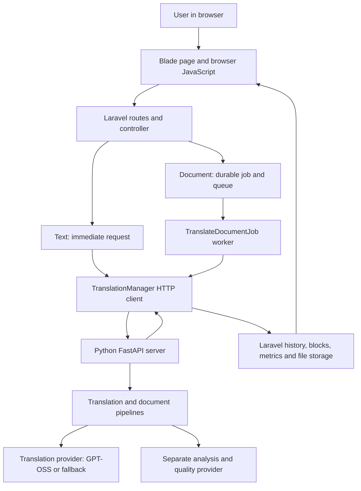

# TriLingua codebase walkthrough

Source checked on 15 October 2026 (Asia/Manila). Repository: `C:\dev\Trilingua`; application: `C:\dev\Trilingua\trilingua-code`. The checkout is on `walben`, commit `cbbfc90`, with substantial local modifications and untracked implementation files. This guide describes the working files inspected, not just the committed version or a deployed website.

The main request, translation, persistence, and review paths were traced in source. A read-only request to the already-running Python service at `http://127.0.0.1:5000/health` confirmed its routing configuration. No new translation was submitted, and no application code or data was changed. This is an explanation, not a fresh production or translation-quality audit.

## 1. The architecture

TriLingua consists of a Laravel application and a Python translation service. The AI model is accessed through a provider adapter; most of the codebase handles the work around that model.



| Layer | Responsibility | Main location |
|---|---|---|
| Browser | Collect text/file and options; send request; display result; poll documents | [translation.blade.php](C:/dev/Trilingua/trilingua-code/resources/views/translation.blade.php) |
| Web backend | Authentication, ownership, validation, job acceptance, persistence, review | [routes/web.php](C:/dev/Trilingua/trilingua-code/routes/web.php), [app](C:/dev/Trilingua/trilingua-code/app) |
| HTTP bridge | Send text, documents, and regeneration requests to Python | [TranslationManager.php](C:/dev/Trilingua/trilingua-code/app/Services/Translation/TranslationManager.php) |
| Python service | Validate engine requests, choose providers, run pipelines, return results | [server.py](C:/dev/Trilingua/trilingua-code/Model/server.py) |
| Translation engineering | Context, batches, cache, checks, reconstruction | [pipeline](C:/dev/Trilingua/trilingua-code/Model/pipeline), [document](C:/dev/Trilingua/trilingua-code/Model/document) |
| Model access | Construct an API request and normalize its answer | [providers](C:/dev/Trilingua/trilingua-code/Model/providers) |

Laravel generally does not choose AI prompts or split translation blocks. It receives provider/model metadata, but delegates translation mechanics to Python. Python does not own the Laravel user's login or history pages.

## 2. Which model is working now?

The **running local Python service** reported:

| Job | Provider route | Reported model |
|---|---|---|
| Primary translation | `gptoss` | `gpt-oss:20b-cloud` |
| Translation fallback | `gemini` | `gemini-3.5-flash-lite` |
| Primary analysis and AI quality review | `gemini_analysis` | `gemini-3.5-flash-lite` |
| Analysis/review fallback | `ollama_analysis` | `gpt-oss:20b-cloud` |

The health response reported translation status `ok`, primary and fallback status `ok`, and analysis status `configured`. These statuses do not demonstrate the linguistic quality of a translation or prove that all routes have just generated a successful result.

There are four different questions:

1. **What did we configure?** Read the relevant environment settings.
2. **What did the running process load?** Read `/health`.
3. **Which route returned this text?** Inspect the text response's `provider` and `model`.
4. **Which routes participated in a document?** Inspect its Python `metrics.providers_used`, cache counts, and warnings while the response is available.

### Configuration and selection files

The shared [Laravel .env](C:/dev/Trilingua/trilingua-code/.env) currently contains these non-secret model settings:

```dotenv
TRANSLATION_PROVIDER=gptoss
TRANSLATION_FALLBACK_PROVIDER=gemini
ANALYSIS_PROVIDER=gemini
ANALYSIS_FALLBACK_PROVIDER=ollama
OLLAMA_CLOUD_MODEL=gpt-oss:20b-cloud
OLLAMA_ANALYSIS_MODEL=gpt-oss:20b-cloud
GEMINI_MODEL=gemini-3.5-flash-lite
GEMINI_ANALYSIS_MODEL=gemini-3.5-flash-lite
TRANSLATION_ANALYZER_MODE=merged
```

These are different roles even when two roles use the same model.

- [config/environment.py](C:/dev/Trilingua/trilingua-code/Model/config/environment.py) loads selected settings from Laravel's `.env`. An already-set, nonempty process environment variable takes precedence.
- [server.py:89](C:/dev/Trilingua/trilingua-code/Model/server.py:89) reads provider names. `_get_active_provider()` chooses the primary, and `_get_pipeline_provider()` wraps it with fallback. The pipelines are constructed during service initialization.
- [providers/gptoss.py:72](C:/dev/Trilingua/trilingua-code/Model/providers/gptoss.py:72) reads `OLLAMA_CLOUD_MODEL` and `OLLAMA_CLOUD_URL`.
- [providers/gemini.py:103](C:/dev/Trilingua/trilingua-code/Model/providers/gemini.py:103) reads `GEMINI_MODEL` for translation.
- [ai/gemini_provider.py:113](C:/dev/Trilingua/trilingua-code/Model/ai/gemini_provider.py:113) reads `GEMINI_ANALYSIS_MODEL` for analysis/review.
- [ai/ollama_provider.py](C:/dev/Trilingua/trilingua-code/Model/ai/ollama_provider.py) handles Ollama analysis/review.

Editing `.env` alone does not replace provider objects already loaded in Python. Restart the Python service for provider changes; Laravel config caching can also affect bridge settings. A dropdown mode such as `thorough` does not choose another model.

### What the health model string means

```text
engine: provider:gptoss_with_gemini_fallback
model:  gpt-oss:20b-cloud|gemini-3.5-flash-lite
```

The pipe-separated string describes a chain. It does not mean every request used both models. GPT-OSS can answer alone, fallback can answer, different document blocks can take different routes, and cache can supply a prior translation without a new translation-model call.

The adapters report their configured model identifiers. This is application-level provenance; it is not independent verification of a remote provider's underlying weights.

### Where the model request happens

[GPTOSSProvider.translate():108](C:/dev/Trilingua/trilingua-code/Model/providers/gptoss.py:108) builds system/user prompts and sends an HTTP request containing `model: self._model` and `messages` to the configured Ollama chat endpoint. It extracts the reply, checks/sanitizes it, and returns a `TranslationResponse`.

[GeminiProvider.translate():139](C:/dev/Trilingua/trilingua-code/Model/providers/gemini.py:139) performs the corresponding Gemini operation. The provider file contains the connection and response-handling logic; the model is not implemented inside that Python file.

### A limitation in historical model evidence

For text, [server.py:501](C:/dev/Trilingua/trilingua-code/Model/server.py:501) returns `provider`, `model`, warnings, and token usage. [TranslationManager.php:72](C:/dev/Trilingua/trilingua-code/app/Services/Translation/TranslationManager.php:72) logs those values; [TranslationController.php:71](C:/dev/Trilingua/trilingua-code/app/Http/Controllers/TranslationController.php:71) passes them to [MetricsService.php](C:/dev/Trilingua/trilingua-code/app/Services/MetricsService.php). Cache responses explicitly use `provider="cache"`; their model value describes the configured cache namespace/chain, not a model newly called.

For documents, [DocumentContext.record_provider():274](C:/dev/Trilingua/trilingua-code/Model/pipeline/document_context.py:274) records observed provider responses. [_engine_metrics():107](C:/dev/Trilingua/trilingua-code/Model/pipeline/document_pipeline.py:107) returns `providers_used` alongside route information and cache counts. This is an aggregate diagnostic, not a complete per-block or per-outbound-request audit.

**Laravel's current `persistDocumentMetrics()` stores selected fields, including `provider` and `model`, but does not persist `providers_used`.** The document's top-level provider/model can describe the configured chain. The captured review blocks do not supply a complete per-block provider history either. Therefore, historical document metrics alone may not establish exactly which model translated every block. Metrics writes are also best-effort, so an absent metric does not necessarily mean translation failed.

The [admin dashboard](C:/dev/Trilingua/trilingua-code/resources/views/admin/dashboard.blade.php:239) also has an engine provider/model display. A runtime engine label is not evidence of which route handled an older document.

## 3. Text translation: exact request flow

Suppose the user enters an English paragraph, selects Cebuano, and presses Translate.

1. [translation.blade.php:353](C:/dev/Trilingua/trilingua-code/resources/views/translation.blade.php:353) builds form data with `text`, `source_lang`, `target_lang`, and `mode`; its JavaScript sends `POST /translate`.
2. [routes/web.php](C:/dev/Trilingua/trilingua-code/routes/web.php) routes the authenticated request to `TranslationController::translate()`.
3. [TranslationController.php:71](C:/dev/Trilingua/trilingua-code/app/Http/Controllers/TranslationController.php:71) checks accepted languages, different source/target languages, text length, mode, and the presence of text or a document. If a document is attached, the document branch takes precedence.
4. The controller builds [TranslationRequest.php](C:/dev/Trilingua/trilingua-code/app/Services/Translation/DTO/TranslationRequest.php). This DTO packages data; it does not translate anything.
5. [TranslationManager::translateText():72](C:/dev/Trilingua/trilingua-code/app/Services/Translation/TranslationManager.php:72) sends JSON to Python's `POST /translate/text`, with the service token when configured.
6. [server.py:501](C:/dev/Trilingua/trilingua-code/Model/server.py:501) validates the engine input, resolves the mode, and invokes `TranslationPipeline.translate()` under its concurrency guard.
7. [TranslationPipeline.translate():659](C:/dev/Trilingua/trilingua-code/Model/pipeline/translation_pipeline.py:659) checks the persistent cache, assembles context, and invokes the translation provider through `_translate_with_echo_guard()`.
8. [providers/fallback.py:110](C:/dev/Trilingua/trilingua-code/Model/providers/fallback.py:110) tries the primary, or directs the request to fallback after a failure/cooldown. The pipeline can also request semantic fallback for invalid or unchanged output.
9. For modes with AI review, the server uses [AIQualityReviewer](C:/dev/Trilingua/trilingua-code/Model/validators/ai_quality_reviewer.py). It may request one repair translation using the review's issues. An unavailable review can return warnings with the valid translation rather than discard it.
10. Python returns the translated string plus metadata. Laravel turns that into [TranslationResponse.php](C:/dev/Trilingua/trilingua-code/app/Services/Translation/DTO/TranslationResponse.php).
11. The controller attempts to save history, notify the user/admins, and persist metrics, then returns JSON to the browser.

Text translation is **synchronous**: the browser waits for this request. History persistence is handled separately: a valid translation can return with `saved=false`. The browser has a warning for this case. Successful generation does not automatically prove successful history persistence.

## 4. Document translation: acceptance, work, completion

Document translation is **queued**. The first browser request accepts work; it does not wait for the finished file.

### Acceptance in Laravel

[TranslationController::handleDocument():247](C:/dev/Trilingua/trilingua-code/app/Http/Controllers/TranslationController.php:247):

1. Moves the uploaded source to scratch storage so the worker can read it later.
2. Checks that its contents match its claimed file type.
3. Hashes the actual bytes and combines the hash with user, languages, mode, and PDF options into a deduplication key.
4. Reuses a matching completed result when downloadable, or returns an existing active job ID.
5. Atomically reserves the daily upload quota.
6. Attempts durable storage of the original, which enables later retries, review, and retranslation.
7. Creates a `translation_jobs` state row and dispatches `TranslateDocumentJob`. The queued-state write and database queue insertion share a transaction.
8. Returns a `job_id` to the browser. Ambiguous dispatch outcomes are classified using durable readback rather than simply treated as rejection.

### Work in the queue worker

[TranslateDocumentJob::handle():101](C:/dev/Trilingua/trilingua-code/app/Jobs/TranslateDocumentJob.php:101):

1. Marks the job processing and obtains a readable source. A retry can recover the source from its durable original.
2. Calls `TranslationManager::translateDocument()`.
3. Receives file bytes, blocks, sidecar, and metrics from Python.
4. Writes the translated bytes to scratch, then stores the result durably.
5. Creates or reuses the history row and persists the required review blocks/sidecar.
6. Persists optional metrics.
7. Conditionally marks the job completed, exposes the download, sends notifications, and cleans scratch files.

Completion is deliberately late. A generated output file is not enough: the job also needs retrievable storage, history, and review data. Terminal transitions are guarded against another worker/reconciler already changing the state.

### Browser status

[translation.blade.php:484](C:/dev/Trilingua/trilingua-code/resources/views/translation.blade.php:484) polls `GET /translate/status/{jobId}` with increasing delays. [TranslationController::status():629](C:/dev/Trilingua/trilingua-code/app/Http/Controllers/TranslationController.php:629) reads the owner-scoped durable job row first, with history/cache compatibility paths.

```text
created -> queued -> processing -> completed
                              -> failed
                              -> cancelled
```

Progress is Laravel's coarse phase progress, not a live token count or a guaranteed percentage of translated words. The browser does not declare failure simply because a long translation takes time.

## 5. What Python does to a document

[DocumentPipeline.translate():212](C:/dev/Trilingua/trilingua-code/Model/pipeline/document_pipeline.py:212) coordinates these steps:

```text
source file
  -> determine processing mode
  -> collect/extract blocks and structural metadata
  -> analyze document and prepare terminology/context when enabled
  -> translate blocks with cache, batches, checks, and optional review
  -> validate translated content/layout
  -> reconstruct or replay into the original structure
  -> create review blocks and regeneration sidecar
  -> return output file plus metrics
```

The analyzer and prepass can be merged into one AI call (`TRANSLATION_ANALYZER_MODE=merged` in the current file configuration). Their output supplies document type, style/context, and terminology. It does not replace the translated paragraphs.

### Office formats: DOCX, PPTX, XLSX

[_translate_inplace():647](C:/dev/Trilingua/trilingua-code/Model/pipeline/document_pipeline.py:647) uses a collect/translate/replay approach:

- Walk the source without saving and collect each translatable element in a stable order.
- Translate the collected text through `batch_translate_blocks()` with context and review options.
- Walk the source again, using an index-to-translation lookup to write each result back into the corresponding element.

[reconstructor.py](C:/dev/Trilingua/trilingua-code/Model/document/reconstructor.py) contains the walkers. DOCX includes paragraphs, tables, headers/footers, and text boxes; PPTX handles slide text; XLSX handles string cells. Using the original as a template helps retain document structure, but does not guarantee identical formatting or semantic placement of bold spans after text length changes.

### PDF and other formats

[extractor.py](C:/dev/Trilingua/trilingua-code/Model/document/extractor.py) dispatches by format. PDF uses PyMuPDF text extraction and layout metadata. If no text is found, the pipeline attempts the optional [ocr_extractor.py](C:/dev/Trilingua/trilingua-code/Model/document/ocr_extractor.py) route; installed OCR dependencies and extractable content remain prerequisites.

Translated PDF blocks are fitted back into layout by [reconstructor.py:763](C:/dev/Trilingua/trilingua-code/Model/document/reconstructor.py:763). PDF column settings affect reading/extraction order. Thorough mode can add a layout plan. CSV has a separate row/cell path; TXT/MD and RTF/ODT use their corresponding readers/writers. RTF and ODT output as DOCX under the configured format contract.

The Python document endpoint returns a **JSON envelope**, not just a raw downloaded file:

```text
file_base64        encoded reconstructed file bytes
blocks             source and translated elements for review
sidecar            reconstruction recipe and metadata
metrics            timings, route labels, counts and diagnostics
download_filename  intended user-facing filename
mime_type          output type
validation         output validation information
```

[TranslationManager::translateDocument():135](C:/dev/Trilingua/trilingua-code/app/Services/Translation/TranslationManager.php:135) decodes the file. The current bridge selects specific envelope fields rather than persisting every Python diagnostic.

## 6. Block, chunk, batch, unit: different things

| Term | Meaning in this codebase | Why it exists |
|---|---|---|
| Block | A structural element such as a paragraph, heading, table cell, or PDF text box | Preserve where translated content belongs |
| Chunk | A context/request-size segment; oversized text can be split and related blocks can be grouped | Fit request budgets and provide coherent context |
| Batch | Several work items packaged into one provider request | Reduce request overhead |
| TranslationUnit | A typed internal record tied to an original block | Carry identity, context, protected spans, and geometry through the optional unit pipeline |

Batching does not mean merging all translated paragraphs into one paragraph. Results are keyed to identities and reassembled in original block order even when requests finish out of order.

The current legacy block path packs batches using provider item/character limits. Some older comments still describe fixed short-block batches; read the actual packing loop in [translation_pipeline.py:885](C:/dev/Trilingua/trilingua-code/Model/pipeline/translation_pipeline.py:885).

The optional `TRANSLATION_UNIT_PIPELINE` path uses [dto/pipeline.py](C:/dev/Trilingua/trilingua-code/Model/dto/pipeline.py), [unit_adapters.py](C:/dev/Trilingua/trilingua-code/Model/pipeline/unit_adapters.py), and `batch_translate_units()`. Its code default is false and it was not explicitly present in the inspected `.env`; `/health` does not expose the running flag, so this check did not establish whether an external process override enabled it. Office in-place and CSV paths retain their block-oriented routes even if the flag is enabled.

## 7. Translation logic file map

| File | What it actually does |
|---|---|
| [server.py](C:/dev/Trilingua/trilingua-code/Model/server.py) | Engine endpoints, environment loading, provider initialization, request concurrency guard, response envelopes |
| [translation_pipeline.py](C:/dev/Trilingua/trilingua-code/Model/pipeline/translation_pipeline.py) | Translation work preparation, cache, passthrough, context, batching, retries/echo checks, review integration, ordered reassembly |
| [document_pipeline.py](C:/dev/Trilingua/trilingua-code/Model/pipeline/document_pipeline.py) | Whole-document orchestration, format branching, analysis, translation, reconstruction, sidecar, metrics |
| [document_context.py](C:/dev/Trilingua/trilingua-code/Model/pipeline/document_context.py) | Per-document state: profile, memory, timing, counters, warnings, observed provider responses |
| [phase_profiler.py](C:/dev/Trilingua/trilingua-code/Model/pipeline/phase_profiler.py) | Phase and AI-call timing helpers used by the pipelines |
| [fair_scheduler.py](C:/dev/Trilingua/trilingua-code/Model/pipeline/fair_scheduler.py) | Process-wide scheduling of GPT-OSS document batches so concurrent documents share execution capacity |
| [coherence_polish.py](C:/dev/Trilingua/trilingua-code/Model/pipeline/coherence_polish.py) | Optional later coherence pass; the pipeline flag defaults off |
| [providers/base.py](C:/dev/Trilingua/trilingua-code/Model/providers/base.py) | Common translation-provider contract |
| [providers/gptoss.py](C:/dev/Trilingua/trilingua-code/Model/providers/gptoss.py) | Ollama chat requests, retries, prompt use, result parsing, native unit batching |
| [providers/gemini.py](C:/dev/Trilingua/trilingua-code/Model/providers/gemini.py) | Gemini translation requests and response normalization |
| [providers/fallback.py](C:/dev/Trilingua/trilingua-code/Model/providers/fallback.py) | Primary/fallback routing, service failure cooldowns, direct semantic fallback |
| [ai/base.py](C:/dev/Trilingua/trilingua-code/Model/ai/base.py) | Separate analysis-provider interface |
| [ai/gemini_provider.py](C:/dev/Trilingua/trilingua-code/Model/ai/gemini_provider.py) | Structured AI analysis/review requests through Gemini |
| [ai/ollama_provider.py](C:/dev/Trilingua/trilingua-code/Model/ai/ollama_provider.py) | Structured analysis/review through Ollama |
| [ai/fallback_provider.py](C:/dev/Trilingua/trilingua-code/Model/ai/fallback_provider.py) | Fallback for analysis/review, separate from translation fallback |
| [prompts/system.py](C:/dev/Trilingua/trilingua-code/Model/prompts/system.py) | Translation role and language-specific rules |
| [prompts/translation.py](C:/dev/Trilingua/trilingua-code/Model/prompts/translation.py) | Source-text instructions, block role, language constraints, few-shot examples |
| [prompts/context.py](C:/dev/Trilingua/trilingua-code/Model/prompts/context.py) | Context prompt construction |
| [prompts/prepass.py](C:/dev/Trilingua/trilingua-code/Model/prompts/prepass.py) | Document summary/domain/terminology prepass prompts and injection |
| [prompts/quality.py](C:/dev/Trilingua/trilingua-code/Model/prompts/quality.py) | AI-review prompt templates |
| [prompts/specialized](C:/dev/Trilingua/trilingua-code/Model/prompts/specialized) | Domain templates, including academic, business, invoice, legal, medical, presentation, resume, technical |
| [document_analyzer.py](C:/dev/Trilingua/trilingua-code/Model/document/document_analyzer.py) | Document profile and merged analysis/prepass support |
| [document_memory.py](C:/dev/Trilingua/trilingua-code/Model/memory/document_memory.py) | Request-scoped terminology, entities, style, and translation context |
| [terminology.py](C:/dev/Trilingua/trilingua-code/Model/memory/terminology.py) | Small context buffer and terminology helpers |
| [glossary.py](C:/dev/Trilingua/trilingua-code/Model/memory/glossary.py) | Applies supplied terminology pairs |
| [sqlite_cache.py](C:/dev/Trilingua/trilingua-code/Model/cache/sqlite_cache.py) | Persistent translated-string cache with a fast in-memory layer |
| [chunker.py](C:/dev/Trilingua/trilingua-code/Model/document/chunker.py) | Size-based text splitting |
| [semantic_chunker.py](C:/dev/Trilingua/trilingua-code/Model/document/semantic_chunker.py) | Groups related content using a document profile |
| [extractor.py](C:/dev/Trilingua/trilingua-code/Model/document/extractor.py) | Reads format-specific source blocks and metadata; does not call the translation provider |
| [reconstructor.py](C:/dev/Trilingua/trilingua-code/Model/document/reconstructor.py) | Applies supplied translated text, handles Office walkers and output writers/PDF fitting |
| [layout.py](C:/dev/Trilingua/trilingua-code/Model/document/layout.py) | Layout helpers reused by reconstruction |
| [layout_planner.py](C:/dev/Trilingua/trilingua-code/Model/document/layout_planner.py) | Optional AI-assisted PDF layout recommendations |
| [regenerator.py](C:/dev/Trilingua/trilingua-code/Model/document/regenerator.py) | Sidecar creation and reconstruction with admin overrides; no retranslation |
| [hallucination_detector.py](C:/dev/Trilingua/trilingua-code/Model/validators/hallucination_detector.py) | Sanitization and deterministic content checks used by providers/pipelines |
| [ai_quality_reviewer.py](C:/dev/Trilingua/trilingua-code/Model/validators/ai_quality_reviewer.py) | AI and deterministic review, issue severity, repair recommendations |
| [translation_validator.py](C:/dev/Trilingua/trilingua-code/Model/validators/translation_validator.py) | Validation helpers, PDF validation errors, optional BLEU reporting |
| [dto/requests.py](C:/dev/Trilingua/trilingua-code/Model/dto/requests.py) | Python request records and supported-language mappings |
| [dto/responses.py](C:/dev/Trilingua/trilingua-code/Model/dto/responses.py) | Python result records |
| [dto/pipeline.py](C:/dev/Trilingua/trilingua-code/Model/dto/pipeline.py) | TranslationUnit, protected span, result, quality/layout and provider-capability records |
| [unit_adapters.py](C:/dev/Trilingua/trilingua-code/Model/pipeline/unit_adapters.py) | Dictionary/unit conversions and provider-facing context |
| [document/map.py](C:/dev/Trilingua/trilingua-code/Model/document/map.py) | Unit-path reading order, neighbors, sections, table-header context |
| [protected_spans.py](C:/dev/Trilingua/trilingua-code/Model/document/protected_spans.py) | Detects/checks/restores literal numbers, URLs, emails, placeholders, inline code |
| [layout_preflight.py](C:/dev/Trilingua/trilingua-code/Model/document/layout_preflight.py) | Advisory fitting checks for the unit pipeline |

The map describes responsibilities, not a claim that every module is enabled for every request.

## 8. Why cache, memory, checks, and fallback matter

**Cache:** identical translation work may reuse a result. The single-text pipeline uses a cache namespace containing prompt version, provider chain, and model identifiers; lookup also uses source/target language and source text. However, `DocumentPipeline._get_cache()` constructs a separate cache without that namespace. Do not assume changing a model or prompt automatically invalidates document-cache entries. Cache values do not retain complete originating-model provenance. Completed-document deduplication in Laravel is a separate reuse mechanism, and its acceptance hash also does not include the translation model.

**Memory:** `DocumentMemory` is temporary context for one document. It is not model training, a change to model weights, or a permanent user conversation memory. It gives later requests terminology and document context.

**Prompts:** rules ask the model to preserve meaning, names, numbers, certainty, and formatting constraints and use natural Cebuano/Filipino. These instructions shape requests; they do not guarantee compliance.

**Checks:** output sanitization, content checks, echo detection, protected-literal checks, and AI review address different failures. AI scores are reviewer outputs, not human-validated accuracy percentages. BLEU reporting requires a supplied reference and is not automatic proof of accuracy.

**Fallback:** a transport/quota failure can open a temporary cooldown so later work goes to the backup. A malformed/echoed answer can trigger a request-local retry or semantic fallback. Not every individual block failure is fatal: some isolated failures retain source content with warnings. Systemic and invalid-content failures can fail the job rather than return the source document as false success. Inspect warnings as well as completion status.

## 9. Processing modes

The presets are in [processing_modes.py](C:/dev/Trilingua/trilingua-code/Model/config/processing_modes.py).

| Mode | Main intended behavior |
|---|---|
| Fast | Skips most optional document analysis/context/AI-review enhancements |
| Balanced | Enables document analysis, memory, semantic context, specialized prompts, prepass, and AI review |
| Thorough | Balanced features plus optional PDF layout planning |
| Auto | Document heuristic chooses a preset from format, block count, words, and tables; text endpoint resolves auto to balanced |

Actual behavior also depends on code paths, installed dependencies, and environment flags. In particular, the shared persistent cache is acquired through its own global flag; the fast preset's `translation_cache=False` field does not by itself prove that a request bypasses that cache. More features can mean more calls and longer latency; these labels do not establish a measured quality improvement.

## 10. Where data is stored

| Table/object | Purpose | Code |
|---|---|---|
| `users` | Accounts, settings, admin flag | [User.php](C:/dev/Trilingua/trilingua-code/app/Models/User.php) |
| `jobs` / `failed_jobs` | Laravel queue delivery and failed queue entries | [queue.php](C:/dev/Trilingua/trilingua-code/config/queue.php), [queue migration](C:/dev/Trilingua/trilingua-code/database/migrations/0001_01_01_000002_create_jobs_table.php) |
| `translation_jobs` | Durable business state: UUID, dedup hash, progress, source/output references, recovery | [TranslationJob.php](C:/dev/Trilingua/trilingua-code/app/Models/TranslationJob.php) |
| `translation_history` | User-visible text/document record, language pair, review state, file references, revisions, sidecar | [TranslationHistory.php](C:/dev/Trilingua/trilingua-code/app/Models/TranslationHistory.php) |
| `translation_blocks` | Document source, original AI text, draft text, published text, review information | [TranslationBlock.php](C:/dev/Trilingua/trilingua-code/app/Models/TranslationBlock.php) |
| `translation_metrics` | Selected engine timing, model/route labels and counters | [TranslationMetric.php](C:/dev/Trilingua/trilingua-code/app/Models/TranslationMetric.php) |
| `translation_edit_log` | Append-only review/edit/publish audit records | [TranslationEditLog.php](C:/dev/Trilingua/trilingua-code/app/Models/TranslationEditLog.php) |
| `translation_quota` | Daily upload reservations | [TranslationQuota.php](C:/dev/Trilingua/trilingua-code/app/Models/TranslationQuota.php), [QuotaService.php](C:/dev/Trilingua/trilingua-code/app/Services/QuotaService.php) |
| `storage_cleanup_outbox` | Deferred deletion/publish-candidate cleanup | [StorageCleanupOutbox.php](C:/dev/Trilingua/trilingua-code/app/Models/StorageCleanupOutbox.php) |
| File objects | Original and generated file bytes | [StorageService.php](C:/dev/Trilingua/trilingua-code/app/Services/StorageService.php) |
| Python SQLite cache | Previously translated strings | [cache/sqlite_cache.py](C:/dev/Trilingua/trilingua-code/Model/cache/sqlite_cache.py) |

The inspected `.env` specifies PostgreSQL and a database queue. History writes use Eloquent via [HistoryService.php](C:/dev/Trilingua/trilingua-code/app/Services/HistoryService.php). This differs from the Supabase file-storage HTTP calls.

StorageService attempts Supabase storage first, then a configured local fallback volume when enabled. The code copies fallback bytes into the configured directory; durability depends on deployment configuration. A filename or a database row is not the file itself.

[CompletedDownloadResolver.php](C:/dev/Trilingua/trilingua-code/app/Services/Translation/CompletedDownloadResolver.php) distinguishes readable, missing, and temporarily unknown output. A temporary storage outage does not prove the file was deleted. Download/history controllers also apply user ownership checks; signed URLs are generated separately.

## 11. Admin review and publication

Execution state and review state are independent. `completed` means the translation job completed; review statuses are `pending`, `verified`, `edited`, or `flagged`, defined in [ReviewStatus.php](C:/dev/Trilingua/trilingua-code/app/Support/ReviewStatus.php).

For each document block:

```text
source_text        original source
ai_translated_text original AI translation, preserved for audit
current_text       current admin draft
published_text     text represented by the published downloadable version
```

[BlockService.php](C:/dev/Trilingua/trilingua-code/app/Services/BlockService.php) creates those records. [ReviewService.php](C:/dev/Trilingua/trilingua-code/app/Services/Admin/ReviewService.php) handles edits, flags, verification, audit records, and publishing.

**Draft edit:** update `current_text`, log the previous/new values, increase `draft_revision`, mark review status edited. The old downloadable file still exists.

**Save & Regenerate:** [ReviewService::saveAndRegenerate():409](C:/dev/Trilingua/trilingua-code/app/Services/Admin/ReviewService.php:409) snapshots all draft blocks, reads the original, overlays them into a sidecar, and calls [TranslationManager::regenerateDocument():241](C:/dev/Trilingua/trilingua-code/app/Services/Translation/TranslationManager.php:241). Python's [regenerator.py](C:/dev/Trilingua/trilingua-code/Model/document/regenerator.py) reconstructs without another translation call. Laravel stores and checks a new output, then commits its pointer, `published_revision`, `published_text`, and publish audit record if the draft has not changed in the meantime.

**Verify:** document verification refuses unpublished edits; the downloadable file must represent the current draft first. This protects against approving text that users cannot yet download.

**Retranslate:** [DocumentsController::retranslate():78](C:/dev/Trilingua/trilingua-code/app/Http/Controllers/DocumentsController.php:78) starts a new translation job from the stored original and links the resulting history to its parent document. This is different from regeneration.

## 12. Feature-to-file map

| Feature | Follow these files |
|---|---|
| Login/register/password reset/Google login | [Auth controllers](C:/dev/Trilingua/trilingua-code/app/Http/Controllers/Auth), [auth views](C:/dev/Trilingua/trilingua-code/resources/views/auth), User model and web routes |
| Session and admin access | [ValidateSession.php](C:/dev/Trilingua/trilingua-code/app/Http/Middleware/ValidateSession.php), [EnsureUserIsAdmin.php](C:/dev/Trilingua/trilingua-code/app/Http/Middleware/EnsureUserIsAdmin.php), [bootstrap/app.php](C:/dev/Trilingua/trilingua-code/bootstrap/app.php) |
| User dashboard/statistics | [DashboardController.php](C:/dev/Trilingua/trilingua-code/app/Http/Controllers/DashboardController.php), [TranslationStatsService.php](C:/dev/Trilingua/trilingua-code/app/Services/TranslationStatsService.php), [dashboard.blade.php](C:/dev/Trilingua/trilingua-code/resources/views/dashboard.blade.php) |
| Translation UI and capabilities | TranslationController, translation view, [config/translation.php](C:/dev/Trilingua/trilingua-code/config/translation.php) |
| Saved history, details, download, rename, delete | [HistoryController.php](C:/dev/Trilingua/trilingua-code/app/Http/Controllers/HistoryController.php), HistoryService, StorageService, [history.blade.php](C:/dev/Trilingua/trilingua-code/resources/views/history.blade.php), [history-detail.blade.php](C:/dev/Trilingua/trilingua-code/resources/views/history-detail.blade.php) |
| Documents and retranslation | [DocumentsController.php](C:/dev/Trilingua/trilingua-code/app/Http/Controllers/DocumentsController.php), [my-documents.blade.php](C:/dev/Trilingua/trilingua-code/resources/views/my-documents.blade.php), TranslateDocumentJob |
| Bookmarks and priority | HistoryController updates record flags; [BookmarksController.php](C:/dev/Trilingua/trilingua-code/app/Http/Controllers/BookmarksController.php) lists bookmarks |
| Notifications | [NotificationController.php](C:/dev/Trilingua/trilingua-code/app/Http/Controllers/NotificationController.php), [Notifications](C:/dev/Trilingua/trilingua-code/app/Notifications), [AdminNotifier.php](C:/dev/Trilingua/trilingua-code/app/Support/AdminNotifier.php) |
| Profile/settings | [ProfileController.php](C:/dev/Trilingua/trilingua-code/app/Http/Controllers/ProfileController.php), [SettingsController.php](C:/dev/Trilingua/trilingua-code/app/Http/Controllers/SettingsController.php), corresponding views |
| Admin review queue and text edits | [Admin/ReviewController.php](C:/dev/Trilingua/trilingua-code/app/Http/Controllers/Admin/ReviewController.php), [TextReviewController.php](C:/dev/Trilingua/trilingua-code/app/Http/Controllers/Admin/TextReviewController.php), ReviewService, [review-text.blade.php](C:/dev/Trilingua/trilingua-code/resources/views/admin/review-text.blade.php) |
| Admin document editing/publishing | [DocumentReviewController.php](C:/dev/Trilingua/trilingua-code/app/Http/Controllers/Admin/DocumentReviewController.php), ReviewService, [review-document.blade.php](C:/dev/Trilingua/trilingua-code/resources/views/admin/review-document.blade.php), [review-document.js](C:/dev/Trilingua/trilingua-code/resources/js/review-document.js) |
| Document browser previews | [document-preview.js](C:/dev/Trilingua/trilingua-code/resources/js/document-preview.js); frontend preview libraries are listed in package.json |
| Admin jobs/retries/users/audit | [Admin controllers](C:/dev/Trilingua/trilingua-code/app/Http/Controllers/Admin), admin views, TranslationJob and activity/edit logs |
| Cleanup and reconciliation | [Console/Commands](C:/dev/Trilingua/trilingua-code/app/Console/Commands), [StorageCleanupService.php](C:/dev/Trilingua/trilingua-code/app/Services/StorageCleanupService.php), schedule in bootstrap/app.php |
| Page styling/assets | [resources/css](C:/dev/Trilingua/trilingua-code/resources/css), [resources/js/app.js](C:/dev/Trilingua/trilingua-code/resources/js/app.js), [vite.config.js](C:/dev/Trilingua/trilingua-code/vite.config.js) |
| Schema | [database/migrations](C:/dev/Trilingua/trilingua-code/database/migrations) |
| Behavior checks | [Laravel tests](C:/dev/Trilingua/trilingua-code/tests), [Python tests](C:/dev/Trilingua/trilingua-code/Model/tests) |
| Translation measurement scripts | [Model/benchmarks](C:/dev/Trilingua/trilingua-code/Model/benchmarks); these are separate from normal web requests |

Authentication in the inspected login controller uses Laravel `Auth::attempt()` and session regeneration. Do not assume that using Supabase storage means users log in through Supabase Auth.

## 13. Processes and recovery

The application needs several processes/services to perform document translations:

- Laravel web server: pages, acceptance requests, status and downloads.
- Laravel queue worker: actually executes accepted document jobs.
- Python FastAPI service: document/text translation pipeline.
- Configured model endpoints: translation and analysis/review.
- Database and file storage: durable state and files.
- Scheduler: invokes reconciliation and cleanup at configured intervals.

[composer.json](C:/dev/Trilingua/trilingua-code/composer.json), [start-all.bat](C:/dev/Trilingua/trilingua-code/start-all.bat), and [start-demo.ps1](C:/dev/Trilingua/trilingua-code/start-demo.ps1) describe local startup. The live listener check found local ports 8000, 5000, and 11434 listening; that does not establish that a queue worker/scheduler is healthy.

[config/timeouts.php](C:/dev/Trilingua/trilingua-code/config/timeouts.php) defines the intended increasing timeouts: Python HTTP allowance, job limit, worker limit, queue lease, then reconciliation. This helps prevent a slow active translation from being mistaken for dead work or leased to another worker too early.

[bootstrap/app.php](C:/dev/Trilingua/trilingua-code/bootstrap/app.php) schedules `translations:reconcile`, `translations:cleanup-storage`, and `queue:check-stale`. Schedule declarations only take effect when the scheduler runs.

## 14. Files and labels that can mislead you

- [document_translator_v3.py](C:/dev/Trilingua/trilingua-code/Model/document_translator_v3.py) is the older monolithic implementation. Some tests still import it, and modules were extracted from it. The current `server.py` creates the modular pipelines; this old file is not the main web entry point.
- [TranslationService.php](C:/dev/Trilingua/trilingua-code/app/Services/TranslationService.php) is explicitly deprecated. Current translation controllers/jobs use TranslationManager.
- [providers/nllb.py](C:/dev/Trilingua/trilingua-code/Model/providers/nllb.py) is an available lazy-loading NLLB adapter intended for controlled benchmarks. Availability does not mean active use; the current service reports GPT-OSS as primary.
- [future_openai.py](C:/dev/Trilingua/trilingua-code/Model/providers/future_openai.py) and [future_deepseek.py](C:/dev/Trilingua/trilingua-code/Model/providers/future_deepseek.py) are stubs whose constructors raise `NotImplementedError`. Their filenames do not establish supported live engines.
- `Model/` contains much more than an AI model: API, pipelines, extraction, file reconstruction, prompts, cache, validators, and tests.
- “In place” means applying content to the source structure. It is not a guarantee of perfect fidelity. The inspected XLSX walker still loads with `data_only=True`, which risks replacing formula definitions with cached values when saved. No new XLSX test was run in this walkthrough.
- The startup code still invokes `_warm_cold_start()` and can warm GPT-OSS with a real request. For inspection, use an existing service's health endpoint; importing/starting `server.py` is not guaranteed to be passive. This walkthrough did not start it.
- Repository root documents and previous reports may describe older routes/models. Working code plus current runtime evidence should determine current claims.

## 15. Reading order and problem navigation

Read this sequence to follow one request without getting lost:

1. [routes/web.php](C:/dev/Trilingua/trilingua-code/routes/web.php): which action receives the request?
2. [translation.blade.php](C:/dev/Trilingua/trilingua-code/resources/views/translation.blade.php): what does the browser send and display?
3. [TranslationController.php](C:/dev/Trilingua/trilingua-code/app/Http/Controllers/TranslationController.php): what is validated and is the work immediate or queued?
4. [TranslateDocumentJob.php](C:/dev/Trilingua/trilingua-code/app/Jobs/TranslateDocumentJob.php): how is document work completed and stored?
5. [TranslationManager.php](C:/dev/Trilingua/trilingua-code/app/Services/Translation/TranslationManager.php): what crosses Laravel/Python?
6. [server.py](C:/dev/Trilingua/trilingua-code/Model/server.py): which pipeline/providers receive it?
7. [document_pipeline.py](C:/dev/Trilingua/trilingua-code/Model/pipeline/document_pipeline.py): which format path and optional stages apply?
8. [translation_pipeline.py](C:/dev/Trilingua/trilingua-code/Model/pipeline/translation_pipeline.py): what gets cached, batched, checked, and translated?
9. [gptoss.py](C:/dev/Trilingua/trilingua-code/Model/providers/gptoss.py), [fallback.py](C:/dev/Trilingua/trilingua-code/Model/providers/fallback.py), [prompts](C:/dev/Trilingua/trilingua-code/Model/prompts): what is sent to the model and what happens on failure?
10. [reconstructor.py](C:/dev/Trilingua/trilingua-code/Model/document/reconstructor.py), [BlockService.php](C:/dev/Trilingua/trilingua-code/app/Services/BlockService.php), [ReviewService.php](C:/dev/Trilingua/trilingua-code/app/Services/Admin/ReviewService.php): how output becomes a file, reviewable data, and a published version?

| Symptom/question | Start here |
|---|---|
| Wrong wording or inconsistent terms | Prompts, document analysis/memory, translation pipeline, provider output, review warnings |
| Wrong model or unexpected fallback | Shared environment, running `/health`, provider/fallback files, result metadata |
| Repeated result after changing prompts/model | Engine restart, cache namespace/prompt version, Laravel completed-job reuse |
| Text works but documents stay queued | Queue worker, database queue rows, durable TranslationJob state |
| Document finished but no download | Job persistence/storage steps, history row, CompletedDownloadResolver |
| File type rejected | Translation config, controller validation/content signature checks, Python format dispatcher |
| Wrong reading order or overflowing PDF | PDF column mode, extractor, layout planning/reconstruction, validation |
| Admin edits absent from downloaded file | Draft/published revisions, Save & Regenerate, storage pointer |
| Incorrect dashboard totals/model inference | MetricsService and TranslationStatsService; distinguish route labels from observed execution |

Result: current-source walkthrough and file map produced. Checked: main translation, job, storage, review, metadata paths and existing local health response. Remaining: no fresh translation, rendered-output QA, full test run, or deployed-service verification; historical per-block model provenance remains incomplete.
